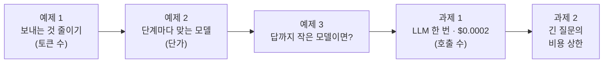
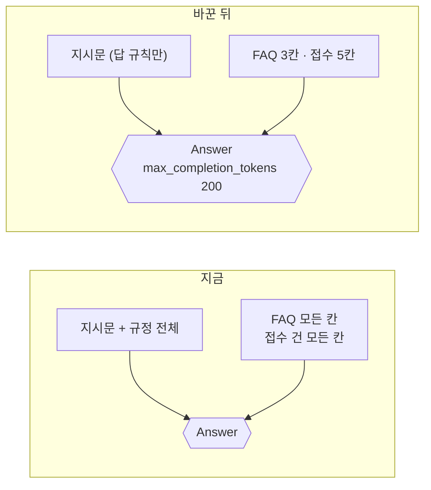
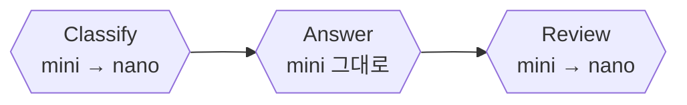
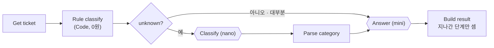
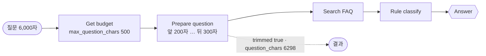

# Lab 02 · 보내는 것 줄이기, 단계마다 맞는 모델, LLM 한 번, 긴 질문의 상한

- 관련 강의: [2단계 · 비용 줄이기](../../Lecture/75/02-STAGE2-REDUCE-COST.md)
- 소요 시간: 50분 (4교시 한 시간) · 예제 1 10분 · 예제 2 8분 · 예제 3 7분 · 과제 1 13분 · 과제 2 12분
- 준비: Lab 01의 `my-work/cost.json` (없으면 `cp reference/lab01-example2-cost.json my-work/cost.json` 후 push. 기록 · `recorded`는 Lab 01 과제를 끝낸 것)
- 목표: 비용을 정하는 세 가지 — **보내는 토큰 수 · 단가 · 호출 수** — 를 한 가지씩 줄이고, 바꿀 때마다 품질 테스트로 확인한다. 싸진 것이 품질을 잃은 것은 아닌지 답을 읽어 보고, 아주 긴 질문에도 비용 상한을 둔다.



> 복사해 붙일 요청문은 없습니다. 막히면 `▶` 를 하나씩 펼칩니다. 바꿀 때마다 `COST.md` 5절에 한 줄.

**비용 = 호출 수 × 호출당 토큰 × 토큰 단가.** 오늘 Lab 02는 이 곱의 세 칸을 하나씩 줄입니다. 한 번에 하나만 바꾸고 다시 재는 것은 72일차 성능 튜닝 · 74일차 버전 관리와 같습니다.

## 예제 1 · 보내는 것 줄이기 (10분)

Lab 01 예제 1에서 `answer` 단계 입력의 대부분이 무엇이었나요?

```bash
uv run tools/flow.py test cases/lab02.json -v          # 고치기 전
```

**만들 것**: 답에 필요한 것만 보내기. 답 길이에도 상한.

| 조건 | 값 |
| --- | --- |
| 지시문 | 사내 규정 전체(참고 자료)를 빼고 답 규칙만 |
| FAQ · 접수 건 | 답에 쓰는 필드만 (FAQ: `id` · `title` · `answer` / 접수: `ticket_id` · `title` · `status` · `note` · `error`) |
| 답 길이 | `max_completion_tokens` 200 |
| 기대 결과 | `cases/lab02.json` 앞 세 케이스 (`answer` 단계 입력 600토큰 이하, 품질 그대로) |

### 이해하기

**"혹시 몰라서" 붙인 글이 비용의 대부분입니다.** `base-cost`의 `Answer`는 지시문 끝에 사내 규정 문서 여덟 개를 통째로 붙입니다. 그런데 지시문은 "FAQ와 접수 건으로만 답하라"고 합니다. 규정 전체는 답을 더 좋게 만들지 못하면서 **질문마다** 함께 보내져, `answer` 단계 입력 약 1,780토큰의 대부분을 차지합니다. Lab 01 예제 3의 "고정비"가 이것입니다.



**필요한 것만 보내는 것이 RAG의 생각입니다.** 71일차에 문서 전체 대신 **질문과 관련된 부분만** 찾아서 보냈습니다. 비용으로 보면 이것도 같은 이야기입니다. 관련 없는 글은 돈만 쓰고, 때로는 모델을 헷갈리게 합니다.

**빼면 안전해지는 것도 있습니다.** 접수 건에는 연락처(`contact`) · 담당자(`assignee`)가 있습니다. 답에 쓰지 않는 칸을 LLM에 보내지 않으면 토큰도 줄고, 73일차처럼 개인정보가 답으로 새어 나갈 길도 하나 줄어듭니다.

**출력에도 상한을 둡니다.** 출력 토큰은 입력보다 비쌉니다 (`gpt-4.1-mini` 4배). `max_completion_tokens`는 답의 최대 길이입니다. 너무 작으면 답이 잘리니, 지시문의 "3문장 이내"와 맞는 값을 둡니다. 오늘 쓰는 두 모델 모두 이 이름을 받습니다 (`gpt-5.4-nano`는 예전 이름 `max_tokens`를 받지 않습니다).

**테스트 케이스 (`lab02.json`).**

| 케이스 | 예제 | 기대 |
| --- | --- | --- |
| VPN · 보내는 양 줄이기 | 1 | `usage.by_step.answer.prompt_tokens` ≤ 600, "인증서" |
| 접수 · 보내는 양 줄이기 | 1 | 같은 상한, "처리 중" |
| 비밀번호 · 품질 그대로 | 1 | "비밀번호 찾기" |
| 분류는 작은 모델 | 2 | `usage.by_step.classify.model` = `gpt-5.4-nano` |
| 프린터 · 품질 그대로 | 2 | "대기열" |

**기대 결과.** 고치기 전: 앞의 두 케이스(입력 1,780토큰쯤)와 예제 2 케이스 ✘. 고친 뒤 앞 세 케이스 ✔ (예제 2 케이스는 아직 ✘). `COST.md` 5절에 `answer` 입력 토큰과 VPN 비용의 전 · 후를 적습니다.

<details><summary>▶ 1단계 · 무엇을 뺐는지 확인</summary>

고친 뒤 `uv run tools/flow.py diff reference/baseline-cost.json my-work/cost.json`으로 `Answer`의 글자 수가 얼마나 줄었는지 봅니다 (74일차 `diff`).
</details>

<details><summary>▶ 2단계 · 규정 전체가 필요한 질문은 없나</summary>

"노트북 교체 주기는?"처럼 FAQ에 없고 규정에만 있는 질문이 오면 어떻게 될까요? 지금 지시문은 그런 질문에 "찾지 못했습니다"라고 하게 돼 있습니다. 규정이 필요하다면 전체가 아니라 71일차처럼 **검색해서 관련 부분만** 보내는 것이 답입니다.
</details>

<details><summary>▶ 빈칸 채우기 · 요청문(프롬프트) 뼈대</summary>

요청문에 꼭 들어갈 것: **① 지시문에서 뺄 것 ② FAQ · 접수 건에서 남길 칸 ③ 답 길이 상한의 이름과 값 ④ 그대로 둘 것 ⑤ 기대 결과**. 아래 빈칸 4개(`____①`~`____④`)를 채워 `my-work/PROMPTS.md`에 쓴 뒤 에이전트에게 보냅니다.

```text
my-work/cost.json 의 Answer 지시문에서 ____① 을 빼고 답 규칙만 남겨 줘.
사용자 메시지에는 질문과, FAQ 는 id · title · ____② 만, 접수 건은 ticket_id · title · status · note · error 만 보내 줘 (contact · assignee 는 빼고).
답 길이 상한은 ____③ 200.
Classify · Review 단계는 ____④ .
기대 결과 cases/lab02.json 앞 세 케이스.
```

빈칸 힌트 (답이 아니라 **어디서 찾고 무엇을 생각하나**):

- ① n8n 화면에서 `Answer` 노드의 본문을 열면 지시문 뒤에 붙은 긴 제목이 보입니다.
- ② FAQ 한 항목(`curl -s 'localhost:8800/faq?q=VPN'`)에서 실제 답 글자가 들어 있는 칸입니다.
- ③ 위 "출력에도 상한을 둡니다"의 이름입니다 (`gpt-5.4-nano`도 받는 이름).
- ④ 한 번에 하나만 바꿉니다. 예제 2에서 바꿀 단계입니다.

채운 요청문은 수업 뒤 공개되는 정답본의 요청문 예와 비교합니다. 노드 이름은 내 파일의 실제 이름을 씁니다.
</details>

```bash
uv run tools/flow.py push my-work/cost.json
uv run tools/flow.py test cases/lab02.json -v
uv run tools/flow.py diff reference/baseline-cost.json my-work/cost.json
```

### 실행 결과 · 보내는 것 줄이기

수업 준비 때(10/28) 강사 노트북에서 정답 워크플로우로 실제로 나온 출력입니다. LLM 문장 · 토큰 · 비용 · 시간은 실행마다 조금씩 다르고, ✔ · ✘는 같아야 합니다.

고치기 전 (Lab 01 과제 2 정답, `test cases/lab02.json -v` 결과 줄)

```text
✘ 예제 1 · VPN · 보내는 양 줄이기 · 3.4s · 자동 답변 · 3 calls · $0.001007 · usage.by_step.answer.prompt_tokens = 1781 (expected 1..600)
✘ 예제 1 · 접수 · 보내는 양 줄이기 · 3.5s · 자동 답변 · 3 calls · $0.000936 · usage.by_step.answer.prompt_tokens = 1791 (expected 1..600)
✔ 예제 1 · 비밀번호 · 품질 그대로 · 3.5s · 자동 답변 · 3 calls · $0.000955
✘ 예제 2 · 분류는 작은 모델 · 3.2s · 자동 답변 · 3 calls · $0.000830 · usage.by_step.classify.model = gpt-4.1-mini (expected gpt-5.4-nano)
✔ 예제 2 · 프린터 · 품질 그대로 · 3.5s · 자동 답변 · 3 calls · $0.000960
Passed 2/5
```

고친 뒤 (결과 줄, `diff`)

```text
✔ 예제 1 · VPN · 보내는 양 줄이기 · 4.7s · 자동 답변 · 3 calls · $0.000346
✔ 예제 1 · 접수 · 보내는 양 줄이기 · 3.2s · 자동 답변 · 3 calls · $0.000284
✔ 예제 1 · 비밀번호 · 품질 그대로 · 3.1s · 자동 답변 · 3 calls · $0.000294
✘ 예제 2 · 분류는 작은 모델 · 2.7s · 자동 답변 · 3 calls · $0.000183 · usage.by_step.classify.model = gpt-4.1-mini (expected gpt-5.4-nano)
✔ 예제 2 · 프린터 · 품질 그대로 · 3.2s · 자동 답변 · 3 calls · $0.000312
Passed 4/5

~ 'Answer' parameters.jsonBody: changed (3491 → 822 chars)
```

**왜 이렇게 나왔나**

- 고치기 전 ✘ 둘: `answer` 입력이 1,781 · 1,791토큰으로 상한 600을 넘었습니다. 규정 전체가 붙어 있기 때문입니다.
- 고친 뒤 `answer` 입력은 VPN 165 · 접수 152 (`-v`의 `usage.by_step.answer`)로 **91% 줄었고**, VPN 비용이 $0.001007 → **$0.000346**. 답의 낱말(인증서 · 처리 중 · 비밀번호 찾기)은 그대로라 품질 케이스도 ✔.
- `diff`가 바뀐 곳을 `Answer` **한 곳**으로 보여 줍니다 (3,491 → 822자). 한 번에 한 칸만 바꿨다는 확인입니다.
- 남은 ✘ 하나(분류 모델)는 예제 2에서 고칠 것이라 **예상한 결과**입니다.

## 예제 2 · 단계마다 맞는 모델 (8분)

**만들 것**: 분류 · 검토 같은 쉬운 단계는 작은 모델(`gpt-5.4-nano`), 답은 지금 모델.

| 조건 | 값 |
| --- | --- |
| 바꿀 곳 | `Classify` · `Review`의 모델 이름 (계산도 그 모델 단가로) |
| 그대로 | `Answer`는 `gpt-4.1-mini` |
| 기대 결과 | `cases/lab02.json` 5/5, `lab01`도 |

### 이해하기

**모든 일에 같은 모델을 쓸 까닭은 없습니다.** 분류는 세 낱말(faq · ticket · other) 중 하나를 고르는 일이고, 검토는 말투를 다듬는 일입니다. 답은 사실(인증서 재발급 · 처리 상태)을 틀리면 안 됩니다. 일의 어려움에 맞춰 모델을 고르는 것을 **모델 라우팅(model routing)** 또는 **계단식 모델(cascade)**이라고 부릅니다.



**단가표를 다시 봅니다.**

| 모델 | 입력 ($/1M) | 출력 ($/1M) | mini 대비 |
| --- | --- | --- | --- |
| `gpt-4.1-mini` | 0.40 | 1.60 | |
| `gpt-5.4-nano` | 0.20 | 1.25 | 입력 절반, 출력 약 0.78배 |

작은 모델이 늘 몇 배씩 싼 것은 아닙니다. 오늘 두 모델은 **입력은 절반, 출력은 조금 쌉니다.** 그래서 입력이 많은 단계일수록 바꾼 효과가 큽니다. 단가는 공급자 · 시기마다 바뀌므로 가격표를 보고 직접 계산해야 합니다.

**74일차를 떠올립니다.** 74일차 릴리스 2.0.0(답까지 nano)은 강한 golden 게이트를 통과했지만, "비용을 본 뒤 배포"로 미뤘습니다. 오늘은 먼저 **쉬운 단계만** 바꾸고, 답까지 바꾸면 얼마나 아끼고 무엇을 잃는지는 예제 3에서 재 봅니다. 한 번에 하나씩입니다.

**기대 결과.** `lab02` 5/5, `lab01` 3/3. VPN 질문 비용이 예제 1보다 조금 더 줄어듭니다. `COST.md` 5절에 한 줄.

<details><summary>▶ 1단계 · 계산도 함께</summary>

모델 이름을 노드에서만 바꾸고 `Build result`의 단계 목록(`steps`)은 그대로 두면 어떻게 될까요? 결과의 `model`은 `gpt-4.1-mini`인데 실제로는 nano를 불렀고, 비용도 mini 단가로 계산됩니다. 74일차 "한 곳에서 정하고 모두 그것을 읽는다"를 떠올립니다.
</details>

<details><summary>▶ 빈칸 채우기 · 요청문(프롬프트) 뼈대</summary>

요청문에 꼭 들어갈 것: **① 바꿀 단계 ② 새 모델 이름 ③ 그대로 둘 단계 ④ 계산이 따라가게 할 것 ⑤ 기대 결과**. 아래 빈칸 4개(`____①`~`____④`)를 채워 `my-work/PROMPTS.md`에 쓴 뒤 에이전트에게 보냅니다.

```text
my-work/cost.json 의 ____① · Review 두 단계의 model 을 ____② 로 바꿔 줘. Answer 는 ____③ .
Build result 의 단계 목록(steps) 의 model 도 같이 바꿔, 비용이 그 모델의 ____④ 로 계산되게.
기대 결과 cases/lab02.json 전체, cases/lab01.json.
```

빈칸 힌트 (답이 아니라 **어디서 찾고 무엇을 생각하나**):

- ① 세 낱말 중 하나를 고르는 쉬운 단계입니다.
- ② `curl -s localhost:8800/prices`에 있는 작은 모델 이름입니다 (AGENTS.md 2절).
- ③ 사실을 틀리면 안 되는 단계입니다. 이 단계를 바꿀지는 예제 3에서 재 보고 정합니다.
- ④ Lab 01 예제 2에서 `/prices`에서 읽은 것입니다.

채운 요청문은 수업 뒤 공개되는 정답본의 요청문 예와 비교합니다. 노드 이름은 내 파일의 실제 이름을 씁니다.
</details>

```bash
uv run tools/flow.py push my-work/cost.json
uv run tools/flow.py test cases/lab02.json -v
uv run tools/flow.py test cases/lab01.json
```

### 실행 결과 · 단계마다 맞는 모델

수업 준비 때(10/28) 강사 노트북에서 정답 워크플로우로 실제로 나온 출력입니다. LLM 문장 · 토큰 · 비용 · 시간은 실행마다 조금씩 다르고, ✔ · ✘는 같아야 합니다.

고친 뒤 (`test cases/lab02.json -v` 결과 줄, `test cases/lab01.json`)

```text
✔ 예제 1 · VPN · 보내는 양 줄이기 · 4.3s · 자동 답변 · 3 calls · $0.000278
✔ 예제 1 · 접수 · 보내는 양 줄이기 · 3.1s · 자동 답변 · 3 calls · $0.000204
✔ 예제 1 · 비밀번호 · 품질 그대로 · 3.6s · 자동 답변 · 3 calls · $0.000244
✔ 예제 2 · 분류는 작은 모델 · 2.7s · 자동 답변 · 3 calls · $0.000144
✔ 예제 2 · 프린터 · 품질 그대로 · 3.7s · 자동 답변 · 3 calls · $0.000270
Passed 5/5

✔ VPN · 비용과 단계별 사용량 · 3.3s · 자동 답변 · 3 calls · $0.000278
✔ 접수 현황 · 비용 · 3.5s · 자동 답변 · 3 calls · $0.000204
✔ 빈 질문은 LLM 없이 · 0.0s
Passed 3/3
```

**왜 이렇게 나왔나**

- 고치기 전은 예제 1의 "고친 뒤"와 같습니다 (4/5, 분류 모델 ✘).
- VPN $0.000346 → **$0.000278** (약 20% 덜). 많이 줄지 않은 것은 분류 · 검토가 입력이 적은 단계이고, nano의 단가가 입력 절반 · 출력 0.78배라서입니다.
- 답은 mini 그대로라 품질 케이스와 `lab01`이 모두 ✔입니다. 비용이 nano 단가로 계산된 것도 줄 끝 금액이 줄어든 것으로 보입니다 (계산의 모델 이름을 함께 바꾸지 않으면 금액이 그대로 나옴).

## 예제 3 · 답까지 작은 모델이면? (7분, 에이전트 없이)

"분류 · 검토가 nano로 잘 되면, 답도 nano로 하면 더 싸지 않나요?" 바꾸기 전에 비교본으로 재 봅니다. `reference/lab02-example3-nano-answer.json`은 예제 2 정답에서 **답 단계만** nano로 바꾼 것입니다 (웹훅 `nano-answer`, 고치지 않음).

```bash
uv run tools/flow.py push reference/lab02-example3-nano-answer.json
uv run tools/flow.py test cases/lab02.json --webhook nano-answer -v     # 통과 수와 답 글자
uv run tools/flow.py test cases/lab01-mix.json                           # 내 것(답 mini) 일곱 질문 비용
uv run tools/flow.py test cases/lab01-mix.json --webhook nano-answer     # 답 nano 일곱 질문 비용
```

`COST.md` 5절 "예제 3" 줄에 통과 수, 일곱 질문 평균 비용 둘, 그리고 **답을 읽고 본 것**을 적습니다.

### 이해하기

**통과했다고 같은 품질은 아닙니다.** 오늘 테스트는 답에 **꼭 있어야 할 낱말**(인증서 · 처리 중 · 대기열)이 있는지만 봅니다. 낱말이 있어도 말투 · 형식 · 군더더기가 달라질 수 있습니다. `-v`로 나온 답 글자를 **사람이 직접 읽어** 봅니다.

| 읽으며 볼 것 | 예 |
| --- | --- |
| 형식 | 메일 · 메신저에 그대로 붙을 글인가 (마크다운 기호 `**`가 섞였나) |
| 군더더기 | 묻지 않은 것을 덧붙였나 ("접수 건은 찾지 못했습니다" 같은 말) |
| 안쪽 말이 새나 | 데이터 API의 오류 글자(`ticket not found`)가 답에 나왔나 |
| 말투 | 합니다체를 지켰나 |

**아끼는 돈과 잃는 것을 같이 적습니다.** 일곱 질문 평균 비용이 얼마나 줄었는지 숫자로 보고, 위 표에서 본 것을 같이 놓고 정합니다. 출력 단가 차이가 크지 않으면(1.60 → 1.25) 답 단계는 바꿔도 많이 아끼지 못합니다. "싸진 만큼 잃은 것"이 더 크면 바꾸지 않는 것이 맞는 결정입니다. 테스트에 형식 검사(`not_contains: ["**"]`)를 더할지도 생각해 봅니다.

**기대 결과.** `lab02 --webhook nano-answer`는 낱말 검사만으로는 대부분 통과합니다. 일곱 질문의 평균 비용 차이는 크지 않고, 답 글자에서 위 표의 차이가 보입니다. 오늘 `my-work/cost.json`의 답은 mini로 둡니다.

<details><summary>▶ 1단계 · 테스트를 더 엄하게 하면</summary>

`cases/lab02.json`을 복사해 `my-work/lab02-strict.json`으로 만들고, 케이스마다 `"not_contains": {"answer": ["**", "ticket not found"]}`를 더해 두 웹훅에 돌려 봅니다. 기대 결과를 **더하는** 것은 괜찮습니다 (원래 테스트를 바꾸는 것은 안 됨).
</details>

<details><summary>▶ 2단계 · 누가 정하나</summary>

이 결정은 에이전트가 아니라 **사람이** 합니다. 숫자(얼마 아끼나)와 답 글자(무엇을 잃나)를 함께 놓고, 74일차처럼 golden 게이트를 지나야 바꿉니다.
</details>

### 실행 결과 · 답까지 작은 모델이면?

수업 준비 때(10/28) 강사 노트북에서 정답 워크플로우로 실제로 나온 출력입니다. LLM 문장 · 토큰 · 비용 · 시간은 실행마다 조금씩 다르고, ✔ · ✘는 같아야 합니다.

`test cases/lab02.json --webhook nano-answer -v` (결과 줄과 답 글자 몇 개)

```text
✔ 예제 1 · VPN · 보내는 양 줄이기 · 5.0s · 자동 답변 · 3 calls · $0.000297
   "answer": "FAQ에 따르면 VPN 접속이 끊길 때는 … 인증서 만료 여부를 확인한 뒤 다시 접속해 보시기 바랍니다. 접수 건은 ticket_id가 없어 상태를 확인할 수 없으며, 요청하신 티켓 기록은 찾지 못했습니다. …"
✔ 예제 1 · 접수 · 보내는 양 줄이기 · 2.8s · 자동 답변 · 3 calls · $0.000190
   "answer": "T-1002의 처리 상태는 **처리 중**이며, **인증서 발급 승인 대기 중**입니다. …"
✔ 예제 1 · 비밀번호 · 품질 그대로 · 3.7s · 자동 답변 · 3 calls · $0.000179
   "answer": "… 휴대폰 인증 후 새 비밀번호를 설정하시면 됩니다. 접수 건은 찾지 못했습니다."
✔ 예제 2 · 분류는 작은 모델 · 3.2s · 자동 답변 · 3 calls · $0.000196
✔ 예제 2 · 프린터 · 품질 그대로 · 3.3s · 자동 답변 · 3 calls · $0.000204
Passed 5/5
```

`lab01-mix` 일곱 질문 (내 것 → `nano-answer`)

```text
FAQ · VPN      $0.000278 → $0.000217
FAQ · 프린터    $0.000270 → $0.000245
FAQ · 비밀번호  $0.000241 → $0.000179
FAQ · 메일      $0.000297 → $0.000209
접수 · T-1002   $0.000204 → $0.000190
접수 · T-1001   $0.000195 → $0.000153
규칙에 없는 질문 $0.000144 → $0.000196
평균           $0.000233 → $0.000198  (약 15% 덜)
```

**왜 이렇게 나왔나**

- 낱말 검사가 **5/5 통과**한 것은 테스트가 "인증서 · 처리 중 · 대기열" 같은 낱말이 있는지만 보기 때문입니다. 그 낱말은 nano 답에도 있습니다.
- 그런데 답을 읽으면 마크다운 `**`, 데이터 API의 칸 이름(`ticket_id`)이 섞인 안쪽 말, 묻지 않은 "접수 건은 찾지 못했습니다"가 있습니다. 테스트가 보지 않는 것이라 통과했습니다.
- 평균이 15%만 준 것은 답 단계의 출력 단가 차이가 크지 않아서입니다 (1.60 → 1.25). 회의실 질문은 nano가 더 길게 답해 오히려 비쌌습니다.
- 그래서 **바꾸지 않는 것**이 이 예제의 결론입니다. 숫자(15%)와 답 글자를 함께 놓고 사람이 정합니다.

## 과제 1 · LLM 한 번, 질문 하나에 $0.0002 이하 (13분)

> "지금도 질문 하나에 $0.0002가 넘어요. 전 직원이 쓰면 부담돼요. FAQ · 접수 질문은 $0.0002 이하로 해 주세요. 답의 내용은 지금과 같아야 합니다."

```bash
uv run tools/flow.py test cases/lab02-challenge.json -v        # 고치기 전
```

| 조건 | 값 |
| --- | --- |
| 분류 | 규칙(Code)으로: 질문에 `T-숫자 4개`면 ticket, FAQ 검색 결과가 있으면 faq, 둘 다 아니면 unknown |
| LLM 분류 | unknown일 때만 `Classify`(nano) |
| 검토 | 뺀다 (답 단계의 지시문이 이미 말투를 정함) |
| 기대 결과 | `cases/lab02-challenge.json` 7개, `lab02` · `lab01` · `lab01-challenge`도 |

### 이해하기

**가장 싼 호출은 하지 않은 호출입니다.** 예제 1 · 2로 호출당 토큰과 단가를 줄였습니다. 남은 것은 **호출 수**입니다. 72일차 성능 튜닝에서 LLM을 줄인 방법 — 규칙으로 정할 수 있는 것은 규칙으로, 코드로 할 수 있는 검사는 코드로 — 이 비용에서도 그대로 통합니다.



**규칙이 모르는 것만 LLM에게.** 질문에 `T-1002`가 있으면 접수 질문이 분명하고, FAQ 검색에 걸리면 FAQ 질문입니다. 이 둘이 아닐 때만 LLM에게 묻습니다. 대부분의 질문은 LLM을 한 번(답)만 부르고, 규칙이 모르는 질문만 두 번입니다.

**검토 단계를 빼도 되나.** 검토는 "합니다체 · 3문장 · 데이터에 없는 말 빼기"를 했습니다. 답 단계의 지시문이 이미 같은 규칙을 말합니다. 같은 일을 두 번 시키는 데 돈을 쓰고 있었는지, 빼고 나서 품질 테스트로 확인합니다. 검토가 정말 필요하다면 LLM 대신 **코드로 검사**할 수 있는 것(길이 · 금지어)부터 찾습니다 (69일차 검토자 Code).

**지나가지 않은 노드는 세지 않습니다.** 규칙으로 분류하면 `Classify`가 실행되지 않습니다. `Build result`가 그 노드를 읽으면 오류가 납니다. 실행됐는지 먼저 보고 읽게 합니다 (AGENTS.md 5절 "그 밖").

**테스트 케이스.**

| 케이스 | 기대 |
| --- | --- |
| FAQ 넷 · 접수 둘 | `llm_calls: 1`, `cost_usd` ≤ 0.0002, 답에 핵심 낱말 |
| 규칙으로 모르는 질문 (회의실 화면 공유) | `llm_calls: 2` (분류 + 답) |

**기대 결과.** 고치기 전(예제 2 정답): 일곱 케이스 모두 ✘ (호출 3번, 비용이 상한을 넘는 것이 대부분). 고친 뒤 7/7, `lab02` 5/5, `lab01` 3/3, `lab01-challenge` 4/4.

<details><summary>▶ 1단계 · 어느 것을 없애나</summary>

세 단계 중 규칙으로 바꿀 수 있는 것은? 다른 단계가 이미 하고 있는 일을 하는 단계는? 남는 하나가 정말 LLM이 필요한 단계입니다.
</details>

<details><summary>▶ 2단계 · 확인 순서</summary>

`lab02-challenge` → `lab02` → `lab01` → `lab01-challenge`. 마지막으로 `flow.py usage`로 기록이 그대로 남는지 (단계가 줄었으니 `calls`도 줄어야 합니다).
</details>

<details><summary>▶ 빈칸 채우기 · 요청문(프롬프트) 뼈대</summary>

요청문에 꼭 들어갈 것: **① 규칙 분류의 세 갈래 ② LLM 분류를 부르는 조건 ③ 뺄 단계 ④ 답 글자를 가져올 곳 ⑤ 지나가지 않은 노드 다루기 ⑥ 기대 결과**. 아래 빈칸 4개(`____①`~`____④`)를 채워 `my-work/PROMPTS.md`에 쓴 뒤 에이전트에게 보냅니다.

```text
my-work/cost.json 의 Get ticket 뒤에 Rule classify(Code) 를 넣어 질문에 T-숫자 4개가 있으면 'ticket', FAQ 검색 결과가 있으면 ' ____① ', 둘 다 아니면 'unknown'.
Known?(If) 로 unknown 일 때만 Classify(nano) → Parse category → Answer, 아니면 바로 Answer.
____② 단계는 빼고, 답은 ____③ 의 글을 그대로 쓴다.
Build result 는 지나간 LLM 단계만 세어 llm_calls 와 비용을 (지나가지 않은 노드는 ____④ 로 확인).
기대 결과 cases/lab02-challenge.json, cases/lab02.json, cases/lab01.json, cases/lab01-challenge.json.
```

빈칸 힌트 (답이 아니라 **어디서 찾고 무엇을 생각하나**):

- ① 분류 세 낱말 중 FAQ 검색에 걸린 질문의 낱말입니다.
- ② 답 단계의 지시문이 이미 하고 있는 일을 다시 하는 단계입니다.
- ③ 이제 LLM 답을 만드는 단 하나의 단계입니다.
- ④ AGENTS.md 5절 "그 밖"의 n8n 표현입니다 (`$('노드').____`).

채운 요청문은 수업 뒤 공개되는 정답본의 요청문 예와 비교합니다. 노드 이름은 내 파일의 실제 이름을 씁니다.
</details>

```bash
uv run tools/flow.py push my-work/cost.json
uv run tools/flow.py test cases/lab02-challenge.json -v
uv run tools/flow.py test cases/lab02.json
uv run tools/flow.py test cases/lab01.json
uv run tools/flow.py test cases/lab01-challenge.json
```

### 실행 결과 · LLM 한 번

수업 준비 때(10/28) 강사 노트북에서 정답 워크플로우로 실제로 나온 출력입니다. LLM 문장 · 토큰 · 비용 · 시간은 실행마다 조금씩 다르고, ✔ · ✘는 같아야 합니다.

고치기 전 (예제 2 정답, `test cases/lab02-challenge.json -v` 결과 줄)

```text
✘ faq-vpn · LLM 한 번 · $0.0002 이하 · 3.0s · 자동 답변 · 3 calls · $0.000278 · llm_calls = 3 (expected 1); cost_usd = 0.00027815 (expected 1e-06..0.0002)
✘ faq-password · LLM 한 번 · $0.0002 이하 · 3.6s · 자동 답변 · 3 calls · $0.000241 · llm_calls = 3 (expected 1); cost_usd = 0.0002407 (expected 1e-06..0.0002)
✘ faq-printer · LLM 한 번 · $0.0002 이하 · 3.5s · 자동 답변 · 3 calls · $0.000267 · llm_calls = 3 (expected 1); cost_usd = 0.0002674 (expected 1e-06..0.0002)
✘ faq-mail · LLM 한 번 · $0.0002 이하 · 3.5s · 자동 답변 · 3 calls · $0.000297 · llm_calls = 3 (expected 1); cost_usd = 0.00029665 (expected 1e-06..0.0002)
✘ ticket-own · LLM 한 번 · $0.0002 이하 · 4.0s · 자동 답변 · 3 calls · $0.000238 · llm_calls = 3 (expected 1); cost_usd = 0.000238 (expected 1e-06..0.0002)
✘ ticket-done · LLM 한 번 · $0.0002 이하 · 3.2s · 자동 답변 · 3 calls · $0.000164 · llm_calls = 3 (expected 1)
✘ 규칙으로 모르는 질문은 분류 + 답 · 3.1s · 자동 답변 · 3 calls · $0.000144 · llm_calls = 3 (expected 2)
Passed 0/7
```

고친 뒤 (결과 줄, 앞의 테스트)

```text
✔ faq-vpn · LLM 한 번 · $0.0002 이하 · 2.8s · 자동 답변 · 1 call · $0.000156
✔ faq-password · LLM 한 번 · $0.0002 이하 · 1.2s · 자동 답변 · 1 call · $0.000138
✔ faq-printer · LLM 한 번 · $0.0002 이하 · 1.2s · 자동 답변 · 1 call · $0.000150
✔ faq-mail · LLM 한 번 · $0.0002 이하 · 1.5s · 자동 답변 · 1 call · $0.000166
✔ ticket-own · LLM 한 번 · $0.0002 이하 · 1.4s · 자동 답변 · 1 call · $0.000115
✔ ticket-done · LLM 한 번 · $0.0002 이하 · 0.9s · 자동 답변 · 1 call · $0.000108
✔ 규칙으로 모르는 질문은 분류 + 답 · 1.5s · 자동 답변 · 2 calls · $0.000097
Passed 7/7

lab02 Passed 5/5 · lab01 Passed 3/3 · lab01-challenge Passed 4/4 (✔ 사용량 요약 · 요청 3건 · $0.000409)
```

**왜 이렇게 나왔나**

- 고치기 전 일곱 모두 ✘: 모든 질문이 3 calls이고, 다섯은 비용도 $0.0002를 넘었습니다. ticket-done($0.000164)은 비용은 통과했지만 호출 수로 ✘입니다.
- 고친 뒤 FAQ · 접수 여섯은 **1 call**: 질문에 `T-1002` 같은 번호가 있거나 FAQ 검색에 걸리면 규칙이 분류해 LLM 분류를 건너뛰고, 검토 단계를 뺐기 때문입니다.
- 회의실 질문은 규칙이 모르므로 작은 모델 분류 + 답으로 **2 calls**입니다. 그래도 $0.000097로 가장 쌉니다 (FAQ · 접수 글을 거의 보내지 않음).
- 호출이 줄어 시간도 3초대 → 1초대입니다. 기록된 질문 3개의 합계는 Lab 01 때 $0.002951에서 **$0.000409**로 약 7분의 1입니다.

## 과제 2 · 아주 긴 질문에도 비용 상한 (12분)

> "어떤 직원이 프린터 로그를 통째로 붙여 넣고 '출력이 안 돼요'라고 물었는데, 그 한 번이 평소 질문의 일곱 배 넘게 들었어요. 누가 일부러 아주 길게 보내면 예산이 금방 바닥나겠어요. 긴 질문도 비용이 정해진 만큼만 들게 해 주세요."

```bash
uv run tools/flow.py call my-cost requests/long-printer.json        # 로그 6,000자 + 끝에 질문
uv run tools/flow.py test cases/lab02-challenge2.json -v            # 고치기 전
```

**만들 것**: 질문이 정해진 글자 수(`max_question_chars`, 사람이 `/budget`에서 정함, 기본 500)보다 길면 **앞 40% + 뒤 60%만** 남기고 가운데를 줄여 LLM에 보내기.

| 조건 | 값 |
| --- | --- |
| 상한 | `GET /budget`의 `max_question_chars` (워크플로우에 숫자를 쓰지 않음) |
| 줄이는 법 | 앞 `floor(상한 × 0.4)`자 + `' … '` + 뒤 나머지 글자 |
| 쓰는 곳 | `Search FAQ`의 `q`, `Rule classify`, `Answer` 모두 줄인 질문 |
| 결과 | 과제 1 결과 + `trimmed` (true/false) + `question_chars` (원래 글자 수) |
| 기대 결과 | `cases/lab02-challenge2.json` 4개, `lab02-challenge`도 그대로 |

### 이해하기

**입력 길이에 비례하는 비용은 누가 정하나.** 비용은 보낸 토큰에 비례합니다. 질문 길이에 상한이 없으면 **한 요청의 비용에도 상한이 없습니다.** 실수(로그 붙여 넣기)든 일부러(73일차 "아주 긴 입력으로 괴롭히기")든, 한 사람이 예산을 혼자 다 쓸 수 있습니다. 예제 1의 `max_completion_tokens`가 **출력**의 상한이었다면, 이것은 **입력**의 상한입니다. 둘이 다 있어야 "한 요청은 최대 얼마"를 말할 수 있습니다.



**왜 앞과 뒤를 남기나.** 사람은 질문을 **앞에** 쓰고 자료를 붙이거나 ("VPN이 끊겨요. 로그는 아래…"), 자료를 붙이고 **끝에** 묻습니다 ("…이런 로그가 나와요. 출력이 안 돼요"). 가운데는 대개 반복되는 로그입니다. 그래서 앞과 뒤를 남깁니다. 테스트 파일에 두 모양이 다 있습니다.

**다른 방법과 비교.**

| 방법 | 비용 | 사용자 | 오늘 |
| --- | --- | --- | --- |
| 거절 (HTTP 413 "너무 김") | 0 | 다시 써야 함 | |
| 앞뒤만 남기기 | 상한 안 | 대개 답을 받음 | ✔ |
| LLM으로 요약한 뒤 답 | 요약 호출이 또 듦 (긴 글 그대로) | 답을 받음 | |

**상한 값은 사람이 정합니다.** 500자는 연습용입니다. 너무 작으면 정상 질문도 잘리고, 너무 크면 상한의 뜻이 없습니다. `flow.py budget --chars 2000`처럼 사람이 바꿉니다. 테스트 마지막 케이스가 "사람이 상한을 늘리면 자르지 않는다"를 확인합니다.

**테스트 케이스.**

| 케이스 | 보내는 것 | 기대 |
| --- | --- | --- |
| 긴 로그 + 끝에 질문 · 프린터 | 6,298자 | `trimmed` true, `llm_calls` 1, `cost_usd` ≤ 0.0003, "대기열" |
| 앞에 질문 + 긴 로그 · VPN | 6,103자 | 같은 기대, "인증서" |
| 짧은 질문은 그대로 | VPN 24자 | `trimmed` false, `question_chars` 24, "인증서" |
| 사람이 상한을 늘리면 자르지 않음 | `before`가 상한 10000, 프린터 로그 | `trimmed` false, "대기열" |

긴 질문의 상한이 $0.0003인 까닭: 질문을 500자로 줄여도 FAQ · 답(출력)의 비용은 그대로 듭니다. 줄인 질문 500자만큼이 짧은 질문보다 더 듭니다.

**기대 결과.** 고치기 전(과제 1 정답): 긴 질문 두 케이스가 비용 상한을 넘고 (`trimmed`도 없음), 나머지 두 케이스도 `trimmed` · `question_chars`가 없어 ✘ (0/4). 고친 뒤 4/4, `lab02-challenge` 7/7. `COST.md` 5절에 긴 로그 질문의 비용 전 · 후.

<details><summary>▶ 1단계 · 얼마나 드나</summary>

`call my-cost requests/long-printer.json`의 `usage.by_step.answer.prompt_tokens`와 `cost_usd`를 짧은 질문(`faq-printer`)과 비교합니다. 몇 배인가요?
</details>

<details><summary>▶ 2단계 · 상한은 어디서</summary>

예제 · 과제마다 "바뀌는 값은 밖에서 읽기"였습니다. 오늘 사람이 정하는 값(예산 · 한도 · 글자 수)은 모두 `GET /budget`에 있습니다 (`curl -s localhost:8800/budget`). Lab 03 예제 1에서도 같은 노드를 씁니다.
</details>

<details><summary>▶ 빈칸 채우기 · 요청문(프롬프트) 뼈대</summary>

요청문에 꼭 들어갈 것: **① 상한을 읽는 곳 ② 줄이는 법 ③ 줄인 질문을 쓸 곳 ④ 결과 칸 ⑤ 기대 결과**. 아래 빈칸 4개(`____①`~`____④`)를 채워 `my-work/PROMPTS.md`에 쓴 뒤 에이전트에게 보냅니다.

```text
my-work/cost.json 의 Has question? 뒤에 Get budget(HTTP GET http://data-api:8800/budget) 을, Get prices 뒤에 Prepare question(Code) 을 넣어 줘.
질문이 Get budget 의 ____① 보다 길면 앞 40% 와 뒤 ____② % 만 남기고 가운데를 ' … ' 로 줄여 줘.
Search FAQ 의 q, Rule classify, Answer 는 모두 원래 질문 대신 ____③ 의 question 을 쓰게.
결과에 trimmed(true/false) 와 ____④ (원래 글자 수) 를 더해 줘.
기대 결과 cases/lab02-challenge2.json, cases/lab02-challenge.json.
```

빈칸 힌트 (답이 아니라 **어디서 찾고 무엇을 생각하나**):

- ① `curl -s localhost:8800/budget`에서 글자 수 상한을 뜻하는 칸입니다.
- ② 앞이 40%면 뒤는?
- ③ 줄인 질문을 만드는 새 노드의 이름입니다.
- ④ `cases/lab02-challenge2.json`의 "짧은 질문은 그대로" 케이스가 보는 칸입니다.

채운 요청문은 수업 뒤 공개되는 정답본의 요청문 예와 비교합니다. 노드 이름은 내 파일의 실제 이름을 씁니다.
</details>

```bash
uv run tools/flow.py push my-work/cost.json
uv run tools/flow.py test cases/lab02-challenge2.json -v
uv run tools/flow.py test cases/lab02-challenge.json
```

### 실행 결과 · 긴 질문의 비용 상한

수업 준비 때(10/28) 강사 노트북에서 정답 워크플로우로 실제로 나온 출력입니다. LLM 문장 · 토큰 · 비용 · 시간은 실행마다 조금씩 다르고, ✔ · ✘는 같아야 합니다.

고치기 전 (과제 1 정답, `test cases/lab02-challenge2.json -v` 결과 줄)

```text
✘ 긴 로그 + 끝에 질문 · 프린터 · 1.3s · 자동 답변 · 1 call · $0.001196 · trimmed = null (expected true); cost_usd = 0.001196 (expected 1e-06..0.0003)
✘ 앞에 질문 + 긴 로그 · VPN · 1.4s · 자동 답변 · 1 call · $0.001099 · trimmed = null (expected true); cost_usd = 0.0010992 (expected 1e-06..0.0003)
✘ 짧은 질문은 그대로 · 1.2s · 자동 답변 · 1 call · $0.000156 · trimmed = null (expected false); question_chars = null (expected 24)
✘ 사람이 한도를 늘리면 자르지 않음 · 1.2s · 자동 답변 · 1 call · $0.001196 · trimmed = null (expected false)
Passed 0/4
```

고친 뒤

```text
✔ 긴 로그 + 끝에 질문 · 프린터 · 2.3s · 자동 답변 · 1 call · $0.000237
✔ 앞에 질문 + 긴 로그 · VPN · 1.1s · 자동 답변 · 1 call · $0.000260
✔ 짧은 질문은 그대로 · 1.1s · 자동 답변 · 1 call · $0.000141
✔ 사람이 한도를 늘리면 자르지 않음 · 1.3s · 자동 답변 · 1 call · $0.001196
Passed 4/4

lab02-challenge Passed 7/7
```

**왜 이렇게 나왔나**

- 고치기 전 긴 로그 질문은 **$0.001196** — 같은 프린터 질문을 짧게 물을 때($0.000150)의 약 8배입니다. 6,000자 넘는 로그가 그대로 FAQ 검색 · 답 단계에 들어갔기 때문입니다.
- 고친 뒤 **$0.000237 · $0.000260**: 질문을 앞 200자 + 뒤 300자로 줄여 보냈습니다. 프린터는 질문이 끝에, VPN은 앞에 있어서 둘 다 남았고, 답에 "대기열" · "인증서"가 그대로 나왔습니다.
- 그래도 짧은 질문($0.000141 ~ 0.000156)보다 비싼 것은 줄인 500자만큼의 입력과, 답(출력) · FAQ 몫이 그대로 들기 때문입니다. 그래서 기대가 $0.0002가 아니라 $0.0003입니다.
- 마지막 케이스는 `before`가 상한을 10000으로 늘려 자르지 않았고, 비용도 고치기 전과 같은 $0.001196입니다. 상한 값을 **사람이** 정한다는 것을 보여 줍니다. 테스트의 `after`가 상한을 500으로 되돌립니다.

## 막혔을 때

| 증상 | 할 일 |
| --- | --- |
| 줄였더니 답이 짧게 잘림 | `max_completion_tokens`가 너무 작음, 또는 지시문의 "3문장 이내"와 맞지 않음 |
| OpenAI 400 `Unsupported parameter: 'max_tokens'` | `max_completion_tokens`로 (`check`가 알려 줌) |
| nano 단계 비용이 mini로 계산됨 | `Build result`의 단계 목록 모델 이름 |
| 접수 답에 "처리 중"이 없음 | 줄인 필드에 `status` · `note`가 남아 있는지 |
| 규칙으로 건너뛴 단계에서 오류 | 지나가지 않은 노드는 `isExecuted`로 확인 |
| 긴 질문이 그대로 감 | `Search FAQ` · `Answer`가 원래 질문(`body.question`)을 읽고 있지 않은지 |
| 테스트 뒤 상한이 그대로 10000 | `uv run tools/flow.py budget --reset` |
| 계속 안 됨 | `reference/lab02-example1-lean.json`, `reference/lab02-example2-models.json` |

## 확인

- [ ] 예제 1: `cases/lab02.json` 앞 세 케이스, `answer` 입력 토큰 전 · 후.
- [ ] 예제 2: `cases/lab02.json` 5/5, `lab01`도 통과.
- [ ] 예제 3: `nano-answer`의 통과 수 · 평균 비용 · 답을 읽고 본 것, 바꿀지 결정과 까닭.
- [ ] 과제 1: `cases/lab02-challenge.json` 7/7, `lab02` · `lab01` · `lab01-challenge` 통과.
- [ ] 과제 2: `cases/lab02-challenge2.json` 4/4, 긴 로그 질문 비용 전 · 후.
- [ ] `COST.md` 5절 (잃은 것도).
