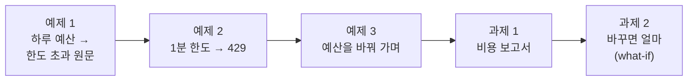
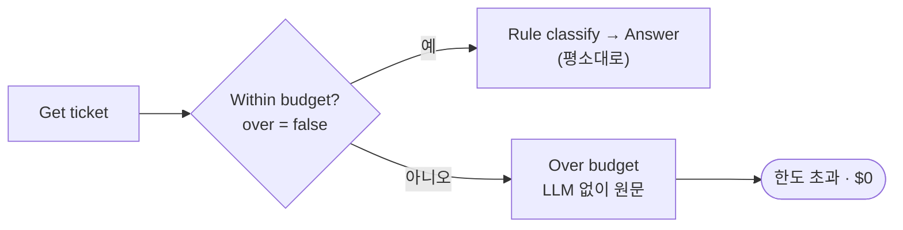
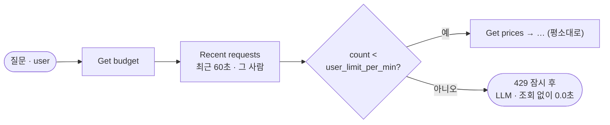
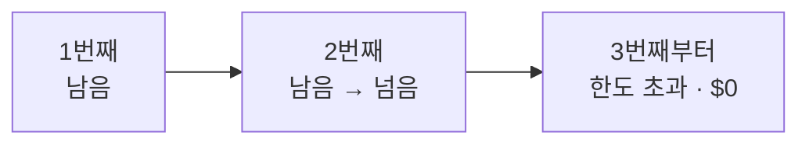
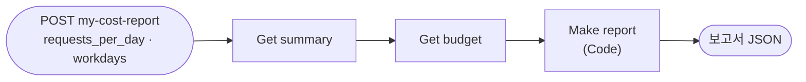
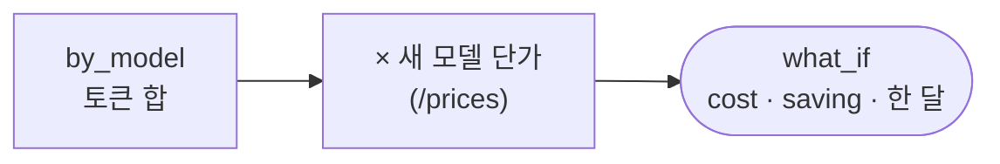

# Lab 03 · 하루 예산, 사용자별 한도, 비용 보고서, 바꾸면 얼마

- 관련 강의: [3단계 · 예산과 한도](../../Lecture/75/03-STAGE3-BUDGET-AND-LIMITS.md)
- 소요 시간: 50분 (6교시 한 시간) · 예제 1 10분 · 예제 2 10분 · 예제 3 7분 · 과제 1 13분 · 과제 2 10분
- 준비: Lab 02의 `my-work/cost.json` (없으면 `cp reference/lab02-example2-models.json my-work/cost.json` 후 push. LLM 한 번 · 긴 질문 상한은 Lab 02 과제를 끝낸 것)
- 목표: 비용이 **넘치지 않게** 한다. 하루 예산을 넘으면 LLM 없이 답하고, 한 사람이 몰아서 부르면 잠시 막고, 예산을 바꿔 가며 언제 멈추는지 보고, 지금까지의 사용량으로 한 달 비용과 "모델을 바꾸면 얼마"를 계산한다.



> 예산 · 한도 값은 **사람이** 정합니다 (`uv run tools/flow.py budget --daily 0.5`). 테스트 파일은 `before`로 바꾸고 `after`로 처음 상태(`/budget/reset`, `/usage-clear`)로 되돌립니다. 손으로 바꿨다면 끝에 `uv run tools/flow.py budget --reset`.

## 예제 1 · 하루 예산 (10분)

```bash
uv run tools/flow.py budget                          # daily_usd · used_usd · over
uv run tools/flow.py test cases/lab03.json -v        # 고치기 전
```

**만들 것**: LLM을 부르기 전에 오늘 예산을 보고, 넘었으면 **LLM 없이** 데이터 그대로 답하기.

| 조건 | 값 |
| --- | --- |
| 확인 | `Get budget`(Lab 02 과제 2에서 넣은 노드)의 `over` |
| 넘었을 때 | `route: 한도 초과`, `llm_calls: 0`, `cost_usd: 0`, 접수 건이면 상태 · 메모, FAQ면 첫 FAQ 원문 + "(오늘 자동 답변 한도를 넘어 … 안내합니다.)" |
| 기대 결과 | `cases/lab03.json` |

### 이해하기

**예산은 "얼마까지 쓰나"를 사람이 정한 것입니다.** Lab 01 과제에서 기록을 쌓았으니, 데이터 API는 오늘 쓴 돈(`used_usd` = 기록된 `cost_usd`의 합)을 압니다. 사람이 정한 하루 예산(`daily_usd`)을 넘으면 `over: true`. 워크플로우는 LLM을 부르기 **전에** 이것을 봅니다.



**멈추는 대신 낮춰서 답합니다.** 예산을 넘었다고 "오늘은 끝"이라고 하면 직원은 아무 도움도 못 받습니다. FAQ 원문과 접수 상태는 **데이터 API가 이미 갖고 있어서** LLM 없이도 줄 수 있습니다. 문장이 덜 다듬어졌을 뿐 내용은 같습니다. 이것을 **우아한 저하(graceful degradation)**라고 합니다.

**72일차의 대체 답과 무엇이 다른가.**

| | 72일차 | 오늘 |
| --- | --- | --- |
| 언제 | LLM이 **멈췄을 때** | LLM은 멀쩡한데 **쓰지 않기로** 했을 때 |
| 누가 정하나 | 장애가 | 사람이 정한 예산이 |
| `route` | `간단 답변` | `한도 초과` |

같은 모양의 Code를 다시 쓸 수 있지만 `route`는 다르게 둡니다. 나중에 로그를 보는 사람이 "장애였나, 예산이었나"를 가를 수 있어야 하기 때문입니다.

**테스트 케이스.**

| 케이스 | `before` | 기대 |
| --- | --- | --- |
| 한도를 넘으면 · FAQ 원문 | 예산 $0.001, 이미 $0.002 쓴 기록 한 줄 | `한도 초과`, `cost_usd` 0, `llm_calls` 0, "인증서" |
| 한도를 넘으면 · 접수 원문 | (같은 상태) | `한도 초과`, "처리 중" |
| 한도 안이면 평소대로 | 처음 상태로 | `자동 답변`, 비용 $0.0002 이하 |

**기대 결과.** 고치기 전: 넘은 상태에서도 `자동 답변`이라 앞 두 케이스 ✘. 고친 뒤 3/3.

<details><summary>▶ 1단계 · 어디에 두나</summary>

예산 확인은 LLM보다 **앞에**, FAQ · 접수 조회보다는 **뒤에** 둡니다. 왜일까요? (원문으로 답하려면 무엇이 먼저 있어야 하나요?)
</details>

<details><summary>▶ 2단계 · 예산을 어디서 세나</summary>

`used_usd`는 기록된 `cost_usd`의 합입니다 (Lab 01 과제). Lab 01 과제 2의 `recorded: false`인 요청은 여기에 들어가지 않습니다. 기록이 빠질수록 예산은 실제보다 남아 보입니다.
</details>

<details><summary>▶ 빈칸 채우기 · 요청문(프롬프트) 뼈대</summary>

요청문에 꼭 들어갈 것: **① 넣을 곳과 보는 값 ② 넘었을 때 답의 재료 ③ 결과의 route · 호출 수 · 비용 ④ 평소 갈래는 그대로 ⑤ 기대 결과**. 아래 빈칸 4개(`____①`~`____④`)를 채워 `my-work/PROMPTS.md`에 쓴 뒤 에이전트에게 보냅니다.

```text
my-work/cost.json 의 Get ticket 뒤에 Within budget?(If) 을 넣어 Get budget 의 ____① 이 false 일 때만 Rule classify 로, 넘었으면 Over budget(Code) → Send over budget.
Over budget 은 LLM 없이: 접수 건이 있으면 그 상태 · 메모, FAQ 가 있으면 첫 FAQ 의 ____② 원문에 "(오늘 자동 답변 한도를 넘어 FAQ 원문으로 안내합니다.)" 를 붙여.
결과는 route ' ____③ ', llm_calls 0, cost_usd ____④ , usage 의 토큰도 0.
기대 결과 cases/lab03.json.
```

빈칸 힌트 (답이 아니라 **어디서 찾고 무엇을 생각하나**):

- ① `uv run tools/flow.py budget -v`의 응답에서 넘었는지를 true/false로 주는 칸입니다.
- ② FAQ 한 항목에서 답 글자가 든 칸입니다 (Lab 02 예제 1에서 남긴 세 칸 중 하나).
- ③ AGENTS.md 3절 `route` 세 가지 중 예산을 넘었을 때의 것입니다.
- ④ LLM을 부르지 않았으니?

채운 요청문은 수업 뒤 공개되는 정답본의 요청문 예와 비교합니다. 노드 이름은 내 파일의 실제 이름을 씁니다.
</details>

```bash
uv run tools/flow.py push my-work/cost.json
uv run tools/flow.py test cases/lab03.json -v
```

### 실행 결과 · 하루 예산

수업 준비 때(10/28) 강사 노트북에서 정답 워크플로우로 실제로 나온 출력입니다. LLM 문장 · 토큰 · 비용 · 시간은 실행마다 조금씩 다르고, ✔ · ✘는 같아야 합니다.

고치기 전 (Lab 02 과제 2 정답, `budget` · `test cases/lab03.json -v` 결과 줄)

```text
budget $1.0 / used $0.006822 · remaining $0.993178 · over False · per user 20/min · question 500 chars
✘ 한도를 넘으면 · FAQ 원문 · 1.1s · 자동 답변 · 1 call · $0.000154 · route = 자동 답변 (expected 한도 초과); cost_usd = 0.000154 (expected 0); llm_calls = 1 (expected 0)
✘ 한도를 넘으면 · 접수 원문 · 1.2s · 자동 답변 · 1 call · $0.000115 · route = 자동 답변 (expected 한도 초과); cost_usd = 0.0001152 (expected 0)
✔ 한도 안이면 평소대로 · 1.4s · 자동 답변 · 1 call · $0.000141
Passed 1/3
```

고친 뒤

```text
✔ 한도를 넘으면 · FAQ 원문 · 1.0s · 한도 초과 · 0 calls · $0.000000
✔ 한도를 넘으면 · 접수 원문 · 0.2s · 한도 초과 · 0 calls · $0.000000
✔ 한도 안이면 평소대로 · 1.6s · 자동 답변 · 1 call · $0.000156
Passed 3/3
```

**왜 이렇게 나왔나**

- 첫 `budget` 줄의 `used $0.006822`는 앞 실습에서 쌓인 기록입니다. 테스트의 `before`가 기록을 비우고 예산을 $0.001로, 이미 $0.002를 쓴 한 줄을 넣어 "넘은 상태"를 만듭니다.
- 고치기 전 앞 두 케이스 ✘: 넘은 상태인데도 `자동 답변`으로 LLM을 불렀습니다 (1 call · $0.000154). 워크플로우가 예산을 보지 않기 때문입니다.
- 고친 뒤 **`한도 초과 · 0 calls · $0`**: LLM 앞에서 `over`를 보고, FAQ 원문 · 접수 상태를 그대로 보냈습니다. LLM을 부르지 않아 시간도 0.2 ~ 1.0초입니다.
- 세 번째 케이스는 `before`가 처음 상태로 되돌려 평소대로 답합니다 ($0.000156). 테스트의 `after`가 예산 · 기록을 처음 상태로 되돌립니다.

## 예제 2 · 사용자별 1분 한도 (10분)

```bash
uv run tools/flow.py test cases/lab03-limit.json -v        # 고치기 전
```

**만들 것**: 같은 사람이 1분에 `user_limit_per_min`번을 넘게 부르면 HTTP 429로 잠시 막기. 다른 사람은 그대로.

| 조건 | 값 |
| --- | --- |
| 센다 | `GET /usage/user/<이름>?window=60`의 `count` (기록된 요청 수) |
| 넘었을 때 | HTTP 429 `{route: 잠시 후, answer, retry_after: 60, llm_calls: 0, cost_usd: 0}` |
| 기대 결과 | `cases/lab03-limit.json` (한도 2: 이준호 세 번째가 429), `lab03` · `lab02-challenge`도 |

### 이해하기

**하루 예산은 모두의 것입니다.** 한 사람이 스크립트로 1분에 수백 번 부르거나, 같은 질문을 계속 고쳐 묻으면 하루 예산이 오전에 바닥납니다. 그러면 나머지 직원은 오후 내내 `한도 초과` 원문만 받습니다. 그래서 **사람마다** 짧은 시간의 한도를 둡니다. 이것을 **속도 제한(rate limiting)**이라고 합니다.



**429는 "잠시 후 다시"라는 약속입니다.** HTTP 429 `Too Many Requests`는 "너무 자주 부른다"는 표준 응답이고, `retry_after`(또는 `Retry-After` 헤더)로 몇 초 뒤에 다시 부르면 되는지 알려 줍니다. 부르는 쪽 프로그램은 이것을 보고 기다렸다가 다시 시도할 수 있습니다 (72일차 재시도).

**가장 앞에 둡니다.** 한도를 넘은 요청에는 FAQ · 접수 조회도, LLM도 할 까닭이 없습니다. 맨 앞에서 바로 돌려보내면 **0원 · 0.0초**입니다. 예제 1의 예산 확인이 "조회 뒤, LLM 앞"이었던 것과 다릅니다. 원문 답이 필요 없기 때문입니다.

**고정 창과 이동 창.** "최근 60초 동안 몇 번"을 세는 방식을 **이동 창(sliding window)**이라고 합니다. "매 분 0초부터 몇 번"은 고정 창입니다. 고정 창은 59초와 61초에 몰아서 부르면 짧은 사이에 두 배를 부를 수 있습니다. 데이터 API의 `/usage/user/<이름>?window=60`은 이동 창으로 셉니다.

**테스트 케이스.**

| 케이스 | 기대 |
| --- | --- |
| 이준호 1번째 | 200 |
| 이준호 2번째 (다른 질문) | 200 |
| 이준호 3번째 · 1분에 2번 넘음 | 429, `잠시 후`, `cost_usd` 0, **1초 안** |
| 다른 사람은 그대로 (한지훈) | 200 |

`before`가 한도를 2로 낮추고, `after`가 처음 상태(한도 20)로 되돌립니다.

**기대 결과.** 고치기 전: 세 번째 케이스 ✘ (200). 고친 뒤 4/4, `lab03` 3/3, `lab02-challenge` 7/7.

<details><summary>▶ 1단계 · 기록이 있어야 셉니다</summary>

`count`는 **기록된** 요청 수입니다. 이준호의 1 · 2번째 요청이 `/usage`에 기록되지 않으면 세 번째도 통과합니다. `uv run tools/flow.py usage`로 이준호의 줄이 쌓이는지 봅니다.
</details>

<details><summary>▶ 2단계 · 한도의 값</summary>

1분 2번은 연습용입니다. 실제로는 몇 번이 좋을까요? 사람이 한 질문을 고쳐 다시 묻는 경우, 여러 사람이 공용 계정 하나로 묻는 경우도 생각합니다. `COST.md` 6절에 까닭과 함께 적습니다.
</details>

<details><summary>▶ 빈칸 채우기 · 요청문(프롬프트) 뼈대</summary>

요청문에 꼭 들어갈 것: **① 세는 창의 길이 ② 비교할 한도 ③ 넘었을 때의 응답 코드와 본문 ④ 그 갈래에서 하지 않는 것 ⑤ 기대 결과**. 아래 빈칸 4개(`____①`~`____④`)를 채워 `my-work/PROMPTS.md`에 쓴 뒤 에이전트에게 보냅니다.

```text
my-work/cost.json 의 Get budget 바로 뒤(가장 앞)에 Recent requests(HTTP GET http://data-api:8800/usage/user/<user>?window= ____① ) 를 넣어 줘.
Under user limit?(If) 로 count 가 Get budget 의 ____② 보다 작으면 Get prices 로, 아니면 Too many(Respond, HTTP ____③ ).
Too many 의 본문은 {route: '잠시 후', answer, retry_after: 60, llm_calls: 0, cost_usd: 0}. 이 갈래는 FAQ · 접수 조회도 ____④ .
기대 결과 cases/lab03-limit.json, cases/lab03.json, cases/lab02-challenge.json.
```

빈칸 힌트 (답이 아니라 **어디서 찾고 무엇을 생각하나**):

- ① "1분"을 초로.
- ② `uv run tools/flow.py budget`에 나오는 "per user …/min"의 칸 이름입니다 (`-v`로 JSON).
- ③ "너무 자주 부른다"는 표준 응답 코드입니다.
- ④ 맨 앞에서 돌려보내는 까닭입니다.

채운 요청문은 수업 뒤 공개되는 정답본의 요청문 예와 비교합니다. 노드 이름은 내 파일의 실제 이름을 씁니다.
</details>

```bash
uv run tools/flow.py push my-work/cost.json
uv run tools/flow.py test cases/lab03-limit.json -v
uv run tools/flow.py test cases/lab03.json
uv run tools/flow.py test cases/lab02-challenge.json
```

### 실행 결과 · 사용자별 1분 한도

수업 준비 때(10/28) 강사 노트북에서 정답 워크플로우로 실제로 나온 출력입니다. LLM 문장 · 토큰 · 비용 · 시간은 실행마다 조금씩 다르고, ✔ · ✘는 같아야 합니다.

고치기 전 (예제 1 정답, `test cases/lab03-limit.json -v` 결과 줄)

```text
✔ 이준호 1번째 · 1.3s · 자동 답변 · 1 call · $0.000156
✔ 이준호 2번째 · 1.6s · 자동 답변 · 1 call · $0.000152
✘ 이준호 3번째 · 1분에 2번 넘음 · 1.3s · 자동 답변 · 1 call · $0.000156 · took 1.3s (expected at most 1s); status 200 (expected 429); route = 자동 답변 (expected 잠시 후); cost_usd = 0.0001556 (expected 0)
✔ 다른 사람은 그대로 · 1.2s · 자동 답변 · 1 call · $0.000136
Passed 3/4
```

고친 뒤 (결과 줄, 앞의 테스트)

```text
✔ 이준호 1번째 · 2.1s · 자동 답변 · 1 call · $0.000141
✔ 이준호 2번째 · 1.6s · 자동 답변 · 1 call · $0.000150
✔ 이준호 3번째 · 1분에 2번 넘음 · 0.0s · 잠시 후 · 0 calls · $0.000000
✔ 다른 사람은 그대로 · 1.9s · 자동 답변 · 1 call · $0.000136
Passed 4/4

lab03 Passed 3/3 · lab02-challenge Passed 7/7
```

**왜 이렇게 나왔나**

- `before`가 한도를 2로 낮췄습니다. 고치기 전 이준호의 세 번째도 200 · 1.3초 · 돈을 썼습니다. 한도를 보지 않기 때문입니다.
- 고친 뒤 세 번째는 **429 · 잠시 후 · 0.0초 · $0**: 가장 앞에서 "이준호의 최근 60초 요청 수(2) ≥ 한도(2)"를 보고 바로 돌려보냈습니다. FAQ · 접수 조회도 LLM도 하지 않아 0.0초입니다.
- 1 · 2번째가 셀 수 있었던 것은 Lab 01 과제의 **기록** 덕분입니다. 기록이 없으면 세 번째도 통과합니다.
- 한지훈은 따로 세므로 그대로 200입니다. 앞에 노드를 더해도 `lab03` · `lab02-challenge`가 그대로라 평소 동작은 바뀌지 않았습니다.

## 예제 3 · 예산을 바꿔 가며 보기 (7분, 에이전트 없이)

예산을 아주 작게 정하고 질문 여섯 개를 차례로 보냅니다. 몇 번째부터 멈추고, 멈출 때까지 얼마를 썼나요?

```bash
uv run tools/flow.py budget --daily 0.0003       # 사람이 예산을 정함
uv run tools/flow.py test cases/lab03-drill.json  # 여섯 질문, 줄마다 route · 호출 수 · 비용
uv run tools/flow.py usage                        # 쓴 돈 · 예산 · route별
uv run tools/flow.py budget --reset               # 처음 상태 ($1.0)
uv run tools/flow.py test cases/lab03-drill.json  # 같은 여섯 질문을 다시
uv run tools/flow.py usage --clear
```

`COST.md` 6절 "예제 3"에 몇 번째부터 `한도 초과`였는지, 예산을 얼마나 넘었는지 적습니다.

### 이해하기

**예산은 넘은 뒤에 멈춥니다.** 예제 1의 워크플로우는 "지금까지 쓴 돈이 예산 이상이면" 멈춥니다. 예산이 조금 남아 있으면 다음 질문은 평소대로 답하고, 그 질문의 비용만큼 예산을 **넘습니다.** 그래서 실제로 쓴 돈은 "예산 + 마지막 한 건"까지 갑니다.



**넘지 않게 하려면.** "남은 금액이 한 건의 최대 비용보다 적으면 멈춘다"로 바꾸면 넘지 않습니다. 이것이 가능하려면 **한 건의 최대 비용**을 알아야 합니다. Lab 02 과제 2의 입력 상한(`max_question_chars`)과 예제 1의 출력 상한(`max_completion_tokens`)이 그것을 정합니다. 상한이 있어야 예산도 지킬 수 있습니다.

**`한도 초과` 답은 기록에 없습니다.** `usage`의 `route`별 합계에는 `자동 답변`만 보입니다. 한도 초과 답은 LLM을 부르지 않아 기록할 호출이 없기 때문입니다. 그러면 "오늘 몇 명이 원문만 받았나"를 셀 수 없습니다. 운영에서는 이것도 세어야 예산이 적절했는지 판단합니다 (77일차 로그).

**기대 결과.** 예산 $0.0003에서는 앞의 한두 질문만 `자동 답변`이고 나머지는 `한도 초과 · 0 calls · $0`. `usage`의 사용액이 예산을 조금 넘습니다. `--reset` 뒤에는 여섯 모두 `자동 답변`.

<details><summary>▶ 1단계 · 하루가 바뀌면</summary>

오늘 데이터 API의 `used_usd`는 기록 전체의 합입니다 (연습용). 실제로는 "오늘 0시부터"를 셉니다. 날짜가 바뀌면 누가 0으로 돌릴까요? 사람이 매일 `--clear`를 하면 될까요?
</details>

<details><summary>▶ 2단계 · 예산은 누가 정하나</summary>

예산은 기술이 아니라 **결정**입니다. 한 달 예산을 22일로 나눈 값, 지난달 기록의 평균 × 1.2, 사용자 수 × 한 사람 몫 등 근거를 정해 `COST.md` 6절에 적습니다. 과제 1의 보고서가 그 근거를 줍니다.
</details>

### 실행 결과 · 예산을 바꿔 가며

수업 준비 때(10/28) 강사 노트북에서 정답 워크플로우로 실제로 나온 출력입니다. LLM 문장 · 토큰 · 비용 · 시간은 실행마다 조금씩 다르고, ✔ · ✘는 같아야 합니다.

예산 $0.0003 (`budget --daily 0.0003` → `test cases/lab03-drill.json` → `usage`)

```text
budget $0.0003 / used $0.000934 · remaining $-0.000634 · over True · per user 20/min · question 500 chars
✔ 1번째 · VPN · 1.1s · 자동 답변 · 1 call · $0.000141
✔ 2번째 · 프린터 · 1.0s · 자동 답변 · 1 call · $0.000152
✔ 3번째 · 비밀번호 · 1.3s · 자동 답변 · 1 call · $0.000136
✔ 4번째 · 메일 · 0.1s · 한도 초과 · 0 calls · $0.000000
✔ 5번째 · 접수 · 0.1s · 한도 초과 · 0 calls · $0.000000
✔ 6번째 · VPN 다시 · 0.0s · 한도 초과 · 0 calls · $0.000000
Passed 6/6

requests 3 · calls 3 · tokens in 498 / out 144 · $0.000430
  route  자동 답변             3 calls · in     498 · out    144 · $0.000430
budget $0.0003 / used $0.000430 · remaining $-0.000130 · over True · per user 20/min · question 500 chars
```

`budget --reset` ($1.0) 뒤 같은 테스트

```text
✔ 1번째 · VPN · 1.4s · 자동 답변 · 1 call · $0.000141
✔ 2번째 · 프린터 · 1.2s · 자동 답변 · 1 call · $0.000152
✔ 3번째 · 비밀번호 · 1.6s · 자동 답변 · 1 call · $0.000136
✔ 4번째 · 메일 · 1.8s · 자동 답변 · 1 call · $0.000166
✔ 5번째 · 접수 · 1.4s · 자동 답변 · 1 call · $0.000133
✔ 6번째 · VPN 다시 · 1.5s · 자동 답변 · 1 call · $0.000156
Passed 6/6
```

**왜 이렇게 나왔나**

- 첫 줄의 `used $0.000934`는 앞 단계에서 남은 기록이라 이미 넘어 보입니다. 테스트의 `before`가 기록을 비우고 시작하므로 실제로는 0부터 셉니다.
- 1 · 2번째까지 $0.000293으로 예산 $0.0003 **아래**라서 3번째도 평소대로 답했고, 그 뒤 합이 $0.000430이 되어 **예산을 $0.00013(43%) 넘었습니다.** 예산을 넘은 **뒤에** 멈추기 때문입니다.
- 4번째부터는 `한도 초과 · $0`입니다. `usage`의 route별 합계에 `자동 답변` 세 줄만 있는 것은 한도 초과 답이 LLM을 부르지 않아 기록할 호출이 없어서입니다.
- `--reset` 뒤에는 예산 $1.0이라 여섯 모두 `자동 답변`입니다. 끝나면 `usage --clear`로 기록을 비웁니다.

## 과제 1 · 비용 보고서 워크플로우 (13분)

> "매달 초에 이번 달 AI 비용이 얼마나 나올지 물어봐요. 지금까지 쓴 걸로 한 달 예상, 모델별 · 사람별로 누가 많이 쓰는지, 예산은 얼마나 남았는지 버튼 하나로 알려 주세요."

```bash
uv run tools/flow.py test cases/lab03-challenge.json -v        # 고치기 전 (웹훅이 없음)
```

| 조건 | 값 |
| --- | --- |
| 파일 · 웹훅 | `my-work/cost-report.json` · `my-cost-report` (새 워크플로우, [AGENTS.md](AGENTS.md) 3절) |
| 읽는 곳 | `/usage/summary`, `/budget` |
| 계산 | Code가 (LLM 없이). 금액은 소수 6자리에서 반올림 |
| 기대 결과 | `cases/lab03-challenge.json` (`before`가 알려진 사용량 4줄을 넣음 → 숫자가 정확히 맞아야 함) |

### 이해하기

**보고서의 숫자는 코드가 계산합니다.** 이 보고서에 LLM이 필요할까요? 합계 · 평균 · 곱셈은 코드가 **틀리지 않고 · 공짜로 · 늘 같게** 합니다. LLM에게 계산을 맡기면 틀릴 수도, 돈도 듭니다. LLM은 숫자를 **설명하는** 일에 씁니다 (79일차).



**계산은 넷입니다.**

```text
avg_usd             = cost_usd ÷ requests            (요청 수. calls 아님)
projected_month_usd = avg_usd × requests_per_day × workdays   (requests_per_day가 없으면 지금 요청 수, workdays 기본 22)
top_user            = by_user 에서 cost_usd 가 가장 큰 사람
remaining_usd       = 예산 − 쓴 돈 (/budget)
```

**먼저 손으로 계산합니다 (3분).** `cases/lab03-challenge.json`의 `before`가 넣는 네 줄을 열어 봅니다. 요청은 몇 개(`request_id`가 다른 것)? 호출은? 비용 합은? 하루 100건 · 22일이면 한 달은? 가장 많이 쓴 사람은? 손 계산이 테스트의 기대값과 맞으면, 에이전트에게 무엇을 요청할지 분명해집니다.

**정확한 숫자를 테스트합니다.** 지금까지의 테스트는 LLM 답이라 `contains`(낱말) · `range`(범위)였습니다. 이 보고서는 입력이 정해져 있으면 결과도 **정확히** 하나입니다. 그래서 `equals`로 소수점까지 봅니다. 0.0019890000001처럼 나오면 실패하므로 반올림 자리를 계약대로 맞춥니다.

**테스트 케이스.**

| 케이스 | 기대 |
| --- | --- |
| 요약 숫자 | `requests`, `calls`, `cost_usd`, `avg_usd`, `top_user` |
| 모델별 · 한 달 예상 | `projected_month_usd`, `by_model`의 mini 몫 |
| 작은 모델 몫 | `by_model`의 nano 몫 |
| 예산 남은 금액 | `daily_budget_usd`, `remaining_usd`, `over_budget` false |
| 예산을 넘으면 | `before`가 예산을 $0.001로 → `over_budget` true |

**기대 결과.** 고치기 전: 웹훅이 없어 5개 모두 ✘ (404). 고친 뒤 5/5. 그다음 실제 사용량으로 `call my-cost-report '{"requests_per_day": 1000}'`.

<details><summary>▶ 1단계 · LLM이 필요한가</summary>

필요 없습니다. Code 노드 하나가 두 API의 응답을 읽어 계산합니다. LLM 노드를 넣으면 테스트의 `equals`가 흔들립니다.
</details>

<details><summary>▶ 2단계 · 숫자가 조금 다르면</summary>

`requests`(요청 수)와 `calls`(호출 수)를 헷갈리면 평균이 크게 달라집니다. 반올림을 평균에 먼저 하고 곱하면 한 달 예상이 조금 달라집니다 (반올림은 마지막에).
</details>

<details><summary>▶ 빈칸 채우기 · 요청문(프롬프트) 뼈대</summary>

요청문에 꼭 들어갈 것: **① 새 파일 · 웹훅 ② 읽을 두 곳 ③ 평균의 분모 ④ 일하는 날 기본값 ⑤ 반올림 ⑥ LLM 없이 ⑦ 기대 결과**. 아래 빈칸 4개(`____①`~`____④`)를 채워 `my-work/PROMPTS.md`에 쓴 뒤 에이전트에게 보냅니다.

```text
my-work/cost-report.json 에 새 워크플로우: 웹훅 ____① 에서 Get summary(GET http://data-api:8800/usage/summary) → Get budget(GET http://data-api:8800/budget) → Make report(Code) → Send report.
avg_usd = cost_usd ÷ ____② (calls 아님). projected_month_usd = avg_usd × requests_per_day × workdays (기본 ____③ , requests_per_day 가 없으면 지금 요청 수).
top_user 는 by_user 에서 cost_usd 가 가장 큰 사람. by_model 은 모델마다 cost_usd. 금액은 소수 ____④ 자리에서 반올림 (반올림은 마지막에). LLM 은 쓰지 않는다.
결과 칸은 AGENTS.md 3절 비용 보고서. 기대 결과 cases/lab03-challenge.json.
```

빈칸 힌트 (답이 아니라 **어디서 찾고 무엇을 생각하나**):

- ① `cases/lab03-challenge.json`의 맨 위 `webhook` 값입니다.
- ② 요약에서 `request_id`가 다른 것을 센 칸입니다.
- ③ AGENTS.md 3절 비용 보고서의 `workdays` 기본값입니다.
- ④ AGENTS.md 3절 "비용 보고서의 금액은 …"의 자리입니다.

채운 요청문은 수업 뒤 공개되는 정답본의 요청문 예와 비교합니다. 노드 이름은 내 파일의 실제 이름을 씁니다.
</details>

```bash
uv run tools/flow.py push my-work/cost-report.json
uv run tools/flow.py test cases/lab03-challenge.json -v
uv run tools/flow.py test cases/lab02-challenge.json                      # 실제 사용량 일곱 건을 쌓고
uv run tools/flow.py call my-cost-report '{"requests_per_day": 1000}'     # 그 평균으로 한 달
```

### 실행 결과 · 비용 보고서

수업 준비 때(10/28) 강사 노트북에서 정답 워크플로우로 실제로 나온 출력입니다. LLM 문장 · 토큰 · 비용 · 시간은 실행마다 조금씩 다르고, ✔ · ✘는 같아야 합니다.

고치기 전 (`test cases/lab03-challenge.json -v` 결과 줄)

```text
✘ 요약 숫자 · 0.0s · status 404 (expected 200); requests = null (expected 3); calls = null (expected 4); cost_usd = null (expected 0.001989); avg_usd = null (expected 0.000663); top_user = null (expected 박서연)
✘ 모델별 · 한 달 예상 · 0.0s · status 404 (expected 200); projected_month_usd = null (expected 1.4586); by_model has none of ['"gpt-4.1-mini": 0.001944']
✘ 작은 모델 몫 · 0.0s · status 404 (expected 200); by_model has none of ['"gpt-5.4-nano": 4.5e-05']
✘ 예산 남은 금액 · 0.0s · status 404 (expected 200); daily_budget_usd = null (expected 1.0); remaining_usd = null (expected 0.998011); over_budget = null (expected false)
✘ 예산을 넘으면 · 0.0s · status 404 (expected 200); over_budget = null (expected true)
Passed 0/5
```

고친 뒤 (결과 줄, 실제 사용량으로 `call`)

```text
✔ 요약 숫자 · 0.8s · $0.001989
✔ 모델별 · 한 달 예상 · 0.0s · $0.001989
✔ 작은 모델 몫 · 0.1s · $0.001989
✔ 예산 남은 금액 · 0.0s · $0.001989
✔ 예산을 넘으면 · 0.1s · $0.001989
Passed 5/5

$ uv run tools/flow.py test cases/lab02-challenge.json          # 실제 일곱 건을 쌓음 (7/7)
$ uv run tools/flow.py call my-cost-report '{"requests_per_day": 1000}'
HTTP 200 · 0.1s
  "requests": 7,
  "cost_usd": 0.000889,
  "avg_usd": 0.000127,
  "top_user": "이준호",
  "projected_month_usd": 2.795257,
```

**왜 이렇게 나왔나**

- 고치기 전 다섯 모두 **404**: `my-cost-report` 웹훅이 아직 없기 때문입니다 (새 워크플로우).
- 고친 뒤 숫자가 손 계산과 **정확히** 같습니다: 네 줄 중 `request_id`가 다른 것 3 · 줄 4 · 합 $0.001989 · 평균 0.001989 ÷ 3 = $0.000663 · 100건 × 22일 = $1.4586. Code가 계산해서 늘 같은 값이고, 그래서 `equals`로 소수점까지 시험할 수 있습니다.
- 줄 끝 `$0.001989`는 보고서 결과의 `cost_usd`(넣은 기록의 합)입니다. 보고서는 LLM을 부르지 않으므로 calls 표시가 없습니다.
- 실제 사용량(과제 1 정답의 일곱 질문)으로는 평균 $0.000127, 하루 1,000건이면 **한 달 $2.80**입니다. Lab 01 예제 3의 어림 $20.8의 약 7분의 1입니다.

## 과제 2 · 모델을 바꾸면 얼마? (10분)

> "답까지 전부 작은 모델로 바꾸면 한 달에 얼마 아끼는지, 바꾸기 전에 숫자로 보고 싶어요. 보고서에서 모델 이름만 넣으면 계산해 주세요."

```bash
uv run tools/flow.py test cases/lab03-challenge2.json -v       # 고치기 전 (과제 1 정답)
```

**만들 것**: 보고서 본문에 `what_if_model`이 있으면, 기록된 **모든 호출의 토큰**을 그 모델의 단가로 다시 계산해 `what_if`에.

| 조건 | 값 |
| --- | --- |
| 입력 | 과제 1 + `what_if_model` (예: `gpt-5.4-nano`) |
| 계산 | 입력 토큰 합 × 그 모델 input + 출력 토큰 합 × output, ÷ 1,000,000 |
| 결과 | 과제 1 + `what_if: {model, cost_usd, saving_usd, projected_month_usd}` |
| 없는 모델 | HTTP 400 `{error: "unknown model", model, known: [...]}` |
| 기대 결과 | `cases/lab03-challenge2.json` 5개, `lab03-challenge`도 그대로 |

### 이해하기

**바꾸기 전에 계산합니다.** 모델을 바꾸는 것은 74일차처럼 릴리스 · 게이트를 거치는 일입니다. 그 전에 "바꾸면 얼마 아끼나"를 알면 **해 볼 만한지** 정할 수 있습니다. 기록에는 모델마다 입력 · 출력 토큰이 있으니, 단가만 바꿔 다시 곱하면 됩니다. 이렇게 "만약 ~라면"을 계산하는 것을 **what-if 분석**이라고 합니다.



**이 숫자를 그대로 믿으면 안 되는 까닭.** what-if는 **같은 토큰 수**를 가정합니다. 실제로는 다릅니다.

| 가정 | 실제 (Lab 02 예제 3) |
| --- | --- |
| 토큰 수가 같다 | 모델마다 답 길이 · 토큰 나누는 법이 다름 |
| 품질이 같다 | 낱말 검사는 통과해도 형식 · 군더더기가 달라짐 |

그래서 what-if는 "**아끼는 돈의 대략**"이고, 바꿀지는 품질 게이트(74일차)로 정합니다. 반대로 "아끼는 돈이 음수"가 나오면(더 비싼 모델) 바꿀 까닭이 없다는 것이 바로 보입니다. 테스트에 그런 케이스도 있습니다.

**모르는 이름은 막습니다.** 단가표에 없는 모델 이름이 오면 0원으로 계산해 "100% 아낀다"는 거짓 숫자를 내기 쉽습니다. 74일차 "없는 릴리스는 400"처럼, 모르는 이름은 400과 알려진 목록으로 돌려보냅니다.

**테스트 케이스.**

| 케이스 | 본문 | 기대 |
| --- | --- | --- |
| 모두 nano였다면 | `what_if_model` nano, 100건 · 22일 | `what_if`의 네 칸이 정확히 |
| 원래 숫자는 그대로 | (같음) | `cost_usd` · `projected_month_usd`가 과제 1과 같음 |
| 모두 mini였다면 · 아끼는 돈이 음수 | `what_if_model` mini | `saving_usd` 음수 |
| 없는 모델은 400 | `gpt-9` | 400, `unknown model`, `known`에 nano |
| what_if 없이 부르면 과제 1과 같음 | `{}` | `what_if` 없음 |

**기대 결과.** 고치기 전(과제 1 정답): nano · mini 케이스와 400 케이스 ✘ (`what_if` 없음, 200), "원래 숫자는 그대로"와 마지막 케이스는 ✔ (2/5). 고친 뒤 5/5, `lab03-challenge` 5/5. 실제 사용량으로 `call`해 `COST.md` 7절을 채웁니다.

<details><summary>▶ 1단계 · 먼저 손으로</summary>

`before`의 네 줄에서 입력 토큰 합 · 출력 토큰 합을 구하고, nano 단가(입력 0.20 · 출력 1.25)로 곱해 봅니다. 그 값이 `what_if.cost_usd`입니다.
</details>

<details><summary>▶ 2단계 · 400은 어디서</summary>

Code 노드는 HTTP 상태를 정하지 못합니다. Code가 `error`를 담아 내보내면, 뒤의 If가 갈라 400을 보내는 Respond로 잇습니다 (74일차 "없는 릴리스는 400"과 같은 모양).
</details>

<details><summary>▶ 빈칸 채우기 · 요청문(프롬프트) 뼈대</summary>

요청문에 꼭 들어갈 것: **① 다시 계산할 때 쓰는 값 ② 아끼는 돈의 식 ③ 없는 모델의 응답 ④ what_if 가 없을 때 ⑤ 기대 결과**. 아래 빈칸 4개(`____①`~`____④`)를 채워 `my-work/PROMPTS.md`에 쓴 뒤 에이전트에게 보냅니다.

```text
my-work/cost-report.json 의 Get budget 뒤에 Get prices(GET http://data-api:8800/prices) 를 넣어 줘.
본문에 what_if_model 이 있으면 Make report 에서 by_model 의 prompt_tokens · completion_tokens 합을 그 모델의 ____① 로 다시 계산해
what_if: {model, cost_usd, saving_usd, projected_month_usd} 를 더해 줘. saving_usd = 지금 cost_usd − ____② .
단가표에 없는 모델이면 Known model?(If) 로 갈라 HTTP ____③ {error: 'unknown model', model, known}.
what_if_model 이 없으면 결과는 과제 1 과 ____④ .
기대 결과 cases/lab03-challenge2.json, cases/lab03-challenge.json.
```

빈칸 힌트 (답이 아니라 **어디서 찾고 무엇을 생각하나**):

- ① `/prices`에서 모델마다 주는 두 숫자입니다.
- ② 새 모델로 계산한 비용의 칸 이름입니다 (`what_if.____`).
- ③ 74일차 "없는 릴리스"와 같은 응답 코드입니다.
- ④ 과제 1의 테스트가 그대로 통과해야 합니다.

채운 요청문은 수업 뒤 공개되는 정답본의 요청문 예와 비교합니다. 노드 이름은 내 파일의 실제 이름을 씁니다.
</details>

```bash
uv run tools/flow.py push my-work/cost-report.json
uv run tools/flow.py test cases/lab03-challenge2.json -v
uv run tools/flow.py test cases/lab03-challenge.json
uv run tools/flow.py test cases/lab02-challenge.json
uv run tools/flow.py call my-cost-report '{"requests_per_day": 1000, "what_if_model": "gpt-5.4-nano"}'
```

마지막으로 `COST.md` 6 · 7절, [테스트 보고서](templates/TEST-REPORT-TEMPLATE.md)를 `my-work/TEST-REPORT.md`로 채웁니다.

### 실행 결과 · 모델을 바꾸면 얼마

수업 준비 때(10/28) 강사 노트북에서 정답 워크플로우로 실제로 나온 출력입니다. LLM 문장 · 토큰 · 비용 · 시간은 실행마다 조금씩 다르고, ✔ · ✘는 같아야 합니다.

고치기 전 (과제 1 정답, `test cases/lab03-challenge2.json -v` 결과 줄)

```text
✘ 모두 nano였다면 · 0.0s · $0.001989 · what_if.model = null (expected gpt-5.4-nano); what_if.cost_usd = null (expected 0.00117); what_if.saving_usd = null (expected 0.000819); what_if.projected_month_usd = null (expected 0.858)
✔ 원래 숫자는 그대로 · 0.1s · $0.001989
✘ 모두 mini였다면 · 아끼는 돈이 음수 · 0.0s · $0.001989 · what_if.cost_usd = null (expected 0.002016); what_if.saving_usd = null (expected -2.7e-05)
✘ 없는 모델은 400 · 0.0s · $0.001989 · status 200 (expected 400); error = null (expected unknown model); known has none of ['gpt-5.4-nano']
✔ what_if 없이 부르면 과제 1과 같음 · 0.0s · $0.001989
Passed 2/5
```

고친 뒤 (결과 줄, 실제 사용량으로 `call`)

```text
✔ 모두 nano였다면 · 0.9s · $0.001989
✔ 원래 숫자는 그대로 · 0.1s · $0.001989
✔ 모두 mini였다면 · 아끼는 돈이 음수 · 0.0s · $0.001989
✔ 없는 모델은 400 · 0.2s
✔ what_if 없이 부르면 과제 1과 같음 · 0.0s · $0.001989
Passed 5/5

lab03-challenge Passed 5/5 · lab02-challenge Passed 7/7
$ uv run tools/flow.py call my-cost-report '{"requests_per_day": 1000, "what_if_model": "gpt-5.4-nano"}'
  "requests": 7,
  "cost_usd": 0.000929,
  "projected_month_usd": 2.920971,
  "what_if": { "model": "gpt-5.4-nano", "cost_usd": 0.00061, "saving_usd": 0.00032, "projected_month_usd": 1.9162 }
```

**왜 이렇게 나왔나**

- 고치기 전 "원래 숫자"와 "what_if 없이" 둘은 ✔입니다. 과제 1 정답이 원래 숫자를 이미 맞게 내기 때문입니다. 나머지는 `what_if` 칸이 없고, 모르는 모델 `gpt-9`도 200으로 그냥 답해서 ✘입니다.
- 고친 뒤 nano: 입력 합 3,600 × 0.20 + 출력 합 360 × 1.25 = $0.00117, 아끼는 돈 $0.001989 − $0.00117 = **$0.000819**. mini: $0.002016로 지금보다 비싸 아끼는 돈이 **음수**(−$0.000027)입니다 — 넣은 기록 중 하나가 이미 nano였기 때문입니다.
- `gpt-9`는 단가표에 없어 **400**과 알려진 목록이 나왔습니다. 0원으로 계산했다면 "100% 아낀다"는 거짓 숫자가 나왔을 것입니다.
- 실제 일곱 건으로는 nano였다면 $0.000929 → $0.00061 (**34% 덜**), 한 달 $2.92 → $1.92입니다. 같은 토큰 수를 가정한 숫자라, Lab 02 예제 3에서 실제로 답 단계만 바꿔 잰 15% · 나빠진 형식과 함께 봐야 합니다.

## 막혔을 때

| 증상 | 할 일 |
| --- | --- |
| 예산을 넘겼는데 그대로 답함 | 예산 확인이 LLM보다 앞에 있는지, `over`를 읽는지 |
| 한도 초과 답에 FAQ가 없음 | 예산 확인이 `Search FAQ` · `Get ticket` **뒤**에 있는지 |
| 429가 안 남 | 기록(`Record usage`)이 되고 있는지 (`flow.py usage`), `count`와 한도를 비교하는 순서 |
| 테스트 뒤에도 429 · 한도 초과 | `uv run tools/flow.py budget --reset`, `uv run tools/flow.py usage --clear` |
| 보고서 숫자가 조금 다름 | 반올림 자리 · 순서, `requests`와 `calls` |
| `by_model.gpt-4.1-mini`가 없다고 나옴 | 이름에 점이 있어 경로로 못 읽습니다. 테스트는 `contains`로 JSON 글자를 찾습니다 (AGENTS.md 8절) |
| what-if 400이 200으로 감 | Code가 `error`를 내보내고, If가 그것으로 가르는지 |
| 계속 안 됨 | `reference/lab03-example1-budget.json`, `reference/lab03-example2-limit.json` |

## 확인

- [ ] 예제 1: `cases/lab03.json` 3/3.
- [ ] 예제 2: `cases/lab03-limit.json` 4/4, `lab03` · `lab02-challenge`도 통과.
- [ ] 예제 3: 예산 $0.0003에서 몇 번째부터 멈추는지, 예산을 얼마나 넘었는지, `--reset`으로 되돌림.
- [ ] 과제 1: `cases/lab03-challenge.json` 5/5, 내 사용량의 한 달 예상.
- [ ] 과제 2: `cases/lab03-challenge2.json` 5/5, 실제 사용량의 what-if와 믿으면 안 되는 까닭.
- [ ] `COST.md`, `TEST-REPORT.md`.
