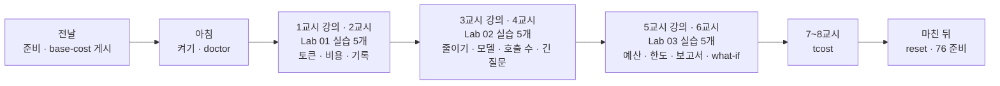
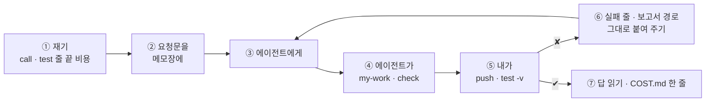

# 75일차 수강 안내 · 수업 준비부터 마칠 때까지

- 일자: 2026-10-29 (목) · 75일차
- 주제: 컴퓨팅 자원 · API 사용량 관리와 비용 최적화 (재기 · 줄이기 · 예산과 한도)
- 실습 폴더: [Last3Mon/75](README.md) · 강의 자료: [Lecture/75](../../Lecture/75/README.md)
- 환경: 65일차 n8n 2.42.6 + **OpenAI API 키만**(`gpt-4.1-mini`, `gpt-5.4-nano`) + **75일차 판 데이터 API**(단가 · 사용량 기록 · 예산 · 한도) + CLI 코딩 에이전트 하나. **Ollama는 쓰지 않습니다.**
- 이 문서: 오늘 하루 내가 할 일을 수업 준비부터 마칠 때까지 순서대로 모은 수강 안내입니다. 수업 중에도 띄워 두고 어디까지 왔는지 확인하세요.



## 0. 하루 한눈에

| 교시 | 시간 | 할 일 | 문서 | 끝났다는 표시 |
| --- | --- | --- | --- | --- |
| 전날 | 약 10분 | 자료 받기 · n8n · 75일차 데이터 API · `base-cost` 게시 · doctor | [PREP](../../Lecture/75/00-DAY75-PREP.md) | `ready` |
| 1 | 09:00~09:50 | 개요 · 1단계 강의 (사용량 재기) | [개요](../../Lecture/75/00-DAY75-OVERVIEW.md) 1~14장, [1단계](../../Lecture/75/01-STAGE1-MEASURE-USAGE.md) | |
| 2 | 10:00~10:50 | Lab 01 실습 5개 (예제 1~3 · 과제 1~2) | [Lab 01](LAB-01-Q-MEASURE-USAGE.md) | `lab01-challenge` · `lab01-challenge2` 통과 |
| 3 | 11:00~11:50 | 2단계 강의 (비용 줄이기) | 개요 15~21장, [2단계](../../Lecture/75/02-STAGE2-REDUCE-COST.md) | |
| 4 | 12:00~12:50 | Lab 02 실습 5개 | [Lab 02](LAB-02-Q-REDUCE-COST.md) | `lab02-challenge` 7/7 · `lab02-challenge2` 4/4 |
| - | 13:00~14:00 | 점심 | | |
| 5 | 14:00~14:50 | 3단계 강의 (예산과 한도) | 개요 22~28장, [3단계](../../Lecture/75/03-STAGE3-BUDGET-AND-LIMITS.md) | |
| 6 | 15:00~15:50 | Lab 03 실습 5개 | [Lab 03](LAB-03-Q-BUDGET-AND-LIMITS.md) | `lab03-challenge` · `lab03-challenge2` 통과, `budget --reset` |
| 7 | 16:00~16:50 | 바이브 코딩 `tcost`: 요청서 → TODO → SPEC → IMP-PLAN → 만들기 → 설치 | [VIBE-REQ-TCOST](VIBE-REQ-TCOST.md) → [VIBE-Q-TCOST](VIBE-Q-TCOST.md) | `Doc/*.md` · R1~R3 · R5 · R6 · R8 · R13 · R14 · `pytest` |
| 8 | 17:00~17:50 | 바이브 코딩 발표 · **4단계 정리** (오늘의 의미 · 효과 · 회사에서 쓰는 법) · 76일차 예고 | [4단계 정리](../../Lecture/75/04-STAGE4-WRAPUP.md), [진행](../../Lecture/75/05-VIBE-CODING.md) | 최종 프로젝트 체크리스트 |

## 1. 전날 준비 (약 10분)

### 1.1 자료 받기

```bash
cd ~/aio-01d4-stu && git pull
```

### 1.2 n8n과 **75일차** 데이터 API 켜기 (Ollama는 끔)

```bash
sudo systemctl disable --now ollama 2>/dev/null   # WSL에 설치한 Ollama가 있으면 끄고 자동 시작도 끔
cd ~/aio-01d4-stu/Last3Mon/65/n8n
docker compose rm -sf ollama                      # Ollama 컨테이너가 있으면 지움 (없으면 그냥 지나감)
docker compose start
cd ~/aio-01d4-stu/Last3Mon/75/data-api
docker compose up -d --force-recreate             # 74일차 판을 75일차 판(+ 단가 · 사용량 기록 · 예산 · 한도)으로 바꿈
sleep 3                                           # 데이터 API가 뜰 때까지
curl -s localhost:8800/prices
```

- 74일차 연습을 되돌리지 않았다면: `cd ~/aio-01d4-stu/Last3Mon/74 && uv run tools/flow.py fault prompts ok`. 릴리스 · 카나리는 데이터 API를 새로 띄우면 처음으로 돌아갑니다.

### 1.3 기준 게시 · 준비 확인

```bash
cd ~/aio-01d4-stu/Last3Mon/75
uv run tools/flow.py push reference/baseline-cost.json
uv run tools/flow.py call base-cost requests/faq-vpn.json     # usage.by_step 이 보이면 됨 (약 $0.001)
uv run tools/flow.py doctor        # 마지막 줄 ready
```

### 1.4 미리 읽기 (선택, 5분)

[PREP 3절](../../Lecture/75/00-DAY75-PREP.md): 질문 하나에 얼마가 들까? 어디에 가장 많이 들까? 그리고 7교시 [요청서](VIBE-REQ-TCOST.md).

### 준비물

노트북과 충전기, WSL의 Docker, WSL 창 두 개, 브라우저, 72일차 `~/vibe/tbench` · 74일차 `~/vibe/tver` (없어도 됨).

## 2. 수업 당일 아침 (09:00 전)

1. 노트북을 껐다 켰다면 1.2를 다시 합니다 (기록 · 예산은 처음으로 돌아갑니다 — 괜찮음).
2. 터미널 두 개, 둘 다 `cd ~/aio-01d4-stu/Last3Mon/75`. ① 에이전트(`codex`/`claude`/`agy`), ② 확인(`call`·`push`·`test`·`usage`·`budget`).
3. 터미널 ②에서 `uv run tools/flow.py doctor` → `ready`, `uv run tools/flow.py budget`.
4. `cp templates/COST-PLAN-TEMPLATE.md my-work/COST.md`, `my-work/PROMPTS.md`.

## 3. 실습할 때마다 같은 순서 (오늘은 "재기 → 줄이기 → 품질 확인")



- 예산 · 한도 · 글자 수 상한은 **내가** `flow.py budget`으로 정합니다. 끝나면 `uv run tools/flow.py budget --reset`.
- 테스트 줄 끝의 `· 자동 답변 · 1 call · $0.000156`이 오늘의 숫자입니다.
- `fault usage error`(Lab 01 과제 2)는 끝나면 **반드시 되돌립니다** (`fault usage ok`).

## 4. 1~2교시 · 1단계 · 사용량 재기

1교시는 강의, 2교시는 [Lab 01](LAB-01-Q-MEASURE-USAGE.md) (50분, 실습 5개).

| 순서 | 할 일 | 파일 · 웹훅 | 확인 (터미널 ②) |
| --- | --- | --- | --- |
| 예제 1 (10분, 에이전트 없이) | 자원 · 단계별 토큰 · 단가 | `base-cost` | `docker stats --no-stream`, `call base-cost requests/faq-vpn.json` · `ticket-own.json`, `curl -s localhost:8800/prices` → `COST.md` 1 · 2절 |
| 예제 2 (12분) | 단계마다 `cost_usd`, 단가는 `/prices`에서 | `cp reference/baseline-cost.json my-work/cost.json` → 웹훅 `my-cost`로 | `push my-work/cost.json` → `test cases/lab01.json -v` |
| 예제 3 (8분, 에이전트 없이) | 일곱 질문의 비용, 한 달 어림 | (그대로) | `test cases/lab01-mix.json` → `COST.md` 3절 |
| 과제 1 (10분) | 요청마다 `/usage`에 기록 (`request_id`) | `my-work/cost.json` 고치기 | `test cases/lab01-challenge.json -v`, `usage` |
| 과제 2 (10분) | 먼저 겪기: `fault usage slow` → `call` → `fault usage ok`. 그다음 기록이 멈춰도 답은 나감 (`recorded`) | `my-work/cost.json` 고치기 | `test cases/lab01-challenge2.json -v` (자동으로 고장 켜고 끔), `lab01-challenge`, `doctor` |

(명령 앞에는 모두 `uv run tools/flow.py`가 붙습니다.)

## 5. 3~4교시 · 2단계 · 비용 줄이기

3교시는 강의, 4교시는 [Lab 02](LAB-02-Q-REDUCE-COST.md) (50분, 실습 5개).

| 순서 | 할 일 | 확인 |
| --- | --- | --- |
| 예제 1 (10분) | 규정 전체를 빼고, FAQ · 접수 건은 필요한 칸만, `max_completion_tokens` 200 | `test cases/lab02.json -v` (전 · 후), `diff reference/baseline-cost.json my-work/cost.json` |
| 예제 2 (8분) | 분류 · 검토를 `gpt-5.4-nano`, 답은 mini | `test cases/lab02.json -v`, `test cases/lab01.json` |
| 예제 3 (7분, 에이전트 없이) | 답까지 nano인 비교본: 통과 수 · 평균 비용 · **답 읽기** | `push reference/lab02-example3-nano-answer.json`, `test cases/lab02.json --webhook nano-answer -v`, `test cases/lab01-mix.json` (내 것 · `--webhook nano-answer`) |
| 과제 1 (13분) | 규칙 분류, 모를 때만 LLM 분류, 검토 빼기 → LLM 한 번 · $0.0002 | `test cases/lab02-challenge.json -v`, `lab02` · `lab01` · `lab01-challenge` |
| 과제 2 (12분) | 긴 질문은 앞 40% + 뒤 60%만 (`max_question_chars`) | `call my-cost requests/long-printer.json`, `test cases/lab02-challenge2.json -v`, `lab02-challenge` |

## 6. 5~6교시 · 3단계 · 예산과 한도

5교시는 강의, 6교시는 [Lab 03](LAB-03-Q-BUDGET-AND-LIMITS.md) (50분, 실습 5개).

| 순서 | 할 일 | 확인 |
| --- | --- | --- |
| 예제 1 (10분) | 예산을 넘으면 LLM 없이 원문 (`한도 초과`) | `budget`, `test cases/lab03.json -v` (전 · 후) |
| 예제 2 (10분) | 같은 사람이 1분에 한도를 넘으면 429 (가장 앞에서) | `test cases/lab03-limit.json -v`, `lab03` · `lab02-challenge` |
| 예제 3 (7분, 에이전트 없이) | 예산 $0.0003으로 여섯 질문, 몇 번째부터 멈추나 | `budget --daily 0.0003` → `test cases/lab03-drill.json` → `usage` → `budget --reset` → 다시 → `usage --clear` |
| 과제 1 (13분) | 비용 보고서 `my-cost-report` (LLM 없이 Code가 계산) | `push my-work/cost-report.json` → `test cases/lab03-challenge.json -v`, `test cases/lab02-challenge.json` → `call my-cost-report '{"requests_per_day": 1000}'` |
| 과제 2 (10분) | `what_if_model`로 "모두 이 모델이면 얼마", 없는 모델 400 | `test cases/lab03-challenge2.json -v`, `lab03-challenge`, `call my-cost-report '{"requests_per_day": 1000, "what_if_model": "gpt-5.4-nano"}'` |

- 기록: `COST.md` 6 · 7절, `TEST-REPORT.md`.

## 7. 7~8교시 · 바이브 코딩 `tcost`

[VIBE-REQ-TCOST](VIBE-REQ-TCOST.md)(요청서)를 **먼저** 읽고 [VIBE-Q-TCOST](VIBE-Q-TCOST.md)의 순서대로 갑니다: `Doc/TODO.md` → `Doc/SPEC.md` → `Doc/IMP-PLAN.md`(엔진 · TUI 단계) → 단계별 구현 → 확인 → `uv tool install` → 다른 폴더에서 사용. 요구는 14개(R1~R14)이고 50분 안에는 엔진 1 · 2단계 · TUI 1단계 · 설치까지, 나머지는 `Doc/IMP-PLAN.md`의 다음 단계로 집에서 이어 갑니다. 만드는 것은 LLM을 부르기 **전에** 글 · 워크플로우의 토큰과 비용을 계산하고, 테스트 보고서의 실제 사용량을 모아 한 달을 예상하는 TUI. 정답본 `VIBE-A-TCOST.md`는 수업이 끝나면 `git pull`로 받습니다.

```bash
mkdir -p ~/vibe/tcost/Doc && cd ~/vibe/tcost
git init
# 에이전트는 Doc/TODO.md를 쓴 뒤에 켭니다: codex (또는 claude, agy)
```

| 시간 | 단계 | 확인 |
| --- | --- | --- |
| 16:00~16:09 | 0 준비 · 1 요청서 → `Doc/TODO.md` (에이전트 없이) | 할 일 ①~⑫ · 꼭 / 나중 |
| 16:09~16:15 | 2 `Doc/SPEC.md` → VIBE-Q 요구 표(R1~R14)와 비교 · commit | 요구마다 확인 방법 (손으로 계산한 금액) |
| 16:15~16:20 | 3 `Doc/IMP-PLAN.md` (엔진 1~4단계 · TUI 1단계 · 설치) · commit | 단계마다 체크리스트 |
| 16:20~16:44 | 4 구현: 엔진 1단계(R1~R3 · R13) → 엔진 2단계(R5 · R6) → TUI 1단계(R8), 막히면 5 문제 해결 팁 | 단계마다 `pytest` · 직접 실행 · commit |
| 16:44~16:50 | 6 확인 · 7 `uv tool install --editable .` · 8 다른 폴더에서 `tcost` | `cd ~/aio-01d4-stu/Last3Mon/75 && tcost usage runs --per-day 1000` |

- 8교시: 1~2명 발표 (10분) → [4단계 정리](../../Lecture/75/04-STAGE4-WRAPUP.md) (35분: 오늘 한 일의 의미 · 효과 · 산업에서의 응용 · 면접 질문 · 최종 프로젝트 체크리스트) → 76일차 예고.

## 8. 마친 뒤

| 할 일 | 이유 |
| --- | --- |
| `uv run tools/flow.py budget --reset`, `usage --clear`, `fault usage ok`, `doctor` → `ready` | 내일 처음 상태로 |
| `PROMPTS.md`, `COST.md`, `TEST-REPORT.md` 정리 | 최종 프로젝트 재료 (비용 계획) |
| `my-work/*.json`, `~/vibe/tcost` 지우지 않기 | 76일차 에러 처리 · 79일차 `tops` |
| 76일차 준비: [00-DAY76-PREP](../../Lecture/76/00-DAY76-PREP.md) | 에러 처리와 예외 대응 |

## 9. 막혔을 때 (오늘 공통)

| 증상 | 할 일 |
| --- | --- |
| doctor의 prices · budget ✘ | 데이터 API가 예전 판. 1.2의 75일차 `--force-recreate` · `sleep 3` |
| doctor에 `budget is not the start state` | `uv run tools/flow.py budget --reset` |
| doctor에 `fault switch is on` | `uv run tools/flow.py fault all ok` |
| OpenAI 400 `Unsupported parameter: 'max_tokens'` | `gpt-5.4-nano`는 `max_completion_tokens`만 (`check`가 알려 줌) |
| `gpt-4.1-nano` 오류 | OpenAI가 더 이상 받지 않음. `gpt-5.4-nano`로 (`check`가 알려 줌) |
| 테스트 뒤에도 429 · 한도 초과 | `budget --reset`, `usage --clear` |
| `call my-cost`가 404 | 복사한 파일의 웹훅 경로를 바꿨는지, push했는지 |
| 같은 곳을 3번 고쳐도 실패 | 요청을 더 작게, 또는 `reference/`로 이어 가기 |

## 확인

- [ ] 전날 75일차 데이터 API, `base-cost` 게시, `doctor` → `ready`
- [ ] Lab 01: `COST.md` 1~4절, `lab01` 3/3, `lab01-mix` 7/7, `lab01-challenge` 4/4, `lab01-challenge2` 4/4
- [ ] Lab 02: `lab02` 5/5, 답까지 nano 비교와 결정, `lab02-challenge` 7/7, `lab02-challenge2` 4/4, `COST.md` 5절
- [ ] Lab 03: `lab03` 3/3, `lab03-limit` 4/4, 예산 $0.0003 연습, `lab03-challenge` 5/5, `lab03-challenge2` 5/5, `COST.md` 6 · 7절
- [ ] `tcost`: `Doc/TODO.md` · `SPEC.md` · `IMP-PLAN.md` 먼저, 엔진 1 · 2단계 · TUI 1단계, `pytest`, 단계마다 commit, `uv tool install`
- [ ] `budget --reset` · `usage --clear` · `fault usage ok`, 76일차 준비
