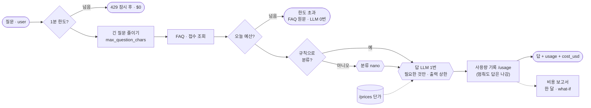

# 75일차 실습 · 컴퓨팅 자원·API 사용량 관리와 비용 최적화 (바이브 코딩)

- 일자: 2026-10-29 (75일차)
- 교과목: 노코드 멀티 에이전트 워크플로우 설계 및 운영
- 단원: AI 워크플로우 운영 및 관리 역량 강화
- 강의 자료: [Lecture/75](../../Lecture/75/README.md)
- 하루 수강 안내: [LECTURE-75.md](LECTURE-75.md) (수업 준비부터 마칠 때까지 순서대로)
- 67~74일차처럼 CLI 코딩 에이전트에게 **내가 쓴 요청문**으로 워크플로우를 만들게 하고, **테스트로 확인**합니다. 오늘은 질문 하나에 **토큰이 몇 개, 돈이 얼마** 드는지 재고, **품질은 그대로 두고** 줄이고, 넘치지 않게 **예산 · 한도**를 둡니다.

## 오늘 고치는 것: 비싼 헬프데스크

`reference/baseline-cost.json`(웹훅 `base-cost`)은 질문마다 LLM을 세 번(분류 · 답 · 검토) 부르고, 답 단계에 **사내 규정 전체**를 붙여 보냅니다. 수업 준비 때 잰 VPN 질문 하나가 **$0.00104**(입력 1,999 · 출력 150토큰)였습니다. 이것을 재고 → 줄이고 → 한도 안에서 답하게 합니다.



## 일하는 방식 (67~74일차와 같음)

| 누가 | 무엇을 |
| --- | --- |
| 나 | 토큰 · 비용 재기, 무엇을 줄일지 정하기, 요청문, 품질 테스트로 확인 · **답 읽기**, 예산 · 한도 정하기(`flow.py budget`) |
| CLI 에이전트 | [AGENTS.md](AGENTS.md) 규칙대로 워크플로우 JSON 작성, `check`로 형식 오류 고치기 |
| `tools/flow.py` | check · push · call · test(`range`, `url`, 줄 끝에 호출 수 · 비용) · diff · bench · **usage** · **budget** · **fault usage** · llm · doctor (모두 `-v`) |

> **싸졌다면 품질이 그대로인지** 원래 테스트로 확인하고 답을 읽습니다. 72일차의 "빠른데 틀린 답"처럼 "싼데 나빠진 답"도 개선이 아닙니다.

## 실습 15개 (Lab마다 예제 3 · 과제 2)

| | 예제 1 | 예제 2 | 예제 3 | 과제 1 | 과제 2 |
| --- | --- | --- | --- | --- | --- |
| [Lab 01](LAB-01-Q-MEASURE-USAGE.md) | 자원 · 단계별 토큰 (에이전트 없이) | 결과에 `cost_usd` | 질문 종류별 비용 · 한 달 어림 (에이전트 없이) | 요청마다 기록 | 기록이 멈춰도 답은 나감 |
| [Lab 02](LAB-02-Q-REDUCE-COST.md) | 보내는 것 줄이기 | 단계마다 맞는 모델 | 답까지 작은 모델이면? (에이전트 없이) | LLM 한 번 · $0.0002 | 긴 질문의 비용 상한 |
| [Lab 03](LAB-03-Q-BUDGET-AND-LIMITS.md) | 하루 예산 → 원문 | 1분 한도 → 429 | 예산을 바꿔 가며 (에이전트 없이) | 비용 보고서 | 바꾸면 얼마 (what-if) |

## 실습 문서 읽는 법

- 실습 문서(`LAB-0x-Q-*.md`, `VIBE-Q-TCOST.md`)에는 **복사해 붙일 요청문이 없습니다.** 실습마다 `### 이해하기`(왜 · 지금 → 바뀐 뒤 · 테스트 케이스 · 기대 결과)를 읽고, 막히면 `▶` 를 하나씩 펼칩니다. 요청문은 `▶ 빈칸 채우기`의 빈칸 4개(`____①`~`____④`)를 채워서 씁니다.
- 쓴 요청문은 `my-work/PROMPTS.md`에, 잰 숫자와 결정은 `my-work/COST.md`에, 테스트 결과는 `my-work/TEST-REPORT.md`에 모아 둡니다.

## 구성

```text
Last3Mon/75/
├── README.md
├── LECTURE-75.md                     # 하루 수강 안내
├── AGENTS.md                         # CLI 에이전트용 작업 규칙 (계약 3절, 토큰이 보이는 LLM 호출 · 단가 · 기록 · 예산 · 한도 노드 5절)
├── LAB-01-Q-MEASURE-USAGE.md         # 1단계 · 자원 · 단계별 토큰 · cost_usd · 종류별 비용 · 기록 · 기록이 멈추면
├── LAB-02-Q-REDUCE-COST.md           # 2단계 · 보내는 것 줄이기 · 단계마다 모델 · 답까지 nano? · LLM 한 번 · 긴 질문
├── LAB-03-Q-BUDGET-AND-LIMITS.md     # 3단계 · 하루 예산 · 사용자별 한도 · 예산 바꿔 보기 · 비용 보고서 · what-if
├── VIBE-REQ-TCOST.md                 # 7교시 바이브 코딩 요청서 (가장 먼저 읽기)
├── VIBE-Q-TCOST.md                   # 7교시 바이브 코딩 · tcost (부르기 전 토큰 · 비용 계산, 보고서 모으기 TUI)
├── tools/flow.py
├── data-api/                         # 75일차 판 데이터 API (74일차 + 단가 · 사용량 기록 · 예산 · 한도)
│   └── data/prices.json · budget.json
├── cases/                            # lab01 · lab01-mix · lab01-challenge(2) · lab02 · lab02-challenge(2) · lab03 · lab03-limit · lab03-drill · lab03-challenge(2)
├── requests/                         # long-printer · long-vpn (6,000자 넘는 로그 질문) 포함
├── reference/                        # baseline-cost(비교 기준) · lab02-example3-nano-answer(비교용) + 막혔을 때 이어 가는 워크플로우
├── templates/                        # 비용 계획 · 테스트 보고서
├── my-work/
└── runs/
```

## 준비

[실습 준비](../../Lecture/75/00-DAY75-PREP.md)를 끝내 주세요. 요약:

```bash
cd ~/aio-01d4-stu/Last3Mon/65/n8n && docker compose start   # Ollama는 쓰지 않음 · 처음 한 번 PREP 1절대로 끄기
cd ~/aio-01d4-stu/Last3Mon/75/data-api && docker compose up -d --force-recreate && sleep 3   # 75일차 판
cd ~/aio-01d4-stu/Last3Mon/75 && uv run tools/flow.py push reference/baseline-cost.json
uv run tools/flow.py doctor                                                          # 마지막 줄 ready
```

## `flow.py` 명령 (오늘 더해진 것)

| 명령 | 하는 일 | 수업 준비 때 |
| --- | --- | --- |
| `uv run tools/flow.py call base-cost requests/faq-vpn.json` | 단계별 토큰(`usage.by_step`) 보기 | 입력 1,999 · 출력 150 토큰 (답 단계 입력 1,781) |
| `uv run tools/flow.py test cases/lab02-challenge.json -v` | `range`로 비용 상한까지 확인, 줄 끝에 `route · 호출 수 · 비용` | 고친 뒤 VPN `1 call · $0.000156` |
| `uv run tools/flow.py usage` · `usage --clear` | 기록된 사용량 · 비용(모델별 · 사람별 · route별) · 예산 요약 · 비우기 | |
| `uv run tools/flow.py budget` · `--daily 0.0003` · `--per-min 2` · `--chars 2000` · `--reset` | 하루 예산 · 사용자별 1분 한도 · 질문 글자 수 상한 보기 · 바꾸기 · 처음으로 | 처음 $1.0 · 20번 · 500자 |
| `uv run tools/flow.py fault usage error\|slow\|ok` | 기록 API 고장 연습 (끝나면 `ok`) | |
| `docker stats --no-stream` | n8n · 데이터 API 컨테이너의 CPU · 메모리 | n8n 642.6MiB · runners 100.5MiB · data-api 20.3MiB |

> 오늘은 실제 OpenAI 호출에 돈이 듭니다 (질문 하나에 약 $0.0001~$0.0012). 같은 테스트를 수십 번 반복하지 않습니다. 단가는 `data-api/data/prices.json` (OpenAI 모델 문서, 2026-10-28 확인: `gpt-4.1-mini` 입력 $0.40 · 출력 $1.60, `gpt-5.4-nano` 입력 $0.20 · 출력 $1.25 / 1M 토큰).
