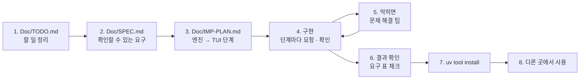

# 7교시 바이브 코딩 · `tcost` 만들기

> **먼저 [VIBE-REQ-TCOST.md](VIBE-REQ-TCOST.md)(요청서)를 읽고 `~/vibe/tcost/Doc/TODO.md`를 직접 쓴 뒤** 이 문서를 엽니다. 아래 1~8을 차례로 갑니다. 이 문서의 요구 표는 **내 SPEC을 쓴 뒤에** 비교하는 데 쓰고, 에이전트에게 통째로 붙여 넣지 않습니다.



- 시간: 16:00~16:50 (50분) · 발표와 정리는 8교시 · 50분 안에 못 한 단계는 집에서 `Doc/IMP-PLAN.md`의 다음 단계로 이어 갑니다
- 도구: CLI 코딩 에이전트(codex / claude / agy), Python + uv + [Textual](https://textual.textualize.io/), 토큰 세는 라이브러리(`tiktoken`)
- 결과물: 글 파일 · 워크플로우의 **토큰을 세고**, 단가표로 모델마다 **부르기 전에 비용을 계산**하고, 테스트 보고서(`runs/*.json`)의 **실제 사용량을 모아** 한 달을 예상하는 TUI. 단가는 날짜 · 출처와 함께 파일에 두고, 모르는 모델은 0원으로 계산하지 않고, **OpenAI를 부르지 않습니다.** `uv tool install`로 설치해 **어느 폴더에서나** `tcost`로 씁니다. 오늘 n8n을 돌려서 잰 것을 돌리기 **전에** 내 도구로.

```text
$ tcost reference runs
┌ tcost · reference runs · prices 2026-10-28 ───────────────────────────────┐
│ [Prompts]  Usage  Compare                                                 │
│ prompt                                 tokens  gpt-4.1-mini /1,000  gpt-5.4-nano /1,000 │
│ baseline-cost.json · Answer              1670      $0.6680             $0.3340          │
│ lab02-example1-lean.json · Answer          75      $0.0300             $0.0150          │
│ ...                                                                       │
│ 19 prompt(s) · 51 report(s) · [r] reload                                  │
│ [r] Reload  [q] Quit                                                      │
└───────────────────────────────────────────────────────────────────────────┘
```

> 요청문은 **직접** 씁니다. 단계마다 `▶` 를 펼치면 생각할 거리가 나옵니다. 정답 요청문은 없습니다.
>
> **시험할 때 OpenAI를 부르지 않습니다.** `tcost`는 이 컴퓨터에서 토큰을 세고, 보고서는 이미 있는 파일을 읽기만 합니다.

## 시간 (50분)

| 시간 | 단계 | 결과 |
| --- | --- | --- |
| 16:00~16:09 | 0 준비 · 1 `Doc/TODO.md` (요청서 읽고 직접) | 할 일 ①~⑫ · 꼭 / 나중 |
| 16:09~16:15 | 2 `Doc/SPEC.md` → 아래 요구 표와 비교 · 고치기 | 요구마다 확인 방법 |
| 16:15~16:20 | 3 `Doc/IMP-PLAN.md` (엔진 단계 · TUI 단계) | 단계마다 체크리스트 |
| 16:20~16:44 | 4 구현: **엔진 1단계 → 엔진 2단계 → TUI 1단계** (막히면 5) | 단계마다 `pytest` · 직접 실행 · commit |
| 16:44~16:50 | 6 확인 · 7 `uv tool install` · 8 다른 폴더에서 | `cd ~/aio-01d4-stu/Last3Mon/75 && tcost usage runs --per-day 1000` |

50분 안 목표: **R1 · R2 · R3 · R13(엔진 1단계) + R5 · R6(엔진 2단계) + R8(TUI 1단계) + R14(설치)**. R4 · R7 · R9~R12는 IMP-PLAN의 다음 단계로 8교시 뒤 · 집에서 이어 갑니다.

## 0. 준비 (1분)

```bash
mkdir -p ~/vibe/tcost/Doc && cd ~/vibe/tcost
git init
# 에이전트는 Doc/TODO.md를 쓴 뒤에 켭니다: codex (또는 claude, agy)
```

## 1. `Doc/TODO.md` · 만들고 싶은 것과 할 일 정리 (8분, 에이전트 없이)

[VIBE-REQ-TCOST.md](VIBE-REQ-TCOST.md)의 "할 일" 틀대로 씁니다. 요청의 말 ①~⑫를 **내 말로** 옮기고, 꼭 · 나중을 표시하고, 걱정되는 것과 50분 안에 못 할 것을 적습니다. "어떻게"는 아직 쓰지 않습니다.

<details><summary>▶ TODO와 SPEC은 무엇이 다른가</summary>

TODO는 **내가 이해한 것**(무엇을 · 왜)입니다. SPEC은 그것을 **확인할 수 있게** 바꾼 것(됐다 · 안 됐다를 말하는 방법)입니다. TODO에서 빠진 것은 SPEC에서도 빠지므로, TODO는 빠짐없이, SPEC은 정확하게.
</details>

`git add Doc/TODO.md && git commit -m "TODO"`

## 2. `Doc/SPEC.md` · 확인할 수 있는 요구로 (6분)

TODO의 할 일마다 **확인 방법**(시험 파일 · 정확한 금액 · 건너뛴 수 · 종료 코드)을 붙여 SPEC을 만듭니다. 에이전트에게 "TODO.md를 읽고 SPEC.md 초안을 써 줘. 요구마다 확인 방법을 붙여"라고 시켜도 됩니다. 그러면 **반드시 내가 읽고 고칩니다.**

```markdown
# tcost SPEC

## 1. 요구 (확인할 수 있게)
| 번호 | 요구 | 요청의 어느 말 | 확인 방법 | 꼭 · 나중 |
| --- | --- | --- | --- | --- |
| R1 | | ① | | 꼭 |

## 2. 숨은 요구
## 3. 범위 밖 (하지 않을 것)
## 4. 정해 둘 것 (단가 파일 모양 · 위치, 반올림, 평균의 분모, 출력 가정의 기본값, 종료 코드)
```

<details><summary>▶ 확인 방법은 손으로 계산할 수 있는 숫자로</summary>

"비용을 계산한다"는 확인 방법이 아닙니다. "입력 1,000 · 출력 100토큰, `gpt-4.1-mini`(0.40 · 1.60) → $0.00056"이 확인 방법입니다. 오늘 Lab 03 과제 1 테스트처럼 **정확히 하나인 답**을 적습니다. 보고서도 "결과 셋 중 400 하나 → 요청 2 · skipped 1"처럼 **나와야 할 것과 나오면 안 되는 것**을 둘 다 적습니다.
</details>

쓴 뒤 아래 표와 비교합니다. 빠진 요구, 내가 더 뽑은 요구를 `Doc/SPEC.md` 끝 "VIBE-Q와 비교"에 한 줄씩 적고 SPEC을 고칩니다.

### 요구 사항 (요청서에서 뽑은 것, 14개)

| 번호 | 요구 | 요청서의 말 | 확인 방법 | 50분 |
| --- | --- | --- | --- | --- |
| R1 | `tcost count <파일>`: 토큰 수와 모델마다 한 번 · 1,000번 비용 표 | ① | 입력 1,000토큰 · mini → $0.0004 · 1,000번 $0.40 | 꼭 |
| R2 | `--out N`: 출력 토큰을 가정해 더함 | ② | 1,000 · `--out 100` · mini → $0.00056 | 꼭 |
| R3 | 단가는 파일(`checked` 날짜 · `source` · `models`), `--prices`로 바꿈, 30일 넘으면 알림 | ③ | 날짜를 45일 전으로 → 알림, 날짜 없음 → 알림 | 꼭 |
| R4 | `tcost workflow <파일>`: LLM 단계마다 노드 · 모델 · 고정 지시문 토큰 · 출력 상한 | ④ | `baseline-cost.json`의 `Answer` 1,000토큰 넘음, `lab02-example1-lean.json` 200 아래 | 나중 |
| R5 | `tcost usage <폴더>`: 보고서의 `usage.by_step`을 모아 요청 · 호출 · 토큰 · 비용, 모델별 · 사람별 · 시간대별, 없는 것은 skipped | ⑤ | 결과 셋(하나는 400) → 요청 2 · skipped 1 | 꼭 |
| R6 | `--per-day N --days D`: 평균(요청당) × N × D = 한 달 | ⑥ | 요청 2 · $0.0007442 · 1,000건 · 22일 → $8.1862 | 꼭 |
| R7 | `tcost compare <파일> --model a --model b`: 나란히, 몇 % 싼지 | ⑦ | mini vs nano → "… % cheaper than gpt-4.1-mini" | 나중 |
| R8 | TUI: 탭 Prompts · Usage · Compare, 시간대별 막대, `[r]` 다시 읽기 (`tcost <폴더> [폴더 …]`) | ⑧ | `tcost reference runs` → 세 탭이 채워짐 | 꼭 |
| R9 | `tcost budget <달러> <파일>`: 모델마다 하루 몇 번 | ⑨ | $1.0 · nano 쪽이 더 많음 | 나중 |
| R10 | `--json`, `--max-usd X`: 한 번이 X를 넘으면 종료 코드 1, 오류는 2 | ⑩ | 긴 글 `--out 200 --max-usd 0.0002` → 1 | 나중 |
| R11 | 폴더: `.txt` · `.prompt` 글, `nodes` · `connections` 워크플로우, `results` 보고서, 나머지(`.md` 문서 · 테스트 파일) skipped | ⑪ | `cases/lab01.json` → skipped | 나중 |
| R12 | 단가표에 없는 모델 → 오류(알려진 목록), 0원으로 계산하지 않음 | ⑫ | `--model gpt-4.1-nano` → 종료 코드 2 · `gpt-5.4-nano`가 목록에 | 나중 |
| R13 | OpenAI를 부르지 않음: 토큰은 이 컴퓨터에서, 테스트도 네트워크 없이 | 끝 | 테스트에 API 키 · 네트워크 호출 없음 | 꼭 |
| R14 | `uv tool install`로 설치해 **어느 폴더에서나** `tcost`, 단가 파일도 함께 | 첫 문단 | `cd /tmp && tcost --help`, `uv tool list`에 `tcost` | 꼭 |

숨은 요구 (요청서에 직접 없지만 없으면 안 되는 것):

| 숨은 요구 | 어디서 나왔나 |
| --- | --- |
| 비용 식 · 반올림을 오늘 데이터 API 계약과 같게 (소수 8자리) | ① · ⑤ — 그래야 보고서의 `cost_usd`와 내 계산을 나란히 놓을 수 있음 |
| 평균은 **요청 수**로 나눈다 (`calls`가 아님) | ⑥ (Lab 03 과제 1) |
| "오늘 날짜"를 함수에 넘길 수 있게 (테스트가 날마다 같게) | ③ |
| 고정 지시문만 센다고 화면에 밝힌다 (질문 · FAQ는 실행 때 붙음) | ④ — 실제 입력보다 작게 나오는 까닭 |
| 엔진(단가 · 세기 · 모으기)과 화면(TUI)을 **나눈다.** `count` · `usage` · `--json`은 화면 없이 엔진만 | ⑩ "다른 프로그램이 읽는", 테스트하기 쉬움 |
| `pyproject.toml`에 명령 이름과 단가 파일을 함께 넣어야 설치한 뒤에도 단가를 찾는다 | R14 |

범위 밖 (오늘 하지 않음): OpenAI 사용량 API로 실제 청구액 가져오기, 캐시 입력 단가, 여러 통화, n8n을 직접 실행해 재기.

`git add Doc/SPEC.md && git commit -m "SPEC"`

## 3. `Doc/IMP-PLAN.md` · 구현 계획 (5분)

SPEC의 요구를 **단계**로 나눕니다. 첫 원칙: **엔진(백엔드)을 먼저, 화면(TUI)은 나중에.** 화면은 엔진이 내놓은 숫자를 보여 주기만 하면 되게 만듭니다. 에이전트에게 "SPEC.md를 읽고 IMP-PLAN.md를 엔진 단계와 TUI 단계로 나눠 써 줘. 단계마다 체크리스트와 확인 명령"이라고 시켜도 됩니다 (내가 읽고 고침).

```markdown
# tcost IMP-PLAN

## 엔진 1단계 · 단가와 토큰 (R1 · R2 · R3 · R13)
- [ ] prices.load(): checked · source · models, --prices
- [ ] cost(model, in, out): (in × input + out × output) / 1,000,000, 소수 8자리
- [ ] warning(today): 30일 넘음 · 날짜 없음
- [ ] tokens.count(): tiktoken o200k_base
- [ ] cli: tcost count <파일> [--out N] [--model M]
- [ ] tests: $0.0004 · $0.00056 · 날짜 경고
- 확인: uv run pytest -q, uv run tcost count <파일> --out 100

## 엔진 2단계 · 보고서 모으기 · 한 달 (R5 · R6)
## TUI 1단계 · 탭 셋 (R8)
## 설치 (R14)
## 엔진 3단계 · 워크플로우 · 비교 · 모르는 모델 (R4 · R7 · R12)
## 엔진 4단계 · 예산 · 다른 프로그램 · 폴더 (R9 · R10 · R11)
```

<details><summary>▶ 왜 엔진 먼저인가</summary>

- 엔진은 **화면 없이 테스트**할 수 있습니다 (`pytest`, `tcost count`). 화면부터 만들면 금액이 맞는지 눈으로만 봅니다.
- 배포 전 비용 관문(R10)은 화면 없이 돌아야 합니다. 74일차 게이트처럼 종료 코드로 다음 단계를 정합니다.
- TUI는 엔진에게 "이 폴더의 지시문 · 보고서 숫자"를 받아 표에 넣기만 하면 됩니다.
</details>

<details><summary>▶ 단계 크기</summary>

한 단계 = 에이전트 요청 한두 번 + 확인 한 번 + commit 한 번 (10분 안팎). 단계가 크면 에이전트가 많이 바꾸고, 틀렸을 때 어디가 틀렸는지 모릅니다. 오늘 Lab 02의 "한 번에 한 가지만 줄이고 다시 잰다"와 같은 생각입니다.
</details>

`git add Doc/IMP-PLAN.md && git commit -m "IMP-PLAN"`

## 4. 구현 시작 (24분: 엔진 1단계 → 엔진 2단계 → TUI 1단계)

이제 에이전트를 켭니다. 첫 요청은 늘 같습니다.

```text
Doc/SPEC.md 와 Doc/IMP-PLAN.md 를 읽어 줘. 아직 코드는 쓰지 말고,
IMP-PLAN 의 "엔진 1단계"를 어떻게 만들지와 각 체크 항목의 확인 방법을 5줄로 먼저 말해 줘.
```

그다음 **한 단계씩**: "엔진 1단계만 만들어 줘. 끝나면 IMP-PLAN의 체크를 표시하고 확인 명령을 알려 줘" → 내가 확인 → commit → 다음 단계.

> **규모가 큰 프로젝트일수록 다단계로** 진행합니다. 오늘 `tcost`도 요구가 14개라 한 번에 시키면 에이전트가 수백 줄을 한꺼번에 쓰고, 어디가 틀렸는지 찾기 어렵습니다. 단계마다 ① 그 단계만 요청 ② 직접 확인 ③ IMP-PLAN 체크 ④ `git commit`.

<details><summary>▶ 엔진 1단계 · 단가 파일의 모양</summary>

오늘 데이터 API의 `prices.json`(`models` 안에 `input` · `output`)을 그대로 따르고 `checked` · `source`를 더하면, 내 도구와 n8n이 **같은 단가표**를 쓸 수 있습니다. 단가를 코드에 숫자로 쓰지 않는 것은 오늘 Lab 01 예제 2와 같습니다.
</details>

<details><summary>▶ 엔진 1단계 · 날짜를 어떻게 시험하나</summary>

"30일 넘으면 알림"을 오늘 날짜로 시험하면 테스트가 날마다 달라집니다. 알림 함수가 "오늘"을 받게 하면(`warning(today)`), 테스트는 확인한 날짜 + 45일을 넘겨 알림이 나오는지 봅니다.
</details>

<details><summary>▶ 엔진 2단계 · 보고서의 모양</summary>

`runs/*.json`을 하나 열어 봅니다. `results`마다 `request`(누가) · `response`(답). `response`에 `usage.by_step`이 있을 수도 없을 수도 있습니다 (400 응답, 429, 요약 케이스, 다른 날의 보고서). 없는 것은 건너뛰고 **몇 개를 건너뛰었는지** 알려 주게 합니다. 시간대는 보고서 파일 이름의 시각(`-20261028-153000`)에서.
</details>

<details><summary>▶ TUI 1단계 · 화면 나누기</summary>

계산(단가 · 세기 · 모으기)과 화면을 나눕니다 (`tver` · `tscan`과 같음). 탭마다 같은 엔진 함수를 부릅니다. 시간대별 막대는 `▁▂▃▄▅▆▇█` 여덟 칸으로 충분합니다.
</details>

<details><summary>▶ 다음 단계들 (8교시 뒤 · 집에서)</summary>

- 엔진 3단계: 워크플로우의 LLM 단계(R4: HTTP `chat/completions` 노드의 `jsonBody`에서 모델 · system 글 · `max_completion_tokens`), 두 모델 비교(R7), 모르는 모델(R12).
- 엔진 4단계: 예산으로 하루 몇 번(R9), `--json` · `--max-usd` · 종료 코드(R10), 폴더 나누기(R11).
</details>

## 5. 바이브 코딩으로 문제 해결 팁

| 이럴 때 | 이렇게 |
| --- | --- |
| 에이전트가 "다 됐다"고 함 | **직접 실행**합니다 (`uv run tcost count ...`, `uv run pytest -q`). 확인 방법은 SPEC에 있습니다 |
| 실패 · 오류 | 오류 출력 **전부**와 실행한 명령을 그대로 붙여 줍니다 |
| 같은 곳을 3번 고쳐도 안 됨 | 멈추고 `git diff` · `git checkout .`로 되돌린 뒤, 단계를 **더 작게** 나눠 다시 요청 |
| 금액이 1,000,000배 큼 | "단가는 1M 토큰당. ÷ 1,000,000" |
| 0.00056000000001 같은 숫자 | "비용은 소수 8자리에서 반올림" |
| 모르는 모델이 $0으로 나옴 | "단가표에 없는 모델은 오류, 목록을 보여 줘" |
| 에이전트가 테스트에서 OpenAI를 부름 | "테스트는 네트워크 없이. 토큰은 tiktoken으로 이 컴퓨터에서" |
| 설치한 `tcost`가 단가 파일을 못 찾음 | "`pyproject.toml`에 prices.json을 wheel에 넣어 줘" (패키지 안 파일) |
| 화면이 이상한데 오류가 안 보임 | `uv add --dev textual-dev` 뒤 다른 터미널에서 `uv run textual console` |
| 대화가 길어져 에이전트가 앞 내용을 잊음 | 새 세션을 열고 "Doc/SPEC.md · Doc/IMP-PLAN.md를 읽고, 체크 안 된 첫 단계부터"로 다시 시작 |
| 설치한 `tcost`가 고친 내용을 모름 | `uv tool install --force .` 로 다시 설치 (또는 처음부터 `--editable`) |

## 6. 결과 확인

`Doc/SPEC.md` 1절 표의 확인 방법대로 **내가** 하나씩 하고 체크합니다. 오늘 50분 안 목표만:

```bash
cd ~/vibe/tcost
L=~/aio-01d4-stu/Last3Mon/75
uv run pytest -q
echo "Answer in Korean in at most 3 sentences." > /tmp/short.txt
uv run tcost count /tmp/short.txt --out 100                    # R1 · R2: 모델마다 한 번 · 1,000번
uv run tcost --prices $L/data-api/data/prices.json count /tmp/short.txt   # R3: 날짜 없는 단가표 → 알림
uv run tcost usage $L/runs --per-day 1000                      # R5 · R6: 요청 · skipped · 한 달
uv run tcost $L/reference $L/runs                              # R8: 세 탭
```

- [ ] R1 토큰 · 모델마다 비용.
- [ ] R2 출력 가정.
- [ ] R3 단가 파일 · 날짜 알림.
- [ ] R5 보고서 모으기 · skipped.
- [ ] R6 한 달.
- [ ] R8 TUI 세 탭.
- [ ] R13 테스트에 네트워크 없음.
- [ ] (이어서) R4 · R7 · R9 · R10 · R11 · R12.

## 7. `uv tool install`로 설치

`pyproject.toml`에 명령이 등록되어 있는지 먼저 봅니다.

```toml
[project.scripts]
tcost = "tcost.cli:main"
```

```bash
cd ~/vibe/tcost
uv tool install --editable .        # 고친 내용이 바로 반영됨 (수업 중 권함)
uv tool list                        # tcost 가 보이는가
which tcost                         # ~/.local/bin/tcost
# 명령을 못 찾으면: uv tool update-shell 뒤 터미널을 새로 엶
```

- 지우기: `uv tool uninstall tcost`.

## 8. 다른 곳에서 사용

설치했으면 오늘 Lab에 씁니다.

```bash
cd ~/aio-01d4-stu/Last3Mon/75
tcost workflow reference/baseline-cost.json my-work/cost.json      # (R4) 줄이기 전 · 후 고정 지시문
tcost usage runs --per-day 1000                                     # 오늘 내가 돌린 테스트의 실제 비용 · 한 달
python3 -c "import json; print(json.load(open('requests/long-printer.json'))['question'])" > /tmp/long.txt
tcost compare /tmp/long.txt --model gpt-4.1-mini --model gpt-5.4-nano --out 60   # (R7) 긴 로그 질문을 두 모델로
tcost reference my-work runs                                        # TUI
```

- `~/vibe/tcost`는 지우지 마세요. 79일차 `tops`에서 다시 씁니다.

## 발표 (8교시, 3분)

| 내용 | |
| --- | |
| TODO → SPEC | 내 SPEC과 VIBE-Q 요구 표가 달랐던 곳 (빠뜨린 요구, 더 뽑은 요구) |
| IMP-PLAN | 엔진 · TUI를 어떻게 나눴나, 어디까지 체크했나 |
| 요청문 | 가장 잘 먹힌 요청문 한 개, 안 먹힌 요청문 한 개 |
| 막힌 곳 | 5절의 어느 팁으로 풀었나 (1M 단위 · 반올림 · 모르는 모델 · 보고서 모양) |
| 시연 | 내 `runs`의 실제 비용과, 기준 · 내 워크플로우의 고정 지시문 비교 |

## 확인

- [ ] `Doc/TODO.md` → `Doc/SPEC.md` → `Doc/IMP-PLAN.md`를 에이전트 전에 (또는 에이전트와 함께 쓰고 내가 고쳐서) 만들고 commit했다.
- [ ] IMP-PLAN의 엔진 1 · 2단계와 TUI 1단계를 체크했다 (단계마다 commit).
- [ ] R1 · R2 · R3 · R5 · R6 · R8 · R13 확인, `uv run pytest -q`.
- [ ] R14 `uv tool install`, 다른 폴더에서 `tcost`.
- [ ] 남은 요구는 IMP-PLAN에 체크 안 된 채로 남겨 두었다 (다음에 이어 감).
