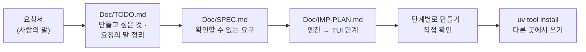

# 7교시 바이브 코딩 · 요청서 `tcost` (가장 먼저 읽기)

- 순서: **이 요청서** → 내 정리 `~/vibe/tcost/Doc/TODO.md` (8분) → [VIBE-Q-TCOST.md](VIBE-Q-TCOST.md)의 순서대로 `Doc/SPEC.md` → `Doc/IMP-PLAN.md` → 단계별로 만들기 → 설치 · 다른 곳에서 쓰기 → 수업이 끝나면 `VIBE-A-TCOST.md`(정답본)로 확인
- 이 문서는 **만들어 달라는 사람의 말**입니다. 요구 사항 표도, 단계도 없습니다. 그것을 뽑아 내는 것이 첫 일입니다. 72일차 `tbench` · 73일차 `tscan` · 74일차 `tver`와 같은 순서입니다.



## 왜 요청서부터인가

요구 사항 표를 통째로 에이전트에게 주고 "이대로 만들어 줘"라고 하면, 무엇이 만들어지든 **내가 판단할 기준이 없습니다.** 실무에서는 요구 사항 표가 오지 않고, 이 요청서 같은 **사람의 말**이 옵니다. 오늘 Lab 03 과제 1에서 보고서 숫자를 **먼저 손으로 계산**해 본 것과 같습니다: 무엇이 맞는지 알아야 맞았는지 말할 수 있습니다.

| 단계 | 누가 | 결과 |
| --- | --- | --- |
| 요청 → 할 일 목록 | **나** | `Doc/TODO.md`: 요청의 말 ①~⑫를 내 말로, 만들고 싶은 것 |
| 할 일 → 요구 | **나** (에이전트와 다듬어도 됨) | `Doc/SPEC.md`: 요구마다 "됐다 / 안 됐다"를 말할 수 있는 확인 방법 |
| 요구 → 단계 | **나** (에이전트와 다듬어도 됨) | `Doc/IMP-PLAN.md`: 엔진 단계와 화면(TUI) 단계로 나눈 순서 |
| 단계 → 코드 | 에이전트 | 단계마다 요청문 하나, `Doc/*.md`를 함께 읽게 함 |
| 확인 | **나** | 직접 `uv run tcost …`, `pytest`, 요구 표에 체크 |

## 요청 (재무 · 운영 담당에게서 온 메시지, 그대로)

> 오늘 헬프데스크 비용을 재는 거 봤어요. 그런데 얼마인지 알려면 **n8n에서 실제로 돌려 봐야** 하잖아요. 돌릴 때마다 돈이 들고요. 지시문을 고치거나 모델을 바꾸기 **전에** "이렇게 바꾸면 얼마"를 미리 계산해 보는 작은 도구가 있으면 좋겠어요. 터미널에서 돌아가면 되고, **어느 폴더에서나** `tcost`라고 치면 되게 해 주세요.
>
> ① 지시문 같은 글 파일을 주면 **토큰이 몇 개**인지, 우리가 쓰는 모델마다 **한 번 보내면 얼마, 1,000번이면 얼마**인지 표로 보여 주세요.
>
> ② 돈은 보내는 것만 드는 게 아니잖아요. **답(출력)도** 몇 토큰쯤 나온다고 치고 계산할 수 있게 해 주세요. 출력이 더 비싸다면서요.
>
> ③ 단가는 자꾸 바뀐대요. 프로그램 안에 숫자를 박지 말고 **파일로** 두고, 그 파일에 **언제 · 어디서** 확인한 가격인지 같이 적어 주세요. 확인한 지 **한 달이 넘었으면** 알려 주세요.
>
> ④ 워크플로우 파일을 주면 그 안의 **LLM 단계마다** 어느 모델로 무엇을 보내는지, 매번 같이 보내는 지시문이 몇 토큰인지 보여 주세요. 오늘 "규정 전체를 매번 보낸다"를 찾은 것처럼요.
>
> ⑤ 오늘 Lab의 **테스트 보고서**(`runs` 폴더)에는 실제로 쓴 토큰과 `cost_usd`가 있잖아요. 그걸 모아서 합 · 평균, **모델별 · 사람별 · 시간대별**로 보여 주세요.
>
> ⑥ 그 평균으로 "하루 몇 건 · 한 달 며칠이면 **한 달에 얼마**"를 바로 계산해 주세요. 매달 초에 물어보거든요.
>
> ⑦ 같은 지시문을 **모델 두 개로** 나란히 놓고, 싼 쪽이 몇 퍼센트 싼지 보여 주세요.
>
> ⑧ **화면에서** 볼 수 있으면 좋겠어요. 지시문 · 사용량 · 비교를 탭으로 나누고, 시간대별로는 막대 같은 걸로요.
>
> ⑨ 하루 예산을 주면 "이 예산이면 **하루 몇 번** 부를 수 있다"를 모델마다 알려 주세요.
>
> ⑩ 나중에 배포 전에 자동으로 돌릴 거라, **다른 프로그램이 읽을 수 있는** 결과도 주세요. 그리고 "한 번에 얼마 넘으면 안 됨"을 주면, **넘을 때 실패하는 종료 코드**를 주세요.
>
> ⑪ 폴더를 통째로 주면 **글 파일 · 워크플로우 · 보고서**를 알아서 나눠 읽어 주세요. 테스트 케이스 파일이나 메모를 워크플로우인 줄 알면 안 돼요.
>
> ⑫ 오늘 `gpt-4.1-nano`처럼 이름이 바뀌거나 없어진 모델이 있잖아요. **단가표에 없는 모델**을 넣으면 0원으로 계산하지 말고 알려 주세요. "공짜"라고 나오면 큰일 나요.
>
> 아, 그리고 이 도구는 **OpenAI를 부르면 안 돼요.** 미리 계산하려고 만드는 건데 계산하느라 돈이 들면 안 되잖아요. 시험할 때도요.

## 함께 받은 것

| 파일 · 자료 | 메모 |
| --- | --- |
| `reference/baseline-cost.json` · `reference/lab02-example1-lean.json` | 시험 자료. `Answer` 지시문이 크게 다름 (Lab 02 예제 1) |
| 오늘 Lab의 `runs/*.json` | 테스트 보고서. 결과마다 `request` · `response`(`usage.by_step` · `cost_usd`가 있을 수도 없을 수도) |
| `data-api/data/prices.json` | 오늘 단가 (1M 토큰당 달러, 2026-10-28 OpenAI 모델 문서에서 확인) |
| `requests/long-printer.json` | 아주 긴 질문 (Lab 02 과제 2). 글 파일로 꺼내 `count`에 |
| 토큰 세는 라이브러리 | 예: `tiktoken` (`o200k_base`). 이 컴퓨터에서 셈 |

## 할 일 · 요청을 내 할 일 목록으로 (8분, 에이전트 없이)

`~/vibe/tcost/Doc/TODO.md`를 만들고 요청의 말 ①~⑫와 맨 끝 부탁을 **내 말로** 한 줄씩 옮깁니다. 아직 "어떻게"는 쓰지 않습니다. **무엇을 · 왜**만 씁니다. 에이전트에게 맡기지 않고 직접 씁니다.

```markdown
# tcost TODO

## 만들고 싶은 것 (한 문단)
어느 폴더에서나 `tcost`로 LLM을 부르기 전에 토큰과 비용을 미리 계산하고, 테스트 보고서의 실제 사용량을 모아 ...

## 요청의 말 → 할 일
| # | 요청의 말 (짧게) | 할 일 (내 말) | 꼭 · 나중 |
| --- | --- | --- | --- |
| ① | 글 파일의 토큰 · 모델마다 비용 | | 꼭 |
| ② | 출력도 | | |
| ... | | | |
| 끝 | OpenAI를 부르지 않기 | | |

## 요청에 없지만 걱정되는 것
## 오늘 50분 안에 못 할 것 같은 것
```

예 하나만 보여 드립니다.

| 요청의 말 | TODO에 쓸 할 일 (내 말) | 다음 단계(SPEC)에서 바뀔 모양 |
| --- | --- | --- |
| ⑫ "단가표에 없는 모델은 0원으로 계산하지 말고" | "모르는 모델 이름이면 계산하지 않고 멈춤, 아는 이름 목록을 보여 줌" | R12: `tcost count x.txt --model gpt-4.1-nano` → 오류 · 종료 코드 2 · 메시지에 `gpt-5.4-nano` |

<details><summary>▶ 1단계 · 꼭 할 것과 나중에 할 것</summary>

요청의 말이 열두 개입니다. 50분 안에 다 만들기 어렵습니다. 담당자가 "매달 초에 물어보거든요"라고 한 것은 무엇인가요? 그리고 비교 · 예산 · 화면을 만들려면 먼저 무엇이 있어야 하나요? (단가 · 토큰 → 비용 식 → 보고서 모으기 → 화면)
</details>

<details><summary>▶ 2단계 · 걱정되는 것 (숨은 요구의 씨앗)</summary>

- ① "토큰이 몇 개": 내가 센 토큰과 OpenAI가 센 토큰이 같을까요? 다르면 무엇으로 맞춰 볼까요? (보고서의 `prompt_tokens`)
- ③ "한 달이 넘었으면": 오늘 날짜를 프로그램이 직접 읽으면 테스트가 날마다 달라집니다. 어떻게 시험할까요?
- ④ "LLM 단계마다": n8n 워크플로우의 LLM은 HTTP 노드(오늘)일 수도, AI Agent 노드(66~74일차)일 수도 있습니다. 지시문이 다른 노드에서 오면(표현식) 몇 토큰이라고 할까요?
- ⑤ "보고서": 400 · 429 응답이나 요약 케이스처럼 `usage`가 없는 결과는? 건너뛰었다고 알려 줘야 하지 않을까요?
- ⑥ "평균": 호출 수로 나눌까요, 요청 수로 나눌까요? (Lab 03 과제 1)
- 끝 "OpenAI를 부르지 않기": 토큰을 세는 라이브러리가 처음에 인코딩 파일을 내려받는 것은 괜찮을까요?
</details>

## 그다음

[VIBE-Q-TCOST.md](VIBE-Q-TCOST.md)를 엽니다. 거기서 `Doc/TODO.md` → `Doc/SPEC.md` → `Doc/IMP-PLAN.md` → 단계별 구현 → 확인 → `uv tool install` → 다른 곳에서 사용 순서로 갑니다. VIBE-Q의 요구 표는 **내 SPEC을 쓴 뒤에** 비교하는 데 씁니다.
