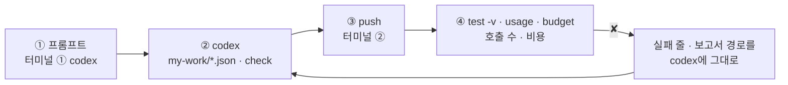
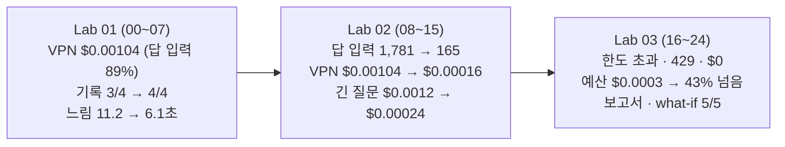

# 75일차 Lab 테스트 결과 · 실제로 만든 시나리오와 `test -v` 결과

> **정답 자료** · 75일차 n8n 워크플로우를 **만드는 프롬프트(codex) → push → `call` · `test -v` · `usage` · `budget` 결과**를 학생이 가는 순서대로 한 문서에 모았습니다. 수업이 끝난 뒤 공개합니다.

- 실행: 2026-10-28, 실습을 Lab마다 5개(예제 3 + 과제 2)로 늘린 뒤 강사 노트북의 65일차 n8n 2.42.6 + 75일차 판 데이터 API(단가 · 사용량 기록 · 예산 · 한도), OpenAI `gpt-4.1-mini` · `gpt-5.4-nano`, 케이스 파일마다 **한 번씩**, 모두 25단계 (00~24)
- 명령: `~/aio-01d4-stu/Last3Mon/75`에서 `uv run tools/flow.py ...`. 아래 단계마다 **실행한 명령**과 **화면에 나온 출력 전부**를 그대로 붙이고, 그 아래 **쉽게 말하면**으로 결과를 풀어 썼습니다 (특히 ✘가 나온 까닭과 그것이 예상한 것인지). 같은 출력이 `NN-<이름>.txt`에, 그 단계 첫 `test`의 보고서가 `NN-<이름>.json`에 있습니다 (00 · 01단계는 보고서 없음).
- LLM 문장 · 토큰 · 비용 · 시간은 **실행마다 조금씩 다릅니다.** 이번 실행에서 정답의 잘못으로 실패한 케이스는 없습니다. ✘는 모두 "고치기 전" 단계에서 본 것입니다.
- 단가: `data-api/data/prices.json` — OpenAI 모델 문서의 공개 단가 (2026-10-28 확인, 1M 토큰당 `gpt-4.1-mini` 입력 $0.40 · 출력 $1.60, `gpt-5.4-nano` 입력 $0.20 · 출력 $1.25). 10/18 판의 `gpt-4.1-nano`는 OpenAI가 더 이상 받지 않아 바꿨습니다.
- 수업 준비 중 실제로 일어난 일: 처음 기록에서 과제 2의 "기록 API 느림" 케이스 뒤 다음 테스트의 `requests`가 하나 많았습니다. 워크플로우는 3초에 포기했지만 데이터 API가 8초 뒤 **결국 저장**해서입니다. 데이터 API의 느림 모드를 "늦게 답하고 저장하지 않음"(멈춘 기록 서버)으로 고친 뒤 05~07 · 19 · 21~24단계를 다시 돌린 기록입니다.

## `-v`가 보여 주는 것 · 줄 끝의 비용

```text
✔ faq-vpn · LLM 한 번 · $0.0002 이하 · 1.3s · 자동 답변 · 1 call · $0.000156   ← 케이스 · 시간 · route · 호출 수 · 비용
    → request  POST /webhook/my-cost                ← 보낸 요청 JSON
      { "question": "VPN …", "user": "이준호" }
    ← response HTTP 200                             ← 받은 응답 JSON
      { "route": "자동 답변", "answer": "…", "llm_calls": 1, "usage": { "by_step": { "answer": { "model": "gpt-4.1-mini", … } } }, "cost_usd": 0.0001556 }
```

오늘은 줄 끝의 **호출 수 · 비용**과 응답의 **`usage.by_step`**(단계마다 모델 · 토큰 · 비용)을 봅니다.

## 이 문서 하나로 따라가기

단계마다 **① codex에 넣는 프롬프트 → ② codex가 `my-work/*.json`을 쓰고 `check` → ③ 내가 `push` → ④ 내가 `test -v` · `usage` · `budget`** 순서입니다. 재기만 하는 예제(Lab 01 예제 1 · 3, Lab 02 예제 3, Lab 03 예제 3)와 고치기 전 단계는 프롬프트가 없습니다.



- **프롬프트는 정답본(`LAB-0x-A-*.md`)의 요청문 예**를 그대로 썼습니다 (실습 문서 빈칸 채우기 뼈대의 `____`를 채운 글자라 빈칸 자리에 띄어쓰기가 남아 있습니다).
- **이 기록의 워크플로우는 수업 준비 때 만든 정답 파일**입니다. 프롬프트를 codex에 보내 다시 만들어 재지는 않았습니다 (68일차부터 수업 준비는 정답 워크플로우만 실행).
- 학생은 `push my-work/cost.json`, 이 기록은 같은 웹훅(`my-cost` · `my-cost-report`)의 정답 파일을 push했습니다. 그래서 `test` 명령과 결과 모양은 같습니다.

## 시나리오 한눈에



| 단계 | 먼저 올린 것 (`push`) | 테스트 · 재기 | 결과 | 파일 |
| --- | --- | --- | --- | --- |
| 00 | `reference/baseline-cost.json` | `budget --reset` · `usage --clear` · `fault all ok` · `doctor` | ready | `00-prep` |
| 01 | (없음) | `docker stats` · `call base-cost` × 2 · `/prices` | 입력 1,999 (answer 1,781) | `01-lab01-resources` |
| 02 | `reference/lab01-example2-cost.json` | `lab01` | 3/3 · VPN $0.001040 | `02-lab01-cost` |
| 03 | (같음) | `lab01-mix` | 7/7 · $0.00083 ~ 0.00104 | `03-lab01-mix` |
| 04 | (같음) | `lab01-challenge` | 3/4 | `04-lab01-challenge-before` |
| 05 | `answers/75-lab01-challenge-record.json` | `lab01-challenge` · `usage` | 4/4 · requests 3 · calls 9 | `05-lab01-challenge` |
| 06 | (같음) | `lab01-challenge2` | 1/4 · 느림 11.2초 | `06-lab01-challenge2-before` |
| 07 | `answers/75-lab01-challenge2-safe-record.json` | `lab01-challenge2` · `lab01-challenge` | 4/4 · 6.1초 · 4/4 | `07-lab01-challenge2` |
| 08 | (같음) | `lab02` | 2/5 | `08-lab02-before` |
| 09 | `reference/lab02-example1-lean.json` | `lab02` · `diff` | 4/5 · answer 입력 165 | `09-lab02-lean` |
| 10 | `reference/lab02-example2-models.json` | `lab02` · `lab01` | 5/5 · 3/3 | `10-lab02-models` |
| 11 | `reference/lab02-example3-nano-answer.json` | `lab02 --webhook nano-answer` · `lab01-mix` × 2 | 5/5 · 평균 $0.000233 / $0.000198 | `11-lab02-nano-answer` |
| 12 | (같음) | `lab02-challenge` | 0/7 | `12-lab02-challenge-before` |
| 13 | `answers/75-lab02-challenge-one-call.json` | `lab02-challenge` · `lab02` · `lab01` · `lab01-challenge` | 7/7 · 5/5 · 3/3 · 4/4 | `13-lab02-challenge` |
| 14 | (같음) | `lab02-challenge2` | 0/4 · 긴 질문 $0.0012 | `14-lab02-challenge2-before` |
| 15 | `answers/75-lab02-challenge2-long-question.json` | `lab02-challenge2` · `lab02-challenge` | 4/4 · $0.00024 · 7/7 | `15-lab02-challenge2` |
| 16 | (같음) | `budget` · `lab03` | 1/3 | `16-lab03-before` |
| 17 | `reference/lab03-example1-budget.json` | `lab03` | 3/3 | `17-lab03-budget` |
| 18 | (같음) | `lab03-limit` | 3/4 | `18-lab03-limit-before` |
| 19 | `reference/lab03-example2-limit.json` | `lab03-limit` · `lab03` · `lab02-challenge` | 4/4 · 3/3 · 7/7 | `19-lab03-limit` |
| 20 | (같음) | `budget --daily 0.0003` · `lab03-drill` · `usage` · `budget --reset` · `lab03-drill` | 4번째부터 한도 초과 · 6/6 자동 답변 | `20-lab03-drill` |
| 21 | (`off my-cost-report`) | `lab03-challenge` | 0/5 (404) | `21-lab03-challenge-before` |
| 22 | `answers/75-lab03-challenge-report.json` | `lab03-challenge` · `lab02-challenge` · `call my-cost-report` | 5/5 · 한 달 $2.80 | `22-lab03-challenge` |
| 23 | (같음) | `lab03-challenge2` | 2/5 | `23-lab03-challenge2-before` |
| 24 | `answers/75-lab03-challenge2-what-if.json` | `lab03-challenge2` · `lab03-challenge` · `lab02-challenge` · `call` · `doctor` | 5/5 · 5/5 · 7/7 · nano였다면 34% 덜 | `24-lab03-challenge2` |

## 준비

### 00 · 수업 준비 · 처음 상태 · 기준 게시 · doctor

실행한 명령:

```bash
uv run tools/flow.py budget --reset
uv run tools/flow.py usage --clear
uv run tools/flow.py fault all ok
uv run tools/flow.py push reference/baseline-cost.json
uv run tools/flow.py doctor
```

출력 (그대로):

```text
✔ budget back to data/budget.json
budget $1.0 / used $0.000000 · remaining $1.000000 · over False · per user 20/min · question 500 chars

✔ usage cleared: {"cleared": 0}

✔ fault switch: {"faq": "ok", "tickets": "ok", "prompts": "ok", "usage": "ok", "slow_seconds": 8.0}

✔ pushed '75 IT helpdesk baseline (provided)' (id wdb6a99a8f13c6a1)
   POST http://localhost:5678/webhook/base-cost

! n8n install folder /Users/[USER]/day65-n8n
   → day 65 SETUP-N8N 5단계 (get.n8n.io 설치). 다른 곳에 설치했다면 Last3Mon/65/n8n/.env 에 N8N_HOME=<폴더>
✔ n8n container day65-n8n-n8n-1
✔ n8n http://localhost:5678
✔ data API http://localhost:8800
✔ prices /prices · budget /budget (day 75 data API)
✔ n8n → http://data-api:8800
✔ credential 'OpenAI (.env)' (openAiCourse0001)
✔ node catalog (for check)
✔ CLI coding agent: codex, claude, agy
ready
```

**쉽게 말하면**

- 예산 · 기록 · 고장 스위치를 처음 상태로 돌리고, 오늘 고칠 기준 `base-cost`를 게시하고, `doctor`가 `ready`입니다.
- `prices /prices · budget /budget (day 75 data API)` ✔는 데이터 API가 75일차 판(단가에 `gpt-5.4-nano`, 예산에 `max_question_chars`)이라는 뜻입니다.

## Lab 01 · 자원과 토큰을 재고, 비용을 계산하고, 기록하기

### 01 · Lab 01 예제 1 · 자원과 단계별 토큰

실행한 명령:

```bash
docker stats --no-stream --format 'table {{.Name}}\t{{.CPUPerc}}\t{{.MemUsage}}'
uv run tools/flow.py call base-cost requests/faq-vpn.json
uv run tools/flow.py call base-cost requests/ticket-own.json
curl -s localhost:8800/prices
```

출력 (그대로):

```text
NAME                    CPU %     MEM USAGE / LIMIT
day67-data-data-api-1   0.02%     20.3MiB / 7.818GiB
day65-n8n-runners-1     0.21%     100.5MiB / 7.818GiB
day65-n8n-n8n-1         0.27%     642.6MiB / 7.818GiB

HTTP 200 · 4.3s
{
  "route": "자동 답변",
  "answer": "VPN 접속이 자주 끊길 경우, VPN 클라이언트를 최신 버전으로 업데이트하고 인증서 만료 여부를 IT 포털에서 확인하시기 바랍니다. 인증서는 만료 30일 전부터 재발급 신청이 가능합니다. 추가 도움이 필요하시면 IT 문의로 연락해 주십시오.",
  "sources": [
    "FAQ-003"
  ],
  "llm_calls": 3,
  "usage": {
    "prompt_tokens": 1999,
    "completion_tokens": 150,
    "by_step": {
      "classify": {
        "model": "gpt-4.1-mini",
        "prompt_tokens": 78,
        "completion_tokens": 6
      },
      "answer": {
        "model": "gpt-4.1-mini",
        "prompt_tokens": 1781,
        "completion_tokens": 78
      },
      "review": {
        "model": "gpt-4.1-mini",
        "prompt_tokens": 140,
        "completion_tokens": 66
      }
    }
  }
}

HTTP 200 · 3.3s
{
  "route": "자동 답변",
  "answer": "티켓 T-1002는 현재 인증서 발급 승인 대기 중이며, 완료 예정일은 10월 20일입니다. 추가 문의 사항이 있으시면 연락 주시기 바랍니다.",
  "sources": [],
  "llm_calls": 3,
  "usage": {
    "prompt_tokens": 1973,
    "completion_tokens": 97,
    "by_step": {
      "classify": {
        "model": "gpt-4.1-mini",
        "prompt_tokens": 71,
        "completion_tokens": 6
      },
      "answer": {
        "model": "gpt-4.1-mini",
        "prompt_tokens": 1791,
        "completion_tokens": 49
      },
      "review": {
        "model": "gpt-4.1-mini",
        "prompt_tokens": 111,
        "completion_tokens": 42
      }
    }
  }
}

{"currency": "USD", "unit": "per 1M tokens", "note": "OpenAI 모델 문서의 공개 단가 (2026-10-28 확인). 수업 전에 가격표를 확인해 바꾸세요.", "models": {"gpt-4.1-mini": {"input": 0.4, "output": 1.6}, "gpt-5.4-nano": {"input": 0.2, "output": 1.25}}}
```

**쉽게 말하면**

- 자원: CPU는 셋 다 1% 아래, 메모리는 n8n 642.6MiB · runners 100.5MiB · data-api 20.3MiB. LLM은 OpenAI 서버에서 계산하므로 내 컴퓨터의 CPU는 거의 쓰지 않습니다.
- VPN 질문: 입력 1,999 · 출력 150 토큰, 그중 `answer` 입력이 **1,781** (89%). 접수 질문도 입력 1,973 · `answer` 1,791로 거의 같습니다. 질문과 관계없이 매번 같이 보내는 것(규정 전체)이 있다는 뜻입니다.
- 단가: `gpt-4.1-mini` 입력 0.4 · 출력 1.6, `gpt-5.4-nano` 입력 0.2 · 출력 1.25 (1M 토큰당 달러). 손 계산: (1,999 × 0.4 + 150 × 1.6) ÷ 1,000,000 = $0.00104.

### 02 · Lab 01 예제 2 · 결과에 비용 → `lab01` 3/3

codex에 입력하는 프롬프트 (터미널 ①, 학생이 만들 파일 `my-work/cost.json` · 이 기록에서 push한 같은 역할의 정답 `reference/lab01-example2-cost.json`):

```text
my-work/cost.json (baseline 을 복사한 것) 의 웹훅 경로를 my-cost 로, 이름을 "75 IT helpdesk (my)" 로 바꿔 줘.
Has question? 뒤에 Get prices(HTTP GET http://data-api:8800/ prices ) 를 넣어 줘.
Build result 에서 단계마다 cost_usd = (prompt_tokens × input + completion_tokens × output) ÷ 1000000 를
그 단계 model 의 단가로 계산해 usage.by_step.<단계>.cost_usd 에, 합을 cost_usd 에 넣어 줘. 소수 8 자리에서 반올림.
기대 결과 cases/lab01.json.
```

실행한 명령:

```bash
uv run tools/flow.py push reference/lab01-example2-cost.json
uv run tools/flow.py test cases/lab01.json -v
```

출력 (그대로):

```text
! unpublished '75 IT helpdesk + user limit (reference)' (w885dc4a9b362094): it used the same webhook path
✔ pushed '75 IT helpdesk + cost (reference)' (id w7aad5ed3acdb113)
   POST http://localhost:5678/webhook/my-cost

POST http://localhost:5678/webhook/my-cost · 3 case(s) × 1
✔ VPN · 비용과 단계별 사용량 · 5.1s · 자동 답변 · 3 calls · $0.001040
    → request  POST /webhook/my-cost
      {
        "question": "VPN 접속이 자꾸 끊겨요. 어떻게 하나요?",
        "user": "이준호"
      }
    ← response HTTP 200
      {
        "route": "자동 답변",
        "answer": "VPN 접속이 자주 끊길 경우, VPN 클라이언트를 최신 버전으로 업데이트하고 인증서 만료 여부를 IT 포털에서 확인하시기 바랍니다. 인증서는 만료 30일 전부터 재발급 신청이 가능합니다. 추가 도움이 필요하시면 IT 문의로 연락해 주십시오.",
        "sources": [
          "FAQ-003"
        ],
        "llm_calls": 3,
        "usage": {
          "prompt_tokens": 1999,
          "completion_tokens": 150,
          "by_step": {
            "classify": {
              "model": "gpt-4.1-mini",
              "prompt_tokens": 78,
              "completion_tokens": 6,
              "cost_usd": 4.08e-05
            },
            "answer": {
              "model": "gpt-4.1-mini",
              "prompt_tokens": 1781,
              "completion_tokens": 78,
              "cost_usd": 0.0008372
            },
            "review": {
              "model": "gpt-4.1-mini",
              "prompt_tokens": 140,
              "completion_tokens": 66,
              "cost_usd": 0.0001616
            }
          }
        },
        "cost_usd": 0.0010396
      }
✔ 접수 현황 · 비용 · 3.3s · 자동 답변 · 3 calls · $0.000946
    → request  POST /webhook/my-cost
      {
        "question": "T-1002 처리 상태 알려 주세요",
        "user": "박서연"
      }
    ← response HTTP 200
      {
        "route": "자동 답변",
        "answer": "티켓 T-1002는 현재 인증서 발급 승인 대기 중이며, 10월 20일에 완료될 예정입니다. 추가 문의 사항이 있으시면 연락해 주시기 바랍니다.",
        "sources": [],
        "llm_calls": 3,
        "usage": {
          "prompt_tokens": 1973,
          "completion_tokens": 98,
          "by_step": {
            "classify": {
              "model": "gpt-4.1-mini",
              "prompt_tokens": 71,
              "completion_tokens": 6,
              "cost_usd": 3.8e-05
            },
            "answer": {
              "model": "gpt-4.1-mini",
              "prompt_tokens": 1791,
              "completion_tokens": 49,
              "cost_usd": 0.0007948
            },
            "review": {
              "model": "gpt-4.1-mini",
              "prompt_tokens": 111,
              "completion_tokens": 43,
              "cost_usd": 0.0001132
            }
          }
        },
        "cost_usd": 0.000946
      }
✔ 빈 질문은 LLM 없이 · 0.0s
    → request  POST /webhook/my-cost
      {
        "question": "",
        "user": "이준호"
      }
    ← response HTTP 400
      {
        "error": "question is required"
      }
Passed 3/3
report: runs/lab01-20261028-210102.json
```

**쉽게 말하면**

- 결과에 단계마다 `cost_usd`와 합이 붙었습니다. VPN **$0.001040** (손 계산과 같음), 접수 $0.000946.
- 단가는 `/prices`에서 읽었습니다. 빈 질문은 그대로 400. 3/3, 예상한 결과.

### 03 · Lab 01 예제 3 · 질문 종류별 비용 → `lab01-mix` 7/7

실행한 명령:

```bash
uv run tools/flow.py test cases/lab01-mix.json
```

출력 (그대로):

```text
POST http://localhost:5678/webhook/my-cost · 7 case(s) × 1
✔ FAQ · VPN · 3.2s · 자동 답변 · 3 calls · $0.001040
✔ FAQ · 프린터 · 3.9s · 자동 답변 · 3 calls · $0.000960
✔ FAQ · 비밀번호 · 3.5s · 자동 답변 · 3 calls · $0.000953
✔ FAQ · 메일 · 3.4s · 자동 답변 · 3 calls · $0.000965
✔ 접수 · T-1002 · 3.0s · 자동 답변 · 3 calls · $0.000946
✔ 접수 · T-1001 · 3.2s · 자동 답변 · 3 calls · $0.000890
✔ 규칙에 없는 질문 · 2.6s · 자동 답변 · 3 calls · $0.000830
Passed 7/7
report: runs/lab01-mix-20261028-210125.json
```

**쉽게 말하면**

- 일곱 질문 모두 3 calls, 비용은 $0.000830 ~ $0.001040으로 **비슷합니다.** 규정 전체를 매번 보내는 고정비가 비용 대부분이기 때문입니다.
- 종류별 평균: FAQ 넷 $0.000980 · 접수 둘 $0.000918 · 그 밖 $0.000830. 비중 60 · 30 · 10%로 섞으면 $0.000946 × 1,000건 × 22일 ≈ **한 달 $20.8**, 일곱 개 단순 평균이면 ≈ $20.7. 고정비가 커서 두 어림이 거의 같습니다.

### 04 · Lab 01 과제 1 하기 전 → `lab01-challenge` 3/4

실행한 명령:

```bash
uv run tools/flow.py test cases/lab01-challenge.json -v
```

출력 (그대로):

```text
✔ before: POST http://localhost:8800/usage-clear · HTTP 200 · 0.0s · {"cleared": 0}
    → request  POST http://localhost:8800/usage-clear
      {}
    ← response HTTP 200
      {
        "cleared": 0
      }
POST http://localhost:5678/webhook/my-cost · 4 case(s) × 1
✔ 기록 1 · VPN · 3.5s · 자동 답변 · 3 calls · $0.001040
    → request  POST /webhook/my-cost
      {
        "question": "VPN 접속이 자꾸 끊겨요. 어떻게 하나요?",
        "user": "이준호"
      }
    ← response HTTP 200
      {
        "route": "자동 답변",
        "answer": "VPN 접속이 자주 끊길 경우, VPN 클라이언트를 최신 버전으로 업데이트하고 인증서 만료 여부를 IT 포털에서 확인하시기 바랍니다. 인증서는 만료 30일 전부터 재발급 신청이 가능합니다. 추가 도움이 필요하시면 IT 문의로 연락해 주십시오.",
        "sources": [
          "FAQ-003"
        ],
        "llm_calls": 3,
        "usage": {
          "prompt_tokens": 1999,
          "completion_tokens": 150,
          "by_step": {
            "classify": {
              "model": "gpt-4.1-mini",
              "prompt_tokens": 78,
              "completion_tokens": 6,
              "cost_usd": 4.08e-05
            },
            "answer": {
              "model": "gpt-4.1-mini",
              "prompt_tokens": 1781,
              "completion_tokens": 78,
              "cost_usd": 0.0008372
            },
            "review": {
              "model": "gpt-4.1-mini",
              "prompt_tokens": 140,
              "completion_tokens": 66,
              "cost_usd": 0.0001616
            }
          }
        },
        "cost_usd": 0.0010396
      }
✔ 기록 2 · 접수 · 3.0s · 자동 답변 · 3 calls · $0.000946
    → request  POST /webhook/my-cost
      {
        "question": "T-1002 처리 상태 알려 주세요",
        "user": "박서연"
      }
    ← response HTTP 200
      {
        "route": "자동 답변",
        "answer": "티켓 T-1002는 현재 인증서 발급 승인 대기 중이며, 10월 20일에 완료될 예정입니다. 추가 문의 사항이 있으시면 연락해 주시기 바랍니다.",
        "sources": [],
        "llm_calls": 3,
        "usage": {
          "prompt_tokens": 1973,
          "completion_tokens": 98,
          "by_step": {
            "classify": {
              "model": "gpt-4.1-mini",
              "prompt_tokens": 71,
              "completion_tokens": 6,
              "cost_usd": 3.8e-05
            },
            "answer": {
              "model": "gpt-4.1-mini",
              "prompt_tokens": 1791,
              "completion_tokens": 49,
              "cost_usd": 0.0007948
            },
            "review": {
              "model": "gpt-4.1-mini",
              "prompt_tokens": 111,
              "completion_tokens": 43,
              "cost_usd": 0.0001132
            }
          }
        },
        "cost_usd": 0.000946
      }
✔ 기록 3 · 다른 사람 · 3.4s · 자동 답변 · 3 calls · $0.000955
    → request  POST /webhook/my-cost
      {
        "question": "비밀번호를 잊어버렸어요. 재설정은 어떻게 하나요?",
        "user": "한지훈"
      }
    ← response HTTP 200
      {
        "route": "자동 답변",
        "answer": "비밀번호 재설정은 사내 포털 로그인 화면의 '비밀번호 찾기'에서 휴대폰 인증 후 새 비밀번호를 설정하시면 됩니다. 추가 도움이 필요하시면 IT 문의로 연락해 주시기 바랍니다.",
        "sources": [
          "FAQ-001"
        ],
        "llm_calls": 3,
        "usage": {
          "prompt_tokens": 1979,
          "completion_tokens": 102,
          "by_step": {
            "classify": {
              "model": "gpt-4.1-mini",
              "prompt_tokens": 81,
              "completion_tokens": 6,
              "cost_usd": 4.2e-05
            },
            "answer": {
              "model": "gpt-4.1-mini",
              "prompt_tokens": 1789,
              "completion_tokens": 47,
              "cost_usd": 0.0007908
            },
            "review": {
              "model": "gpt-4.1-mini",
              "prompt_tokens": 109,
              "completion_tokens": 49,
              "cost_usd": 0.000122
            }
          }
        },
        "cost_usd": 0.0009548
      }
✘ 사용량 요약 · 요청 3건 · 0.0s · $0.000000 · requests = 0 (expected 3); cost_usd = 0.0 (expected 1e-06..0.05); by_user has none of ['이준호', '박서연', '한지훈']; by_model has none of ['gpt-4.1-mini']
    → request  POST http://localhost:8800/usage/summary
      {}
    ← response HTTP 200
      {
        "requests": 0,
        "calls": 0,
        "prompt_tokens": 0,
        "completion_tokens": 0,
        "cost_usd": 0.0,
        "by_model": {},
        "by_user": {},
        "by_route": {}
      }
Passed 3/4
report: runs/lab01-challenge-20261028-210135.json
```

**쉽게 말하면**

- 답 세 개는 ✔. 요약 케이스만 ✘: `requests = 0`. 답에는 비용이 있지만 **아무 데도 기록하지 않아서** 데이터 API는 모릅니다. 예상한 결과.

### 05 · Lab 01 과제 1 · 요청마다 기록 → 4/4

codex에 입력하는 프롬프트 (터미널 ①, 학생이 만들 파일 `my-work/cost.json` · 이 기록에서 push한 같은 역할의 정답 `answers/75-lab01-challenge-record.json`):

```text
my-work/cost.json 의 Build result 뒤에 Record usage(HTTP POST http://data-api:8800/usage) 를 넣어 줘.
본문은 items: usage.by_step 의 단계마다 한 줄 {request_id, user, step, model, prompt_tokens, completion_tokens, cost_usd, route}.
request_id 는 $execution.id , user 는 웹훅 본문의 user .
기록 응답이 오류여도 멈추지 않게 options.response 에 neverError: true , 그다음 Result again(Code) 이 Build result 의 결과를 다시 꺼내 Send result 로.
기대 결과 cases/lab01-challenge.json.
```

실행한 명령:

```bash
uv run tools/flow.py push answers/75-lab01-challenge-record.json
uv run tools/flow.py test cases/lab01-challenge.json -v
uv run tools/flow.py usage
```

출력 (그대로):

```text
! unpublished '75 IT helpdesk + user limit (reference)' (w3b18d2741bd22c6): it used the same webhook path
✔ pushed '75 IT helpdesk + usage record (answer)' (id waec469b37d74b05)
   POST http://localhost:5678/webhook/my-cost

✔ before: POST http://localhost:8800/usage-clear · HTTP 200 · 0.0s · {"cleared": 0}
    → request  POST http://localhost:8800/usage-clear
      {}
    ← response HTTP 200
      {
        "cleared": 0
      }
POST http://localhost:5678/webhook/my-cost · 4 case(s) × 1
✔ 기록 1 · VPN · 5.0s · 자동 답변 · 3 calls · $0.001040
    → request  POST /webhook/my-cost
      {
        "question": "VPN 접속이 자꾸 끊겨요. 어떻게 하나요?",
        "user": "이준호"
      }
    ← response HTTP 200
      {
        "route": "자동 답변",
        "answer": "VPN 접속이 자주 끊길 경우, VPN 클라이언트를 최신 버전으로 업데이트하고 인증서 만료 여부를 IT 포털에서 확인하시기 바랍니다. 인증서는 만료 30일 전부터 재발급 신청이 가능합니다. 추가 도움이 필요하시면 IT 문의로 연락해 주십시오.",
        "sources": [
          "FAQ-003"
        ],
        "llm_calls": 3,
        "usage": {
          "prompt_tokens": 1999,
          "completion_tokens": 150,
          "by_step": {
            "classify": {
              "model": "gpt-4.1-mini",
              "prompt_tokens": 78,
              "completion_tokens": 6,
              "cost_usd": 4.08e-05
            },
            "answer": {
              "model": "gpt-4.1-mini",
              "prompt_tokens": 1781,
              "completion_tokens": 78,
              "cost_usd": 0.0008372
            },
            "review": {
              "model": "gpt-4.1-mini",
              "prompt_tokens": 140,
              "completion_tokens": 66,
              "cost_usd": 0.0001616
            }
          }
        },
        "cost_usd": 0.0010396
      }
✔ 기록 2 · 접수 · 3.5s · 자동 답변 · 3 calls · $0.000959
    → request  POST /webhook/my-cost
      {
        "question": "T-1002 처리 상태 알려 주세요",
        "user": "박서연"
      }
    ← response HTTP 200
      {
        "route": "자동 답변",
        "answer": "티켓 T-1002는 현재 '처리 중' 상태이며, 인증서 발급 승인 대기 중입니다. 완료 예정일은 10월 20일입니다. 추가 문의 사항이 있으시면 연락해 주시기 바랍니다.",
        "sources": [],
        "llm_calls": 3,
        "usage": {
          "prompt_tokens": 1973,
          "completion_tokens": 106,
          "by_step": {
            "classify": {
              "model": "gpt-4.1-mini",
              "prompt_tokens": 71,
              "completion_tokens": 6,
              "cost_usd": 3.8e-05
            },
            "answer": {
              "model": "gpt-4.1-mini",
              "prompt_tokens": 1791,
              "completion_tokens": 49,
              "cost_usd": 0.0007948
            },
            "review": {
              "model": "gpt-4.1-mini",
              "prompt_tokens": 111,
              "completion_tokens": 51,
              "cost_usd": 0.000126
            }
          }
        },
        "cost_usd": 0.0009588
      }
✔ 기록 3 · 다른 사람 · 3.4s · 자동 답변 · 3 calls · $0.000953
    → request  POST /webhook/my-cost
      {
        "question": "비밀번호를 잊어버렸어요. 재설정은 어떻게 하나요?",
        "user": "한지훈"
      }
    ← response HTTP 200
      {
        "route": "자동 답변",
        "answer": "비밀번호 재설정은 사내 포털 로그인 화면의 '비밀번호 찾기'에서 휴대폰 인증 후 새 비밀번호를 설정하시면 됩니다. 추가 도움이 필요하시면 IT 문의로 연락해 주시기 바랍니다.",
        "sources": [
          "FAQ-001"
        ],
        "llm_calls": 3,
        "usage": {
          "prompt_tokens": 1978,
          "completion_tokens": 101,
          "by_step": {
            "classify": {
              "model": "gpt-4.1-mini",
              "prompt_tokens": 81,
              "completion_tokens": 6,
              "cost_usd": 4.2e-05
            },
            "answer": {
              "model": "gpt-4.1-mini",
              "prompt_tokens": 1789,
              "completion_tokens": 46,
              "cost_usd": 0.0007892
            },
            "review": {
              "model": "gpt-4.1-mini",
              "prompt_tokens": 108,
              "completion_tokens": 49,
              "cost_usd": 0.0001216
            }
          }
        },
        "cost_usd": 0.0009528
      }
✔ 사용량 요약 · 요청 3건 · 0.0s · $0.002951
    → request  POST http://localhost:8800/usage/summary
      {}
    ← response HTTP 200
      {
        "requests": 3,
        "calls": 9,
        "prompt_tokens": 5950,
        "completion_tokens": 357,
        "cost_usd": 0.0029512,
        "by_model": {
          "gpt-4.1-mini": {
            "calls": 9,
            "prompt_tokens": 5950,
            "completion_tokens": 357,
            "cost_usd": 0.0029512
          }
        },
        "by_user": {
          "이준호": {
            "calls": 3,
            "prompt_tokens": 1999,
            "completion_tokens": 150,
            "cost_usd": 0.0010396
          },
          "박서연": {
            "calls": 3,
            "prompt_tokens": 1973,
            "completion_tokens": 106,
            "cost_usd": 0.0009588
          },
          "한지훈": {
            "calls": 3,
            "prompt_tokens": 1978,
            "completion_tokens": 101,
            "cost_usd": 0.0009528
          }
        },
        "by_route": {
          "자동 답변": {
            "calls": 9,
            "prompt_tokens": 5950,
            "completion_tokens": 357,
            "cost_usd": 0.0029512
          }
        }
      }
Passed 4/4
report: runs/lab01-challenge-20261028-211025.json

requests 3 · calls 9 · tokens in 5950 / out 357 · $0.002951
  model  gpt-4.1-mini      9 calls · in    5950 · out    357 · $0.002951
  user   이준호               3 calls · in    1999 · out    150 · $0.001040
  user   박서연               3 calls · in    1973 · out    106 · $0.000959
  user   한지훈               3 calls · in    1978 · out    101 · $0.000953
  route  자동 답변             9 calls · in    5950 · out    357 · $0.002951
budget $1.0 / used $0.002951 · remaining $0.997049 · over False · per user 20/min · question 500 chars
```

**쉽게 말하면**

- 요청 3건 · 호출 9줄(3단계 × 3)이 같은 `request_id`로 묶여 `requests 3 · calls 9`, 합계 $0.002951.
- `flow.py usage`가 모델별 · 사람별 · route별로 보여 줍니다 (이준호 $0.001040 · 박서연 $0.000959 · 한지훈 $0.000953). 4/4, 예상한 결과.

### 06 · Lab 01 과제 2 하기 전 → `lab01-challenge2` 1/4

실행한 명령:

```bash
uv run tools/flow.py test cases/lab01-challenge2.json -v
```

출력 (그대로):

```text
✔ before: POST http://localhost:8800/usage-clear · HTTP 200 · 0.0s · {"cleared": 9}
    → request  POST http://localhost:8800/usage-clear
      {}
    ← response HTTP 200
      {
        "cleared": 9
      }
✔ before: POST http://localhost:8800/admin/fault · HTTP 200 · 0.0s · {"faq": "ok", "tickets": "ok", "prompts": "ok", "usage": "ok", "slow_seconds": 8}
    → request  POST http://localhost:8800/admin/fault
      {
        "usage": "ok"
      }
    ← response HTTP 200
      {
        "faq": "ok",
        "tickets": "ok",
        "prompts": "ok",
        "usage": "ok",
        "slow_seconds": 8
      }
POST http://localhost:5678/webhook/my-cost · 4 case(s) × 1
✔ before: POST http://localhost:8800/admin/fault · HTTP 200 · 0.0s · {"faq": "ok", "tickets": "ok", "prompts": "ok", "usage": "error", "slow_seconds": 8}
    → request  POST http://localhost:8800/admin/fault
      {
        "usage": "error"
      }
    ← response HTTP 200
      {
        "faq": "ok",
        "tickets": "ok",
        "prompts": "ok",
        "usage": "error",
        "slow_seconds": 8
      }
✘ 기록 API 고장(500) · 답은 나감 · 3.4s · 자동 답변 · 3 calls · $0.001040 · recorded = null (expected false)
    → request  POST /webhook/my-cost
      {
        "question": "VPN 접속이 자꾸 끊겨요. 어떻게 하나요?",
        "user": "이준호"
      }
    ← response HTTP 200
      {
        "route": "자동 답변",
        "answer": "VPN 접속이 자주 끊길 경우, VPN 클라이언트를 최신 버전으로 업데이트하고 인증서 만료 여부를 IT 포털에서 확인하시기 바랍니다. 인증서는 만료 30일 전부터 재발급 신청이 가능합니다. 추가 도움이 필요하시면 IT 문의로 연락해 주십시오.",
        "sources": [
          "FAQ-003"
        ],
        "llm_calls": 3,
        "usage": {
          "prompt_tokens": 1999,
          "completion_tokens": 150,
          "by_step": {
            "classify": {
              "model": "gpt-4.1-mini",
              "prompt_tokens": 78,
              "completion_tokens": 6,
              "cost_usd": 4.08e-05
            },
            "answer": {
              "model": "gpt-4.1-mini",
              "prompt_tokens": 1781,
              "completion_tokens": 78,
              "cost_usd": 0.0008372
            },
            "review": {
              "model": "gpt-4.1-mini",
              "prompt_tokens": 140,
              "completion_tokens": 66,
              "cost_usd": 0.0001616
            }
          }
        },
        "cost_usd": 0.0010396
      }
✔ before: POST http://localhost:8800/admin/fault · HTTP 200 · 0.0s · {"faq": "ok", "tickets": "ok", "prompts": "ok", "usage": "slow", "slow_seconds": 8.0}
    → request  POST http://localhost:8800/admin/fault
      {
        "usage": "slow",
        "slow_seconds": 8
      }
    ← response HTTP 200
      {
        "faq": "ok",
        "tickets": "ok",
        "prompts": "ok",
        "usage": "slow",
        "slow_seconds": 8.0
      }
✘ 기록 API 느림(8초) · 답은 나감 · 11.2s · 자동 답변 · 3 calls · $0.000962 · recorded = null (expected false)
    → request  POST /webhook/my-cost
      {
        "question": "프린터 출력이 안 돼요",
        "user": "최유진"
      }
    ← response HTTP 200
      {
        "route": "자동 답변",
        "answer": "프린터 전원과 네트워크 연결을 확인하시고, 인쇄 대기열을 비운 후 다시 출력해 보시기 바랍니다. 추가 도움이 필요하시면 IT 담당자에게 문의해 주시기 바랍니다.",
        "sources": [
          "FAQ-004"
        ],
        "llm_calls": 3,
        "usage": {
          "prompt_tokens": 1968,
          "completion_tokens": 109,
          "by_step": {
            "classify": {
              "model": "gpt-4.1-mini",
              "prompt_tokens": 72,
              "completion_tokens": 6,
              "cost_usd": 3.84e-05
            },
            "answer": {
              "model": "gpt-4.1-mini",
              "prompt_tokens": 1779,
              "completion_tokens": 55,
              "cost_usd": 0.0007996
            },
            "review": {
              "model": "gpt-4.1-mini",
              "prompt_tokens": 117,
              "completion_tokens": 48,
              "cost_usd": 0.0001236
            }
          }
        },
        "cost_usd": 0.0009616
      }
✔ before: POST http://localhost:8800/admin/fault · HTTP 200 · 0.0s · {"faq": "ok", "tickets": "ok", "prompts": "ok", "usage": "ok", "slow_seconds": 8.0}
    → request  POST http://localhost:8800/admin/fault
      {
        "usage": "ok"
      }
    ← response HTTP 200
      {
        "faq": "ok",
        "tickets": "ok",
        "prompts": "ok",
        "usage": "ok",
        "slow_seconds": 8.0
      }
✘ 고친 뒤 · 기록됨 · 3.5s · 자동 답변 · 3 calls · $0.000953 · recorded = null (expected true)
    → request  POST /webhook/my-cost
      {
        "question": "비밀번호를 잊어버렸어요. 재설정은 어떻게 하나요?",
        "user": "한지훈"
      }
    ← response HTTP 200
      {
        "route": "자동 답변",
        "answer": "비밀번호 재설정은 사내 포털 로그인 화면의 '비밀번호 찾기'에서 휴대폰 인증 후 새 비밀번호를 설정하시면 됩니다. 추가 도움이 필요하시면 IT 문의로 연락해 주시기 바랍니다.",
        "sources": [
          "FAQ-001"
        ],
        "llm_calls": 3,
        "usage": {
          "prompt_tokens": 1978,
          "completion_tokens": 101,
          "by_step": {
            "classify": {
              "model": "gpt-4.1-mini",
              "prompt_tokens": 81,
              "completion_tokens": 6,
              "cost_usd": 4.2e-05
            },
            "answer": {
              "model": "gpt-4.1-mini",
              "prompt_tokens": 1789,
              "completion_tokens": 46,
              "cost_usd": 0.0007892
            },
            "review": {
              "model": "gpt-4.1-mini",
              "prompt_tokens": 108,
              "completion_tokens": 49,
              "cost_usd": 0.0001216
            }
          }
        },
        "cost_usd": 0.0009528
      }
✔ 요약 · 기록된 요청은 1건 · 0.0s · $0.000953
    → request  POST http://localhost:8800/usage/summary
      {}
    ← response HTTP 200
      {
        "requests": 1,
        "calls": 3,
        "prompt_tokens": 1978,
        "completion_tokens": 101,
        "cost_usd": 0.0009528,
        "by_model": {
          "gpt-4.1-mini": {
            "calls": 3,
            "prompt_tokens": 1978,
            "completion_tokens": 101,
            "cost_usd": 0.0009528
          }
        },
        "by_user": {
          "한지훈": {
            "calls": 3,
            "prompt_tokens": 1978,
            "completion_tokens": 101,
            "cost_usd": 0.0009528
          }
        },
        "by_route": {
          "자동 답변": {
            "calls": 3,
            "prompt_tokens": 1978,
            "completion_tokens": 101,
            "cost_usd": 0.0009528
          }
        }
      }
Passed 1/4
report: runs/lab01-challenge2-20261028-211043.json
✔ after: POST http://localhost:8800/admin/fault · HTTP 200 · 0.0s · {"faq": "ok", "tickets": "ok", "prompts": "ok", "usage": "ok", "slow_seconds": 8.0}
    → request  POST http://localhost:8800/admin/fault
      {
        "usage": "ok"
      }
    ← response HTTP 200
      {
        "faq": "ok",
        "tickets": "ok",
        "prompts": "ok",
        "usage": "ok",
        "slow_seconds": 8.0
      }
```

**쉽게 말하면**

- 기록 API 고장(500): 답은 나갔지만(`neverError` 덕분) `recorded` 칸이 없어 ✘.
- 기록 API 느림: **11.2초** 걸린 뒤에야 답했습니다 (LLM 세 번 + 기록 8초를 다 기다림). `recorded`도 없어 ✘.
- "고친 뒤 · 기록됨"도 `recorded`가 없어 ✘. 요약 케이스만 ✔ — 고장 · 느림 두 건은 기록되지 않아 `requests` 1입니다. 예상한 결과.

### 07 · Lab 01 과제 2 · 기록이 멈춰도 답은 나감 → 4/4

codex에 입력하는 프롬프트 (터미널 ①, 학생이 만들 파일 `my-work/cost.json` · 이 기록에서 push한 같은 역할의 정답 `answers/75-lab01-challenge2-safe-record.json`):

```text
my-work/cost.json 의 Record usage 에 options.timeout 3000 과 onError continueRegularOutput 를 넣어 줘.
Result again 은 Build result 의 결과에 recorded 를 더해: 기록 응답의 stored 가 1 이상이면 true, 아니면 false.
기록이 실패해도 사용자에게 가는 answer · cost_usd 는 그대로 .
기대 결과 cases/lab01-challenge2.json, cases/lab01-challenge.json.
```

실행한 명령:

```bash
uv run tools/flow.py push answers/75-lab01-challenge2-safe-record.json
uv run tools/flow.py test cases/lab01-challenge2.json -v
uv run tools/flow.py test cases/lab01-challenge.json
```

출력 (그대로):

```text
! unpublished '75 IT helpdesk + usage record (answer)' (waec469b37d74b05): it used the same webhook path
✔ pushed '75 IT helpdesk + safe record (answer)' (id w2ae10aa66addee4)
   POST http://localhost:5678/webhook/my-cost

✔ before: POST http://localhost:8800/usage-clear · HTTP 200 · 0.0s · {"cleared": 3}
    → request  POST http://localhost:8800/usage-clear
      {}
    ← response HTTP 200
      {
        "cleared": 3
      }
✔ before: POST http://localhost:8800/admin/fault · HTTP 200 · 0.0s · {"faq": "ok", "tickets": "ok", "prompts": "ok", "usage": "ok", "slow_seconds": 8.0}
    → request  POST http://localhost:8800/admin/fault
      {
        "usage": "ok"
      }
    ← response HTTP 200
      {
        "faq": "ok",
        "tickets": "ok",
        "prompts": "ok",
        "usage": "ok",
        "slow_seconds": 8.0
      }
POST http://localhost:5678/webhook/my-cost · 4 case(s) × 1
✔ before: POST http://localhost:8800/admin/fault · HTTP 200 · 0.0s · {"faq": "ok", "tickets": "ok", "prompts": "ok", "usage": "error", "slow_seconds": 8.0}
    → request  POST http://localhost:8800/admin/fault
      {
        "usage": "error"
      }
    ← response HTTP 200
      {
        "faq": "ok",
        "tickets": "ok",
        "prompts": "ok",
        "usage": "error",
        "slow_seconds": 8.0
      }
✔ 기록 API 고장(500) · 답은 나감 · 4.4s · 자동 답변 · 3 calls · $0.001040
    → request  POST /webhook/my-cost
      {
        "question": "VPN 접속이 자꾸 끊겨요. 어떻게 하나요?",
        "user": "이준호"
      }
    ← response HTTP 200
      {
        "route": "자동 답변",
        "answer": "VPN 접속이 자주 끊길 경우, VPN 클라이언트를 최신 버전으로 업데이트하고 인증서 만료 여부를 IT 포털에서 확인하시기 바랍니다. 인증서는 만료 30일 전부터 재발급 신청이 가능합니다. 추가 도움이 필요하시면 IT 문의로 연락해 주십시오.",
        "sources": [
          "FAQ-003"
        ],
        "llm_calls": 3,
        "usage": {
          "prompt_tokens": 1999,
          "completion_tokens": 150,
          "by_step": {
            "classify": {
              "model": "gpt-4.1-mini",
              "prompt_tokens": 78,
              "completion_tokens": 6,
              "cost_usd": 4.08e-05
            },
            "answer": {
              "model": "gpt-4.1-mini",
              "prompt_tokens": 1781,
              "completion_tokens": 78,
              "cost_usd": 0.0008372
            },
            "review": {
              "model": "gpt-4.1-mini",
              "prompt_tokens": 140,
              "completion_tokens": 66,
              "cost_usd": 0.0001616
            }
          }
        },
        "cost_usd": 0.0010396,
        "recorded": false
      }
✔ before: POST http://localhost:8800/admin/fault · HTTP 200 · 0.0s · {"faq": "ok", "tickets": "ok", "prompts": "ok", "usage": "slow", "slow_seconds": 8.0}
    → request  POST http://localhost:8800/admin/fault
      {
        "usage": "slow",
        "slow_seconds": 8
      }
    ← response HTTP 200
      {
        "faq": "ok",
        "tickets": "ok",
        "prompts": "ok",
        "usage": "slow",
        "slow_seconds": 8.0
      }
✔ 기록 API 느림(8초) · 답은 나감 · 6.1s · 자동 답변 · 3 calls · $0.000960
    → request  POST /webhook/my-cost
      {
        "question": "프린터 출력이 안 돼요",
        "user": "최유진"
      }
    ← response HTTP 200
      {
        "route": "자동 답변",
        "answer": "프린터 전원과 네트워크 연결을 확인하시고, 인쇄 대기열을 비운 후 다시 출력해 보시기 바랍니다. 추가 도움이 필요하시면 IT 담당자에게 문의해 주시기 바랍니다.",
        "sources": [
          "FAQ-004"
        ],
        "llm_calls": 3,
        "usage": {
          "prompt_tokens": 1967,
          "completion_tokens": 108,
          "by_step": {
            "classify": {
              "model": "gpt-4.1-mini",
              "prompt_tokens": 72,
              "completion_tokens": 6,
              "cost_usd": 3.84e-05
            },
            "answer": {
              "model": "gpt-4.1-mini",
              "prompt_tokens": 1779,
              "completion_tokens": 54,
              "cost_usd": 0.000798
            },
            "review": {
              "model": "gpt-4.1-mini",
              "prompt_tokens": 116,
              "completion_tokens": 48,
              "cost_usd": 0.0001232
            }
          }
        },
        "cost_usd": 0.0009596,
        "recorded": false
      }
✔ before: POST http://localhost:8800/admin/fault · HTTP 200 · 0.0s · {"faq": "ok", "tickets": "ok", "prompts": "ok", "usage": "ok", "slow_seconds": 8.0}
    → request  POST http://localhost:8800/admin/fault
      {
        "usage": "ok"
      }
    ← response HTTP 200
      {
        "faq": "ok",
        "tickets": "ok",
        "prompts": "ok",
        "usage": "ok",
        "slow_seconds": 8.0
      }
✔ 고친 뒤 · 기록됨 · 3.7s · 자동 답변 · 3 calls · $0.000955
    → request  POST /webhook/my-cost
      {
        "question": "비밀번호를 잊어버렸어요. 재설정은 어떻게 하나요?",
        "user": "한지훈"
      }
    ← response HTTP 200
      {
        "route": "자동 답변",
        "answer": "비밀번호 재설정은 사내 포털 로그인 화면의 '비밀번호 찾기'에서 휴대폰 인증 후 새 비밀번호를 설정하시면 됩니다. 추가 도움이 필요하시면 IT 문의로 연락해 주시기 바랍니다.",
        "sources": [
          "FAQ-001"
        ],
        "llm_calls": 3,
        "usage": {
          "prompt_tokens": 1979,
          "completion_tokens": 102,
          "by_step": {
            "classify": {
              "model": "gpt-4.1-mini",
              "prompt_tokens": 81,
              "completion_tokens": 6,
              "cost_usd": 4.2e-05
            },
            "answer": {
              "model": "gpt-4.1-mini",
              "prompt_tokens": 1789,
              "completion_tokens": 47,
              "cost_usd": 0.0007908
            },
            "review": {
              "model": "gpt-4.1-mini",
              "prompt_tokens": 109,
              "completion_tokens": 49,
              "cost_usd": 0.000122
            }
          }
        },
        "cost_usd": 0.0009548,
        "recorded": true
      }
✔ 요약 · 기록된 요청은 1건 · 0.0s · $0.000955
    → request  POST http://localhost:8800/usage/summary
      {}
    ← response HTTP 200
      {
        "requests": 1,
        "calls": 3,
        "prompt_tokens": 1979,
        "completion_tokens": 102,
        "cost_usd": 0.0009548,
        "by_model": {
          "gpt-4.1-mini": {
            "calls": 3,
            "prompt_tokens": 1979,
            "completion_tokens": 102,
            "cost_usd": 0.0009548
          }
        },
        "by_user": {
          "한지훈": {
            "calls": 3,
            "prompt_tokens": 1979,
            "completion_tokens": 102,
            "cost_usd": 0.0009548
          }
        },
        "by_route": {
          "자동 답변": {
            "calls": 3,
            "prompt_tokens": 1979,
            "completion_tokens": 102,
            "cost_usd": 0.0009548
          }
        }
      }
Passed 4/4
report: runs/lab01-challenge2-20261028-211109.json
✔ after: POST http://localhost:8800/admin/fault · HTTP 200 · 0.0s · {"faq": "ok", "tickets": "ok", "prompts": "ok", "usage": "ok", "slow_seconds": 8.0}
    → request  POST http://localhost:8800/admin/fault
      {
        "usage": "ok"
      }
    ← response HTTP 200
      {
        "faq": "ok",
        "tickets": "ok",
        "prompts": "ok",
        "usage": "ok",
        "slow_seconds": 8.0
      }

✔ before: POST http://localhost:8800/usage-clear · HTTP 200 · 0.0s · {"cleared": 3}
POST http://localhost:5678/webhook/my-cost · 4 case(s) × 1
✔ 기록 1 · VPN · 3.7s · 자동 답변 · 3 calls · $0.001040
✔ 기록 2 · 접수 · 3.4s · 자동 답변 · 3 calls · $0.000978
✔ 기록 3 · 다른 사람 · 3.2s · 자동 답변 · 3 calls · $0.000953
✔ 사용량 요약 · 요청 3건 · 0.0s · $0.002970
Passed 4/4
report: runs/lab01-challenge-20261028-211120.json
```

**쉽게 말하면**

- 고장: 답 + `recorded: false`. 느림: 3초에 포기하고 **6.1초**에 답 + `recorded: false` (11.2초 → 6.1초). 고친 뒤: `recorded: true`.
- 요약 `requests` 1: 기록이 빠진 두 건은 예산 · 한도에서도 빠집니다. 그래서 `recorded: false`를 남겨 셀 수 있게 했습니다.
- `lab01-challenge` 4/4로 과제 1도 그대로입니다. 4/4, 예상한 결과.

## Lab 02 · 보내는 것 줄이기, 단계마다 맞는 모델, LLM 한 번, 긴 질문의 상한

### 08 · Lab 02 예제 1 하기 전 → `lab02` 2/5

실행한 명령:

```bash
uv run tools/flow.py test cases/lab02.json -v
```

출력 (그대로):

```text
POST http://localhost:5678/webhook/my-cost · 5 case(s) × 1
✘ 예제 1 · VPN · 보내는 양 줄이기 · 3.4s · 자동 답변 · 3 calls · $0.001007 · usage.by_step.answer.prompt_tokens = 1781 (expected 1..600)
    → request  POST /webhook/my-cost
      {
        "question": "VPN 접속이 자꾸 끊겨요. 어떻게 하나요?",
        "user": "이준호"
      }
    ← response HTTP 200
      {
        "route": "자동 답변",
        "answer": "VPN 접속 오류가 발생하면 VPN 클라이언트를 최신 버전으로 업데이트하고 인증서 만료 여부를 확인하시기 바랍니다. 인증서가 만료된 경우 IT 포털에서 재발급받으실 수 있습니다. 추가 도움이 필요하시면 IT 문의로 연락해 주십시오.",
        "sources": [
          "FAQ-003"
        ],
        "llm_calls": 3,
        "usage": {
          "prompt_tokens": 1986,
          "completion_tokens": 133,
          "by_step": {
            "classify": {
              "model": "gpt-4.1-mini",
              "prompt_tokens": 78,
              "completion_tokens": 6,
              "cost_usd": 4.08e-05
            },
            "answer": {
              "model": "gpt-4.1-mini",
              "prompt_tokens": 1781,
              "completion_tokens": 65,
              "cost_usd": 0.0008164
            },
            "review": {
              "model": "gpt-4.1-mini",
              "prompt_tokens": 127,
              "completion_tokens": 62,
              "cost_usd": 0.00015
            }
          }
        },
        "cost_usd": 0.0010072,
        "recorded": true
      }
✘ 예제 1 · 접수 · 보내는 양 줄이기 · 3.5s · 자동 답변 · 3 calls · $0.000936 · usage.by_step.answer.prompt_tokens = 1791 (expected 1..600)
    → request  POST /webhook/my-cost
      {
        "question": "T-1002 처리 상태 알려 주세요",
        "user": "박서연"
      }
    ← response HTTP 200
      {
        "route": "자동 답변",
        "answer": "티켓 T-1002는 현재 인증서 발급 승인 대기 중이며, 완료 예정일은 10월 20일입니다. 추가 문의 사항이 있으시면 연락 주시기 바랍니다.",
        "sources": [],
        "llm_calls": 3,
        "usage": {
          "prompt_tokens": 1969,
          "completion_tokens": 93,
          "by_step": {
            "classify": {
              "model": "gpt-4.1-mini",
              "prompt_tokens": 71,
              "completion_tokens": 6,
              "cost_usd": 3.8e-05
            },
            "answer": {
              "model": "gpt-4.1-mini",
              "prompt_tokens": 1791,
              "completion_tokens": 45,
              "cost_usd": 0.0007884
            },
            "review": {
              "model": "gpt-4.1-mini",
              "prompt_tokens": 107,
              "completion_tokens": 42,
              "cost_usd": 0.00011
            }
          }
        },
        "cost_usd": 0.0009364,
        "recorded": true
      }
✔ 예제 1 · 비밀번호 · 품질 그대로 · 3.5s · 자동 답변 · 3 calls · $0.000955
    → request  POST /webhook/my-cost
      {
        "question": "비밀번호를 잊어버렸어요. 재설정은 어떻게 하나요?",
        "user": "한지훈"
      }
    ← response HTTP 200
      {
        "route": "자동 답변",
        "answer": "비밀번호 재설정은 사내 포털 로그인 화면의 '비밀번호 찾기'에서 휴대폰 인증 후 새 비밀번호를 설정하시면 됩니다. 추가 도움이 필요하시면 IT 문의로 연락해 주시기 바랍니다.",
        "sources": [
          "FAQ-001"
        ],
        "llm_calls": 3,
        "usage": {
          "prompt_tokens": 1979,
          "completion_tokens": 102,
          "by_step": {
            "classify": {
              "model": "gpt-4.1-mini",
              "prompt_tokens": 81,
              "completion_tokens": 6,
              "cost_usd": 4.2e-05
            },
            "answer": {
              "model": "gpt-4.1-mini",
              "prompt_tokens": 1789,
              "completion_tokens": 47,
              "cost_usd": 0.0007908
            },
            "review": {
              "model": "gpt-4.1-mini",
              "prompt_tokens": 109,
              "completion_tokens": 49,
              "cost_usd": 0.000122
            }
          }
        },
        "cost_usd": 0.0009548,
        "recorded": true
      }
✘ 예제 2 · 분류는 작은 모델 · 3.2s · 자동 답변 · 3 calls · $0.000830 · usage.by_step.classify.model = gpt-4.1-mini (expected gpt-5.4-nano)
    → request  POST /webhook/my-cost
      {
        "question": "회의실 화면 공유가 안 되는데 누구에게 물어보나요?",
        "user": "이준호"
      }
    ← response HTTP 200
      {
        "route": "자동 답변",
        "answer": "회의실 화면 공유 문제는 IT 문의로 연락 주시면 도움을 드리겠습니다.",
        "sources": [],
        "llm_calls": 3,
        "usage": {
          "prompt_tokens": 1883,
          "completion_tokens": 48,
          "by_step": {
            "classify": {
              "model": "gpt-4.1-mini",
              "prompt_tokens": 78,
              "completion_tokens": 6,
              "cost_usd": 4.08e-05
            },
            "answer": {
              "model": "gpt-4.1-mini",
              "prompt_tokens": 1719,
              "completion_tokens": 24,
              "cost_usd": 0.000726
            },
            "review": {
              "model": "gpt-4.1-mini",
              "prompt_tokens": 86,
              "completion_tokens": 18,
              "cost_usd": 6.32e-05
            }
          }
        },
        "cost_usd": 0.00083,
        "recorded": true
      }
✔ 예제 2 · 프린터 · 품질 그대로 · 3.5s · 자동 답변 · 3 calls · $0.000960
    → request  POST /webhook/my-cost
      {
        "question": "프린터 출력이 안 돼요",
        "user": "최유진"
      }
    ← response HTTP 200
      {
        "route": "자동 답변",
        "answer": "프린터 전원과 네트워크 연결을 확인하시고, 인쇄 대기열을 비운 후 다시 출력해 보시기 바랍니다. 추가 도움이 필요하시면 IT 담당자에게 문의해 주시기 바랍니다.",
        "sources": [
          "FAQ-004"
        ],
        "llm_calls": 3,
        "usage": {
          "prompt_tokens": 1967,
          "completion_tokens": 108,
          "by_step": {
            "classify": {
              "model": "gpt-4.1-mini",
              "prompt_tokens": 72,
              "completion_tokens": 6,
              "cost_usd": 3.84e-05
            },
            "answer": {
              "model": "gpt-4.1-mini",
              "prompt_tokens": 1779,
              "completion_tokens": 54,
              "cost_usd": 0.000798
            },
            "review": {
              "model": "gpt-4.1-mini",
              "prompt_tokens": 116,
              "completion_tokens": 48,
              "cost_usd": 0.0001232
            }
          }
        },
        "cost_usd": 0.0009596,
        "recorded": true
      }
Passed 2/5
report: runs/lab02-20261028-210311.json
```

**쉽게 말하면**

- `answer` 단계 입력이 VPN 1,781 · 접수 1,791토큰이라 600 상한 두 케이스 ✘. 분류 모델이 아직 mini라 예제 2 케이스 ✘.
- 품질 케이스 둘(비밀번호 · 프린터)은 ✔. 예상한 결과.

### 09 · Lab 02 예제 1 · 보내는 것 줄이기 → `lab02` 4/5

codex에 입력하는 프롬프트 (터미널 ①, 학생이 만들 파일 `my-work/cost.json` · 이 기록에서 push한 같은 역할의 정답 `reference/lab02-example1-lean.json`):

```text
my-work/cost.json 의 Answer 지시문에서 참고 자료 (사내 규정 전체) 을 빼고 답 규칙만 남겨 줘.
사용자 메시지에는 질문과, FAQ 는 id · title · answer 만, 접수 건은 ticket_id · title · status · note · error 만 보내 줘 (contact · assignee 는 빼고).
답 길이 상한은 max_completion_tokens 200.
Classify · Review 단계는 그대로 .
기대 결과 cases/lab02.json 앞 세 케이스.
```

실행한 명령:

```bash
uv run tools/flow.py push reference/lab02-example1-lean.json
uv run tools/flow.py test cases/lab02.json -v
uv run tools/flow.py diff answers/75-lab01-challenge2-safe-record.json reference/lab02-example1-lean.json
```

출력 (그대로):

```text
! unpublished '75 IT helpdesk + safe record (answer)' (w2ae10aa66addee4): it used the same webhook path
✔ pushed '75 IT helpdesk + lean prompt (reference)' (id wd453c4a61b08d35)
   POST http://localhost:5678/webhook/my-cost

POST http://localhost:5678/webhook/my-cost · 5 case(s) × 1
✔ 예제 1 · VPN · 보내는 양 줄이기 · 4.7s · 자동 답변 · 3 calls · $0.000346
    → request  POST /webhook/my-cost
      {
        "question": "VPN 접속이 자꾸 끊겨요. 어떻게 하나요?",
        "user": "이준호"
      }
    ← response HTTP 200
      {
        "route": "자동 답변",
        "answer": "VPN 접속 오류가 발생할 경우, VPN 클라이언트를 최신 버전으로 업데이트하고 인증서 만료 여부를 확인한 후 다시 접속해 주시기 바랍니다. 현재 관련된 접수된 티켓은 없습니다. 추가 도움이 필요하시면 언제든지 문의해 주시기 바랍니다.",
        "sources": [
          "FAQ-003"
        ],
        "llm_calls": 3,
        "usage": {
          "prompt_tokens": 361,
          "completion_tokens": 126,
          "by_step": {
            "classify": {
              "model": "gpt-4.1-mini",
              "prompt_tokens": 78,
              "completion_tokens": 6,
              "cost_usd": 4.08e-05
            },
            "answer": {
              "model": "gpt-4.1-mini",
              "prompt_tokens": 165,
              "completion_tokens": 56,
              "cost_usd": 0.0001556
            },
            "review": {
              "model": "gpt-4.1-mini",
              "prompt_tokens": 118,
              "completion_tokens": 64,
              "cost_usd": 0.0001496
            }
          }
        },
        "cost_usd": 0.000346,
        "recorded": true
      }
✔ 예제 1 · 접수 · 보내는 양 줄이기 · 3.2s · 자동 답변 · 3 calls · $0.000284
    → request  POST /webhook/my-cost
      {
        "question": "T-1002 처리 상태 알려 주세요",
        "user": "박서연"
      }
    ← response HTTP 200
      {
        "route": "자동 답변",
        "answer": "T-1002 티켓은 현재 인증서 발급 승인 대기 중이며, 10월 20일에 완료될 예정입니다. 추가 문의 사항이 있으시면 언제든지 알려주시기 바랍니다.",
        "sources": [],
        "llm_calls": 3,
        "usage": {
          "prompt_tokens": 330,
          "completion_tokens": 95,
          "by_step": {
            "classify": {
              "model": "gpt-4.1-mini",
              "prompt_tokens": 71,
              "completion_tokens": 6,
              "cost_usd": 3.8e-05
            },
            "answer": {
              "model": "gpt-4.1-mini",
              "prompt_tokens": 152,
              "completion_tokens": 45,
              "cost_usd": 0.0001328
            },
            "review": {
              "model": "gpt-4.1-mini",
              "prompt_tokens": 107,
              "completion_tokens": 44,
              "cost_usd": 0.0001132
            }
          }
        },
        "cost_usd": 0.000284,
        "recorded": true
      }
✔ 예제 1 · 비밀번호 · 품질 그대로 · 3.1s · 자동 답변 · 3 calls · $0.000294
    → request  POST /webhook/my-cost
      {
        "question": "비밀번호를 잊어버렸어요. 재설정은 어떻게 하나요?",
        "user": "한지훈"
      }
    ← response HTTP 200
      {
        "route": "자동 답변",
        "answer": "비밀번호 재설정은 사내 포털 로그인 화면의 '비밀번호 찾기'에서 휴대폰 인증 후 새 비밀번호를 설정하시면 됩니다. 추가 도움이 필요하시면 문의해 주시기 바랍니다.",
        "sources": [
          "FAQ-001"
        ],
        "llm_calls": 3,
        "usage": {
          "prompt_tokens": 355,
          "completion_tokens": 95,
          "by_step": {
            "classify": {
              "model": "gpt-4.1-mini",
              "prompt_tokens": 81,
              "completion_tokens": 6,
              "cost_usd": 4.2e-05
            },
            "answer": {
              "model": "gpt-4.1-mini",
              "prompt_tokens": 169,
              "completion_tokens": 43,
              "cost_usd": 0.0001364
            },
            "review": {
              "model": "gpt-4.1-mini",
              "prompt_tokens": 105,
              "completion_tokens": 46,
              "cost_usd": 0.0001156
            }
          }
        },
        "cost_usd": 0.000294,
        "recorded": true
      }
✘ 예제 2 · 분류는 작은 모델 · 2.7s · 자동 답변 · 3 calls · $0.000183 · usage.by_step.classify.model = gpt-4.1-mini (expected gpt-5.4-nano)
    → request  POST /webhook/my-cost
      {
        "question": "회의실 화면 공유가 안 되는데 누구에게 물어보나요?",
        "user": "이준호"
      }
    ← response HTTP 200
      {
        "route": "자동 답변",
        "answer": "죄송합니다만, 해당 정보를 찾지 못했습니다. 담당 직원이 곧 도움을 드리겠습니다. 감사합니다.",
        "sources": [],
        "llm_calls": 3,
        "usage": {
          "prompt_tokens": 278,
          "completion_tokens": 45,
          "by_step": {
            "classify": {
              "model": "gpt-4.1-mini",
              "prompt_tokens": 78,
              "completion_tokens": 6,
              "cost_usd": 4.08e-05
            },
            "answer": {
              "model": "gpt-4.1-mini",
              "prompt_tokens": 124,
              "completion_tokens": 14,
              "cost_usd": 7.2e-05
            },
            "review": {
              "model": "gpt-4.1-mini",
              "prompt_tokens": 76,
              "completion_tokens": 25,
              "cost_usd": 7.04e-05
            }
          }
        },
        "cost_usd": 0.0001832,
        "recorded": true
      }
✔ 예제 2 · 프린터 · 품질 그대로 · 3.2s · 자동 답변 · 3 calls · $0.000312
    → request  POST /webhook/my-cost
      {
        "question": "프린터 출력이 안 돼요",
        "user": "최유진"
      }
    ← response HTTP 200
      {
        "route": "자동 답변",
        "answer": "프린터 전원과 네트워크 연결을 확인하시고, 인쇄 대기열을 비운 후 다시 출력해 보시기 바랍니다. 추가 도움이 필요하시면 담당 직원에게 문의해 주시기 바랍니다.",
        "sources": [
          "FAQ-004"
        ],
        "llm_calls": 3,
        "usage": {
          "prompt_tokens": 352,
          "completion_tokens": 107,
          "by_step": {
            "classify": {
              "model": "gpt-4.1-mini",
              "prompt_tokens": 72,
              "completion_tokens": 6,
              "cost_usd": 3.84e-05
            },
            "answer": {
              "model": "gpt-4.1-mini",
              "prompt_tokens": 164,
              "completion_tokens": 54,
              "cost_usd": 0.000152
            },
            "review": {
              "model": "gpt-4.1-mini",
              "prompt_tokens": 116,
              "completion_tokens": 47,
              "cost_usd": 0.0001216
            }
          }
        },
        "cost_usd": 0.000312,
        "recorded": true
      }
Passed 4/5
report: runs/lab02-20261028-210339.json

75 IT helpdesk + safe record (answer)  →  75 IT helpdesk + lean prompt (reference)
~ 'Answer' parameters.jsonBody: changed (3491 → 822 chars)
1 change(s)
```

**쉽게 말하면**

- `answer` 입력 **1,781 → 165토큰** (91% 줄임), VPN 비용 $0.001007 → **$0.000346**. 답은 그대로 "인증서" · "처리 중" · "비밀번호 찾기".
- `diff`로 보면 바뀐 것은 `Answer`의 본문 하나 (3,491 → 822자).
- 남은 ✘ 하나는 예제 2 케이스(분류 모델). 예상한 결과.

### 10 · Lab 02 예제 2 · 분류 · 검토를 nano → `lab02` 5/5

codex에 입력하는 프롬프트 (터미널 ①, 학생이 만들 파일 `my-work/cost.json` · 이 기록에서 push한 같은 역할의 정답 `reference/lab02-example2-models.json`):

```text
my-work/cost.json 의 Classify · Review 두 단계의 model 을 gpt-5.4-nano 로 바꿔 줘. Answer 는 gpt-4.1-mini 그대로 .
Build result 의 단계 목록(steps) 의 model 도 같이 바꿔, 비용이 그 모델의 단가 로 계산되게.
기대 결과 cases/lab02.json 전체, cases/lab01.json.
```

실행한 명령:

```bash
uv run tools/flow.py push reference/lab02-example2-models.json
uv run tools/flow.py test cases/lab02.json -v
uv run tools/flow.py test cases/lab01.json
```

출력 (그대로):

```text
! unpublished '75 IT helpdesk + lean prompt (reference)' (wd453c4a61b08d35): it used the same webhook path
✔ pushed '75 IT helpdesk + small models (reference)' (id w5619722541404a5)
   POST http://localhost:5678/webhook/my-cost

POST http://localhost:5678/webhook/my-cost · 5 case(s) × 1
✔ 예제 1 · VPN · 보내는 양 줄이기 · 4.3s · 자동 답변 · 3 calls · $0.000278
    → request  POST /webhook/my-cost
      {
        "question": "VPN 접속이 자꾸 끊겨요. 어떻게 하나요?",
        "user": "이준호"
      }
    ← response HTTP 200
      {
        "route": "자동 답변",
        "answer": "VPN 접속 오류는 VPN 클라이언트를 최신 버전으로 업데이트하고, 인증서 만료 여부를 확인한 뒤 다시 접속하시기 바랍니다. 현재 접수된 관련 티켓은 없습니다. 추가 도움이 필요하시면 담당자가 도와드리겠습니다.",
        "sources": [
          "FAQ-003"
        ],
        "llm_calls": 3,
        "usage": {
          "prompt_tokens": 359,
          "completion_tokens": 123,
          "by_step": {
            "classify": {
              "model": "gpt-5.4-nano",
              "prompt_tokens": 77,
              "completion_tokens": 8,
              "cost_usd": 2.54e-05
            },
            "answer": {
              "model": "gpt-4.1-mini",
              "prompt_tokens": 165,
              "completion_tokens": 56,
              "cost_usd": 0.0001556
            },
            "review": {
              "model": "gpt-5.4-nano",
              "prompt_tokens": 117,
              "completion_tokens": 59,
              "cost_usd": 9.715e-05
            }
          }
        },
        "cost_usd": 0.00027815,
        "recorded": true
      }
✔ 예제 1 · 접수 · 보내는 양 줄이기 · 3.1s · 자동 답변 · 3 calls · $0.000204
    → request  POST /webhook/my-cost
      {
        "question": "T-1002 처리 상태 알려 주세요",
        "user": "박서연"
      }
    ← response HTTP 200
      {
        "route": "자동 답변",
        "answer": "T-1002 티켓은 현재 처리 중이며, 인증서 발급 승인 대기 중입니다. 10월 20일에 완료될 예정입니다.",
        "sources": [],
        "llm_calls": 3,
        "usage": {
          "prompt_tokens": 317,
          "completion_tokens": 79,
          "by_step": {
            "classify": {
              "model": "gpt-5.4-nano",
              "prompt_tokens": 70,
              "completion_tokens": 8,
              "cost_usd": 2.4e-05
            },
            "answer": {
              "model": "gpt-4.1-mini",
              "prompt_tokens": 152,
              "completion_tokens": 34,
              "cost_usd": 0.0001152
            },
            "review": {
              "model": "gpt-5.4-nano",
              "prompt_tokens": 95,
              "completion_tokens": 37,
              "cost_usd": 6.525e-05
            }
          }
        },
        "cost_usd": 0.00020445,
        "recorded": true
      }
✔ 예제 1 · 비밀번호 · 품질 그대로 · 3.6s · 자동 답변 · 3 calls · $0.000244
    → request  POST /webhook/my-cost
      {
        "question": "비밀번호를 잊어버렸어요. 재설정은 어떻게 하나요?",
        "user": "한지훈"
      }
    ← response HTTP 200
      {
        "route": "자동 답변",
        "answer": "비밀번호 재설정은 사내 포털 로그인 화면의 ‘비밀번호 찾기’에서 휴대폰 인증 후 새 비밀번호를 설정하시면 됩니다. 도움이 필요하시면 언제든 문의해 주세요.",
        "sources": [
          "FAQ-001"
        ],
        "llm_calls": 3,
        "usage": {
          "prompt_tokens": 354,
          "completion_tokens": 99,
          "by_step": {
            "classify": {
              "model": "gpt-5.4-nano",
              "prompt_tokens": 80,
              "completion_tokens": 8,
              "cost_usd": 2.6e-05
            },
            "answer": {
              "model": "gpt-4.1-mini",
              "prompt_tokens": 169,
              "completion_tokens": 44,
              "cost_usd": 0.000138
            },
            "review": {
              "model": "gpt-5.4-nano",
              "prompt_tokens": 105,
              "completion_tokens": 47,
              "cost_usd": 7.975e-05
            }
          }
        },
        "cost_usd": 0.00024375,
        "recorded": true
      }
✔ 예제 2 · 분류는 작은 모델 · 2.7s · 자동 답변 · 3 calls · $0.000144
    → request  POST /webhook/my-cost
      {
        "question": "회의실 화면 공유가 안 되는데 누구에게 물어보나요?",
        "user": "이준호"
      }
    ← response HTTP 200
      {
        "route": "자동 답변",
        "answer": "죄송합니다. 요청하신 내용을 찾지 못했습니다. 담당 직원이 도움을 드리겠습니다.",
        "sources": [],
        "llm_calls": 3,
        "usage": {
          "prompt_tokens": 276,
          "completion_tokens": 47,
          "by_step": {
            "classify": {
              "model": "gpt-5.4-nano",
              "prompt_tokens": 77,
              "completion_tokens": 8,
              "cost_usd": 2.54e-05
            },
            "answer": {
              "model": "gpt-4.1-mini",
              "prompt_tokens": 124,
              "completion_tokens": 14,
              "cost_usd": 7.2e-05
            },
            "review": {
              "model": "gpt-5.4-nano",
              "prompt_tokens": 75,
              "completion_tokens": 25,
              "cost_usd": 4.625e-05
            }
          }
        },
        "cost_usd": 0.00014365,
        "recorded": true
      }
✔ 예제 2 · 프린터 · 품질 그대로 · 3.7s · 자동 답변 · 3 calls · $0.000270
    → request  POST /webhook/my-cost
      {
        "question": "프린터 출력이 안 돼요",
        "user": "최유진"
      }
    ← response HTTP 200
      {
        "route": "자동 답변",
        "answer": "프린터 전원과 네트워크 연결을 확인한 뒤 인쇄 대기열을 비우고 다시 출력해 보시기 바랍니다. 현재 접수된 관련 문의는 없습니다. 추가 도움이 필요하시면 담당 직원이 도와드리겠습니다.",
        "sources": [
          "FAQ-004"
        ],
        "llm_calls": 3,
        "usage": {
          "prompt_tokens": 350,
          "completion_tokens": 119,
          "by_step": {
            "classify": {
              "model": "gpt-5.4-nano",
              "prompt_tokens": 71,
              "completion_tokens": 8,
              "cost_usd": 2.42e-05
            },
            "answer": {
              "model": "gpt-4.1-mini",
              "prompt_tokens": 164,
              "completion_tokens": 54,
              "cost_usd": 0.000152
            },
            "review": {
              "model": "gpt-5.4-nano",
              "prompt_tokens": 115,
              "completion_tokens": 57,
              "cost_usd": 9.425e-05
            }
          }
        },
        "cost_usd": 0.00027045,
        "recorded": true
      }
Passed 5/5
report: runs/lab02-20261028-210408.json

POST http://localhost:5678/webhook/my-cost · 3 case(s) × 1
✔ VPN · 비용과 단계별 사용량 · 3.3s · 자동 답변 · 3 calls · $0.000278
✔ 접수 현황 · 비용 · 3.5s · 자동 답변 · 3 calls · $0.000204
✔ 빈 질문은 LLM 없이 · 0.0s
Passed 3/3
report: runs/lab01-20261028-210415.json
```

**쉽게 말하면**

- VPN $0.000346 → **$0.000278**. 분류 · 검토는 입력이 많은 단계가 아니라 줄어든 폭이 작습니다 (nano는 입력만 절반, 출력은 0.78배).
- 답은 mini 그대로라 품질 케이스 ✔. `lab01` 3/3. 5/5, 예상한 결과.

### 11 · Lab 02 예제 3 · 답까지 nano면? → 낱말 검사 5/5

실행한 명령:

```bash
uv run tools/flow.py push reference/lab02-example3-nano-answer.json
uv run tools/flow.py test cases/lab02.json --webhook nano-answer -v
uv run tools/flow.py test cases/lab01-mix.json
uv run tools/flow.py test cases/lab01-mix.json --webhook nano-answer
```

출력 (그대로):

```text
✔ pushed '75 IT helpdesk, answer on nano too (compare)' (id wf141d1eb1ccfef8)
   POST http://localhost:5678/webhook/nano-answer

POST http://localhost:5678/webhook/nano-answer · 5 case(s) × 1
✔ 예제 1 · VPN · 보내는 양 줄이기 · 5.0s · 자동 답변 · 3 calls · $0.000297
    → request  POST /webhook/nano-answer
      {
        "question": "VPN 접속이 자꾸 끊겨요. 어떻게 하나요?",
        "user": "이준호"
      }
    ← response HTTP 200
      {
        "route": "자동 답변",
        "answer": "FAQ에 따르면 VPN 접속이 끊길 때는 VPN 클라이언트를 최신 버전으로 업데이트하고, 인증서 만료 여부를 확인한 뒤 다시 접속해 보시기 바랍니다. 접수 건은 ticket_id가 없어 상태를 확인할 수 없으며, 요청하신 티켓 기록은 찾지 못했습니다. 담당 직원이 추가로 도와드리겠습니다.",
        "sources": [
          "FAQ-003"
        ],
        "llm_calls": 3,
        "usage": {
          "prompt_tokens": 383,
          "completion_tokens": 176,
          "by_step": {
            "classify": {
              "model": "gpt-5.4-nano",
              "prompt_tokens": 77,
              "completion_tokens": 8,
              "cost_usd": 2.54e-05
            },
            "answer": {
              "model": "gpt-5.4-nano",
              "prompt_tokens": 164,
              "completion_tokens": 84,
              "cost_usd": 0.0001378
            },
            "review": {
              "model": "gpt-5.4-nano",
              "prompt_tokens": 142,
              "completion_tokens": 84,
              "cost_usd": 0.0001334
            }
          }
        },
        "cost_usd": 0.0002966,
        "recorded": true
      }
✔ 예제 1 · 접수 · 보내는 양 줄이기 · 2.8s · 자동 답변 · 3 calls · $0.000190
    → request  POST /webhook/nano-answer
      {
        "question": "T-1002 처리 상태 알려 주세요",
        "user": "박서연"
      }
    ← response HTTP 200
      {
        "route": "자동 답변",
        "answer": "T-1002의 처리 상태는 **처리 중**이며, **인증서 발급 승인 대기 중**입니다. 또한 **10월 20일 완료 예정**으로 기록되어 있습니다.",
        "sources": [],
        "llm_calls": 3,
        "usage": {
          "prompt_tokens": 325,
          "completion_tokens": 100,
          "by_step": {
            "classify": {
              "model": "gpt-5.4-nano",
              "prompt_tokens": 70,
              "completion_tokens": 8,
              "cost_usd": 2.4e-05
            },
            "answer": {
              "model": "gpt-5.4-nano",
              "prompt_tokens": 151,
              "completion_tokens": 46,
              "cost_usd": 8.77e-05
            },
            "review": {
              "model": "gpt-5.4-nano",
              "prompt_tokens": 104,
              "completion_tokens": 46,
              "cost_usd": 7.83e-05
            }
          }
        },
        "cost_usd": 0.00019,
        "recorded": true
      }
✔ 예제 1 · 비밀번호 · 품질 그대로 · 3.7s · 자동 답변 · 3 calls · $0.000179
    → request  POST /webhook/nano-answer
      {
        "question": "비밀번호를 잊어버렸어요. 재설정은 어떻게 하나요?",
        "user": "한지훈"
      }
    ← response HTTP 200
      {
        "route": "자동 답변",
        "answer": "사내 포털 로그인 화면의 ‘비밀번호 찾기’에서 휴대폰 인증 후 새 비밀번호를 설정하시면 됩니다. 접수 건은 찾지 못했습니다.",
        "sources": [
          "FAQ-001"
        ],
        "llm_calls": 3,
        "usage": {
          "prompt_tokens": 346,
          "completion_tokens": 88,
          "by_step": {
            "classify": {
              "model": "gpt-5.4-nano",
              "prompt_tokens": 80,
              "completion_tokens": 8,
              "cost_usd": 2.6e-05
            },
            "answer": {
              "model": "gpt-5.4-nano",
              "prompt_tokens": 168,
              "completion_tokens": 40,
              "cost_usd": 8.36e-05
            },
            "review": {
              "model": "gpt-5.4-nano",
              "prompt_tokens": 98,
              "completion_tokens": 40,
              "cost_usd": 6.96e-05
            }
          }
        },
        "cost_usd": 0.0001792,
        "recorded": true
      }
✔ 예제 2 · 분류는 작은 모델 · 3.2s · 자동 답변 · 3 calls · $0.000196
    → request  POST /webhook/nano-answer
      {
        "question": "회의실 화면 공유가 안 되는데 누구에게 물어보나요?",
        "user": "이준호"
      }
    ← response HTTP 200
      {
        "route": "자동 답변",
        "answer": "제공된 FAQ와 접수 건 기록에서 “회의실 화면 공유” 관련 안내를 찾지 못했습니다. 또한 해당 티켓 정보가 없어 상태를 확인할 수 없습니다. 담당자에게 확인해 드리겠습니다.",
        "sources": [],
        "llm_calls": 3,
        "usage": {
          "prompt_tokens": 307,
          "completion_tokens": 108,
          "by_step": {
            "classify": {
              "model": "gpt-5.4-nano",
              "prompt_tokens": 77,
              "completion_tokens": 8,
              "cost_usd": 2.54e-05
            },
            "answer": {
              "model": "gpt-5.4-nano",
              "prompt_tokens": 123,
              "completion_tokens": 50,
              "cost_usd": 8.71e-05
            },
            "review": {
              "model": "gpt-5.4-nano",
              "prompt_tokens": 107,
              "completion_tokens": 50,
              "cost_usd": 8.39e-05
            }
          }
        },
        "cost_usd": 0.0001964,
        "recorded": true
      }
✔ 예제 2 · 프린터 · 품질 그대로 · 3.3s · 자동 답변 · 3 calls · $0.000204
    → request  POST /webhook/nano-answer
      {
        "question": "프린터 출력이 안 돼요",
        "user": "최유진"
      }
    ← response HTTP 200
      {
        "route": "자동 답변",
        "answer": "프린터 출력이 안 될 때는 프린터 전원과 네트워크 연결을 확인한 뒤, 인쇄 대기열을 비우고 다시 출력해 보시기 바랍니다. 접수 건은 찾지 못했습니다.",
        "sources": [
          "FAQ-004"
        ],
        "llm_calls": 3,
        "usage": {
          "prompt_tokens": 340,
          "completion_tokens": 109,
          "by_step": {
            "classify": {
              "model": "gpt-5.4-nano",
              "prompt_tokens": 71,
              "completion_tokens": 8,
              "cost_usd": 2.42e-05
            },
            "answer": {
              "model": "gpt-5.4-nano",
              "prompt_tokens": 163,
              "completion_tokens": 48,
              "cost_usd": 9.26e-05
            },
            "review": {
              "model": "gpt-5.4-nano",
              "prompt_tokens": 106,
              "completion_tokens": 53,
              "cost_usd": 8.745e-05
            }
          }
        },
        "cost_usd": 0.00020425,
        "recorded": true
      }
Passed 5/5
report: runs/lab02-20261028-210444.json

POST http://localhost:5678/webhook/my-cost · 7 case(s) × 1
✔ FAQ · VPN · 3.6s · 자동 답변 · 3 calls · $0.000278
✔ FAQ · 프린터 · 3.1s · 자동 답변 · 3 calls · $0.000270
✔ FAQ · 비밀번호 · 3.2s · 자동 답변 · 3 calls · $0.000241
✔ FAQ · 메일 · 3.1s · 자동 답변 · 3 calls · $0.000297
✔ 접수 · T-1002 · 3.0s · 자동 답변 · 3 calls · $0.000204
✔ 접수 · T-1001 · 3.3s · 자동 답변 · 3 calls · $0.000195
✔ 규칙에 없는 질문 · 2.8s · 자동 답변 · 3 calls · $0.000144
Passed 7/7
report: runs/lab01-mix-20261028-210506.json

POST http://localhost:5678/webhook/nano-answer · 7 case(s) × 1
✔ FAQ · VPN · 3.7s · 자동 답변 · 3 calls · $0.000217
✔ FAQ · 프린터 · 3.1s · 자동 답변 · 3 calls · $0.000245
✔ FAQ · 비밀번호 · 3.0s · 자동 답변 · 3 calls · $0.000179
✔ FAQ · 메일 · 3.3s · 자동 답변 · 3 calls · $0.000209
✔ 접수 · T-1002 · 3.3s · 자동 답변 · 3 calls · $0.000190
✔ 접수 · T-1001 · 3.2s · 자동 답변 · 3 calls · $0.000153
✔ 규칙에 없는 질문 · 3.2s · 자동 답변 · 3 calls · $0.000196
Passed 7/7
report: runs/lab01-mix-20261028-210529.json
```

**쉽게 말하면**

- `nano-answer`도 낱말 검사는 **5/5 통과**. 그런데 답을 읽으면: 접수 답에 `**처리 중**` 같은 마크다운, VPN 답에 "접수 건은 ticket_id가 없어 상태를 확인할 수 없으며…"처럼 묻지 않은 안쪽 말, 비밀번호 · 프린터 답 끝에 "접수 건은 찾지 못했습니다".
- 일곱 질문 평균: 답 mini **$0.000233**, 답 nano **$0.000198** (약 15% 덜 듦). 아끼는 돈은 작고 잃는 것(형식 · 군더더기)은 보입니다 → 답은 mini로 둡니다.
- 테스트가 통과해도 품질이 같다는 뜻은 아니라는 것을 보여 주는 단계입니다. 예상한 결과.

### 12 · Lab 02 과제 1 하기 전 → `lab02-challenge` 0/7

실행한 명령:

```bash
uv run tools/flow.py test cases/lab02-challenge.json -v
```

출력 (그대로):

```text
POST http://localhost:5678/webhook/my-cost · 7 case(s) × 1
✘ faq-vpn · LLM 한 번 · $0.0002 이하 · 3.0s · 자동 답변 · 3 calls · $0.000278 · llm_calls = 3 (expected 1); cost_usd = 0.00027815 (expected 1e-06..0.0002)
    → request  POST /webhook/my-cost
      {
        "question": "VPN 접속이 자꾸 끊겨요. 어떻게 하나요?",
        "user": "이준호"
      }
    ← response HTTP 200
      {
        "route": "자동 답변",
        "answer": "VPN 접속 오류는 VPN 클라이언트를 최신 버전으로 업데이트하고, 인증서 만료 여부를 확인한 뒤 다시 접속하시기 바랍니다. 현재 접수된 관련 티켓은 없습니다. 추가 도움이 필요하시면 담당자가 도와드리겠습니다.",
        "sources": [
          "FAQ-003"
        ],
        "llm_calls": 3,
        "usage": {
          "prompt_tokens": 359,
          "completion_tokens": 123,
          "by_step": {
            "classify": {
              "model": "gpt-5.4-nano",
              "prompt_tokens": 77,
              "completion_tokens": 8,
              "cost_usd": 2.54e-05
            },
            "answer": {
              "model": "gpt-4.1-mini",
              "prompt_tokens": 165,
              "completion_tokens": 56,
              "cost_usd": 0.0001556
            },
            "review": {
              "model": "gpt-5.4-nano",
              "prompt_tokens": 117,
              "completion_tokens": 59,
              "cost_usd": 9.715e-05
            }
          }
        },
        "cost_usd": 0.00027815,
        "recorded": true
      }
✘ faq-password · LLM 한 번 · $0.0002 이하 · 3.6s · 자동 답변 · 3 calls · $0.000241 · llm_calls = 3 (expected 1); cost_usd = 0.0002407 (expected 1e-06..0.0002)
    → request  POST /webhook/my-cost
      {
        "question": "비밀번호를 잊어버렸어요. 재설정은 어떻게 하나요?",
        "user": "한지훈"
      }
    ← response HTTP 200
      {
        "route": "자동 답변",
        "answer": "비밀번호 재설정은 사내 포털 로그인 화면의 ‘비밀번호 찾기’에서 휴대폰 인증 후 새 비밀번호를 설정하시면 됩니다. 추가 도움이 필요하시면 문의해 주세요.",
        "sources": [
          "FAQ-001"
        ],
        "llm_calls": 3,
        "usage": {
          "prompt_tokens": 353,
          "completion_tokens": 97,
          "by_step": {
            "classify": {
              "model": "gpt-5.4-nano",
              "prompt_tokens": 80,
              "completion_tokens": 8,
              "cost_usd": 2.6e-05
            },
            "answer": {
              "model": "gpt-4.1-mini",
              "prompt_tokens": 169,
              "completion_tokens": 43,
              "cost_usd": 0.0001364
            },
            "review": {
              "model": "gpt-5.4-nano",
              "prompt_tokens": 104,
              "completion_tokens": 46,
              "cost_usd": 7.83e-05
            }
          }
        },
        "cost_usd": 0.0002407,
        "recorded": true
      }
✘ faq-printer · LLM 한 번 · $0.0002 이하 · 3.5s · 자동 답변 · 3 calls · $0.000267 · llm_calls = 3 (expected 1); cost_usd = 0.0002674 (expected 1e-06..0.0002)
    → request  POST /webhook/my-cost
      {
        "question": "프린터 출력이 안 돼요",
        "user": "최유진"
      }
    ← response HTTP 200
      {
        "route": "자동 답변",
        "answer": "프린터 전원과 네트워크 연결을 확인한 뒤 인쇄 대기열을 비우고 다시 출력해 보시기 바랍니다. 현재 접수된 관련 문의는 없습니다. 추가 도움이 필요하시면 담당자가 도와드리겠습니다.",
        "sources": [
          "FAQ-004"
        ],
        "llm_calls": 3,
        "usage": {
          "prompt_tokens": 349,
          "completion_tokens": 117,
          "by_step": {
            "classify": {
              "model": "gpt-5.4-nano",
              "prompt_tokens": 71,
              "completion_tokens": 8,
              "cost_usd": 2.42e-05
            },
            "answer": {
              "model": "gpt-4.1-mini",
              "prompt_tokens": 164,
              "completion_tokens": 53,
              "cost_usd": 0.0001504
            },
            "review": {
              "model": "gpt-5.4-nano",
              "prompt_tokens": 114,
              "completion_tokens": 56,
              "cost_usd": 9.28e-05
            }
          }
        },
        "cost_usd": 0.0002674,
        "recorded": true
      }
✘ faq-mail · LLM 한 번 · $0.0002 이하 · 3.5s · 자동 답변 · 3 calls · $0.000297 · llm_calls = 3 (expected 1); cost_usd = 0.00029665 (expected 1e-06..0.0002)
    → request  POST /webhook/my-cost
      {
        "question": "메일함 용량이 꽉 찼대요",
        "user": "김민지"
      }
    ← response HTTP 200
      {
        "route": "자동 답변",
        "answer": "메일함 용량이 초과된 경우, 오래된 메일과 큰 첨부 파일을 보관함으로 옮기거나 삭제하여 용량을 확보하시기 바랍니다. 현재 접수된 관련 티켓은 없습니다. 추가 도움이 필요하시면 담당자가 도와드리겠습니다.",
        "sources": [
          "FAQ-005"
        ],
        "llm_calls": 3,
        "usage": {
          "prompt_tokens": 364,
          "completion_tokens": 135,
          "by_step": {
            "classify": {
              "model": "gpt-5.4-nano",
              "prompt_tokens": 73,
              "completion_tokens": 8,
              "cost_usd": 2.46e-05
            },
            "answer": {
              "model": "gpt-4.1-mini",
              "prompt_tokens": 167,
              "completion_tokens": 62,
              "cost_usd": 0.000166
            },
            "review": {
              "model": "gpt-5.4-nano",
              "prompt_tokens": 124,
              "completion_tokens": 65,
              "cost_usd": 0.00010605
            }
          }
        },
        "cost_usd": 0.00029665,
        "recorded": true
      }
✘ ticket-own · LLM 한 번 · $0.0002 이하 · 4.0s · 자동 답변 · 3 calls · $0.000238 · llm_calls = 3 (expected 1); cost_usd = 0.000238 (expected 1e-06..0.0002)
    → request  POST /webhook/my-cost
      {
        "question": "T-1002 처리 상태 알려 주세요",
        "user": "박서연"
      }
    ← response HTTP 200
      {
        "route": "자동 답변",
        "answer": "T-1002 티켓은 현재 처리 중이며, 인증서 발급 승인 대기 중입니다. 10월 20일에 완료될 예정입니다. 추가 문의 사항이 있으시면 알려주시기 바랍니다.",
        "sources": [],
        "llm_calls": 3,
        "usage": {
          "prompt_tokens": 328,
          "completion_tokens": 101,
          "by_step": {
            "classify": {
              "model": "gpt-5.4-nano",
              "prompt_tokens": 70,
              "completion_tokens": 8,
              "cost_usd": 2.4e-05
            },
            "answer": {
              "model": "gpt-4.1-mini",
              "prompt_tokens": 152,
              "completion_tokens": 45,
              "cost_usd": 0.0001328
            },
            "review": {
              "model": "gpt-5.4-nano",
              "prompt_tokens": 106,
              "completion_tokens": 48,
              "cost_usd": 8.12e-05
            }
          }
        },
        "cost_usd": 0.000238,
        "recorded": true
      }
✘ ticket-done · LLM 한 번 · $0.0002 이하 · 3.2s · 자동 답변 · 3 calls · $0.000164 · llm_calls = 3 (expected 1)
    → request  POST /webhook/my-cost
      {
        "question": "T-1001 어떻게 됐나요?",
        "user": "이준호"
      }
    ← response HTTP 200
      {
        "route": "자동 답변",
        "answer": "티켓 T-1001은 처리 완료되었으며, 새 배터리로 교체했습니다.",
        "sources": [],
        "llm_calls": 3,
        "usage": {
          "prompt_tokens": 297,
          "completion_tokens": 55,
          "by_step": {
            "classify": {
              "model": "gpt-5.4-nano",
              "prompt_tokens": 71,
              "completion_tokens": 8,
              "cost_usd": 2.42e-05
            },
            "answer": {
              "model": "gpt-4.1-mini",
              "prompt_tokens": 143,
              "completion_tokens": 22,
              "cost_usd": 9.24e-05
            },
            "review": {
              "model": "gpt-5.4-nano",
              "prompt_tokens": 83,
              "completion_tokens": 25,
              "cost_usd": 4.785e-05
            }
          }
        },
        "cost_usd": 0.00016445,
        "recorded": true
      }
✘ 규칙으로 모르는 질문은 분류 + 답 · 3.1s · 자동 답변 · 3 calls · $0.000144 · llm_calls = 3 (expected 2)
    → request  POST /webhook/my-cost
      {
        "question": "회의실 화면 공유가 안 되는데 누구에게 물어보나요?",
        "user": "이준호"
      }
    ← response HTTP 200
      {
        "route": "자동 답변",
        "answer": "죄송합니다. 요청하신 내용을 찾지 못했습니다. 담당 직원이 도움을 드리겠습니다.",
        "sources": [],
        "llm_calls": 3,
        "usage": {
          "prompt_tokens": 276,
          "completion_tokens": 47,
          "by_step": {
            "classify": {
              "model": "gpt-5.4-nano",
              "prompt_tokens": 77,
              "completion_tokens": 8,
              "cost_usd": 2.54e-05
            },
            "answer": {
              "model": "gpt-4.1-mini",
              "prompt_tokens": 124,
              "completion_tokens": 14,
              "cost_usd": 7.2e-05
            },
            "review": {
              "model": "gpt-5.4-nano",
              "prompt_tokens": 75,
              "completion_tokens": 25,
              "cost_usd": 4.625e-05
            }
          }
        },
        "cost_usd": 0.00014365,
        "recorded": true
      }
Passed 0/7
report: runs/lab02-challenge-20261028-210554.json
```

**쉽게 말하면**

- 일곱 케이스 모두 `llm_calls = 3`이라 ✘. 비용도 $0.000144 ~ $0.000297로 다섯 케이스가 $0.0002를 넘습니다.
- 답의 내용은 모두 맞습니다. 실패는 호출 수 · 비용 때문입니다. 예상한 결과.

### 13 · Lab 02 과제 1 · LLM 한 번 → 7/7

codex에 입력하는 프롬프트 (터미널 ①, 학생이 만들 파일 `my-work/cost.json` · 이 기록에서 push한 같은 역할의 정답 `answers/75-lab02-challenge-one-call.json`):

```text
my-work/cost.json 의 Get ticket 뒤에 Rule classify(Code) 를 넣어 질문에 T-숫자 4개가 있으면 'ticket', FAQ 검색 결과가 있으면 ' faq ', 둘 다 아니면 'unknown'.
Known?(If) 로 unknown 일 때만 Classify(nano) → Parse category → Answer, 아니면 바로 Answer.
Review 단계는 빼고, 답은 Answer 의 글을 그대로 쓴다.
Build result 는 지나간 LLM 단계만 세어 llm_calls 와 비용을 (지나가지 않은 노드는 isExecuted 로 확인).
기대 결과 cases/lab02-challenge.json, cases/lab02.json, cases/lab01.json, cases/lab01-challenge.json.
```

실행한 명령:

```bash
uv run tools/flow.py push answers/75-lab02-challenge-one-call.json
uv run tools/flow.py test cases/lab02-challenge.json -v
uv run tools/flow.py test cases/lab02.json
uv run tools/flow.py test cases/lab01.json
uv run tools/flow.py test cases/lab01-challenge.json
```

출력 (그대로):

```text
! unpublished '75 IT helpdesk + small models (reference)' (w5619722541404a5): it used the same webhook path
✔ pushed '75 IT helpdesk + one LLM call (answer)' (id wbf73b5f2c309119)
   POST http://localhost:5678/webhook/my-cost

POST http://localhost:5678/webhook/my-cost · 7 case(s) × 1
✔ faq-vpn · LLM 한 번 · $0.0002 이하 · 2.8s · 자동 답변 · 1 call · $0.000156
    → request  POST /webhook/my-cost
      {
        "question": "VPN 접속이 자꾸 끊겨요. 어떻게 하나요?",
        "user": "이준호"
      }
    ← response HTTP 200
      {
        "route": "자동 답변",
        "answer": "VPN 접속 오류는 VPN 클라이언트를 최신 버전으로 업데이트하고, 인증서 만료 여부를 확인한 뒤 다시 접속하시기 바랍니다. 현재 접수된 관련 티켓은 없습니다. 추가 도움이 필요하시면 담당자가 도와드리겠습니다.",
        "sources": [
          "FAQ-003"
        ],
        "llm_calls": 1,
        "usage": {
          "prompt_tokens": 165,
          "completion_tokens": 56,
          "by_step": {
            "answer": {
              "model": "gpt-4.1-mini",
              "prompt_tokens": 165,
              "completion_tokens": 56,
              "cost_usd": 0.0001556
            }
          }
        },
        "cost_usd": 0.0001556,
        "recorded": true
      }
✔ faq-password · LLM 한 번 · $0.0002 이하 · 1.2s · 자동 답변 · 1 call · $0.000138
    → request  POST /webhook/my-cost
      {
        "question": "비밀번호를 잊어버렸어요. 재설정은 어떻게 하나요?",
        "user": "한지훈"
      }
    ← response HTTP 200
      {
        "route": "자동 답변",
        "answer": "비밀번호 재설정은 사내 포털 로그인 화면의 '비밀번호 찾기'에서 휴대폰 인증 후 새 비밀번호를 설정하시면 됩니다. 도움이 필요하시면 언제든 문의해 주세요.",
        "sources": [
          "FAQ-001"
        ],
        "llm_calls": 1,
        "usage": {
          "prompt_tokens": 169,
          "completion_tokens": 44,
          "by_step": {
            "answer": {
              "model": "gpt-4.1-mini",
              "prompt_tokens": 169,
              "completion_tokens": 44,
              "cost_usd": 0.000138
            }
          }
        },
        "cost_usd": 0.000138,
        "recorded": true
      }
✔ faq-printer · LLM 한 번 · $0.0002 이하 · 1.2s · 자동 답변 · 1 call · $0.000150
    → request  POST /webhook/my-cost
      {
        "question": "프린터 출력이 안 돼요",
        "user": "최유진"
      }
    ← response HTTP 200
      {
        "route": "자동 답변",
        "answer": "프린터 전원과 네트워크 연결을 확인하고, 인쇄 대기열을 비운 뒤 다시 출력해 보시기 바랍니다. 현재 접수된 관련 문의는 없습니다. 추가 도움이 필요하시면 담당자가 도와드리겠습니다.",
        "sources": [
          "FAQ-004"
        ],
        "llm_calls": 1,
        "usage": {
          "prompt_tokens": 164,
          "completion_tokens": 53,
          "by_step": {
            "answer": {
              "model": "gpt-4.1-mini",
              "prompt_tokens": 164,
              "completion_tokens": 53,
              "cost_usd": 0.0001504
            }
          }
        },
        "cost_usd": 0.0001504,
        "recorded": true
      }
✔ faq-mail · LLM 한 번 · $0.0002 이하 · 1.5s · 자동 답변 · 1 call · $0.000166
    → request  POST /webhook/my-cost
      {
        "question": "메일함 용량이 꽉 찼대요",
        "user": "김민지"
      }
    ← response HTTP 200
      {
        "route": "자동 답변",
        "answer": "메일함 용량이 초과된 경우, 오래된 메일과 큰 첨부 파일을 보관함으로 옮기거나 삭제하여 용량을 확보하시기 바랍니다. 현재 접수된 관련 티켓은 없습니다. 추가 도움이 필요하시면 담당자가 도와드리겠습니다.",
        "sources": [
          "FAQ-005"
        ],
        "llm_calls": 1,
        "usage": {
          "prompt_tokens": 167,
          "completion_tokens": 62,
          "by_step": {
            "answer": {
              "model": "gpt-4.1-mini",
              "prompt_tokens": 167,
              "completion_tokens": 62,
              "cost_usd": 0.000166
            }
          }
        },
        "cost_usd": 0.000166,
        "recorded": true
      }
✔ ticket-own · LLM 한 번 · $0.0002 이하 · 1.4s · 자동 답변 · 1 call · $0.000115
    → request  POST /webhook/my-cost
      {
        "question": "T-1002 처리 상태 알려 주세요",
        "user": "박서연"
      }
    ← response HTTP 200
      {
        "route": "자동 답변",
        "answer": "T-1002 티켓은 현재 처리 중이며, 인증서 발급 승인 대기 중입니다. 10월 20일에 완료될 예정입니다.",
        "sources": [],
        "llm_calls": 1,
        "usage": {
          "prompt_tokens": 152,
          "completion_tokens": 34,
          "by_step": {
            "answer": {
              "model": "gpt-4.1-mini",
              "prompt_tokens": 152,
              "completion_tokens": 34,
              "cost_usd": 0.0001152
            }
          }
        },
        "cost_usd": 0.0001152,
        "recorded": true
      }
✔ ticket-done · LLM 한 번 · $0.0002 이하 · 0.9s · 자동 답변 · 1 call · $0.000108
    → request  POST /webhook/my-cost
      {
        "question": "T-1001 어떻게 됐나요?",
        "user": "이준호"
      }
    ← response HTTP 200
      {
        "route": "자동 답변",
        "answer": "티켓 T-1001은 처리 완료되었으며, 새 배터리로 교체했습니다. 추가 문의 사항이 있으시면 말씀해 주세요.",
        "sources": [],
        "llm_calls": 1,
        "usage": {
          "prompt_tokens": 143,
          "completion_tokens": 32,
          "by_step": {
            "answer": {
              "model": "gpt-4.1-mini",
              "prompt_tokens": 143,
              "completion_tokens": 32,
              "cost_usd": 0.0001084
            }
          }
        },
        "cost_usd": 0.0001084,
        "recorded": true
      }
✔ 규칙으로 모르는 질문은 분류 + 답 · 1.5s · 자동 답변 · 2 calls · $0.000097
    → request  POST /webhook/my-cost
      {
        "question": "회의실 화면 공유가 안 되는데 누구에게 물어보나요?",
        "user": "이준호"
      }
    ← response HTTP 200
      {
        "route": "자동 답변",
        "answer": "찾지 못했습니다. 담당 직원이 도움을 드리겠습니다.",
        "sources": [],
        "llm_calls": 2,
        "usage": {
          "prompt_tokens": 201,
          "completion_tokens": 22,
          "by_step": {
            "classify": {
              "model": "gpt-5.4-nano",
              "prompt_tokens": 77,
              "completion_tokens": 8,
              "cost_usd": 2.54e-05
            },
            "answer": {
              "model": "gpt-4.1-mini",
              "prompt_tokens": 124,
              "completion_tokens": 14,
              "cost_usd": 7.2e-05
            }
          }
        },
        "cost_usd": 9.74e-05,
        "recorded": true
      }
Passed 7/7
report: runs/lab02-challenge-20261028-210617.json

POST http://localhost:5678/webhook/my-cost · 5 case(s) × 1
✔ 예제 1 · VPN · 보내는 양 줄이기 · 1.2s · 자동 답변 · 1 call · $0.000156
✔ 예제 1 · 접수 · 보내는 양 줄이기 · 1.0s · 자동 답변 · 1 call · $0.000115
✔ 예제 1 · 비밀번호 · 품질 그대로 · 1.5s · 자동 답변 · 1 call · $0.000136
✔ 예제 2 · 분류는 작은 모델 · 2.1s · 자동 답변 · 2 calls · $0.000097
✔ 예제 2 · 프린터 · 품질 그대로 · 1.2s · 자동 답변 · 1 call · $0.000152
Passed 5/5
report: runs/lab02-20261028-210624.json

POST http://localhost:5678/webhook/my-cost · 3 case(s) × 1
✔ VPN · 비용과 단계별 사용량 · 1.4s · 자동 답변 · 1 call · $0.000156
✔ 접수 현황 · 비용 · 1.2s · 자동 답변 · 1 call · $0.000115
✔ 빈 질문은 LLM 없이 · 0.0s
Passed 3/3
report: runs/lab01-20261028-210627.json

✔ before: POST http://localhost:8800/usage-clear · HTTP 200 · 0.0s · {"cleared": 157}
POST http://localhost:5678/webhook/my-cost · 4 case(s) × 1
✔ 기록 1 · VPN · 1.2s · 자동 답변 · 1 call · $0.000156
✔ 기록 2 · 접수 · 1.0s · 자동 답변 · 1 call · $0.000115
✔ 기록 3 · 다른 사람 · 1.4s · 자동 답변 · 1 call · $0.000138
✔ 사용량 요약 · 요청 3건 · 0.0s · $0.000409
Passed 4/4
report: runs/lab01-challenge-20261028-210630.json
```

**쉽게 말하면**

- FAQ · 접수 여섯 질문이 **1 call**, $0.000108 ~ $0.000166 (VPN $0.000278 → **$0.000156**). 규칙이 모르는 회의실 질문만 2 calls (nano 분류 + 답) $0.000097.
- 검토 단계를 빼도 품질 케이스는 그대로 ✔. 시간도 3초대 → 1초대.
- `lab02` 5/5 · `lab01` 3/3 · `lab01-challenge` 4/4 (요청 3건 $0.000409, Lab 01 때 $0.002951의 약 7분의 1). 예상한 결과.

### 14 · Lab 02 과제 2 하기 전 → `lab02-challenge2` 0/4

실행한 명령:

```bash
uv run tools/flow.py test cases/lab02-challenge2.json -v
```

출력 (그대로):

```text
✔ before: POST http://localhost:8800/budget/reset · HTTP 200 · 0.0s · {"daily_usd": 1.0, "user_limit_per_min": 20, "max_question_chars": 500, "used_usd": 0.0004088, "remaining_usd": 0.999591
    → request  POST http://localhost:8800/budget/reset
      {}
    ← response HTTP 200
      {
        "daily_usd": 1.0,
        "user_limit_per_min": 20,
        "max_question_chars": 500,
        "used_usd": 0.0004088,
        "remaining_usd": 0.9995912,
        "over": false
      }
POST http://localhost:5678/webhook/my-cost · 4 case(s) × 1
✘ 긴 로그 + 끝에 질문 · 프린터 · 1.3s · 자동 답변 · 1 call · $0.001196 · trimmed = null (expected true); cost_usd = 0.001196 (expected 1e-06..0.0003)
    → request  POST /webhook/my-cost
      {
        "question": "아래는 프린터 로그를 그대로 붙인 것입니다.\n2026-10-29 09:10:05 spooler[2231]: job 4100 state=held queue=FL3-PRN-01 reason=paused-by-driver retry=0\n2026-10-29 09:10:35 spooler[2231]: job 4101 state=held queue=FL3-PRN-01 reason=paused-by-driver retry=1\n2026-10-29 09:11:05 spooler[2231]: job 4102 state=held queue=FL3-PRN-01 reason=paused-by-driver retry=2\n2026-10-29 09:11:35 spooler[2231]: job 4103 state=held queue=FL3-PRN-01 reason=paused-by-driver retry=3\n2026-10-29 09:12:05 spooler[2231]: job 4104 state=held queue=FL3-PRN-01 reason=paused-by-driver retry=0\n2026-10-29 09:12:35 spooler[2231]: job 4105 state=held queue=FL3-PRN-01 reason=paused-by-driver retry=1\n2026-10-29 09:13:05 spooler[2231]: job 4106 state=held queue=FL3-PRN-01 reason=paused-by-driver retry=2\n2026-10-29 09:13:35 spooler[2231]: job 4107 state=held queue=FL3-PRN-01 reason=paused-by-driver retry=3\n2026-10-29 09:14:05 spooler[2231]: job 4108 state=held queue=FL3-PRN-01 reason=paused-by-driver retry=0\n2026-10-29 09:14:35 spooler[2231]: job 4109 state=held queue=FL3-PRN-01 reason=paused-by-driver retry=1\n2026-10-29 09:15:05 spooler[2231]: job 4110 state=held queue=FL3-PRN-01 reason=paused-by-driver retry=2\n2026-10-29 09:15:35 spooler[2231]: job 4111 state=held queue=FL3-PRN-01 reason=paused-by-driver retry=3\n2026-10-29 09:16:05 spooler[2231]: job 4112 state=held queue=FL3-PRN-01 reason=paused-by-driver retry=0\n2026-10-29 09:16:35 spooler[2231]: job 4113 state=held queue=FL3-PRN-01 reason=paused-by-driver retry=1\n2026-10-29 09:17:05 spooler[2231]: job 4114 state=held queue=FL3-PRN-01 reason=paused-by-driver retry=2\n2026-10-29 09:17:35 spooler[2231]: job 4115 state=held queue=FL3-PRN-01 reason=paused-by-driver retry=3\n2026-10-29 09:18:05 spooler[2231]: job 4116 state=held queue=FL3-PRN-01 reason=paused-by-driver retry=0\n2026-10-29 09:18:35 spooler[2231]: job 4117 state=held queue=FL3-PRN-01 reason=paused-by-driver retry=1\n2026-10-29 09:19:05 spooler[2231]: job 4118 state=held queue=FL3-PRN-01 reason=paused-by-driver retry=2\n2026-10-29 09:19:35 spooler[2231]: job 4119 state=held queue=FL3-PRN-01 reason=paused-by-driver retry=3\n2026-10-29 09:20:05 spooler[2231]: job 4120 state=held queue=FL3-PRN-01 reason=paused-by-driver retry=0\n2026-10-29 09:20:35 spooler[2231]: job 4121 state=held queue=FL3-PRN-01 reason=paused-by-driver retry=1\n2026-10-29 09:21:05 spooler[2231]: job 4122 state=held queue=FL3-PRN-01 reason=paused-by-driver retry=2\n2026-10-29 09:21:35 spooler[2231]: job 4123 state=held queue=FL3-PRN-01 reason=paused-by-driver retry=3\n2026-10-29 09:22:05 spooler[2231]: job 4124 state=held queue=FL3-PRN-01 reason=paused-by-driver retry=0\n2026-10-29 09:22:35 spooler[2231]: job 4125 state=held queue=FL3-PRN-01 reason=paused-by-driver retry=1\n2026-10-29 09:23:05 spooler[2231]: job 4126 state=held queue=FL3-PRN-01 reason=paused-by-driver retry=2\n2026-10-29 09:23:35 spooler[2231]: job 4127 state=held queue=FL3-PRN-01 reason=paused-by-driver retry=3\n2026-10-29 09:24:05 spooler[2231]: job 4128 state=held queue=FL3-PRN-01 reason=paused-by-driver retry=0\n2026-10-29 09:24:35 spooler[2231]: job 4129 state=held queue=FL3-PRN-01 reason=paused-by-driver retry=1\n2026-10-29 09:25:05 spooler[2231]: job 4130 state=held queue=FL3-PRN-01 reason=paused-by-driver retry=2\n2026-10-29 09:25:35 spooler[2231]: job 4131 state=held queue=FL3-PRN-01 reason=paused-by-driver retry=3\n2026-10-29 09:26:05 spooler[2231]: job 4132 state=held queue=FL3-PRN-01 reason=paused-by-driver retry=0\n2026-10-29 09:26:35 spooler[2231]: job 4133 state=held queue=FL3-PRN-01 reason=paused-by-driver retry=1\n2026-10-29 09:27:05 spooler[2231]: job 4134 state=held queue=FL3-PRN-01 reason=paused-by-driver retry=2\n2026-10-29 09:27:35 spooler[2231]: job 4135 state=held queue=FL3-PRN-01 reason=paused-by-driver retry=3\n2026-10-29 09:28:05 spooler[2231]: job 4136 state=held queue=FL3-PRN-01 reason=paused-by-driver retry=0\n2026-10-29 09:28:35 spooler[2231]: job 4137 state=held queue=FL3-PRN-01 reason=paused-by-driver retry=1\n2026-10-29 09:29:05 spooler[2231]: job 4138 state=held queue=FL3-PRN-01 reason=paused-by-driver retry=2\n2026-10-29 09:29:35 spooler[2231]: job 4139 state=held queue=FL3-PRN-01 reason=paused-by-driver retry=3\n2026-10-29 09:30:05 spooler[2231]: job 4140 state=held queue=FL3-PRN-01 reason=paused-by-driver retry=0\n2026-10-29 09:30:35 spooler[2231]: job 4141 state=held queue=FL3-PRN-01 reason=paused-by-driver retry=1\n2026-10-29 09:31:05 spooler[2231]: job 4142 state=held queue=FL3-PRN-01 reason=paused-by-driver retry=2\n2026-10-29 09:31:35 spooler[2231]: job 4143 state=held queue=FL3-PRN-01 reason=paused-by-driver retry=3\n2026-10-29 09:32:05 spooler[2231]: job 4144 state=held queue=FL3-PRN-01 reason=paused-by-driver retry=0\n2026-10-29 09:32:35 spooler[2231]: job 4145 state=held queue=FL3-PRN-01 reason=paused-by-driver retry=1\n2026-10-29 09:33:05 spooler[2231]: job 4146 state=held queue=FL3-PRN-01 reason=paused-by-driver retry=2\n2026-10-29 09:33:35 spooler[2231]: job 4147 state=held queue=FL3-PRN-01 reason=paused-by-driver retry=3\n2026-10-29 09:34:05 spooler[2231]: job 4148 state=held queue=FL3-PRN-01 reason=paused-by-driver retry=0\n2026-10-29 09:34:35 spooler[2231]: job 4149 state=held queue=FL3-PRN-01 reason=paused-by-driver retry=1\n2026-10-29 09:35:05 spooler[2231]: job 4150 state=held queue=FL3-PRN-01 reason=paused-by-driver retry=2\n2026-10-29 09:35:35 spooler[2231]: job 4151 state=held queue=FL3-PRN-01 reason=paused-by-driver retry=3\n2026-10-29 09:36:05 spooler[2231]: job 4152 state=held queue=FL3-PRN-01 reason=paused-by-driver retry=0\n2026-10-29 09:36:35 spooler[2231]: job 4153 state=held queue=FL3-PRN-01 reason=paused-by-driver retry=1\n2026-10-29 09:37:05 spooler[2231]: job 4154 state=held queue=FL3-PRN-01 reason=paused-by-driver retry=2\n2026-10-29 09:37:35 spooler[2231]: job 4155 state=held queue=FL3-PRN-01 reason=paused-by-driver retry=3\n2026-10-29 09:38:05 spooler[2231]: job 4156 state=held queue=FL3-PRN-01 reason=paused-by-driver retry=0\n2026-10-29 09:38:35 spooler[2231]: job 4157 state=held queue=FL3-PRN-01 reason=paused-by-driver retry=1\n2026-10-29 09:39:05 spooler[2231]: job 4158 state=held queue=FL3-PRN-01 reason=paused-by-driver retry=2\n2026-10-29 09:39:35 spooler[2231]: job 4159 state=held queue=FL3-PRN-01 reason=paused-by-driver retry=3\n로그는 이렇습니다. 프린터 출력이 안 돼요. 어떻게 하나요?",
        "user": "최유진"
      }
    ← response HTTP 200
      {
        "route": "자동 답변",
        "answer": "프린터 전원과 네트워크 연결을 먼저 확인하시고, 인쇄 대기열을 비운 뒤 다시 출력해 보시기 바랍니다. 현재 접수된 티켓은 없으며, 추가 도움이 필요하시면 직원이 도와드리겠습니다.",
        "sources": [
          "FAQ-004"
        ],
        "llm_calls": 1,
        "usage": {
          "prompt_tokens": 2766,
          "completion_tokens": 56,
          "by_step": {
            "answer": {
              "model": "gpt-4.1-mini",
              "prompt_tokens": 2766,
              "completion_tokens": 56,
              "cost_usd": 0.001196
            }
          }
        },
        "cost_usd": 0.001196,
        "recorded": true
      }
✘ 앞에 질문 + 긴 로그 · VPN · 1.4s · 자동 답변 · 1 call · $0.001099 · trimmed = null (expected true); cost_usd = 0.0010992 (expected 1e-06..0.0003)
    → request  POST /webhook/my-cost
      {
        "question": "VPN 접속이 자꾸 끊겨요. 어떻게 하나요? 아래는 접속 프로그램 로그입니다.\n2026-10-29 08:10:10 vpnclient[812]: tunnel=corp-gw-2 keepalive missed=0 rtt_ms=40 state=reconnecting\n2026-10-29 08:10:40 vpnclient[812]: tunnel=corp-gw-2 keepalive missed=1 rtt_ms=41 state=reconnecting\n2026-10-29 08:11:10 vpnclient[812]: tunnel=corp-gw-2 keepalive missed=2 rtt_ms=42 state=reconnecting\n2026-10-29 08:11:40 vpnclient[812]: tunnel=corp-gw-2 keepalive missed=3 rtt_ms=43 state=reconnecting\n2026-10-29 08:12:10 vpnclient[812]: tunnel=corp-gw-2 keepalive missed=4 rtt_ms=44 state=reconnecting\n2026-10-29 08:12:40 vpnclient[812]: tunnel=corp-gw-2 keepalive missed=0 rtt_ms=45 state=reconnecting\n2026-10-29 08:13:10 vpnclient[812]: tunnel=corp-gw-2 keepalive missed=1 rtt_ms=46 state=reconnecting\n2026-10-29 08:13:40 vpnclient[812]: tunnel=corp-gw-2 keepalive missed=2 rtt_ms=47 state=reconnecting\n2026-10-29 08:14:10 vpnclient[812]: tunnel=corp-gw-2 keepalive missed=3 rtt_ms=48 state=reconnecting\n2026-10-29 08:14:40 vpnclient[812]: tunnel=corp-gw-2 keepalive missed=4 rtt_ms=49 state=reconnecting\n2026-10-29 08:15:10 vpnclient[812]: tunnel=corp-gw-2 keepalive missed=0 rtt_ms=50 state=reconnecting\n2026-10-29 08:15:40 vpnclient[812]: tunnel=corp-gw-2 keepalive missed=1 rtt_ms=51 state=reconnecting\n2026-10-29 08:16:10 vpnclient[812]: tunnel=corp-gw-2 keepalive missed=2 rtt_ms=52 state=reconnecting\n2026-10-29 08:16:40 vpnclient[812]: tunnel=corp-gw-2 keepalive missed=3 rtt_ms=53 state=reconnecting\n2026-10-29 08:17:10 vpnclient[812]: tunnel=corp-gw-2 keepalive missed=4 rtt_ms=54 state=reconnecting\n2026-10-29 08:17:40 vpnclient[812]: tunnel=corp-gw-2 keepalive missed=0 rtt_ms=55 state=reconnecting\n2026-10-29 08:18:10 vpnclient[812]: tunnel=corp-gw-2 keepalive missed=1 rtt_ms=56 state=reconnecting\n2026-10-29 08:18:40 vpnclient[812]: tunnel=corp-gw-2 keepalive missed=2 rtt_ms=57 state=reconnecting\n2026-10-29 08:19:10 vpnclient[812]: tunnel=corp-gw-2 keepalive missed=3 rtt_ms=58 state=reconnecting\n2026-10-29 08:19:40 vpnclient[812]: tunnel=corp-gw-2 keepalive missed=4 rtt_ms=59 state=reconnecting\n2026-10-29 08:20:10 vpnclient[812]: tunnel=corp-gw-2 keepalive missed=0 rtt_ms=60 state=reconnecting\n2026-10-29 08:20:40 vpnclient[812]: tunnel=corp-gw-2 keepalive missed=1 rtt_ms=61 state=reconnecting\n2026-10-29 08:21:10 vpnclient[812]: tunnel=corp-gw-2 keepalive missed=2 rtt_ms=62 state=reconnecting\n2026-10-29 08:21:40 vpnclient[812]: tunnel=corp-gw-2 keepalive missed=3 rtt_ms=63 state=reconnecting\n2026-10-29 08:22:10 vpnclient[812]: tunnel=corp-gw-2 keepalive missed=4 rtt_ms=64 state=reconnecting\n2026-10-29 08:22:40 vpnclient[812]: tunnel=corp-gw-2 keepalive missed=0 rtt_ms=65 state=reconnecting\n2026-10-29 08:23:10 vpnclient[812]: tunnel=corp-gw-2 keepalive missed=1 rtt_ms=66 state=reconnecting\n2026-10-29 08:23:40 vpnclient[812]: tunnel=corp-gw-2 keepalive missed=2 rtt_ms=67 state=reconnecting\n2026-10-29 08:24:10 vpnclient[812]: tunnel=corp-gw-2 keepalive missed=3 rtt_ms=68 state=reconnecting\n2026-10-29 08:24:40 vpnclient[812]: tunnel=corp-gw-2 keepalive missed=4 rtt_ms=69 state=reconnecting\n2026-10-29 08:25:10 vpnclient[812]: tunnel=corp-gw-2 keepalive missed=0 rtt_ms=40 state=reconnecting\n2026-10-29 08:25:40 vpnclient[812]: tunnel=corp-gw-2 keepalive missed=1 rtt_ms=41 state=reconnecting\n2026-10-29 08:26:10 vpnclient[812]: tunnel=corp-gw-2 keepalive missed=2 rtt_ms=42 state=reconnecting\n2026-10-29 08:26:40 vpnclient[812]: tunnel=corp-gw-2 keepalive missed=3 rtt_ms=43 state=reconnecting\n2026-10-29 08:27:10 vpnclient[812]: tunnel=corp-gw-2 keepalive missed=4 rtt_ms=44 state=reconnecting\n2026-10-29 08:27:40 vpnclient[812]: tunnel=corp-gw-2 keepalive missed=0 rtt_ms=45 state=reconnecting\n2026-10-29 08:28:10 vpnclient[812]: tunnel=corp-gw-2 keepalive missed=1 rtt_ms=46 state=reconnecting\n2026-10-29 08:28:40 vpnclient[812]: tunnel=corp-gw-2 keepalive missed=2 rtt_ms=47 state=reconnecting\n2026-10-29 08:29:10 vpnclient[812]: tunnel=corp-gw-2 keepalive missed=3 rtt_ms=48 state=reconnecting\n2026-10-29 08:29:40 vpnclient[812]: tunnel=corp-gw-2 keepalive missed=4 rtt_ms=49 state=reconnecting\n2026-10-29 08:30:10 vpnclient[812]: tunnel=corp-gw-2 keepalive missed=0 rtt_ms=50 state=reconnecting\n2026-10-29 08:30:40 vpnclient[812]: tunnel=corp-gw-2 keepalive missed=1 rtt_ms=51 state=reconnecting\n2026-10-29 08:31:10 vpnclient[812]: tunnel=corp-gw-2 keepalive missed=2 rtt_ms=52 state=reconnecting\n2026-10-29 08:31:40 vpnclient[812]: tunnel=corp-gw-2 keepalive missed=3 rtt_ms=53 state=reconnecting\n2026-10-29 08:32:10 vpnclient[812]: tunnel=corp-gw-2 keepalive missed=4 rtt_ms=54 state=reconnecting\n2026-10-29 08:32:40 vpnclient[812]: tunnel=corp-gw-2 keepalive missed=0 rtt_ms=55 state=reconnecting\n2026-10-29 08:33:10 vpnclient[812]: tunnel=corp-gw-2 keepalive missed=1 rtt_ms=56 state=reconnecting\n2026-10-29 08:33:40 vpnclient[812]: tunnel=corp-gw-2 keepalive missed=2 rtt_ms=57 state=reconnecting\n2026-10-29 08:34:10 vpnclient[812]: tunnel=corp-gw-2 keepalive missed=3 rtt_ms=58 state=reconnecting\n2026-10-29 08:34:40 vpnclient[812]: tunnel=corp-gw-2 keepalive missed=4 rtt_ms=59 state=reconnecting\n2026-10-29 08:35:10 vpnclient[812]: tunnel=corp-gw-2 keepalive missed=0 rtt_ms=60 state=reconnecting\n2026-10-29 08:35:40 vpnclient[812]: tunnel=corp-gw-2 keepalive missed=1 rtt_ms=61 state=reconnecting\n2026-10-29 08:36:10 vpnclient[812]: tunnel=corp-gw-2 keepalive missed=2 rtt_ms=62 state=reconnecting\n2026-10-29 08:36:40 vpnclient[812]: tunnel=corp-gw-2 keepalive missed=3 rtt_ms=63 state=reconnecting\n2026-10-29 08:37:10 vpnclient[812]: tunnel=corp-gw-2 keepalive missed=4 rtt_ms=64 state=reconnecting\n2026-10-29 08:37:40 vpnclient[812]: tunnel=corp-gw-2 keepalive missed=0 rtt_ms=65 state=reconnecting\n2026-10-29 08:38:10 vpnclient[812]: tunnel=corp-gw-2 keepalive missed=1 rtt_ms=66 state=reconnecting\n2026-10-29 08:38:40 vpnclient[812]: tunnel=corp-gw-2 keepalive missed=2 rtt_ms=67 state=reconnecting\n2026-10-29 08:39:10 vpnclient[812]: tunnel=corp-gw-2 keepalive missed=3 rtt_ms=68 state=reconnecting\n2026-10-29 08:39:40 vpnclient[812]: tunnel=corp-gw-2 keepalive missed=4 rtt_ms=69 state=reconnecting",
        "user": "이준호"
      }
    ← response HTTP 200
      {
        "route": "자동 답변",
        "answer": "VPN 접속 오류는 VPN 클라이언트를 최신 버전으로 업데이트하고, 인증서 만료 여부를 확인한 뒤 다시 접속하시기 바랍니다. 현재 접수된 티켓이 없어 별도의 상태 안내는 어렵습니다. 추가 도움이 필요하시면 IT 담당자가 도와드리겠습니다.",
        "sources": [
          "FAQ-003",
          "FAQ-006"
        ],
        "llm_calls": 1,
        "usage": {
          "prompt_tokens": 2496,
          "completion_tokens": 63,
          "by_step": {
            "answer": {
              "model": "gpt-4.1-mini",
              "prompt_tokens": 2496,
              "completion_tokens": 63,
              "cost_usd": 0.0010992
            }
          }
        },
        "cost_usd": 0.0010992,
        "recorded": true
      }
✘ 짧은 질문은 그대로 · 1.2s · 자동 답변 · 1 call · $0.000156 · trimmed = null (expected false); question_chars = null (expected 24)
    → request  POST /webhook/my-cost
      {
        "question": "VPN 접속이 자꾸 끊겨요. 어떻게 하나요?",
        "user": "이준호"
      }
    ← response HTTP 200
      {
        "route": "자동 답변",
        "answer": "VPN 접속 오류는 VPN 클라이언트를 최신 버전으로 업데이트하고, 인증서 만료 여부를 확인한 뒤 다시 접속하시기 바랍니다. 현재 접수된 관련 티켓은 없습니다. 추가 도움이 필요하시면 담당자가 도와드리겠습니다.",
        "sources": [
          "FAQ-003"
        ],
        "llm_calls": 1,
        "usage": {
          "prompt_tokens": 165,
          "completion_tokens": 56,
          "by_step": {
            "answer": {
              "model": "gpt-4.1-mini",
              "prompt_tokens": 165,
              "completion_tokens": 56,
              "cost_usd": 0.0001556
            }
          }
        },
        "cost_usd": 0.0001556,
        "recorded": true
      }
✔ before: POST http://localhost:8800/budget · HTTP 200 · 0.0s · {"daily_usd": 1.0, "user_limit_per_min": 20, "max_question_chars": 10000, "used_usd": 0.0028596, "remaining_usd": 0.9971
    → request  POST http://localhost:8800/budget
      {
        "max_question_chars": 10000
      }
    ← response HTTP 200
      {
        "daily_usd": 1.0,
        "user_limit_per_min": 20,
        "max_question_chars": 10000,
        "used_usd": 0.0028596,
        "remaining_usd": 0.9971404,
        "over": false
      }
✘ 사람이 한도를 늘리면 자르지 않음 · 1.2s · 자동 답변 · 1 call · $0.001196 · trimmed = null (expected false)
    → request  POST /webhook/my-cost
      {
        "question": "아래는 프린터 로그를 그대로 붙인 것입니다.\n2026-10-29 09:10:05 spooler[2231]: job 4100 state=held queue=FL3-PRN-01 reason=paused-by-driver retry=0\n2026-10-29 09:10:35 spooler[2231]: job 4101 state=held queue=FL3-PRN-01 reason=paused-by-driver retry=1\n2026-10-29 09:11:05 spooler[2231]: job 4102 state=held queue=FL3-PRN-01 reason=paused-by-driver retry=2\n2026-10-29 09:11:35 spooler[2231]: job 4103 state=held queue=FL3-PRN-01 reason=paused-by-driver retry=3\n2026-10-29 09:12:05 spooler[2231]: job 4104 state=held queue=FL3-PRN-01 reason=paused-by-driver retry=0\n2026-10-29 09:12:35 spooler[2231]: job 4105 state=held queue=FL3-PRN-01 reason=paused-by-driver retry=1\n2026-10-29 09:13:05 spooler[2231]: job 4106 state=held queue=FL3-PRN-01 reason=paused-by-driver retry=2\n2026-10-29 09:13:35 spooler[2231]: job 4107 state=held queue=FL3-PRN-01 reason=paused-by-driver retry=3\n2026-10-29 09:14:05 spooler[2231]: job 4108 state=held queue=FL3-PRN-01 reason=paused-by-driver retry=0\n2026-10-29 09:14:35 spooler[2231]: job 4109 state=held queue=FL3-PRN-01 reason=paused-by-driver retry=1\n2026-10-29 09:15:05 spooler[2231]: job 4110 state=held queue=FL3-PRN-01 reason=paused-by-driver retry=2\n2026-10-29 09:15:35 spooler[2231]: job 4111 state=held queue=FL3-PRN-01 reason=paused-by-driver retry=3\n2026-10-29 09:16:05 spooler[2231]: job 4112 state=held queue=FL3-PRN-01 reason=paused-by-driver retry=0\n2026-10-29 09:16:35 spooler[2231]: job 4113 state=held queue=FL3-PRN-01 reason=paused-by-driver retry=1\n2026-10-29 09:17:05 spooler[2231]: job 4114 state=held queue=FL3-PRN-01 reason=paused-by-driver retry=2\n2026-10-29 09:17:35 spooler[2231]: job 4115 state=held queue=FL3-PRN-01 reason=paused-by-driver retry=3\n2026-10-29 09:18:05 spooler[2231]: job 4116 state=held queue=FL3-PRN-01 reason=paused-by-driver retry=0\n2026-10-29 09:18:35 spooler[2231]: job 4117 state=held queue=FL3-PRN-01 reason=paused-by-driver retry=1\n2026-10-29 09:19:05 spooler[2231]: job 4118 state=held queue=FL3-PRN-01 reason=paused-by-driver retry=2\n2026-10-29 09:19:35 spooler[2231]: job 4119 state=held queue=FL3-PRN-01 reason=paused-by-driver retry=3\n2026-10-29 09:20:05 spooler[2231]: job 4120 state=held queue=FL3-PRN-01 reason=paused-by-driver retry=0\n2026-10-29 09:20:35 spooler[2231]: job 4121 state=held queue=FL3-PRN-01 reason=paused-by-driver retry=1\n2026-10-29 09:21:05 spooler[2231]: job 4122 state=held queue=FL3-PRN-01 reason=paused-by-driver retry=2\n2026-10-29 09:21:35 spooler[2231]: job 4123 state=held queue=FL3-PRN-01 reason=paused-by-driver retry=3\n2026-10-29 09:22:05 spooler[2231]: job 4124 state=held queue=FL3-PRN-01 reason=paused-by-driver retry=0\n2026-10-29 09:22:35 spooler[2231]: job 4125 state=held queue=FL3-PRN-01 reason=paused-by-driver retry=1\n2026-10-29 09:23:05 spooler[2231]: job 4126 state=held queue=FL3-PRN-01 reason=paused-by-driver retry=2\n2026-10-29 09:23:35 spooler[2231]: job 4127 state=held queue=FL3-PRN-01 reason=paused-by-driver retry=3\n2026-10-29 09:24:05 spooler[2231]: job 4128 state=held queue=FL3-PRN-01 reason=paused-by-driver retry=0\n2026-10-29 09:24:35 spooler[2231]: job 4129 state=held queue=FL3-PRN-01 reason=paused-by-driver retry=1\n2026-10-29 09:25:05 spooler[2231]: job 4130 state=held queue=FL3-PRN-01 reason=paused-by-driver retry=2\n2026-10-29 09:25:35 spooler[2231]: job 4131 state=held queue=FL3-PRN-01 reason=paused-by-driver retry=3\n2026-10-29 09:26:05 spooler[2231]: job 4132 state=held queue=FL3-PRN-01 reason=paused-by-driver retry=0\n2026-10-29 09:26:35 spooler[2231]: job 4133 state=held queue=FL3-PRN-01 reason=paused-by-driver retry=1\n2026-10-29 09:27:05 spooler[2231]: job 4134 state=held queue=FL3-PRN-01 reason=paused-by-driver retry=2\n2026-10-29 09:27:35 spooler[2231]: job 4135 state=held queue=FL3-PRN-01 reason=paused-by-driver retry=3\n2026-10-29 09:28:05 spooler[2231]: job 4136 state=held queue=FL3-PRN-01 reason=paused-by-driver retry=0\n2026-10-29 09:28:35 spooler[2231]: job 4137 state=held queue=FL3-PRN-01 reason=paused-by-driver retry=1\n2026-10-29 09:29:05 spooler[2231]: job 4138 state=held queue=FL3-PRN-01 reason=paused-by-driver retry=2\n2026-10-29 09:29:35 spooler[2231]: job 4139 state=held queue=FL3-PRN-01 reason=paused-by-driver retry=3\n2026-10-29 09:30:05 spooler[2231]: job 4140 state=held queue=FL3-PRN-01 reason=paused-by-driver retry=0\n2026-10-29 09:30:35 spooler[2231]: job 4141 state=held queue=FL3-PRN-01 reason=paused-by-driver retry=1\n2026-10-29 09:31:05 spooler[2231]: job 4142 state=held queue=FL3-PRN-01 reason=paused-by-driver retry=2\n2026-10-29 09:31:35 spooler[2231]: job 4143 state=held queue=FL3-PRN-01 reason=paused-by-driver retry=3\n2026-10-29 09:32:05 spooler[2231]: job 4144 state=held queue=FL3-PRN-01 reason=paused-by-driver retry=0\n2026-10-29 09:32:35 spooler[2231]: job 4145 state=held queue=FL3-PRN-01 reason=paused-by-driver retry=1\n2026-10-29 09:33:05 spooler[2231]: job 4146 state=held queue=FL3-PRN-01 reason=paused-by-driver retry=2\n2026-10-29 09:33:35 spooler[2231]: job 4147 state=held queue=FL3-PRN-01 reason=paused-by-driver retry=3\n2026-10-29 09:34:05 spooler[2231]: job 4148 state=held queue=FL3-PRN-01 reason=paused-by-driver retry=0\n2026-10-29 09:34:35 spooler[2231]: job 4149 state=held queue=FL3-PRN-01 reason=paused-by-driver retry=1\n2026-10-29 09:35:05 spooler[2231]: job 4150 state=held queue=FL3-PRN-01 reason=paused-by-driver retry=2\n2026-10-29 09:35:35 spooler[2231]: job 4151 state=held queue=FL3-PRN-01 reason=paused-by-driver retry=3\n2026-10-29 09:36:05 spooler[2231]: job 4152 state=held queue=FL3-PRN-01 reason=paused-by-driver retry=0\n2026-10-29 09:36:35 spooler[2231]: job 4153 state=held queue=FL3-PRN-01 reason=paused-by-driver retry=1\n2026-10-29 09:37:05 spooler[2231]: job 4154 state=held queue=FL3-PRN-01 reason=paused-by-driver retry=2\n2026-10-29 09:37:35 spooler[2231]: job 4155 state=held queue=FL3-PRN-01 reason=paused-by-driver retry=3\n2026-10-29 09:38:05 spooler[2231]: job 4156 state=held queue=FL3-PRN-01 reason=paused-by-driver retry=0\n2026-10-29 09:38:35 spooler[2231]: job 4157 state=held queue=FL3-PRN-01 reason=paused-by-driver retry=1\n2026-10-29 09:39:05 spooler[2231]: job 4158 state=held queue=FL3-PRN-01 reason=paused-by-driver retry=2\n2026-10-29 09:39:35 spooler[2231]: job 4159 state=held queue=FL3-PRN-01 reason=paused-by-driver retry=3\n로그는 이렇습니다. 프린터 출력이 안 돼요. 어떻게 하나요?",
        "user": "최유진"
      }
    ← response HTTP 200
      {
        "route": "자동 답변",
        "answer": "프린터 전원과 네트워크 연결을 먼저 확인하시고, 인쇄 대기열을 비운 뒤 다시 출력해 보시기 바랍니다. 현재 접수된 티켓은 없으며, 추가 도움이 필요하시면 직원이 도와드리겠습니다.",
        "sources": [
          "FAQ-004"
        ],
        "llm_calls": 1,
        "usage": {
          "prompt_tokens": 2766,
          "completion_tokens": 56,
          "by_step": {
            "answer": {
              "model": "gpt-4.1-mini",
              "prompt_tokens": 2766,
              "completion_tokens": 56,
              "cost_usd": 0.001196
            }
          }
        },
        "cost_usd": 0.001196,
        "recorded": true
      }
Passed 0/4
report: runs/lab02-challenge2-20261028-210636.json
✔ after: POST http://localhost:8800/budget/reset · HTTP 200 · 0.0s · {"daily_usd": 1.0, "user_limit_per_min": 20, "max_question_chars": 500, "used_usd": 0.0040556, "remaining_usd": 0.995944
    → request  POST http://localhost:8800/budget/reset
      {}
    ← response HTTP 200
      {
        "daily_usd": 1.0,
        "user_limit_per_min": 20,
        "max_question_chars": 500,
        "used_usd": 0.0040556,
        "remaining_usd": 0.9959444,
        "over": false
      }
```

**쉽게 말하면**

- 6,298자 프린터 로그 질문 **$0.001196**, 6,103자 VPN 로그 질문 $0.001099 — 짧은 질문($0.000156)의 7배 넘게. 상한 $0.0003 ✘.
- `trimmed` · `question_chars` 칸이 없어 나머지 두 케이스도 ✘. 예상한 결과.

### 15 · Lab 02 과제 2 · 긴 질문의 비용 상한 → 4/4

codex에 입력하는 프롬프트 (터미널 ①, 학생이 만들 파일 `my-work/cost.json` · 이 기록에서 push한 같은 역할의 정답 `answers/75-lab02-challenge2-long-question.json`):

```text
my-work/cost.json 의 Has question? 뒤에 Get budget(HTTP GET http://data-api:8800/budget) 을, Get prices 뒤에 Prepare question(Code) 을 넣어 줘.
질문이 Get budget 의 max_question_chars 보다 길면 앞 40% 와 뒤 60 % 만 남기고 가운데를 ' … ' 로 줄여 줘.
Search FAQ 의 q, Rule classify, Answer 는 모두 원래 질문 대신 Prepare question 의 question 을 쓰게.
결과에 trimmed(true/false) 와 question_chars (원래 글자 수) 를 더해 줘.
기대 결과 cases/lab02-challenge2.json, cases/lab02-challenge.json.
```

실행한 명령:

```bash
uv run tools/flow.py push answers/75-lab02-challenge2-long-question.json
uv run tools/flow.py test cases/lab02-challenge2.json -v
uv run tools/flow.py test cases/lab02-challenge.json
```

출력 (그대로):

```text
! unpublished '75 IT helpdesk + one LLM call (answer)' (wbf73b5f2c309119): it used the same webhook path
✔ pushed '75 IT helpdesk + long question cap (answer)' (id w3d4ba9195f92a57)
   POST http://localhost:5678/webhook/my-cost

✔ before: POST http://localhost:8800/budget/reset · HTTP 200 · 0.0s · {"daily_usd": 1.0, "user_limit_per_min": 20, "max_question_chars": 500, "used_usd": 0.0040556, "remaining_usd": 0.995944
    → request  POST http://localhost:8800/budget/reset
      {}
    ← response HTTP 200
      {
        "daily_usd": 1.0,
        "user_limit_per_min": 20,
        "max_question_chars": 500,
        "used_usd": 0.0040556,
        "remaining_usd": 0.9959444,
        "over": false
      }
POST http://localhost:5678/webhook/my-cost · 4 case(s) × 1
✔ 긴 로그 + 끝에 질문 · 프린터 · 2.3s · 자동 답변 · 1 call · $0.000237
    → request  POST /webhook/my-cost
      {
        "question": "아래는 프린터 로그를 그대로 붙인 것입니다.\n2026-10-29 09:10:05 spooler[2231]: job 4100 state=held queue=FL3-PRN-01 reason=paused-by-driver retry=0\n2026-10-29 09:10:35 spooler[2231]: job 4101 state=held queue=FL3-PRN-01 reason=paused-by-driver retry=1\n2026-10-29 09:11:05 spooler[2231]: job 4102 state=held queue=FL3-PRN-01 reason=paused-by-driver retry=2\n2026-10-29 09:11:35 spooler[2231]: job 4103 state=held queue=FL3-PRN-01 reason=paused-by-driver retry=3\n2026-10-29 09:12:05 spooler[2231]: job 4104 state=held queue=FL3-PRN-01 reason=paused-by-driver retry=0\n2026-10-29 09:12:35 spooler[2231]: job 4105 state=held queue=FL3-PRN-01 reason=paused-by-driver retry=1\n2026-10-29 09:13:05 spooler[2231]: job 4106 state=held queue=FL3-PRN-01 reason=paused-by-driver retry=2\n2026-10-29 09:13:35 spooler[2231]: job 4107 state=held queue=FL3-PRN-01 reason=paused-by-driver retry=3\n2026-10-29 09:14:05 spooler[2231]: job 4108 state=held queue=FL3-PRN-01 reason=paused-by-driver retry=0\n2026-10-29 09:14:35 spooler[2231]: job 4109 state=held queue=FL3-PRN-01 reason=paused-by-driver retry=1\n2026-10-29 09:15:05 spooler[2231]: job 4110 state=held queue=FL3-PRN-01 reason=paused-by-driver retry=2\n2026-10-29 09:15:35 spooler[2231]: job 4111 state=held queue=FL3-PRN-01 reason=paused-by-driver retry=3\n2026-10-29 09:16:05 spooler[2231]: job 4112 state=held queue=FL3-PRN-01 reason=paused-by-driver retry=0\n2026-10-29 09:16:35 spooler[2231]: job 4113 state=held queue=FL3-PRN-01 reason=paused-by-driver retry=1\n2026-10-29 09:17:05 spooler[2231]: job 4114 state=held queue=FL3-PRN-01 reason=paused-by-driver retry=2\n2026-10-29 09:17:35 spooler[2231]: job 4115 state=held queue=FL3-PRN-01 reason=paused-by-driver retry=3\n2026-10-29 09:18:05 spooler[2231]: job 4116 state=held queue=FL3-PRN-01 reason=paused-by-driver retry=0\n2026-10-29 09:18:35 spooler[2231]: job 4117 state=held queue=FL3-PRN-01 reason=paused-by-driver retry=1\n2026-10-29 09:19:05 spooler[2231]: job 4118 state=held queue=FL3-PRN-01 reason=paused-by-driver retry=2\n2026-10-29 09:19:35 spooler[2231]: job 4119 state=held queue=FL3-PRN-01 reason=paused-by-driver retry=3\n2026-10-29 09:20:05 spooler[2231]: job 4120 state=held queue=FL3-PRN-01 reason=paused-by-driver retry=0\n2026-10-29 09:20:35 spooler[2231]: job 4121 state=held queue=FL3-PRN-01 reason=paused-by-driver retry=1\n2026-10-29 09:21:05 spooler[2231]: job 4122 state=held queue=FL3-PRN-01 reason=paused-by-driver retry=2\n2026-10-29 09:21:35 spooler[2231]: job 4123 state=held queue=FL3-PRN-01 reason=paused-by-driver retry=3\n2026-10-29 09:22:05 spooler[2231]: job 4124 state=held queue=FL3-PRN-01 reason=paused-by-driver retry=0\n2026-10-29 09:22:35 spooler[2231]: job 4125 state=held queue=FL3-PRN-01 reason=paused-by-driver retry=1\n2026-10-29 09:23:05 spooler[2231]: job 4126 state=held queue=FL3-PRN-01 reason=paused-by-driver retry=2\n2026-10-29 09:23:35 spooler[2231]: job 4127 state=held queue=FL3-PRN-01 reason=paused-by-driver retry=3\n2026-10-29 09:24:05 spooler[2231]: job 4128 state=held queue=FL3-PRN-01 reason=paused-by-driver retry=0\n2026-10-29 09:24:35 spooler[2231]: job 4129 state=held queue=FL3-PRN-01 reason=paused-by-driver retry=1\n2026-10-29 09:25:05 spooler[2231]: job 4130 state=held queue=FL3-PRN-01 reason=paused-by-driver retry=2\n2026-10-29 09:25:35 spooler[2231]: job 4131 state=held queue=FL3-PRN-01 reason=paused-by-driver retry=3\n2026-10-29 09:26:05 spooler[2231]: job 4132 state=held queue=FL3-PRN-01 reason=paused-by-driver retry=0\n2026-10-29 09:26:35 spooler[2231]: job 4133 state=held queue=FL3-PRN-01 reason=paused-by-driver retry=1\n2026-10-29 09:27:05 spooler[2231]: job 4134 state=held queue=FL3-PRN-01 reason=paused-by-driver retry=2\n2026-10-29 09:27:35 spooler[2231]: job 4135 state=held queue=FL3-PRN-01 reason=paused-by-driver retry=3\n2026-10-29 09:28:05 spooler[2231]: job 4136 state=held queue=FL3-PRN-01 reason=paused-by-driver retry=0\n2026-10-29 09:28:35 spooler[2231]: job 4137 state=held queue=FL3-PRN-01 reason=paused-by-driver retry=1\n2026-10-29 09:29:05 spooler[2231]: job 4138 state=held queue=FL3-PRN-01 reason=paused-by-driver retry=2\n2026-10-29 09:29:35 spooler[2231]: job 4139 state=held queue=FL3-PRN-01 reason=paused-by-driver retry=3\n2026-10-29 09:30:05 spooler[2231]: job 4140 state=held queue=FL3-PRN-01 reason=paused-by-driver retry=0\n2026-10-29 09:30:35 spooler[2231]: job 4141 state=held queue=FL3-PRN-01 reason=paused-by-driver retry=1\n2026-10-29 09:31:05 spooler[2231]: job 4142 state=held queue=FL3-PRN-01 reason=paused-by-driver retry=2\n2026-10-29 09:31:35 spooler[2231]: job 4143 state=held queue=FL3-PRN-01 reason=paused-by-driver retry=3\n2026-10-29 09:32:05 spooler[2231]: job 4144 state=held queue=FL3-PRN-01 reason=paused-by-driver retry=0\n2026-10-29 09:32:35 spooler[2231]: job 4145 state=held queue=FL3-PRN-01 reason=paused-by-driver retry=1\n2026-10-29 09:33:05 spooler[2231]: job 4146 state=held queue=FL3-PRN-01 reason=paused-by-driver retry=2\n2026-10-29 09:33:35 spooler[2231]: job 4147 state=held queue=FL3-PRN-01 reason=paused-by-driver retry=3\n2026-10-29 09:34:05 spooler[2231]: job 4148 state=held queue=FL3-PRN-01 reason=paused-by-driver retry=0\n2026-10-29 09:34:35 spooler[2231]: job 4149 state=held queue=FL3-PRN-01 reason=paused-by-driver retry=1\n2026-10-29 09:35:05 spooler[2231]: job 4150 state=held queue=FL3-PRN-01 reason=paused-by-driver retry=2\n2026-10-29 09:35:35 spooler[2231]: job 4151 state=held queue=FL3-PRN-01 reason=paused-by-driver retry=3\n2026-10-29 09:36:05 spooler[2231]: job 4152 state=held queue=FL3-PRN-01 reason=paused-by-driver retry=0\n2026-10-29 09:36:35 spooler[2231]: job 4153 state=held queue=FL3-PRN-01 reason=paused-by-driver retry=1\n2026-10-29 09:37:05 spooler[2231]: job 4154 state=held queue=FL3-PRN-01 reason=paused-by-driver retry=2\n2026-10-29 09:37:35 spooler[2231]: job 4155 state=held queue=FL3-PRN-01 reason=paused-by-driver retry=3\n2026-10-29 09:38:05 spooler[2231]: job 4156 state=held queue=FL3-PRN-01 reason=paused-by-driver retry=0\n2026-10-29 09:38:35 spooler[2231]: job 4157 state=held queue=FL3-PRN-01 reason=paused-by-driver retry=1\n2026-10-29 09:39:05 spooler[2231]: job 4158 state=held queue=FL3-PRN-01 reason=paused-by-driver retry=2\n2026-10-29 09:39:35 spooler[2231]: job 4159 state=held queue=FL3-PRN-01 reason=paused-by-driver retry=3\n로그는 이렇습니다. 프린터 출력이 안 돼요. 어떻게 하나요?",
        "user": "최유진"
      }
    ← response HTTP 200
      {
        "route": "자동 답변",
        "answer": "프린터 전원과 네트워크 연결을 확인하시고, 인쇄 대기열을 비운 뒤 다시 출력해 보시기 바랍니다. 현재 접수된 티켓은 없으며, 추가 도움이 필요하시면 직원이 도와드리겠습니다.",
        "sources": [
          "FAQ-004"
        ],
        "llm_calls": 1,
        "usage": {
          "prompt_tokens": 372,
          "completion_tokens": 55,
          "by_step": {
            "answer": {
              "model": "gpt-4.1-mini",
              "prompt_tokens": 372,
              "completion_tokens": 55,
              "cost_usd": 0.0002368
            }
          }
        },
        "cost_usd": 0.0002368,
        "trimmed": true,
        "question_chars": 6298,
        "recorded": true
      }
✔ 앞에 질문 + 긴 로그 · VPN · 1.1s · 자동 답변 · 1 call · $0.000260
    → request  POST /webhook/my-cost
      {
        "question": "VPN 접속이 자꾸 끊겨요. 어떻게 하나요? 아래는 접속 프로그램 로그입니다.\n2026-10-29 08:10:10 vpnclient[812]: tunnel=corp-gw-2 keepalive missed=0 rtt_ms=40 state=reconnecting\n2026-10-29 08:10:40 vpnclient[812]: tunnel=corp-gw-2 keepalive missed=1 rtt_ms=41 state=reconnecting\n2026-10-29 08:11:10 vpnclient[812]: tunnel=corp-gw-2 keepalive missed=2 rtt_ms=42 state=reconnecting\n2026-10-29 08:11:40 vpnclient[812]: tunnel=corp-gw-2 keepalive missed=3 rtt_ms=43 state=reconnecting\n2026-10-29 08:12:10 vpnclient[812]: tunnel=corp-gw-2 keepalive missed=4 rtt_ms=44 state=reconnecting\n2026-10-29 08:12:40 vpnclient[812]: tunnel=corp-gw-2 keepalive missed=0 rtt_ms=45 state=reconnecting\n2026-10-29 08:13:10 vpnclient[812]: tunnel=corp-gw-2 keepalive missed=1 rtt_ms=46 state=reconnecting\n2026-10-29 08:13:40 vpnclient[812]: tunnel=corp-gw-2 keepalive missed=2 rtt_ms=47 state=reconnecting\n2026-10-29 08:14:10 vpnclient[812]: tunnel=corp-gw-2 keepalive missed=3 rtt_ms=48 state=reconnecting\n2026-10-29 08:14:40 vpnclient[812]: tunnel=corp-gw-2 keepalive missed=4 rtt_ms=49 state=reconnecting\n2026-10-29 08:15:10 vpnclient[812]: tunnel=corp-gw-2 keepalive missed=0 rtt_ms=50 state=reconnecting\n2026-10-29 08:15:40 vpnclient[812]: tunnel=corp-gw-2 keepalive missed=1 rtt_ms=51 state=reconnecting\n2026-10-29 08:16:10 vpnclient[812]: tunnel=corp-gw-2 keepalive missed=2 rtt_ms=52 state=reconnecting\n2026-10-29 08:16:40 vpnclient[812]: tunnel=corp-gw-2 keepalive missed=3 rtt_ms=53 state=reconnecting\n2026-10-29 08:17:10 vpnclient[812]: tunnel=corp-gw-2 keepalive missed=4 rtt_ms=54 state=reconnecting\n2026-10-29 08:17:40 vpnclient[812]: tunnel=corp-gw-2 keepalive missed=0 rtt_ms=55 state=reconnecting\n2026-10-29 08:18:10 vpnclient[812]: tunnel=corp-gw-2 keepalive missed=1 rtt_ms=56 state=reconnecting\n2026-10-29 08:18:40 vpnclient[812]: tunnel=corp-gw-2 keepalive missed=2 rtt_ms=57 state=reconnecting\n2026-10-29 08:19:10 vpnclient[812]: tunnel=corp-gw-2 keepalive missed=3 rtt_ms=58 state=reconnecting\n2026-10-29 08:19:40 vpnclient[812]: tunnel=corp-gw-2 keepalive missed=4 rtt_ms=59 state=reconnecting\n2026-10-29 08:20:10 vpnclient[812]: tunnel=corp-gw-2 keepalive missed=0 rtt_ms=60 state=reconnecting\n2026-10-29 08:20:40 vpnclient[812]: tunnel=corp-gw-2 keepalive missed=1 rtt_ms=61 state=reconnecting\n2026-10-29 08:21:10 vpnclient[812]: tunnel=corp-gw-2 keepalive missed=2 rtt_ms=62 state=reconnecting\n2026-10-29 08:21:40 vpnclient[812]: tunnel=corp-gw-2 keepalive missed=3 rtt_ms=63 state=reconnecting\n2026-10-29 08:22:10 vpnclient[812]: tunnel=corp-gw-2 keepalive missed=4 rtt_ms=64 state=reconnecting\n2026-10-29 08:22:40 vpnclient[812]: tunnel=corp-gw-2 keepalive missed=0 rtt_ms=65 state=reconnecting\n2026-10-29 08:23:10 vpnclient[812]: tunnel=corp-gw-2 keepalive missed=1 rtt_ms=66 state=reconnecting\n2026-10-29 08:23:40 vpnclient[812]: tunnel=corp-gw-2 keepalive missed=2 rtt_ms=67 state=reconnecting\n2026-10-29 08:24:10 vpnclient[812]: tunnel=corp-gw-2 keepalive missed=3 rtt_ms=68 state=reconnecting\n2026-10-29 08:24:40 vpnclient[812]: tunnel=corp-gw-2 keepalive missed=4 rtt_ms=69 state=reconnecting\n2026-10-29 08:25:10 vpnclient[812]: tunnel=corp-gw-2 keepalive missed=0 rtt_ms=40 state=reconnecting\n2026-10-29 08:25:40 vpnclient[812]: tunnel=corp-gw-2 keepalive missed=1 rtt_ms=41 state=reconnecting\n2026-10-29 08:26:10 vpnclient[812]: tunnel=corp-gw-2 keepalive missed=2 rtt_ms=42 state=reconnecting\n2026-10-29 08:26:40 vpnclient[812]: tunnel=corp-gw-2 keepalive missed=3 rtt_ms=43 state=reconnecting\n2026-10-29 08:27:10 vpnclient[812]: tunnel=corp-gw-2 keepalive missed=4 rtt_ms=44 state=reconnecting\n2026-10-29 08:27:40 vpnclient[812]: tunnel=corp-gw-2 keepalive missed=0 rtt_ms=45 state=reconnecting\n2026-10-29 08:28:10 vpnclient[812]: tunnel=corp-gw-2 keepalive missed=1 rtt_ms=46 state=reconnecting\n2026-10-29 08:28:40 vpnclient[812]: tunnel=corp-gw-2 keepalive missed=2 rtt_ms=47 state=reconnecting\n2026-10-29 08:29:10 vpnclient[812]: tunnel=corp-gw-2 keepalive missed=3 rtt_ms=48 state=reconnecting\n2026-10-29 08:29:40 vpnclient[812]: tunnel=corp-gw-2 keepalive missed=4 rtt_ms=49 state=reconnecting\n2026-10-29 08:30:10 vpnclient[812]: tunnel=corp-gw-2 keepalive missed=0 rtt_ms=50 state=reconnecting\n2026-10-29 08:30:40 vpnclient[812]: tunnel=corp-gw-2 keepalive missed=1 rtt_ms=51 state=reconnecting\n2026-10-29 08:31:10 vpnclient[812]: tunnel=corp-gw-2 keepalive missed=2 rtt_ms=52 state=reconnecting\n2026-10-29 08:31:40 vpnclient[812]: tunnel=corp-gw-2 keepalive missed=3 rtt_ms=53 state=reconnecting\n2026-10-29 08:32:10 vpnclient[812]: tunnel=corp-gw-2 keepalive missed=4 rtt_ms=54 state=reconnecting\n2026-10-29 08:32:40 vpnclient[812]: tunnel=corp-gw-2 keepalive missed=0 rtt_ms=55 state=reconnecting\n2026-10-29 08:33:10 vpnclient[812]: tunnel=corp-gw-2 keepalive missed=1 rtt_ms=56 state=reconnecting\n2026-10-29 08:33:40 vpnclient[812]: tunnel=corp-gw-2 keepalive missed=2 rtt_ms=57 state=reconnecting\n2026-10-29 08:34:10 vpnclient[812]: tunnel=corp-gw-2 keepalive missed=3 rtt_ms=58 state=reconnecting\n2026-10-29 08:34:40 vpnclient[812]: tunnel=corp-gw-2 keepalive missed=4 rtt_ms=59 state=reconnecting\n2026-10-29 08:35:10 vpnclient[812]: tunnel=corp-gw-2 keepalive missed=0 rtt_ms=60 state=reconnecting\n2026-10-29 08:35:40 vpnclient[812]: tunnel=corp-gw-2 keepalive missed=1 rtt_ms=61 state=reconnecting\n2026-10-29 08:36:10 vpnclient[812]: tunnel=corp-gw-2 keepalive missed=2 rtt_ms=62 state=reconnecting\n2026-10-29 08:36:40 vpnclient[812]: tunnel=corp-gw-2 keepalive missed=3 rtt_ms=63 state=reconnecting\n2026-10-29 08:37:10 vpnclient[812]: tunnel=corp-gw-2 keepalive missed=4 rtt_ms=64 state=reconnecting\n2026-10-29 08:37:40 vpnclient[812]: tunnel=corp-gw-2 keepalive missed=0 rtt_ms=65 state=reconnecting\n2026-10-29 08:38:10 vpnclient[812]: tunnel=corp-gw-2 keepalive missed=1 rtt_ms=66 state=reconnecting\n2026-10-29 08:38:40 vpnclient[812]: tunnel=corp-gw-2 keepalive missed=2 rtt_ms=67 state=reconnecting\n2026-10-29 08:39:10 vpnclient[812]: tunnel=corp-gw-2 keepalive missed=3 rtt_ms=68 state=reconnecting\n2026-10-29 08:39:40 vpnclient[812]: tunnel=corp-gw-2 keepalive missed=4 rtt_ms=69 state=reconnecting",
        "user": "이준호"
      }
    ← response HTTP 200
      {
        "route": "자동 답변",
        "answer": "VPN 접속 오류는 VPN 클라이언트를 최신 버전으로 업데이트하고, 인증서 만료 여부를 확인한 뒤 다시 접속하는 것을 권장합니다. 현재 접수된 티켓이 없어 상태를 확인할 수 없으며, 추가 도움이 필요하면 IT 담당자가 도와드리겠습니다.",
        "sources": [
          "FAQ-003",
          "FAQ-006"
        ],
        "llm_calls": 1,
        "usage": {
          "prompt_tokens": 394,
          "completion_tokens": 64,
          "by_step": {
            "answer": {
              "model": "gpt-4.1-mini",
              "prompt_tokens": 394,
              "completion_tokens": 64,
              "cost_usd": 0.00026
            }
          }
        },
        "cost_usd": 0.00026,
        "trimmed": true,
        "question_chars": 6103,
        "recorded": true
      }
✔ 짧은 질문은 그대로 · 1.1s · 자동 답변 · 1 call · $0.000141
    → request  POST /webhook/my-cost
      {
        "question": "VPN 접속이 자꾸 끊겨요. 어떻게 하나요?",
        "user": "이준호"
      }
    ← response HTTP 200
      {
        "route": "자동 답변",
        "answer": "VPN 접속 오류는 VPN 클라이언트를 최신 버전으로 업데이트하고, 인증서 만료 여부를 확인한 뒤 다시 접속하시기 바랍니다. 추가 도움이 필요하시면 담당 직원이 도와드리겠습니다.",
        "sources": [
          "FAQ-003"
        ],
        "llm_calls": 1,
        "usage": {
          "prompt_tokens": 165,
          "completion_tokens": 47,
          "by_step": {
            "answer": {
              "model": "gpt-4.1-mini",
              "prompt_tokens": 165,
              "completion_tokens": 47,
              "cost_usd": 0.0001412
            }
          }
        },
        "cost_usd": 0.0001412,
        "trimmed": false,
        "question_chars": 24,
        "recorded": true
      }
✔ before: POST http://localhost:8800/budget · HTTP 200 · 0.0s · {"daily_usd": 1.0, "user_limit_per_min": 20, "max_question_chars": 10000, "used_usd": 0.0046936, "remaining_usd": 0.9953
    → request  POST http://localhost:8800/budget
      {
        "max_question_chars": 10000
      }
    ← response HTTP 200
      {
        "daily_usd": 1.0,
        "user_limit_per_min": 20,
        "max_question_chars": 10000,
        "used_usd": 0.0046936,
        "remaining_usd": 0.9953064,
        "over": false
      }
✔ 사람이 한도를 늘리면 자르지 않음 · 1.3s · 자동 답변 · 1 call · $0.001196
    → request  POST /webhook/my-cost
      {
        "question": "아래는 프린터 로그를 그대로 붙인 것입니다.\n2026-10-29 09:10:05 spooler[2231]: job 4100 state=held queue=FL3-PRN-01 reason=paused-by-driver retry=0\n2026-10-29 09:10:35 spooler[2231]: job 4101 state=held queue=FL3-PRN-01 reason=paused-by-driver retry=1\n2026-10-29 09:11:05 spooler[2231]: job 4102 state=held queue=FL3-PRN-01 reason=paused-by-driver retry=2\n2026-10-29 09:11:35 spooler[2231]: job 4103 state=held queue=FL3-PRN-01 reason=paused-by-driver retry=3\n2026-10-29 09:12:05 spooler[2231]: job 4104 state=held queue=FL3-PRN-01 reason=paused-by-driver retry=0\n2026-10-29 09:12:35 spooler[2231]: job 4105 state=held queue=FL3-PRN-01 reason=paused-by-driver retry=1\n2026-10-29 09:13:05 spooler[2231]: job 4106 state=held queue=FL3-PRN-01 reason=paused-by-driver retry=2\n2026-10-29 09:13:35 spooler[2231]: job 4107 state=held queue=FL3-PRN-01 reason=paused-by-driver retry=3\n2026-10-29 09:14:05 spooler[2231]: job 4108 state=held queue=FL3-PRN-01 reason=paused-by-driver retry=0\n2026-10-29 09:14:35 spooler[2231]: job 4109 state=held queue=FL3-PRN-01 reason=paused-by-driver retry=1\n2026-10-29 09:15:05 spooler[2231]: job 4110 state=held queue=FL3-PRN-01 reason=paused-by-driver retry=2\n2026-10-29 09:15:35 spooler[2231]: job 4111 state=held queue=FL3-PRN-01 reason=paused-by-driver retry=3\n2026-10-29 09:16:05 spooler[2231]: job 4112 state=held queue=FL3-PRN-01 reason=paused-by-driver retry=0\n2026-10-29 09:16:35 spooler[2231]: job 4113 state=held queue=FL3-PRN-01 reason=paused-by-driver retry=1\n2026-10-29 09:17:05 spooler[2231]: job 4114 state=held queue=FL3-PRN-01 reason=paused-by-driver retry=2\n2026-10-29 09:17:35 spooler[2231]: job 4115 state=held queue=FL3-PRN-01 reason=paused-by-driver retry=3\n2026-10-29 09:18:05 spooler[2231]: job 4116 state=held queue=FL3-PRN-01 reason=paused-by-driver retry=0\n2026-10-29 09:18:35 spooler[2231]: job 4117 state=held queue=FL3-PRN-01 reason=paused-by-driver retry=1\n2026-10-29 09:19:05 spooler[2231]: job 4118 state=held queue=FL3-PRN-01 reason=paused-by-driver retry=2\n2026-10-29 09:19:35 spooler[2231]: job 4119 state=held queue=FL3-PRN-01 reason=paused-by-driver retry=3\n2026-10-29 09:20:05 spooler[2231]: job 4120 state=held queue=FL3-PRN-01 reason=paused-by-driver retry=0\n2026-10-29 09:20:35 spooler[2231]: job 4121 state=held queue=FL3-PRN-01 reason=paused-by-driver retry=1\n2026-10-29 09:21:05 spooler[2231]: job 4122 state=held queue=FL3-PRN-01 reason=paused-by-driver retry=2\n2026-10-29 09:21:35 spooler[2231]: job 4123 state=held queue=FL3-PRN-01 reason=paused-by-driver retry=3\n2026-10-29 09:22:05 spooler[2231]: job 4124 state=held queue=FL3-PRN-01 reason=paused-by-driver retry=0\n2026-10-29 09:22:35 spooler[2231]: job 4125 state=held queue=FL3-PRN-01 reason=paused-by-driver retry=1\n2026-10-29 09:23:05 spooler[2231]: job 4126 state=held queue=FL3-PRN-01 reason=paused-by-driver retry=2\n2026-10-29 09:23:35 spooler[2231]: job 4127 state=held queue=FL3-PRN-01 reason=paused-by-driver retry=3\n2026-10-29 09:24:05 spooler[2231]: job 4128 state=held queue=FL3-PRN-01 reason=paused-by-driver retry=0\n2026-10-29 09:24:35 spooler[2231]: job 4129 state=held queue=FL3-PRN-01 reason=paused-by-driver retry=1\n2026-10-29 09:25:05 spooler[2231]: job 4130 state=held queue=FL3-PRN-01 reason=paused-by-driver retry=2\n2026-10-29 09:25:35 spooler[2231]: job 4131 state=held queue=FL3-PRN-01 reason=paused-by-driver retry=3\n2026-10-29 09:26:05 spooler[2231]: job 4132 state=held queue=FL3-PRN-01 reason=paused-by-driver retry=0\n2026-10-29 09:26:35 spooler[2231]: job 4133 state=held queue=FL3-PRN-01 reason=paused-by-driver retry=1\n2026-10-29 09:27:05 spooler[2231]: job 4134 state=held queue=FL3-PRN-01 reason=paused-by-driver retry=2\n2026-10-29 09:27:35 spooler[2231]: job 4135 state=held queue=FL3-PRN-01 reason=paused-by-driver retry=3\n2026-10-29 09:28:05 spooler[2231]: job 4136 state=held queue=FL3-PRN-01 reason=paused-by-driver retry=0\n2026-10-29 09:28:35 spooler[2231]: job 4137 state=held queue=FL3-PRN-01 reason=paused-by-driver retry=1\n2026-10-29 09:29:05 spooler[2231]: job 4138 state=held queue=FL3-PRN-01 reason=paused-by-driver retry=2\n2026-10-29 09:29:35 spooler[2231]: job 4139 state=held queue=FL3-PRN-01 reason=paused-by-driver retry=3\n2026-10-29 09:30:05 spooler[2231]: job 4140 state=held queue=FL3-PRN-01 reason=paused-by-driver retry=0\n2026-10-29 09:30:35 spooler[2231]: job 4141 state=held queue=FL3-PRN-01 reason=paused-by-driver retry=1\n2026-10-29 09:31:05 spooler[2231]: job 4142 state=held queue=FL3-PRN-01 reason=paused-by-driver retry=2\n2026-10-29 09:31:35 spooler[2231]: job 4143 state=held queue=FL3-PRN-01 reason=paused-by-driver retry=3\n2026-10-29 09:32:05 spooler[2231]: job 4144 state=held queue=FL3-PRN-01 reason=paused-by-driver retry=0\n2026-10-29 09:32:35 spooler[2231]: job 4145 state=held queue=FL3-PRN-01 reason=paused-by-driver retry=1\n2026-10-29 09:33:05 spooler[2231]: job 4146 state=held queue=FL3-PRN-01 reason=paused-by-driver retry=2\n2026-10-29 09:33:35 spooler[2231]: job 4147 state=held queue=FL3-PRN-01 reason=paused-by-driver retry=3\n2026-10-29 09:34:05 spooler[2231]: job 4148 state=held queue=FL3-PRN-01 reason=paused-by-driver retry=0\n2026-10-29 09:34:35 spooler[2231]: job 4149 state=held queue=FL3-PRN-01 reason=paused-by-driver retry=1\n2026-10-29 09:35:05 spooler[2231]: job 4150 state=held queue=FL3-PRN-01 reason=paused-by-driver retry=2\n2026-10-29 09:35:35 spooler[2231]: job 4151 state=held queue=FL3-PRN-01 reason=paused-by-driver retry=3\n2026-10-29 09:36:05 spooler[2231]: job 4152 state=held queue=FL3-PRN-01 reason=paused-by-driver retry=0\n2026-10-29 09:36:35 spooler[2231]: job 4153 state=held queue=FL3-PRN-01 reason=paused-by-driver retry=1\n2026-10-29 09:37:05 spooler[2231]: job 4154 state=held queue=FL3-PRN-01 reason=paused-by-driver retry=2\n2026-10-29 09:37:35 spooler[2231]: job 4155 state=held queue=FL3-PRN-01 reason=paused-by-driver retry=3\n2026-10-29 09:38:05 spooler[2231]: job 4156 state=held queue=FL3-PRN-01 reason=paused-by-driver retry=0\n2026-10-29 09:38:35 spooler[2231]: job 4157 state=held queue=FL3-PRN-01 reason=paused-by-driver retry=1\n2026-10-29 09:39:05 spooler[2231]: job 4158 state=held queue=FL3-PRN-01 reason=paused-by-driver retry=2\n2026-10-29 09:39:35 spooler[2231]: job 4159 state=held queue=FL3-PRN-01 reason=paused-by-driver retry=3\n로그는 이렇습니다. 프린터 출력이 안 돼요. 어떻게 하나요?",
        "user": "최유진"
      }
    ← response HTTP 200
      {
        "route": "자동 답변",
        "answer": "프린터 전원과 네트워크 연결을 먼저 확인하시고, 인쇄 대기열을 비운 뒤 다시 출력해 보시기 바랍니다. 현재 접수된 티켓은 없으며, 추가 도움이 필요하시면 직원이 도와드리겠습니다.",
        "sources": [
          "FAQ-004"
        ],
        "llm_calls": 1,
        "usage": {
          "prompt_tokens": 2766,
          "completion_tokens": 56,
          "by_step": {
            "answer": {
              "model": "gpt-4.1-mini",
              "prompt_tokens": 2766,
              "completion_tokens": 56,
              "cost_usd": 0.001196
            }
          }
        },
        "cost_usd": 0.001196,
        "trimmed": false,
        "question_chars": 6298,
        "recorded": true
      }
Passed 4/4
report: runs/lab02-challenge2-20261028-210653.json
✔ after: POST http://localhost:8800/budget/reset · HTTP 200 · 0.0s · {"daily_usd": 1.0, "user_limit_per_min": 20, "max_question_chars": 500, "used_usd": 0.0058896, "remaining_usd": 0.994110
    → request  POST http://localhost:8800/budget/reset
      {}
    ← response HTTP 200
      {
        "daily_usd": 1.0,
        "user_limit_per_min": 20,
        "max_question_chars": 500,
        "used_usd": 0.0058896,
        "remaining_usd": 0.9941104,
        "over": false
      }

POST http://localhost:5678/webhook/my-cost · 7 case(s) × 1
✔ faq-vpn · LLM 한 번 · $0.0002 이하 · 1.3s · 자동 답변 · 1 call · $0.000156
✔ faq-password · LLM 한 번 · $0.0002 이하 · 1.3s · 자동 답변 · 1 call · $0.000138
✔ faq-printer · LLM 한 번 · $0.0002 이하 · 1.7s · 자동 답변 · 1 call · $0.000152
✔ faq-mail · LLM 한 번 · $0.0002 이하 · 1.4s · 자동 답변 · 1 call · $0.000166
✔ ticket-own · LLM 한 번 · $0.0002 이하 · 1.2s · 자동 답변 · 1 call · $0.000115
✔ ticket-done · LLM 한 번 · $0.0002 이하 · 1.3s · 자동 답변 · 1 call · $0.000108
✔ 규칙으로 모르는 질문은 분류 + 답 · 2.0s · 자동 답변 · 2 calls · $0.000097
Passed 7/7
report: runs/lab02-challenge-20261028-210703.json
```

**쉽게 말하면**

- 질문을 앞 200자 + 뒤 300자로 줄이자 프린터 로그 $0.001196 → **$0.000237**, VPN 로그 $0.001099 → **$0.000260**. 질문이 끝(프린터) · 앞(VPN)에 있어도 "대기열" · "인증서"가 답에 남았습니다.
- 짧은 질문은 `trimmed: false`, `question_chars: 24`. 사람이 상한을 10000으로 늘리면 자르지 않아 다시 $0.001196.
- `lab02-challenge` 7/7. 4/4, 예상한 결과.

## Lab 03 · 하루 예산, 사용자별 한도, 비용 보고서, 바꾸면 얼마

### 16 · Lab 03 예제 1 하기 전 → `lab03` 1/3

실행한 명령:

```bash
uv run tools/flow.py budget
uv run tools/flow.py test cases/lab03.json -v
```

출력 (그대로):

```text
budget $1.0 / used $0.006822 · remaining $0.993178 · over False · per user 20/min · question 500 chars

POST http://localhost:5678/webhook/my-cost · 3 case(s) × 1
✔ before: POST http://localhost:8800/usage-clear · HTTP 200 · 0.0s · {"cleared": 19}
    → request  POST http://localhost:8800/usage-clear
      {}
    ← response HTTP 200
      {
        "cleared": 19
      }
✔ before: POST http://localhost:8800/budget · HTTP 200 · 0.0s · {"daily_usd": 0.001, "user_limit_per_min": 20, "max_question_chars": 500, "used_usd": 0, "remaining_usd": 0.001, "over":
    → request  POST http://localhost:8800/budget
      {
        "daily_usd": 0.001
      }
    ← response HTTP 200
      {
        "daily_usd": 0.001,
        "user_limit_per_min": 20,
        "max_question_chars": 500,
        "used_usd": 0,
        "remaining_usd": 0.001,
        "over": false
      }
✔ before: POST http://localhost:8800/usage · HTTP 200 · 0.0s · {"stored": 1, "total": 1}
    → request  POST http://localhost:8800/usage
      {
        "request_id": "seed",
        "user": "seed",
        "step": "answer",
        "model": "gpt-4.1-mini",
        "cost_usd": 0.002
      }
    ← response HTTP 200
      {
        "stored": 1,
        "total": 1
      }
✘ 한도를 넘으면 · FAQ 원문 · 1.1s · 자동 답변 · 1 call · $0.000154 · route = 자동 답변 (expected 한도 초과); cost_usd = 0.000154 (expected 0); llm_calls = 1 (expected 0)
    → request  POST /webhook/my-cost
      {
        "question": "VPN 접속이 자꾸 끊겨요. 어떻게 하나요?",
        "user": "이준호"
      }
    ← response HTTP 200
      {
        "route": "자동 답변",
        "answer": "VPN 접속 오류는 VPN 클라이언트를 최신 버전으로 업데이트하고, 인증서 만료 여부를 확인한 뒤 다시 접속하시기 바랍니다. 현재 접수된 관련 티켓이 없어 추가 지원이 필요하면 담당자가 도와드리겠습니다.",
        "sources": [
          "FAQ-003"
        ],
        "llm_calls": 1,
        "usage": {
          "prompt_tokens": 165,
          "completion_tokens": 55,
          "by_step": {
            "answer": {
              "model": "gpt-4.1-mini",
              "prompt_tokens": 165,
              "completion_tokens": 55,
              "cost_usd": 0.000154
            }
          }
        },
        "cost_usd": 0.000154,
        "trimmed": false,
        "question_chars": 24,
        "recorded": true
      }
✘ 한도를 넘으면 · 접수 원문 · 1.2s · 자동 답변 · 1 call · $0.000115 · route = 자동 답변 (expected 한도 초과); cost_usd = 0.0001152 (expected 0)
    → request  POST /webhook/my-cost
      {
        "question": "T-1002 처리 상태 알려 주세요",
        "user": "박서연"
      }
    ← response HTTP 200
      {
        "route": "자동 답변",
        "answer": "T-1002 티켓은 현재 처리 중이며, 인증서 발급 승인 대기 중입니다. 10월 20일에 완료될 예정입니다.",
        "sources": [],
        "llm_calls": 1,
        "usage": {
          "prompt_tokens": 152,
          "completion_tokens": 34,
          "by_step": {
            "answer": {
              "model": "gpt-4.1-mini",
              "prompt_tokens": 152,
              "completion_tokens": 34,
              "cost_usd": 0.0001152
            }
          }
        },
        "cost_usd": 0.0001152,
        "trimmed": false,
        "question_chars": 19,
        "recorded": true
      }
✔ before: POST http://localhost:8800/budget/reset · HTTP 200 · 0.0s · {"daily_usd": 1.0, "user_limit_per_min": 20, "max_question_chars": 500, "used_usd": 0.0022692, "remaining_usd": 0.997730
    → request  POST http://localhost:8800/budget/reset
      {}
    ← response HTTP 200
      {
        "daily_usd": 1.0,
        "user_limit_per_min": 20,
        "max_question_chars": 500,
        "used_usd": 0.0022692,
        "remaining_usd": 0.9977308,
        "over": false
      }
✔ before: POST http://localhost:8800/usage-clear · HTTP 200 · 0.0s · {"cleared": 3}
    → request  POST http://localhost:8800/usage-clear
      {}
    ← response HTTP 200
      {
        "cleared": 3
      }
✔ 한도 안이면 평소대로 · 1.4s · 자동 답변 · 1 call · $0.000141
    → request  POST /webhook/my-cost
      {
        "question": "VPN 접속이 자꾸 끊겨요. 어떻게 하나요?",
        "user": "이준호"
      }
    ← response HTTP 200
      {
        "route": "자동 답변",
        "answer": "VPN 접속 오류는 VPN 클라이언트를 최신 버전으로 업데이트하고, 인증서 만료 여부를 확인한 뒤 다시 접속하시기 바랍니다. 추가 도움이 필요하시면 담당 직원이 도와드리겠습니다.",
        "sources": [
          "FAQ-003"
        ],
        "llm_calls": 1,
        "usage": {
          "prompt_tokens": 165,
          "completion_tokens": 47,
          "by_step": {
            "answer": {
              "model": "gpt-4.1-mini",
              "prompt_tokens": 165,
              "completion_tokens": 47,
              "cost_usd": 0.0001412
            }
          }
        },
        "cost_usd": 0.0001412,
        "trimmed": false,
        "question_chars": 24,
        "recorded": true
      }
Passed 1/3
report: runs/lab03-20261028-210707.json
✔ after: POST http://localhost:8800/budget/reset · HTTP 200 · 0.0s · {"daily_usd": 1.0, "user_limit_per_min": 20, "max_question_chars": 500, "used_usd": 0.0001412, "remaining_usd": 0.999858
    → request  POST http://localhost:8800/budget/reset
      {}
    ← response HTTP 200
      {
        "daily_usd": 1.0,
        "user_limit_per_min": 20,
        "max_question_chars": 500,
        "used_usd": 0.0001412,
        "remaining_usd": 0.9998588,
        "over": false
      }
✔ after: POST http://localhost:8800/usage-clear · HTTP 200 · 0.0s · {"cleared": 1}
    → request  POST http://localhost:8800/usage-clear
      {}
    ← response HTTP 200
      {
        "cleared": 1
      }
```

**쉽게 말하면**

- 예산 $0.001에 이미 $0.002를 쓴 상태인데도 `자동 답변`으로 LLM을 불렀습니다 (앞 두 케이스 ✘). 예산을 보지 않기 때문입니다.
- "한도 안이면 평소대로" ✔. 예상한 결과.

### 17 · Lab 03 예제 1 · 하루 예산 → 3/3

codex에 입력하는 프롬프트 (터미널 ①, 학생이 만들 파일 `my-work/cost.json` · 이 기록에서 push한 같은 역할의 정답 `reference/lab03-example1-budget.json`):

```text
my-work/cost.json 의 Get ticket 뒤에 Within budget?(If) 을 넣어 Get budget 의 over 이 false 일 때만 Rule classify 로, 넘었으면 Over budget(Code) → Send over budget.
Over budget 은 LLM 없이: 접수 건이 있으면 그 상태 · 메모, FAQ 가 있으면 첫 FAQ 의 answer 원문에 "(오늘 자동 답변 한도를 넘어 FAQ 원문으로 안내합니다.)" 를 붙여.
결과는 route ' 한도 초과 ', llm_calls 0, cost_usd 0 , usage 의 토큰도 0.
기대 결과 cases/lab03.json.
```

실행한 명령:

```bash
uv run tools/flow.py push reference/lab03-example1-budget.json
uv run tools/flow.py test cases/lab03.json -v
```

출력 (그대로):

```text
! unpublished '75 IT helpdesk + long question cap (answer)' (w3d4ba9195f92a57): it used the same webhook path
✔ pushed '75 IT helpdesk + daily budget (reference)' (id wd38606e31f611a9)
   POST http://localhost:5678/webhook/my-cost

POST http://localhost:5678/webhook/my-cost · 3 case(s) × 1
✔ before: POST http://localhost:8800/usage-clear · HTTP 200 · 0.0s · {"cleared": 0}
    → request  POST http://localhost:8800/usage-clear
      {}
    ← response HTTP 200
      {
        "cleared": 0
      }
✔ before: POST http://localhost:8800/budget · HTTP 200 · 0.0s · {"daily_usd": 0.001, "user_limit_per_min": 20, "max_question_chars": 500, "used_usd": 0, "remaining_usd": 0.001, "over":
    → request  POST http://localhost:8800/budget
      {
        "daily_usd": 0.001
      }
    ← response HTTP 200
      {
        "daily_usd": 0.001,
        "user_limit_per_min": 20,
        "max_question_chars": 500,
        "used_usd": 0,
        "remaining_usd": 0.001,
        "over": false
      }
✔ before: POST http://localhost:8800/usage · HTTP 200 · 0.0s · {"stored": 1, "total": 1}
    → request  POST http://localhost:8800/usage
      {
        "request_id": "seed",
        "user": "seed",
        "step": "answer",
        "model": "gpt-4.1-mini",
        "cost_usd": 0.002
      }
    ← response HTTP 200
      {
        "stored": 1,
        "total": 1
      }
✔ 한도를 넘으면 · FAQ 원문 · 1.0s · 한도 초과 · 0 calls · $0.000000
    → request  POST /webhook/my-cost
      {
        "question": "VPN 접속이 자꾸 끊겨요. 어떻게 하나요?",
        "user": "이준호"
      }
    ← response HTTP 200
      {
        "route": "한도 초과",
        "answer": "VPN 클라이언트를 최신 버전으로 업데이트하고, 인증서 만료 여부를 확인한 뒤 다시 접속합니다. (오늘 자동 답변 한도를 넘어 FAQ 원문으로 안내합니다.)",
        "sources": [
          "FAQ-003"
        ],
        "llm_calls": 0,
        "usage": {
          "prompt_tokens": 0,
          "completion_tokens": 0,
          "by_step": {}
        },
        "cost_usd": 0
      }
✔ 한도를 넘으면 · 접수 원문 · 0.2s · 한도 초과 · 0 calls · $0.000000
    → request  POST /webhook/my-cost
      {
        "question": "T-1002 처리 상태 알려 주세요",
        "user": "박서연"
      }
    ← response HTTP 200
      {
        "route": "한도 초과",
        "answer": "T-1002 접수 건은 현재 '처리 중' 상태입니다. 인증서 발급 승인 대기 중이며 10월 20일 완료 예정입니다. (오늘 자동 답변 한도를 넘어 원문으로 안내합니다.)",
        "sources": [],
        "llm_calls": 0,
        "usage": {
          "prompt_tokens": 0,
          "completion_tokens": 0,
          "by_step": {}
        },
        "cost_usd": 0
      }
✔ before: POST http://localhost:8800/budget/reset · HTTP 200 · 0.0s · {"daily_usd": 1.0, "user_limit_per_min": 20, "max_question_chars": 500, "used_usd": 0.002, "remaining_usd": 0.998, "over
    → request  POST http://localhost:8800/budget/reset
      {}
    ← response HTTP 200
      {
        "daily_usd": 1.0,
        "user_limit_per_min": 20,
        "max_question_chars": 500,
        "used_usd": 0.002,
        "remaining_usd": 0.998,
        "over": false
      }
✔ before: POST http://localhost:8800/usage-clear · HTTP 200 · 0.0s · {"cleared": 1}
    → request  POST http://localhost:8800/usage-clear
      {}
    ← response HTTP 200
      {
        "cleared": 1
      }
✔ 한도 안이면 평소대로 · 1.6s · 자동 답변 · 1 call · $0.000156
    → request  POST /webhook/my-cost
      {
        "question": "VPN 접속이 자꾸 끊겨요. 어떻게 하나요?",
        "user": "이준호"
      }
    ← response HTTP 200
      {
        "route": "자동 답변",
        "answer": "VPN 접속 오류는 VPN 클라이언트를 최신 버전으로 업데이트하고, 인증서 만료 여부를 확인한 뒤 다시 접속하시기 바랍니다. 현재 접수된 관련 티켓은 없습니다. 추가 도움이 필요하시면 담당자가 도와드리겠습니다.",
        "sources": [
          "FAQ-003"
        ],
        "llm_calls": 1,
        "usage": {
          "prompt_tokens": 165,
          "completion_tokens": 56,
          "by_step": {
            "answer": {
              "model": "gpt-4.1-mini",
              "prompt_tokens": 165,
              "completion_tokens": 56,
              "cost_usd": 0.0001556
            }
          }
        },
        "cost_usd": 0.0001556,
        "trimmed": false,
        "question_chars": 24,
        "recorded": true
      }
Passed 3/3
report: runs/lab03-20261028-210722.json
✔ after: POST http://localhost:8800/budget/reset · HTTP 200 · 0.0s · {"daily_usd": 1.0, "user_limit_per_min": 20, "max_question_chars": 500, "used_usd": 0.0001556, "remaining_usd": 0.999844
    → request  POST http://localhost:8800/budget/reset
      {}
    ← response HTTP 200
      {
        "daily_usd": 1.0,
        "user_limit_per_min": 20,
        "max_question_chars": 500,
        "used_usd": 0.0001556,
        "remaining_usd": 0.9998444,
        "over": false
      }
✔ after: POST http://localhost:8800/usage-clear · HTTP 200 · 0.0s · {"cleared": 1}
    → request  POST http://localhost:8800/usage-clear
      {}
    ← response HTTP 200
      {
        "cleared": 1
      }
```

**쉽게 말하면**

- 예산을 넘으면 `한도 초과 · 0 calls · $0` — FAQ 원문("인증서")과 접수 상태("처리 중")는 LLM 없이 데이터 그대로. 한도 안이면 평소대로 $0.000156.
- 3/3, 예상한 결과.

### 18 · Lab 03 예제 2 하기 전 → `lab03-limit` 3/4

실행한 명령:

```bash
uv run tools/flow.py test cases/lab03-limit.json -v
```

출력 (그대로):

```text
✔ before: POST http://localhost:8800/budget/reset · HTTP 200 · 0.0s · {"daily_usd": 1.0, "user_limit_per_min": 20, "max_question_chars": 500, "used_usd": 0, "remaining_usd": 1.0, "over": fal
    → request  POST http://localhost:8800/budget/reset
      {}
    ← response HTTP 200
      {
        "daily_usd": 1.0,
        "user_limit_per_min": 20,
        "max_question_chars": 500,
        "used_usd": 0,
        "remaining_usd": 1.0,
        "over": false
      }
✔ before: POST http://localhost:8800/usage-clear · HTTP 200 · 0.0s · {"cleared": 0}
    → request  POST http://localhost:8800/usage-clear
      {}
    ← response HTTP 200
      {
        "cleared": 0
      }
✔ before: POST http://localhost:8800/budget · HTTP 200 · 0.0s · {"daily_usd": 1.0, "user_limit_per_min": 2, "max_question_chars": 500, "used_usd": 0, "remaining_usd": 1.0, "over": fals
    → request  POST http://localhost:8800/budget
      {
        "user_limit_per_min": 2
      }
    ← response HTTP 200
      {
        "daily_usd": 1.0,
        "user_limit_per_min": 2,
        "max_question_chars": 500,
        "used_usd": 0,
        "remaining_usd": 1.0,
        "over": false
      }
POST http://localhost:5678/webhook/my-cost · 4 case(s) × 1
✔ 이준호 1번째 · 1.3s · 자동 답변 · 1 call · $0.000156
    → request  POST /webhook/my-cost
      {
        "question": "VPN 접속이 자꾸 끊겨요. 어떻게 하나요?",
        "user": "이준호"
      }
    ← response HTTP 200
      {
        "route": "자동 답변",
        "answer": "VPN 접속 오류는 VPN 클라이언트를 최신 버전으로 업데이트하고, 인증서 만료 여부를 확인한 뒤 다시 접속하시기 바랍니다. 현재 접수된 관련 티켓은 없습니다. 추가 도움이 필요하시면 담당자가 도와드리겠습니다.",
        "sources": [
          "FAQ-003"
        ],
        "llm_calls": 1,
        "usage": {
          "prompt_tokens": 165,
          "completion_tokens": 56,
          "by_step": {
            "answer": {
              "model": "gpt-4.1-mini",
              "prompt_tokens": 165,
              "completion_tokens": 56,
              "cost_usd": 0.0001556
            }
          }
        },
        "cost_usd": 0.0001556,
        "trimmed": false,
        "question_chars": 24,
        "recorded": true
      }
✔ 이준호 2번째 · 1.6s · 자동 답변 · 1 call · $0.000152
    → request  POST /webhook/my-cost
      {
        "question": "프린터 출력이 안 돼요",
        "user": "이준호"
      }
    ← response HTTP 200
      {
        "route": "자동 답변",
        "answer": "프린터 전원과 네트워크 연결을 확인하고, 인쇄 대기열을 비운 뒤 다시 출력해 보시기 바랍니다. 현재 접수된 관련 문의는 없습니다. 추가 도움이 필요하시면 담당 직원이 도와드리겠습니다.",
        "sources": [
          "FAQ-004"
        ],
        "llm_calls": 1,
        "usage": {
          "prompt_tokens": 164,
          "completion_tokens": 54,
          "by_step": {
            "answer": {
              "model": "gpt-4.1-mini",
              "prompt_tokens": 164,
              "completion_tokens": 54,
              "cost_usd": 0.000152
            }
          }
        },
        "cost_usd": 0.000152,
        "trimmed": false,
        "question_chars": 12,
        "recorded": true
      }
✘ 이준호 3번째 · 1분에 2번 넘음 · 1.3s · 자동 답변 · 1 call · $0.000156 · took 1.3s (expected at most 1s); status 200 (expected 429); route = 자동 답변 (expected 잠시 후); cost_usd = 0.0001556 (expected 0)
    → request  POST /webhook/my-cost
      {
        "question": "VPN 접속이 자꾸 끊겨요. 어떻게 하나요?",
        "user": "이준호"
      }
    ← response HTTP 200
      {
        "route": "자동 답변",
        "answer": "VPN 접속 오류는 VPN 클라이언트를 최신 버전으로 업데이트하고, 인증서 만료 여부를 확인한 뒤 다시 접속하시기 바랍니다. 현재 접수된 관련 티켓은 없습니다. 추가 도움이 필요하시면 담당자가 도와드리겠습니다.",
        "sources": [
          "FAQ-003"
        ],
        "llm_calls": 1,
        "usage": {
          "prompt_tokens": 165,
          "completion_tokens": 56,
          "by_step": {
            "answer": {
              "model": "gpt-4.1-mini",
              "prompt_tokens": 165,
              "completion_tokens": 56,
              "cost_usd": 0.0001556
            }
          }
        },
        "cost_usd": 0.0001556,
        "trimmed": false,
        "question_chars": 24,
        "recorded": true
      }
✔ 다른 사람은 그대로 · 1.2s · 자동 답변 · 1 call · $0.000136
    → request  POST /webhook/my-cost
      {
        "question": "비밀번호를 잊어버렸어요. 재설정은 어떻게 하나요?",
        "user": "한지훈"
      }
    ← response HTTP 200
      {
        "route": "자동 답변",
        "answer": "비밀번호 재설정은 사내 포털 로그인 화면의 '비밀번호 찾기'에서 휴대폰 인증 후 새 비밀번호를 설정하시면 됩니다. 추가 도움이 필요하시면 문의해 주세요.",
        "sources": [
          "FAQ-001"
        ],
        "llm_calls": 1,
        "usage": {
          "prompt_tokens": 169,
          "completion_tokens": 43,
          "by_step": {
            "answer": {
              "model": "gpt-4.1-mini",
              "prompt_tokens": 169,
              "completion_tokens": 43,
              "cost_usd": 0.0001364
            }
          }
        },
        "cost_usd": 0.0001364,
        "trimmed": false,
        "question_chars": 27,
        "recorded": true
      }
Passed 3/4
report: runs/lab03-limit-20261028-210727.json
✔ after: POST http://localhost:8800/budget/reset · HTTP 200 · 0.0s · {"daily_usd": 1.0, "user_limit_per_min": 20, "max_question_chars": 500, "used_usd": 0.0005996, "remaining_usd": 0.999400
    → request  POST http://localhost:8800/budget/reset
      {}
    ← response HTTP 200
      {
        "daily_usd": 1.0,
        "user_limit_per_min": 20,
        "max_question_chars": 500,
        "used_usd": 0.0005996,
        "remaining_usd": 0.9994004,
        "over": false
      }
✔ after: POST http://localhost:8800/usage-clear · HTTP 200 · 0.0s · {"cleared": 4}
    → request  POST http://localhost:8800/usage-clear
      {}
    ← response HTTP 200
      {
        "cleared": 4
      }
```

**쉽게 말하면**

- 한도 2인데 이준호의 세 번째도 200 · 1.3초 · $0.000156 (✘). 다른 케이스는 ✔. 예상한 결과.

### 19 · Lab 03 예제 2 · 사용자별 1분 한도 → 4/4

codex에 입력하는 프롬프트 (터미널 ①, 학생이 만들 파일 `my-work/cost.json` · 이 기록에서 push한 같은 역할의 정답 `reference/lab03-example2-limit.json`):

```text
my-work/cost.json 의 Get budget 바로 뒤(가장 앞)에 Recent requests(HTTP GET http://data-api:8800/usage/user/<user>?window= 60 ) 를 넣어 줘.
Under user limit?(If) 로 count 가 Get budget 의 user_limit_per_min 보다 작으면 Get prices 로, 아니면 Too many(Respond, HTTP 429 ).
Too many 의 본문은 {route: '잠시 후', answer, retry_after: 60, llm_calls: 0, cost_usd: 0}. 이 갈래는 FAQ · 접수 조회도 하지 않는다 .
기대 결과 cases/lab03-limit.json, cases/lab03.json, cases/lab02-challenge.json.
```

실행한 명령:

```bash
uv run tools/flow.py push reference/lab03-example2-limit.json
uv run tools/flow.py test cases/lab03-limit.json -v
uv run tools/flow.py test cases/lab03.json
uv run tools/flow.py test cases/lab02-challenge.json
```

출력 (그대로):

```text
! unpublished '75 IT helpdesk + safe record (answer)' (w2ae10aa66addee4): it used the same webhook path
✔ pushed '75 IT helpdesk + user limit (reference)' (id w3b18d2741bd22c6)
   POST http://localhost:5678/webhook/my-cost

✔ before: POST http://localhost:8800/budget/reset · HTTP 200 · 0.0s · {"daily_usd": 1.0, "user_limit_per_min": 20, "max_question_chars": 500, "used_usd": 0.0029704, "remaining_usd": 0.997029
    → request  POST http://localhost:8800/budget/reset
      {}
    ← response HTTP 200
      {
        "daily_usd": 1.0,
        "user_limit_per_min": 20,
        "max_question_chars": 500,
        "used_usd": 0.0029704,
        "remaining_usd": 0.9970296,
        "over": false
      }
✔ before: POST http://localhost:8800/usage-clear · HTTP 200 · 0.0s · {"cleared": 9}
    → request  POST http://localhost:8800/usage-clear
      {}
    ← response HTTP 200
      {
        "cleared": 9
      }
✔ before: POST http://localhost:8800/budget · HTTP 200 · 0.0s · {"daily_usd": 1.0, "user_limit_per_min": 2, "max_question_chars": 500, "used_usd": 0, "remaining_usd": 1.0, "over": fals
    → request  POST http://localhost:8800/budget
      {
        "user_limit_per_min": 2
      }
    ← response HTTP 200
      {
        "daily_usd": 1.0,
        "user_limit_per_min": 2,
        "max_question_chars": 500,
        "used_usd": 0,
        "remaining_usd": 1.0,
        "over": false
      }
POST http://localhost:5678/webhook/my-cost · 4 case(s) × 1
✔ 이준호 1번째 · 2.1s · 자동 답변 · 1 call · $0.000141
    → request  POST /webhook/my-cost
      {
        "question": "VPN 접속이 자꾸 끊겨요. 어떻게 하나요?",
        "user": "이준호"
      }
    ← response HTTP 200
      {
        "route": "자동 답변",
        "answer": "VPN 접속 오류는 VPN 클라이언트를 최신 버전으로 업데이트하고, 인증서 만료 여부를 확인한 뒤 다시 접속하시기 바랍니다. 추가 도움이 필요하시면 담당 직원이 도와드리겠습니다.",
        "sources": [
          "FAQ-003"
        ],
        "llm_calls": 1,
        "usage": {
          "prompt_tokens": 165,
          "completion_tokens": 47,
          "by_step": {
            "answer": {
              "model": "gpt-4.1-mini",
              "prompt_tokens": 165,
              "completion_tokens": 47,
              "cost_usd": 0.0001412
            }
          }
        },
        "cost_usd": 0.0001412,
        "trimmed": false,
        "question_chars": 24,
        "recorded": true
      }
✔ 이준호 2번째 · 1.6s · 자동 답변 · 1 call · $0.000150
    → request  POST /webhook/my-cost
      {
        "question": "프린터 출력이 안 돼요",
        "user": "이준호"
      }
    ← response HTTP 200
      {
        "route": "자동 답변",
        "answer": "프린터 전원과 네트워크 연결을 확인하고, 인쇄 대기열을 비운 뒤 다시 출력해 보시기 바랍니다. 현재 접수된 관련 문의는 없습니다. 추가 도움이 필요하시면 담당자가 도와드리겠습니다.",
        "sources": [
          "FAQ-004"
        ],
        "llm_calls": 1,
        "usage": {
          "prompt_tokens": 164,
          "completion_tokens": 53,
          "by_step": {
            "answer": {
              "model": "gpt-4.1-mini",
              "prompt_tokens": 164,
              "completion_tokens": 53,
              "cost_usd": 0.0001504
            }
          }
        },
        "cost_usd": 0.0001504,
        "trimmed": false,
        "question_chars": 12,
        "recorded": true
      }
✔ 이준호 3번째 · 1분에 2번 넘음 · 0.0s · 잠시 후 · 0 calls · $0.000000
    → request  POST /webhook/my-cost
      {
        "question": "VPN 접속이 자꾸 끊겨요. 어떻게 하나요?",
        "user": "이준호"
      }
    ← response HTTP 429
      {
        "route": "잠시 후",
        "answer": "요청이 많아 잠시 뒤에 다시 물어봐 주세요.",
        "retry_after": 60,
        "llm_calls": 0,
        "cost_usd": 0
      }
✔ 다른 사람은 그대로 · 1.9s · 자동 답변 · 1 call · $0.000136
    → request  POST /webhook/my-cost
      {
        "question": "비밀번호를 잊어버렸어요. 재설정은 어떻게 하나요?",
        "user": "한지훈"
      }
    ← response HTTP 200
      {
        "route": "자동 답변",
        "answer": "비밀번호 재설정은 사내 포털 로그인 화면의 '비밀번호 찾기'에서 휴대폰 인증 후 새 비밀번호를 설정하시면 됩니다. 추가 도움이 필요하시면 문의해 주세요.",
        "sources": [
          "FAQ-001"
        ],
        "llm_calls": 1,
        "usage": {
          "prompt_tokens": 169,
          "completion_tokens": 43,
          "by_step": {
            "answer": {
              "model": "gpt-4.1-mini",
              "prompt_tokens": 169,
              "completion_tokens": 43,
              "cost_usd": 0.0001364
            }
          }
        },
        "cost_usd": 0.0001364,
        "trimmed": false,
        "question_chars": 27,
        "recorded": true
      }
Passed 4/4
report: runs/lab03-limit-20261028-211138.json
✔ after: POST http://localhost:8800/budget/reset · HTTP 200 · 0.0s · {"daily_usd": 1.0, "user_limit_per_min": 20, "max_question_chars": 500, "used_usd": 0.000428, "remaining_usd": 0.999572,
    → request  POST http://localhost:8800/budget/reset
      {}
    ← response HTTP 200
      {
        "daily_usd": 1.0,
        "user_limit_per_min": 20,
        "max_question_chars": 500,
        "used_usd": 0.000428,
        "remaining_usd": 0.999572,
        "over": false
      }
✔ after: POST http://localhost:8800/usage-clear · HTTP 200 · 0.0s · {"cleared": 3}
    → request  POST http://localhost:8800/usage-clear
      {}
    ← response HTTP 200
      {
        "cleared": 3
      }

POST http://localhost:5678/webhook/my-cost · 3 case(s) × 1
✔ before: POST http://localhost:8800/usage-clear · HTTP 200 · 0.0s · {"cleared": 0}
✔ before: POST http://localhost:8800/budget · HTTP 200 · 0.0s · {"daily_usd": 0.001, "user_limit_per_min": 20, "max_question_chars": 500, "used_usd": 0, "remaining_usd": 0.001, "over":
✔ before: POST http://localhost:8800/usage · HTTP 200 · 0.0s · {"stored": 1, "total": 1}
✔ 한도를 넘으면 · FAQ 원문 · 0.1s · 한도 초과 · 0 calls · $0.000000
✔ 한도를 넘으면 · 접수 원문 · 0.1s · 한도 초과 · 0 calls · $0.000000
✔ before: POST http://localhost:8800/budget/reset · HTTP 200 · 0.0s · {"daily_usd": 1.0, "user_limit_per_min": 20, "max_question_chars": 500, "used_usd": 0.002, "remaining_usd": 0.998, "over
✔ before: POST http://localhost:8800/usage-clear · HTTP 200 · 0.0s · {"cleared": 1}
✔ 한도 안이면 평소대로 · 1.2s · 자동 답변 · 1 call · $0.000156
Passed 3/3
report: runs/lab03-20261028-211139.json
✔ after: POST http://localhost:8800/budget/reset · HTTP 200 · 0.0s · {"daily_usd": 1.0, "user_limit_per_min": 20, "max_question_chars": 500, "used_usd": 0.0001556, "remaining_usd": 0.999844
✔ after: POST http://localhost:8800/usage-clear · HTTP 200 · 0.0s · {"cleared": 1}

POST http://localhost:5678/webhook/my-cost · 7 case(s) × 1
✔ faq-vpn · LLM 한 번 · $0.0002 이하 · 1.3s · 자동 답변 · 1 call · $0.000141
✔ faq-password · LLM 한 번 · $0.0002 이하 · 1.3s · 자동 답변 · 1 call · $0.000138
✔ faq-printer · LLM 한 번 · $0.0002 이하 · 1.3s · 자동 답변 · 1 call · $0.000152
✔ faq-mail · LLM 한 번 · $0.0002 이하 · 1.5s · 자동 답변 · 1 call · $0.000166
✔ ticket-own · LLM 한 번 · $0.0002 이하 · 1.3s · 자동 답변 · 1 call · $0.000115
✔ ticket-done · LLM 한 번 · $0.0002 이하 · 1.1s · 자동 답변 · 1 call · $0.000108
✔ 규칙으로 모르는 질문은 분류 + 답 · 1.7s · 자동 답변 · 2 calls · $0.000097
Passed 7/7
report: runs/lab02-challenge-20261028-211149.json
```

**쉽게 말하면**

- 이준호 세 번째: **429 · 잠시 후 · 0.0초 · $0**. 한지훈은 그대로 200.
- `lab03` 3/3 · `lab02-challenge` 7/7. 앞쪽에 노드 둘을 더해도 평소 동작은 그대로. 예상한 결과.

### 20 · Lab 03 예제 3 · 예산 $0.0003으로 바꿔 가며

실행한 명령:

```bash
uv run tools/flow.py budget --daily 0.0003
uv run tools/flow.py test cases/lab03-drill.json
uv run tools/flow.py usage
uv run tools/flow.py budget --reset
uv run tools/flow.py test cases/lab03-drill.json
uv run tools/flow.py usage --clear
```

출력 (그대로):

```text
✔ budget changed: {"daily_usd": 0.0003}
budget $0.0003 / used $0.000934 · remaining $-0.000634 · over True · per user 20/min · question 500 chars

✔ before: POST http://localhost:8800/usage-clear · HTTP 200 · 0.0s · {"cleared": 8}
POST http://localhost:5678/webhook/my-cost · 6 case(s) × 1
✔ 1번째 · VPN · 1.1s · 자동 답변 · 1 call · $0.000141
✔ 2번째 · 프린터 · 1.0s · 자동 답변 · 1 call · $0.000152
✔ 3번째 · 비밀번호 · 1.3s · 자동 답변 · 1 call · $0.000136
✔ 4번째 · 메일 · 0.1s · 한도 초과 · 0 calls · $0.000000
✔ 5번째 · 접수 · 0.1s · 한도 초과 · 0 calls · $0.000000
✔ 6번째 · VPN 다시 · 0.0s · 한도 초과 · 0 calls · $0.000000
Passed 6/6
report: runs/lab03-drill-20261028-210759.json

requests 3 · calls 3 · tokens in 498 / out 144 · $0.000430
  model  gpt-4.1-mini      3 calls · in     498 · out    144 · $0.000430
  user   최유진               1 calls · in     164 · out     54 · $0.000152
  user   이준호               1 calls · in     165 · out     47 · $0.000141
  user   한지훈               1 calls · in     169 · out     43 · $0.000136
  route  자동 답변             3 calls · in     498 · out    144 · $0.000430
budget $0.0003 / used $0.000430 · remaining $-0.000130 · over True · per user 20/min · question 500 chars

✔ budget back to data/budget.json
budget $1.0 / used $0.000430 · remaining $0.999570 · over False · per user 20/min · question 500 chars

✔ before: POST http://localhost:8800/usage-clear · HTTP 200 · 0.0s · {"cleared": 3}
POST http://localhost:5678/webhook/my-cost · 6 case(s) × 1
✔ 1번째 · VPN · 1.4s · 자동 답변 · 1 call · $0.000141
✔ 2번째 · 프린터 · 1.2s · 자동 답변 · 1 call · $0.000152
✔ 3번째 · 비밀번호 · 1.6s · 자동 답변 · 1 call · $0.000136
✔ 4번째 · 메일 · 1.8s · 자동 답변 · 1 call · $0.000166
✔ 5번째 · 접수 · 1.4s · 자동 답변 · 1 call · $0.000133
✔ 6번째 · VPN 다시 · 1.5s · 자동 답변 · 1 call · $0.000156
Passed 6/6
report: runs/lab03-drill-20261028-210808.json

✔ usage cleared: {"cleared": 6}
```

**쉽게 말하면**

- 예산을 $0.0003으로 정한 처음 `budget` 줄의 사용액 $0.000934는 앞 단계에서 쌓인 기록입니다. 테스트 파일의 `before`가 기록을 비우고 시작합니다.
- 1 · 2 · 3번째 `자동 답변`, **4번째부터 `한도 초과 · $0`**. 두 번째까지 $0.000293으로 예산 아래라 세 번째도 답했고, 그 뒤 $0.000430 — 예산을 **$0.00013(43%) 넘었습니다.** 예산은 넘은 뒤에 멈춥니다.
- `usage`의 route별에는 `자동 답변` 3줄만 있습니다. 한도 초과 세 건은 기록에 없습니다. `--reset`($1.0) 뒤에는 여섯 모두 `자동 답변`.

### 21 · Lab 03 과제 1 하기 전 → `lab03-challenge` 0/5

실행한 명령:

```bash
uv run tools/flow.py off my-cost-report
uv run tools/flow.py test cases/lab03-challenge.json -v
```

출력 (그대로):

```text
✔ unpublished my-cost-report (id wc7211a27bb523f0)
✔ n8n restarted. Turn it back on with: uv run tools/flow.py push <the workflow file>

✔ before: POST http://localhost:8800/usage-clear · HTTP 200 · 0.0s · {"cleared": 8}
    → request  POST http://localhost:8800/usage-clear
      {}
    ← response HTTP 200
      {
        "cleared": 8
      }
✔ before: POST http://localhost:8800/budget/reset · HTTP 200 · 0.0s · {"daily_usd": 1.0, "user_limit_per_min": 20, "max_question_chars": 500, "used_usd": 0, "remaining_usd": 1.0, "over": fal
    → request  POST http://localhost:8800/budget/reset
      {}
    ← response HTTP 200
      {
        "daily_usd": 1.0,
        "user_limit_per_min": 20,
        "max_question_chars": 500,
        "used_usd": 0,
        "remaining_usd": 1.0,
        "over": false
      }
✔ before: POST http://localhost:8800/usage · HTTP 200 · 0.0s · {"stored": 4, "total": 4}
    → request  POST http://localhost:8800/usage
      {
        "items": [
          {
            "request_id": "r1",
            "user": "이준호",
            "step": "answer",
            "model": "gpt-4.1-mini",
            "prompt_tokens": 1000,
            "completion_tokens": 100,
            "cost_usd": 0.00056,
            "route": "자동 답변"
          },
          {
            "request_id": "r1",
            "user": "이준호",
            "step": "classify",
            "model": "gpt-5.4-nano",
            "prompt_tokens": 100,
            "completion_tokens": 20,
            "cost_usd": 4.5e-05,
            "route": "자동 답변"
          },
          {
            "request_id": "r2",
            "user": "박서연",
            "step": "answer",
            "model": "gpt-4.1-mini",
            "prompt_tokens": 2000,
            "completion_tokens": 200,
            "cost_usd": 0.00112,
            "route": "자동 답변"
          },
          {
            "request_id": "r3",
            "user": "이준호",
            "step": "answer",
            "model": "gpt-4.1-mini",
            "prompt_tokens": 500,
            "completion_tokens": 40,
            "cost_usd": 0.000264,
            "route": "자동 답변"
          }
        ]
      }
    ← response HTTP 200
      {
        "stored": 4,
        "total": 4
      }
POST http://localhost:5678/webhook/my-cost-report · 5 case(s) × 1
✘ 요약 숫자 · 0.0s · status 404 (expected 200); requests = null (expected 3); calls = null (expected 4); cost_usd = null (expected 0.001989); avg_usd = null (expected 0.000663); top_user = null (expected 박서연)
    → request  POST /webhook/my-cost-report
      {
        "requests_per_day": 100,
        "workdays": 22
      }
    ← response HTTP 404
      {
        "code": 404,
        "message": "The requested webhook \"POST my-cost-report\" is not registered.",
        "hint": "The workflow must be active for a production URL to run successfully. You can activate the workflow using the toggle in the top-right of the editor. Note that unlike test URL calls, production URL calls aren't shown on the canvas (only in the executions list)"
      }
✘ 모델별 · 한 달 예상 · 0.0s · status 404 (expected 200); projected_month_usd = null (expected 1.4586); by_model has none of ['"gpt-4.1-mini": 0.001944']
    → request  POST /webhook/my-cost-report
      {
        "requests_per_day": 100,
        "workdays": 22
      }
    ← response HTTP 404
      {
        "code": 404,
        "message": "The requested webhook \"POST my-cost-report\" is not registered.",
        "hint": "The workflow must be active for a production URL to run successfully. You can activate the workflow using the toggle in the top-right of the editor. Note that unlike test URL calls, production URL calls aren't shown on the canvas (only in the executions list)"
      }
✘ 작은 모델 몫 · 0.0s · status 404 (expected 200); by_model has none of ['"gpt-5.4-nano": 4.5e-05']
    → request  POST /webhook/my-cost-report
      {}
    ← response HTTP 404
      {
        "code": 404,
        "message": "The requested webhook \"POST my-cost-report\" is not registered.",
        "hint": "The workflow must be active for a production URL to run successfully. You can activate the workflow using the toggle in the top-right of the editor. Note that unlike test URL calls, production URL calls aren't shown on the canvas (only in the executions list)"
      }
✘ 예산 남은 금액 · 0.0s · status 404 (expected 200); daily_budget_usd = null (expected 1.0); remaining_usd = null (expected 0.998011); over_budget = null (expected false)
    → request  POST /webhook/my-cost-report
      {}
    ← response HTTP 404
      {
        "code": 404,
        "message": "The requested webhook \"POST my-cost-report\" is not registered.",
        "hint": "The workflow must be active for a production URL to run successfully. You can activate the workflow using the toggle in the top-right of the editor. Note that unlike test URL calls, production URL calls aren't shown on the canvas (only in the executions list)"
      }
✔ before: POST http://localhost:8800/budget · HTTP 200 · 0.0s · {"daily_usd": 0.001, "user_limit_per_min": 20, "max_question_chars": 500, "used_usd": 0.001989, "remaining_usd": -0.0009
    → request  POST http://localhost:8800/budget
      {
        "daily_usd": 0.001
      }
    ← response HTTP 200
      {
        "daily_usd": 0.001,
        "user_limit_per_min": 20,
        "max_question_chars": 500,
        "used_usd": 0.001989,
        "remaining_usd": -0.000989,
        "over": true
      }
✘ 예산을 넘으면 · 0.0s · status 404 (expected 200); over_budget = null (expected true)
    → request  POST /webhook/my-cost-report
      {}
    ← response HTTP 404
      {
        "code": 404,
        "message": "The requested webhook \"POST my-cost-report\" is not registered.",
        "hint": "The workflow must be active for a production URL to run successfully. You can activate the workflow using the toggle in the top-right of the editor. Note that unlike test URL calls, production URL calls aren't shown on the canvas (only in the executions list)"
      }
Passed 0/5
report: runs/lab03-challenge-20261028-211157.json
✔ after: POST http://localhost:8800/budget/reset · HTTP 200 · 0.0s · {"daily_usd": 1.0, "user_limit_per_min": 20, "max_question_chars": 500, "used_usd": 0.001989, "remaining_usd": 0.998011,
    → request  POST http://localhost:8800/budget/reset
      {}
    ← response HTTP 200
      {
        "daily_usd": 1.0,
        "user_limit_per_min": 20,
        "max_question_chars": 500,
        "used_usd": 0.001989,
        "remaining_usd": 0.998011,
        "over": false
      }
✔ after: POST http://localhost:8800/usage-clear · HTTP 200 · 0.0s · {"cleared": 4}
    → request  POST http://localhost:8800/usage-clear
      {}
    ← response HTTP 200
      {
        "cleared": 4
      }
```

**쉽게 말하면**

- `my-cost-report` 웹훅이 없어(404) 다섯 케이스 모두 ✘. 이 기록은 수업 준비 때 미리 올려 둔 것을 `off`로 내린 뒤 잰 것입니다. 예상한 결과.

### 22 · Lab 03 과제 1 · 비용 보고서 → 5/5

codex에 입력하는 프롬프트 (터미널 ①, 학생이 만들 파일 `my-work/cost-report.json` · 이 기록에서 push한 같은 역할의 정답 `answers/75-lab03-challenge-report.json`):

```text
my-work/cost-report.json 에 새 워크플로우: 웹훅 my-cost-report 에서 Get summary(GET http://data-api:8800/usage/summary) → Get budget(GET http://data-api:8800/budget) → Make report(Code) → Send report.
avg_usd = cost_usd ÷ requests (calls 아님). projected_month_usd = avg_usd × requests_per_day × workdays (기본 22 , requests_per_day 가 없으면 지금 요청 수).
top_user 는 by_user 에서 cost_usd 가 가장 큰 사람. by_model 은 모델마다 cost_usd. 금액은 소수 6 자리에서 반올림 (반올림은 마지막에). LLM 은 쓰지 않는다.
결과 칸은 AGENTS.md 3절 비용 보고서. 기대 결과 cases/lab03-challenge.json.
```

실행한 명령:

```bash
uv run tools/flow.py push answers/75-lab03-challenge-report.json
uv run tools/flow.py test cases/lab03-challenge.json -v
uv run tools/flow.py test cases/lab02-challenge.json
uv run tools/flow.py call my-cost-report '{"requests_per_day": 1000}'
```

출력 (그대로):

```text
✔ pushed '75 Cost report (answer)' (id w1f9c668c0305daf)
   POST http://localhost:5678/webhook/my-cost-report

✔ before: POST http://localhost:8800/usage-clear · HTTP 200 · 0.0s · {"cleared": 0}
    → request  POST http://localhost:8800/usage-clear
      {}
    ← response HTTP 200
      {
        "cleared": 0
      }
✔ before: POST http://localhost:8800/budget/reset · HTTP 200 · 0.0s · {"daily_usd": 1.0, "user_limit_per_min": 20, "max_question_chars": 500, "used_usd": 0, "remaining_usd": 1.0, "over": fal
    → request  POST http://localhost:8800/budget/reset
      {}
    ← response HTTP 200
      {
        "daily_usd": 1.0,
        "user_limit_per_min": 20,
        "max_question_chars": 500,
        "used_usd": 0,
        "remaining_usd": 1.0,
        "over": false
      }
✔ before: POST http://localhost:8800/usage · HTTP 200 · 0.0s · {"stored": 4, "total": 4}
    → request  POST http://localhost:8800/usage
      {
        "items": [
          {
            "request_id": "r1",
            "user": "이준호",
            "step": "answer",
            "model": "gpt-4.1-mini",
            "prompt_tokens": 1000,
            "completion_tokens": 100,
            "cost_usd": 0.00056,
            "route": "자동 답변"
          },
          {
            "request_id": "r1",
            "user": "이준호",
            "step": "classify",
            "model": "gpt-5.4-nano",
            "prompt_tokens": 100,
            "completion_tokens": 20,
            "cost_usd": 4.5e-05,
            "route": "자동 답변"
          },
          {
            "request_id": "r2",
            "user": "박서연",
            "step": "answer",
            "model": "gpt-4.1-mini",
            "prompt_tokens": 2000,
            "completion_tokens": 200,
            "cost_usd": 0.00112,
            "route": "자동 답변"
          },
          {
            "request_id": "r3",
            "user": "이준호",
            "step": "answer",
            "model": "gpt-4.1-mini",
            "prompt_tokens": 500,
            "completion_tokens": 40,
            "cost_usd": 0.000264,
            "route": "자동 답변"
          }
        ]
      }
    ← response HTTP 200
      {
        "stored": 4,
        "total": 4
      }
POST http://localhost:5678/webhook/my-cost-report · 5 case(s) × 1
✔ 요약 숫자 · 0.8s · $0.001989
    → request  POST /webhook/my-cost-report
      {
        "requests_per_day": 100,
        "workdays": 22
      }
    ← response HTTP 200
      {
        "requests": 3,
        "calls": 4,
        "cost_usd": 0.001989,
        "avg_usd": 0.000663,
        "by_model": {
          "gpt-4.1-mini": 0.001944,
          "gpt-5.4-nano": 4.5e-05
        },
        "top_user": "박서연",
        "projected_month_usd": 1.4586,
        "daily_budget_usd": 1,
        "remaining_usd": 0.998011,
        "over_budget": false
      }
✔ 모델별 · 한 달 예상 · 0.0s · $0.001989
    → request  POST /webhook/my-cost-report
      {
        "requests_per_day": 100,
        "workdays": 22
      }
    ← response HTTP 200
      {
        "requests": 3,
        "calls": 4,
        "cost_usd": 0.001989,
        "avg_usd": 0.000663,
        "by_model": {
          "gpt-4.1-mini": 0.001944,
          "gpt-5.4-nano": 4.5e-05
        },
        "top_user": "박서연",
        "projected_month_usd": 1.4586,
        "daily_budget_usd": 1,
        "remaining_usd": 0.998011,
        "over_budget": false
      }
✔ 작은 모델 몫 · 0.1s · $0.001989
    → request  POST /webhook/my-cost-report
      {}
    ← response HTTP 200
      {
        "requests": 3,
        "calls": 4,
        "cost_usd": 0.001989,
        "avg_usd": 0.000663,
        "by_model": {
          "gpt-4.1-mini": 0.001944,
          "gpt-5.4-nano": 4.5e-05
        },
        "top_user": "박서연",
        "projected_month_usd": 0.043758,
        "daily_budget_usd": 1,
        "remaining_usd": 0.998011,
        "over_budget": false
      }
✔ 예산 남은 금액 · 0.0s · $0.001989
    → request  POST /webhook/my-cost-report
      {}
    ← response HTTP 200
      {
        "requests": 3,
        "calls": 4,
        "cost_usd": 0.001989,
        "avg_usd": 0.000663,
        "by_model": {
          "gpt-4.1-mini": 0.001944,
          "gpt-5.4-nano": 4.5e-05
        },
        "top_user": "박서연",
        "projected_month_usd": 0.043758,
        "daily_budget_usd": 1,
        "remaining_usd": 0.998011,
        "over_budget": false
      }
✔ before: POST http://localhost:8800/budget · HTTP 200 · 0.0s · {"daily_usd": 0.001, "user_limit_per_min": 20, "max_question_chars": 500, "used_usd": 0.001989, "remaining_usd": -0.0009
    → request  POST http://localhost:8800/budget
      {
        "daily_usd": 0.001
      }
    ← response HTTP 200
      {
        "daily_usd": 0.001,
        "user_limit_per_min": 20,
        "max_question_chars": 500,
        "used_usd": 0.001989,
        "remaining_usd": -0.000989,
        "over": true
      }
✔ 예산을 넘으면 · 0.1s · $0.001989
    → request  POST /webhook/my-cost-report
      {}
    ← response HTTP 200
      {
        "requests": 3,
        "calls": 4,
        "cost_usd": 0.001989,
        "avg_usd": 0.000663,
        "by_model": {
          "gpt-4.1-mini": 0.001944,
          "gpt-5.4-nano": 4.5e-05
        },
        "top_user": "박서연",
        "projected_month_usd": 0.043758,
        "daily_budget_usd": 0.001,
        "remaining_usd": -0.000989,
        "over_budget": true
      }
Passed 5/5
report: runs/lab03-challenge-20261028-211208.json
✔ after: POST http://localhost:8800/budget/reset · HTTP 200 · 0.0s · {"daily_usd": 1.0, "user_limit_per_min": 20, "max_question_chars": 500, "used_usd": 0.001989, "remaining_usd": 0.998011,
    → request  POST http://localhost:8800/budget/reset
      {}
    ← response HTTP 200
      {
        "daily_usd": 1.0,
        "user_limit_per_min": 20,
        "max_question_chars": 500,
        "used_usd": 0.001989,
        "remaining_usd": 0.998011,
        "over": false
      }
✔ after: POST http://localhost:8800/usage-clear · HTTP 200 · 0.0s · {"cleared": 4}
    → request  POST http://localhost:8800/usage-clear
      {}
    ← response HTTP 200
      {
        "cleared": 4
      }

POST http://localhost:5678/webhook/my-cost · 7 case(s) × 1
✔ faq-vpn · LLM 한 번 · $0.0002 이하 · 1.3s · 자동 답변 · 1 call · $0.000141
✔ faq-password · LLM 한 번 · $0.0002 이하 · 1.5s · 자동 답변 · 1 call · $0.000136
✔ faq-printer · LLM 한 번 · $0.0002 이하 · 1.4s · 자동 답변 · 1 call · $0.000150
✔ faq-mail · LLM 한 번 · $0.0002 이하 · 1.7s · 자동 답변 · 1 call · $0.000140
✔ ticket-own · LLM 한 번 · $0.0002 이하 · 1.2s · 자동 답변 · 1 call · $0.000115
✔ ticket-done · LLM 한 번 · $0.0002 이하 · 1.0s · 자동 답변 · 1 call · $0.000108
✔ 규칙으로 모르는 질문은 분류 + 답 · 1.7s · 자동 답변 · 2 calls · $0.000097
Passed 7/7
report: runs/lab02-challenge-20261028-211218.json

HTTP 200 · 0.1s
{
  "requests": 7,
  "calls": 8,
  "cost_usd": 0.000889,
  "avg_usd": 0.000127,
  "by_model": {
    "gpt-4.1-mini": 0.000864,
    "gpt-5.4-nano": 2.5e-05
  },
  "top_user": "이준호",
  "projected_month_usd": 2.795257,
  "daily_budget_usd": 1,
  "remaining_usd": 0.999111,
  "over_budget": false
}
```

**쉽게 말하면**

- 넣은 네 줄로 요청 3 · 호출 4 · $0.001989 · 평균 $0.000663 · 100건 × 22일 **$1.4586** · 가장 많이 쓴 사람 박서연 · 남은 예산 $0.998011 — 손 계산과 정확히 같습니다.
- 실제 사용량(`lab02-challenge` 일곱 건)으로 `call`: 평균 $0.000127, 하루 1,000건 × 22일 **한 달 $2.80**, 가장 많이 쓴 사람 이준호. Lab 01 예제 3의 어림 $20.8에서 약 7분의 1입니다.

### 23 · Lab 03 과제 2 하기 전 → `lab03-challenge2` 2/5

실행한 명령:

```bash
uv run tools/flow.py test cases/lab03-challenge2.json -v
```

출력 (그대로):

```text
✔ before: POST http://localhost:8800/usage-clear · HTTP 200 · 0.0s · {"cleared": 8}
    → request  POST http://localhost:8800/usage-clear
      {}
    ← response HTTP 200
      {
        "cleared": 8
      }
✔ before: POST http://localhost:8800/budget/reset · HTTP 200 · 0.0s · {"daily_usd": 1.0, "user_limit_per_min": 20, "max_question_chars": 500, "used_usd": 0, "remaining_usd": 1.0, "over": fal
    → request  POST http://localhost:8800/budget/reset
      {}
    ← response HTTP 200
      {
        "daily_usd": 1.0,
        "user_limit_per_min": 20,
        "max_question_chars": 500,
        "used_usd": 0,
        "remaining_usd": 1.0,
        "over": false
      }
✔ before: POST http://localhost:8800/usage · HTTP 200 · 0.0s · {"stored": 4, "total": 4}
    → request  POST http://localhost:8800/usage
      {
        "items": [
          {
            "request_id": "r1",
            "user": "이준호",
            "step": "answer",
            "model": "gpt-4.1-mini",
            "prompt_tokens": 1000,
            "completion_tokens": 100,
            "cost_usd": 0.00056,
            "route": "자동 답변"
          },
          {
            "request_id": "r1",
            "user": "이준호",
            "step": "classify",
            "model": "gpt-5.4-nano",
            "prompt_tokens": 100,
            "completion_tokens": 20,
            "cost_usd": 4.5e-05,
            "route": "자동 답변"
          },
          {
            "request_id": "r2",
            "user": "박서연",
            "step": "answer",
            "model": "gpt-4.1-mini",
            "prompt_tokens": 2000,
            "completion_tokens": 200,
            "cost_usd": 0.00112,
            "route": "자동 답변"
          },
          {
            "request_id": "r3",
            "user": "이준호",
            "step": "answer",
            "model": "gpt-4.1-mini",
            "prompt_tokens": 500,
            "completion_tokens": 40,
            "cost_usd": 0.000264,
            "route": "자동 답변"
          }
        ]
      }
    ← response HTTP 200
      {
        "stored": 4,
        "total": 4
      }
POST http://localhost:5678/webhook/my-cost-report · 5 case(s) × 1
✘ 모두 nano였다면 · 0.0s · $0.001989 · what_if.model = null (expected gpt-5.4-nano); what_if.cost_usd = null (expected 0.00117); what_if.saving_usd = null (expected 0.000819); what_if.projected_month_usd = null (expected 0.858)
    → request  POST /webhook/my-cost-report
      {
        "requests_per_day": 100,
        "workdays": 22,
        "what_if_model": "gpt-5.4-nano"
      }
    ← response HTTP 200
      {
        "requests": 3,
        "calls": 4,
        "cost_usd": 0.001989,
        "avg_usd": 0.000663,
        "by_model": {
          "gpt-4.1-mini": 0.001944,
          "gpt-5.4-nano": 4.5e-05
        },
        "top_user": "박서연",
        "projected_month_usd": 1.4586,
        "daily_budget_usd": 1,
        "remaining_usd": 0.998011,
        "over_budget": false
      }
✔ 원래 숫자는 그대로 · 0.1s · $0.001989
    → request  POST /webhook/my-cost-report
      {
        "requests_per_day": 100,
        "workdays": 22,
        "what_if_model": "gpt-5.4-nano"
      }
    ← response HTTP 200
      {
        "requests": 3,
        "calls": 4,
        "cost_usd": 0.001989,
        "avg_usd": 0.000663,
        "by_model": {
          "gpt-4.1-mini": 0.001944,
          "gpt-5.4-nano": 4.5e-05
        },
        "top_user": "박서연",
        "projected_month_usd": 1.4586,
        "daily_budget_usd": 1,
        "remaining_usd": 0.998011,
        "over_budget": false
      }
✘ 모두 mini였다면 · 아끼는 돈이 음수 · 0.0s · $0.001989 · what_if.cost_usd = null (expected 0.002016); what_if.saving_usd = null (expected -2.7e-05)
    → request  POST /webhook/my-cost-report
      {
        "what_if_model": "gpt-4.1-mini"
      }
    ← response HTTP 200
      {
        "requests": 3,
        "calls": 4,
        "cost_usd": 0.001989,
        "avg_usd": 0.000663,
        "by_model": {
          "gpt-4.1-mini": 0.001944,
          "gpt-5.4-nano": 4.5e-05
        },
        "top_user": "박서연",
        "projected_month_usd": 0.043758,
        "daily_budget_usd": 1,
        "remaining_usd": 0.998011,
        "over_budget": false
      }
✘ 없는 모델은 400 · 0.0s · $0.001989 · status 200 (expected 400); error = null (expected unknown model); known has none of ['gpt-5.4-nano']
    → request  POST /webhook/my-cost-report
      {
        "what_if_model": "gpt-9"
      }
    ← response HTTP 200
      {
        "requests": 3,
        "calls": 4,
        "cost_usd": 0.001989,
        "avg_usd": 0.000663,
        "by_model": {
          "gpt-4.1-mini": 0.001944,
          "gpt-5.4-nano": 4.5e-05
        },
        "top_user": "박서연",
        "projected_month_usd": 0.043758,
        "daily_budget_usd": 1,
        "remaining_usd": 0.998011,
        "over_budget": false
      }
✔ what_if 없이 부르면 과제 1과 같음 · 0.0s · $0.001989
    → request  POST /webhook/my-cost-report
      {}
    ← response HTTP 200
      {
        "requests": 3,
        "calls": 4,
        "cost_usd": 0.001989,
        "avg_usd": 0.000663,
        "by_model": {
          "gpt-4.1-mini": 0.001944,
          "gpt-5.4-nano": 4.5e-05
        },
        "top_user": "박서연",
        "projected_month_usd": 0.043758,
        "daily_budget_usd": 1,
        "remaining_usd": 0.998011,
        "over_budget": false
      }
Passed 2/5
report: runs/lab03-challenge2-20261028-211219.json
✔ after: POST http://localhost:8800/budget/reset · HTTP 200 · 0.0s · {"daily_usd": 1.0, "user_limit_per_min": 20, "max_question_chars": 500, "used_usd": 0.001989, "remaining_usd": 0.998011,
    → request  POST http://localhost:8800/budget/reset
      {}
    ← response HTTP 200
      {
        "daily_usd": 1.0,
        "user_limit_per_min": 20,
        "max_question_chars": 500,
        "used_usd": 0.001989,
        "remaining_usd": 0.998011,
        "over": false
      }
✔ after: POST http://localhost:8800/usage-clear · HTTP 200 · 0.0s · {"cleared": 4}
    → request  POST http://localhost:8800/usage-clear
      {}
    ← response HTTP 200
      {
        "cleared": 4
      }
```

**쉽게 말하면**

- `what_if`가 없어 nano · mini 케이스 ✘, 없는 모델 `gpt-9`도 200이라 ✘.
- "원래 숫자는 그대로"와 "what_if 없이"는 ✔ (과제 1 정답이 그대로 맞으니까). 예상한 결과.

### 24 · Lab 03 과제 2 · 모델을 바꾸면 얼마 → 5/5

codex에 입력하는 프롬프트 (터미널 ①, 학생이 만들 파일 `my-work/cost-report.json` · 이 기록에서 push한 같은 역할의 정답 `answers/75-lab03-challenge2-what-if.json`):

```text
my-work/cost-report.json 의 Get budget 뒤에 Get prices(GET http://data-api:8800/prices) 를 넣어 줘.
본문에 what_if_model 이 있으면 Make report 에서 by_model 의 prompt_tokens · completion_tokens 합을 그 모델의 단가(input · output) 로 다시 계산해
what_if: {model, cost_usd, saving_usd, projected_month_usd} 를 더해 줘. saving_usd = 지금 cost_usd − what_if.cost_usd .
단가표에 없는 모델이면 Known model?(If) 로 갈라 HTTP 400 {error: 'unknown model', model, known}.
what_if_model 이 없으면 결과는 과제 1 과 같다 .
기대 결과 cases/lab03-challenge2.json, cases/lab03-challenge.json.
```

실행한 명령:

```bash
uv run tools/flow.py push answers/75-lab03-challenge2-what-if.json
uv run tools/flow.py test cases/lab03-challenge2.json -v
uv run tools/flow.py test cases/lab03-challenge.json
uv run tools/flow.py test cases/lab02-challenge.json
uv run tools/flow.py call my-cost-report '{"requests_per_day": 1000, "what_if_model": "gpt-5.4-nano"}'
uv run tools/flow.py usage --clear
uv run tools/flow.py budget --reset
uv run tools/flow.py doctor
```

출력 (그대로):

```text
! unpublished '75 Cost report (answer)' (w1f9c668c0305daf): it used the same webhook path
✔ pushed '75 Cost report + what-if (answer)' (id wc7211a27bb523f0)
   POST http://localhost:5678/webhook/my-cost-report

✔ before: POST http://localhost:8800/usage-clear · HTTP 200 · 0.0s · {"cleared": 0}
    → request  POST http://localhost:8800/usage-clear
      {}
    ← response HTTP 200
      {
        "cleared": 0
      }
✔ before: POST http://localhost:8800/budget/reset · HTTP 200 · 0.0s · {"daily_usd": 1.0, "user_limit_per_min": 20, "max_question_chars": 500, "used_usd": 0, "remaining_usd": 1.0, "over": fal
    → request  POST http://localhost:8800/budget/reset
      {}
    ← response HTTP 200
      {
        "daily_usd": 1.0,
        "user_limit_per_min": 20,
        "max_question_chars": 500,
        "used_usd": 0,
        "remaining_usd": 1.0,
        "over": false
      }
✔ before: POST http://localhost:8800/usage · HTTP 200 · 0.0s · {"stored": 4, "total": 4}
    → request  POST http://localhost:8800/usage
      {
        "items": [
          {
            "request_id": "r1",
            "user": "이준호",
            "step": "answer",
            "model": "gpt-4.1-mini",
            "prompt_tokens": 1000,
            "completion_tokens": 100,
            "cost_usd": 0.00056,
            "route": "자동 답변"
          },
          {
            "request_id": "r1",
            "user": "이준호",
            "step": "classify",
            "model": "gpt-5.4-nano",
            "prompt_tokens": 100,
            "completion_tokens": 20,
            "cost_usd": 4.5e-05,
            "route": "자동 답변"
          },
          {
            "request_id": "r2",
            "user": "박서연",
            "step": "answer",
            "model": "gpt-4.1-mini",
            "prompt_tokens": 2000,
            "completion_tokens": 200,
            "cost_usd": 0.00112,
            "route": "자동 답변"
          },
          {
            "request_id": "r3",
            "user": "이준호",
            "step": "answer",
            "model": "gpt-4.1-mini",
            "prompt_tokens": 500,
            "completion_tokens": 40,
            "cost_usd": 0.000264,
            "route": "자동 답변"
          }
        ]
      }
    ← response HTTP 200
      {
        "stored": 4,
        "total": 4
      }
POST http://localhost:5678/webhook/my-cost-report · 5 case(s) × 1
✔ 모두 nano였다면 · 0.9s · $0.001989
    → request  POST /webhook/my-cost-report
      {
        "requests_per_day": 100,
        "workdays": 22,
        "what_if_model": "gpt-5.4-nano"
      }
    ← response HTTP 200
      {
        "requests": 3,
        "calls": 4,
        "cost_usd": 0.001989,
        "avg_usd": 0.000663,
        "by_model": {
          "gpt-4.1-mini": 0.001944,
          "gpt-5.4-nano": 4.5e-05
        },
        "top_user": "박서연",
        "projected_month_usd": 1.4586,
        "daily_budget_usd": 1,
        "remaining_usd": 0.998011,
        "over_budget": false,
        "what_if": {
          "model": "gpt-5.4-nano",
          "cost_usd": 0.00117,
          "saving_usd": 0.000819,
          "projected_month_usd": 0.858
        }
      }
✔ 원래 숫자는 그대로 · 0.1s · $0.001989
    → request  POST /webhook/my-cost-report
      {
        "requests_per_day": 100,
        "workdays": 22,
        "what_if_model": "gpt-5.4-nano"
      }
    ← response HTTP 200
      {
        "requests": 3,
        "calls": 4,
        "cost_usd": 0.001989,
        "avg_usd": 0.000663,
        "by_model": {
          "gpt-4.1-mini": 0.001944,
          "gpt-5.4-nano": 4.5e-05
        },
        "top_user": "박서연",
        "projected_month_usd": 1.4586,
        "daily_budget_usd": 1,
        "remaining_usd": 0.998011,
        "over_budget": false,
        "what_if": {
          "model": "gpt-5.4-nano",
          "cost_usd": 0.00117,
          "saving_usd": 0.000819,
          "projected_month_usd": 0.858
        }
      }
✔ 모두 mini였다면 · 아끼는 돈이 음수 · 0.0s · $0.001989
    → request  POST /webhook/my-cost-report
      {
        "what_if_model": "gpt-4.1-mini"
      }
    ← response HTTP 200
      {
        "requests": 3,
        "calls": 4,
        "cost_usd": 0.001989,
        "avg_usd": 0.000663,
        "by_model": {
          "gpt-4.1-mini": 0.001944,
          "gpt-5.4-nano": 4.5e-05
        },
        "top_user": "박서연",
        "projected_month_usd": 0.043758,
        "daily_budget_usd": 1,
        "remaining_usd": 0.998011,
        "over_budget": false,
        "what_if": {
          "model": "gpt-4.1-mini",
          "cost_usd": 0.002016,
          "saving_usd": -2.7e-05,
          "projected_month_usd": 0.044352
        }
      }
✔ 없는 모델은 400 · 0.2s
    → request  POST /webhook/my-cost-report
      {
        "what_if_model": "gpt-9"
      }
    ← response HTTP 400
      {
        "error": "unknown model",
        "model": "gpt-9",
        "known": [
          "gpt-4.1-mini",
          "gpt-5.4-nano"
        ]
      }
✔ what_if 없이 부르면 과제 1과 같음 · 0.0s · $0.001989
    → request  POST /webhook/my-cost-report
      {}
    ← response HTTP 200
      {
        "requests": 3,
        "calls": 4,
        "cost_usd": 0.001989,
        "avg_usd": 0.000663,
        "by_model": {
          "gpt-4.1-mini": 0.001944,
          "gpt-5.4-nano": 4.5e-05
        },
        "top_user": "박서연",
        "projected_month_usd": 0.043758,
        "daily_budget_usd": 1,
        "remaining_usd": 0.998011,
        "over_budget": false
      }
Passed 5/5
report: runs/lab03-challenge2-20261028-211231.json
✔ after: POST http://localhost:8800/budget/reset · HTTP 200 · 0.0s · {"daily_usd": 1.0, "user_limit_per_min": 20, "max_question_chars": 500, "used_usd": 0.001989, "remaining_usd": 0.998011,
    → request  POST http://localhost:8800/budget/reset
      {}
    ← response HTTP 200
      {
        "daily_usd": 1.0,
        "user_limit_per_min": 20,
        "max_question_chars": 500,
        "used_usd": 0.001989,
        "remaining_usd": 0.998011,
        "over": false
      }
✔ after: POST http://localhost:8800/usage-clear · HTTP 200 · 0.0s · {"cleared": 4}
    → request  POST http://localhost:8800/usage-clear
      {}
    ← response HTTP 200
      {
        "cleared": 4
      }

✔ before: POST http://localhost:8800/usage-clear · HTTP 200 · 0.0s · {"cleared": 0}
✔ before: POST http://localhost:8800/budget/reset · HTTP 200 · 0.0s · {"daily_usd": 1.0, "user_limit_per_min": 20, "max_question_chars": 500, "used_usd": 0, "remaining_usd": 1.0, "over": fal
✔ before: POST http://localhost:8800/usage · HTTP 200 · 0.0s · {"stored": 4, "total": 4}
POST http://localhost:5678/webhook/my-cost-report · 5 case(s) × 1
✔ 요약 숫자 · 0.1s · $0.001989
✔ 모델별 · 한 달 예상 · 0.1s · $0.001989
✔ 작은 모델 몫 · 0.1s · $0.001989
✔ 예산 남은 금액 · 0.0s · $0.001989
✔ before: POST http://localhost:8800/budget · HTTP 200 · 0.0s · {"daily_usd": 0.001, "user_limit_per_min": 20, "max_question_chars": 500, "used_usd": 0.001989, "remaining_usd": -0.0009
✔ 예산을 넘으면 · 0.0s · $0.001989
Passed 5/5
report: runs/lab03-challenge-20261028-211232.json
✔ after: POST http://localhost:8800/budget/reset · HTTP 200 · 0.0s · {"daily_usd": 1.0, "user_limit_per_min": 20, "max_question_chars": 500, "used_usd": 0.001989, "remaining_usd": 0.998011,
✔ after: POST http://localhost:8800/usage-clear · HTTP 200 · 0.0s · {"cleared": 4}

POST http://localhost:5678/webhook/my-cost · 7 case(s) × 1
✔ faq-vpn · LLM 한 번 · $0.0002 이하 · 1.7s · 자동 답변 · 1 call · $0.000156
✔ faq-password · LLM 한 번 · $0.0002 이하 · 1.4s · 자동 답변 · 1 call · $0.000136
✔ faq-printer · LLM 한 번 · $0.0002 이하 · 1.2s · 자동 답변 · 1 call · $0.000150
✔ faq-mail · LLM 한 번 · $0.0002 이하 · 1.4s · 자동 답변 · 1 call · $0.000166
✔ ticket-own · LLM 한 번 · $0.0002 이하 · 1.0s · 자동 답변 · 1 call · $0.000115
✔ ticket-done · LLM 한 번 · $0.0002 이하 · 1.1s · 자동 답변 · 1 call · $0.000108
✔ 규칙으로 모르는 질문은 분류 + 답 · 2.2s · 자동 답변 · 2 calls · $0.000097
Passed 7/7
report: runs/lab02-challenge-20261028-211242.json

HTTP 200 · 0.1s
{
  "requests": 7,
  "calls": 8,
  "cost_usd": 0.000929,
  "avg_usd": 0.000133,
  "by_model": {
    "gpt-4.1-mini": 0.000904,
    "gpt-5.4-nano": 2.5e-05
  },
  "top_user": "이준호",
  "projected_month_usd": 2.920971,
  "daily_budget_usd": 1,
  "remaining_usd": 0.999071,
  "over_budget": false,
  "what_if": {
    "model": "gpt-5.4-nano",
    "cost_usd": 0.00061,
    "saving_usd": 0.00032,
    "projected_month_usd": 1.9162
  }
}

✔ usage cleared: {"cleared": 8}

✔ budget back to data/budget.json
budget $1.0 / used $0.000000 · remaining $1.000000 · over False · per user 20/min · question 500 chars

! n8n install folder /Users/[USER]/day65-n8n
   → day 65 SETUP-N8N 5단계 (get.n8n.io 설치). 다른 곳에 설치했다면 Last3Mon/65/n8n/.env 에 N8N_HOME=<폴더>
✔ n8n container day65-n8n-n8n-1
✔ n8n http://localhost:5678
✔ data API http://localhost:8800
✔ prices /prices · budget /budget (day 75 data API)
✔ n8n → http://data-api:8800
✔ credential 'OpenAI (.env)' (openAiCourse0001)
✔ node catalog (for check)
✔ CLI coding agent: codex, claude, agy
ready
```

**쉽게 말하면**

- 넣은 네 줄이 모두 nano였다면 $0.00117 (아끼는 돈 $0.000819, 한 달 $1.4586 → $0.858). 모두 mini였다면 $0.002016 — 아끼는 돈 **−$0.000027** (더 비쌈).
- 없는 모델 `gpt-9`는 400과 `known` 목록. `lab03-challenge` 5/5 · `lab02-challenge` 7/7.
- 실제 사용량 일곱 건: $0.000929 → nano였다면 $0.00061 (34% 덜), 한 달 $2.92 → $1.92. 같은 토큰 수를 가정한 숫자라 실제와 다를 수 있습니다 (Lab 02 예제 3).
- 끝으로 기록을 비우고 예산을 처음으로 돌린 뒤 `doctor` `ready`.

## 다시 돌려 보기

강사 노트북에서 같은 순서를 다시 돌리려면 (강사 저장소 `~/work/AIO-01D4/Last3Mon/75`, 정답 파일이 있는 곳):

```bash
cd ~/work/AIO-01D4/Last3Mon/75
uv run tools/flow.py budget --reset && uv run tools/flow.py usage --clear && uv run tools/flow.py fault all ok
uv run tools/flow.py push reference/baseline-cost.json reference/lab02-example3-nano-answer.json
uv run tools/flow.py push answers/75-lab01-challenge2-safe-record.json && uv run tools/flow.py test cases/lab01-challenge2.json -v
uv run tools/flow.py push answers/75-lab02-challenge2-long-question.json && uv run tools/flow.py test cases/lab02-challenge2.json -v
uv run tools/flow.py push reference/lab03-example2-limit.json && uv run tools/flow.py test cases/lab03-limit.json -v
uv run tools/flow.py push answers/75-lab03-challenge2-what-if.json && uv run tools/flow.py test cases/lab03-challenge2.json -v
uv run tools/flow.py usage --clear && uv run tools/flow.py budget --reset && uv run tools/flow.py doctor
```

- 결과의 ✔ · ✘(판정)는 같게 나와야 합니다. LLM 문장 · 토큰 · 비용 · 시간은 다를 수 있습니다. 보고서(`lab03-challenge` · `lab03-challenge2`)는 넣은 기록으로 계산하므로 숫자가 정확히 같습니다.
