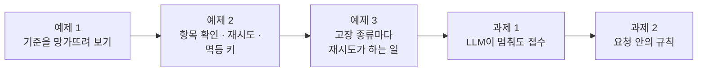
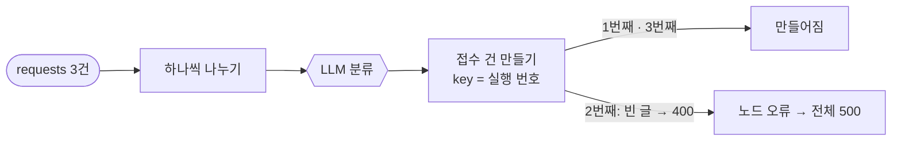
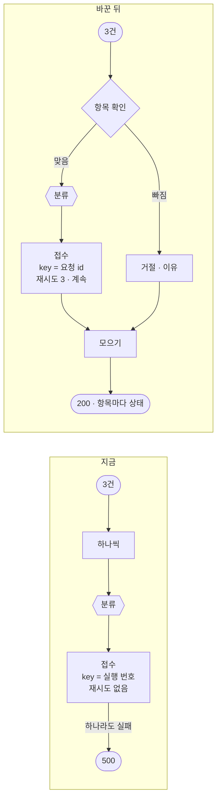
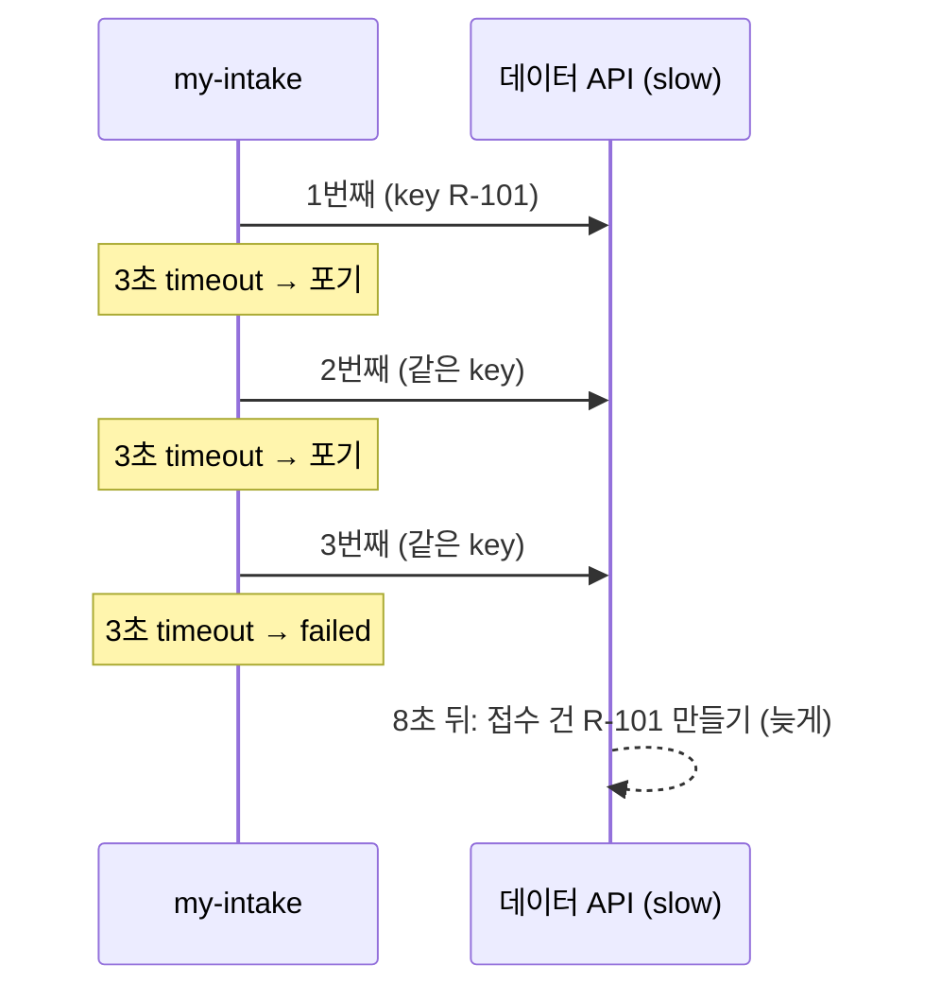
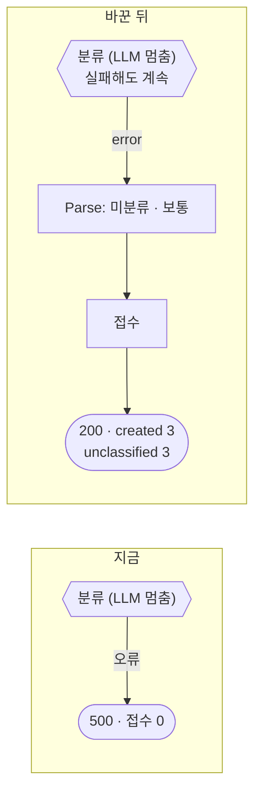
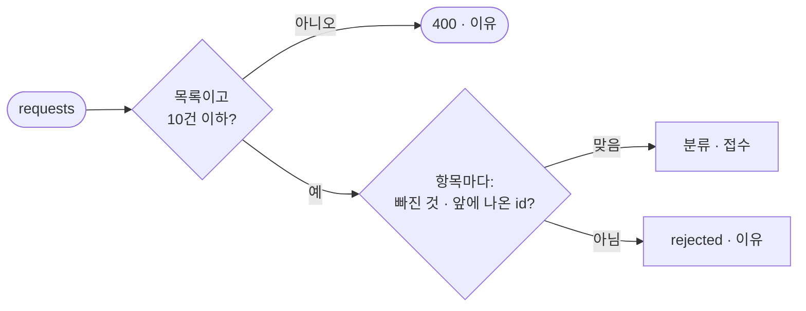

# Lab 01 · 실패를 겪어 보고, 항목마다 처리하고, 중복 없이 다시 해 보기

- 관련 강의: [1단계 · 실패의 종류](../../Lecture/76/01-STAGE1-FAILURE-TYPES.md)
- 소요 시간: 50분 (2교시 한 시간) · 예제 1 10분 · 예제 2 15분 · 예제 3 7분 · 과제 1 8분 · 과제 2 10분
- 준비: [실습 준비](../../Lecture/76/00-DAY76-PREP.md)의 `doctor` → `ready`, `base-intake` · `nightly-report` 게시
- 목표: 여러 건을 한 번에 처리할 때 **한 건의 실패가 전체를 망치지 않게** 한다. 잘못된 항목은 그 항목만 거절하고, 잠깐의 실패는 다시 해 보고, 다시 해도 **접수 건이 두 번 생기지 않게** 한다. 고장 종류마다 재시도가 무엇을 하는지 재 보고, LLM이 멈춰도 접수는 하고, 요청 안의 규칙(같은 id · 10건 상한)을 지킨다.



> 복사해 붙일 요청문은 없습니다. 막히면 `▶` 를 하나씩 펼칩니다. 연습이 끝나면 `uv run tools/flow.py ops --reset`.

## 시작하기 · 터미널 두 개

| 터미널 | 하는 일 |
| --- | --- |
| ① 에이전트 | `cd ~/aio-01d4-stu/Last3Mon/76` 후 `codex` (또는 `claude`, `agy`). 내가 쓴 요청문을 보낸다 |
| ② 확인 | `cd ~/aio-01d4-stu/Last3Mon/76` 에서 `call` · `push` · `test` · `ops` · `fault`를 **내가** 실행한다 |

`cp templates/RUNBOOK-TEMPLATE.md my-work/RUNBOOK.md` 후 표를 채워 갑니다. 쓴 요청문은 `my-work/PROMPTS.md`에 모읍니다.

## 예제 1 · 기준을 망가뜨려 보기 (10분, 에이전트 없이)

### 이 실습의 의도

**한 줄로:** 오늘 고칠 기준 워크플로우(`base-intake`)가 실패할 때 **무엇을 숨기는지** 직접 봅니다. 고치는 것은 예제 2부터이고, 여기서는 **망가뜨려 보고 적기만** 합니다.

> **생활 속 예 · 마트 계산대.** 계산원이 "결제 실패"라고만 했는데 영수증을 보니 앞의 물건은 이미 결제돼 있다면, 다시 계산하면 두 번 냅니다. 예제 1은 일부러 이런 상황을 만들어, **들은 말**(워크플로우의 답, `call`)과 **실제로 일어난 일**(영수증, `ops`)을 나란히 보는 실습입니다.

**상황.** `base-intake`는 문의 여러 건(`requests[]`)을 한 번에 받아, 한 건씩 LLM으로 분류하고 데이터 API에 접수 건을 만듭니다. 정상 요청이면 잘 됩니다. 그런데 운영하다 보면 이런 일이 생깁니다.

- 보낸 문의 중 하나가 잘못됨 (글이 비어 있음)
- 데이터 API가 잠깐 끊김
- 사용자가 답을 못 받았다며 같은 요청을 다시 보냄

이 셋을 하나씩 일부러 일으켜, **사용자가 받은 답**과 **데이터 API에 실제로 생긴 접수 건**을 나란히 봅니다. 둘이 다르면 그것이 오늘 고칠 문제입니다.

**실험 셋.**

| 실험 | 일으키는 것 | 보낼 요청 | 볼 것 |
| --- | --- | --- | --- |
| ① 잘못된 항목 | 3건 중 가운데 글이 빔 | `batch-bad-item` (R-201 · 빈 R-202 · R-203) | 답은 성공인가 실패인가? 그런데 `ops`에 접수 건이 생겼나, 몇 개? |
| ② 잠깐의 끊김 | `fault tickets flaky`: 접수 건 만들기가 키마다 첫 시도만 실패 | `batch-two` (R-301 · R-302) | 한 번만 더 했으면 됐을 실패를 기준은 어떻게 끝내나? |
| ③ 다시 보내기 | 고장을 끄고 정상 3건을 한 번 더 | `batch-ok` (R-101~103) 두 번째 | 같은 문의의 접수 건이 몇 개가 되나? `ops`의 `key` 칸이 첫 번째와 같나? |

`call`은 웹훅을 한 번 불러 **워크플로우의 답**을 보여 주고, `ops`는 데이터 API에 지금 있는 접수 건 · DLQ · 알림 · 고장 스위치를 보여 줍니다. `ops`는 답이 아니라 **실제로 생긴 것**을 보는 창입니다. 두 화면을 번갈아 봅니다.

**끝나면 알게 되는 것.** 기준은 ① 한 건 때문에 전체를 실패라고 하면서 다른 건은 이미 만들었고, ② 잠깐의 끊김도 바로 실패로 끝내고, ③ 같은 문의를 다시 보내면 또 만듭니다. 예제 2에서 이 셋을 **항목 확인 · 재시도 · 멱등 키**로 하나씩 고칩니다.

**적을 곳.** `my-work/RUNBOOK.md` 1.1 표 (한 일 · 사용자가 본 것 · 실제로 생긴 것), 실험마다 한 줄.

```bash
uv run tools/flow.py ops --reset                                      # 접수 건 · DLQ · 알림 비우기, 고장 스위치 모두 ok

# 0. 정상일 때 (비교 기준)
uv run tools/flow.py call base-intake requests/batch-ok.json          # 정상 3건

# ① 잘못된 항목
uv run tools/flow.py call base-intake requests/batch-bad-item.json    # 가운데 항목의 text가 비어 있음
uv run tools/flow.py ops                                              # 답은 실패였는데, 접수 건은 몇 개?

# ② 잠깐의 끊김
uv run tools/flow.py fault tickets flaky                              # 접수 건 만들기가 키마다 첫 시도에 실패
uv run tools/flow.py call base-intake requests/batch-two.json
uv run tools/flow.py fault tickets ok                                 # 고장 끄기

# ③ 다시 보내기
uv run tools/flow.py call base-intake requests/batch-ok.json          # 0번과 같은 요청을 다시
uv run tools/flow.py ops                                              # VPN 문의(R-101)의 접수 건은 몇 개? key는?
```

### 이해하기

**여러 건을 한 번에 처리하는 일(일괄 처리, batch)에는 "반쯤 된" 상태가 있습니다.** 한 건만 처리하면 결과는 됐다 · 안 됐다 둘 중 하나입니다. 세 건을 처리하다 두 번째에서 멈추면 첫 번째는 이미 끝났고, 세 번째는 했는지 안 했는지 모릅니다. 그런데 사용자에게는 `500` 하나만 갑니다.



**오늘 기준이 가진 문제 셋.**

| 문제 | 겉으로 | 실제로 |
| --- | --- | --- |
| 한 건의 실패가 전체를 멈춤 | HTTP 500 · `Error in workflow` | 다른 건은 이미 접수됨 (부분 처리) |
| 잠깐의 실패도 바로 실패 | 500 | 1초 뒤에 다시 했으면 됐을 것 |
| 다시 보내면 또 만듦 | 200 · 접수 건 번호 3개 | 같은 문의의 접수 건이 둘 (중복) |

**왜 중복이 생기나.** 기준은 접수 건을 만들 때 키를 `$execution.id + '-' + $itemIndex`(이번 실행 번호와 순서)로 정합니다. 같은 문의를 다시 보내면 실행 번호가 다르니 데이터 API는 다른 요청으로 봅니다. "같은 문의"를 알아보게 하려면 **실행마다 바뀌지 않는 것**(요청의 `id`)이 키여야 합니다 (예제 2).

**고장 스위치.** 오늘 데이터 API에는 접수 건 만들기(`tickets`)와 DLQ(`dlq`)에 고장 스위치가 있습니다. `flaky`는 키마다 첫 시도만 실패시킵니다 (잠깐의 끊김), `error`는 늘 500, `slow`는 8초를 기다린 뒤 답합니다. 연습이 끝나면 `ops --reset`이 접수 건 · DLQ · 알림을 비우고 스위치를 모두 `ok`로 돌립니다.

**기대 결과.** 빈 글 하나가 섞인 3건 → 500인데 접수 건 2개가 생깁니다. `flaky`에서는 500. 같은 정상 3건을 두 번 보내면 VPN 문의의 접수 건이 두 개가 됩니다. `RUNBOOK.md` 1절에 "사용자가 본 것 / 실제로 생긴 것"을 나란히 적습니다.

<details><summary>▶ 1단계 · 실패를 나누기</summary>

| 실패 | 다시 하면 되나 |
| --- | --- |
| 입력이 잘못됨 (빈 글) | 아니오 — 몇 번을 해도 같음 |
| API가 잠깐 실패 | 예 |
| API가 오래 멈춤 | 지금은 아니오, 나중에는 예 |

이 셋을 똑같이 "500"으로 끝내면 무엇을 잃을까요? 사용자는 무엇을 할까요?
</details>

<details><summary>▶ 2단계 · 중복은 왜 생기나</summary>

`ops`의 `key` 칸을 봅니다. 두 번째 `batch-ok`의 키는 첫 번째와 같나요? 같은 요청을 알아보게 하려면 무엇을 키로 써야 할까요?
</details>

### 실행 결과 · 기준을 망가뜨려 보기

수업 준비 때(10/29) 강사 노트북에서 실제로 나온 출력입니다 (줄임). LLM 분류 · 시간 · 접수 건 번호의 순서는 실행마다 조금씩 다를 수 있고, 500 · 접수 건 수는 같아야 합니다.

```text
$ call base-intake requests/batch-ok.json
HTTP 200 · 5.2s   {"processed": 3, "tickets": ["T-2001", "T-2002", "T-2003"]}

$ call base-intake requests/batch-bad-item.json
HTTP 500 · 3.2s   {"message": "Error in workflow"}

$ ops
created tickets: 5
  T-2004  key 10058-0  장비/보통  프린터 용지가 걸려요
  T-2005  key 10058-2  소프트웨어/보통  메일 첨부가 안 열려요

$ fault tickets flaky   →   call base-intake requests/batch-two.json
HTTP 500 · 2.5s   {"message": "Error in workflow"}

$ fault tickets ok   →   call base-intake requests/batch-ok.json
HTTP 200 · 3.0s   {"processed": 3, "tickets": ["T-2006", "T-2008", "T-2007"]}

$ ops
created tickets: 8
  T-2006  key 10060-0  네트워크/높음  VPN이 아침부터 계속 끊겨서 고객 미팅을 못 하고 있
```

**왜 이렇게 나왔나**

- 빈 글이 섞인 요청은 **500인데 접수 건이 2개(T-2004 · T-2005) 생겼습니다.** 접수 건 만들기 노드가 1번째 · 3번째는 만들고, 2번째에서 데이터 API가 `title`이 비었다고 400을 주자 노드가 오류로 멈췄기 때문입니다. 사용자는 "실패"로 알고 다시 보낼 것이고, 그러면 두 건이 또 생깁니다.
- `flaky`에서 500: 첫 시도만 실패하는 **잠깐의 끊김**인데도 기준에는 재시도가 없어 바로 멈췄습니다.
- 같은 정상 3건을 다시 보내자 **새 번호 3개(T-2006~2008)** 가 생겼습니다. VPN 문의 접수 건이 T-2001 · T-2006 둘입니다. 키가 `10057-0` → `10060-0`처럼 실행 번호라서, 데이터 API는 같은 문의인 줄 모릅니다.

## 예제 2 · 항목 확인 · 재시도 · 멱등 키 (15분)

### 이 실습의 의도

**한 줄로:** 예제 1에서 본 세 문제를 내 워크플로우(`my-intake`)에서 고칩니다. Lab 01의 중심 실습입니다.

> **생활 속 예 · 택배 배송 조회 + 송장 번호.** 좋은 택배 회사는 ① 상자마다 "배달 완료 / 주소 불명 반송"을 따로 보여 주고(부분 성공), ② 벨을 눌러 대답이 없으면 한 번 더 눌러 보고(재시도), ③ 같은 송장 번호의 상자는 두 번 배달하지 않습니다(멱등 키). 예제 2는 `my-intake`를 이런 택배 회사로 만드는 실습입니다.

| 예제 1의 문제 | 고치는 방법 | 확인하는 테스트 케이스 |
| --- | --- | --- |
| ① 한 건이 잘못되면 전체 500, 다른 건은 이미 접수 | 항목마다 확인해 잘못된 것만 `rejected`, 결과는 늘 200에 항목마다 상태 (부분 성공) | 잘못된 항목 · 목록이 아님 |
| ② 잠깐의 끊김도 바로 실패 | 접수 건 만들기 노드에 재시도 3번, 그래도 실패면 `failed`로 적고 계속 | 가끔 실패 (`flaky`) |
| ③ 다시 보내면 또 만듦 | 접수 건의 `key`를 실행 번호 대신 요청 `id`(R-101)로 | 같은 요청을 다시 · 접수 건 수 |

**왜 셋을 한 번에.** 셋은 서로 기대고 있습니다. 재시도(②)를 넣으면 n8n은 노드에 들어온 항목을 **모두** 다시 보냅니다. 이미 만든 접수 건도 또 보내므로, 멱등 키(③) 없이는 재시도가 중복을 만듭니다. 그리고 재시도 뒤에도 실패한 항목을 `failed`로 남기려면 항목마다 상태를 담는 결과 모양(①)이 먼저 있어야 합니다.

**순서.** 기준을 복사 → 같은 테스트를 **기준에 먼저** 돌려 0/6을 봄 (무엇이 틀렸는지 케이스마다 확인) → 요청문을 써서 에이전트에게 고치게 함 → push → 6/6.

**끝나면 알게 되는 것.** "일부가 실패해도 200 + 항목마다 상태"가 왜 500보다 정직한지, n8n 재시도가 노드의 어디에 붙고 무엇을 다시 보내는지, 멱등 키가 재시도를 어떻게 안전하게 만드는지.

**만들 것**: 기준을 복사해, 항목마다 확인하고, 접수 건 만들기를 다시 해 보게 하고, 요청 `id`를 멱등 키로. 결과는 늘 200 (부분 성공).

```bash
cp reference/baseline-intake.json my-work/intake.json
uv run tools/flow.py test cases/lab01.json --webhook base-intake -v     # 고치기 전 (기준에 같은 테스트)
```

| 조건 | 값 |
| --- | --- |
| 파일 · 웹훅 | `my-work/intake.json` · `my-intake` (경로 · 이름을 바꿈) |
| 거절 | id · user · text가 없는 항목 → `rejected`와 이유, 나머지는 처리 |
| 재시도 | timeout 3초, 3번, 0.3초 간격 · 그래도 실패면 `failed` (멈추지 않음) |
| 결과 · 400 | [AGENTS.md](AGENTS.md) 3절 (`requests`가 목록이 아니면 400) |
| 기대 결과 | `cases/lab01.json` |

### 이해하기

**지금 무엇이 문제인가.** 예제 1의 세 문제(한 건이 전체를 멈춤 · 잠깐의 실패도 실패 · 다시 보내면 중복)를 한 번에 고칩니다. 셋은 따로 보이지만 서로 이어져 있습니다. 재시도를 넣으면 **이미 만든 건을 또 보내게** 되므로, 재시도와 멱등 키는 늘 함께 갑니다.



**부분 성공.** 결과는 늘 HTTP 200이고, 항목마다 `created` · `failed` · `rejected`와 이유를 담습니다. "모두 되거나 500" 대신 "무엇이 되고 무엇이 안 됐는지"를 알려 줍니다. 받는 쪽은 `rejected`는 고쳐서, `failed`는 나중에 다시 보내면 됩니다.

**n8n의 재시도는 노드 단위입니다.** `retryOnFail` · `maxTries` · `waitBetweenTries`는 노드 **바로 아래**(`parameters` 밖)에 둡니다. 그리고 그 노드에 들어온 **항목을 모두** 다시 보냅니다. 세 건 중 하나만 실패해도 세 건을 다시 보냅니다. 그래서 키가 필요합니다.

**멱등 키(idempotency key).** 같은 요청을 몇 번 보내도 결과가 한 번 한 것과 같게 하는 표시입니다. 오늘 데이터 API는 `POST /tickets`의 `key`가 같으면 새로 만들지 않고 처음 번호를 돌려줍니다 (`duplicate: true`).

| 키 | 같은 요청을 다시 보내면 |
| --- | --- |
| 실행 번호 (`$execution.id`) | 매번 새 키 → 중복 |
| **요청 `id`** (`R-101`) | "이미 만든 건" → 같은 번호, `duplicate: true` |

**실패해도 다음으로.** 재시도 뒤에도 실패한 항목에서 멈추면 안 됩니다. `onError: continueRegularOutput`이면 실패한 항목이 `error`를 가진 채 다음 Code로 갑니다. 다음 Code는 앞 노드(`Parse`)의 항목과 **같은 순서**로 맞춰 `created` / `failed`를 정합니다.

**테스트 케이스.**

| 케이스 | 보내는 것 | 기대 |
| --- | --- | --- |
| 정상 3건 | `batch-ok` | `created: 3` |
| 같은 요청을 다시 | `batch-ok` 또 | `created: 3, duplicates: 3` |
| 접수 건 수 | `/tickets-created/list` | `count: 3` (중복 없음) |
| 잘못된 항목 | `batch-bad-item` | `created: 2, rejected: 1`, 이유 `text is required` |
| 목록이 아님 | `not-a-list` | HTTP 400 |
| 가끔 실패 | `flaky` + `batch-two` | `created: 2, failed: 0` (재시도로 성공) |

**기대 결과.** 고치기 전(기준에 같은 테스트) 0/6, 고친 뒤 6/6.

<details><summary>▶ 1단계 · 거절한 항목은 어디로</summary>

거절한 항목은 LLM · API로 보내지 않습니다. 하지만 결과에는 있어야 합니다. 두 갈래(처리 · 거절)를 다시 하나로 모으는 노드가 [AGENTS.md](AGENTS.md) 5절에 있습니다. 두 번째 입력은 `index: 1`.
</details>

<details><summary>▶ 2단계 · 재시도와 중복</summary>

n8n 노드의 재시도는 그 노드에 들어온 **항목을 모두** 다시 보냅니다. 이미 성공한 항목도요. 멱등 키가 있으면 데이터 API가 "이미 만든 건"이라며 같은 번호를 돌려줍니다 (`duplicate: true`).
</details>

<details><summary>▶ 3단계 · 실패한 항목도 다음으로</summary>

재시도 뒤에도 실패한 항목에서 워크플로우가 멈추면 안 됩니다. 실패한 항목이 `error`를 가진 채 다음 노드로 가게 하는 설정과, 다음 Code에서 앞 노드 항목과 순서를 맞추는 방법을 요청문에 적습니다.
</details>

<details><summary>▶ 빈칸 채우기 · 요청문(프롬프트) 뼈대</summary>

요청문에 꼭 들어갈 것: **① 파일 · 웹훅 ② 항목 확인과 거절 이유 ③ 재시도 설정과 실패해도 계속 ④ 멱등 키 ⑤ 두 갈래 모으기 ⑥ 결과 모양 · 기대 결과**. 아래 빈칸 4개(`____①`~`____④`)를 채워 `my-work/PROMPTS.md`에 쓴 뒤 에이전트에게 보냅니다.

```text
my-work/intake.json (baseline 을 복사한 것) 의 웹훅 경로를 my-intake 로, 이름을 "76 Intake (my)" 로 바꿔 줘.
requests 가 목록이 아니면 400 {"error": "requests must be a list"}.
항목마다 id · user · text 를 확인해서, 빠진 것이 있으면 LLM 과 API 로 보내지 말고 status rejected 와 이유("text is required" 등)로.
Create ticket 노드에 timeout 3000ms, 재시도 ____① 번, 간격 300ms, 그리고 실패해도 다음으로 가게 onError ____② .
접수 건의 key 는 ____③ (실행 번호가 아님).
처리한 갈래와 거절한 갈래를 Merge 로 모아 AGENTS.md 3절 결과 모양으로, HTTP ____④ .
기대 결과 cases/lab01.json.
```

빈칸 힌트 (답이 아니라 **어디서 찾고 무엇을 생각하나**):

- ① 위 조건 표의 "재시도"입니다. 처음 한 번을 포함한 수입니다.
- ② AGENTS.md 5절 접수 건 만들기 노드의 설정입니다. 멈추지 않고 실패한 항목이 다음으로 가는 값.
- ③ 같은 문의를 다시 보내도 **바뀌지 않는** 것입니다. 예제 1의 `ops`에서 키가 왜 바뀌었는지 떠올립니다.
- ④ 부분 성공의 상태 코드입니다. 일부가 실패해도 이것.

채운 요청문은 수업 뒤 공개되는 정답본의 요청문 예와 비교합니다. 노드 이름은 내 파일의 실제 이름을 씁니다.
</details>

```bash
uv run tools/flow.py push my-work/intake.json
uv run tools/flow.py test cases/lab01.json -v
uv run tools/flow.py ops
```

### 실행 결과 · 항목 확인 · 재시도 · 멱등 키

수업 준비 때(10/29) 강사 노트북에서 정답 워크플로우로 실제로 나온 출력입니다. 시간은 실행마다 조금씩 다르고, ✔ · ✘는 같아야 합니다.

고치기 전 (`test cases/lab01.json --webhook base-intake`)

```text
✘ 정상 3건 · 2.7s · created = null (expected 3); failed = null (expected 0); rejected = null (expected 0)
✘ 같은 요청을 다시 보내도 중복 없음 · 3.1s · created = null (expected 3); duplicates = null (expected 3)
✘ 만들어진 접수 건은 3개 · 0.0s · count = 6 (expected 3)
✘ 잘못된 항목은 그 항목만 거절 · 3.4s · status 500 (expected 200); ...
✘ 목록이 아니면 400 · 0.1s · status 500 (expected 400)
✘ 가끔 실패하는 API · 다시 해 보기로 성공 · 2.0s · status 500 (expected 200); ...
Passed 0/6
```

고친 뒤 (`test cases/lab01.json`)

```text
✔ 정상 3건 · 3.9s
✔ 같은 요청을 다시 보내도 중복 없음 · 3.1s
✔ 만들어진 접수 건은 3개 · 0.0s
✔ 잘못된 항목은 그 항목만 거절 · 1.7s
✔ 목록이 아니면 400 · 0.0s
✔ 가끔 실패하는 API · 다시 해 보기로 성공 · 2.4s
Passed 6/6
```

**왜 이렇게 나왔나**

- 고치기 전에 `created = null`인 것은 기준의 결과가 `{processed, tickets}` 모양이라 오늘 계약의 칸이 없기 때문입니다. 접수 건이 **6개**(3이 기대)인 것은 같은 3건을 두 번 보내 중복이 생겼기 때문입니다. 목록이 아닌 본문도 확인 없이 하나씩 나누다 500이 되었습니다.
- 고친 뒤 두 번째 `batch-ok`는 `created: 3, duplicates: 3`입니다. 키가 `R-101`처럼 요청 `id`라서 데이터 API가 처음 번호를 돌려줬습니다. 접수 건은 3개 그대로.
- `flaky`에서 2건 모두 `created`: 첫 시도가 500이었지만 0.3초 뒤 두 번째 시도에서 성공했습니다. 재시도는 두 건을 **모두** 다시 보냈지만, 키 덕분에 중복이 생기지 않았습니다.
- 잘못된 항목 케이스가 1.7초로 빠른 것은 빈 글 하나를 LLM에 보내지 않고 거절했기 때문입니다.

## 예제 3 · 고장 종류마다 재시도가 하는 일 (7분, 에이전트 없이)

### 이 실습의 의도

**한 줄로:** 예제 2에서 넣은 재시도가 **어떤 고장에는 도움이 되고, 어떤 고장에는 시간만 늘리는지** 재 봅니다. 워크플로우는 고치지 않고(에이전트 없이), 데이터 API의 고장 종류만 바꿔 가며 같은 `my-intake`를 부릅니다.

> **생활 속 예 · 전화 다시 걸기.** 통화 중이면 다시 걸면 됩니다(`flaky`). 상대 전화국이 고장이면 열 번 걸어도 시간만 갑니다(`error`). 상대가 받았는데 말소리가 늦게 들려 내가 먼저 끊었다면, 상대는 사실 내 말을 다 들었을 수 있습니다(`slow`). 예제 3은 세 경우에 "다시 걸기"가 각각 무엇을 하는지 재 봅니다.

**왜 하나.** 재시도를 넣으면 "이제 실패는 해결"이라고 생각하기 쉽습니다. 하지만 고장은 종류가 다릅니다.

| 고장 스위치 | 현실에서는 | 물어볼 것 |
| --- | --- | --- |
| `flaky` | 네트워크가 잠깐 끊김 · 서버가 한 번 버벅임 | 재시도가 구해 주나? |
| `error` | 데이터 API가 죽음 (몇 분 · 몇 시간) | 세 번 다시 하면 달라지나? 무엇이 늘어나나? |
| `slow` | 데이터 API가 느림 (8초) — 우리는 3초만 기다림 | 우리가 "실패"라고 포기한 요청은 정말 실패했나? |

`cases/lab01-faults.json`이 이 셋을 차례로 켜고, 마지막에 8초를 기다린 뒤 접수 건 목록을 봅니다. **`slow`에서 포기한 3건이 나중에 생겼는지**가 이 예제의 핵심 관찰입니다.

**끝나면 알게 되는 것.** 재시도는 잠깐의 실패에만 약이고, 오래 멈춘 고장에는 다른 그물(Lab 02의 DLQ)이 필요하며, 시간 초과는 "실패"가 아니라 "모름"이라서 멱등 키가 꼭 있어야 한다는 것.

**적을 곳.** `my-work/RUNBOOK.md` 1.2 표 (고장 · 걸린 시간 · 결과 · 실제로 생긴 접수 건).

```bash
uv run tools/flow.py test cases/lab01-faults.json -v
uv run tools/flow.py ops
```

### 이해하기

**재시도는 잠깐의 실패에만 약입니다.**

| 고장 | 무엇 | 재시도를 하면 |
| --- | --- | --- |
| `flaky` (잠깐 끊김) | 키마다 첫 시도만 500 | 두 번째에 성공 → **좋아짐** |
| `error` (멈춤) | 늘 500 | 세 번 다 실패 → 결과는 같고 **시간만 더** |
| `slow` (느림) | 8초 뒤에 답 | 3초마다 끊고 다시 → 세 번 × 3초 + 간격, 그래도 실패 |



**시간 초과(timeout)는 "실패"가 아니라 "모름"입니다.** 3초 안에 답이 오지 않아 포기했지만, 데이터 API는 요청을 받았고 8초 뒤에 **접수 건을 만들었습니다.** 워크플로우는 `failed`라고 말하지만 실제로는 만들어져 있습니다. 이때 같은 키로 다시 보내면 `duplicate: true`로 처음 번호를 받습니다. 멱등 키가 없었다면 두 번째 접수 건이 생깁니다. 이것이 **"시간 초과 뒤 재시도"에 멱등 키가 꼭 필요한** 까닭입니다 (Lab 03 예제 3에서 재처리로 다시 봄).

**재시도는 사용자를 기다리게 합니다.** `slow`에서 사용자는 3초 × 3번 + 간격 + LLM 분류 = 12초쯤 기다리고 `failed`를 받습니다. "재시도를 늘리면 더 잘 된다"가 아니라, **기다릴 수 있는 시간 안에서** 몇 번 할지 정합니다 (바이브 코딩 `tretry`의 마감 `--deadline`).

**테스트 케이스.** 이 파일은 내 워크플로우를 바꾸지 않고 **고장만 바꿔 가며** 잽니다.

| 케이스 | 고장 | 기대 |
| --- | --- | --- |
| flaky | `tickets flaky` · `batch-two` | `created: 2` |
| error | `tickets error` · `batch-ok` | `failed: 3` |
| slow | `tickets slow` · `batch-ok` | `failed: 3` (오래 걸림) |
| 늦게 만들어짐 | 8초 기다린 뒤 `/tickets-created/list` | `count: 5` (flaky 2 + 실패라던 3) |
| 다시 보냄 | `ok` · `batch-ok` | `created: 3, duplicates: 3` |

**기대 결과.** 5/5. 시간은 flaky < error < slow이고, slow는 10초가 넘습니다. 실패라던 3건이 접수 건 목록에 있습니다.

<details><summary>▶ 1단계 · error에서 3번은 좋은가</summary>

데이터 API가 한 시간 멈췄다면, 요청마다 세 번씩 보내는 것은 무엇을 늘릴까요? 그 사이 다른 워크플로우도 똑같이 세 번씩 보낸다면? (강의 1단계 "재시도 폭풍")
</details>

<details><summary>▶ 2단계 · failed인데 만들어진 건</summary>

결과의 `failed` 3건과 `ops`의 접수 건 목록을 나란히 봅니다. 사용자에게 "실패"라고 말한 것이 사실은 됐다면, 사용자는 무엇을 할까요? 그때 무엇이 중복을 막나요?
</details>

### 실행 결과 · 고장 종류마다

수업 준비 때(10/29) 강사 노트북에서 예제 2 정답으로 실제로 나온 출력입니다. 시간은 실행마다 조금씩 다르고, ✔ · ✘는 같아야 합니다.

`test cases/lab01-faults.json` (결과 줄과 이유만)

```text
✔ flaky · 다시 해 보면 됨 · 2.4s
✔ error · 세 번 해도 실패 · 3.4s
      "reason": "500 - \"{\"error\": \"tickets service is failing (fault switch)\"}\""
✔ slow · 3초씩 세 번 기다리다 실패 · 12.4s
      "reason": "timeout of 3000ms exceeded"
… before: wait 8s
✔ 실패라던 3건이 늦게 만들어짐 (2 + 3) · 0.0s
✔ 같은 요청을 다시 · 멱등 키로 중복 없음 · 2.9s
Passed 5/5

$ ops
created tickets: 5
  T-2001  key R-301 · T-2002  key R-302 · T-2003  key R-103 · T-2004  key R-102 · T-2005  key R-101
```

**왜 이렇게 나왔나**

- `flaky` 2.4초: 첫 시도 500 → 0.3초 뒤 두 번째 성공. 재시도가 **도움이 된** 경우입니다.
- `error` 3.4초: 세 번 모두 500이라 `failed: 3`. 재시도가 결과를 바꾸지 못하고 시간만 더했습니다 (분류 약 2.5초 + 시도 셋과 간격 둘).
- `slow` 12.4초: 시도마다 3초에 끊겨(`timeout of 3000ms exceeded`) 세 번 실패했습니다. 사용자는 12초를 기다리고 실패를 받았습니다.
- 그런데 8초 뒤 접수 건이 **5개**입니다. 실패라던 R-101 · R-102 · R-103이 늦게 만들어졌습니다 (데이터 API가 8초 뒤 처리). 시도는 9번 갔지만 키가 같아 3건만 생겼습니다.
- 마지막에 같은 3건을 다시 보내자 `duplicates: 3`: 이미 있는 것을 알아보고 새로 만들지 않았습니다.

## 과제 1 · LLM이 멈춰도 접수는 (8분)

### 이 실습의 의도

**한 줄로:** LLM(OpenAI)이 멈춰도 **문의 접수는 계속** 되게 합니다. 분류만 "미분류"로 줄여서.

> **생활 속 예 · 카드 단말기가 고장 난 편의점.** 단말기가 안 된다고 문을 닫지 않고 "오늘은 현금만"으로 판매를 계속합니다. 과제 1은 LLM(단말기)이 멈춰도 접수(판매)는 "미분류"로 계속하게 하는 실습입니다.

**상황.** 지금 `my-intake`는 분류(LLM) → 접수 순서입니다. 키가 잘못되거나 OpenAI에 장애가 나면 분류 노드에서 멈추고 500이 나며, 접수 건은 하나도 생기지 않습니다. 그 사이 들어온 문의는 모두 사라집니다. 분류는 나중에 사람이 해도 되지만, 접수되지 않은 문의는 아무도 모릅니다.

**어떻게 시험하나.** 실제 OpenAI 장애를 기다릴 수는 없으니 "LLM이 멈춘 상태"를 만듭니다. `cases/lab01-challenge.json`의 한 케이스가 `llm down`으로 n8n의 OpenAI Credential을 일부러 틀린 키로 바꾸고, 끝나면 `llm up`으로 진짜 키를 되돌립니다.

| 볼 것 | 고치기 전 | 고친 뒤 기대 |
| --- | --- | --- |
| LLM이 멈췄을 때 답 | 직접 확인 | 200, `created: 3, unclassified: 3` |
| 접수 건의 분류 | 직접 확인 | `미분류` |
| 평소 요청 | 분류됨 | 그대로 분류됨 |

**예제 2와의 관계.** 예제 2에서 접수 건 만들기 노드에 쓴 "실패해도 계속"을 이번에는 **분류 노드**에 씁니다. 같은 설정, 다른 노드입니다. 그리고 분류 결과를 읽는 Code가 "실패한 분류"를 알아보고 대신 넣을 값을 정합니다.

**끝나면 알게 되는 것.** 핵심 일(접수)과 덧붙인 일(분류)을 나누고, 덧붙인 일이 실패하면 줄여서라도 핵심 일을 끝내는 법(우아한 성능 저하), 그리고 줄인 양(`unclassified`)을 숨기지 않는 법.

팀장이 요청했습니다.

> "AI 분류가 안 된다고 문의 접수까지 막히면 안 돼요. 분류는 나중에 사람이 해도 되니, 일단 '미분류'로 받아 주세요."

```bash
uv run tools/flow.py test cases/lab01-challenge.json -v      # 고치기 전
```

| 조건 | 값 |
| --- | --- |
| LLM이 실패하면 | `category: 미분류`, `priority: 보통`으로 접수 (결과의 `unclassified`에 셈) |
| 기대 결과 | `cases/lab01-challenge.json` (케이스 하나가 `llm down`, 끝나면 `llm up`) |

### 이해하기

**핵심 일과 덧붙인 일.** 접수는 이 워크플로우의 **핵심 일**입니다. 분류는 접수를 돕는 **덧붙인 일**입니다. 덧붙인 일이 실패했다고 핵심 일까지 멈추면, LLM이 멈춘 동안 들어온 문의가 모두 사라집니다. 덧붙인 일은 **줄여서라도** 핵심 일을 끝내게 합니다 (graceful degradation, 우아한 성능 저하).



**72일차와 무엇이 다른가.** 72일차에 LLM이 멈췄을 때는 FAQ 원문으로 "간단 답변"을 했습니다. 오늘은 "미분류로 접수"입니다. 둘 다 같은 생각입니다: LLM 없이도 할 수 있는 몫은 한다. 그리고 **얼마나 줄였는지를 숨기지 않습니다** — `unclassified` 수가 있어야 나중에 사람이 몇 건을 분류해야 하는지 압니다.

**테스트 케이스.**

| 케이스 | 하는 것 | 기대 |
| --- | --- | --- |
| 평소 | `batch-two` | `created: 2, unclassified: 0` |
| LLM 멈춤 | `llm down` · `batch-ok` · `llm up` | `created: 3, unclassified: 3, failed: 0` |
| 접수 건 확인 | `/tickets-created/list` | 분류에 `미분류`가 있음 |

**기대 결과.** 고치기 전 1/3 (LLM 멈춤에서 500), 고친 뒤 3/3. `lab01`도 그대로 6/6.

**먼저 생각해 보기 (2분)**: 어떤 일은 LLM 없이도 해야 하고, 어떤 일은 LLM 없이는 할 수 없나요? 오늘 문의 접수에서 LLM이 없으면 무엇을 잃나요?

<details><summary>▶ 1단계 · 실패한 분류를 알아보기</summary>

분류 노드가 실패한 항목은 답 글자(`output`) 대신 `error`를 가집니다. 노드가 실패한 항목을 다음으로 넘기게 설정하고, 다음 Code가 `error`를 보고 "미분류"로 정하게 합니다. LLM이 JSON이 아닌 글을 돌려준 경우도 같이 생각합니다.
</details>

<details><summary>▶ 빈칸 채우기 · 요청문(프롬프트) 뼈대</summary>

요청문에 꼭 들어갈 것: **① 고칠 파일 ② 분류 노드가 실패해도 계속 ③ 실패를 알아보는 법과 대신 넣을 값 ④ 결과에 셀 칸 ⑤ 기대 결과**. 빈칸 4개를 채웁니다.

```text
my-work/intake.json 에서 Classify(AI Agent) 노드가 실패해도 워크플로우가 멈추지 않게 onError ____① 로 해 줘.
Parse 에서 그 항목에 ____② 가 있거나 output 이 JSON 이 아니면 category "____③", priority "보통" 으로.
결과의 ____④ 에 미분류로 접수한 수를 세어 줘. 나머지는 그대로.
기대 결과 cases/lab01-challenge.json, cases/lab01.json 도 그대로 통과.
```

빈칸 힌트:

- ① 예제 2의 `Create ticket`에 쓴 것과 같은 값입니다 (AGENTS.md 5절 AI Agent).
- ② 실패한 항목이 답 글자 대신 가지는 칸입니다 (▶ 1단계).
- ③ 팀장의 말에 있습니다.
- ④ AGENTS.md 3절 결과 모양에서 미분류 수를 세는 칸입니다.
</details>

```bash
uv run tools/flow.py push my-work/intake.json
uv run tools/flow.py test cases/lab01-challenge.json -v
uv run tools/flow.py test cases/lab01.json
```

### 실행 결과 · LLM이 멈춰도 접수

수업 준비 때(10/29) 강사 노트북에서 실제로 나온 출력입니다.

고치기 전 (예제 2 정답)

```text
✔ 평소에는 분류됨 · 2.1s
✔ OpenAI credential: broken key (drill). Restore with: uv run tools/flow.py llm up
✘ LLM이 멈추면 미분류로 접수 · 0.8s · status 500 (expected 200); created = null (expected 3); unclassified = null (expected 3); failed = null (expected 0)
✔ OpenAI credential: real key from .env restored
✘ 미분류도 접수 건으로 · 0.0s · tickets has none of ['미분류']
Passed 1/3
```

고친 뒤

```text
✔ 평소에는 분류됨 · 3.5s
✔ LLM이 멈추면 미분류로 접수 · 0.9s
✔ 미분류도 접수 건으로 · 0.0s
Passed 3/3
(lab01 6/6)
```

**왜 이렇게 나왔나**

- 고치기 전 0.8초 만에 500: 키가 틀려 OpenAI가 호출을 거절하자 분류 노드가 오류로 멈췄습니다 (n8n은 `Error in workflow`). 접수 건 만들기까지 가지 못해 3건 모두 사라졌습니다.
- 고친 뒤 0.9초에 `created: 3, unclassified: 3`: 분류는 실패했지만 `Parse`가 `error`를 보고 미분류 · 보통으로 정해 접수했습니다. LLM을 기다리지 않아 오히려 빨랐습니다.
- `llm up`으로 진짜 키를 되돌린 뒤의 `lab01` 6/6은 평소 분류가 그대로라는 뜻입니다.

## 과제 2 · 요청 안의 규칙 (10분)

### 이 실습의 의도

**한 줄로:** 비싼 일(LLM 분류 · 접수)을 하기 **전에** 요청 전체를 보고, 규칙에 맞지 않는 것을 입구에서 막습니다.

> **생활 속 예 · 접수 창구 직원.** 같은 서류를 두 번 내밀면 "방금 접수하셨는데요" 하고 그 자리에서 돌려주고, 서류를 수백 장 한꺼번에 내밀면 "한 번에 10장까지만 받아요"라고 합니다. 안쪽 사무실까지 들고 가서 처리하지 않습니다. 과제 2는 워크플로우 입구에 이 창구 직원을 세우는 실습입니다.

**상황 둘.**

| 상황 | 지금은 | 바라는 것 |
| --- | --- | --- |
| 엑셀에서 복사하다 같은 줄(같은 `id`)이 두 번 | 둘 다 분류 · 접수 시도. 키 덕분에 접수 건은 하나지만 답은 "둘 다 접수" | 두 번째 줄만 `rejected` (`duplicate id in this request`) |
| 한 번에 수백 건 | 모두 처리, 그동안 n8n이 붙잡힘 | 10건이 넘으면 요청 전체를 400으로 거절, 하나도 처리하지 않음 |

**예제 2와의 차이.** 예제 2의 항목 확인은 "이 한 줄에 id · user · text가 있나"였습니다. 이번 규칙은 **다른 줄과 비교해야**(같은 id) 또는 **요청 전체를 봐야**(몇 건인가) 알 수 있습니다.

**왜 멱등 키로 충분하지 않나.** [교안 1단계 8절](../../Lecture/76/01-STAGE1-FAILURE-TYPES.md)의 "멱등 키가 있어도 입구 규칙이 필요한 까닭"을 먼저 읽습니다. 키는 중복 접수 건이라는 **피해**를 막고, 입구 규칙은 쓸데없는 분류와 틀린 숫자라는 **일**을 막습니다.

**시험하는 것.** `batch-dup-id`(R-401 두 번 · R-402), `batch-eleven`(11건), 11건이 400일 때 접수 건이 정말 하나도 안 생겼는지, 평소 요청은 그대로인지.

**끝나면 알게 되는 것.** 항목 규칙과 요청 전체 규칙의 차이, 상한을 넘으면 일부가 아니라 전체를 거절하는 까닭, 입구에서 막으면 얼마나 빨라지는지 (11건을 다 처리할 때와 비교).

> "어떤 팀은 엑셀에서 복사하다 같은 줄을 두 번 넣어 보내요. 그리고 한 번에 수백 건을 보내서 몇 분씩 걸린 적도 있어요. 같은 요청 안에 같은 번호가 또 있으면 두 번째는 받지 말고, 한 번에는 10건까지만 받아 주세요."

```bash
uv run tools/flow.py test cases/lab01-challenge2.json -v     # 고치기 전
```

| 조건 | 값 |
| --- | --- |
| 같은 `id`가 또 | 두 번째부터 `rejected`, 이유 `duplicate id in this request` |
| 10건 넘음 | HTTP 400 `{"error": "too many requests (max 10)"}`, 하나도 처리하지 않음 |
| 기대 결과 | `cases/lab01-challenge2.json`, `lab01` · `lab01-challenge`도 그대로 |

### 이해하기

**입구에서 막기 (validate at the edge).** 잘못된 요청은 비싼 일(LLM · API)을 하기 **전에** 막는 것이 가장 쌉니다. 예제 2의 항목 확인이 "항목 하나"의 규칙이었다면, 이번에는 **요청 전체**의 규칙입니다.

| 규칙 | 어느 수준 | 어기면 |
| --- | --- | --- |
| id · user · text가 있어야 | 항목 | 그 항목만 거절 (나머지는 처리) |
| 같은 요청 안에 같은 id가 또 | 항목 (두 번째) | 두 번째만 거절 |
| 한 번에 10건까지 | 요청 전체 | 요청 전체 400 (하나도 처리하지 않음) |

**왜 같은 id는 멱등 키로 충분하지 않나.** 같은 id 두 개는 키가 같아 접수 건은 하나만 생깁니다. 하지만 결과에는 `created` 2건(하나는 `duplicate: true`)으로 나와, 사용자는 두 건이 접수된 줄 압니다. 그리고 LLM 분류를 두 번 합니다. **입구에서 두 번째를 거절**하면 결과가 정직하고 비용도 덜 듭니다.

**왜 상한인가.** 상한이 없으면 한 요청이 몇 분씩 n8n을 붙잡고, 그동안 다른 요청이 기다립니다. 많은 API가 한 번에 받을 수 있는 수를 정해 둡니다 (예: AWS SQS의 묶음 보내기는 한 번에 10개). 상한을 넘으면 일부만 처리하지 않고 **전체를 거절**합니다. 일부만 처리하면 어디까지 됐는지 사용자가 알기 어렵기 때문입니다.



**테스트 케이스.**

| 케이스 | 보내는 것 | 기대 |
| --- | --- | --- |
| 같은 id 두 번 | `batch-dup-id` (R-401 둘 · R-402) | `created: 2, rejected: 1, duplicates: 0`, 이유 `duplicate id` |
| 11건 | `batch-eleven` | 400, `error`에 `too many` |
| 400이면 아무것도 | `/tickets-created/list` | `count: 2` |
| 평소 | `batch-ok` | `created: 3, rejected: 0` |

**기대 결과.** 고치기 전 1/4, 고친 뒤 4/4. 11건은 LLM을 부르지 않아 빠르게 끝납니다.

<details><summary>▶ 1단계 · 어디에 넣나</summary>

"목록인가"를 보는 곳이 이미 있습니다 (예제 2의 400). 상한은 그 자리에, 같은 id는 항목을 확인하는 Code에서 **앞에서 본 id를 기억해** 둡니다. 400의 이유가 둘(목록이 아님 · 너무 많음)이 되므로 응답 글도 나눠야 합니다.
</details>

<details><summary>▶ 빈칸 채우기 · 요청문(프롬프트) 뼈대</summary>

요청문에 꼭 들어갈 것: **① 요청 전체 규칙과 응답 ② 항목 규칙과 이유 ③ 어느 것이 거절되나 ④ 이미 있는 규칙은 그대로 ⑤ 기대 결과**. 빈칸 4개를 채웁니다.

```text
my-work/intake.json 에서 requests 가 목록이어도 ____① 건이 넘으면 HTTP 400 {"error": "too many requests (max 10)"} 로, 하나도 처리하지 말아 줘.
목록이 아닐 때의 400 글은 그대로 "requests must be a list".
Check items 에서 같은 요청 안에 같은 id 가 또 나오면 ____② 번째부터 rejected, 이유 "____③".
앞에서 본 id 는 ____④ 에 기억해 둔다. 나머지 규칙(빠진 칸 거절 · 재시도 · 키 · 미분류)은 그대로.
기대 결과 cases/lab01-challenge2.json, cases/lab01.json · lab01-challenge.json 도 통과.
```

빈칸 힌트:

- ① 팀장의 말에 있습니다. "넘으면"이므로 그 수 자체는 받습니다.
- ② 처음 나온 것은 받습니다.
- ③ 위 조건 표의 이유 글 그대로입니다 (테스트가 `duplicate id`를 찾음).
- ④ 이미 본 것을 빨리 찾을 수 있는 JavaScript 모음입니다 (목록도 되지만 더 알맞은 것).
</details>

```bash
uv run tools/flow.py push my-work/intake.json
uv run tools/flow.py test cases/lab01-challenge2.json -v
uv run tools/flow.py test cases/lab01.json
uv run tools/flow.py test cases/lab01-challenge.json
uv run tools/flow.py ops --reset
```

### 실행 결과 · 요청 안의 규칙

수업 준비 때(10/29) 강사 노트북에서 실제로 나온 출력입니다.

고치기 전 (과제 1 정답)

```text
✘ 같은 id가 두 번이면 두 번째는 거절 · 2.8s · created = 3 (expected 2); rejected = 0 (expected 1); duplicates = 1 (expected 0); results has none of ['duplicate id']
✘ 11건은 400 (한 번에 10건까지) · 11.0s · status 200 (expected 400); error has none of ['too many']
✘ 400이면 하나도 만들지 않음 · 0.0s · count = 13 (expected 2)
✔ 평소 요청은 그대로 · 3.2s
Passed 1/4
```

고친 뒤

```text
✔ 같은 id가 두 번이면 두 번째는 거절 · 3.4s
✔ 11건은 400 (한 번에 10건까지) · 0.2s
✔ 400이면 하나도 만들지 않음 · 0.0s
✔ 평소 요청은 그대로 · 3.7s
Passed 4/4
(lab01 6/6 · lab01-challenge 3/3)
```

**왜 이렇게 나왔나**

- 고치기 전 같은 id 두 번은 `created: 3, duplicates: 1`: 멱등 키 덕분에 접수 건은 둘만 생겼지만, 결과는 세 건을 접수했다고 말하고 LLM 분류도 세 번 했습니다.
- 고치기 전 11건은 **11.0초** 걸려 모두 처리됐고, 접수 건이 13개(2 + 11)가 되었습니다. 상한이 없으면 한 요청이 그만큼 n8n을 붙잡습니다.
- 고친 뒤 11건은 **0.2초**에 400: LLM과 API를 부르기 전에 입구에서 막았습니다. 접수 건은 2개 그대로입니다.
- 평소 요청 3건은 그대로 `created: 3`: 새 규칙이 정상 요청을 막지 않았습니다.

## 막혔을 때

| 증상 | 할 일 |
| --- | --- |
| 거절한 항목이 결과에 없음 | 거절 갈래가 모으는 노드(Merge)의 두 번째 입력(`index: 1`)에 이어졌는지 |
| `flaky`에서 실패 | 접수 건 만들기 노드에 재시도 설정이 있는지 (`parameters` 밖, 노드 바로 아래). `check`가 안에 쓴 것을 오류로 알려 줌 |
| 다시 보냈더니 `duplicates`가 0 | `key`가 요청의 `id`인지 (`$execution.id`가 아님) |
| 결과의 순서 · 이유가 엉킴 | Code에서 앞 노드의 `.all()`과 같은 순서로 맞추는지 |
| 테스트 뒤에도 LLM이 모두 실패 | `uv run tools/flow.py llm up` |
| `slow` 케이스가 너무 오래 | 정상 (약 12초). 접수 건 만들기의 timeout이 3초인지 |
| 11건이 400인데 이유가 `must be a list` | 400 응답 글을 두 경우로 나눴는지 |
| 계속 안 됨 | `cp reference/lab01-example2-intake.json my-work/intake.json` 후 push (예제 2까지) |

## 확인

- [ ] 예제 1: 기준의 500 · 이미 만들어진 건 · 중복을 `RUNBOOK.md`에 적었다.
- [ ] 예제 2: `cases/lab01.json` 6/6 (고치기 전 0/6).
- [ ] 예제 3: `cases/lab01-faults.json` 5/5, 고장마다 시간 · 늦게 생긴 접수 건을 적었다.
- [ ] 과제 1: `cases/lab01-challenge.json` 3/3, `lab01`도 통과.
- [ ] 과제 2: `cases/lab01-challenge2.json` 4/4, `lab01` · `lab01-challenge`도 통과.
- [ ] `my-work/PROMPTS.md`, 끝나면 `ops --reset`.
