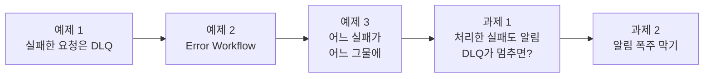
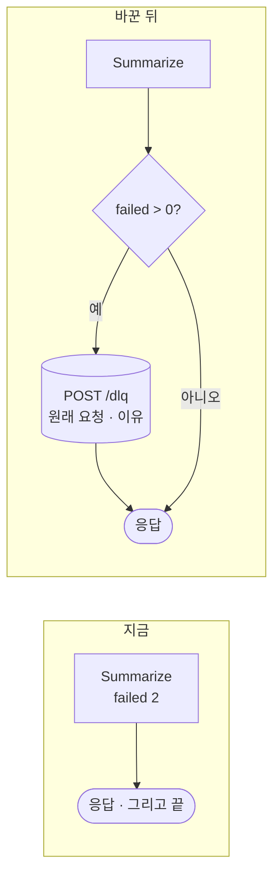
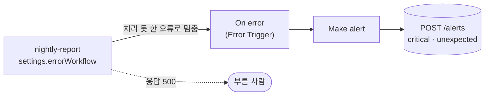
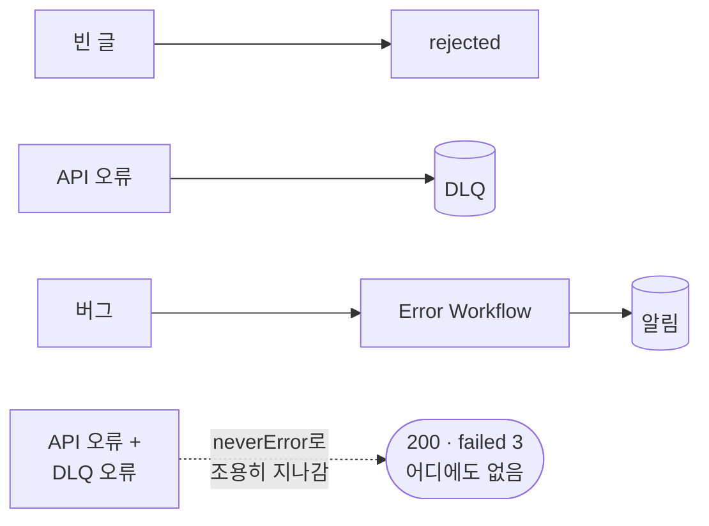
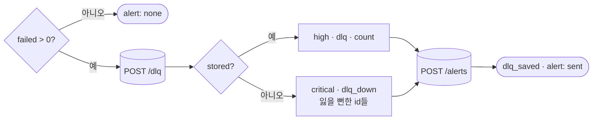
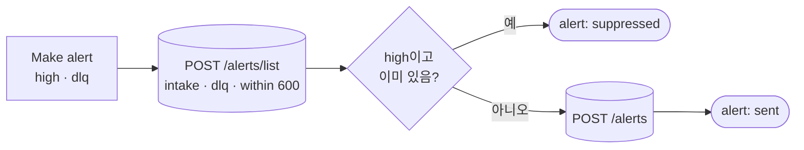

# Lab 02 · 실패를 모으고(DLQ), 알리기 (Error Workflow)

- 관련 강의: [2단계 · 모으고 알리기](../../Lecture/76/02-STAGE2-COLLECT-AND-ALERT.md)
- 소요 시간: 50분 (4교시 한 시간) · 예제 1 12분 · 예제 2 12분 · 예제 3 6분 · 과제 1 10분 · 과제 2 10분
- 준비: Lab 01의 `my-work/intake.json` (없으면 `cp reference/lab01-example2-intake.json my-work/intake.json` 후 push. 그 파일은 Lab 01 예제 2까지)
- 목표: 다시 하면 될 실패는 **잃지 않게 모아 두고**(DLQ), 예상하지 못한 오류는 **n8n이 대신 알리게**(Error Workflow) 한다. 어느 실패가 어느 그물에 걸리는지 보고 그물 사이의 구멍을 막고, 처리한 실패도 사람에게 알리되 같은 알림이 쏟아지지 않게 한다.



> 복사해 붙일 요청문은 없습니다. 막히면 `▶` 를 하나씩 펼칩니다. 연습이 끝나면 `uv run tools/flow.py ops --reset`.

## 예제 1 · 실패한 요청은 DLQ에 (12분)

### 이 실습의 의도

**한 줄로:** 데이터 API가 멈춘 동안 들어온 문의를 **잃지 않게 따로 모아 두는 곳**(DLQ)을 만듭니다.

> **생활 속 예 · 택배 보관소.** 집에 아무도 없으면 기사는 상자를 버리지 않고 보관소에 상자 그대로 · 못 전한 까닭과 함께 둡니다. 지금 `my-intake`는 "배달 실패"라고 말만 하고 상자를 길에 두고 가는 기사와 같습니다. 예제 1은 보관소(DLQ)를 만드는 실습입니다.

**상황.** Lab 01까지 고친 `my-intake`는 API가 멈추면 그 문의를 `failed`로 표시하고 200으로 답합니다. 정직한 답이지만, 그 답을 받은 화면이 닫히면 끝입니다. 문의 내용은 데이터 API에도, n8n에도, 어디에도 남지 않습니다. 원인을 고친 뒤 "아까 실패한 것 다시 해 줘"라고 할 대상이 없습니다.

**먼저 볼 것 → 고칠 것.**

| 순서 | 명령 | 볼 것 |
| --- | --- | --- |
| 1 | `fault tickets error` → `call my-intake batch-two` | 답은 `failed: 2`. 여기까지는 Lab 01과 같음 |
| 2 | `fault tickets ok` → `ops` | **DLQ가 0** — 실패한 두 문의가 어디에도 없음 |
| 3 | `test cases/lab02.json` (고치기 전) | DLQ 케이스가 ✘ |
| 4 | 요청문 → push → 다시 test | DLQ에 R-301 · R-302가 원래 요청 그대로 |

**무엇을 넣고 무엇을 안 넣나.** 다시 하면 될 실패(`failed`)만, **처음 받은 요청 그대로** 넣습니다. 그래야 Lab 03에서 같은 요청을 `my-intake`에 다시 보낼 수 있습니다. 거절(`rejected`)은 다시 해도 같으니 넣지 않습니다.

**끝나면 알게 되는 것.** 실패를 "알리는 것"과 "잃지 않는 것"은 다르다는 것, DLQ에 무엇을 담아야 나중에 다시 돌릴 수 있는지. 이 DLQ는 Lab 03의 재처리가 읽어 갑니다.

```bash
uv run tools/flow.py ops --reset
uv run tools/flow.py fault tickets error
uv run tools/flow.py call my-intake requests/batch-two.json     # failed 2 — 그다음은?
uv run tools/flow.py fault tickets ok
uv run tools/flow.py ops                                        # DLQ는?
uv run tools/flow.py test cases/lab02.json -v                   # 고치기 전
```

API가 멈춘 동안 들어온 두 문의는 결과에 `failed`로만 남았습니다. 사용자 화면을 닫으면 사라집니다.

**만들 것**: 실패한(`failed`) 요청을 **원래 요청 그대로** 데이터 API의 DLQ(`POST /dlq`)에 넣기.

| 조건 | 값 |
| --- | --- |
| 넣는 것 | 본문 `{items: [...]}`, 실패한 항목마다 `{item: 원래 요청 {id, user, text}, reason, workflow: "intake"}` |
| 거절(`rejected`)은 | 넣지 않는다 (다시 해도 같으니까) |
| 실패가 없으면 | DLQ를 부르지 않는다 |
| 기대 결과 | `cases/lab02.json` 앞 두 케이스 |

### 이해하기

**DLQ(dead letter queue)는 "배달하지 못한 편지 보관함"입니다.** 우체국은 주소가 틀린 편지를 버리지 않고 따로 모아 둡니다. 메시지 시스템(Amazon SQS · RabbitMQ · Kafka)도 처리하지 못한 메시지를 버리지 않고 DLQ로 옮깁니다. 나중에 원인을 고친 사람이 **같은 메시지를 다시** 처리할 수 있게요.



**무엇을 넣나.**

| 넣는 것 | 까닭 |
| --- | --- |
| **원래 요청 그대로** (`id` · `user` · `text`) | 나중에 같은 요청으로 다시 돌림 (Lab 03). 분류 결과 같은 중간 값이 아니라 처음 받은 것 |
| 이유 (`reason`) | 사람이 원인을 압니다 (`500 - tickets service is failing`, `timeout`) |
| 어느 워크플로우 (`workflow`) | 여러 워크플로우가 같은 DLQ를 쓸 때 |

**거절은 넣지 않습니다.** 빈 글은 다시 해도 빈 글입니다. DLQ는 "**나중에 다시 하면 될 것**"만 모읍니다. 거절까지 넣으면 재처리할 때마다 같은 실패가 되풀이되고, 정말 살려야 할 것이 묻힙니다.

**같은 요청이 또 오면.** 오늘 데이터 API는 같은 `item.id`가 다시 들어오면 새 줄을 만들지 않고 `attempts`를 하나 올립니다. 재처리(Lab 03)에서 또 실패할 때 쓰입니다.

**테스트 케이스 (예제 1 몫).**

| 케이스 | 하는 것 | 기대 |
| --- | --- | --- |
| API가 멈추면 | `tickets error` · `batch-two` | 200 · `created: 0, failed: 2` |
| DLQ 확인 | `/dlq/list` | `size: 2`, `R-301` · `R-302` |

**기대 결과.** 고치기 전 `lab02` 2/4, 예제 1 뒤 3/4 (남은 ✘는 예제 2의 알림).

<details><summary>▶ 1단계 · 왜 원래 요청 그대로</summary>

나중에 다시 돌릴 때(3단계) 같은 요청을 그대로 `my-intake`에 보내야 합니다. Lab 01의 결과에서 실패한 항목은 `request`(원래 요청)를 가지고 있습니다. 그것을 모아 DLQ 본문으로.
</details>

<details><summary>▶ 2단계 · DLQ에 넣다가 실패하면</summary>

DLQ 저장마저 실패하면? 최소한 사용자 응답은 나가야 합니다. 어떤 설정을 둘까요? (그다음은 예제 3에서 직접 봅니다)
</details>

<details><summary>▶ 빈칸 채우기 · 요청문(프롬프트) 뼈대</summary>

요청문에 꼭 들어갈 것: **① 언제 DLQ로 가나 ② DLQ 주소와 본문 모양 ③ 넣지 않는 것 ④ DLQ가 실패해도 응답 ⑤ 기대 결과**. 빈칸 4개를 채웁니다.

```text
my-work/intake.json 의 Summarize 뒤에 Any failed?(If) 를 넣어 failed 가 1 이상일 때만 Send to DLQ(HTTP POST http://data-api:8800/ ____① ) 로.
본문은 {items: [...]}, 실패한 항목마다 { item: ____② {id, user, text}, reason, workflow: "intake" }. rejected 는 ____③ .
DLQ 저장이 실패해도 응답은 나가게 options.response 에 ____④ , 두 갈래 모두 Public result 로 가서 같은 결과를 응답.
기대 결과 cases/lab02.json 앞 두 케이스.
```

빈칸 힌트:

- ① AGENTS.md 2절 데이터 API 표에서 실패한 요청을 넣는 주소입니다.
- ② 나중에 다시 돌릴 때 그대로 보낼 것입니다 (▶ 1단계).
- ③ 다시 해도 같은 실패입니다.
- ④ AGENTS.md 5절 "DLQ · 알림" 노드의 응답 설정입니다. HTTP 오류를 노드 오류로 만들지 않는 값.
</details>

```bash
uv run tools/flow.py push my-work/intake.json
uv run tools/flow.py test cases/lab02.json -v
uv run tools/flow.py ops
```

### 실행 결과 · 실패한 요청은 DLQ에

수업 준비 때(10/29) 강사 노트북에서 정답 워크플로우로 실제로 나온 출력입니다. 시간은 실행마다 조금씩 다르고, ✔ · ✘는 같아야 합니다.

고치기 전 (Lab 01 과제 2 정답)

```text
$ fault tickets error  →  call my-intake requests/batch-two.json
HTTP 200 · 2.8s   ( "failed": 2 )
$ ops
created tickets: 0
DLQ: 0 (parked 0)
alerts: 0

✔ 예제 1 · API가 멈추면 실패로 표시 · 200 · 2.8s
✘ 예제 1 · 실패한 2건은 DLQ에 · 0.0s · size = 0 (expected 2); items has none of ['R-301', 'R-302']
✔ 예제 2 · 예상 못 한 오류 (nightly-report) · 0.0s
✘ 예제 2 · Error Workflow가 알림을 남김 · 0.0s · severity = null (expected critical); ...
Passed 2/4
```

고친 뒤

```text
✔ 예제 1 · API가 멈추면 실패로 표시 · 200 · 4.1s
✔ 예제 1 · 실패한 2건은 DLQ에 · 0.0s
✔ 예제 2 · 예상 못 한 오류 (nightly-report) · 0.1s
✘ 예제 2 · Error Workflow가 알림을 남김 · 0.0s · severity = null (expected critical); ...
Passed 3/4

$ ops
DLQ: 2 (parked 0)
  D-1  R-301  attempts 1  parked False  500 - "{\"error\": \"tickets service is failing (f
  D-2  R-302  attempts 1  parked False  500 - "{\"error\": \"tickets service is failing (f
```

**왜 이렇게 나왔나**

- 고치기 전 `failed: 2`는 Lab 01에서 이미 있었습니다. 하지만 `ops`의 DLQ가 0입니다. 결과를 받은 화면이 닫히면 두 문의는 **아무 데도 남지 않습니다.**
- 고친 뒤 DLQ에 R-301 · R-302가 원래 요청 그대로, 실패 이유 · `attempts 1`과 함께 들어갔습니다. 이제 원인을 고친 뒤 다시 돌릴 수 있습니다 (Lab 03).
- 남은 ✘는 `nightly-report`의 오류를 아무도 알리지 않아서입니다 (예제 2).

## 예제 2 · Error Workflow (12분)

### 이 실습의 의도

**한 줄로:** 내가 **예상하지 못한** 오류로 워크플로우가 멈췄을 때, n8n이 대신 알림을 남기게 합니다.

> **생활 속 예 · 자동차 경고등.** 운전자는 모든 고장을 미리 알 수 없지만, 무슨 일이 생기면 계기판에 경고등이 켜져 정비소에 가게 됩니다. 경고등이 고장을 고치지는 않습니다. 예제 2는 `nightly-report`의 버그(고장)를 고치지 않고, 버그가 나면 켜지는 경고등(Error Workflow → 알림)을 다는 실습입니다.

**상황.** 예제 1의 DLQ는 "API가 멈출 수 있다"를 **예상하고** 미리 길을 만들어 둔 것입니다. 하지만 버그, 모르는 응답 모양, 누가 바꾼 설정 같은 오류는 미리 길을 만들 수 없습니다. 그런 오류로 워크플로우가 멈추면 부른 쪽에 500 하나가 갈 뿐, **운영하는 사람은 아무도 모릅니다.**

**연습 대상.** `nightly-report`는 일부러 버그를 넣어 둔 제공 워크플로우입니다. 버그는 **고치지 않습니다.** 오늘의 목표는 버그를 고치는 것이 아니라 "버그가 나면 누가 아느냐"를 바꾸는 것입니다.

| 순서 | 명령 | 볼 것 |
| --- | --- | --- |
| 1 | `call nightly-report` | 500 |
| 2 | `ops` | `alerts: 0` — 아무도 모름 |
| 3 | 에러 처리기를 만들어 push → `test cases/lab02.json` | 3초 뒤 critical 알림: 어느 워크플로우 · 어느 노드 · 무슨 오류 |

**n8n이 해 주는 것과 내가 할 것.** 워크플로우 설정에 `errorWorkflow`(처리기 id)가 있으면, 그 워크플로우가 멈출 때 n8n이 처리기를 부릅니다. 나는 처리기(Error Trigger로 시작 → 알림 남기기)를 만들어 **정해진 id로 게시**하고, 내 `my-intake`에도 같은 설정을 넣습니다.

**끝나면 알게 되는 것.** "처리한 실패"(DLQ)와 "처리하지 못한 실패"(Error Workflow)는 받는 곳이 다르고 둘 다 있어야 한다는 것, 알림 한 줄에 무엇이 있어야 고칠 곳을 찾을 수 있는지.

이제 확인합니다. `nightly-report`는 일부러 버그가 있는 워크플로우입니다 (고치지 않습니다).

```bash
uv run tools/flow.py call nightly-report      # HTTP 500 — 누가 알까?
uv run tools/flow.py ops                      # alerts: 0
```

**만들 것**: 처리하지 못한 오류로 워크플로우가 멈추면 n8n이 부르는 **에러 처리기**. 알림을 데이터 API에 남긴다. 그리고 내 접수 워크플로우도 이 처리기를 쓰게.

| 조건 | 값 |
| --- | --- |
| 파일 | `my-work/error-handler.json`, 맨 위에 `"id": "errHandler76001"` ([AGENTS.md](AGENTS.md) 3 · 4절) |
| 알림 | `POST /alerts` `{workflow, workflow_id, node, message, execution_id, severity: "critical", reason: "unexpected"}` |
| 내 접수 워크플로우 | `settings.errorWorkflow: "errHandler76001"` |
| 기대 결과 | `cases/lab02.json` 전체, `lab01`도 그대로 |

### 이해하기

**처리한 실패와 처리하지 못한 실패.** 예제 1의 DLQ는 내가 **예상한** 실패(API가 멈춤)를 그 자리에서 처리한 것입니다. 하지만 모든 실패를 예상할 수는 없습니다. 버그, 모르는 응답 모양, 누가 바꾼 설정. 그런 오류로 워크플로우가 멈추면, 응답 500 하나만 남고 아무도 모릅니다.

| | 처리한 실패 | 처리하지 못한 실패 |
| --- | --- | --- |
| 예 | API가 멈춤 (예상함) | `nightly-report`의 버그 |
| 워크플로우 | 계속, 200 | **멈춤**, 500 |
| 받는 곳 | DLQ + 알림 (내가 만듦, 과제 1) | **Error Workflow** (n8n이 부름) |

**Error Workflow는 마지막 그물입니다.** n8n은 워크플로우 설정에 `errorWorkflow`가 있으면, 그 워크플로우가 처리하지 못한 오류로 멈출 때 지정한 워크플로우를 부릅니다. 받는 쪽은 **Error Trigger** 노드로 시작하고, 어느 워크플로우 · 어느 실행 · 어느 노드 · 무슨 오류인지를 받습니다.



| Error Trigger가 넘기는 것 | 알림에 |
| --- | --- |
| `workflow.name` · `workflow.id` | 어느 워크플로우 |
| `execution.lastNodeExecuted` | 어느 노드 |
| `execution.error.message` | 무슨 오류 |
| `execution.id` | n8n 화면 Executions에서 그 실행을 연다 |

**처리기의 id는 고정합니다.** 다른 워크플로우가 처리기를 **id로** 부르므로, 파일 맨 위에 `"id": "errHandler76001"`을 씁니다 (70일차 모듈과 같음). 처리기도 **게시(push)**해야 합니다. 게시를 내린 처리기는 n8n이 부르지 않습니다 (수업 준비 때 확인).

**알림은 늦게 생깁니다.** Error Workflow는 웹훅 응답(500)이 나간 **뒤에** 돕니다. 테스트는 3초를 기다린 뒤(`{"sleep": 3}`) 알림을 봅니다.

**테스트 케이스 (예제 2 몫).**

| 케이스 | 하는 것 | 기대 |
| --- | --- | --- |
| 예상 못 한 오류 | `nightly-report` | 500 |
| 알림 | 3초 뒤 `/alerts/latest` | `severity: critical, reason: unexpected`, 워크플로우 이름, 노드 `Count by category` |

**기대 결과.** `lab02` 4/4. `ops`에 critical 알림 하나.

<details><summary>▶ 1단계 · 둘 다 있어야 하는 이유</summary>

DLQ만 있으면? 예상 못 한 버그는 아무도 모릅니다. Error Workflow만 있으면? API가 멈출 때마다 워크플로우가 멈춰야 알림이 오고, 멈추면 그 실행의 다른 항목도 함께 잃습니다.
</details>

<details><summary>▶ 2단계 · 알림에 무엇을</summary>

받는 사람이 "어느 워크플로우의 어느 노드에서 무슨 오류"를 바로 알아야 합니다. 실행 번호가 있으면 n8n 화면 Executions에서 그 실행을 엽니다. Error Trigger가 넘기는 값은 AGENTS.md 5절.
</details>

<details><summary>▶ 빈칸 채우기 · 요청문(프롬프트) 뼈대</summary>

요청문에 꼭 들어갈 것: **① 파일과 고정 id ② 시작 노드 ③ 알림에 담을 값과 등급 ④ 부르는 쪽 설정 ⑤ 기대 결과**. 빈칸 4개를 채웁니다.

```text
my-work/error-handler.json 을 새로 만들어 줘. 파일 맨 위에 "id": "____①", 첫 노드는 ____② .
Make alert(Code) 가 workflow.name · workflow.id · execution.lastNodeExecuted · execution.error.message · execution.id 를
{workflow, workflow_id, node, message, execution_id, severity: "____③", reason: "unexpected"} 로 만들어 POST http://data-api:8800/alerts.
my-work/intake.json 의 settings 에 ____④ : "errHandler76001" 을 넣어 줘.
기대 결과 cases/lab02.json 전체.
```

빈칸 힌트:

- ① 위 조건 표의 파일 줄입니다. `nightly-report`의 설정에 이미 적혀 있는 값과 같아야 합니다.
- ② AGENTS.md 5절 "Error Workflow"의 노드 종류(`type`의 끝 부분)입니다.
- ③ 처리하지 못한 오류의 등급입니다. 강의 2단계 알림 등급 표.
- ④ AGENTS.md 4절 워크플로우 파일 규칙의 `settings` 안 이름입니다.
</details>

```bash
uv run tools/flow.py push my-work/error-handler.json my-work/intake.json
uv run tools/flow.py test cases/lab02.json -v
uv run tools/flow.py ops
uv run tools/flow.py test cases/lab01.json
```

### 실행 결과 · Error Workflow

수업 준비 때(10/29) 강사 노트북에서 정답 워크플로우로 실제로 나온 출력입니다.

고친 뒤

```text
✔ 예제 1 · API가 멈추면 실패로 표시 · 200 · 4.8s
✔ 예제 1 · 실패한 2건은 DLQ에 · 0.0s
✔ 예제 2 · 예상 못 한 오류 (nightly-report) · 0.1s
… before: wait 3s
✔ 예제 2 · Error Workflow가 알림을 남김 · 0.0s
Passed 4/4

$ ops
alerts: 1
  [critical] 76 Nightly report (provided, has a bug) · unexpected · Count by category · rows is not iterable [line 4]
(lab01 6/6)
```

**왜 이렇게 나왔나**

- `nightly-report`는 여전히 500입니다 (버그를 고치지 않음). 달라진 것은 **누가 아느냐**입니다. 3초 뒤 critical 알림이 생겼고, 어느 워크플로우 · 어느 노드(`Count by category`) · 무슨 오류(`rows is not iterable [line 4]`)인지 한 줄로 보입니다.
- 오류 문장은 버그를 가리킵니다: 응답의 `tickets`를 `items`로 잘못 읽어 `rows`가 비어(`undefined`) 있었습니다. 알림만 보고 고칠 곳을 찾을 수 있습니다.
- `nightly-report`의 설정에 이미 `errorWorkflow: errHandler76001`이 있었기 때문에, 처리기를 그 id로 **게시하는 것만으로** 알림이 시작되었습니다.
- 내 `my-intake`도 같은 처리기를 씁니다. 하지만 오늘의 실패는 모두 처리하므로(200) 처리기가 불리지 않습니다. `lab01` 6/6.

## 예제 3 · 어느 실패가 어느 그물에 (6분, 에이전트 없이)

### 이 실습의 의도

**한 줄로:** 지금까지 만든 그물 셋이 각각 어떤 실패를 잡는지 확인하고, **그물 사이로 빠지는 구멍**을 찾습니다. 고치지 않고(에이전트 없이) 재기만 합니다.

> **생활 속 예 · 건전지가 다 된 화재경보기.** 경보기가 있어도 건전지가 다 되면 불이 나도 조용합니다. 예제 3은 그물(거절 · 보관소 · 경고등)을 하나씩 시험하다가, 보관소(DLQ) 문까지 잠겼을 때 아무 소리도 나지 않는 것을 직접 확인하는 실습입니다.

**지금 있는 그물 셋.**

| 그물 | 언제 만들었나 | 잡는 것 |
| --- | --- | --- |
| 결과의 `rejected` | Lab 01 예제 2 · 과제 2 | 잘못된 항목 |
| DLQ | 예제 1 | API가 멈춰 처리 못 한 항목 |
| Error Workflow | 예제 2 | 워크플로우를 멈추게 한 예상 못 한 오류 |

**실패 넷을 일으킵니다.** 빈 글 · API 오류 · 버그, 그리고 마지막으로 **API와 DLQ가 함께 멈춘** 경우. 앞의 셋은 각자 그물에 걸립니다. 네 번째는 어디에 걸릴까요? DLQ에 넣지 못했고, 워크플로우는 멈추지 않았으니(`neverError`) Error Workflow도 불리지 않습니다.

**`lab02-nets.json`의 6 · 7번은 지금 ✘가 맞습니다.** 이 예제는 구멍을 **보여 주는** 것이고, 막는 것은 과제 1입니다. 5/7이 기대 결과입니다.

**끝나면 알게 되는 것.** 실패를 처리하는 장치(DLQ)도 실패할 수 있고, 그때 요청이 소리 없이 사라진다는 것 ("누가 감시자를 감시하나"). 그물 지도를 표로 그려 두면 구멍이 보인다는 것.

**적을 곳.** `my-work/RUNBOOK.md` 1.3 그물 지도 (실패 · 어떻게 알아채나 · 자동으로 하는 일 · 사람이 할 일).


```bash
uv run tools/flow.py test cases/lab02-nets.json -v
uv run tools/flow.py ops
```

### 이해하기

**그물 지도.**

| 실패 | 걸리는 그물 | 사람이 아는 방법 |
| --- | --- | --- |
| 잘못된 항목 (빈 글) | 결과의 `rejected` + 이유 | 부른 쪽이 결과를 보고 고쳐 보냄 |
| API 오류 | `failed` → **DLQ** | (아직 없음 → 과제 1) |
| 버그 (`nightly-report`) | **Error Workflow** → critical 알림 | 알림 |
| **DLQ도 멈춤** | ? | ? |



**구멍은 그물 사이에 있습니다.** 예제 1에서 DLQ 저장이 실패해도 응답은 나가게 `neverError`를 두었습니다. 그래서 DLQ가 멈추면 워크플로우는 **멈추지 않고(→ Error Workflow도 안 불림)**, DLQ에도 없고, 결과는 `failed`만 말합니다. 실패를 처리하는 장치 자체가 실패할 때를 생각해야 합니다. 이것을 "누가 감시자를 감시하나"라고 부르기도 합니다.

**테스트 케이스.** 지금 워크플로우를 바꾸지 않고 재기만 합니다. 6 · 7번은 **지금은 ✘가 맞습니다** (과제 1에서 고침).

| 케이스 | 하는 것 | 기대 |
| --- | --- | --- |
| 1 | `batch-bad-item` | `rejected: 1, created: 2` |
| 2 · 3 | `tickets error` · `batch-two`, `/dlq/list` | `failed: 2`, DLQ `size: 2` |
| 4 · 5 | `nightly-report`, 3초 뒤 알림 | 500, critical · unexpected |
| 6 | `tickets error` + `dlq error` · `batch-ok` | `failed: 3, dlq_saved: false` |
| 7 | `/alerts/latest` | critical · `dlq_down` |

**기대 결과.** 5/7. 6번은 결과에 `dlq_saved`가 없어서, 7번은 마지막 알림이 5번의 `unexpected`라서 ✘. `ops`의 DLQ는 2건 그대로 (3건이 사라짐).

<details><summary>▶ 1단계 · 사라진 3건을 찾을 수 있나</summary>

6번 뒤 `ops`를 봅니다. DLQ는 몇 건인가요? n8n 화면 Executions에서 그 실행을 열면 `Send to DLQ` 노드의 응답에 무엇이 있나요? 사람이 매번 Executions를 열어 볼 수 있을까요?
</details>

### 실행 결과 · 어느 실패가 어느 그물에

수업 준비 때(10/29) 강사 노트북에서 예제 2 정답으로 실제로 나온 출력입니다.

```text
✔ 1 · 잘못된 항목 → 결과에만 (rejected) · 1.7s
✔ 2 · API 오류 → failed · 2.8s
✔ 3 · failed는 DLQ에 · 0.0s
✔ 4 · 버그 → 500 · 0.0s
… before: wait 3s
✔ 5 · Error Workflow → critical 알림 · 0.0s
✘ 6 · DLQ마저 멈추면 결과가 알려야 · 4.1s · dlq_saved = null (expected false)
✘ 7 · DLQ가 멈춘 것을 누가 아나 (critical · dlq_down) · 0.0s · reason = unexpected (expected dlq_down)
Passed 5/7

$ ops
DLQ: 2 (parked 0)
  D-1  R-301 …   D-2  R-302 …
alerts: 1
  [critical] 76 Nightly report (provided, has a bug) · unexpected · Count by category · rows is not iterable [line 4]
```

**왜 이렇게 나왔나**

- 1~5: 그물 셋이 각자 일했습니다. 빈 글은 결과에, API 오류는 DLQ에, 버그는 알림으로.
- 6: 응답은 200 · `failed: 3`. 그런데 DLQ는 **2건 그대로**입니다. `batch-ok`의 세 문의(R-101~103)는 DLQ 저장이 500으로 실패했고, `neverError` 때문에 워크플로우는 아무 일 없다는 듯 끝났습니다. 결과에도 "DLQ에 못 넣었다"는 말이 없습니다.
- 7: 마지막 알림은 여전히 5번의 버그 알림입니다. **세 문의를 잃었다는 것을 아무도 모릅니다.** 과제 1에서 이 구멍을 막습니다.

## 과제 1 · 처리한 실패도 알리기, DLQ가 멈추면 (10분)

### 이 실습의 의도

**한 줄로:** DLQ에 쌓인 것을 사람이 **바로 알게** 하고, 예제 3에서 찾은 구멍(DLQ도 멈춤)을 **더 큰 알림**으로 막습니다.

> **생활 속 예 · 응급실과 "건전지 부족" 삑 소리.** 응급실은 급한 정도에 따라 환자를 나누고, 화재경보기는 건전지가 떨어지면 따로 삑 소리를 냅니다. 과제 1은 보관소에 넣었으면 "확인해 주세요"(high), 보관소에도 못 넣었으면 "지금 바로"(critical, 잃을 뻔한 송장 번호와 함께)로 등급을 나눠 알리는 실습입니다.

**문제 둘.**

| 문제 | 지금 | 바라는 것 |
| --- | --- | --- |
| DLQ에 쌓여도 아무도 모름 | 다음 날 아침에 `ops`를 쳐야 앎 | DLQ에 넣을 때 `high` 알림 하나 (몇 건인지) |
| DLQ도 멈추면 요청이 사라짐 | 결과는 `failed`만, 알림 없음 | `critical` 알림, 메시지에 **잃을 뻔한 요청 id** |

**왜 등급을 나누나.** DLQ에 넣었으면 요청은 안전합니다. 원인을 고친 뒤 재처리하면 됩니다(`high`). DLQ에도 못 넣었으면 요청은 지금 **어디에도 없습니다.** 알림에 적힌 id가 유일한 단서라 바로 봐야 합니다(`critical`).

**지킬 것.** 실패가 없으면 알림을 보내지 않습니다. 실패한 항목마다가 아니라 **요청 하나에 알림 하나**(개수를 담아)입니다. 그리고 결과에 `dlq_saved` · `alert`를 더해, 부른 쪽도 "DLQ에 들어갔나"를 알게 합니다.

**끝나면 알게 되는 것.** 알림 등급을 무엇으로 정하나(요청을 잃을 수 있나), DLQ에 저장됐는지를 상태 코드가 아니라 응답 내용으로 판단하는 법. 고치면 예제 3의 `lab02-nets`가 7/7이 됩니다.

> "DLQ에 쌓이는 걸 아무도 몰라서 다음 날 아침에야 봤어요. DLQ에 넣었으면 바로 알려 주세요. 그리고 아까처럼 DLQ에도 못 넣었으면 그건 정말 급한 거니 더 크게 알려 주세요. 대신 문제가 없을 때는 알림을 보내지 마세요."

```bash
uv run tools/flow.py test cases/lab02-challenge.json -v      # 고치기 전
```

| 조건 | 값 |
| --- | --- |
| DLQ에 넣었으면 | `POST /alerts` `{workflow: "intake", severity: "high", reason: "dlq", count, message}` |
| DLQ에 못 넣었으면 | `{severity: "critical", reason: "dlq_down", count, message}` — message에 잃을 뻔한 요청 id들 |
| 실패가 없으면 | 알림 없음 |
| 결과에 | `dlq_saved` (실패가 있을 때 true/false), `alert` (`sent` · `none`) |
| 기대 결과 | `cases/lab02-challenge.json`, `lab02-nets` 7/7, `lab02` 그대로 |

### 이해하기

**알림 등급.** 모든 알림이 같은 무게면 받는 사람은 무엇부터 볼지 모릅니다.

| 등급 | 오늘 | 받으면 |
| --- | --- | --- |
| `critical` | 예상 못 한 오류(버그), **DLQ가 멈춤 (요청을 잃을 수 있음)** | 바로 본다 |
| `high` | DLQ에 쌓임, parked (Lab 03) | 원인(데이터 API 등)을 확인하고 재처리 |
| (알림 없음) | 거절, 미분류 | 결과 · 보고서로 셈 |

**요청 하나에 알림 하나.** 실패한 항목마다 알림을 보내면 50건 실패에 알림 50개입니다. 요청 하나에 알림 하나, 개수(`count`)를 담습니다.

**구멍 막기.** DLQ의 응답에 `stored`가 있으면 저장된 것, 없으면(500의 `error`) 저장되지 않은 것입니다. 저장되지 않았다면 **잃을 뻔한 요청의 id를 알림에 직접 적습니다.** 그러면 DLQ가 멈춰도 사람이 알림만 보고 그 요청들을 살릴 수 있습니다. 결과의 `dlq_saved: false`는 부른 쪽에게도 "이건 아직 아무 데도 없다"고 알려 줍니다.



**테스트 케이스.**

| 케이스 | 하는 것 | 기대 |
| --- | --- | --- |
| API가 멈춤 | `tickets error` · `batch-two` | `failed: 2, dlq_saved: true, alert: sent` |
| high 알림 | `/alerts/latest` | `high · dlq · count 2 · intake` |
| 실패 없음 | `batch-ok` | `alert: none` |
| 알림은 그대로 | `/alerts/list` | `count: 1` |
| DLQ도 멈춤 | `tickets error` + `dlq error` · `batch-bad-item` | `failed: 2, dlq_saved: false` |
| critical 알림 | `/alerts/latest` | `critical · dlq_down · count 2`, message에 `R-201` |

**기대 결과.** 고치기 전 0/6, 고친 뒤 6/6. 예제 3의 `lab02-nets`도 7/7.

**먼저 생각해 보기 (2분)**: 알림이 너무 많으면 어떻게 될까요? `critical`과 `high`는 받는 사람에게 무엇이 달라야 할까요? (런북 1절)

<details><summary>▶ 1단계 · 한 번에 하나</summary>

DLQ 노드는 요청 하나에 한 번 돕니다 (`items` 목록 하나). 그 뒤에 알림을 하나 만들면 저절로 "요청 하나에 하나"가 됩니다.
</details>

<details><summary>▶ 2단계 · 저장됐는지 어떻게 아나</summary>

`curl -s -XPOST localhost:8800/dlq -d '{"items": [{"item": {"id": "X-1"}, "reason": "test"}]}'`과, `fault dlq error` 뒤 같은 명령을 해 봅니다. 응답에 무엇이 있고 무엇이 없나요? (끝나면 `ops --reset`)
</details>

<details><summary>▶ 빈칸 채우기 · 요청문(프롬프트) 뼈대</summary>

요청문에 꼭 들어갈 것: **① 어디에 붙이나 ② 저장됐을 때 알림 ③ 저장 못 했을 때 알림 ④ 알림 수 ⑤ 결과에 더할 칸 ⑥ 기대 결과**. 빈칸 4개를 채웁니다.

```text
my-work/intake.json 의 Send to DLQ 뒤에 Make alert(Code) 와 Send alert(HTTP POST http://data-api:8800/alerts) 를 넣어 줘.
DLQ 응답에 ____① 가 있으면 {workflow: "intake", severity: "____②", reason: "dlq", count: failed 수, message},
없으면(DLQ 저장 실패) severity "critical", reason " ____③ ", message 에 잃을 뻔한 요청 id 들.
알림은 요청 하나에 하나 (항목마다가 아님). 실패가 없으면 알림을 보내지 않는다.
결과에 dlq_saved(실패가 있을 때 true/false) 와 ____④ ("sent" / "none") 를 더해 줘.
기대 결과 cases/lab02-challenge.json, cases/lab02-nets.json, cases/lab02.json.
```

빈칸 힌트:

- ① ▶ 2단계에서 본 DLQ 응답의 칸입니다. 저장된 수.
- ② 팀장 말의 "바로 알려 주세요"는 critical보다 한 단계 아래입니다 (위 등급 표).
- ③ 위 조건 표의 reason 그대로입니다 (테스트가 찾음).
- ④ 위 조건 표의 결과 칸 이름입니다.
</details>

```bash
uv run tools/flow.py push my-work/intake.json
uv run tools/flow.py test cases/lab02-challenge.json -v
uv run tools/flow.py test cases/lab02-nets.json
uv run tools/flow.py test cases/lab02.json
uv run tools/flow.py ops
```

### 실행 결과 · 처리한 실패도 알리기

수업 준비 때(10/29) 강사 노트북에서 실제로 나온 출력입니다.

고치기 전 (예제 2 정답)

```text
✘ API가 멈춤 → DLQ · 2.7s · dlq_saved = null (expected true); alert = null (expected sent)
✘ 처리한 실패도 알림 (high · 개수) · 0.0s · severity = null (expected high); reason = null (expected dlq); ...
✘ 실패가 없으면 알림 없음 · 2.8s · alert = null (expected none)
✘ 알림은 그대로 1개 · 0.0s · count = 0 (expected 1)
✘ DLQ도 멈추면 critical · 2.4s · dlq_saved = null (expected false)
✘ 잃어버린 id를 알림에 · 0.0s · severity = null (expected critical); ... message has none of ['R-201']
Passed 0/6
```

고친 뒤

```text
✔ API가 멈춤 → DLQ · 4.3s
✔ 처리한 실패도 알림 (high · 개수) · 0.0s
✔ 실패가 없으면 알림 없음 · 2.9s
✔ 알림은 그대로 1개 · 0.0s
✔ DLQ도 멈추면 critical · 2.4s
✔ 잃어버린 id를 알림에 · 0.0s
Passed 6/6
(lab02-nets 7/7 · lab02 4/4)

알림 두 개 (응답에서):
  [high] intake · dlq · count 2 · "2 request(s) could not be created and wait in the DLQ"
  [critical] intake · dlq_down · count 2 · "DLQ save failed: dlq service is failing (fault switch) · lost ids R-201, R-203"
```

**왜 이렇게 나왔나**

- 고치기 전에는 DLQ에는 넣지만 알림이 0개라 모두 ✘입니다. 결과에 `dlq_saved` · `alert` 칸도 없습니다.
- 고친 뒤 실패 2건 → high 알림 **하나**(`count 2`). 실패가 없는 `batch-ok`에는 `alert: none`, 알림은 1개 그대로.
- DLQ가 멈추면 `dlq_saved: false` + critical `dlq_down` 알림, 메시지에 `lost ids R-201, R-203`. DLQ에 없어도 사람이 알림만 보고 두 문의를 살릴 수 있습니다. 예제 3의 구멍이 막혀 `lab02-nets` 7/7.

## 과제 2 · 알림 폭주 막기 (10분)

### 이 실습의 의도

**한 줄로:** 같은 원인의 `high` 알림은 **10분에 한 번만** 보내, 사람이 알림을 꺼 버리지 않게 합니다. 급한 것(`critical`)과 실패의 기록(DLQ)은 줄이지 않습니다.

> **생활 속 예 · 알림을 꺼 버린 단톡방.** 같은 공지가 백 번 오면 사람들은 단톡방 알림을 끄고, 정말 중요한 공지도 못 봅니다. 그래도 대화 기록은 남아 있습니다. 과제 2는 같은 원인의 알림은 10분에 한 번만 보내되(알림 줄이기), DLQ(대화 기록)는 그대로 두고, 정말 급한 것(critical)은 늘 보내는 실습입니다.

**상황.** 과제 1로 "DLQ에 넣으면 알림"이 생겼습니다. 그런데 API가 30분 멈추면, 그동안 들어온 요청마다 알림이 하나씩 갑니다. 같은 원인을 백 번 알리는 셈이고, 받는 사람은 결국 알림을 끕니다. 그러면 정말 급한 알림도 못 봅니다 (알림 피로).

| 줄이는 것 | 줄이지 않는 것 |
| --- | --- |
| 10분 안에 같은 `reason`의 `high` 알림이 이미 있으면 보내지 않음 (`alert: suppressed`) | DLQ에는 모두 남음 |
| | `critical`은 늘 보냄 (요청을 잃을 수 있으니) |

**어떻게 아나.** 알림을 보내기 **바로 전에** 데이터 API에 "10분 안에 같은 알림이 있었나"를 묻습니다 (`/alerts/list`의 `within`).

**시험하는 것.** 첫 실패 → 보냄, 10분 안에 또 실패 → 보내지 않음, 그래도 DLQ에는 모두, DLQ가 멈춘 critical은 그래도 보냄.

**끝나면 알게 되는 것.** 알림이 많은 것이 안전한 것은 아니라는 것, 운영 도구의 묶기 · 반복 간격 · 중복 없애기가 무엇을 하는지 (그 가장 작은 판), 줄이는 것은 알림이지 기록이 아니라는 것.

> "어제 API가 30분 멈췄는데, 그동안 요청마다 알림이 와서 휴대폰이 백 번 울렸어요. 그다음부터는 다들 알림을 꺼 버렸고요. 같은 문제면 10분에 한 번만 알려 주세요. 단, 정말 급한 건(critical)은 늘 보내 주세요."

```bash
uv run tools/flow.py test cases/lab02-challenge2.json -v     # 고치기 전
```

| 조건 | 값 |
| --- | --- |
| 같은 알림 | `workflow: intake`이고 같은 `reason`의 알림이 10분(600초) 안에 이미 있으면 |
| 그때 high는 | 보내지 않고 결과에 `alert: "suppressed"` |
| critical은 | 늘 보냄 |
| 10분 안의 알림 수 | `POST /alerts/list` 본문 `{workflow, reason, within: 600}` (AGENTS.md 2절) |
| 기대 결과 | `cases/lab02-challenge2.json`, `lab02-challenge` 그대로 |

### 이해하기

**알림 피로 (alert fatigue).** 알림이 너무 많으면 사람은 알림을 보지 않게 됩니다. 그러면 정말 급한 알림도 묻힙니다. 알림이 많다는 것은 안전하다는 뜻이 아니라, **아무도 보지 않는다**는 뜻이 되기 쉽습니다.

**같은 문제는 한 번, 대신 숨기지 않기.**

| 하는 것 | 하지 않는 것 |
| --- | --- |
| 같은 문제의 high 알림은 10분에 한 번 | 실패를 DLQ에서 빼기 (DLQ에는 모두 남음) |
| 결과에 `alert: suppressed` (보내지 않은 것도 기록) | critical 줄이기 (급한 것은 늘 보냄) |

운영 도구들(Prometheus Alertmanager · PagerDuty 등)은 이것을 묶기(grouping) · 반복 간격(repeat interval) · 중복 없애기(deduplication)라고 부릅니다. 오늘은 그 가장 작은 판입니다: "**같은 이유의 알림이 10분 안에 있었나?**"



**테스트 케이스.**

| 케이스 | 하는 것 | 기대 |
| --- | --- | --- |
| 첫 실패 | `tickets error` · `batch-two` | `alert: sent` |
| 10분 안에 또 | `batch-ok` | `failed: 3, alert: suppressed` |
| dlq 알림 수 | `/alerts/list {reason: dlq}` | `count: 1` |
| DLQ에는 모두 | `/dlq/list` | `size: 5` |
| critical은 늘 | `dlq error` · `batch-bad-item` | `dlq_saved: false, alert: sent` |
| 고친 뒤 | `batch-dup-id` | `failed: 0, alert: none` |

**기대 결과.** 고치기 전 4/6 (두 번째에도 보내서), 고친 뒤 6/6.

<details><summary>▶ 1단계 · 어디서 세나</summary>

알림을 보내기 **바로 전에** 데이터 API에 "10분 안에 같은 알림이 있나"를 묻습니다. `curl -s -XPOST localhost:8800/alerts/list -d '{"workflow": "intake", "reason": "dlq", "within": 600}'`로 모양을 봅니다.
</details>

<details><summary>▶ 2단계 · 왜 critical은 예외인가</summary>

DLQ가 멈춘 알림을 10분 동안 한 번만 보내면, 그 10분 동안 들어온 다른 요청의 id는 어디에 남나요? (critical 메시지에 id를 적은 까닭)
</details>

<details><summary>▶ 빈칸 채우기 · 요청문(프롬프트) 뼈대</summary>

요청문에 꼭 들어갈 것: **① 묻는 곳과 본문 ② 보내지 않는 조건 ③ 예외 ④ 결과 값 ⑤ 기대 결과**. 빈칸 4개를 채웁니다.

```text
my-work/intake.json 의 Make alert 뒤에 Recent alerts(HTTP POST http://data-api:8800/alerts/list) 를 넣어
본문 {workflow: "intake", reason: 이번 알림의 reason, within: ____① } 로 10분 안의 같은 알림 수를 받아 줘.
Decide alert(Code): severity 가 ____② 이고 그 수가 1 이상이면 suppressed true. critical 은 ____③ .
Send it?(If) 로 suppressed 가 아닐 때만 Send alert, 결과의 alert 는 "sent" / "____④" / "none".
기대 결과 cases/lab02-challenge2.json, cases/lab02-challenge.json.
```

빈칸 힌트:

- ① 10분을 초로.
- ② 팀장이 줄이라고 한 등급입니다.
- ③ 팀장 말의 "단," 뒤입니다.
- ④ 위 조건 표의 값 그대로입니다.
</details>

```bash
uv run tools/flow.py push my-work/intake.json
uv run tools/flow.py test cases/lab02-challenge2.json -v
uv run tools/flow.py test cases/lab02-challenge.json
uv run tools/flow.py test cases/lab01-challenge2.json
uv run tools/flow.py ops --reset
```

### 실행 결과 · 알림 폭주 막기

수업 준비 때(10/29) 강사 노트북에서 실제로 나온 출력입니다.

고치기 전 (과제 1 정답)

```text
✔ 첫 실패 → 알림 보냄 · 2.9s
✘ 10분 안에 또 실패 → 보내지 않음 · 3.7s · alert = sent (expected suppressed)
✘ dlq 알림은 1개 · 0.0s · count = 2 (expected 1)
✔ 그래도 DLQ에는 5건 모두 · 0.0s
✔ DLQ가 멈춘 것은 늘 보냄 (critical) · 2.5s
✔ 고친 뒤 · 실패 없음 · 알림 없음 · 2.0s
Passed 4/6
```

고친 뒤

```text
✔ 첫 실패 → 알림 보냄 · 4.5s
✔ 10분 안에 또 실패 → 보내지 않음 · 3.7s
✔ dlq 알림은 1개 · 0.0s
✔ 그래도 DLQ에는 5건 모두 · 0.0s
✔ DLQ가 멈춘 것은 늘 보냄 (critical) · 2.4s
✔ 고친 뒤 · 실패 없음 · 알림 없음 · 2.8s
Passed 6/6
(lab02-challenge 6/6 · lab01-challenge2 4/4)
```

**왜 이렇게 나왔나**

- 고치기 전에는 두 번째 실패에도 알림을 또 보내 dlq 알림이 2개입니다. 장애가 30분 이어지면 요청마다 하나씩 쌓입니다.
- 고친 뒤 두 번째는 `suppressed`, dlq 알림 1개. 그래도 **DLQ에는 5건 모두** 있습니다. 줄인 것은 알림이지 실패의 기록이 아닙니다.
- DLQ가 멈춘 critical은 10분 안이라도 `sent`. 급한 것은 줄이지 않았습니다.
- 마지막 `batch-dup-id`는 `failed: 0` · `alert: none`이고, Lab 01 과제 2의 같은 id 거절도 그대로입니다.

## 막혔을 때

| 증상 | 할 일 |
| --- | --- |
| DLQ가 비어 있음 | 실패가 있을 때만 가는 If의 true 쪽에 DLQ 노드가 있는지, 본문이 `{items: [...]}`인지 |
| 알림이 안 생김 | 에러 처리기를 push(게시)했는지, 파일의 `id`가 `errHandler76001`인지, 부르는 쪽 `settings.errorWorkflow` |
| 알림이 늦게 생김 | 정상. 응답이 나간 뒤에 돈다 (테스트는 `{"sleep": 3}`) |
| 알림이 두 개 | 테스트의 `url` 케이스가 `/alerts`에 POST하면 알림이 생김 — 읽기는 `/alerts/list` · `/alerts/latest` |
| `dlq_saved`가 늘 true | DLQ 응답의 `stored`를 보는지 (상태 코드는 `neverError`라 늘 성공처럼 보임) |
| 늘 `suppressed` | 앞 테스트의 알림이 남았는지 (`ops --reset`), `within`이 초 단위인지 |
| `fault dlq error` 뒤 다른 테스트가 이상함 | `uv run tools/flow.py fault dlq ok` 또는 `ops --reset` |
| 계속 안 됨 | `reference/lab02-example1-dlq.json`, `reference/lab02-example2-*.json` (예제까지) |

## 확인

- [ ] 예제 1: `cases/lab02.json` 앞 두 케이스, `ops`로 DLQ 확인.
- [ ] 예제 2: `cases/lab02.json` 4/4, `nightly-report`의 알림을 봤다.
- [ ] 예제 3: `cases/lab02-nets.json` 5/7, 그물 지도와 구멍을 `RUNBOOK.md`에 적었다.
- [ ] 과제 1: `cases/lab02-challenge.json` 6/6, `lab02-nets` 7/7, `lab02`도 통과.
- [ ] 과제 2: `cases/lab02-challenge2.json` 6/6, `lab02-challenge`도 통과.
- [ ] `RUNBOOK.md` 1절 (알아채는 법 · 자동으로 하는 일 · 알림 등급).
