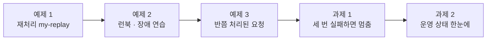
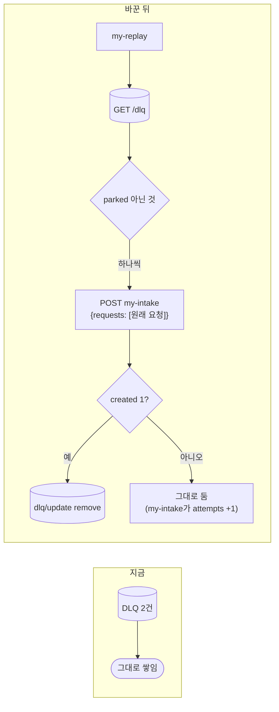
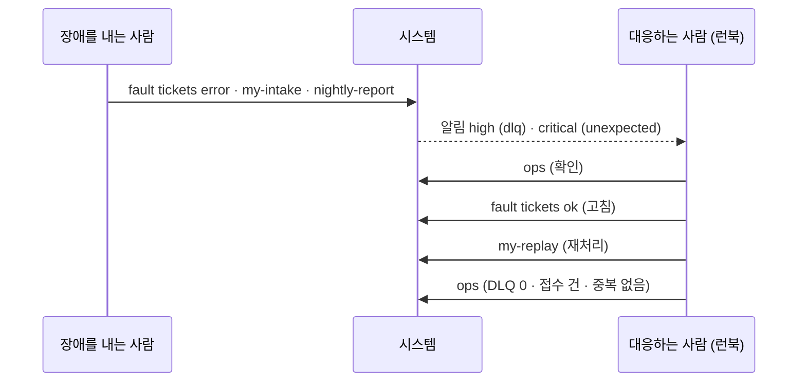
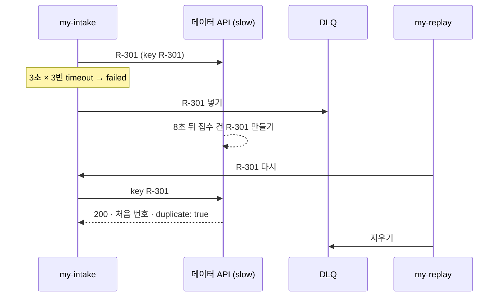
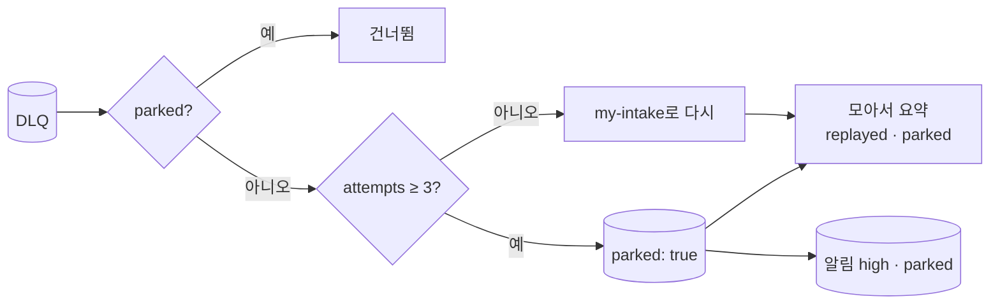
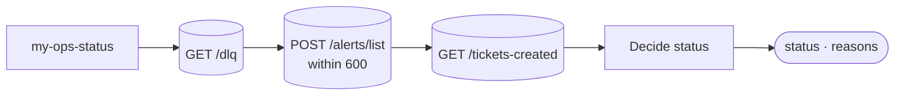

# Lab 03 · 다시 돌리기, 런북과 장애 연습, 끝없이 돌리지 않기

- 관련 강의: [3단계 · 재처리와 운영 체계](../../Lecture/76/03-STAGE3-REPLAY-AND-RUNBOOK.md)
- 소요 시간: 50분 (6교시 한 시간) · 예제 1 12분 · 예제 2 12분 · 예제 3 6분 · 과제 1 10분 · 과제 2 10분
- 준비: Lab 02의 `my-work/intake.json` · `my-work/error-handler.json` (없으면 `reference/lab02-example2-*.json`을 복사 후 push)
- 목표: 원인을 고친 뒤 DLQ의 요청을 **중복 없이** 다시 돌리고, 장애가 났을 때 할 일을 **런북**으로 써서 연습하고, 반쯤 처리된 요청도 안전하게 다시 돌리는 것을 보고, 계속 실패하는 요청은 끝없이 돌리지 않고 멈추고, 지금 괜찮은지를 한 번에 알려 주는 상태 웹훅을 만든다.



> 복사해 붙일 요청문은 없습니다. 막히면 `▶` 를 하나씩 펼칩니다.

## 예제 1 · 재처리 (12분)

### 이 실습의 의도

**한 줄로:** 원인을 고친 뒤 DLQ에 모아 둔 요청을 **다시 돌려 일을 끝내는** 재처리 워크플로우(`my-replay`)를 만듭니다.

> **생활 속 예 · 택배 재배송.** 보관소에 둔 택배는 다음 날 다시 배송하고, 전하면 목록에서 지워야 일이 끝납니다. 재배송도 따로 지름길로 하지 않고 **평소와 같은 배송 절차**를 거칩니다. 예제 1은 DLQ(보관소)의 요청을 같은 입구(`my-intake`)로 다시 보내는 재배송 실습입니다.

**상황.** Lab 02에서 API가 멈춘 동안의 문의를 DLQ에 모았습니다. 하지만 모아 두기만 하면 일은 끝나지 않습니다. 문의한 사람에게 접수 건은 아직 없습니다. 장애가 끝나면 누군가 DLQ의 요청을 다시 처리해야 합니다.

**핵심 결정: 새로 만들지 말고, 이미 있는 입구로 다시 보내기.** 재처리가 접수 건을 직접 만들면 항목 확인 · 분류 · 키 · DLQ · 알림 규칙을 한 벌 더 만들어야 하고, 언젠가 두 곳이 달라집니다. 그래서 DLQ의 원래 요청을 **`my-intake`에 그대로 다시 보냅니다.** 같은 규칙, 같은 멱등 키를 거칩니다.

| 재처리가 하는 일 | 까닭 |
| --- | --- |
| DLQ에서 `parked`가 아닌 것을 읽음 | 다시 돌릴 대상 |
| 하나씩 `my-intake`로 | 어느 것이 실패했는지 가리려고 |
| 성공하면 DLQ에서 지움, 실패하면 그대로 | 다음 재처리가 또 시도 (`attempts`는 `my-intake`가 올림) |
| 비었으면 바로 "할 일 없음" | 몇 번을 불러도 안전하게 |

**시험하는 것.** 장애 동안 2건 → DLQ, 고친 뒤 재처리 → DLQ 0 · 접수 건 2 (중복 없음), 한 번 더 돌려도 할 일 없음.

**끝나면 알게 되는 것.** DLQ는 끝이 아니라 중간이라는 것, 재처리를 원래 입구로 보내면 규칙이 하나로 유지된다는 것.

```bash
uv run tools/flow.py test cases/lab03.json -v        # 고치기 전 (my-replay가 아직 없음)
```

**만들 것**: `my-work/replay.json` (`my-replay`). DLQ의 요청을 `my-intake`에 하나씩 다시 보내고, 성공하면 DLQ에서 지우기.

| 조건 | 값 |
| --- | --- |
| 계약 | [AGENTS.md](AGENTS.md) 3절 재처리 `{replayed, ok, still_failed, parked, duplicates}` |
| 다시 보내는 곳 | `POST http://localhost:5678/webhook/my-intake` 본문 `{requests: [DLQ의 원래 요청]}` (AGENTS.md 5절) |
| 성공이면 | `POST /dlq/update {dlq_id, remove: true}`. 실패면 지우지 않음 |
| DLQ가 비었으면 | 할 일 없음 `{replayed: 0, ...}` |
| 기대 결과 | `cases/lab03.json` (재처리 뒤 DLQ 0, 접수 건 2개 — 중복 없음) |

### 이해하기

**DLQ는 모으는 곳이지 끝이 아닙니다.** 원인(데이터 API 장애)을 고친 뒤 모아 둔 요청을 다시 돌려야 일이 끝납니다. 이것을 재처리(replay, redrive)라고 부릅니다. Amazon SQS에는 DLQ의 메시지를 원래 큐로 되돌리는 "redrive" 기능이 있습니다.



**새로 만들지 말고 다시 보내기.** 재처리 워크플로우가 접수 건을 직접 만들면, 항목 확인 · 분류 · 키 · DLQ · 알림을 또 만들어야 하고, 두 곳의 규칙이 언젠가 달라집니다. 이미 있는 `my-intake`를 다시 부르면 **같은 규칙**으로 처리됩니다 (70일차 모듈과 같은 생각).

**다시 실패하면.** `my-intake`가 또 실패하면 그 요청을 다시 DLQ에 넣습니다. 데이터 API는 같은 `item.id`면 새 줄을 만들지 않고 `attempts`를 올립니다. 그래서 재처리는 실패한 것을 지우지 않고 그대로 두면 됩니다 (과제 1에서 `attempts`를 씀).

**테스트 케이스.**

| 케이스 | 하는 것 | 기대 |
| --- | --- | --- |
| 장애 동안 2건 | `tickets error` · `batch-two` | `failed: 2` |
| 고친 뒤 재처리 | `ok` · `my-replay` | `replayed: 2, ok: 2, still_failed: 0` |
| DLQ | `/dlq/list` | `size: 0` |
| 접수 건 | `/tickets-created/list` | `count: 2` (중복 없음) |
| 한 번 더 | `my-replay` | `replayed: 0` |

**기대 결과.** 고치기 전 1/5 (404), 고친 뒤 5/5.

<details><summary>▶ 1단계 · 새로 만들지 말고 다시 보내기</summary>

DLQ 항목의 `item`이 원래 요청입니다. `my-intake`가 받는 모양(`{requests: [...]}`)으로 감싸 하나씩 보냅니다. 한 번에 다 보내면 하나가 실패할 때 어느 것인지 가리기 어렵습니다.
</details>

<details><summary>▶ 2단계 · 성공은 무엇으로 아나</summary>

`my-intake`의 결과에서 `created`가 1이면 성공입니다 (이미 있던 건이면 `duplicates`도 1). HTTP 상태는 늘 200이라(부분 성공) 상태 코드로는 알 수 없습니다.
</details>

<details><summary>▶ 3단계 · DLQ가 비었을 때</summary>

DLQ가 비면 `Pick items`가 항목 0개를 내놓고, n8n은 그 뒤 노드를 돌리지 않습니다. 응답이 나가지 않으면? 비어도 다음으로 가게 하는 설정과 "할 일 없음" 갈래가 필요합니다.
</details>

<details><summary>▶ 빈칸 채우기 · 요청문(프롬프트) 뼈대</summary>

요청문에 꼭 들어갈 것: **① 웹훅 ② DLQ에서 고르기와 비었을 때 ③ 다시 보내는 곳과 본문 ④ 성공 판단과 지우기 ⑤ 요약 · 기대 결과**. 빈칸 4개를 채웁니다.

```text
my-work/replay.json 을 새로 만들어 줘. 웹훅 POST ____① .
Get DLQ(HTTP GET http://data-api:8800/dlq) → Pick items(Code): parked 가 아닌 것만, 비어도 다음으로 가게 ____② true.
Has items? 가 없으면 바로 {replayed: 0, ok: 0, still_failed: 0, parked: 0}.
있으면 항목마다 Run intake again: POST http://localhost:5678/webhook/my-intake 본문 {requests: [ ____③ ]} (DLQ 의 원래 요청).
my-intake 결과의 ____④ 가 1 이면 성공 → POST /dlq/update {dlq_id, remove: true}. 실패면 지우지 않는다.
끝에 AGENTS.md 3절 {replayed, ok, still_failed, parked, duplicates}. 기대 결과 cases/lab03.json.
```

빈칸 힌트:

- ① AGENTS.md 3절 재처리 줄의 웹훅 이름입니다.
- ② ▶ 3단계. AGENTS.md 5절 "그 밖"에 있는 노드 설정입니다.
- ③ DLQ 항목에서 원래 요청이 든 칸입니다 (`curl -s localhost:8800/dlq`로 확인).
- ④ ▶ 2단계.
</details>

```bash
uv run tools/flow.py push my-work/replay.json
uv run tools/flow.py test cases/lab03.json -v
uv run tools/flow.py ops
```

### 실행 결과 · 재처리

수업 준비 때(10/29) 강사 노트북에서 정답 워크플로우로 실제로 나온 출력입니다. 시간은 실행마다 조금씩 다르고, ✔ · ✘는 같아야 합니다.

고치기 전

```text
✔ API가 멈춘 동안 2건 → DLQ · 2.9s
✘ 고친 뒤 다시 돌리기 · 0.0s · status 404 (expected 200); replayed = null (expected 2); ok = null (expected 2); still_failed = null (expected 0)
✘ DLQ가 비었음 · 0.0s · size = 2 (expected 0)
✘ 접수 건은 2개 (중복 없음) · 0.0s · count = 0 (expected 2)
✘ 한 번 더 돌려도 할 일 없음 · 0.0s · status 404 (expected 200); replayed = null (expected 0)
Passed 1/5
```

고친 뒤

```text
✔ API가 멈춘 동안 2건 → DLQ · 4.4s
✔ 고친 뒤 다시 돌리기 · 1.1s
✔ DLQ가 비었음 · 0.0s
✔ 접수 건은 2개 (중복 없음) · 0.0s
✔ 한 번 더 돌려도 할 일 없음 · 0.0s
Passed 5/5
```

**왜 이렇게 나왔나**

- 고치기 전에는 `my-replay` 웹훅이 없어 404. DLQ의 2건은 쌓인 채 접수 건 0개입니다.
- 고친 뒤 1.1초에 `ok: 2`: 두 요청을 `my-intake`로 다시 보내 접수 건을 만들고, DLQ에서 지웠습니다. 다시 보낸 요청도 `my-intake`의 확인 · 분류 · 키 규칙을 똑같이 거쳤습니다.
- 한 번 더 돌리면 DLQ가 비어 `replayed: 0` (0.0초). 비었을 때 갈래가 바로 답했습니다.

## 예제 2 · 런북과 장애 연습 (12분, 에이전트 없이)

### 이 실습의 의도

**한 줄로:** 장애가 났을 때 할 일을 **런북**으로 써 두고, 짝과 함께 **일부러 장애를 내서** 그 런북이 정말 쓸모 있는지 시험합니다. 워크플로우는 고치지 않습니다(에이전트 없이).

> **생활 속 예 · 소방 훈련.** 대피 안내문은 붙여 두기만 하면 맞는지 모릅니다. 일부러 경보를 울리고 모두 대피해 봐야 "비상구 앞에 상자가 있다" 같은 문제가 드러납니다. 예제 2는 런북(대피 안내문)을 쓰고, 짝이 일부러 장애를 낸 상태에서 런북만 보고 대응해 보는 훈련입니다.

**왜 하나.** 지금까지 실패를 모으고(DLQ) 알리고(알림) 다시 돌리는(재처리) 장치를 만들었습니다. 하지만 알림을 받은 **사람**이 무엇을 할지 모르면 장치는 소용없습니다. 장애는 대개 밤에, 만든 사람이 없을 때 납니다. 그때 처음 보는 사람이 따라 할 수 있는 순서가 런북입니다.

**진행 셋.**

| 순서 | 누가 | 하는 일 |
| --- | --- | --- |
| 1 · 쓰기 | 각자 | `RUNBOOK.md` 2절 "알림을 받으면": 확인 → 원인 → 고침 → 재처리 → 확인을 **명령 그대로** |
| 2 · 짝 연습 | 한 사람은 장애를 냄, 다른 사람은 **런북만 보고** 대응 | 막힌 곳 · 빠진 단계 · 걸린 시간을 적음 |
| 3 · 자동 연습 | 테스트 | `lab03-drill.json`이 같은 연습을 한 번에 (7/7) |

**볼 것.** 장애를 내면 알림이 **둘**(high · dlq, critical · unexpected) 생깁니다. 원인이 다른 알림입니다. 고장 스위치를 되돌리고 재처리하면 DLQ는 비지만, 버그 알림은 남습니다. 런북이 이 둘을 나눠 다루는지 확인합니다.

**끝나면 알게 되는 것.** 런북은 써 두기만 하면 틀린 줄 모르고, 다른 사람이 따라 해 봐야 빈 곳이 보인다는 것 (장애 연습, game day).

**적을 곳.** `RUNBOOK.md` 2절 (순서), 3절 (연습 기록: 걸린 시간 · 빠진 단계).

이제 런북 2절 "알림을 받으면"을 순서대로 씁니다. **새벽 3시에 처음 보는 사람**이 따라 할 수 있어야 합니다. 그다음 옆 사람과 짝을 지어, 한 사람이 장애를 내고 다른 사람이 런북만 보고 대응합니다.

```bash
# 장애를 내는 사람
uv run tools/flow.py ops --reset
uv run tools/flow.py fault tickets error
uv run tools/flow.py call my-intake requests/batch-two.json
uv run tools/flow.py call nightly-report
# 대응하는 사람: 런북 순서대로 (ops → 원인 → 고침 → 재처리 → 확인)
uv run tools/flow.py ops
uv run tools/flow.py fault tickets ok          # "고침" (오늘은 고장 스위치를 되돌리는 것)
uv run tools/flow.py call my-replay
uv run tools/flow.py ops
```

마지막으로 같은 연습을 테스트로 돌려 봅니다.

```bash
uv run tools/flow.py test cases/lab03-drill.json -v
```

`RUNBOOK.md` 3절에 걸린 시간을 적습니다. 런북에서 빠진 단계는 무엇이었나요?

### 이해하기

**런북(runbook)은 "그때 할 일을 미리 써 둔 것"입니다.** 장애는 대개 바쁠 때, 밤에, 그 시스템을 만든 사람이 없을 때 납니다. 그때 머릿속으로 떠올리면 단계를 빠뜨립니다. 런북은 알림 하나에 대해 **확인 → 원인 → 고침 → 되돌리기 → 확인**을 명령 그대로 적습니다. 구글 SRE 책은 런북(플레이북)이 있으면 장애에서 회복하는 시간이 크게 줄어든다고 말합니다.

**좋은 런북의 네 가지.**

| 갖출 것 | 예 |
| --- | --- |
| 명령을 **그대로 복사**해 쓸 수 있게 | `uv run tools/flow.py ops` (설명 말고 명령) |
| "확인"은 **무엇을 보면 되는지**까지 | "`ops`의 DLQ가 0이고 접수 건 수가 늘었는지" |
| **하지 말 것** | "DLQ를 비우지 말 것 — 재처리할 요청이 사라짐", "parked를 자동으로 돌리지 말 것" |
| **누구 · 언제까지** | parked 건은 누가 몇 시간 안에 보나 (4절) |

**장애 연습(game day).** 런북은 써 두기만 하면 틀린 줄을 모릅니다. 일부러 장애를 내고 **다른 사람이 런북만 보고** 대응해 봐야 빠진 단계가 드러납니다. Netflix의 Chaos Monkey처럼 운영 중에 일부러 고장을 내는 곳도 있습니다 (카오스 엔지니어링). 오늘은 고장 스위치로 작게 합니다.



**테스트 케이스 (`lab03-drill`, 같은 연습을 자동으로).** 평소 3건 → 장애 2건 → DLQ 2 → 보고서 500 → critical 알림 → 고친 뒤 재처리 `ok: 2` → 접수 건 5 (중복 없음).

**기대 결과.** 7/7. 짝 연습에서 런북에 빠진 단계를 하나 이상 찾아 3절에 적습니다.

<details><summary>▶ 1단계 · 알림 둘, 무엇부터</summary>

`ops`에 알림이 둘(high dlq · critical unexpected) 있습니다. 둘은 같은 원인인가요? `nightly-report`의 critical은 고장 스위치를 되돌려도 남습니다. 런북에서 둘을 어떻게 나눌까요?
</details>

### 실행 결과 · 장애 연습

수업 준비 때(10/29) 강사 노트북에서 실제로 나온 출력입니다 (줄임).

```text
$ fault tickets error  →  call my-intake requests/batch-two.json      HTTP 200 · 2.8s ("failed": 2)
$ call nightly-report                                                 HTTP 500 · 0.1s
$ ops
DLQ: 2 (parked 0)
  D-1  R-301  attempts 1 …   D-2  R-302  attempts 1 …
alerts: 2
  [high] intake · dlq · Send to DLQ · count 2 · 2 request(s) could not be created and wait in the DLQ
  [critical] 76 Nightly report (provided, has a bug) · unexpected · Count by category · rows is not iterable [line 4]
$ fault tickets ok  →  call my-replay                                 HTTP 200 · 1.4s
$ ops
created tickets: 2
DLQ: 0 (parked 0)

$ test cases/lab03-drill.json
✔ 1 · 평소 · 2.6s
✔ 2 · 장애 시작 · API 오류 · 3.0s
✔ 3 · DLQ 확인 · 0.0s
✔ 4 · 보고서 작업도 실패 · 0.0s
✔ 5 · 알림 확인 · 0.0s
✔ 6 · 고친 뒤 재처리 · 1.4s
✔ 7 · 결과 확인 · 중복 없이 5건 · 0.0s
Passed 7/7
```

**왜 이렇게 나왔나**

- 장애를 낸 뒤 `ops` 한 번으로 DLQ 2건과 알림 둘이 보였습니다. **원인이 다른 알림 둘**입니다: high는 데이터 API 장애(고장 스위치), critical은 `nightly-report`의 버그입니다.
- 고장 스위치를 되돌리고 재처리하자 DLQ 0 · 접수 건 2. 하지만 critical 알림은 남아 있습니다. 버그는 재처리로 고쳐지지 않습니다 — 런북에 "critical unexpected는 코드 담당에게"가 따로 있어야 합니다.
- 테스트의 접수 건 5건 = 평소 3 + 재처리 2. 같은 연습을 사람이 해도, 테스트가 해도 결과가 같습니다.

## 예제 3 · 반쯤 처리된 요청 (6분, 에이전트 없이)

### 이 실습의 의도

**한 줄로:** "실패"로 DLQ에 들어갔지만 **사실은 처리된** 요청을 재처리해도, 접수 건이 두 번 생기지 않는지 확인합니다. 고치지 않고(에이전트 없이) 재기만 합니다.

> **생활 속 예 · 엘리베이터 버튼.** 급한 사람이 버튼을 여러 번 눌러도 엘리베이터는 한 대만 옵니다. 버튼이 "이미 불렀음"을 기억하기 때문입니다. 예제 3은 사실은 처리된 요청을 재처리로 "한 번 더 눌러도" 접수 건이 한 번만 생기는지 확인하는 실습입니다.

**이어지는 이야기.** Lab 01 예제 3에서 `slow`일 때 `my-intake`는 3초씩 세 번 기다리다 `failed`라고 답했지만, 데이터 API는 8초 뒤 접수 건을 **만들었습니다.** Lab 02부터는 `failed`가 DLQ로 갑니다. 그러면 이 순간 같은 문의가 **두 곳에** 있습니다.

| 곳 | 상태 |
| --- | --- |
| 데이터 API | 접수 건이 이미 있음 (늦게 만들어짐) |
| DLQ | "실패한 요청"으로 기다림 |

여기서 예제 1의 재처리를 돌리면 같은 문의를 **또** 보냅니다. 접수 건이 둘이 될까요?

**시험하는 것.** `slow`로 2건 실패 → DLQ 2 → 8초 뒤 접수 건이 이미 2 → 재처리 → 접수 건은? DLQ는?

**끝나면 알게 되는 것.** 재시도 · 재처리가 있는 시스템에서는 같은 요청이 **최소 한 번 이상** 갈 수 있고, 그래도 결과가 한 번이 되게 하는 것은 받는 쪽의 멱등 키라는 것 (at-least-once + 멱등). Lab 01 예제 2의 키가 재처리까지 지켜 줍니다.


```bash
uv run tools/flow.py test cases/lab03-half.json -v
uv run tools/flow.py ops
```

### 이해하기

**DLQ의 요청이 꼭 "안 된 것"은 아닙니다.** 시간 초과로 포기한 요청은 사실 **처리됐을 수도** 있습니다. 상대가 늦게 끝냈을 뿐입니다. 그런 요청이 DLQ에 들어가고, 나중에 재처리되면 같은 일을 **두 번** 하게 됩니다.



**최소 한 번 + 멱등 = 결과는 한 번.** 재시도 · 재처리가 있는 시스템은 같은 요청이 **최소 한 번(at-least-once)** 이상 갈 수 있습니다. "정확히 한 번(exactly-once)"을 네트워크 너머에서 보장하기는 매우 어렵습니다. 그래서 실무에서는 **받는 쪽을 멱등하게** 만들어 "여러 번 가도 결과는 한 번"을 만듭니다. 오늘 Lab 01 예제 2의 멱등 키가 재처리까지 지켜 줍니다.

**테스트 케이스.**

| 케이스 | 하는 것 | 기대 |
| --- | --- | --- |
| 1 | `tickets slow` · `batch-two` | `failed: 2` (약 12초) |
| 2 | `/dlq/list` | `size: 2` |
| 3 | 8초 기다린 뒤 `ok` · `/tickets-created/list` | `count: 2` (이미 있음) |
| 4 | `my-replay` | `replayed: 2, ok: 2, duplicates: 2` |
| 5 | `/tickets-created/list` | `count: 2` (그대로) |
| 6 | `/dlq/list` | `size: 0` |

**기대 결과.** 6/6. 재처리가 두 건 모두 "이미 있던 건"(`duplicates: 2`)으로 끝나고 접수 건은 2개 그대로입니다.

<details><summary>▶ 1단계 · 키가 없었다면</summary>

Lab 01 예제 1의 기준처럼 키가 실행 번호였다면, 4번의 재처리 뒤 접수 건은 몇 개일까요? 그 사이 담당자가 첫 번째 접수 건에 답을 달았다면?
</details>

### 실행 결과 · 반쯤 처리된 요청

수업 준비 때(10/29) 강사 노트북에서 예제 1 정답으로 실제로 나온 출력입니다.

```text
✔ 1 · API가 느림 → 기다리다 실패 · 11.6s
✔ 2 · DLQ에 2건 · 0.0s
… before: wait 8s
✔ 3 · 그런데 접수 건은 이미 2개 · 0.0s
✔ 4 · 재처리 · 이미 있는 건이라 duplicate · 1.1s
      ← response  { "replayed": 2, "ok": 2, "still_failed": 0, "parked": 0, "duplicates": 2 }
✔ 5 · 그래도 2개 (중복 없음) · 0.0s
✔ 6 · DLQ가 비었음 · 0.0s
Passed 6/6
```

**왜 이렇게 나왔나**

- 1 · 2: `slow`라 3초마다 끊겨 11.6초 뒤 `failed: 2`, 두 요청이 DLQ로.
- 3: 8초 뒤 접수 건이 **이미 2개**입니다. 데이터 API가 늦게라도 처리했습니다. 이 순간 DLQ에도 2건, 접수 건도 2건 — 같은 문의가 두 곳에 있습니다.
- 4 · 5: 재처리가 두 건을 다시 보냈고, 키(`R-301` · `R-302`)가 같아 데이터 API가 처음 번호를 돌려줬습니다 (`duplicates: 2`). 접수 건은 2개 그대로, DLQ는 0. **반쯤 처리된 요청도 재처리가 안전한 것은 키 덕분입니다.**

## 과제 1 · 세 번 실패하면 멈추기 (10분)

### 이 실습의 의도

**한 줄로:** 재처리해도 계속 실패하는 요청은 **세 번에서 멈추고**(`parked`), 사람에게 넘깁니다.

> **생활 속 예 · 비밀번호 잠금.** 은행 앱은 비밀번호를 5번 틀리면 더 시도하게 두지 않고 잠근 뒤, 창구에서 사람이 확인하게 합니다. 과제 1은 세 번 재처리해도 실패한 요청을 잠그고(`parked`) 사람에게 넘기는 실습입니다.

**상황.** 예제 1의 재처리는 실패하면 DLQ에 그대로 두고, 다음 재처리에서 또 시도합니다. 원인이 금방 고쳐지면 좋지만, 하루 종일 고쳐지지 않거나 요청 자체가 영영 처리되지 않는 것이라면? 재처리를 돌릴 때마다 같은 요청이 또 실패하고, API를 두드리고, 알림이 쌓이고, 새로 들어온 실패가 묻힙니다.

| | 지금 | 바라는 것 |
| --- | --- | --- |
| 세 번째 재처리 | 또 보냄 → 또 실패 (끝없이) | 다시 보내지 않고 `parked: true` + `high · parked` 알림 |
| parked 항목 | — | DLQ에 남기고(지우지 않음), 다음 재처리도 건너뜀 |
| 원인을 고친 뒤 | — | parked는 **자동으로 돌리지 않음** (사람이 보고 결정) |

**`attempts`는 어디서 오나.** DLQ는 같은 요청이 다시 들어오면 새 줄 대신 `attempts`를 올립니다 (Lab 02 예제 1). 그 수를 보고 멈춥니다.

**끝나면 알게 되는 것.** 자동 재처리에도 끝이 있어야 한다는 것 (SQS의 최대 받기 횟수), parked는 포기가 아니라 "자동은 여기까지, 이제 사람이"라는 것, 간격 × 횟수 = 포기하기까지의 시간.

> "API가 하루 종일 멈춘 날, 재처리를 돌릴 때마다 같은 요청이 또 실패하고 또 실패했어요. 계속 실패하는 건 따로 빼서 사람이 보게 해 주세요."

```bash
uv run tools/flow.py test cases/lab03-challenge.json -v      # 고치기 전
```

| 조건 | 값 |
| --- | --- |
| 기준 | `attempts`가 `max_attempts`(본문, 기본 3) 이상이면 다시 보내지 않고 `parked: true` (`POST /dlq/update`) |
| 알림 | parked 할 때 `{workflow: "replay", severity: "high", reason: "parked", dlq_id, message}` |
| parked는 | 다음 재처리에서도 건너뜀 (사람이 보고 결정), DLQ에서 지우지 않음 |
| 기대 결과 | `cases/lab03-challenge.json` (재처리 1 · 2는 또 실패, 3에서 parked 2), `lab03` 그대로 |

### 이해하기

**끝없이 다시 하면 독이 됩니다.** 원인이 고쳐지지 않은 요청을 계속 다시 보내면 매번 API를 두드리고, 알림이 쌓이고, 정말 새로 들어온 실패가 묻힙니다. 메시지 시스템들은 이것을 "최대 받기 횟수"(Amazon SQS의 `maxReceiveCount`)로 막습니다: 그 수를 넘으면 더 시도하지 않고 따로 옮깁니다. 오늘은 DLQ 안에서 `parked`로 표시합니다.



**사람에게 넘기기 (human in the loop).** parked는 "포기"가 아니라 "**자동으로는 여기까지, 이제 사람이**"입니다. 요청 자체가 이상한지(데이터 API가 영영 받지 않는 글), 데이터 API의 다른 문제인지, 사람이 보고 고친 뒤 직접 다시 돌립니다. 그래서 parked 항목은 지우지 않고, 런북 4절에 "누가 · 언제까지"를 적습니다.

**몇 번이 좋은가.** 3은 오늘 정한 숫자입니다. 재처리를 1분마다 자동으로 돌린다면 3번은 3분, 하루에 한 번 돌린다면 3일입니다. **간격 × 횟수 = 포기하기까지 걸리는 시간**으로 생각합니다 (바이브 코딩 `tretry`의 backoff · 마감과 같은 생각).

**테스트 케이스.**

| 케이스 | 하는 것 | 기대 |
| --- | --- | --- |
| 처음 실패 | `tickets error` · `batch-two` | `failed: 2` (attempts 1) |
| 재처리 1 · 2 | `my-replay` 두 번 (여전히 error) | `replayed: 2, still_failed: 2, parked: 0` (attempts 2 · 3) |
| 재처리 3 | `my-replay` | `replayed: 0, parked: 2` |
| DLQ | `/dlq/list` | `size: 2, parked: 2` |
| 알림 | `/alerts/latest` | `high · parked` |
| 고친 뒤 | `ok` · `my-replay` | `replayed: 0` (parked는 자동으로 돌리지 않음) |

**기대 결과.** 고치기 전 3/7, 고친 뒤 7/7.

**먼저 생각해 보기 (2분)**: 재처리를 1분마다 자동으로 돌린다면 몇 번이 좋을까요? 데이터 API 담당자가 출근하기까지 얼마나 걸리나요?

<details><summary>▶ 1단계 · 두 갈래</summary>

DLQ 항목을 "다시 보낼 것"과 "멈출 것"으로 나눈 뒤, 두 갈래를 끝에서 모아 요약합니다 (Lab 01의 Merge).
</details>

<details><summary>▶ 2단계 · 사람에게 넘기기</summary>

parked 항목은 지우지 않습니다. 런북에 "parked 건은 누가, 언제까지, 무엇을 보고 결정하나"를 적습니다 (4절).
</details>

<details><summary>▶ 빈칸 채우기 · 요청문(프롬프트) 뼈대</summary>

요청문에 꼭 들어갈 것: **① 기준 수와 어디서 읽나 ② 나누기 ③ 멈출 때 하는 두 가지 ④ 모으기와 요약 ⑤ 지우지 않기 ⑥ 기대 결과**. 빈칸 4개를 채웁니다.

```text
my-work/replay.json 의 Pick items 에서 body.max_attempts(없으면 ____① ) 를 읽어,
attempts 가 그 수 ____② 인 항목은 action "park", 나머지는 "replay" 로 나눠 줘.
Replay it?(If): replay 는 지금처럼 다시 보내고, park 는 POST /dlq/update {dlq_id, parked: ____③ , reason} 뒤
POST /alerts {workflow: "replay", severity: "high", reason: "____④", dlq_id, message}.
두 갈래를 Merge 로 모아 요약의 parked 에 수를. parked 항목은 지우지 않는다.
기대 결과 cases/lab03-challenge.json, cases/lab03.json.
```

빈칸 힌트:

- ① 위 조건 표의 기본값입니다.
- ② "3번 실패한 것"이 멈추려면 같음을 포함하는지 생각합니다 (재처리 3에서 attempts는 3).
- ③ DLQ 항목의 칸 값입니다 (참/거짓).
- ④ 위 조건 표의 알림 reason 그대로입니다.
</details>

```bash
uv run tools/flow.py push my-work/replay.json
uv run tools/flow.py test cases/lab03-challenge.json -v
uv run tools/flow.py test cases/lab03.json
uv run tools/flow.py ops
```

### 실행 결과 · 세 번 실패하면 멈추기

수업 준비 때(10/29) 강사 노트북에서 실제로 나온 출력입니다.

고치기 전 (예제 1 정답)

```text
✔ API가 오래 멈춤 · 처음 실패 · 3.4s
✔ 재처리 1 · 또 실패 · 2.2s
✔ 재처리 2 · 또 실패 · 2.4s
✘ 재처리 3 · 세 번 실패한 것은 멈춤 (parked) · 2.0s · replayed = 2 (expected 0); parked = 0 (expected 2)
✘ parked로 남음 · 0.0s · parked = 0 (expected 2)
✘ 멈춘 것은 알림 · 0.0s · reason = dlq (expected parked)
✘ 고친 뒤에도 parked는 자동으로 돌리지 않음 · 1.6s · replayed = 2 (expected 0)
Passed 3/7
```

고친 뒤

```text
✔ API가 오래 멈춤 · 처음 실패 · 4.3s
✔ 재처리 1 · 또 실패 · 1.9s
✔ 재처리 2 · 또 실패 · 2.1s
✔ 재처리 3 · 세 번 실패한 것은 멈춤 (parked) · 0.1s
✔ parked로 남음 · 0.0s
✔ 멈춘 것은 알림 · 0.0s
✔ 고친 뒤에도 parked는 자동으로 돌리지 않음 · 0.0s
Passed 7/7
(lab03 5/5)
```

**왜 이렇게 나왔나**

- 고치기 전 재처리 3도 두 건을 또 보냈습니다 (2.0초, `replayed: 2`). 몇 번을 돌려도 같습니다. 마지막 알림은 `my-intake`의 `dlq`라 parked 알림이 없고, 고친 뒤 재처리는 사람이 보기 전에 자동으로 보내 버렸습니다.
- 고친 뒤 재처리 3은 **0.1초**: `attempts`가 3이 된 두 건을 다시 보내지 않고 parked로 표시하고 high 알림을 남겼습니다. DLQ에는 `parked: 2`로 남아 사람을 기다립니다.
- 고친 뒤 재처리도 `replayed: 0`: parked는 자동으로 돌리지 않습니다. `lab03` 5/5로 평소 재처리는 그대로입니다.

## 과제 2 · 운영 상태 한눈에 (10분)

### 이 실습의 의도

**한 줄로:** 주소 하나를 부르면 지금 상태를 **신호등 셋**(ok · warn · critical)과 **까닭**으로 알려 주는 웹훅을 만듭니다.

> **생활 속 예 · 미세먼지 앱.** 측정값 여럿을 늘어놓지 않고 "나쁨 · 마스크를 쓰세요"를 먼저 보여 줍니다. 과제 2는 DLQ · parked · 알림 숫자를 신호등(`ok` · `warn` · `critical`)과 할 일(까닭)로 줄여 주는 웹훅을 만드는 실습입니다.

**상황.** 지금 상태를 알려면 `ops`를 치고 DLQ · parked · 알림을 하나하나 읽어 판단해야 합니다. 만든 사람은 할 수 있지만, 처음 보는 사람은 "그래서 괜찮은 거야?"를 모릅니다. 오늘 하루 만든 것(DLQ · parked · 알림)을 **판단 하나로 줄여** 줍니다.

| 신호 | 언제 | 사람이 할 일 |
| --- | --- | --- |
| `ok` | 아무 일 없음 | 없음 |
| `warn` | 기다리는 실패(DLQ) · 10분 안 high 알림 | 원인을 고친 뒤 재처리 |
| `critical` | parked · 10분 안 critical 알림 | 지금 봄, 담당에게 |

**지킬 것.** 상태를 묻는 것이 상태를 바꾸면 안 됩니다 (**읽기만**). 그리고 신호만이 아니라 까닭(`reasons`)을 함께 줘서, 런북의 어느 줄로 갈지 바로 알게 합니다.

**시험하는 것.** 처음 `ok` → 접수 실패 뒤 `warn` → 버그 알림 뒤 `critical` → 재처리하고 알림을 비운 뒤 다시 `ok`. 신호가 실제 상태를 따라가는지.

**끝나면 알게 되는 것.** "살아 있나"(`/health`)와 "일이 잘 되나"는 다르다는 것, 여러 숫자를 사람이 읽을 판단으로 줄이는 법. 런북 2절 1번을 "`my-ops-status`부터"로 바꿀 수 있습니다.

> "알림이 오면 `ops` 명령을 치고 알림 · DLQ를 하나하나 읽어야 해서, 처음 보는 사람은 지금 괜찮은 건지 아닌지를 몰라요. 주소 하나를 부르면 '괜찮다 · 주의 · 위험'과 그 까닭을 바로 알려 주세요. 나중에 대시보드에도 붙이려고요."

```bash
uv run tools/flow.py test cases/lab03-challenge2.json -v     # 고치기 전
```

| 조건 | 값 |
| --- | --- |
| 파일 · 웹훅 | `my-work/ops-status.json` · `POST my-ops-status` |
| `critical` | parked가 1 이상이거나, 10분 안 critical 알림이 있음 |
| `warn` | parked가 아닌 DLQ가 있거나, 10분 안 high 알림이 있음 |
| `ok` | 둘 다 아님 |
| 결과 | AGENTS.md 3절 `{status, dlq, parked, created, alerts: {critical, high}, reasons: [...]}` |
| 지킬 것 | **읽기만** (DLQ · 알림을 바꾸지 않음) |
| 기대 결과 | `cases/lab03-challenge2.json` |

### 이해하기

**상태 확인 (health check · status page).** 운영 중인 서비스는 대개 "지금 괜찮은가"를 알려 주는 주소를 둡니다. 쿠버네티스는 그 주소로 컨테이너가 살아 있는지 보고, 많은 회사가 고객용 상태 페이지(status page)를 둡니다. 오늘은 사람이 보는 판입니다: 여러 숫자를 **세 단계 신호등**과 **까닭**으로 줄입니다.

| 신호 | 뜻 | 런북 |
| --- | --- | --- |
| `ok` | 할 일 없음 | — |
| `warn` | 기다리는 실패가 있음 (DLQ) | 원인을 고친 뒤 재처리 |
| `critical` | 사람이 지금 봐야 함 (parked · critical 알림) | 1차 대응 · 담당에게 |



**읽기만 하는 확인.** 상태를 묻는 것이 상태를 바꾸면 안 됩니다. Lab 02에서 테스트가 `/alerts`에 POST해서 빈 알림을 만든 일이 있었습니다 (`/alerts/list`를 쓰는 까닭). 상태 웹훅은 몇 번을 불러도 DLQ · 알림이 그대로여야 합니다.

**까닭을 함께.** "`critical`"만 있으면 사람은 다시 `ops`를 칩니다. "`parked 2건: 사람이 보고 결정`"처럼 **무엇을 해야 하는지**까지 알려 주면, 런북의 어느 줄로 갈지 바로 압니다.

**테스트 케이스.**

| 케이스 | 하는 것 | 기대 |
| --- | --- | --- |
| 1 | (처음) | `ok`, `dlq: 0` |
| 2 · 3 | `tickets error` · `my-intake` 2건 실패 → 상태 | `warn`, `dlq: 2`, 까닭에 `재처리` |
| 4 · 5 | `nightly-report` 500 → 3초 뒤 상태 | `critical`, `alerts.critical: 1` |
| 6 · 7 | 재처리 · 알림 확인 뒤 비움 → 상태 | `ok`, `dlq: 0, created: 2` |

**기대 결과.** 고치기 전 3/7 (상태 케이스 넷이 404), 고친 뒤 7/7.

<details><summary>▶ 1단계 · 순서가 있는 규칙</summary>

`critical` 조건과 `warn` 조건이 둘 다 맞으면? 더 나쁜 쪽을 먼저 봅니다. 까닭(`reasons`)은 맞는 것을 **모두** 적습니다.
</details>

<details><summary>▶ 빈칸 채우기 · 요청문(프롬프트) 뼈대</summary>

요청문에 꼭 들어갈 것: **① 웹훅 ② 읽을 곳 셋 ③ 규칙과 순서 ④ 결과 모양 ⑤ 읽기만 ⑥ 기대 결과**. 빈칸 4개를 채웁니다.

```text
my-work/ops-status.json 을 새로 만들어 줘. 웹훅 POST ____① .
Get DLQ(GET /dlq) → Recent alerts(POST /alerts/list {within: ____② }) → Get created(GET /tickets-created) → Decide status(Code).
parked 가 1 이상이거나 10분 안 critical 알림이 있으면 "critical", parked 가 아닌 DLQ 가 있거나 high 알림이 있으면 " ____③ ", 아니면 "ok".
결과 {status, dlq(parked 가 아닌 수), parked, created, alerts: {critical, high}, reasons: [한국어로 까닭]}.
읽기만 한다: 이 워크플로우에서 DLQ · 알림을 ____④ . 기대 결과 cases/lab03-challenge2.json.
```

빈칸 힌트:

- ① 위 조건 표의 웹훅입니다.
- ② 10분을 초로 (Lab 02 과제 2와 같음).
- ③ 위 조건 표의 가운데 신호입니다.
- ④ "읽기만"을 다르게 말한 것입니다.
</details>

```bash
uv run tools/flow.py push my-work/ops-status.json
uv run tools/flow.py test cases/lab03-challenge2.json -v
uv run tools/flow.py test cases/lab03-challenge.json
uv run tools/flow.py call my-ops-status
uv run tools/flow.py ops --reset
```

마지막으로 `RUNBOOK.md` 전체, [테스트 보고서](templates/TEST-REPORT-TEMPLATE.md)를 `my-work/TEST-REPORT.md`로 채웁니다. 런북 2절 1번에 "`my-ops-status`부터"를 넣어도 됩니다.

### 실행 결과 · 운영 상태 한눈에

수업 준비 때(10/29) 강사 노트북에서 실제로 나온 출력입니다.

고치기 전

```text
✘ 1 · 아무 일 없음 → ok · 0.0s · status 404 (expected 200); status = null (expected ok); dlq = null (expected 0)
✔ 2 · (접수 실패 2건) · 2.9s
✘ 3 · DLQ가 있으면 warn · 0.0s · status 404 (expected 200); ...
✔ 4 · (보고서 버그) · 0.0s
✘ 5 · critical 알림이 있으면 critical · 0.0s · status 404 (expected 200); ...
✔ 6 · (재처리 · 알림 확인 뒤 비움) · 1.1s
✘ 7 · 고친 뒤 → ok · 0.0s · status 404 (expected 200); ...
Passed 3/7
```

고친 뒤

```text
✔ 1 · 아무 일 없음 → ok · 0.9s
✔ 2 · (접수 실패 2건) · 3.7s
✔ 3 · DLQ가 있으면 warn · 0.1s
✔ 4 · (보고서 버그) · 0.1s
… before: wait 3s
✔ 5 · critical 알림이 있으면 critical · 0.1s
✔ 6 · (재처리 · 알림 확인 뒤 비움) · 1.2s
✔ 7 · 고친 뒤 → ok · 0.0s
Passed 7/7
(lab03-challenge 7/7)

$ call my-ops-status      (lab02-challenge2 바로 뒤, 비우기 전)
HTTP 200 · 0.1s
{ "status": "critical", "dlq": 5, "parked": 0, "created": 2, "alerts": { "critical": 1, "high": 1 },
  "reasons": [ "critical 알림 1건 (10분)", "DLQ 5건: 원인을 고친 뒤 재처리", "high 알림 1건 (10분)" ] }
```

**왜 이렇게 나왔나**

- 고치기 전에는 웹훅이 없어 상태 케이스 넷이 404. 상태를 바꾸는 케이스 셋(실패 · 버그 · 재처리)만 ✔.
- 고친 뒤 `ok` → 실패 2건 뒤 `warn`(DLQ 2, "원인을 고친 뒤 재처리") → 버그 뒤 `critical` → 재처리하고 알림을 확인(비움)한 뒤 다시 `ok`. 신호가 실제 상태를 따라갑니다.
- 마지막 `call`은 Lab 02 과제 2 테스트가 남긴 상태를 그대로 읽었습니다: DLQ 5건에 `dlq_down` critical 알림 → `critical`, 까닭 셋. 숫자 여럿을 읽지 않아도 무엇부터 할지 보입니다.
- 상태 웹훅은 0.1초 안팎: 데이터 API를 세 번 읽기만 하고 LLM을 부르지 않습니다.

## 막혔을 때

| 증상 | 할 일 |
| --- | --- |
| 재처리했는데 DLQ가 그대로 | 성공을 무엇으로 판단하나 (`my-intake` 결과의 `created`), 지울 때 `dlq_id` |
| 접수 건이 늘어남 (중복) | `my-intake`의 `key`가 요청 `id`인지 |
| DLQ가 비었을 때 응답이 없음 | 빈 결과에서도 다음으로 (`alwaysOutputData`), "할 일 없음" 갈래 |
| `attempts`가 안 오름 | DLQ에 넣을 때 `item.id`가 같은지 |
| 재처리 3에서도 다시 보냄 | `attempts >= max`인지 (`>`면 4번째에야 멈춤) |
| 상태가 늘 `critical` | 앞 테스트의 알림 · DLQ가 남았는지 (`ops --reset`), `within`이 초 단위인지 |
| `lab03-half`의 3번이 `count: 0` | 테스트 중에 데이터 API를 다시 켜면(재시작) 늦게 만들 요청이 사라짐 → 처음부터 다시 |
| 계속 안 됨 | `cp reference/lab03-example1-replay.json my-work/replay.json` 후 push (예제 1까지) |

## 확인

- [ ] 예제 1: `cases/lab03.json` 5/5 (중복 없음).
- [ ] 예제 2: 런북으로 짝 연습, `cases/lab03-drill.json` 7/7, 걸린 시간 · 빠진 단계.
- [ ] 예제 3: `cases/lab03-half.json` 6/6, `duplicates: 2`를 봤다.
- [ ] 과제 1: `cases/lab03-challenge.json` 7/7, `lab03`도 통과.
- [ ] 과제 2: `cases/lab03-challenge2.json` 7/7.
- [ ] `RUNBOOK.md`, `TEST-REPORT.md`, 끝나면 `ops --reset`.
