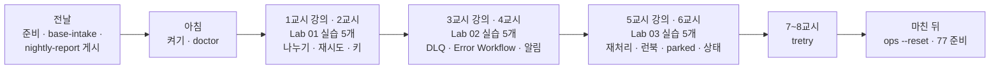
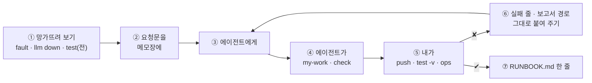

# 76일차 수강 안내 · 수업 준비부터 마칠 때까지

- 일자: 2026-10-30 (금) · 76일차
- 주제: 에러 처리와 예외 대응, 안정적 운영 체계 (실패의 종류 · 모으고 알리기 · 재처리와 런북)
- 실습 폴더: [Last3Mon/76](README.md) · 강의 자료: [Lecture/76](../../Lecture/76/README.md)
- 환경: 65일차 n8n 2.42.6 + **OpenAI API 키만**(`gpt-4.1-mini`, 분류) + **76일차 판 데이터 API**(75일차 + 접수 건 만들기 · DLQ · 알림 · 고장 스위치) + CLI 코딩 에이전트 하나. **Ollama는 쓰지 않습니다.**
- 이 문서: 오늘 하루 내가 할 일을 수업 준비부터 마칠 때까지 순서대로 모은 수강 안내입니다. 수업 중에도 띄워 두고 어디까지 왔는지 확인하세요.



## 0. 하루 한눈에

| 교시 | 시간 | 할 일 | 문서 | 끝났다는 표시 |
| --- | --- | --- | --- | --- |
| 전날 | 약 10분 | 자료 받기 · n8n · 76일차 데이터 API · `base-intake` · `nightly-report` 게시 · doctor | [PREP](../../Lecture/76/00-DAY76-PREP.md) | `ready` |
| 1 | 09:00~09:50 | 개요 · 1단계 강의 (실패의 종류) | [개요](../../Lecture/76/00-DAY76-OVERVIEW.md) 1~14장, [1단계](../../Lecture/76/01-STAGE1-FAILURE-TYPES.md) | |
| 2 | 10:00~10:50 | Lab 01 실습 5개 (예제 1~3 · 과제 1~2) | [Lab 01](LAB-01-Q-FAILURE-TYPES.md) | `lab01-challenge` 3/3 · `lab01-challenge2` 4/4 |
| 3 | 11:00~11:50 | 2단계 강의 (모으고 알리기) | 개요 15~21장, [2단계](../../Lecture/76/02-STAGE2-COLLECT-AND-ALERT.md) | |
| 4 | 12:00~12:50 | Lab 02 실습 5개 | [Lab 02](LAB-02-Q-COLLECT-AND-ALERT.md) | `lab02-challenge` 6/6 · `lab02-challenge2` 6/6 |
| - | 13:00~14:00 | 점심 | | |
| 5 | 14:00~14:50 | 3단계 강의 (재처리와 운영 체계) | 개요 22~28장, [3단계](../../Lecture/76/03-STAGE3-REPLAY-AND-RUNBOOK.md) | |
| 6 | 15:00~15:50 | Lab 03 실습 5개 | [Lab 03](LAB-03-Q-REPLAY-AND-RUNBOOK.md) | `lab03-challenge` 7/7 · `lab03-challenge2` 7/7, `RUNBOOK.md` |
| 7 | 16:00~16:50 | 바이브 코딩 `tretry`: 요청서 → TODO → SPEC → IMP-PLAN → 만들기 → 설치 | [VIBE-REQ-TRETRY](VIBE-REQ-TRETRY.md) → [VIBE-Q-TRETRY](VIBE-Q-TRETRY.md) | `Doc/*.md` · R1~R6 · R8 · R11~R14 · `pytest` |
| 8 | 17:00~17:50 | 바이브 코딩 발표 · **4단계 정리** (오늘의 의미 · 효과 · 회사에서 쓰는 법) · 77일차 예고 | [4단계 정리](../../Lecture/76/04-STAGE4-WRAPUP.md), [진행](../../Lecture/76/05-VIBE-CODING.md) | 최종 프로젝트 체크리스트 |

## 1. 전날 준비 (약 10분)

### 1.1 자료 받기

```bash
cd ~/aio-01d4-stu && git pull
```

### 1.2 n8n과 **76일차** 데이터 API 켜기 (Ollama는 끔)

```bash
sudo systemctl disable --now ollama 2>/dev/null   # WSL에 설치한 Ollama가 있으면 끄고 자동 시작도 끔
cd ~/aio-01d4-stu/Last3Mon/65/n8n
docker compose rm -sf ollama                      # Ollama 컨테이너가 있으면 지움 (없으면 그냥 지나감)
docker compose start
cd ~/aio-01d4-stu/Last3Mon/76/data-api
docker compose up -d --force-recreate             # 75일차 판을 76일차 판(+ 접수 건 만들기 · DLQ · 알림)으로 바꿈
sleep 3                                           # 데이터 API가 뜰 때까지
curl -s localhost:8800/dlq                        # {"size": 0, "parked": 0, "items": []}
```

- 75일차 연습을 되돌리지 않았어도 괜찮습니다: 데이터 API를 새로 띄우면 예산 · 사용량 기록 · 고장 스위치가 처음으로 돌아갑니다.

### 1.3 기준 게시 · 준비 확인

```bash
cd ~/aio-01d4-stu/Last3Mon/76
uv run tools/flow.py push reference/baseline-intake.json reference/nightly-report.json
uv run tools/flow.py call base-intake requests/batch-ok.json   # processed 3 이면 됨
uv run tools/flow.py ops --reset
uv run tools/flow.py doctor        # 마지막 줄 ready
```

### 1.4 미리 읽기 (선택, 5분)

[PREP 3절](../../Lecture/76/00-DAY76-PREP.md): 500을 받은 사용자는 무엇을 할까? 그때 서버에는 무엇이 남아 있을까? 그리고 7교시 [요청서](VIBE-REQ-TRETRY.md).

### 준비물

노트북과 충전기, WSL의 Docker, WSL 창 두 개, 브라우저 (n8n 화면 Executions를 열어 봄), 짝 연습을 할 옆 사람.

## 2. 수업 당일 아침 (09:00 전)

1. 노트북을 껐다 켰다면 1.2를 다시 합니다 (접수 건 · DLQ · 알림은 처음으로 돌아갑니다 — 괜찮음).
2. 터미널 두 개, 둘 다 `cd ~/aio-01d4-stu/Last3Mon/76`. ① 에이전트(`codex`/`claude`/`agy`), ② 확인(`call`·`push`·`test`·`ops`·`fault`).
3. 터미널 ②에서 `uv run tools/flow.py doctor` → `ready`, `uv run tools/flow.py ops`.
4. `cp templates/RUNBOOK-TEMPLATE.md my-work/RUNBOOK.md`, `my-work/PROMPTS.md`.

## 3. 실습할 때마다 같은 순서 (오늘은 "망가뜨려 보기 → 고치기 → 다시 망가뜨려 확인")



- 고장 스위치는 **내가** `flow.py fault`로 켜고 끕니다. 테스트 파일은 자기가 켠 고장을 끝에서 되돌립니다. 손으로 켰으면 끝나면 `uv run tools/flow.py fault tickets ok` (또는 `ops --reset`).
- `ops` 한 번으로 고장 스위치 · 접수 건 · DLQ · 알림이 보입니다. 테스트 사이마다 봅니다.
- `llm down`(Lab 01 과제 1)은 테스트가 끝에서 `llm up`으로 되돌립니다. 중간에 멈췄다면 **반드시** `uv run tools/flow.py llm up`.

## 4. 1~2교시 · 1단계 · 실패의 종류

1교시는 강의, 2교시는 [Lab 01](LAB-01-Q-FAILURE-TYPES.md) (50분, 실습 5개).

| 순서 | 할 일 | 파일 · 웹훅 | 확인 (터미널 ②) |
| --- | --- | --- | --- |
| 예제 1 (10분, 에이전트 없이) | 기준을 망가뜨려 보기: 빈 글 · `flaky` · 다시 보내기 | `base-intake` | `call base-intake requests/batch-*.json`, `ops`, `fault tickets flaky` · `ok` → `RUNBOOK.md` 1.1 |
| 예제 2 (15분) | 항목 확인 · 재시도 3 · 키 = 요청 id · 부분 성공 200 | `cp reference/baseline-intake.json my-work/intake.json` → 웹훅 `my-intake`로 | `test cases/lab01.json --webhook base-intake -v` (전), `push my-work/intake.json` → `test cases/lab01.json -v` |
| 예제 3 (7분, 에이전트 없이) | 고장 종류마다 재시도: `flaky` · `error` · `slow`, 늦게 생긴 접수 건 | (그대로) | `test cases/lab01-faults.json -v`, `ops` → `RUNBOOK.md` 1.2 |
| 과제 1 (8분) | LLM이 멈춰도 미분류 · 보통으로 접수 | `my-work/intake.json` 고치기 | `test cases/lab01-challenge.json -v` (자동으로 `llm down` · `up`), `lab01` |
| 과제 2 (10분) | 같은 id의 두 번째는 거절, 10건 넘으면 400 | `my-work/intake.json` 고치기 | `test cases/lab01-challenge2.json -v`, `lab01` · `lab01-challenge` |

(명령 앞에는 모두 `uv run tools/flow.py`가 붙습니다.)

## 5. 3~4교시 · 2단계 · 모으고 알리기

3교시는 강의, 4교시는 [Lab 02](LAB-02-Q-COLLECT-AND-ALERT.md) (50분, 실습 5개).

| 순서 | 할 일 | 확인 |
| --- | --- | --- |
| 예제 1 (12분) | 먼저 겪기: `fault tickets error` → `call my-intake` → `ok` → `ops` (DLQ 0). 그다음 실패한 요청은 원래 그대로 DLQ에 | `test cases/lab02.json -v` (전 · 후), `ops` |
| 예제 2 (12분) | 에러 처리기 `errHandler76001` (Error Trigger → critical 알림), 내 접수에 `errorWorkflow` | `push my-work/error-handler.json my-work/intake.json`, `test cases/lab02.json -v`, `ops`, `lab01` |
| 예제 3 (6분, 에이전트 없이) | 실패 넷이 어느 그물에: 빈 글 · API 오류 · 버그 · **DLQ도 멈춤** | `test cases/lab02-nets.json -v` (5/7이 맞음), `ops` → `RUNBOOK.md` 1.3 |
| 과제 1 (10분) | DLQ에 넣었으면 high 알림, 못 넣었으면 critical `dlq_down` + 잃을 뻔한 id, 결과에 `dlq_saved` · `alert` | `test cases/lab02-challenge.json -v`, `lab02-nets` 7/7, `lab02` |
| 과제 2 (10분) | 같은 이유의 high 알림은 10분에 한 번 (`suppressed`), critical은 늘 | `test cases/lab02-challenge2.json -v`, `lab02-challenge`, `lab01-challenge2`, `ops --reset` |

## 6. 5~6교시 · 3단계 · 재처리와 운영 체계

5교시는 강의, 6교시는 [Lab 03](LAB-03-Q-REPLAY-AND-RUNBOOK.md) (50분, 실습 5개).

| 순서 | 할 일 | 확인 |
| --- | --- | --- |
| 예제 1 (12분) | 재처리 `my-replay`: DLQ의 요청을 `my-intake`로 하나씩, 성공하면 지우기 | `test cases/lab03.json -v` (전 · 후), `ops` |
| 예제 2 (12분, 에이전트 없이) | `RUNBOOK.md` 2절을 쓰고 짝 연습: 한 사람이 장애를 내고 다른 사람이 런북만 보고 대응 | `fault tickets error` · `call my-intake` · `call nightly-report` → `ops` → `fault tickets ok` → `call my-replay` → `ops`, `test cases/lab03-drill.json -v` → `RUNBOOK.md` 3절 |
| 예제 3 (6분, 에이전트 없이) | 반쯤 처리된 요청: `slow`로 실패 → 늦게 생긴 접수 건 → 재처리는 `duplicates` | `test cases/lab03-half.json -v`, `ops` |
| 과제 1 (10분) | `attempts` 3 이상이면 다시 보내지 않고 parked + high 알림 | `test cases/lab03-challenge.json -v`, `lab03` |
| 과제 2 (10분) | 운영 상태 `my-ops-status`: ok · warn · critical과 까닭 (읽기만) | `test cases/lab03-challenge2.json -v`, `lab03-challenge`, `call my-ops-status`, `ops --reset` |

- 기록: `RUNBOOK.md` 전체 (4절 누가 · 언제까지), `TEST-REPORT.md`.

## 7. 7~8교시 · 바이브 코딩 `tretry`

[VIBE-REQ-TRETRY](VIBE-REQ-TRETRY.md)(요청서)를 **먼저** 읽고 [VIBE-Q-TRETRY](VIBE-Q-TRETRY.md)의 순서대로 갑니다: `Doc/TODO.md` → `Doc/SPEC.md` → `Doc/IMP-PLAN.md`(엔진 · TUI 단계) → 단계별 구현 → 확인 → `uv tool install` → 다른 폴더에서 사용. 요구는 14개(R1~R14)이고 50분 안에는 엔진 1 · 2단계 · TUI 1단계 · 설치까지, 나머지(R7 마감 · R9 순위 · R10 회로 차단)는 `Doc/IMP-PLAN.md`의 다음 단계로 집에서 이어 갑니다. 만드는 것은 아무 명령이나 HTTP 호출을 감싸 다시 하기(backoff · 상한 · 흔들기) · 시간 제한 · 대체를 붙이고, 고칠 수 없는 실패는 다시 하지 않고, 같은 멱등 키를 붙이고, 기록 · 순위를 TUI로 보는 도구. 정답본 `VIBE-A-TRETRY.md`는 수업이 끝나면 `git pull`로 받습니다.

```bash
mkdir -p ~/vibe/tretry/Doc && cd ~/vibe/tretry
git init
# 에이전트는 Doc/TODO.md를 쓴 뒤에 켭니다: codex (또는 claude, agy)
```

| 시간 | 단계 | 확인 |
| --- | --- | --- |
| 16:00~16:09 | 0 준비 · 1 요청서 → `Doc/TODO.md` (에이전트 없이) | 할 일 ①~⑫ · 꼭 / 나중 |
| 16:09~16:15 | 2 `Doc/SPEC.md` → VIBE-Q 요구 표(R1~R14)와 비교 · commit | 요구마다 확인 방법 (시도 수 · 기다린 시간 · 종료 코드) |
| 16:15~16:20 | 3 `Doc/IMP-PLAN.md` (엔진 1~3단계 · TUI 1단계 · 설치) · commit | 단계마다 체크리스트 |
| 16:20~16:44 | 4 구현: 엔진 1단계(R1~R4 · R12 · R13) → 엔진 2단계(R5 · R6 · R8) → TUI 1단계(R11), 막히면 5 문제 해결 팁 | 단계마다 `pytest` · 직접 실행 · commit |
| 16:44~16:50 | 6 확인 · 7 `uv tool install --editable .` · 8 다른 폴더에서 `tretry` | 데이터 API `flaky`에서 `tretry http POST localhost:8800/tickets ... --idem-key x --body-key key` |

- 8교시: 1~2명 발표 (10분) → [4단계 정리](../../Lecture/76/04-STAGE4-WRAPUP.md) (35분: 오늘 한 일의 의미 · 효과 · 산업에서의 응용 · 면접 질문 · 최종 프로젝트 체크리스트) → 77일차 예고.

## 8. 마친 뒤

| 할 일 | 이유 |
| --- | --- |
| `uv run tools/flow.py ops --reset`, `llm up`(혹시 모르니), `doctor` → `ready` | 내일 처음 상태로 |
| `PROMPTS.md`, `RUNBOOK.md`, `TEST-REPORT.md` 정리 | 최종 프로젝트 재료 (장애 대응 절차) |
| `my-work/*.json`, `~/vibe/tretry` 지우지 않기 | 77일차 로그 분석 · 79일차 `tops` |
| 77일차 준비: [00-DAY77-PREP](../../Lecture/77/00-DAY77-PREP.md) | 실행 기록 · 로그 분석 |

## 9. 막혔을 때 (오늘 공통)

| 증상 | 할 일 |
| --- | --- |
| doctor의 `dead letter queue /dlq · alerts · fault switch dlq` ✘ | 데이터 API가 예전 판. 1.2의 76일차 `--force-recreate` · `sleep 3` |
| doctor에 `fault switch is on` · `DLQ is not empty` | `uv run tools/flow.py ops --reset` |
| `check`가 `retryOnFail ... must be at the node level` | 재시도 설정을 `parameters` 밖, 노드 바로 아래로 |
| 테스트 뒤에도 분류가 모두 실패 | `uv run tools/flow.py llm up` |
| 알림이 하나도 안 생김 | 에러 처리기를 push(게시)했는지, 파일의 `"id": "errHandler76001"` |
| 늘 `suppressed` · 늘 `critical` | 앞 테스트의 알림이 남음 → `ops --reset` |
| `call my-intake`가 404 | 복사한 파일의 웹훅 경로를 바꿨는지, push했는지 |
| `slow` 테스트가 오래 걸림 | 정상 (한 케이스 10~12초) |
| 같은 곳을 3번 고쳐도 실패 | 요청을 더 작게, 또는 `reference/`로 이어 가기 |

## 확인

- [ ] 전날 76일차 데이터 API, `base-intake` · `nightly-report` 게시, `doctor` → `ready`
- [ ] Lab 01: `RUNBOOK.md` 1.1 · 1.2, `lab01` 6/6, `lab01-faults` 5/5, `lab01-challenge` 3/3, `lab01-challenge2` 4/4
- [ ] Lab 02: `lab02` 4/4, `lab02-nets` 5/7 → 7/7, `lab02-challenge` 6/6, `lab02-challenge2` 6/6, `RUNBOOK.md` 1.3 · 1.4
- [ ] Lab 03: `lab03` 5/5, 짝 연습 · `lab03-drill` 7/7, `lab03-half` 6/6, `lab03-challenge` 7/7, `lab03-challenge2` 7/7, `RUNBOOK.md` 2~4절
- [ ] `tretry`: `Doc/TODO.md` · `SPEC.md` · `IMP-PLAN.md` 먼저, 엔진 1 · 2단계 · TUI 1단계, `pytest`, 단계마다 commit, `uv tool install`
- [ ] `ops --reset` · `llm up`, 77일차 준비
