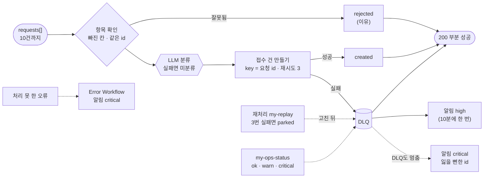

# 76일차 실습 · 에러 처리와 예외 대응, 안정적 운영 체계 (바이브 코딩)

- 일자: 2026-10-30 (76일차)
- 교과목: 노코드 멀티 에이전트 워크플로우 설계 및 운영
- 단원: AI 워크플로우 운영 및 관리 역량 강화
- 강의 자료: [Lecture/76](../../Lecture/76/README.md)
- 하루 수강 안내: [LECTURE-76.md](LECTURE-76.md) (수업 준비부터 마칠 때까지 순서대로)
- 67~75일차처럼 CLI 코딩 에이전트에게 **내가 쓴 요청문**으로 워크플로우를 만들게 하고, **테스트로 확인**합니다. 오늘은 실패를 **나누고 · 모으고 · 알리고 · 다시 돌리는** 체계를 만듭니다.

## 오늘 고치는 것: 실패하면 잃고, 다시 보내면 겹치는 문의 일괄 접수

`reference/baseline-intake.json`(웹훅 `base-intake`)은 여러 문의(`requests[]`)를 받아 하나씩 LLM으로 분류하고 접수 건을 만듭니다. 수업 준비 때 빈 글이 섞인 3건을 보내자 **HTTP 500인데 접수 건 2개가 이미 생겼고**, 같은 3건을 다시 보내자 **같은 문의의 접수 건이 둘**이 되었습니다. 이것을 실패해도 잃지 않고, 다시 해도 겹치지 않고, 사람이 바로 알게 바꿉니다.



## 일하는 방식 (67~75일차와 같음)

| 누가 | 무엇을 |
| --- | --- |
| 나 | 실패를 겪어 보고 나누기(거절 · 재시도 · DLQ · 알림), 요청문, 고장 연습, 대응 절차(런북) 쓰기 · 짝 연습 |
| CLI 에이전트 | [AGENTS.md](AGENTS.md) 규칙대로 워크플로우 JSON 작성, `check`로 형식 오류 고치기 |
| `tools/flow.py` | check(재시도 설정 자리 · `errorWorkflow` id) · push · call · test(`{"sleep": 3}`) · **ops**(접수 건 · DLQ · 알림 · 고장 스위치, `--reset`) · **fault tickets\|dlq flaky\|slow\|error\|ok** · llm · doctor (모두 `-v`) |

> 실패를 **숨기지** 않습니다. 실패한 항목은 결과에 그대로, 그리고 다시 돌릴 수 있는 곳(DLQ)에. 알림을 줄여도 실패의 기록은 줄이지 않습니다.

## 실습 15개 (Lab마다 예제 3 · 과제 2)

| | 예제 1 | 예제 2 | 예제 3 | 과제 1 | 과제 2 |
| --- | --- | --- | --- | --- | --- |
| [Lab 01](LAB-01-Q-FAILURE-TYPES.md) | 기준을 망가뜨려 보기 (에이전트 없이) | 항목 확인 · 재시도 · 멱등 키 | 고장 종류마다 재시도가 하는 일 (에이전트 없이) | LLM이 멈춰도 미분류로 접수 | 요청 안의 규칙 (같은 id · 10건) |
| [Lab 02](LAB-02-Q-COLLECT-AND-ALERT.md) | 실패한 요청은 DLQ | Error Workflow | 어느 실패가 어느 그물에 (에이전트 없이) | 처리한 실패도 알림 · DLQ가 멈추면 | 알림 폭주 막기 |
| [Lab 03](LAB-03-Q-REPLAY-AND-RUNBOOK.md) | 재처리 | 런북 · 장애 연습 (에이전트 없이) | 반쯤 처리된 요청 (에이전트 없이) | 세 번 실패하면 멈춤 (parked) | 운영 상태 한눈에 |

## 실습 문서 읽는 법

- 실습 문서(`LAB-0x-Q-*.md`, `VIBE-Q-TRETRY.md`)에는 **복사해 붙일 요청문이 없습니다.** 실습마다 `### 이해하기`(왜 · 지금 → 바뀐 뒤 · 테스트 케이스 · 기대 결과)를 읽고, 막히면 `▶` 를 하나씩 펼칩니다. 요청문은 `▶ 빈칸 채우기`의 빈칸 4개(`____①`~`____④`)를 채워서 씁니다. 실습마다 끝에 `### 실행 결과`(수업 준비 때 고치기 전 · 후 출력과 그렇게 나온 까닭)가 있습니다.
- 쓴 요청문은 `my-work/PROMPTS.md`에, 실패 지도와 대응 절차는 `my-work/RUNBOOK.md`에, 테스트 결과는 `my-work/TEST-REPORT.md`에 모아 둡니다.

## 구성

```text
Last3Mon/76/
├── README.md
├── LECTURE-76.md                    # 하루 수강 안내
├── AGENTS.md                        # CLI 에이전트용 작업 규칙 (계약 3절, 항목 실패 · 재시도 · 멱등 키 · DLQ · Error Workflow 노드 5절)
├── LAB-01-Q-FAILURE-TYPES.md        # 1단계 · 망가뜨려 보기 · 항목 확인 · 재시도 · 멱등 키 · 고장 종류 · LLM 멈춤 · 요청 규칙
├── LAB-02-Q-COLLECT-AND-ALERT.md    # 2단계 · DLQ · Error Workflow · 그물 지도 · 처리한 실패 알림 · 알림 폭주
├── LAB-03-Q-REPLAY-AND-RUNBOOK.md   # 3단계 · 재처리 · 런북 · 장애 연습 · 반쯤 처리된 요청 · parked · 운영 상태
├── VIBE-REQ-TRETRY.md               # 7교시 바이브 코딩 요청서 (가장 먼저 읽기)
├── VIBE-Q-TRETRY.md                 # 7교시 바이브 코딩 · tretry (명령 · HTTP 재시도 · 대체 · 마감 · 회로 차단 TUI)
├── tools/flow.py
├── data-api/                        # 76일차 판 데이터 API (75일차 + 접수 건 만들기 · DLQ · 알림 · 고장 스위치 dlq)
├── cases/                           # lab01 · lab01-faults · lab01-challenge(2) · lab02 · lab02-nets · lab02-challenge(2) · lab03 · lab03-drill · lab03-half · lab03-challenge(2)
├── requests/                        # batch-ok · batch-bad-item · batch-two · batch-dup-id · batch-eleven · not-a-list
├── reference/                       # baseline-intake · nightly-report(버그) + 막혔을 때 이어 가는 워크플로우
├── templates/                       # 런북 · 테스트 보고서
├── my-work/
└── runs/
```

## 준비

[실습 준비](../../Lecture/76/00-DAY76-PREP.md)를 끝내 주세요. 요약:

```bash
cd ~/aio-01d4-stu/Last3Mon/65/n8n && docker compose start   # Ollama는 쓰지 않음 · 처음 한 번 PREP 1절대로 끄기
cd ~/aio-01d4-stu/Last3Mon/76/data-api && docker compose up -d --force-recreate && sleep 3   # 76일차 판
cd ~/aio-01d4-stu/Last3Mon/76 && uv run tools/flow.py push reference/baseline-intake.json reference/nightly-report.json
uv run tools/flow.py doctor                                                          # 마지막 줄 ready
```

## `flow.py` 명령 (오늘 더해진 것)

| 명령 | 하는 일 | 수업 준비 때 |
| --- | --- | --- |
| `uv run tools/flow.py call base-intake requests/batch-bad-item.json` | 기준이 잘못된 항목 하나에 어떻게 되나 | HTTP 500, 그런데 나머지 2건은 이미 접수됨 |
| `uv run tools/flow.py ops` · `ops --reset` | 만든 접수 건 · DLQ(parked) · 알림 · 고장 스위치 보기 · 모두 비우고 스위치 `ok` | |
| `uv run tools/flow.py fault tickets flaky` · `slow` · `error` · `ok` | 접수 건 만들기를 키마다 첫 시도만 실패 · 8초 늦게(그래도 만듦) · 늘 실패 · 되돌리기 | `slow`에서 내 접수 12.4초 · 늦게 생긴 3건 |
| `uv run tools/flow.py fault dlq error` · `ok` | DLQ 저장을 실패로 (Lab 02 예제 3 · 과제 1) | |
| `uv run tools/flow.py llm down` · `llm up` | LLM 멈춤 연습 (72일차와 같음) | |
| `uv run tools/flow.py check my-work/intake.json` | 재시도 설정을 `parameters` 안에 쓰면 · `errorWorkflow` id가 이상하면 오류 | |

> 오늘 LLM은 분류에만 씁니다 (`gpt-4.1-mini`, 문의 하나에 한 번). `slow` 케이스는 한 번에 10초 넘게 걸리니 같은 테스트를 여러 번 반복하지 않습니다.
