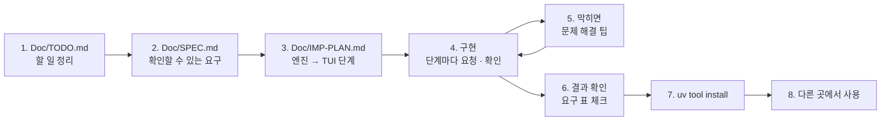

# 7교시 바이브 코딩 · `tretry` 만들기

> **먼저 [VIBE-REQ-TRETRY.md](VIBE-REQ-TRETRY.md)(요청서)를 읽고 `~/vibe/tretry/Doc/TODO.md`를 직접 쓴 뒤** 이 문서를 엽니다. 아래 1~8을 차례로 갑니다. 이 문서의 요구 표는 **내 SPEC을 쓴 뒤에** 비교하는 데 쓰고, 에이전트에게 통째로 붙여 넣지 않습니다.



- 시간: 16:00~16:50 (50분) · 발표와 정리는 8교시 · 50분 안에 못 한 단계는 집에서 `Doc/IMP-PLAN.md`의 다음 단계로 이어 갑니다
- 도구: CLI 코딩 에이전트(codex / claude / agy), Python + uv + [Textual](https://textual.textualize.io/), 표준 라이브러리 `subprocess` · `urllib.request`
- 결과물: 아무 **명령이나 HTTP 호출을 감싸** 실패하면 **간격을 늘려 가며 다시** 하고(상한 · 흔들기), 한 시도는 **시간 제한**으로 끊고, 전체 **마감 시간** 안에 끝내고, 다 실패하면 **대신 할 명령**을 돌리는 도구. 고칠 수 없는 실패(HTTP 4xx)는 다시 하지 않고, 다시 보낼 때는 **같은 멱등 키**를 붙입니다. 시도마다 기록을 남기고(키 · 토큰은 지움), 기록으로 순위와 **바로 대체(회로 차단)**를 정하고, TUI로 봅니다. `uv tool install`로 설치해 **어느 폴더에서나** `tretry`. 오늘 n8n 노드 설정(`retryOnFail` · `onError` · 대체 경로)으로 한 일을 **n8n 밖 어떤 명령에든.**

```text
$ tretry --tries 4 --backoff 0.5 --timeout 2 --fallback "cat ~/cache/faq.json" -- curl -sf localhost:8800/faq?q=vpn
#1          0.00s  ✘ exit 22 · 0.02s
#2          0.52s  ✘ timeout 2.0s · 2.00s (waited 0.50s)
#3          3.53s  ✔ ok · 0.03s (waited 1.00s)
result: ok  · 3 tries · 3.56s

$ tretry log
┌ tretry · ~/.tretry/log.jsonl ──────────────────────────────────────────────────┐
│ target                               runs ok% tries/run failed │ run try at +s result error │
│ POST http://localhost:8800/tickets      4  50%      2.75      7 │   3   1  0.00   ✘   HTTP 500 │
│ curl -sf localhost:8800/faq?q=vpn       2 100%      2.00      2 │   3   2  0.31   ✔            │
│ 6 run(s) · 15 tr(ies) · [enter] show tries · [f] failed only · [r] reload       │
└────────────────────────────────────────────────────────────────────────────────┘
```

> 요청문은 **직접** 씁니다. 단계마다 `▶` 를 펼치면 생각할 거리가 나옵니다. 정답 요청문은 없습니다.
>
> **테스트에서 진짜로 기다리지 않습니다.** 기다리는 일(`sleep`)과 시계(`clock`)를 바꿔 끼울 수 있게 만들고, HTTP는 테스트 안의 작은 가짜 서버로 시험합니다.

## 시간 (50분)

| 시간 | 단계 | 결과 |
| --- | --- | --- |
| 16:00~16:09 | 0 준비 · 1 `Doc/TODO.md` (요청서 읽고 직접) | 할 일 ①~⑫ · 꼭 / 나중 |
| 16:09~16:15 | 2 `Doc/SPEC.md` → 아래 요구 표와 비교 · 고치기 | 요구마다 확인 방법 |
| 16:15~16:20 | 3 `Doc/IMP-PLAN.md` (엔진 단계 · TUI 단계) | 단계마다 체크리스트 |
| 16:20~16:44 | 4 구현: **엔진 1단계 → 엔진 2단계 → TUI 1단계** (막히면 5) | 단계마다 `pytest` · 직접 실행 · commit |
| 16:44~16:50 | 6 확인 · 7 `uv tool install` · 8 다른 폴더에서 | `tretry http POST localhost:8800/tickets ...` (데이터 API `flaky`) |

50분 안 목표: **R1 · R2 · R3 · R4 · R12 · R13(엔진 1단계) + R5 · R6 · R8(엔진 2단계) + R11(TUI 1단계) + R14(설치)**. R7 · R9 · R10은 IMP-PLAN의 다음 단계로 8교시 뒤 · 집에서 이어 갑니다.

## 0. 준비 (1분)

```bash
mkdir -p ~/vibe/tretry/Doc && cd ~/vibe/tretry
git init
# 에이전트는 Doc/TODO.md를 쓴 뒤에 켭니다: codex (또는 claude, agy)
```

## 1. `Doc/TODO.md` · 만들고 싶은 것과 할 일 정리 (8분, 에이전트 없이)

[VIBE-REQ-TRETRY.md](VIBE-REQ-TRETRY.md)의 "할 일" 틀대로 씁니다. 요청의 말 ①~⑫를 **내 말로** 옮기고, 꼭 · 나중을 표시하고, 걱정되는 것과 50분 안에 못 할 것을 적습니다. "어떻게"는 아직 쓰지 않습니다.

<details><summary>▶ TODO와 SPEC은 무엇이 다른가</summary>

TODO는 **내가 이해한 것**(무엇을 · 왜)입니다. SPEC은 그것을 **확인할 수 있게** 바꾼 것(됐다 · 안 됐다를 말하는 방법)입니다. TODO에서 빠진 것은 SPEC에서도 빠지므로, TODO는 빠짐없이, SPEC은 정확하게.
</details>

`git add Doc/TODO.md && git commit -m "TODO"`

## 2. `Doc/SPEC.md` · 확인할 수 있는 요구로 (6분)

TODO의 할 일마다 **확인 방법**(시도 수 · 기다린 시간 · 종료 코드 · 기록에 남은 것)을 붙여 SPEC을 만듭니다. 에이전트에게 "TODO.md를 읽고 SPEC.md 초안을 써 줘. 요구마다 확인 방법을 붙여"라고 시켜도 됩니다. 그러면 **반드시 내가 읽고 고칩니다.**

```markdown
# tretry SPEC

## 1. 요구 (확인할 수 있게)
| 번호 | 요구 | 요청의 어느 말 | 확인 방법 | 꼭 · 나중 |
| --- | --- | --- | --- | --- |
| R1 | | ① | | 꼭 |

## 2. 숨은 요구
## 3. 범위 밖 (하지 않을 것)
## 4. 정해 둘 것 (기본 횟수 · 간격 · 상한, 다시 할 HTTP 상태, 종료 코드 번호, 기록 파일 위치 · 모양, 회로 차단 기준)
```

<details><summary>▶ 확인 방법은 손으로 셀 수 있는 숫자로</summary>

"간격을 늘린다"는 확인 방법이 아닙니다. "두 번 실패 후 성공하는 가짜 시도, `--tries 4 --backoff 0.5` → 시도 3번, 기다린 시간 [0.5, 1.0]"이 확인 방법입니다. 오늘 Lab 01 예제 3처럼 고장 종류마다 **나와야 할 것과 나오면 안 되는 것**을 둘 다 적습니다 (400 → 시도 1번 · 대체 명령 **안 함**).
</details>

쓴 뒤 아래 표와 비교합니다. 빠진 요구, 내가 더 뽑은 요구를 `Doc/SPEC.md` 끝 "VIBE-Q와 비교"에 한 줄씩 적고 SPEC을 고칩니다.

### 요구 사항 (요청서에서 뽑은 것, 14개)

| 번호 | 요구 | 요청서의 말 | 확인 방법 | 50분 |
| --- | --- | --- | --- | --- |
| R1 | `tretry [--tries N] -- <명령>`: 종료 코드 ≠ 0이면 N번까지 다시 | ① | `--tries 3 --backoff 0 -- false` → 시도 3번 · 종료 코드 1 | 꼭 |
| R2 | 기다림 = `backoff × 2^(i-1)`, `--max-wait` 상한, `--jitter`는 기다림을 **줄이기만** (무작위를 바꿔 끼울 수 있게) | ② | 가짜 sleep: 0.5 → 1.0, `backoff 1 · max 4` → 1 · 2 · 4 · 4, jitter 0.5 · 무작위 1.0 → 절반 | 꼭 |
| R3 | `--timeout S`: 한 시도를 S초에 끊고, 끊긴 것도 다시 할 실패로 | ③ | `--tries 1 --timeout 0.3 -- sleep 5` → `timeout 0.3s` · 종료 코드 1 · 0.3초쯤에 끝 | 꼭 |
| R4 | `--fallback "<명령>"`: 다 실패하면 한 번 실행해 그 출력을 쓰고, 대체로 됐다고 알림 | ④ | `-- false` + `--fallback "echo cached"` → 출력 `cached` · 종료 코드 0 · "by the fallback" | 꼭 |
| R5 | `tretry http <METHOD> <url> [--body] [--header]`: 2xx 성공 · 5xx · 408 · 425 · 429 · timeout · 연결 실패는 다시 · 그 밖의 4xx는 **1번에 멈추고 대체도 안 함**, `Retry-After`를 따름 (상한까지) | ⑤ | 가짜 서버 500 → 201: 시도 2번, 400: 시도 1번 · 종료 코드 3 · 대체 출력 없음, 429 + `Retry-After: 3` → 기다림 3 | 꼭 |
| R6 | `--idem-key auto\|<값>`: 모든 시도에 **같은** 키를 헤더 `Idempotency-Key`로, `--body-key key`면 본문 필드에도 | ⑥ | 가짜 서버가 본 키가 시도 3번 모두 하나 · 본문 `key`와 같음. 데이터 API `flaky`에서 201 → 같은 키로 다시 200 `duplicate: true` | 꼭 |
| R7 | `--deadline S`: 전체 S초. 끝낼 수 없는 기다림 · 시도는 시작하지 않고, 마지막 시도의 시간 제한은 남은 시간으로 줄임 | ⑦ | 가짜: 시도마다 3초 · `backoff 1 · deadline 7` → 시도 2번 · 멈춘 까닭 `deadline` | 나중 |
| R8 | 시도마다 JSON Lines 한 줄 `{at, kind, target, attempt, started, seconds, ok, error, status, waited, fallback, final, result}`, 키 · 토큰(`sk-…`, `Bearer …`, `api_key=…`)은 `***` | ⑧ | URL `?api_key=secret123`, 헤더 `Authorization: Bearer sk-…` → 기록에 `secret123` · `sk-` 없음 | 꼭 |
| R9 | `tretry stats [--json]`: 대상마다 실행 수 · 성공률 · 실행당 시도 · 실패한 시도 · 대체 · p95 시간, 실패 많은 순 | ⑨ | 실패 실행 3번(시도 3 · 2 · 대체) → runs 3 · failed 5 · fallbacks 1 · 33% | 나중 |
| R10 | 회로 차단: 같은 대상의 최근 60초 시도 N개(기본 5)가 모두 실패면 시도 없이 바로 대체 (`--breaker 0`은 끔), 대체가 없으면 멈춤 | ⑩ | 실패 시도 5번 뒤 → 시도 0번 · 대체 출력 · "breaker open" | 나중 |
| R11 | `tretry log`: TUI. 왼쪽 대상 순위(실패 많은 순), 고르면 오른쪽에 시도들, `[f]` 실패만, `[r]` 다시 읽기 | ⑪ | `run_test`: 대상 2개 · 첫 줄이 실패 많은 대상, `f` → 실패만 | 꼭 |
| R12 | 종료 코드 0 됨(대체 포함) · 1 다 실패 · 2 쓰는 법이 틀림 · 3 고칠 수 없는 실패, `--json` | ⑫ | `--` 없음 → 2, 본문이 JSON이 아님 → 2, `--json` → `exit_code` · `stopped` · `attempts` | 꼭 |
| R13 | 테스트에서 기다리지 않음: `sleep` · `clock` · 무작위를 바꿔 끼움, HTTP는 테스트 안의 가짜 서버 | 끝 | `uv run pytest -q`가 10초 안 | 꼭 |
| R14 | `uv tool install`로 설치해 **어느 폴더에서나** `tretry` | 첫 문단 | `cd /tmp && tretry --help`, `uv tool list`에 `tretry` | 꼭 |

숨은 요구 (요청서에 직접 없지만 없으면 안 되는 것):

| 숨은 요구 | 어디서 나왔나 |
| --- | --- |
| 다시 하기 **엔진**은 명령도 HTTP도 모른다. "한 번 해 보기"를 받아 결과(성공 · 다시 할 수 있나 · 오류)만 본다 | ① · ⑤ — 그래야 명령 · HTTP · 다음에 올 것(DB 등)에 같은 엔진 |
| 명령이 **없으면**(오타) 다시 하지 않는다 | ⑤의 "몇 번을 해도 똑같은 것" |
| 대체 명령이 다 실패를 **가리지 않게**: 결과 · 기록에 "대체로 됨"이 남는다 | ④ "대신 한 거라면 그렇다고" — 오늘 Lab 01 과제 1의 `unclassified` 수와 같은 생각 |
| 한 실행의 시도 줄들을 다시 묶을 수 있어야 한다 (`final`) | ⑨ · ⑪ — 실행당 시도 수 |
| 회로 차단은 **대체의 성공**을 대상의 성공으로 세지 않는다 | ⑩ — 대체가 늘 성공하면 차단이 영영 안 풀림 |
| 기록 파일 위치를 바꿀 수 있게 (`--log`, `$TRETRY_LOG`) | 테스트가 내 진짜 기록을 더럽히지 않게 |

범위 밖 (오늘 하지 않음): 여러 대상 동시에, 차단 상태를 여러 컴퓨터가 함께 쓰기, 메일 · 메신저 알림, 기록 파일 돌려 쓰기(로테이션).

`git add Doc/SPEC.md && git commit -m "SPEC"`

## 3. `Doc/IMP-PLAN.md` · 구현 계획 (5분)

SPEC의 요구를 **단계**로 나눕니다. 첫 원칙: **엔진(백엔드)을 먼저, 화면(TUI)은 나중에.** 화면은 기록 파일을 읽어 보여 주기만 하면 되게 만듭니다. 에이전트에게 "SPEC.md를 읽고 IMP-PLAN.md를 엔진 단계와 TUI 단계로 나눠 써 줘. 단계마다 체크리스트와 확인 명령"이라고 시켜도 됩니다 (내가 읽고 고침).

```markdown
# tretry IMP-PLAN

## 엔진 1단계 · 다시 하기 · 대체 · 종료 코드 (R1 · R2 · R3 · R4 · R12 · R13)
- [ ] retry.py: Policy(tries, backoff, max_wait, jitter), wait(i) = min(backoff × 2^(i-1), max_wait) × (1 - jitter × 무작위)
- [ ] run_with_retry(attempt, policy, fallback, timeout, sleep, clock, rand) → Result(ok, attempts, stopped, used_fallback)
- [ ] runners.command(argv): 종료 코드 · timeout · 명령 없음
- [ ] cli: tretry [옵션] -- <명령>, 종료 코드 0 · 1 · 2 · 3, --json
- [ ] tests: 가짜 시계로 [0.5, 1.0], 상한, 대체, 4xx 같은 "다시 못 함"은 1번
- 확인: uv run pytest -q, uv run tretry --tries 3 --backoff 0.2 -- false

## 엔진 2단계 · HTTP · 멱등 키 · 기록 (R5 · R6 · R8)
## TUI 1단계 · 기록 보기 (R11)
## 설치 (R14)
## 엔진 3단계 · 마감 · 순위 · 회로 차단 (R7 · R9 · R10)
```

<details><summary>▶ 왜 엔진 먼저인가</summary>

- 엔진은 **화면 없이 테스트**할 수 있습니다 (`pytest`, `tretry -- false`). 화면부터 만들면 다시 하는지 눈으로만 봅니다.
- 밤 작업 스크립트는 화면 없이 돌아갑니다. 종료 코드(R12)가 다음 줄을 정합니다 (74일차 게이트와 같음).
- TUI는 기록 파일을 읽어 표에 넣기만 합니다. 기록 모양(R8)이 정해져야 TUI를 만들 수 있습니다.
</details>

<details><summary>▶ 단계 크기</summary>

한 단계 = 에이전트 요청 한두 번 + 확인 한 번 + commit 한 번 (10분 안팎). 단계가 크면 에이전트가 많이 바꾸고, 틀렸을 때 어디가 틀렸는지 모릅니다. 오늘 Lab 01에서 기준을 한 번에 다 고치지 않고 "확인 → 재시도 → 멱등 키"로 나눈 것과 같습니다.
</details>

`git add Doc/IMP-PLAN.md && git commit -m "IMP-PLAN"`

## 4. 구현 시작 (24분: 엔진 1단계 → 엔진 2단계 → TUI 1단계)

이제 에이전트를 켭니다. 첫 요청은 늘 같습니다.

```text
Doc/SPEC.md 와 Doc/IMP-PLAN.md 를 읽어 줘. 아직 코드는 쓰지 말고,
IMP-PLAN 의 "엔진 1단계"를 어떻게 만들지와 각 체크 항목의 확인 방법을 5줄로 먼저 말해 줘.
```

그다음 **한 단계씩**. 단계마다 긴 요청문은 필요 없습니다. 할 일은 SPEC · IMP-PLAN에 있으니까요.

```text
(처음) 좋아. 체크 안 된 첫 단계만 만들어 줘. 끝나면 IMP-PLAN 체크를 표시하고 확인 명령을 알려 줘. 다음 단계는 내가 말할 때까지 하지 마.
(그다음) 확인했고 commit 했어. 다음 단계.
```

→ 내가 확인 → commit → 한 줄. 그냥 "계속"만 치면 여러 단계를 한꺼번에 하거나 체크 · 확인 명령을 빼먹기 쉽습니다. 틀렸을 때만 무엇이 틀렸는지 · SPEC의 어느 요구인지 · 어디만 고칠지 · 무엇으로 확인할지를 적어 고쳐 달라고 합니다.

> **규모가 큰 프로젝트일수록 다단계로** 진행합니다. `tretry`도 요구가 14개라 한 번에 시키면 에이전트가 수백 줄을 한꺼번에 쓰고, 어디가 틀렸는지 찾기 어렵습니다. 단계마다 ① 그 단계만 요청 ② 직접 확인 ③ IMP-PLAN 체크 ④ `git commit`.

<details><summary>▶ 엔진 1단계 · 테스트가 기다리지 않게</summary>

`time.sleep`을 엔진 안에서 바로 부르면 테스트 하나에 몇 초씩 걸립니다. 엔진이 `sleep` · `clock`을 **인자로 받게** 하고, 테스트는 "기다린 시간을 적고 시계만 앞으로 돌리는" 가짜를 넣습니다. 그러면 "3초짜리 시도 · 마감 7초"도 0초 안에 시험합니다 (R7).
</details>

<details><summary>▶ 엔진 1단계 · 무엇을 "다시 할 수 있는 실패"로 보나</summary>

엔진은 시도 결과에 **다시 할 수 있나**(retryable)를 함께 받습니다. 명령: 종료 코드 ≠ 0 · 시간 초과는 예, 명령이 없음은 아니오. HTTP(엔진 2단계): 5xx · 408 · 425 · 429 · 시간 초과 · 연결 실패는 예, 그 밖의 4xx는 아니오. 이 판단을 엔진 밖(실행기)에 두면 엔진은 하나로 충분합니다.
</details>

<details><summary>▶ 엔진 2단계 · 멱등 키는 언제 만드나</summary>

키를 **시도마다** 만들면 데이터 API가 매번 새 요청으로 봅니다 (오늘 기준 워크플로우의 `$execution.id`와 같은 실수). 키는 **실행을 시작할 때 한 번** 만들고 모든 시도에 붙입니다. 오늘 데이터 API는 본문의 `key`를 봅니다 → `--body-key key`.
</details>

<details><summary>▶ 엔진 2단계 · 기록에 무엇을 남기나 · 남기지 않나</summary>

남길 것: 언제 · 무엇을(대상) · 몇 번째 · 시작부터 몇 초 · 걸린 시간 · 결과 · 오류 · 상태 코드 · 기다린 시간 · 대체였나. 남기지 **않을** 것: 헤더 값, URL · 오류 문장 안의 키 · 토큰. 한 줄에 하나(JSON Lines)면 실행이 중간에 죽어도 앞 줄들은 살아 있습니다.
</details>

<details><summary>▶ TUI 1단계 · 화면 나누기</summary>

순위 계산(엔진)과 화면을 나눕니다 (`tcost` · `tver`와 같음). 왼쪽 표의 줄을 고르면(`RowHighlighted`) 오른쪽 표를 다시 채웁니다. 기록 읽기 · 순위는 엔진 함수를 부르기만.
</details>

<details><summary>▶ 다음 단계들 (8교시 뒤 · 집에서)</summary>

- 마감(R7): 시도를 시작하기 전에 남은 시간을 보고, 기다림이 마감을 넘으면 멈춤. 마지막 시도의 시간 제한 = min(`--timeout`, 남은 시간).
- 순위(R9): 기록을 실행 단위로 묶어(`final`) 대상마다 셈. p95는 실행 시간으로.
- 회로 차단(R10): 기록에서 그 대상의 최근 60초 시도(대체 제외) N개가 모두 실패면 바로 대체. 60초가 지나면 저절로 다시 시도 (half-open).
</details>

## 5. 바이브 코딩으로 문제 해결 팁

| 이럴 때 | 이렇게 |
| --- | --- |
| 에이전트가 "다 됐다"고 함 | **직접 실행**합니다 (`uv run tretry --tries 3 -- false; echo $?`, `uv run pytest -q`). 확인 방법은 SPEC에 있습니다 |
| 실패 · 오류 | 오류 출력 **전부**와 실행한 명령을 그대로 붙여 줍니다 |
| 같은 곳을 3번 고쳐도 안 됨 | 멈추고 `git diff` · `git checkout .`로 되돌린 뒤, 단계를 **더 작게** 나눠 다시 요청 |
| 테스트가 몇 초씩 걸림 | "엔진이 sleep · clock을 인자로 받게, 테스트에서는 가짜로" |
| 400도 다시 함 | "고칠 수 없는 실패(4xx, 408 · 425 · 429 빼고)는 1번에 멈추고 종료 코드 3, 대체도 하지 않기" |
| 간격이 늘 같음 · 끝없이 늚 | "지수 backoff와 상한(--max-wait)" |
| 다시 보낸 POST로 접수 건이 둘 | "멱등 키는 실행에 한 번 만들고 모든 시도에 같은 값, 본문 key에도" |
| `--timeout`이 안 먹음 | "subprocess.run(timeout=...)과 urlopen(timeout=...) 둘 다, 시간 초과도 다시 할 실패로" |
| `-- ` 뒤 옵션을 tretry가 먹어 버림 | "`--` 앞만 tretry 옵션으로 읽고, 뒤는 그대로 명령으로" |
| 기록에 토큰이 보임 | "헤더 값은 기록하지 않고, URL · 오류의 sk-… · Bearer … · api_key=… 는 *** 로" |
| 화면이 이상한데 오류가 안 보임 | `uv add --dev textual-dev` 뒤 다른 터미널에서 `uv run textual console` |
| 대화가 길어져 에이전트가 앞 내용을 잊음 | 새 세션을 열고 "Doc/SPEC.md · Doc/IMP-PLAN.md를 읽고, 체크 안 된 첫 단계부터"로 다시 시작 |
| 설치한 `tretry`가 고친 내용을 모름 | `uv tool install --force .` 로 다시 설치 (또는 처음부터 `--editable`) |

## 6. 결과 확인

`Doc/SPEC.md` 1절 표의 확인 방법대로 **내가** 하나씩 하고 체크합니다. 오늘 50분 안 목표만:

```bash
cd ~/vibe/tretry
uv run pytest -q                                                          # R13: 10초 안
uv run tretry --tries 3 --backoff 0.2 -- false; echo "exit $?"            # R1 · R2: 3번, 0.2 → 0.4
uv run tretry --tries 1 --timeout 0.3 -- sleep 5; echo "exit $?"          # R3
uv run tretry --tries 2 --backoff 0 --fallback "echo cached" -- false     # R4
uv run tretry; echo "exit $?"                                             # R12: 2
L=~/aio-01d4-stu/Last3Mon/76
(cd $L && uv run tools/flow.py fault tickets flaky)
uv run tretry http POST http://localhost:8800/tickets --body '{"title": "vibe test", "requester": "나"}' \
  --idem-key vibe-001 --body-key key --backoff 0.3                        # R5 · R6: 500 → 201
uv run tretry http POST http://localhost:8800/tickets --body '{"title": "vibe test"}' --idem-key vibe-001 --body-key key
                                                                          # R6: 200 duplicate: true
uv run tretry http POST http://localhost:8800/tickets --body '{}' --fallback "echo cached"; echo "exit $?"   # R5: 400 → 3
(cd $L && uv run tools/flow.py fault tickets ok)
tail -3 ~/.tretry/log.jsonl                                               # R8
uv run tretry log                                                         # R11
```

- [ ] R1 횟수.
- [ ] R2 backoff · 상한 · jitter.
- [ ] R3 시도마다 시간 제한.
- [ ] R4 대체 명령.
- [ ] R5 HTTP 5xx · timeout만 다시, 4xx는 1번 · 종료 코드 3.
- [ ] R6 같은 멱등 키 · `duplicate: true`.
- [ ] R8 기록 · 키 지움.
- [ ] R11 TUI.
- [ ] R12 종료 코드 · `--json`.
- [ ] R13 기다리지 않는 테스트.
- [ ] (이어서) R7 · R9 · R10.

## 7. `uv tool install`로 설치

`pyproject.toml`에 명령이 등록되어 있는지 먼저 봅니다.

```toml
[project.scripts]
tretry = "tretry.cli:main"
```

```bash
cd ~/vibe/tretry
uv tool install --editable .        # 고친 내용이 바로 반영됨 (수업 중 권함)
uv tool list                        # tretry 가 보이는가
which tretry                        # ~/.local/bin/tretry
# 명령을 못 찾으면: uv tool update-shell 뒤 터미널을 새로 엶
```

- 지우기: `uv tool uninstall tretry`.

## 8. 다른 곳에서 사용

설치했으면 오늘 Lab과 내 스크립트에 씁니다.

```bash
cd ~/aio-01d4-stu/Last3Mon/76
uv run tools/flow.py fault tickets slow
tretry http POST http://localhost:8800/tickets --body '{"title": "deadline test"}' --idem-key dl-1 --body-key key \
  --timeout 3 --deadline 5                                         # (R7) Lab 01 예제 3의 12초 대신 5초 안에 포기
uv run tools/flow.py fault tickets ok
tretry --tries 3 --fallback "echo '{\"status\": \"cached\"}'" -- curl -sf http://localhost:8800/health   # 아무 명령이나
tretry stats                                                       # (R9) 오늘 가장 자주 실패한 대상
tretry log
```

- `~/vibe/tretry`는 지우지 마세요. 79일차 `tops`에서 다시 씁니다.

## 발표 (8교시, 3분)

| 내용 | |
| --- | |
| TODO → SPEC | 내 SPEC과 VIBE-Q 요구 표가 달랐던 곳 (빠뜨린 요구, 더 뽑은 요구) |
| IMP-PLAN | 엔진 · TUI를 어떻게 나눴나, 어디까지 체크했나 |
| 요청문 | 가장 잘 먹힌 요청문 한 개, 안 먹힌 요청문 한 개 |
| 막힌 곳 | 5절의 어느 팁으로 풀었나 (4xx 재시도 · 테스트 시간 · 멱등 키 · `--` 뒤 옵션) |
| 시연 | 데이터 API `flaky` · `error` · `slow`에서 다시 하기 · 대체 · 마감 |

## 확인

- [ ] `Doc/TODO.md` → `Doc/SPEC.md` → `Doc/IMP-PLAN.md`를 에이전트 전에 (또는 에이전트와 함께 쓰고 내가 고쳐서) 만들고 commit했다.
- [ ] IMP-PLAN의 엔진 1 · 2단계와 TUI 1단계를 체크했다 (단계마다 commit).
- [ ] R1 · R2 · R3 · R4 · R5 · R6 · R8 · R11 · R12 · R13 확인, `uv run pytest -q`.
- [ ] R14 `uv tool install`, 다른 폴더에서 `tretry`.
- [ ] 남은 요구는 IMP-PLAN에 체크 안 된 채로 남겨 두었다 (다음에 이어 감).
