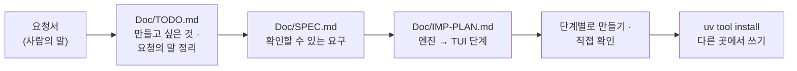

# 7교시 바이브 코딩 · 요청서 `tretry` (가장 먼저 읽기)

- 순서: **이 요청서** → 내 정리 `~/vibe/tretry/Doc/TODO.md` (8분) → [VIBE-Q-TRETRY.md](VIBE-Q-TRETRY.md)의 순서대로 `Doc/SPEC.md` → `Doc/IMP-PLAN.md` → 단계별로 만들기 → 설치 · 다른 곳에서 쓰기 → 수업이 끝나면 `VIBE-A-TRETRY.md`(정답본)로 확인
- 이 문서는 **만들어 달라는 사람의 말**입니다. 요구 사항 표도, 단계도 없습니다. 그것을 뽑아 내는 것이 첫 일입니다. 72일차 `tbench` · 73일차 `tscan` · 74일차 `tver` · 75일차 `tcost`와 같은 순서입니다.



## 왜 요청서부터인가

요구 사항 표를 통째로 에이전트에게 주고 "이대로 만들어 줘"라고 하면, 무엇이 만들어지든 **내가 판단할 기준이 없습니다.** 실무에서는 요구 사항 표가 오지 않고, 이 요청서 같은 **사람의 말**이 옵니다. 오늘 Lab 01 예제 1에서 기준 워크플로우를 먼저 망가뜨려 본 것과 같습니다: 무엇이 실패인지 알아야 고쳤는지 말할 수 있습니다.

| 단계 | 누가 | 결과 |
| --- | --- | --- |
| 요청 → 할 일 목록 | **나** | `Doc/TODO.md`: 요청의 말 ①~⑫를 내 말로, 만들고 싶은 것 |
| 할 일 → 요구 | **나** (에이전트와 다듬어도 됨) | `Doc/SPEC.md`: 요구마다 "됐다 / 안 됐다"를 말할 수 있는 확인 방법 |
| 요구 → 단계 | **나** (에이전트와 다듬어도 됨) | `Doc/IMP-PLAN.md`: 엔진 단계와 화면(TUI) 단계로 나눈 순서 |
| 단계 → 코드 | 에이전트 | 단계마다 요청문 하나, `Doc/*.md`를 함께 읽게 함 |
| 확인 | **나** | 직접 `uv run tretry …`, `pytest`, 요구 표에 체크 |

## 요청 (운영 담당에게서 온 메시지, 그대로)

> 오늘 n8n에서 재시도 · 대체 · 알림을 노드 설정으로 했잖아요. 그런데 우리 밤 작업은 n8n 밖에도 많아요. 셸 스크립트에서 `curl`로 API를 부르고, 백업 명령을 돌리고요. 그런 것들이 **한 번 실패하면 그냥 끝나** 버려서 아침에 보면 빠져 있어요. 아무 명령이나 감싸서 **n8n처럼 다시 해 보게** 해 주는 작은 도구가 있으면 좋겠어요. **어느 폴더에서나** `tretry`라고 치면 되게요.
>
> ① 명령을 주면 실행하고, 실패하면(**종료 코드가 0이 아니면**) 정해진 **횟수**만큼 다시 해 주세요.
>
> ② 바로바로 다시 하면 이미 힘든 서버가 더 힘들어진대요. 기다리는 시간을 **점점 늘려** 주시고, 너무 길어지지 않게 **상한**도요. 그리고 밤 작업 여러 개가 **같은 순간에 한꺼번에** 다시 보내지 않게 해 주세요.
>
> ③ 한 번 시도가 **멈춰 버리면**(응답이 안 오면) 정해진 시간에 끊고 다시 해 주세요.
>
> ④ 다 해도 안 되면 **대신 할 명령**을 돌려 주세요. 예를 들어 어제 받아 둔 파일을 쓰는 거요. 대신 한 거라면 그렇다고 알려 주세요.
>
> ⑤ API를 부를 때는 **고칠 수 없는 실패**(우리 요청이 잘못된 것)까지 다시 하면 안 되잖아요. 몇 번을 해도 똑같으니까요. 그런 건 바로 멈추고, 그때는 대신 할 명령도 돌리지 말아 주세요. 실수가 가려지니까요. 다만 서버가 "**잠깐 뒤에 다시 와**"라고 하면 그 말대로 기다려 주세요.
>
> ⑥ 같은 요청을 다시 보낼 때 **두 번 만들어지면** 안 돼요. 오늘 접수 건이 그랬잖아요. 다시 보낼 때마다 같은 표시(키)를 붙여 주세요.
>
> ⑦ 다시 하는 건 좋은데, 전체가 **몇 초 안에는** 끝나야 할 때가 있어요. 오늘 느린 API에 3초씩 세 번 기다린 것처럼요. 정해진 시간 안에 끝낼 수 없는 시도는 **시작하지 말아** 주세요.
>
> ⑧ 시도마다 **언제 · 무엇을 · 몇 번째 · 몇 초 · 결과 · 오류**를 파일에 남겨 주세요. 나중에 모아서 보려고요. 그런데 거기에 **API 키나 토큰이 남으면 큰일** 나요.
>
> ⑨ 그 기록으로 **어느 대상이 가장 자주 실패하는지**, 성공률 · 평균 몇 번 만에 됐는지 · 오래 걸린 정도를 보여 주세요.
>
> ⑩ 하루 종일 죽어 있는 대상에 매번 세 번씩 다시 보내는 건 낭비예요. **방금 계속 실패한 대상**이면 시도하지 말고 바로 대신 할 명령으로 가 주세요. 조금 지나면 다시 시도해 보고요.
>
> ⑪ **화면에서** 보고 싶어요. 실패가 많은 대상 순서로, 하나를 고르면 그 시도들이 보이게요. 실패한 것만 볼 수도 있게요.
>
> ⑫ 스크립트 안에서 쓸 거라 **종료 코드**가 중요해요. 됐다 · 다 실패했다 · 쓰는 법이 틀렸다 · 고칠 수 없는 실패다를 서로 다른 번호로 주세요. 그리고 **다른 프로그램이 읽을 수 있는** 결과도요.
>
> 아, 시험할 때 **진짜로 몇 초씩 기다리면** 안 돼요. 그리고 오늘 수업의 데이터 API(고장 스위치)로 직접 해 보고 싶어요.

## 함께 받은 것

| 파일 · 자료 | 메모 |
| --- | --- |
| 오늘 데이터 API `http://localhost:8800` | `POST /tickets` (멱등 키 `key`), 고장 스위치: `uv run tools/flow.py fault tickets flaky` · `error` · `slow` · `ok` |
| `requests/batch-ok.json` | 요청 본문 예. `tretry http POST ... --body @파일` |
| 오늘 Lab 01 예제 3 | 고장 종류마다 재시도가 하는 일 (flaky · error · slow) |
| Python 표준 라이브러리 | `subprocess`(시간 제한), `urllib.request`. TUI는 Textual |

## 할 일 · 요청을 내 할 일 목록으로 (8분, 에이전트 없이)

`~/vibe/tretry/Doc/TODO.md`를 만들고 요청의 말 ①~⑫와 맨 끝 부탁을 **내 말로** 한 줄씩 옮깁니다. 아직 "어떻게"는 쓰지 않습니다. **무엇을 · 왜**만 씁니다. 에이전트에게 맡기지 않고 직접 씁니다.

```markdown
# tretry TODO

## 만들고 싶은 것 (한 문단)
어느 폴더에서나 `tretry`로 아무 명령이나 API 호출을 감싸, 실패하면 간격을 늘려 가며 다시 하고 ...

## 요청의 말 → 할 일
| # | 요청의 말 (짧게) | 할 일 (내 말) | 꼭 · 나중 |
| --- | --- | --- | --- |
| ① | 종료 코드 ≠ 0이면 다시 | | 꼭 |
| ② | 점점 늘려 · 상한 · 한꺼번에 X | | |
| ... | | | |
| 끝 | 시험에서 기다리지 않기 | | |

## 요청에 없지만 걱정되는 것
## 오늘 50분 안에 못 할 것 같은 것
```

예 하나만 보여 드립니다.

| 요청의 말 | TODO에 쓸 할 일 (내 말) | 다음 단계(SPEC)에서 바뀔 모양 |
| --- | --- | --- |
| ⑤ "고칠 수 없는 실패까지 다시 하면 안 돼요" | "API가 400처럼 내 잘못을 말하면 한 번만 하고 멈춤, 대신 할 명령도 안 함" | R5: 가짜 서버가 400 → 시도 1번, 종료 코드 3, 대체 명령의 출력 없음 |

<details><summary>▶ 1단계 · 꼭 할 것과 나중에 할 것</summary>

요청의 말이 열두 개입니다. 50분 안에 다 만들기 어렵습니다. 담당자가 가장 아파하는 것은 "한 번 실패하면 그냥 끝나 버려서"입니다. 그리고 기록 · 순위 · 화면 · 바로 대체(⑩)를 만들려면 먼저 무엇이 있어야 하나요? (다시 하기 엔진 → 명령 · HTTP → 기록 → 기록 읽기 → 화면)
</details>

<details><summary>▶ 2단계 · 걱정되는 것 (숨은 요구의 씨앗)</summary>

- ② "점점 늘려": 0.5 → 1 → 2 → 4초면, 열 번째는 몇 초일까요? 상한이 없으면? "한꺼번에 X"는 기다리는 시간을 조금씩 다르게 하면 됩니다. 그런데 무작위면 시험 결과가 날마다 달라지지 않을까요?
- ③ "멈춰 버리면": 명령이 멈춘 것과 API가 멈춘 것은 끊는 방법이 다릅니다. 둘 다 끊어야 합니다.
- ⑤ "고칠 수 없는 실패": HTTP 4xx 중에도 기다리면 되는 것이 있습니다 (429 Too Many Requests · 408). 명령은? 명령이 없을 때(오타)도 다시 할까요?
- ⑥ "같은 표시": 키를 시도마다 새로 만들면 아무 소용이 없습니다. 오늘 데이터 API는 키를 **본문**의 `key`로 받습니다. 헤더로만 보내면?
- ⑦ "몇 초 안에": 남은 시간이 1.5초인데 한 시도의 시간 제한이 3초라면?
- ⑧ "키나 토큰": 헤더뿐 아니라 URL(`?api_key=...`)이나 오류 문장에도 들어갈 수 있습니다.
- ⑩ "계속 실패한 대상": 몇 번 실패하면 · 얼마 동안 바로 대체로? 대신 할 명령이 없으면?
- 끝 "진짜로 기다리면 안 돼요": 기다리는 일을 프로그램 밖에서 바꿔 끼울 수 있어야 합니다.
</details>

## 그다음

[VIBE-Q-TRETRY.md](VIBE-Q-TRETRY.md)를 엽니다. 거기서 `Doc/TODO.md` → `Doc/SPEC.md` → `Doc/IMP-PLAN.md` → 단계별 구현 → 확인 → `uv tool install` → 다른 곳에서 사용 순서로 갑니다. VIBE-Q의 요구 표는 **내 SPEC을 쓴 뒤에** 비교하는 데 씁니다.
