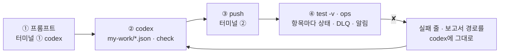
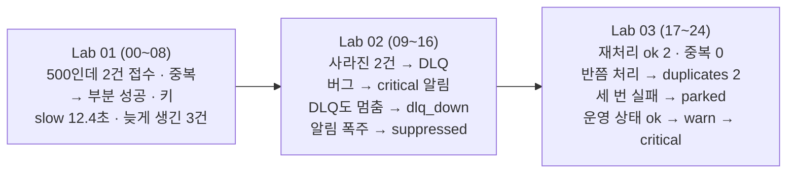

# 76일차 Lab 테스트 결과 · 실제로 만든 시나리오와 `test -v` 결과

> **정답 자료** · 76일차 n8n 워크플로우를 **만드는 프롬프트(codex) → push → `call` · `test -v` · `ops` 결과**를 학생이 가는 순서대로 한 문서에 모았습니다. 수업이 끝난 뒤 공개합니다.

- 실행: 2026-10-29, 실습을 Lab마다 5개(예제 3 + 과제 2)로 늘린 뒤 강사 노트북의 65일차 n8n 2.42.6 + 76일차 판 데이터 API(75일차 + 접수 건 만들기 · DLQ · 알림 · 고장 스위치 `dlq`), OpenAI `gpt-4.1-mini`(분류), 케이스 파일마다 **한 번씩**, 모두 25단계 (00~24)
- 명령: `~/aio-01d4-stu/Last3Mon/76`에서 `uv run tools/flow.py ...`. 아래 단계마다 **실행한 명령**과 **화면에 나온 출력 전부**를 그대로 붙이고, 그 아래 **쉽게 말하면**으로 결과를 풀어 썼습니다 (특히 ✘가 나온 까닭과 그것이 예상한 것인지). 같은 출력이 `NN-<이름>.txt`에, 그 단계 첫 `test`의 보고서가 `NN-<이름>.json`에 있습니다 (00 · 01단계는 보고서 없음).
- LLM 분류 · 시간 · 접수 건 번호의 순서는 **실행마다 조금씩 다릅니다.** 이번 실행에서 정답의 잘못으로 실패한 케이스는 없습니다. ✘는 모두 "고치기 전" 단계에서 본 것입니다.
- "고치기 전" 상태: 00단계에서 `my-intake` · `my-replay` · `my-ops-status`와 에러 처리기를 **게시 해제**(`off`)해 학생이 처음 여는 n8n과 같게 했습니다. 게시를 내린 에러 처리기는 n8n이 부르지 않습니다 (수업 준비 때 확인).

## `-v`가 보여 주는 것

```text
✔ 잘못된 항목은 그 항목만 거절 · 1.7s                 ← 케이스 · 시간
    → request  POST /webhook/my-intake                ← 보낸 요청 JSON
      { "requests": [ { "id": "R-201", … }, { "id": "R-202", "text": "" }, … ] }
    ← response HTTP 200                               ← 받은 응답 JSON
      { "total": 3, "created": 2, "failed": 0, "rejected": 1, "duplicates": 0, "unclassified": 0,
        "results": [ { "id": "R-201", "status": "created", "ticket_id": "T-2004", … }, { "id": "R-202", "status": "rejected", "reason": "text is required" }, … ] }
```

오늘은 응답의 **항목마다 상태**(`created` · `failed` · `rejected`)와, 테스트 사이의 `ops`(접수 건 · DLQ · 알림 · 고장 스위치)를 봅니다.

## 이 문서 하나로 따라가기

단계마다 **① codex에 넣는 프롬프트 → ② codex가 `my-work/*.json`을 쓰고 `check` → ③ 내가 `push` → ④ 내가 `test -v` · `ops`** 순서입니다. 에이전트 없이 하는 예제(Lab 01 예제 1 · 3, Lab 02 예제 3, Lab 03 예제 2 · 3)와 고치기 전 단계는 프롬프트가 없습니다.



- **프롬프트는 정답본(`LAB-0x-A-*.md`)의 요청문 예**를 그대로 썼습니다 (실습 문서 빈칸 채우기 뼈대의 `____`를 채운 글자라 빈칸 자리에 띄어쓰기가 남아 있습니다).
- **이 기록의 워크플로우는 수업 준비 때 만든 정답 파일**입니다. 프롬프트를 codex에 보내 다시 만들어 재지는 않았습니다 (68일차부터 수업 준비는 정답 워크플로우만 실행).
- 학생은 `push my-work/intake.json`, 이 기록은 같은 웹훅(`my-intake` · `my-replay` · `my-ops-status`)의 정답 파일을 push했습니다. 그래서 `test` 명령과 결과 모양은 같습니다.

## 시나리오 한눈에



| 단계 | 내용 | 결과 |
| --- | --- | --- |
| 00 | 수업 준비 · 처음 상태 · 기준 게시 · doctor | - |
| 01 | Lab 01 예제 1 · 기준을 망가뜨려 보기 | - |
| 02 | Lab 01 예제 2 하기 전 | `lab01` 0/6 (기준에) |
| 03 | Lab 01 예제 2 · 항목 확인 · 재시도 · 멱등 키 | 6/6 |
| 04 | Lab 01 예제 3 · 고장 종류마다 재시도가 하는 일 | 5/5 |
| 05 | Lab 01 과제 1 하기 전 | `lab01-challenge` 1/3 |
| 06 | Lab 01 과제 1 · LLM이 멈춰도 미분류로 접수 | 3/3 |
| 07 | Lab 01 과제 2 하기 전 | `lab01-challenge2` 1/4 |
| 08 | Lab 01 과제 2 · 요청 안의 규칙 | 4/4 |
| 09 | Lab 02 하기 전 · 실패한 2건은 어디로? | `lab02` 2/4 |
| 10 | Lab 02 예제 1 · 실패한 요청은 DLQ에 | `lab02` 3/4 |
| 11 | Lab 02 예제 2 · Error Workflow | `lab02` 4/4 |
| 12 | Lab 02 예제 3 · 어느 실패가 어느 그물에 | `lab02-nets` 5/7 |
| 13 | Lab 02 과제 1 하기 전 | `lab02-challenge` 0/6 |
| 14 | Lab 02 과제 1 · 처리한 실패도 알리기 | 6/6 |
| 15 | Lab 02 과제 2 하기 전 | `lab02-challenge2` 4/6 |
| 16 | Lab 02 과제 2 · 알림 폭주 막기 | 6/6 |
| 17 | Lab 03 예제 1 하기 전 | `lab03` 1/5 |
| 18 | Lab 03 예제 1 · 재처리 | 5/5 |
| 19 | Lab 03 예제 2 · 런북 · 장애 연습 | `lab03-drill` 7/7 |
| 20 | Lab 03 예제 3 · 반쯤 처리된 요청 | `lab03-half` 6/6 |
| 21 | Lab 03 과제 1 하기 전 | `lab03-challenge` 3/7 |
| 22 | Lab 03 과제 1 · 세 번 실패하면 멈추기 | 7/7 |
| 23 | Lab 03 과제 2 하기 전 | `lab03-challenge2` 3/7 |
| 24 | Lab 03 과제 2 · 운영 상태 한눈에 | 7/7 |

## 준비

### 00 · 수업 준비 · 처음 상태 · 기준 게시 · doctor

실행한 명령:

```bash
uv run tools/flow.py ops --reset
uv run tools/flow.py budget --reset
uv run tools/flow.py usage --clear
uv run tools/flow.py off my-intake my-replay my-ops-status reference/lab02-example2-error-handler.json
uv run tools/flow.py push reference/baseline-intake.json reference/nightly-report.json
uv run tools/flow.py doctor
```

출력 (그대로):

```text
✔ created tickets, DLQ and alerts emptied, fault switch all ok

✔ budget back to data/budget.json
budget $1.0 / used $0.000000 · remaining $1.000000 · over False · per user 20/min · question 500 chars

✔ usage cleared: {"cleared": 0}

✔ unpublished my-intake (id w75a95815facf2d6)
✔ unpublished my-replay (id w7d8de63c811909b)
✔ unpublished my-ops-status (id w07b5812eaa88ef9)
✔ n8n restarted. Turn it back on with: uv run tools/flow.py push <the workflow file>

✔ pushed '76 Intake baseline (provided)' (id w4ef8dc8a25b82e3)
   POST http://localhost:5678/webhook/base-intake
✔ pushed '76 Nightly report (provided, has a bug)' (id wb9ce32c18d7df56)
   POST http://localhost:5678/webhook/nightly-report

! n8n install folder /Users/[USER]/day65-n8n
   → day 65 SETUP-N8N 5단계 (get.n8n.io 설치). 다른 곳에 설치했다면 Last3Mon/65/n8n/.env 에 N8N_HOME=<폴더>
✔ n8n container day65-n8n-n8n-1
✔ n8n http://localhost:5678
✔ data API http://localhost:8800
✔ dead letter queue /dlq · alerts · fault switch dlq (day 76 data API)
✔ n8n → http://data-api:8800
✔ credential 'OpenAI (.env)' (openAiCourse0001)
✔ node catalog (for check)
✔ CLI coding agent: codex, claude, agy
ready
```

**쉽게 말하면**

- 접수 건 · DLQ · 알림을 비우고 고장 스위치를 모두 `ok`로 돌렸습니다. 예산 · 사용량 기록(75일차)도 처음 상태입니다.
- 앞서 게시한 `my-intake` · `my-replay` · `my-ops-status`와 에러 처리기를 내려 학생이 처음 여는 상태를 만들고, 오늘 고칠 기준 `base-intake`와 버그가 있는 `nightly-report`를 게시했습니다.
- `dead letter queue /dlq · alerts · fault switch dlq (day 76 data API)` ✔는 데이터 API가 76일차 판이라는 뜻입니다. `ready`.

## Lab 01 · 실패를 겪어 보고, 항목마다 처리하고, 중복 없이 다시 해 보기

### 01 · Lab 01 예제 1 · 기준을 망가뜨려 보기

실행한 명령:

```bash
uv run tools/flow.py ops --reset
uv run tools/flow.py call base-intake requests/batch-ok.json
uv run tools/flow.py call base-intake requests/batch-bad-item.json
uv run tools/flow.py ops
uv run tools/flow.py fault tickets flaky
uv run tools/flow.py call base-intake requests/batch-two.json
uv run tools/flow.py fault tickets ok
uv run tools/flow.py call base-intake requests/batch-ok.json
uv run tools/flow.py ops
```

출력 (그대로):

```text
✔ created tickets, DLQ and alerts emptied, fault switch all ok

HTTP 200 · 5.2s
{
  "processed": 3,
  "tickets": [
    "T-2001",
    "T-2002",
    "T-2003"
  ]
}

HTTP 500 · 3.2s
{
  "message": "Error in workflow"
}

fault switch: all ok
created tickets: 5
  T-2001  key 10057-0  네트워크/높음  VPN이 아침부터 계속 끊겨서 고객 미팅을 못 하고 있
  T-2002  key 10057-1  장비/낮음  새 모니터를 하나 더 받을 수 있을까요?
  T-2003  key 10057-2  소프트웨어/높음  엑셀 라이선스가 만료됐다고 나와요
  T-2004  key 10058-0  장비/보통  프린터 용지가 걸려요
  T-2005  key 10058-2  소프트웨어/보통  메일 첨부가 안 열려요
DLQ: 0 (parked 0)
alerts: 0

✔ fault switch: {"faq": "ok", "tickets": "flaky", "prompts": "ok", "usage": "ok", "dlq": "ok", "slow_seconds": 8}

HTTP 500 · 2.5s
{
  "message": "Error in workflow"
}

✔ fault switch: {"faq": "ok", "tickets": "ok", "prompts": "ok", "usage": "ok", "dlq": "ok", "slow_seconds": 8}

HTTP 200 · 3.0s
{
  "processed": 3,
  "tickets": [
    "T-2006",
    "T-2008",
    "T-2007"
  ]
}

fault switch: all ok
created tickets: 8
  T-2004  key 10058-0  장비/보통  프린터 용지가 걸려요
  T-2005  key 10058-2  소프트웨어/보통  메일 첨부가 안 열려요
  T-2006  key 10060-0  네트워크/높음  VPN이 아침부터 계속 끊겨서 고객 미팅을 못 하고 있
  T-2007  key 10060-2  소프트웨어/높음  엑셀 라이선스가 만료됐다고 나와요
  T-2008  key 10060-1  장비/낮음  새 모니터를 하나 더 받을 수 있을까요?
DLQ: 0 (parked 0)
alerts: 0
```

**쉽게 말하면**

- 정상 3건: 200 · `processed: 3`.
- 빈 글이 섞인 3건: **500인데 접수 건 2개(1번째 · 3번째)가 이미 생겼습니다.** 2번째의 빈 제목에 데이터 API가 400을 주자 노드가 멈췄습니다. 사용자는 실패로 알고 다시 보낼 것입니다.
- `flaky`(키마다 첫 시도만 실패): 재시도가 없어 바로 500.
- 정상 3건을 다시: 새 번호 3개 → 접수 건 8개, VPN 문의가 T-2001 · T-2006 둘. 키가 실행 번호(`10057-0` → `10060-0`)라서입니다. 예상한 결과.

### 02 · Lab 01 예제 2 하기 전 → `lab01` 0/6 (기준에)

실행한 명령:

```bash
uv run tools/flow.py test cases/lab01.json --webhook base-intake -v
```

출력 (그대로):

```text
✔ before: POST http://localhost:8800/tickets-reset · HTTP 200 · 0.0s · {"cleared": 8}
    → request  POST http://localhost:8800/tickets-reset
      {}
    ← response HTTP 200
      {
        "cleared": 8
      }
✔ before: POST http://localhost:8800/dlq-clear · HTTP 200 · 0.0s · {"cleared": 0}
    → request  POST http://localhost:8800/dlq-clear
      {}
    ← response HTTP 200
      {
        "cleared": 0
      }
✔ before: POST http://localhost:8800/alerts-clear · HTTP 200 · 0.0s · {"cleared": 0}
    → request  POST http://localhost:8800/alerts-clear
      {}
    ← response HTTP 200
      {
        "cleared": 0
      }
✔ before: POST http://localhost:8800/admin/fault · HTTP 200 · 0.0s · {"faq": "ok", "tickets": "ok", "prompts": "ok", "usage": "ok", "dlq": "ok", "slow_seconds": 8}
    → request  POST http://localhost:8800/admin/fault
      {
        "faq": "ok",
        "tickets": "ok",
        "prompts": "ok",
        "usage": "ok",
        "dlq": "ok"
      }
    ← response HTTP 200
      {
        "faq": "ok",
        "tickets": "ok",
        "prompts": "ok",
        "usage": "ok",
        "dlq": "ok",
        "slow_seconds": 8
      }
POST http://localhost:5678/webhook/base-intake · 6 case(s) × 1
✘ 정상 3건 · 2.7s · created = null (expected 3); failed = null (expected 0); rejected = null (expected 0)
    → request  POST /webhook/base-intake
      {
        "requests": [
          {
            "id": "R-101",
            "user": "이준호",
            "text": "VPN이 아침부터 계속 끊겨서 고객 미팅을 못 하고 있어요"
          },
          {
            "id": "R-102",
            "user": "박서연",
            "text": "새 모니터를 하나 더 받을 수 있을까요?"
          },
          {
            "id": "R-103",
            "user": "최유진",
            "text": "엑셀 라이선스가 만료됐다고 나와요"
          }
        ]
      }
    ← response HTTP 200
      {
        "processed": 3,
        "tickets": [
          "T-2001",
          "T-2002",
          "T-2003"
        ]
      }
✘ 같은 요청을 다시 보내도 중복 없음 · 3.1s · created = null (expected 3); duplicates = null (expected 3)
    → request  POST /webhook/base-intake
      {
        "requests": [
          {
            "id": "R-101",
            "user": "이준호",
            "text": "VPN이 아침부터 계속 끊겨서 고객 미팅을 못 하고 있어요"
          },
          {
            "id": "R-102",
            "user": "박서연",
            "text": "새 모니터를 하나 더 받을 수 있을까요?"
          },
          {
            "id": "R-103",
            "user": "최유진",
            "text": "엑셀 라이선스가 만료됐다고 나와요"
          }
        ]
      }
    ← response HTTP 200
      {
        "processed": 3,
        "tickets": [
          "T-2004",
          "T-2005",
          "T-2006"
        ]
      }
✘ 만들어진 접수 건은 3개 · 0.0s · count = 6 (expected 3)
    → request  POST http://localhost:8800/tickets-created/list
      {}
    ← response HTTP 200
      {
        "count": 6,
        "tickets": [
          {
            "ticket_id": "T-2001",
            "key": "10061-0",
            "title": "VPN이 아침부터 계속 끊겨서 고객 미팅을 못 하고 있어요",
            "requester": "이준호",
            "category": "네트워크",
            "priority": "높음"
          },
          {
            "ticket_id": "T-2002",
            "key": "10061-1",
            "title": "새 모니터를 하나 더 받을 수 있을까요?",
            "requester": "박서연",
            "category": "장비",
            "priority": "낮음"
          },
          {
            "ticket_id": "T-2003",
            "key": "10061-2",
            "title": "엑셀 라이선스가 만료됐다고 나와요",
            "requester": "최유진",
            "category": "소프트웨어",
            "priority": "높음"
          },
          {
            "ticket_id": "T-2004",
            "key": "10062-0",
            "title": "VPN이 아침부터 계속 끊겨서 고객 미팅을 못 하고 있어요",
            "requester": "이준호",
            "category": "네트워크",
            "priority": "높음"
          },
          {
            "ticket_id": "T-2005",
            "key": "10062-1",
            "title": "새 모니터를 하나 더 받을 수 있을까요?",
            "requester": "박서연",
            "category": "장비",
            "priority": "보통"
          },
          {
            "ticket_id": "T-2006",
            "key": "10062-2",
            "title": "엑셀 라이선스가 만료됐다고 나와요",
            "requester": "최유진",
            "category": "소프트웨어",
            "priority": "높음"
          }
        ]
      }
✘ 잘못된 항목은 그 항목만 거절 · 3.4s · status 500 (expected 200); created = null (expected 2); rejected = null (expected 1); failed = null (expected 0); results has none of ['text is required']
    → request  POST /webhook/base-intake
      {
        "requests": [
          {
            "id": "R-201",
            "user": "한지훈",
            "text": "프린터 용지가 걸려요"
          },
          {
            "id": "R-202",
            "user": "한지훈",
            "text": ""
          },
          {
            "id": "R-203",
            "user": "김민지",
            "text": "메일 첨부가 안 열려요"
          }
        ]
      }
    ← response HTTP 500
      {
        "message": "Error in workflow"
      }
✘ 목록이 아니면 400 · 0.1s · status 500 (expected 400)
    → request  POST /webhook/base-intake
      {
        "requests": "VPN이 끊겨요"
      }
    ← response HTTP 500
      {
        "message": "Error in workflow"
      }
✔ before: POST http://localhost:8800/admin/fault · HTTP 200 · 0.0s · {"faq": "ok", "tickets": "flaky", "prompts": "ok", "usage": "ok", "dlq": "ok", "slow_seconds": 8}
    → request  POST http://localhost:8800/admin/fault
      {
        "tickets": "flaky"
      }
    ← response HTTP 200
      {
        "faq": "ok",
        "tickets": "flaky",
        "prompts": "ok",
        "usage": "ok",
        "dlq": "ok",
        "slow_seconds": 8
      }
✘ 가끔 실패하는 API · 다시 해 보기로 성공 · 2.0s · status 500 (expected 200); created = null (expected 2); failed = null (expected 0)
    → request  POST /webhook/base-intake
      {
        "requests": [
          {
            "id": "R-301",
            "user": "정우성",
            "text": "사내 위키 로그인이 안 돼요"
          },
          {
            "id": "R-302",
            "user": "이준호",
            "text": "노트북 배터리가 금방 닳아요"
          }
        ]
      }
    ← response HTTP 500
      {
        "message": "Error in workflow"
      }
✔ after: POST http://localhost:8800/admin/fault · HTTP 200 · 0.0s · {"faq": "ok", "tickets": "ok", "prompts": "ok", "usage": "ok", "dlq": "ok", "slow_seconds": 8}
    → request  POST http://localhost:8800/admin/fault
      {
        "faq": "ok",
        "tickets": "ok",
        "prompts": "ok",
        "usage": "ok",
        "dlq": "ok"
      }
    ← response HTTP 200
      {
        "faq": "ok",
        "tickets": "ok",
        "prompts": "ok",
        "usage": "ok",
        "dlq": "ok",
        "slow_seconds": 8
      }
Passed 0/6
report: runs/lab01-20261029-141145.json
✔ after: POST http://localhost:8800/admin/fault · HTTP 200 · 0.0s · {"faq": "ok", "tickets": "ok", "prompts": "ok", "usage": "ok", "dlq": "ok", "slow_seconds": 8}
    → request  POST http://localhost:8800/admin/fault
      {
        "faq": "ok",
        "tickets": "ok",
        "prompts": "ok",
        "usage": "ok",
        "dlq": "ok"
      }
    ← response HTTP 200
      {
        "faq": "ok",
        "tickets": "ok",
        "prompts": "ok",
        "usage": "ok",
        "dlq": "ok",
        "slow_seconds": 8
      }
```

**쉽게 말하면**

- 기준의 결과는 `{processed, tickets}` 모양이라 `created` 등 계약의 칸이 모두 `null`입니다.
- 같은 3건을 두 번 보내 접수 건이 6개(3이 기대) — 중복. 빈 글 · 목록이 아닌 본문 · `flaky`는 모두 500. 예상한 결과.

### 03 · Lab 01 예제 2 · 항목 확인 · 재시도 · 멱등 키 → 6/6

codex에 입력하는 프롬프트 (터미널 ①, 학생이 만들 파일 `my-work/intake.json` · 이 기록에서 push한 같은 역할의 정답 `reference/lab01-example2-intake.json`):

```text
my-work/intake.json (baseline 을 복사한 것) 의 웹훅 경로를 my-intake 로, 이름을 "76 Intake (my)" 로 바꿔 줘.
requests 가 목록이 아니면 400 {"error": "requests must be a list"}.
항목마다 id · user · text 를 확인해서, 빠진 것이 있으면 LLM 과 API 로 보내지 말고 status rejected 와 이유("text is required" 등)로.
Create ticket 노드에 timeout 3000ms, 재시도 3 번, 간격 300ms, 그리고 실패해도 다음으로 가게 onError continueRegularOutput .
접수 건의 key 는 요청의 id (실행 번호가 아님).
처리한 갈래와 거절한 갈래를 Merge 로 모아 AGENTS.md 3절 결과 모양으로, HTTP 200 .
기대 결과 cases/lab01.json.
```

실행한 명령:

```bash
uv run tools/flow.py push reference/lab01-example2-intake.json
uv run tools/flow.py test cases/lab01.json -v
uv run tools/flow.py ops
```

출력 (그대로):

```text
✔ pushed '76 Intake · retry and idempotency key (reference, Lab 01 example 2)' (id w8399f905b79a073)
   POST http://localhost:5678/webhook/my-intake

✔ before: POST http://localhost:8800/tickets-reset · HTTP 200 · 0.0s · {"cleared": 8}
    → request  POST http://localhost:8800/tickets-reset
      {}
    ← response HTTP 200
      {
        "cleared": 8
      }
✔ before: POST http://localhost:8800/dlq-clear · HTTP 200 · 0.0s · {"cleared": 0}
    → request  POST http://localhost:8800/dlq-clear
      {}
    ← response HTTP 200
      {
        "cleared": 0
      }
✔ before: POST http://localhost:8800/alerts-clear · HTTP 200 · 0.0s · {"cleared": 0}
    → request  POST http://localhost:8800/alerts-clear
      {}
    ← response HTTP 200
      {
        "cleared": 0
      }
✔ before: POST http://localhost:8800/admin/fault · HTTP 200 · 0.0s · {"faq": "ok", "tickets": "ok", "prompts": "ok", "usage": "ok", "dlq": "ok", "slow_seconds": 8}
    → request  POST http://localhost:8800/admin/fault
      {
        "faq": "ok",
        "tickets": "ok",
        "prompts": "ok",
        "usage": "ok",
        "dlq": "ok"
      }
    ← response HTTP 200
      {
        "faq": "ok",
        "tickets": "ok",
        "prompts": "ok",
        "usage": "ok",
        "dlq": "ok",
        "slow_seconds": 8
      }
POST http://localhost:5678/webhook/my-intake · 6 case(s) × 1
✔ 정상 3건 · 3.9s
    → request  POST /webhook/my-intake
      {
        "requests": [
          {
            "id": "R-101",
            "user": "이준호",
            "text": "VPN이 아침부터 계속 끊겨서 고객 미팅을 못 하고 있어요"
          },
          {
            "id": "R-102",
            "user": "박서연",
            "text": "새 모니터를 하나 더 받을 수 있을까요?"
          },
          {
            "id": "R-103",
            "user": "최유진",
            "text": "엑셀 라이선스가 만료됐다고 나와요"
          }
        ]
      }
    ← response HTTP 200
      {
        "total": 3,
        "created": 3,
        "failed": 0,
        "rejected": 0,
        "duplicates": 0,
        "unclassified": 0,
        "results": [
          {
            "id": "R-101",
            "status": "created",
            "ticket_id": "T-2001",
            "duplicate": false,
            "category": "네트워크",
            "priority": "높음"
          },
          {
            "id": "R-102",
            "status": "created",
            "ticket_id": "T-2002",
            "duplicate": false,
            "category": "장비",
            "priority": "낮음"
          },
          {
            "id": "R-103",
            "status": "created",
            "ticket_id": "T-2003",
            "duplicate": false,
            "category": "소프트웨어",
            "priority": "높음"
          }
        ]
      }
✔ 같은 요청을 다시 보내도 중복 없음 · 3.1s
    → request  POST /webhook/my-intake
      {
        "requests": [
          {
            "id": "R-101",
            "user": "이준호",
            "text": "VPN이 아침부터 계속 끊겨서 고객 미팅을 못 하고 있어요"
          },
          {
            "id": "R-102",
            "user": "박서연",
            "text": "새 모니터를 하나 더 받을 수 있을까요?"
          },
          {
            "id": "R-103",
            "user": "최유진",
            "text": "엑셀 라이선스가 만료됐다고 나와요"
          }
        ]
      }
    ← response HTTP 200
      {
        "total": 3,
        "created": 3,
        "failed": 0,
        "rejected": 0,
        "duplicates": 3,
        "unclassified": 0,
        "results": [
          {
            "id": "R-101",
            "status": "created",
            "ticket_id": "T-2001",
            "duplicate": true,
            "category": "네트워크",
            "priority": "높음"
          },
          {
            "id": "R-102",
            "status": "created",
            "ticket_id": "T-2002",
            "duplicate": true,
            "category": "장비",
            "priority": "낮음"
          },
          {
            "id": "R-103",
            "status": "created",
            "ticket_id": "T-2003",
            "duplicate": true,
            "category": "소프트웨어",
            "priority": "높음"
          }
        ]
      }
✔ 만들어진 접수 건은 3개 · 0.0s
    → request  POST http://localhost:8800/tickets-created/list
      {}
    ← response HTTP 200
      {
        "count": 3,
        "tickets": [
          {
            "ticket_id": "T-2001",
            "key": "R-101",
            "title": "VPN이 아침부터 계속 끊겨서 고객 미팅을 못 하고 있어요",
            "requester": "이준호",
            "category": "네트워크",
            "priority": "높음"
          },
          {
            "ticket_id": "T-2002",
            "key": "R-102",
            "title": "새 모니터를 하나 더 받을 수 있을까요?",
            "requester": "박서연",
            "category": "장비",
            "priority": "낮음"
          },
          {
            "ticket_id": "T-2003",
            "key": "R-103",
            "title": "엑셀 라이선스가 만료됐다고 나와요",
            "requester": "최유진",
            "category": "소프트웨어",
            "priority": "높음"
          }
        ]
      }
✔ 잘못된 항목은 그 항목만 거절 · 1.7s
    → request  POST /webhook/my-intake
      {
        "requests": [
          {
            "id": "R-201",
            "user": "한지훈",
            "text": "프린터 용지가 걸려요"
          },
          {
            "id": "R-202",
            "user": "한지훈",
            "text": ""
          },
          {
            "id": "R-203",
            "user": "김민지",
            "text": "메일 첨부가 안 열려요"
          }
        ]
      }
    ← response HTTP 200
      {
        "total": 3,
        "created": 2,
        "failed": 0,
        "rejected": 1,
        "duplicates": 0,
        "unclassified": 0,
        "results": [
          {
            "id": "R-201",
            "status": "created",
            "ticket_id": "T-2004",
            "duplicate": false,
            "category": "장비",
            "priority": "보통"
          },
          {
            "id": "R-203",
            "status": "created",
            "ticket_id": "T-2005",
            "duplicate": false,
            "category": "소프트웨어",
            "priority": "보통"
          },
          {
            "id": "R-202",
            "status": "rejected",
            "reason": "text is required"
          }
        ]
      }
✔ 목록이 아니면 400 · 0.0s
    → request  POST /webhook/my-intake
      {
        "requests": "VPN이 끊겨요"
      }
    ← response HTTP 400
      {
        "error": "requests must be a list"
      }
✔ before: POST http://localhost:8800/admin/fault · HTTP 200 · 0.0s · {"faq": "ok", "tickets": "flaky", "prompts": "ok", "usage": "ok", "dlq": "ok", "slow_seconds": 8}
    → request  POST http://localhost:8800/admin/fault
      {
        "tickets": "flaky"
      }
    ← response HTTP 200
      {
        "faq": "ok",
        "tickets": "flaky",
        "prompts": "ok",
        "usage": "ok",
        "dlq": "ok",
        "slow_seconds": 8
      }
✔ 가끔 실패하는 API · 다시 해 보기로 성공 · 2.4s
    → request  POST /webhook/my-intake
      {
        "requests": [
          {
            "id": "R-301",
            "user": "정우성",
            "text": "사내 위키 로그인이 안 돼요"
          },
          {
            "id": "R-302",
            "user": "이준호",
            "text": "노트북 배터리가 금방 닳아요"
          }
        ]
      }
    ← response HTTP 200
      {
        "total": 2,
        "created": 2,
        "failed": 0,
        "rejected": 0,
        "duplicates": 0,
        "unclassified": 0,
        "results": [
          {
            "id": "R-301",
            "status": "created",
            "ticket_id": "T-2006",
            "duplicate": false,
            "category": "계정",
            "priority": "높음"
          },
          {
            "id": "R-302",
            "status": "created",
            "ticket_id": "T-2007",
            "duplicate": false,
            "category": "장비",
            "priority": "보통"
          }
        ]
      }
✔ after: POST http://localhost:8800/admin/fault · HTTP 200 · 0.0s · {"faq": "ok", "tickets": "ok", "prompts": "ok", "usage": "ok", "dlq": "ok", "slow_seconds": 8}
    → request  POST http://localhost:8800/admin/fault
      {
        "faq": "ok",
        "tickets": "ok",
        "prompts": "ok",
        "usage": "ok",
        "dlq": "ok"
      }
    ← response HTTP 200
      {
        "faq": "ok",
        "tickets": "ok",
        "prompts": "ok",
        "usage": "ok",
        "dlq": "ok",
        "slow_seconds": 8
      }
Passed 6/6
report: runs/lab01-20261029-141207.json
✔ after: POST http://localhost:8800/admin/fault · HTTP 200 · 0.0s · {"faq": "ok", "tickets": "ok", "prompts": "ok", "usage": "ok", "dlq": "ok", "slow_seconds": 8}
    → request  POST http://localhost:8800/admin/fault
      {
        "faq": "ok",
        "tickets": "ok",
        "prompts": "ok",
        "usage": "ok",
        "dlq": "ok"
      }
    ← response HTTP 200
      {
        "faq": "ok",
        "tickets": "ok",
        "prompts": "ok",
        "usage": "ok",
        "dlq": "ok",
        "slow_seconds": 8
      }

fault switch: all ok
created tickets: 7
  T-2003  key R-103  소프트웨어/높음  엑셀 라이선스가 만료됐다고 나와요
  T-2004  key R-201  장비/보통  프린터 용지가 걸려요
  T-2005  key R-203  소프트웨어/보통  메일 첨부가 안 열려요
  T-2006  key R-301  계정/높음  사내 위키 로그인이 안 돼요
  T-2007  key R-302  장비/보통  노트북 배터리가 금방 닳아요
DLQ: 0 (parked 0)
alerts: 0
```

**쉽게 말하면**

- 다시 보낸 `batch-ok`가 `created: 3, duplicates: 3`: 키가 요청 `id`라 데이터 API가 처음 번호를 돌려줬습니다. 접수 건은 3개 그대로.
- 빈 글 항목만 `rejected`(`text is required`), 나머지 2건은 접수. 목록이 아니면 400.
- `flaky`에서도 `created: 2`: 첫 시도 500 → 0.3초 뒤 두 번째 성공. 재시도가 두 건을 모두 다시 보냈지만 키 덕분에 중복 없음. 6/6, 예상한 결과.

### 04 · Lab 01 예제 3 · 고장 종류마다 재시도가 하는 일 → 5/5

실행한 명령:

```bash
uv run tools/flow.py test cases/lab01-faults.json -v
uv run tools/flow.py ops
```

출력 (그대로):

```text
✔ before: POST http://localhost:8800/tickets-reset · HTTP 200 · 0.0s · {"cleared": 7}
    → request  POST http://localhost:8800/tickets-reset
      {}
    ← response HTTP 200
      {
        "cleared": 7
      }
✔ before: POST http://localhost:8800/dlq-clear · HTTP 200 · 0.0s · {"cleared": 0}
    → request  POST http://localhost:8800/dlq-clear
      {}
    ← response HTTP 200
      {
        "cleared": 0
      }
✔ before: POST http://localhost:8800/alerts-clear · HTTP 200 · 0.0s · {"cleared": 0}
    → request  POST http://localhost:8800/alerts-clear
      {}
    ← response HTTP 200
      {
        "cleared": 0
      }
✔ before: POST http://localhost:8800/admin/fault · HTTP 200 · 0.0s · {"faq": "ok", "tickets": "ok", "prompts": "ok", "usage": "ok", "dlq": "ok", "slow_seconds": 8}
    → request  POST http://localhost:8800/admin/fault
      {
        "faq": "ok",
        "tickets": "ok",
        "prompts": "ok",
        "usage": "ok",
        "dlq": "ok"
      }
    ← response HTTP 200
      {
        "faq": "ok",
        "tickets": "ok",
        "prompts": "ok",
        "usage": "ok",
        "dlq": "ok",
        "slow_seconds": 8
      }
POST http://localhost:5678/webhook/my-intake · 5 case(s) × 1
✔ before: POST http://localhost:8800/admin/fault · HTTP 200 · 0.0s · {"faq": "ok", "tickets": "flaky", "prompts": "ok", "usage": "ok", "dlq": "ok", "slow_seconds": 8}
    → request  POST http://localhost:8800/admin/fault
      {
        "tickets": "flaky"
      }
    ← response HTTP 200
      {
        "faq": "ok",
        "tickets": "flaky",
        "prompts": "ok",
        "usage": "ok",
        "dlq": "ok",
        "slow_seconds": 8
      }
✔ flaky · 다시 해 보면 됨 · 2.4s
    → request  POST /webhook/my-intake
      {
        "requests": [
          {
            "id": "R-301",
            "user": "정우성",
            "text": "사내 위키 로그인이 안 돼요"
          },
          {
            "id": "R-302",
            "user": "이준호",
            "text": "노트북 배터리가 금방 닳아요"
          }
        ]
      }
    ← response HTTP 200
      {
        "total": 2,
        "created": 2,
        "failed": 0,
        "rejected": 0,
        "duplicates": 0,
        "unclassified": 0,
        "results": [
          {
            "id": "R-301",
            "status": "created",
            "ticket_id": "T-2001",
            "duplicate": false,
            "category": "계정",
            "priority": "높음"
          },
          {
            "id": "R-302",
            "status": "created",
            "ticket_id": "T-2002",
            "duplicate": false,
            "category": "장비",
            "priority": "보통"
          }
        ]
      }
✔ before: POST http://localhost:8800/admin/fault · HTTP 200 · 0.0s · {"faq": "ok", "tickets": "error", "prompts": "ok", "usage": "ok", "dlq": "ok", "slow_seconds": 8}
    → request  POST http://localhost:8800/admin/fault
      {
        "tickets": "error"
      }
    ← response HTTP 200
      {
        "faq": "ok",
        "tickets": "error",
        "prompts": "ok",
        "usage": "ok",
        "dlq": "ok",
        "slow_seconds": 8
      }
✔ error · 세 번 해도 실패 · 3.4s
    → request  POST /webhook/my-intake
      {
        "requests": [
          {
            "id": "R-101",
            "user": "이준호",
            "text": "VPN이 아침부터 계속 끊겨서 고객 미팅을 못 하고 있어요"
          },
          {
            "id": "R-102",
            "user": "박서연",
            "text": "새 모니터를 하나 더 받을 수 있을까요?"
          },
          {
            "id": "R-103",
            "user": "최유진",
            "text": "엑셀 라이선스가 만료됐다고 나와요"
          }
        ]
      }
    ← response HTTP 200
      {
        "total": 3,
        "created": 0,
        "failed": 3,
        "rejected": 0,
        "duplicates": 0,
        "unclassified": 0,
        "results": [
          {
            "id": "R-101",
            "status": "failed",
            "reason": "500 - \"{\\\"error\\\": \\\"tickets service is failing (fault switch)\\\"}\""
          },
          {
            "id": "R-102",
            "status": "failed",
            "reason": "500 - \"{\\\"error\\\": \\\"tickets service is failing (fault switch)\\\"}\""
          },
          {
            "id": "R-103",
            "status": "failed",
            "reason": "500 - \"{\\\"error\\\": \\\"tickets service is failing (fault switch)\\\"}\""
          }
        ]
      }
✔ before: POST http://localhost:8800/admin/fault · HTTP 200 · 0.0s · {"faq": "ok", "tickets": "slow", "prompts": "ok", "usage": "ok", "dlq": "ok", "slow_seconds": 8}
    → request  POST http://localhost:8800/admin/fault
      {
        "tickets": "slow"
      }
    ← response HTTP 200
      {
        "faq": "ok",
        "tickets": "slow",
        "prompts": "ok",
        "usage": "ok",
        "dlq": "ok",
        "slow_seconds": 8
      }
✔ slow · 3초씩 세 번 기다리다 실패 · 12.4s
    → request  POST /webhook/my-intake
      {
        "requests": [
          {
            "id": "R-101",
            "user": "이준호",
            "text": "VPN이 아침부터 계속 끊겨서 고객 미팅을 못 하고 있어요"
          },
          {
            "id": "R-102",
            "user": "박서연",
            "text": "새 모니터를 하나 더 받을 수 있을까요?"
          },
          {
            "id": "R-103",
            "user": "최유진",
            "text": "엑셀 라이선스가 만료됐다고 나와요"
          }
        ]
      }
    ← response HTTP 200
      {
        "total": 3,
        "created": 0,
        "failed": 3,
        "rejected": 0,
        "duplicates": 0,
        "unclassified": 0,
        "results": [
          {
            "id": "R-101",
            "status": "failed",
            "reason": "timeout of 3000ms exceeded"
          },
          {
            "id": "R-102",
            "status": "failed",
            "reason": "timeout of 3000ms exceeded"
          },
          {
            "id": "R-103",
            "status": "failed",
            "reason": "timeout of 3000ms exceeded"
          }
        ]
      }
… before: wait 8s
✔ before: POST http://localhost:8800/admin/fault · HTTP 200 · 0.0s · {"faq": "ok", "tickets": "ok", "prompts": "ok", "usage": "ok", "dlq": "ok", "slow_seconds": 8}
    → request  POST http://localhost:8800/admin/fault
      {
        "faq": "ok",
        "tickets": "ok",
        "prompts": "ok",
        "usage": "ok",
        "dlq": "ok"
      }
    ← response HTTP 200
      {
        "faq": "ok",
        "tickets": "ok",
        "prompts": "ok",
        "usage": "ok",
        "dlq": "ok",
        "slow_seconds": 8
      }
✔ 실패라던 3건이 늦게 만들어짐 (2 + 3) · 0.0s
    → request  POST http://localhost:8800/tickets-created/list
      {}
    ← response HTTP 200
      {
        "count": 5,
        "tickets": [
          {
            "ticket_id": "T-2001",
            "key": "R-301",
            "title": "사내 위키 로그인이 안 돼요",
            "requester": "정우성",
            "category": "계정",
            "priority": "높음"
          },
          {
            "ticket_id": "T-2002",
            "key": "R-302",
            "title": "노트북 배터리가 금방 닳아요",
            "requester": "이준호",
            "category": "장비",
            "priority": "보통"
          },
          {
            "ticket_id": "T-2003",
            "key": "R-103",
            "title": "엑셀 라이선스가 만료됐다고 나와요",
            "requester": "최유진",
            "category": "소프트웨어",
            "priority": "높음"
          },
          {
            "ticket_id": "T-2004",
            "key": "R-102",
            "title": "새 모니터를 하나 더 받을 수 있을까요?",
            "requester": "박서연",
            "category": "장비",
            "priority": "낮음"
          },
          {
            "ticket_id": "T-2005",
            "key": "R-101",
            "title": "VPN이 아침부터 계속 끊겨서 고객 미팅을 못 하고 있어요",
            "requester": "이준호",
            "category": "네트워크",
            "priority": "높음"
          }
        ]
      }
✔ 같은 요청을 다시 · 멱등 키로 중복 없음 · 2.9s
    → request  POST /webhook/my-intake
      {
        "requests": [
          {
            "id": "R-101",
            "user": "이준호",
            "text": "VPN이 아침부터 계속 끊겨서 고객 미팅을 못 하고 있어요"
          },
          {
            "id": "R-102",
            "user": "박서연",
            "text": "새 모니터를 하나 더 받을 수 있을까요?"
          },
          {
            "id": "R-103",
            "user": "최유진",
            "text": "엑셀 라이선스가 만료됐다고 나와요"
          }
        ]
      }
    ← response HTTP 200
      {
        "total": 3,
        "created": 3,
        "failed": 0,
        "rejected": 0,
        "duplicates": 3,
        "unclassified": 0,
        "results": [
          {
            "id": "R-101",
            "status": "created",
            "ticket_id": "T-2005",
            "duplicate": true,
            "category": "네트워크",
            "priority": "높음"
          },
          {
            "id": "R-102",
            "status": "created",
            "ticket_id": "T-2004",
            "duplicate": true,
            "category": "장비",
            "priority": "낮음"
          },
          {
            "id": "R-103",
            "status": "created",
            "ticket_id": "T-2003",
            "duplicate": true,
            "category": "소프트웨어",
            "priority": "높음"
          }
        ]
      }
Passed 5/5
report: runs/lab01-faults-20261029-141237.json
✔ after: POST http://localhost:8800/admin/fault · HTTP 200 · 0.0s · {"faq": "ok", "tickets": "ok", "prompts": "ok", "usage": "ok", "dlq": "ok", "slow_seconds": 8}
    → request  POST http://localhost:8800/admin/fault
      {
        "faq": "ok",
        "tickets": "ok",
        "prompts": "ok",
        "usage": "ok",
        "dlq": "ok"
      }
    ← response HTTP 200
      {
        "faq": "ok",
        "tickets": "ok",
        "prompts": "ok",
        "usage": "ok",
        "dlq": "ok",
        "slow_seconds": 8
      }

fault switch: all ok
created tickets: 5
  T-2001  key R-301  계정/높음  사내 위키 로그인이 안 돼요
  T-2002  key R-302  장비/보통  노트북 배터리가 금방 닳아요
  T-2003  key R-103  소프트웨어/높음  엑셀 라이선스가 만료됐다고 나와요
  T-2004  key R-102  장비/낮음  새 모니터를 하나 더 받을 수 있을까요?
  T-2005  key R-101  네트워크/높음  VPN이 아침부터 계속 끊겨서 고객 미팅을 못 하고 있
DLQ: 0 (parked 0)
alerts: 0
```

**쉽게 말하면**

- `flaky` 2.4초 · 성공, `error` 3.4초 · `failed: 3` (재시도가 시간만 더함), `slow` **12.4초** · `failed: 3` (`timeout of 3000ms exceeded` 세 번).
- 8초 뒤 접수 건 **5개**: 실패라던 R-101~103이 늦게 만들어졌습니다. 시간 초과는 "안 됨"이 아니라 "모름"입니다. 시도 9번이 갔지만 키가 같아 3건만.
- 같은 3건을 다시 보내자 `duplicates: 3`. 5/5, 예상한 결과.

### 05 · Lab 01 과제 1 하기 전 → `lab01-challenge` 1/3

실행한 명령:

```bash
uv run tools/flow.py test cases/lab01-challenge.json -v
```

출력 (그대로):

```text
✔ before: POST http://localhost:8800/tickets-reset · HTTP 200 · 0.0s · {"cleared": 5}
    → request  POST http://localhost:8800/tickets-reset
      {}
    ← response HTTP 200
      {
        "cleared": 5
      }
✔ before: POST http://localhost:8800/dlq-clear · HTTP 200 · 0.0s · {"cleared": 0}
    → request  POST http://localhost:8800/dlq-clear
      {}
    ← response HTTP 200
      {
        "cleared": 0
      }
✔ before: POST http://localhost:8800/alerts-clear · HTTP 200 · 0.0s · {"cleared": 0}
    → request  POST http://localhost:8800/alerts-clear
      {}
    ← response HTTP 200
      {
        "cleared": 0
      }
✔ before: POST http://localhost:8800/admin/fault · HTTP 200 · 0.0s · {"faq": "ok", "tickets": "ok", "prompts": "ok", "usage": "ok", "dlq": "ok", "slow_seconds": 8}
    → request  POST http://localhost:8800/admin/fault
      {
        "faq": "ok",
        "tickets": "ok",
        "prompts": "ok",
        "usage": "ok",
        "dlq": "ok"
      }
    ← response HTTP 200
      {
        "faq": "ok",
        "tickets": "ok",
        "prompts": "ok",
        "usage": "ok",
        "dlq": "ok",
        "slow_seconds": 8
      }
POST http://localhost:5678/webhook/my-intake · 3 case(s) × 1
✔ 평소에는 분류됨 · 2.1s
    → request  POST /webhook/my-intake
      {
        "requests": [
          {
            "id": "R-301",
            "user": "정우성",
            "text": "사내 위키 로그인이 안 돼요"
          },
          {
            "id": "R-302",
            "user": "이준호",
            "text": "노트북 배터리가 금방 닳아요"
          }
        ]
      }
    ← response HTTP 200
      {
        "total": 2,
        "created": 2,
        "failed": 0,
        "rejected": 0,
        "duplicates": 0,
        "unclassified": 0,
        "results": [
          {
            "id": "R-301",
            "status": "created",
            "ticket_id": "T-2001",
            "duplicate": false,
            "category": "계정",
            "priority": "높음"
          },
          {
            "id": "R-302",
            "status": "created",
            "ticket_id": "T-2002",
            "duplicate": false,
            "category": "장비",
            "priority": "보통"
          }
        ]
      }
    $ bash 65/n8n/register-credentials.sh → exit 0
      Successfully imported 2 credentials.
      Registered 'OpenAI (.env)' and 'Ollama local' from /Users/[USER]/work/AIO-01D4/Last3Mon/.env
✔ OpenAI credential: broken key (drill). Restore with: uv run tools/flow.py llm up
✘ LLM이 멈추면 미분류로 접수 · 0.8s · status 500 (expected 200); created = null (expected 3); unclassified = null (expected 3); failed = null (expected 0)
    → request  POST /webhook/my-intake
      {
        "requests": [
          {
            "id": "R-101",
            "user": "이준호",
            "text": "VPN이 아침부터 계속 끊겨서 고객 미팅을 못 하고 있어요"
          },
          {
            "id": "R-102",
            "user": "박서연",
            "text": "새 모니터를 하나 더 받을 수 있을까요?"
          },
          {
            "id": "R-103",
            "user": "최유진",
            "text": "엑셀 라이선스가 만료됐다고 나와요"
          }
        ]
      }
    ← response HTTP 500
      {
        "message": "Error in workflow"
      }
    $ bash 65/n8n/register-credentials.sh → exit 0
      Successfully imported 2 credentials.
      Registered 'OpenAI (.env)' and 'Ollama local' from /Users/[USER]/work/AIO-01D4/Last3Mon/.env
✔ OpenAI credential: real key from .env restored
✘ 미분류도 접수 건으로 · 0.0s · tickets has none of ['미분류']
    → request  POST http://localhost:8800/tickets-created/list
      {}
    ← response HTTP 200
      {
        "count": 2,
        "tickets": [
          {
            "ticket_id": "T-2001",
            "key": "R-301",
            "title": "사내 위키 로그인이 안 돼요",
            "requester": "정우성",
            "category": "계정",
            "priority": "높음"
          },
          {
            "ticket_id": "T-2002",
            "key": "R-302",
            "title": "노트북 배터리가 금방 닳아요",
            "requester": "이준호",
            "category": "장비",
            "priority": "보통"
          }
        ]
      }
Passed 1/3
report: runs/lab01-challenge-20261029-141245.json
    $ bash 65/n8n/register-credentials.sh → exit 0
      Successfully imported 2 credentials.
      Registered 'OpenAI (.env)' and 'Ollama local' from /Users/[USER]/work/AIO-01D4/Last3Mon/.env
✔ OpenAI credential: real key from .env restored
✔ after: POST http://localhost:8800/admin/fault · HTTP 200 · 0.0s · {"faq": "ok", "tickets": "ok", "prompts": "ok", "usage": "ok", "dlq": "ok", "slow_seconds": 8}
    → request  POST http://localhost:8800/admin/fault
      {
        "faq": "ok",
        "tickets": "ok",
        "prompts": "ok",
        "usage": "ok",
        "dlq": "ok"
      }
    ← response HTTP 200
      {
        "faq": "ok",
        "tickets": "ok",
        "prompts": "ok",
        "usage": "ok",
        "dlq": "ok",
        "slow_seconds": 8
      }
```

**쉽게 말하면**

- 평소 분류는 ✔. `llm down`(틀린 키)에서 분류 노드가 멈춰 **0.8초에 500**, 접수 0건. 미분류 접수 건도 없어 ✘. 예상한 결과.

### 06 · Lab 01 과제 1 · LLM이 멈춰도 미분류로 접수 → 3/3

codex에 입력하는 프롬프트 (터미널 ①, 학생이 만들 파일 `my-work/intake.json` · 이 기록에서 push한 같은 역할의 정답 `answers/76-lab01-challenge-fallback.json`):

```text
my-work/intake.json 에서 Classify(AI Agent) 노드가 실패해도 워크플로우가 멈추지 않게 onError continueRegularOutput 로 해 줘.
Parse 에서 그 항목에 error 가 있거나 output 이 JSON 이 아니면 category "미분류", priority "보통" 으로.
결과의 unclassified 에 미분류로 접수한 수를 세어 줘. 나머지는 그대로.
기대 결과 cases/lab01-challenge.json, cases/lab01.json 도 그대로 통과.
```

실행한 명령:

```bash
uv run tools/flow.py push answers/76-lab01-challenge-fallback.json
uv run tools/flow.py test cases/lab01-challenge.json -v
uv run tools/flow.py test cases/lab01.json
```

출력 (그대로):

```text
! unpublished '76 Intake · retry and idempotency key (reference, Lab 01 example 2)' (w8399f905b79a073): it used the same webhook path
✔ pushed '76 Intake · LLM fallback (answer, Lab 01 task 1)' (id w0f5e1ef11aa4c14)
   POST http://localhost:5678/webhook/my-intake

✔ before: POST http://localhost:8800/tickets-reset · HTTP 200 · 0.0s · {"cleared": 2}
    → request  POST http://localhost:8800/tickets-reset
      {}
    ← response HTTP 200
      {
        "cleared": 2
      }
✔ before: POST http://localhost:8800/dlq-clear · HTTP 200 · 0.0s · {"cleared": 0}
    → request  POST http://localhost:8800/dlq-clear
      {}
    ← response HTTP 200
      {
        "cleared": 0
      }
✔ before: POST http://localhost:8800/alerts-clear · HTTP 200 · 0.0s · {"cleared": 0}
    → request  POST http://localhost:8800/alerts-clear
      {}
    ← response HTTP 200
      {
        "cleared": 0
      }
✔ before: POST http://localhost:8800/admin/fault · HTTP 200 · 0.0s · {"faq": "ok", "tickets": "ok", "prompts": "ok", "usage": "ok", "dlq": "ok", "slow_seconds": 8}
    → request  POST http://localhost:8800/admin/fault
      {
        "faq": "ok",
        "tickets": "ok",
        "prompts": "ok",
        "usage": "ok",
        "dlq": "ok"
      }
    ← response HTTP 200
      {
        "faq": "ok",
        "tickets": "ok",
        "prompts": "ok",
        "usage": "ok",
        "dlq": "ok",
        "slow_seconds": 8
      }
POST http://localhost:5678/webhook/my-intake · 3 case(s) × 1
✔ 평소에는 분류됨 · 3.5s
    → request  POST /webhook/my-intake
      {
        "requests": [
          {
            "id": "R-301",
            "user": "정우성",
            "text": "사내 위키 로그인이 안 돼요"
          },
          {
            "id": "R-302",
            "user": "이준호",
            "text": "노트북 배터리가 금방 닳아요"
          }
        ]
      }
    ← response HTTP 200
      {
        "total": 2,
        "created": 2,
        "failed": 0,
        "rejected": 0,
        "duplicates": 0,
        "unclassified": 0,
        "results": [
          {
            "id": "R-301",
            "status": "created",
            "ticket_id": "T-2001",
            "duplicate": false,
            "category": "계정",
            "priority": "높음"
          },
          {
            "id": "R-302",
            "status": "created",
            "ticket_id": "T-2002",
            "duplicate": false,
            "category": "장비",
            "priority": "보통"
          }
        ]
      }
    $ bash 65/n8n/register-credentials.sh → exit 0
      Successfully imported 2 credentials.
      Registered 'OpenAI (.env)' and 'Ollama local' from /Users/[USER]/work/AIO-01D4/Last3Mon/.env
✔ OpenAI credential: broken key (drill). Restore with: uv run tools/flow.py llm up
✔ LLM이 멈추면 미분류로 접수 · 0.9s
    → request  POST /webhook/my-intake
      {
        "requests": [
          {
            "id": "R-101",
            "user": "이준호",
            "text": "VPN이 아침부터 계속 끊겨서 고객 미팅을 못 하고 있어요"
          },
          {
            "id": "R-102",
            "user": "박서연",
            "text": "새 모니터를 하나 더 받을 수 있을까요?"
          },
          {
            "id": "R-103",
            "user": "최유진",
            "text": "엑셀 라이선스가 만료됐다고 나와요"
          }
        ]
      }
    ← response HTTP 200
      {
        "total": 3,
        "created": 3,
        "failed": 0,
        "rejected": 0,
        "duplicates": 0,
        "unclassified": 3,
        "results": [
          {
            "id": "R-101",
            "status": "created",
            "ticket_id": "T-2003",
            "duplicate": false,
            "category": "미분류",
            "priority": "보통"
          },
          {
            "id": "R-102",
            "status": "created",
            "ticket_id": "T-2005",
            "duplicate": false,
            "category": "미분류",
            "priority": "보통"
          },
          {
            "id": "R-103",
            "status": "created",
            "ticket_id": "T-2004",
            "duplicate": false,
            "category": "미분류",
            "priority": "보통"
          }
        ]
      }
    $ bash 65/n8n/register-credentials.sh → exit 0
      Successfully imported 2 credentials.
      Registered 'OpenAI (.env)' and 'Ollama local' from /Users/[USER]/work/AIO-01D4/Last3Mon/.env
✔ OpenAI credential: real key from .env restored
✔ 미분류도 접수 건으로 · 0.0s
    → request  POST http://localhost:8800/tickets-created/list
      {}
    ← response HTTP 200
      {
        "count": 5,
        "tickets": [
          {
            "ticket_id": "T-2001",
            "key": "R-301",
            "title": "사내 위키 로그인이 안 돼요",
            "requester": "정우성",
            "category": "계정",
            "priority": "높음"
          },
          {
            "ticket_id": "T-2002",
            "key": "R-302",
            "title": "노트북 배터리가 금방 닳아요",
            "requester": "이준호",
            "category": "장비",
            "priority": "보통"
          },
          {
            "ticket_id": "T-2003",
            "key": "R-101",
            "title": "VPN이 아침부터 계속 끊겨서 고객 미팅을 못 하고 있어요",
            "requester": "이준호",
            "category": "미분류",
            "priority": "보통"
          },
          {
            "ticket_id": "T-2004",
            "key": "R-103",
            "title": "엑셀 라이선스가 만료됐다고 나와요",
            "requester": "최유진",
            "category": "미분류",
            "priority": "보통"
          },
          {
            "ticket_id": "T-2005",
            "key": "R-102",
            "title": "새 모니터를 하나 더 받을 수 있을까요?",
            "requester": "박서연",
            "category": "미분류",
            "priority": "보통"
          }
        ]
      }
Passed 3/3
report: runs/lab01-challenge-20261029-141310.json
    $ bash 65/n8n/register-credentials.sh → exit 0
      Successfully imported 2 credentials.
      Registered 'OpenAI (.env)' and 'Ollama local' from /Users/[USER]/work/AIO-01D4/Last3Mon/.env
✔ OpenAI credential: real key from .env restored
✔ after: POST http://localhost:8800/admin/fault · HTTP 200 · 0.0s · {"faq": "ok", "tickets": "ok", "prompts": "ok", "usage": "ok", "dlq": "ok", "slow_seconds": 8}
    → request  POST http://localhost:8800/admin/fault
      {
        "faq": "ok",
        "tickets": "ok",
        "prompts": "ok",
        "usage": "ok",
        "dlq": "ok"
      }
    ← response HTTP 200
      {
        "faq": "ok",
        "tickets": "ok",
        "prompts": "ok",
        "usage": "ok",
        "dlq": "ok",
        "slow_seconds": 8
      }

✔ before: POST http://localhost:8800/tickets-reset · HTTP 200 · 0.0s · {"cleared": 5}
✔ before: POST http://localhost:8800/dlq-clear · HTTP 200 · 0.0s · {"cleared": 0}
✔ before: POST http://localhost:8800/alerts-clear · HTTP 200 · 0.0s · {"cleared": 0}
✔ before: POST http://localhost:8800/admin/fault · HTTP 200 · 0.0s · {"faq": "ok", "tickets": "ok", "prompts": "ok", "usage": "ok", "dlq": "ok", "slow_seconds": 8}
POST http://localhost:5678/webhook/my-intake · 6 case(s) × 1
✔ 정상 3건 · 3.1s
✔ 같은 요청을 다시 보내도 중복 없음 · 3.1s
✔ 만들어진 접수 건은 3개 · 0.0s
✔ 잘못된 항목은 그 항목만 거절 · 1.8s
✔ 목록이 아니면 400 · 0.0s
✔ before: POST http://localhost:8800/admin/fault · HTTP 200 · 0.0s · {"faq": "ok", "tickets": "flaky", "prompts": "ok", "usage": "ok", "dlq": "ok", "slow_seconds": 8}
✔ 가끔 실패하는 API · 다시 해 보기로 성공 · 2.4s
✔ after: POST http://localhost:8800/admin/fault · HTTP 200 · 0.0s · {"faq": "ok", "tickets": "ok", "prompts": "ok", "usage": "ok", "dlq": "ok", "slow_seconds": 8}
Passed 6/6
report: runs/lab01-20261029-141323.json
✔ after: POST http://localhost:8800/admin/fault · HTTP 200 · 0.0s · {"faq": "ok", "tickets": "ok", "prompts": "ok", "usage": "ok", "dlq": "ok", "slow_seconds": 8}
```

**쉽게 말하면**

- LLM이 멈춰도 `created: 3, unclassified: 3` (0.9초). 분류 노드가 `error`를 넘기고 `Parse`가 미분류 · 보통으로 정했습니다.
- `llm up` 뒤 `lab01` 6/6: 평소 분류는 그대로. 예상한 결과.

### 07 · Lab 01 과제 2 하기 전 → `lab01-challenge2` 1/4

실행한 명령:

```bash
uv run tools/flow.py test cases/lab01-challenge2.json -v
```

출력 (그대로):

```text
✔ before: POST http://localhost:8800/tickets-reset · HTTP 200 · 0.0s · {"cleared": 7}
    → request  POST http://localhost:8800/tickets-reset
      {}
    ← response HTTP 200
      {
        "cleared": 7
      }
✔ before: POST http://localhost:8800/dlq-clear · HTTP 200 · 0.0s · {"cleared": 0}
    → request  POST http://localhost:8800/dlq-clear
      {}
    ← response HTTP 200
      {
        "cleared": 0
      }
✔ before: POST http://localhost:8800/alerts-clear · HTTP 200 · 0.0s · {"cleared": 0}
    → request  POST http://localhost:8800/alerts-clear
      {}
    ← response HTTP 200
      {
        "cleared": 0
      }
✔ before: POST http://localhost:8800/admin/fault · HTTP 200 · 0.0s · {"faq": "ok", "tickets": "ok", "prompts": "ok", "usage": "ok", "dlq": "ok", "slow_seconds": 8}
    → request  POST http://localhost:8800/admin/fault
      {
        "faq": "ok",
        "tickets": "ok",
        "prompts": "ok",
        "usage": "ok",
        "dlq": "ok"
      }
    ← response HTTP 200
      {
        "faq": "ok",
        "tickets": "ok",
        "prompts": "ok",
        "usage": "ok",
        "dlq": "ok",
        "slow_seconds": 8
      }
POST http://localhost:5678/webhook/my-intake · 4 case(s) × 1
✘ 같은 id가 두 번이면 두 번째는 거절 · 2.8s · created = 3 (expected 2); rejected = 0 (expected 1); duplicates = 1 (expected 0); results has none of ['duplicate id']
    → request  POST /webhook/my-intake
      {
        "requests": [
          {
            "id": "R-401",
            "user": "김민지",
            "text": "회의실 화면 공유가 안 돼요"
          },
          {
            "id": "R-401",
            "user": "김민지",
            "text": "회의실 화면 공유가 안 돼요"
          },
          {
            "id": "R-402",
            "user": "최유진",
            "text": "비밀번호를 바꾸라는 창이 계속 떠요"
          }
        ]
      }
    ← response HTTP 200
      {
        "total": 3,
        "created": 3,
        "failed": 0,
        "rejected": 0,
        "duplicates": 1,
        "unclassified": 0,
        "results": [
          {
            "id": "R-401",
            "status": "created",
            "ticket_id": "T-2001",
            "duplicate": false,
            "category": "네트워크",
            "priority": "높음"
          },
          {
            "id": "R-401",
            "status": "created",
            "ticket_id": "T-2001",
            "duplicate": true,
            "category": "네트워크",
            "priority": "높음"
          },
          {
            "id": "R-402",
            "status": "created",
            "ticket_id": "T-2002",
            "duplicate": false,
            "category": "계정",
            "priority": "보통"
          }
        ]
      }
✘ 11건은 400 (한 번에 10건까지) · 11.0s · status 200 (expected 400); error has none of ['too many']
    → request  POST /webhook/my-intake
      {
        "requests": [
          {
            "id": "R-501",
            "user": "박서연",
            "text": "모니터 1번이 켜지지 않아요"
          },
          {
            "id": "R-502",
            "user": "최유진",
            "text": "모니터 2번이 켜지지 않아요"
          },
          {
            "id": "R-503",
            "user": "정우성",
            "text": "모니터 3번이 켜지지 않아요"
          },
          {
            "id": "R-504",
            "user": "한지훈",
            "text": "모니터 4번이 켜지지 않아요"
          },
          {
            "id": "R-505",
            "user": "김민지",
            "text": "모니터 5번이 켜지지 않아요"
          },
          {
            "id": "R-506",
            "user": "이준호",
            "text": "모니터 6번이 켜지지 않아요"
          },
          {
            "id": "R-507",
            "user": "박서연",
            "text": "모니터 7번이 켜지지 않아요"
          },
          {
            "id": "R-508",
            "user": "최유진",
            "text": "모니터 8번이 켜지지 않아요"
          },
          {
            "id": "R-509",
            "user": "정우성",
            "text": "모니터 9번이 켜지지 않아요"
          },
          {
            "id": "R-510",
            "user": "한지훈",
            "text": "모니터 10번이 켜지지 않아요"
          },
          {
            "id": "R-511",
            "user": "김민지",
            "text": "모니터 11번이 켜지지 않아요"
          }
        ]
      }
    ← response HTTP 200
      {
        "total": 11,
        "created": 11,
        "failed": 0,
        "rejected": 0,
        "duplicates": 0,
        "unclassified": 0,
        "results": [
          {
            "id": "R-501",
            "status": "created",
            "ticket_id": "T-2004",
            "duplicate": false,
            "category": "장비",
            "priority": "높음"
          },
          {
            "id": "R-502",
            "status": "created",
            "ticket_id": "T-2003",
            "duplicate": false,
            "category": "장비",
            "priority": "높음"
          },
          {
            "id": "R-503",
            "status": "created",
            "ticket_id": "T-2005",
            "duplicate": false,
            "category": "장비",
            "priority": "보통"
          },
          {
            "id": "R-504",
            "status": "created",
            "ticket_id": "T-2006",
            "duplicate": false,
            "category": "장비",
            "priority": "높음"
          },
          {
            "id": "R-505",
            "status": "created",
            "ticket_id": "T-2007",
            "duplicate": false,
            "category": "장비",
            "priority": "높음"
          },
          {
            "id": "R-506",
            "status": "created",
            "ticket_id": "T-2008",
            "duplicate": false,
            "category": "장비",
            "priority": "높음"
          },
          {
            "id": "R-507",
            "status": "created",
            "ticket_id": "T-2013",
            "duplicate": false,
            "category": "장비",
            "priority": "높음"
          },
          {
            "id": "R-508",
            "status": "created",
            "ticket_id": "T-2012",
            "duplicate": false,
            "category": "장비",
            "priority": "높음"
          },
          {
            "id": "R-509",
            "status": "created",
            "ticket_id": "T-2010",
            "duplicate": false,
            "category": "장비",
            "priority": "높음"
          },
          {
            "id": "R-510",
            "status": "created",
            "ticket_id": "T-2011",
            "duplicate": false,
            "category": "장비",
            "priority": "높음"
          },
          {
            "id": "R-511",
            "status": "created",
            "ticket_id": "T-2009",
            "duplicate": false,
            "category": "장비",
            "priority": "높음"
          }
        ]
      }
✘ 400이면 하나도 만들지 않음 · 0.0s · count = 13 (expected 2)
    → request  POST http://localhost:8800/tickets-created/list
      {}
    ← response HTTP 200
      {
        "count": 13,
        "tickets": [
          {
            "ticket_id": "T-2001",
            "key": "R-401",
            "title": "회의실 화면 공유가 안 돼요",
            "requester": "김민지",
            "category": "네트워크",
            "priority": "높음"
          },
          {
            "ticket_id": "T-2002",
            "key": "R-402",
            "title": "비밀번호를 바꾸라는 창이 계속 떠요",
            "requester": "최유진",
            "category": "계정",
            "priority": "보통"
          },
          {
            "ticket_id": "T-2003",
            "key": "R-502",
            "title": "모니터 2번이 켜지지 않아요",
            "requester": "최유진",
            "category": "장비",
            "priority": "높음"
          },
          {
            "ticket_id": "T-2004",
            "key": "R-501",
            "title": "모니터 1번이 켜지지 않아요",
            "requester": "박서연",
            "category": "장비",
            "priority": "높음"
          },
          {
            "ticket_id": "T-2005",
            "key": "R-503",
            "title": "모니터 3번이 켜지지 않아요",
            "requester": "정우성",
            "category": "장비",
            "priority": "보통"
          },
          {
            "ticket_id": "T-2006",
            "key": "R-504",
            "title": "모니터 4번이 켜지지 않아요",
            "requester": "한지훈",
            "category": "장비",
            "priority": "높음"
          },
          {
            "ticket_id": "T-2007",
            "key": "R-505",
            "title": "모니터 5번이 켜지지 않아요",
            "requester": "김민지",
            "category": "장비",
            "priority": "높음"
          },
          {
            "ticket_id": "T-2008",
            "key": "R-506",
            "title": "모니터 6번이 켜지지 않아요",
            "requester": "이준호",
            "category": "장비",
            "priority": "높음"
          },
          {
            "ticket_id": "T-2009",
            "key": "R-511",
            "title": "모니터 11번이 켜지지 않아요",
            "requester": "김민지",
            "category": "장비",
            "priority": "높음"
          },
          {
            "ticket_id": "T-2010",
            "key": "R-509",
            "title": "모니터 9번이 켜지지 않아요",
            "requester": "정우성",
            "category": "장비",
            "priority": "높음"
          },
          {
            "ticket_id": "T-2011",
            "key": "R-510",
            "title": "모니터 10번이 켜지지 않아요",
            "requester": "한지훈",
            "category": "장비",
            "priority": "높음"
          },
          {
            "ticket_id": "T-2012",
            "key": "R-508",
            "title": "모니터 8번이 켜지지 않아요",
            "requester": "최유진",
            "category": "장비",
            "priority": "높음"
          },
          {
            "ticket_id": "T-2013",
            "key": "R-507",
            "title": "모니터 7번이 켜지지 않아요",
            "requester": "박서연",
            "category": "장비",
            "priority": "높음"
          }
        ]
      }
✔ 평소 요청은 그대로 · 3.2s
    → request  POST /webhook/my-intake
      {
        "requests": [
          {
            "id": "R-101",
            "user": "이준호",
            "text": "VPN이 아침부터 계속 끊겨서 고객 미팅을 못 하고 있어요"
          },
          {
            "id": "R-102",
            "user": "박서연",
            "text": "새 모니터를 하나 더 받을 수 있을까요?"
          },
          {
            "id": "R-103",
            "user": "최유진",
            "text": "엑셀 라이선스가 만료됐다고 나와요"
          }
        ]
      }
    ← response HTTP 200
      {
        "total": 3,
        "created": 3,
        "failed": 0,
        "rejected": 0,
        "duplicates": 0,
        "unclassified": 0,
        "results": [
          {
            "id": "R-101",
            "status": "created",
            "ticket_id": "T-2014",
            "duplicate": false,
            "category": "네트워크",
            "priority": "높음"
          },
          {
            "id": "R-102",
            "status": "created",
            "ticket_id": "T-2015",
            "duplicate": false,
            "category": "장비",
            "priority": "낮음"
          },
          {
            "id": "R-103",
            "status": "created",
            "ticket_id": "T-2016",
            "duplicate": false,
            "category": "소프트웨어",
            "priority": "높음"
          }
        ]
      }
Passed 1/4
report: runs/lab01-challenge2-20261029-141341.json
✔ after: POST http://localhost:8800/admin/fault · HTTP 200 · 0.0s · {"faq": "ok", "tickets": "ok", "prompts": "ok", "usage": "ok", "dlq": "ok", "slow_seconds": 8}
    → request  POST http://localhost:8800/admin/fault
      {
        "faq": "ok",
        "tickets": "ok",
        "prompts": "ok",
        "usage": "ok",
        "dlq": "ok"
      }
    ← response HTTP 200
      {
        "faq": "ok",
        "tickets": "ok",
        "prompts": "ok",
        "usage": "ok",
        "dlq": "ok",
        "slow_seconds": 8
      }
```

**쉽게 말하면**

- 같은 id 두 번: `created: 3, duplicates: 1` — 접수 건은 둘이지만 결과는 셋을 접수했다고 말하고 분류도 세 번 했습니다.
- 11건: 상한이 없어 **11.0초** 동안 모두 처리, 접수 건 13개. 평소 요청만 ✔. 예상한 결과.

### 08 · Lab 01 과제 2 · 요청 안의 규칙 → 4/4

codex에 입력하는 프롬프트 (터미널 ①, 학생이 만들 파일 `my-work/intake.json` · 이 기록에서 push한 같은 역할의 정답 `answers/76-lab01-challenge2-rules.json`):

```text
my-work/intake.json 에서 requests 가 목록이어도 10 건이 넘으면 HTTP 400 {"error": "too many requests (max 10)"} 로, 하나도 처리하지 말아 줘.
목록이 아닐 때의 400 글은 그대로 "requests must be a list".
Check items 에서 같은 요청 안에 같은 id 가 또 나오면 두 번째부터 rejected, 이유 "duplicate id in this request".
앞에서 본 id 는 Set 에 기억해 둔다. 나머지 규칙(빠진 칸 거절 · 재시도 · 키 · 미분류)은 그대로.
기대 결과 cases/lab01-challenge2.json, cases/lab01.json · lab01-challenge.json 도 통과.
```

실행한 명령:

```bash
uv run tools/flow.py push answers/76-lab01-challenge2-rules.json
uv run tools/flow.py test cases/lab01-challenge2.json -v
uv run tools/flow.py test cases/lab01.json
uv run tools/flow.py test cases/lab01-challenge.json
```

출력 (그대로):

```text
! unpublished '76 Intake · LLM fallback (answer, Lab 01 task 1)' (w0f5e1ef11aa4c14): it used the same webhook path
✔ pushed '76 Intake · request rules (answer, Lab 01 task 2)' (id w4bb85fc171aea9d)
   POST http://localhost:5678/webhook/my-intake

✔ before: POST http://localhost:8800/tickets-reset · HTTP 200 · 0.0s · {"cleared": 16}
    → request  POST http://localhost:8800/tickets-reset
      {}
    ← response HTTP 200
      {
        "cleared": 16
      }
✔ before: POST http://localhost:8800/dlq-clear · HTTP 200 · 0.0s · {"cleared": 0}
    → request  POST http://localhost:8800/dlq-clear
      {}
    ← response HTTP 200
      {
        "cleared": 0
      }
✔ before: POST http://localhost:8800/alerts-clear · HTTP 200 · 0.0s · {"cleared": 0}
    → request  POST http://localhost:8800/alerts-clear
      {}
    ← response HTTP 200
      {
        "cleared": 0
      }
✔ before: POST http://localhost:8800/admin/fault · HTTP 200 · 0.0s · {"faq": "ok", "tickets": "ok", "prompts": "ok", "usage": "ok", "dlq": "ok", "slow_seconds": 8}
    → request  POST http://localhost:8800/admin/fault
      {
        "faq": "ok",
        "tickets": "ok",
        "prompts": "ok",
        "usage": "ok",
        "dlq": "ok"
      }
    ← response HTTP 200
      {
        "faq": "ok",
        "tickets": "ok",
        "prompts": "ok",
        "usage": "ok",
        "dlq": "ok",
        "slow_seconds": 8
      }
POST http://localhost:5678/webhook/my-intake · 4 case(s) × 1
✔ 같은 id가 두 번이면 두 번째는 거절 · 3.4s
    → request  POST /webhook/my-intake
      {
        "requests": [
          {
            "id": "R-401",
            "user": "김민지",
            "text": "회의실 화면 공유가 안 돼요"
          },
          {
            "id": "R-401",
            "user": "김민지",
            "text": "회의실 화면 공유가 안 돼요"
          },
          {
            "id": "R-402",
            "user": "최유진",
            "text": "비밀번호를 바꾸라는 창이 계속 떠요"
          }
        ]
      }
    ← response HTTP 200
      {
        "total": 3,
        "created": 2,
        "failed": 0,
        "rejected": 1,
        "duplicates": 0,
        "unclassified": 0,
        "results": [
          {
            "id": "R-401",
            "status": "created",
            "ticket_id": "T-2001",
            "duplicate": false,
            "category": "네트워크",
            "priority": "높음"
          },
          {
            "id": "R-402",
            "status": "created",
            "ticket_id": "T-2002",
            "duplicate": false,
            "category": "계정",
            "priority": "보통"
          },
          {
            "id": "R-401",
            "status": "rejected",
            "reason": "duplicate id in this request"
          }
        ]
      }
✔ 11건은 400 (한 번에 10건까지) · 0.2s
    → request  POST /webhook/my-intake
      {
        "requests": [
          {
            "id": "R-501",
            "user": "박서연",
            "text": "모니터 1번이 켜지지 않아요"
          },
          {
            "id": "R-502",
            "user": "최유진",
            "text": "모니터 2번이 켜지지 않아요"
          },
          {
            "id": "R-503",
            "user": "정우성",
            "text": "모니터 3번이 켜지지 않아요"
          },
          {
            "id": "R-504",
            "user": "한지훈",
            "text": "모니터 4번이 켜지지 않아요"
          },
          {
            "id": "R-505",
            "user": "김민지",
            "text": "모니터 5번이 켜지지 않아요"
          },
          {
            "id": "R-506",
            "user": "이준호",
            "text": "모니터 6번이 켜지지 않아요"
          },
          {
            "id": "R-507",
            "user": "박서연",
            "text": "모니터 7번이 켜지지 않아요"
          },
          {
            "id": "R-508",
            "user": "최유진",
            "text": "모니터 8번이 켜지지 않아요"
          },
          {
            "id": "R-509",
            "user": "정우성",
            "text": "모니터 9번이 켜지지 않아요"
          },
          {
            "id": "R-510",
            "user": "한지훈",
            "text": "모니터 10번이 켜지지 않아요"
          },
          {
            "id": "R-511",
            "user": "김민지",
            "text": "모니터 11번이 켜지지 않아요"
          }
        ]
      }
    ← response HTTP 400
      {
        "error": "too many requests (max 10)"
      }
✔ 400이면 하나도 만들지 않음 · 0.0s
    → request  POST http://localhost:8800/tickets-created/list
      {}
    ← response HTTP 200
      {
        "count": 2,
        "tickets": [
          {
            "ticket_id": "T-2001",
            "key": "R-401",
            "title": "회의실 화면 공유가 안 돼요",
            "requester": "김민지",
            "category": "네트워크",
            "priority": "높음"
          },
          {
            "ticket_id": "T-2002",
            "key": "R-402",
            "title": "비밀번호를 바꾸라는 창이 계속 떠요",
            "requester": "최유진",
            "category": "계정",
            "priority": "보통"
          }
        ]
      }
✔ 평소 요청은 그대로 · 3.7s
    → request  POST /webhook/my-intake
      {
        "requests": [
          {
            "id": "R-101",
            "user": "이준호",
            "text": "VPN이 아침부터 계속 끊겨서 고객 미팅을 못 하고 있어요"
          },
          {
            "id": "R-102",
            "user": "박서연",
            "text": "새 모니터를 하나 더 받을 수 있을까요?"
          },
          {
            "id": "R-103",
            "user": "최유진",
            "text": "엑셀 라이선스가 만료됐다고 나와요"
          }
        ]
      }
    ← response HTTP 200
      {
        "total": 3,
        "created": 3,
        "failed": 0,
        "rejected": 0,
        "duplicates": 0,
        "unclassified": 0,
        "results": [
          {
            "id": "R-101",
            "status": "created",
            "ticket_id": "T-2003",
            "duplicate": false,
            "category": "네트워크",
            "priority": "높음"
          },
          {
            "id": "R-102",
            "status": "created",
            "ticket_id": "T-2004",
            "duplicate": false,
            "category": "장비",
            "priority": "낮음"
          },
          {
            "id": "R-103",
            "status": "created",
            "ticket_id": "T-2005",
            "duplicate": false,
            "category": "소프트웨어",
            "priority": "높음"
          }
        ]
      }
Passed 4/4
report: runs/lab01-challenge2-20261029-141401.json
✔ after: POST http://localhost:8800/admin/fault · HTTP 200 · 0.0s · {"faq": "ok", "tickets": "ok", "prompts": "ok", "usage": "ok", "dlq": "ok", "slow_seconds": 8}
    → request  POST http://localhost:8800/admin/fault
      {
        "faq": "ok",
        "tickets": "ok",
        "prompts": "ok",
        "usage": "ok",
        "dlq": "ok"
      }
    ← response HTTP 200
      {
        "faq": "ok",
        "tickets": "ok",
        "prompts": "ok",
        "usage": "ok",
        "dlq": "ok",
        "slow_seconds": 8
      }

✔ before: POST http://localhost:8800/tickets-reset · HTTP 200 · 0.0s · {"cleared": 5}
✔ before: POST http://localhost:8800/dlq-clear · HTTP 200 · 0.0s · {"cleared": 0}
✔ before: POST http://localhost:8800/alerts-clear · HTTP 200 · 0.0s · {"cleared": 0}
✔ before: POST http://localhost:8800/admin/fault · HTTP 200 · 0.0s · {"faq": "ok", "tickets": "ok", "prompts": "ok", "usage": "ok", "dlq": "ok", "slow_seconds": 8}
POST http://localhost:5678/webhook/my-intake · 6 case(s) × 1
✔ 정상 3건 · 2.8s
✔ 같은 요청을 다시 보내도 중복 없음 · 2.8s
✔ 만들어진 접수 건은 3개 · 0.0s
✔ 잘못된 항목은 그 항목만 거절 · 1.8s
✔ 목록이 아니면 400 · 0.0s
✔ before: POST http://localhost:8800/admin/fault · HTTP 200 · 0.0s · {"faq": "ok", "tickets": "flaky", "prompts": "ok", "usage": "ok", "dlq": "ok", "slow_seconds": 8}
✔ 가끔 실패하는 API · 다시 해 보기로 성공 · 2.4s
✔ after: POST http://localhost:8800/admin/fault · HTTP 200 · 0.0s · {"faq": "ok", "tickets": "ok", "prompts": "ok", "usage": "ok", "dlq": "ok", "slow_seconds": 8}
Passed 6/6
report: runs/lab01-20261029-141411.json
✔ after: POST http://localhost:8800/admin/fault · HTTP 200 · 0.0s · {"faq": "ok", "tickets": "ok", "prompts": "ok", "usage": "ok", "dlq": "ok", "slow_seconds": 8}

✔ before: POST http://localhost:8800/tickets-reset · HTTP 200 · 0.0s · {"cleared": 7}
✔ before: POST http://localhost:8800/dlq-clear · HTTP 200 · 0.0s · {"cleared": 0}
✔ before: POST http://localhost:8800/alerts-clear · HTTP 200 · 0.0s · {"cleared": 0}
✔ before: POST http://localhost:8800/admin/fault · HTTP 200 · 0.0s · {"faq": "ok", "tickets": "ok", "prompts": "ok", "usage": "ok", "dlq": "ok", "slow_seconds": 8}
POST http://localhost:5678/webhook/my-intake · 3 case(s) × 1
✔ 평소에는 분류됨 · 2.0s
✔ OpenAI credential: broken key (drill). Restore with: uv run tools/flow.py llm up
✔ LLM이 멈추면 미분류로 접수 · 1.4s
✔ OpenAI credential: real key from .env restored
✔ 미분류도 접수 건으로 · 0.0s
Passed 3/3
report: runs/lab01-challenge-20261029-141421.json
✔ OpenAI credential: real key from .env restored
✔ after: POST http://localhost:8800/admin/fault · HTTP 200 · 0.0s · {"faq": "ok", "tickets": "ok", "prompts": "ok", "usage": "ok", "dlq": "ok", "slow_seconds": 8}
```

**쉽게 말하면**

- 같은 id의 두 번째는 `rejected`(`duplicate id in this request`), `created: 2, duplicates: 0`.
- 11건은 **0.2초에 400** (`too many requests (max 10)`), 접수 건 2개 그대로. LLM · API를 부르기 전에 입구에서 막았습니다.
- `lab01` 6/6 · `lab01-challenge` 3/3. 예상한 결과.

## Lab 02 · 실패를 모으고(DLQ), 알리기 (Error Workflow)

### 09 · Lab 02 하기 전 · 실패한 2건은 어디로? → `lab02` 2/4

실행한 명령:

```bash
uv run tools/flow.py ops --reset
uv run tools/flow.py fault tickets error
uv run tools/flow.py call my-intake requests/batch-two.json
uv run tools/flow.py fault tickets ok
uv run tools/flow.py ops
uv run tools/flow.py call nightly-report
uv run tools/flow.py test cases/lab02.json -v
```

출력 (그대로):

```text
✔ created tickets, DLQ and alerts emptied, fault switch all ok

✔ fault switch: {"faq": "ok", "tickets": "error", "prompts": "ok", "usage": "ok", "dlq": "ok", "slow_seconds": 8}

HTTP 200 · 2.8s
{
  "total": 2,
  "created": 0,
  "failed": 2,
  "rejected": 0,
  "duplicates": 0,
  "unclassified": 0,
  "results": [
    {
      "id": "R-301",
      "status": "failed",
      "reason": "500 - \"{\\\"error\\\": \\\"tickets service is failing (fault switch)\\\"}\""
    },
    {
      "id": "R-302",
      "status": "failed",
      "reason": "500 - \"{\\\"error\\\": \\\"tickets service is failing (fault switch)\\\"}\""
    }
  ]
}

✔ fault switch: {"faq": "ok", "tickets": "ok", "prompts": "ok", "usage": "ok", "dlq": "ok", "slow_seconds": 8}

fault switch: all ok
created tickets: 0
DLQ: 0 (parked 0)
alerts: 0

HTTP 500 · 0.1s
{
  "message": "Error in workflow"
}

✔ before: POST http://localhost:8800/tickets-reset · HTTP 200 · 0.0s · {"cleared": 0}
    → request  POST http://localhost:8800/tickets-reset
      {}
    ← response HTTP 200
      {
        "cleared": 0
      }
✔ before: POST http://localhost:8800/dlq-clear · HTTP 200 · 0.0s · {"cleared": 0}
    → request  POST http://localhost:8800/dlq-clear
      {}
    ← response HTTP 200
      {
        "cleared": 0
      }
✔ before: POST http://localhost:8800/alerts-clear · HTTP 200 · 0.0s · {"cleared": 0}
    → request  POST http://localhost:8800/alerts-clear
      {}
    ← response HTTP 200
      {
        "cleared": 0
      }
✔ before: POST http://localhost:8800/admin/fault · HTTP 200 · 0.0s · {"faq": "ok", "tickets": "ok", "prompts": "ok", "usage": "ok", "dlq": "ok", "slow_seconds": 8}
    → request  POST http://localhost:8800/admin/fault
      {
        "faq": "ok",
        "tickets": "ok",
        "prompts": "ok",
        "usage": "ok",
        "dlq": "ok"
      }
    ← response HTTP 200
      {
        "faq": "ok",
        "tickets": "ok",
        "prompts": "ok",
        "usage": "ok",
        "dlq": "ok",
        "slow_seconds": 8
      }
POST http://localhost:5678/webhook/my-intake · 4 case(s) × 1
✔ before: POST http://localhost:8800/admin/fault · HTTP 200 · 0.0s · {"faq": "ok", "tickets": "error", "prompts": "ok", "usage": "ok", "dlq": "ok", "slow_seconds": 8}
    → request  POST http://localhost:8800/admin/fault
      {
        "tickets": "error"
      }
    ← response HTTP 200
      {
        "faq": "ok",
        "tickets": "error",
        "prompts": "ok",
        "usage": "ok",
        "dlq": "ok",
        "slow_seconds": 8
      }
✔ 예제 1 · API가 멈추면 실패로 표시 · 200 · 2.8s
    → request  POST /webhook/my-intake
      {
        "requests": [
          {
            "id": "R-301",
            "user": "정우성",
            "text": "사내 위키 로그인이 안 돼요"
          },
          {
            "id": "R-302",
            "user": "이준호",
            "text": "노트북 배터리가 금방 닳아요"
          }
        ]
      }
    ← response HTTP 200
      {
        "total": 2,
        "created": 0,
        "failed": 2,
        "rejected": 0,
        "duplicates": 0,
        "unclassified": 0,
        "results": [
          {
            "id": "R-301",
            "status": "failed",
            "reason": "500 - \"{\\\"error\\\": \\\"tickets service is failing (fault switch)\\\"}\""
          },
          {
            "id": "R-302",
            "status": "failed",
            "reason": "500 - \"{\\\"error\\\": \\\"tickets service is failing (fault switch)\\\"}\""
          }
        ]
      }
✔ after: POST http://localhost:8800/admin/fault · HTTP 200 · 0.0s · {"faq": "ok", "tickets": "ok", "prompts": "ok", "usage": "ok", "dlq": "ok", "slow_seconds": 8}
    → request  POST http://localhost:8800/admin/fault
      {
        "faq": "ok",
        "tickets": "ok",
        "prompts": "ok",
        "usage": "ok",
        "dlq": "ok"
      }
    ← response HTTP 200
      {
        "faq": "ok",
        "tickets": "ok",
        "prompts": "ok",
        "usage": "ok",
        "dlq": "ok",
        "slow_seconds": 8
      }
✘ 예제 1 · 실패한 2건은 DLQ에 · 0.0s · size = 0 (expected 2); items has none of ['R-301', 'R-302']
    → request  POST http://localhost:8800/dlq/list
      {}
    ← response HTTP 200
      {
        "size": 0,
        "parked": 0,
        "items": []
      }
✔ 예제 2 · 예상 못 한 오류 (nightly-report) · 0.0s
    → request  POST /webhook/nightly-report
      {}
    ← response HTTP 500
      {
        "message": "Error in workflow"
      }
… before: wait 3s
✘ 예제 2 · Error Workflow가 알림을 남김 · 0.0s · severity = null (expected critical); reason = null (expected unexpected); workflow = null (expected 76 Nightly report (provided, has a bug)); node has none of ['Count by category']
    → request  POST http://localhost:8800/alerts/latest
      {}
    ← response HTTP 200
      {}
Passed 2/4
report: runs/lab02-20261029-141433.json
✔ after: POST http://localhost:8800/admin/fault · HTTP 200 · 0.0s · {"faq": "ok", "tickets": "ok", "prompts": "ok", "usage": "ok", "dlq": "ok", "slow_seconds": 8}
    → request  POST http://localhost:8800/admin/fault
      {
        "faq": "ok",
        "tickets": "ok",
        "prompts": "ok",
        "usage": "ok",
        "dlq": "ok"
      }
    ← response HTTP 200
      {
        "faq": "ok",
        "tickets": "ok",
        "prompts": "ok",
        "usage": "ok",
        "dlq": "ok",
        "slow_seconds": 8
      }
```

**쉽게 말하면**

- `fault tickets error` 동안 `my-intake`: 200 · `failed: 2`. 그런데 `ops`의 DLQ 0 · 알림 0 — 결과 화면을 닫으면 **두 문의가 사라집니다.**
- `nightly-report`: 500. 에러 처리기가 아직 없어 알림 0 — 아무도 모릅니다.
- DLQ 케이스 · 알림 케이스 ✘, 나머지 ✔. 예상한 결과.

### 10 · Lab 02 예제 1 · 실패한 요청은 DLQ에 → `lab02` 3/4

codex에 입력하는 프롬프트 (터미널 ①, 학생이 만들 파일 `my-work/intake.json` · 이 기록에서 push한 같은 역할의 정답 `reference/lab02-example1-dlq.json`):

```text
my-work/intake.json 의 Summarize 뒤에 Any failed?(If) 를 넣어 failed 가 1 이상일 때만 Send to DLQ(HTTP POST http://data-api:8800/ dlq ) 로.
본문은 {items: [...]}, 실패한 항목마다 { item: 원래 요청 {id, user, text}, reason, workflow: "intake" }. rejected 는 넣지 않는다 .
DLQ 저장이 실패해도 응답은 나가게 options.response 에 neverError: true , 두 갈래 모두 Public result 로 가서 같은 결과를 응답.
기대 결과 cases/lab02.json 앞 두 케이스.
```

실행한 명령:

```bash
uv run tools/flow.py push reference/lab02-example1-dlq.json
uv run tools/flow.py test cases/lab02.json -v
uv run tools/flow.py ops
```

출력 (그대로):

```text
! unpublished '76 Intake · request rules (answer, Lab 01 task 2)' (w4bb85fc171aea9d): it used the same webhook path
✔ pushed '76 Intake · DLQ (reference, Lab 02 example 1, includes Lab 01 tasks)' (id w92de92194fc1657)
   POST http://localhost:5678/webhook/my-intake

✔ before: POST http://localhost:8800/tickets-reset · HTTP 200 · 0.0s · {"cleared": 0}
    → request  POST http://localhost:8800/tickets-reset
      {}
    ← response HTTP 200
      {
        "cleared": 0
      }
✔ before: POST http://localhost:8800/dlq-clear · HTTP 200 · 0.0s · {"cleared": 0}
    → request  POST http://localhost:8800/dlq-clear
      {}
    ← response HTTP 200
      {
        "cleared": 0
      }
✔ before: POST http://localhost:8800/alerts-clear · HTTP 200 · 0.0s · {"cleared": 0}
    → request  POST http://localhost:8800/alerts-clear
      {}
    ← response HTTP 200
      {
        "cleared": 0
      }
✔ before: POST http://localhost:8800/admin/fault · HTTP 200 · 0.0s · {"faq": "ok", "tickets": "ok", "prompts": "ok", "usage": "ok", "dlq": "ok", "slow_seconds": 8}
    → request  POST http://localhost:8800/admin/fault
      {
        "faq": "ok",
        "tickets": "ok",
        "prompts": "ok",
        "usage": "ok",
        "dlq": "ok"
      }
    ← response HTTP 200
      {
        "faq": "ok",
        "tickets": "ok",
        "prompts": "ok",
        "usage": "ok",
        "dlq": "ok",
        "slow_seconds": 8
      }
POST http://localhost:5678/webhook/my-intake · 4 case(s) × 1
✔ before: POST http://localhost:8800/admin/fault · HTTP 200 · 0.0s · {"faq": "ok", "tickets": "error", "prompts": "ok", "usage": "ok", "dlq": "ok", "slow_seconds": 8}
    → request  POST http://localhost:8800/admin/fault
      {
        "tickets": "error"
      }
    ← response HTTP 200
      {
        "faq": "ok",
        "tickets": "error",
        "prompts": "ok",
        "usage": "ok",
        "dlq": "ok",
        "slow_seconds": 8
      }
✔ 예제 1 · API가 멈추면 실패로 표시 · 200 · 4.1s
    → request  POST /webhook/my-intake
      {
        "requests": [
          {
            "id": "R-301",
            "user": "정우성",
            "text": "사내 위키 로그인이 안 돼요"
          },
          {
            "id": "R-302",
            "user": "이준호",
            "text": "노트북 배터리가 금방 닳아요"
          }
        ]
      }
    ← response HTTP 200
      {
        "total": 2,
        "created": 0,
        "failed": 2,
        "rejected": 0,
        "duplicates": 0,
        "unclassified": 0,
        "results": [
          {
            "id": "R-301",
            "status": "failed",
            "reason": "500 - \"{\\\"error\\\": \\\"tickets service is failing (fault switch)\\\"}\""
          },
          {
            "id": "R-302",
            "status": "failed",
            "reason": "500 - \"{\\\"error\\\": \\\"tickets service is failing (fault switch)\\\"}\""
          }
        ]
      }
✔ after: POST http://localhost:8800/admin/fault · HTTP 200 · 0.0s · {"faq": "ok", "tickets": "ok", "prompts": "ok", "usage": "ok", "dlq": "ok", "slow_seconds": 8}
    → request  POST http://localhost:8800/admin/fault
      {
        "faq": "ok",
        "tickets": "ok",
        "prompts": "ok",
        "usage": "ok",
        "dlq": "ok"
      }
    ← response HTTP 200
      {
        "faq": "ok",
        "tickets": "ok",
        "prompts": "ok",
        "usage": "ok",
        "dlq": "ok",
        "slow_seconds": 8
      }
✔ 예제 1 · 실패한 2건은 DLQ에 · 0.0s
    → request  POST http://localhost:8800/dlq/list
      {}
    ← response HTTP 200
      {
        "size": 2,
        "parked": 0,
        "items": [
          {
            "dlq_id": "D-1",
            "attempts": 1,
            "parked": false,
            "item": {
              "id": "R-301",
              "user": "정우성",
              "text": "사내 위키 로그인이 안 돼요"
            },
            "reason": "500 - \"{\\\"error\\\": \\\"tickets service is failing (fault switch)\\\"}\"",
            "workflow": "intake",
            "at": 1793250889.918716
          },
          {
            "dlq_id": "D-2",
            "attempts": 1,
            "parked": false,
            "item": {
              "id": "R-302",
              "user": "이준호",
              "text": "노트북 배터리가 금방 닳아요"
            },
            "reason": "500 - \"{\\\"error\\\": \\\"tickets service is failing (fault switch)\\\"}\"",
            "workflow": "intake",
            "at": 1793250889.918718
          }
        ]
      }
✔ 예제 2 · 예상 못 한 오류 (nightly-report) · 0.1s
    → request  POST /webhook/nightly-report
      {}
    ← response HTTP 500
      {
        "message": "Error in workflow"
      }
… before: wait 3s
✘ 예제 2 · Error Workflow가 알림을 남김 · 0.0s · severity = null (expected critical); reason = null (expected unexpected); workflow = null (expected 76 Nightly report (provided, has a bug)); node has none of ['Count by category']
    → request  POST http://localhost:8800/alerts/latest
      {}
    ← response HTTP 200
      {}
Passed 3/4
report: runs/lab02-20261029-141452.json
✔ after: POST http://localhost:8800/admin/fault · HTTP 200 · 0.0s · {"faq": "ok", "tickets": "ok", "prompts": "ok", "usage": "ok", "dlq": "ok", "slow_seconds": 8}
    → request  POST http://localhost:8800/admin/fault
      {
        "faq": "ok",
        "tickets": "ok",
        "prompts": "ok",
        "usage": "ok",
        "dlq": "ok"
      }
    ← response HTTP 200
      {
        "faq": "ok",
        "tickets": "ok",
        "prompts": "ok",
        "usage": "ok",
        "dlq": "ok",
        "slow_seconds": 8
      }

fault switch: all ok
created tickets: 0
DLQ: 2 (parked 0)
  D-1  R-301  attempts 1  parked False  500 - "{\"error\": \"tickets service is failing (f
  D-2  R-302  attempts 1  parked False  500 - "{\"error\": \"tickets service is failing (f
alerts: 0
```

**쉽게 말하면**

- DLQ에 R-301 · R-302가 원래 요청 그대로, 이유(`500 - tickets service is failing`) · `attempts 1`과 함께.
- 남은 ✘ 하나는 예제 2(Error Workflow)의 알림 케이스. 예상한 결과.

### 11 · Lab 02 예제 2 · Error Workflow → `lab02` 4/4

codex에 입력하는 프롬프트 (터미널 ①, 학생이 만들 파일 `my-work/error-handler.json` · 이 기록에서 push한 같은 역할의 정답 `reference/lab02-example2-error-handler.json (+ reference/lab02-example2-intake.json)`):

```text
my-work/error-handler.json 을 새로 만들어 줘. 파일 맨 위에 "id": "errHandler76001", 첫 노드는 errorTrigger .
Make alert(Code) 가 workflow.name · workflow.id · execution.lastNodeExecuted · execution.error.message · execution.id 를
{workflow, workflow_id, node, message, execution_id, severity: "critical", reason: "unexpected"} 로 만들어 POST http://data-api:8800/alerts.
my-work/intake.json 의 settings 에 errorWorkflow: "errHandler76001" 을 넣어 줘.
기대 결과 cases/lab02.json 전체.
```

실행한 명령:

```bash
uv run tools/flow.py push reference/lab02-example2-error-handler.json reference/lab02-example2-intake.json
uv run tools/flow.py test cases/lab02.json -v
uv run tools/flow.py ops
uv run tools/flow.py test cases/lab01.json
```

출력 (그대로):

```text
! unpublished '76 Intake · DLQ (reference, Lab 02 example 1, includes Lab 01 tasks)' (w92de92194fc1657): it used the same webhook path
✔ pushed '76 Error handler (reference)' (id errHandler76001)
✔ pushed '76 Intake · DLQ + error workflow (reference, Lab 02 example 2)' (id w01376519d41c1ce)
   POST http://localhost:5678/webhook/my-intake

✔ before: POST http://localhost:8800/tickets-reset · HTTP 200 · 0.0s · {"cleared": 0}
    → request  POST http://localhost:8800/tickets-reset
      {}
    ← response HTTP 200
      {
        "cleared": 0
      }
✔ before: POST http://localhost:8800/dlq-clear · HTTP 200 · 0.0s · {"cleared": 2}
    → request  POST http://localhost:8800/dlq-clear
      {}
    ← response HTTP 200
      {
        "cleared": 2
      }
✔ before: POST http://localhost:8800/alerts-clear · HTTP 200 · 0.0s · {"cleared": 0}
    → request  POST http://localhost:8800/alerts-clear
      {}
    ← response HTTP 200
      {
        "cleared": 0
      }
✔ before: POST http://localhost:8800/admin/fault · HTTP 200 · 0.0s · {"faq": "ok", "tickets": "ok", "prompts": "ok", "usage": "ok", "dlq": "ok", "slow_seconds": 8}
    → request  POST http://localhost:8800/admin/fault
      {
        "faq": "ok",
        "tickets": "ok",
        "prompts": "ok",
        "usage": "ok",
        "dlq": "ok"
      }
    ← response HTTP 200
      {
        "faq": "ok",
        "tickets": "ok",
        "prompts": "ok",
        "usage": "ok",
        "dlq": "ok",
        "slow_seconds": 8
      }
POST http://localhost:5678/webhook/my-intake · 4 case(s) × 1
✔ before: POST http://localhost:8800/admin/fault · HTTP 200 · 0.0s · {"faq": "ok", "tickets": "error", "prompts": "ok", "usage": "ok", "dlq": "ok", "slow_seconds": 8}
    → request  POST http://localhost:8800/admin/fault
      {
        "tickets": "error"
      }
    ← response HTTP 200
      {
        "faq": "ok",
        "tickets": "error",
        "prompts": "ok",
        "usage": "ok",
        "dlq": "ok",
        "slow_seconds": 8
      }
✔ 예제 1 · API가 멈추면 실패로 표시 · 200 · 4.8s
    → request  POST /webhook/my-intake
      {
        "requests": [
          {
            "id": "R-301",
            "user": "정우성",
            "text": "사내 위키 로그인이 안 돼요"
          },
          {
            "id": "R-302",
            "user": "이준호",
            "text": "노트북 배터리가 금방 닳아요"
          }
        ]
      }
    ← response HTTP 200
      {
        "total": 2,
        "created": 0,
        "failed": 2,
        "rejected": 0,
        "duplicates": 0,
        "unclassified": 0,
        "results": [
          {
            "id": "R-301",
            "status": "failed",
            "reason": "500 - \"{\\\"error\\\": \\\"tickets service is failing (fault switch)\\\"}\""
          },
          {
            "id": "R-302",
            "status": "failed",
            "reason": "500 - \"{\\\"error\\\": \\\"tickets service is failing (fault switch)\\\"}\""
          }
        ]
      }
✔ after: POST http://localhost:8800/admin/fault · HTTP 200 · 0.0s · {"faq": "ok", "tickets": "ok", "prompts": "ok", "usage": "ok", "dlq": "ok", "slow_seconds": 8}
    → request  POST http://localhost:8800/admin/fault
      {
        "faq": "ok",
        "tickets": "ok",
        "prompts": "ok",
        "usage": "ok",
        "dlq": "ok"
      }
    ← response HTTP 200
      {
        "faq": "ok",
        "tickets": "ok",
        "prompts": "ok",
        "usage": "ok",
        "dlq": "ok",
        "slow_seconds": 8
      }
✔ 예제 1 · 실패한 2건은 DLQ에 · 0.0s
    → request  POST http://localhost:8800/dlq/list
      {}
    ← response HTTP 200
      {
        "size": 2,
        "parked": 0,
        "items": [
          {
            "dlq_id": "D-1",
            "attempts": 1,
            "parked": false,
            "item": {
              "id": "R-301",
              "user": "정우성",
              "text": "사내 위키 로그인이 안 돼요"
            },
            "reason": "500 - \"{\\\"error\\\": \\\"tickets service is failing (fault switch)\\\"}\"",
            "workflow": "intake",
            "at": 1793250914.161773
          },
          {
            "dlq_id": "D-2",
            "attempts": 1,
            "parked": false,
            "item": {
              "id": "R-302",
              "user": "이준호",
              "text": "노트북 배터리가 금방 닳아요"
            },
            "reason": "500 - \"{\\\"error\\\": \\\"tickets service is failing (fault switch)\\\"}\"",
            "workflow": "intake",
            "at": 1793250914.161775
          }
        ]
      }
✔ 예제 2 · 예상 못 한 오류 (nightly-report) · 0.1s
    → request  POST /webhook/nightly-report
      {}
    ← response HTTP 500
      {
        "message": "Error in workflow"
      }
… before: wait 3s
✔ 예제 2 · Error Workflow가 알림을 남김 · 0.0s
    → request  POST http://localhost:8800/alerts/latest
      {}
    ← response HTTP 200
      {
        "workflow": "76 Nightly report (provided, has a bug)",
        "workflow_id": "wb9ce32c18d7df56",
        "node": "Count by category",
        "message": "rows is not iterable [line 4]",
        "execution_id": "10104",
        "severity": "critical",
        "reason": "unexpected",
        "at": 1793250914.256605
      }
Passed 4/4
report: runs/lab02-20261029-141517.json
✔ after: POST http://localhost:8800/admin/fault · HTTP 200 · 0.0s · {"faq": "ok", "tickets": "ok", "prompts": "ok", "usage": "ok", "dlq": "ok", "slow_seconds": 8}
    → request  POST http://localhost:8800/admin/fault
      {
        "faq": "ok",
        "tickets": "ok",
        "prompts": "ok",
        "usage": "ok",
        "dlq": "ok"
      }
    ← response HTTP 200
      {
        "faq": "ok",
        "tickets": "ok",
        "prompts": "ok",
        "usage": "ok",
        "dlq": "ok",
        "slow_seconds": 8
      }

fault switch: all ok
created tickets: 0
DLQ: 2 (parked 0)
  D-1  R-301  attempts 1  parked False  500 - "{\"error\": \"tickets service is failing (f
  D-2  R-302  attempts 1  parked False  500 - "{\"error\": \"tickets service is failing (f
alerts: 1
  [critical] 76 Nightly report (provided, has a bug) · unexpected · Count by category · rows is not iterable [line 4]

✔ before: POST http://localhost:8800/tickets-reset · HTTP 200 · 0.0s · {"cleared": 0}
✔ before: POST http://localhost:8800/dlq-clear · HTTP 200 · 0.0s · {"cleared": 2}
✔ before: POST http://localhost:8800/alerts-clear · HTTP 200 · 0.0s · {"cleared": 1}
✔ before: POST http://localhost:8800/admin/fault · HTTP 200 · 0.0s · {"faq": "ok", "tickets": "ok", "prompts": "ok", "usage": "ok", "dlq": "ok", "slow_seconds": 8}
POST http://localhost:5678/webhook/my-intake · 6 case(s) × 1
✔ 정상 3건 · 2.9s
✔ 같은 요청을 다시 보내도 중복 없음 · 2.6s
✔ 만들어진 접수 건은 3개 · 0.0s
✔ 잘못된 항목은 그 항목만 거절 · 1.9s
✔ 목록이 아니면 400 · 0.0s
✔ before: POST http://localhost:8800/admin/fault · HTTP 200 · 0.0s · {"faq": "ok", "tickets": "flaky", "prompts": "ok", "usage": "ok", "dlq": "ok", "slow_seconds": 8}
✔ 가끔 실패하는 API · 다시 해 보기로 성공 · 2.5s
✔ after: POST http://localhost:8800/admin/fault · HTTP 200 · 0.0s · {"faq": "ok", "tickets": "ok", "prompts": "ok", "usage": "ok", "dlq": "ok", "slow_seconds": 8}
Passed 6/6
report: runs/lab01-20261029-141527.json
✔ after: POST http://localhost:8800/admin/fault · HTTP 200 · 0.0s · {"faq": "ok", "tickets": "ok", "prompts": "ok", "usage": "ok", "dlq": "ok", "slow_seconds": 8}
```

**쉽게 말하면**

- `nightly-report`의 500 뒤 알림 `[critical] 76 Nightly report (provided, has a bug) · unexpected · Count by category · rows is not iterable [line 4]`: 어느 워크플로우 · 어느 노드 · 무슨 오류인지 바로 압니다.
- 알림은 응답이 나간 뒤에 생깁니다 (테스트는 3초 기다림). `lab01` 6/6. 예상한 결과.

### 12 · Lab 02 예제 3 · 어느 실패가 어느 그물에 → `lab02-nets` 5/7

실행한 명령:

```bash
uv run tools/flow.py test cases/lab02-nets.json -v
uv run tools/flow.py ops
```

출력 (그대로):

```text
✔ before: POST http://localhost:8800/tickets-reset · HTTP 200 · 0.0s · {"cleared": 7}
    → request  POST http://localhost:8800/tickets-reset
      {}
    ← response HTTP 200
      {
        "cleared": 7
      }
✔ before: POST http://localhost:8800/dlq-clear · HTTP 200 · 0.0s · {"cleared": 0}
    → request  POST http://localhost:8800/dlq-clear
      {}
    ← response HTTP 200
      {
        "cleared": 0
      }
✔ before: POST http://localhost:8800/alerts-clear · HTTP 200 · 0.0s · {"cleared": 0}
    → request  POST http://localhost:8800/alerts-clear
      {}
    ← response HTTP 200
      {
        "cleared": 0
      }
✔ before: POST http://localhost:8800/admin/fault · HTTP 200 · 0.0s · {"faq": "ok", "tickets": "ok", "prompts": "ok", "usage": "ok", "dlq": "ok", "slow_seconds": 8}
    → request  POST http://localhost:8800/admin/fault
      {
        "faq": "ok",
        "tickets": "ok",
        "prompts": "ok",
        "usage": "ok",
        "dlq": "ok"
      }
    ← response HTTP 200
      {
        "faq": "ok",
        "tickets": "ok",
        "prompts": "ok",
        "usage": "ok",
        "dlq": "ok",
        "slow_seconds": 8
      }
POST http://localhost:5678/webhook/my-intake · 7 case(s) × 1
✔ 1 · 잘못된 항목 → 결과에만 (rejected) · 1.7s
    → request  POST /webhook/my-intake
      {
        "requests": [
          {
            "id": "R-201",
            "user": "한지훈",
            "text": "프린터 용지가 걸려요"
          },
          {
            "id": "R-202",
            "user": "한지훈",
            "text": ""
          },
          {
            "id": "R-203",
            "user": "김민지",
            "text": "메일 첨부가 안 열려요"
          }
        ]
      }
    ← response HTTP 200
      {
        "total": 3,
        "created": 2,
        "failed": 0,
        "rejected": 1,
        "duplicates": 0,
        "unclassified": 0,
        "results": [
          {
            "id": "R-201",
            "status": "created",
            "ticket_id": "T-2001",
            "duplicate": false,
            "category": "장비",
            "priority": "보통"
          },
          {
            "id": "R-203",
            "status": "created",
            "ticket_id": "T-2002",
            "duplicate": false,
            "category": "소프트웨어",
            "priority": "보통"
          },
          {
            "id": "R-202",
            "status": "rejected",
            "reason": "text is required"
          }
        ]
      }
✔ before: POST http://localhost:8800/admin/fault · HTTP 200 · 0.0s · {"faq": "ok", "tickets": "error", "prompts": "ok", "usage": "ok", "dlq": "ok", "slow_seconds": 8}
    → request  POST http://localhost:8800/admin/fault
      {
        "tickets": "error"
      }
    ← response HTTP 200
      {
        "faq": "ok",
        "tickets": "error",
        "prompts": "ok",
        "usage": "ok",
        "dlq": "ok",
        "slow_seconds": 8
      }
✔ 2 · API 오류 → failed · 2.8s
    → request  POST /webhook/my-intake
      {
        "requests": [
          {
            "id": "R-301",
            "user": "정우성",
            "text": "사내 위키 로그인이 안 돼요"
          },
          {
            "id": "R-302",
            "user": "이준호",
            "text": "노트북 배터리가 금방 닳아요"
          }
        ]
      }
    ← response HTTP 200
      {
        "total": 2,
        "created": 0,
        "failed": 2,
        "rejected": 0,
        "duplicates": 0,
        "unclassified": 0,
        "results": [
          {
            "id": "R-301",
            "status": "failed",
            "reason": "500 - \"{\\\"error\\\": \\\"tickets service is failing (fault switch)\\\"}\""
          },
          {
            "id": "R-302",
            "status": "failed",
            "reason": "500 - \"{\\\"error\\\": \\\"tickets service is failing (fault switch)\\\"}\""
          }
        ]
      }
✔ 3 · failed는 DLQ에 · 0.0s
    → request  POST http://localhost:8800/dlq/list
      {}
    ← response HTTP 200
      {
        "size": 2,
        "parked": 0,
        "items": [
          {
            "dlq_id": "D-1",
            "attempts": 1,
            "parked": false,
            "item": {
              "id": "R-301",
              "user": "정우성",
              "text": "사내 위키 로그인이 안 돼요"
            },
            "reason": "500 - \"{\\\"error\\\": \\\"tickets service is failing (fault switch)\\\"}\"",
            "workflow": "intake",
            "at": 1793250932.1935513
          },
          {
            "dlq_id": "D-2",
            "attempts": 1,
            "parked": false,
            "item": {
              "id": "R-302",
              "user": "이준호",
              "text": "노트북 배터리가 금방 닳아요"
            },
            "reason": "500 - \"{\\\"error\\\": \\\"tickets service is failing (fault switch)\\\"}\"",
            "workflow": "intake",
            "at": 1793250932.1935537
          }
        ]
      }
✔ 4 · 버그 → 500 · 0.0s
    → request  POST /webhook/nightly-report
      {}
    ← response HTTP 500
      {
        "message": "Error in workflow"
      }
… before: wait 3s
✔ 5 · Error Workflow → critical 알림 · 0.0s
    → request  POST http://localhost:8800/alerts/latest
      {}
    ← response HTTP 200
      {
        "workflow": "76 Nightly report (provided, has a bug)",
        "workflow_id": "wb9ce32c18d7df56",
        "node": "Count by category",
        "message": "rows is not iterable [line 4]",
        "execution_id": "10114",
        "severity": "critical",
        "reason": "unexpected",
        "at": 1793250932.293378
      }
✔ before: POST http://localhost:8800/admin/fault · HTTP 200 · 0.0s · {"faq": "ok", "tickets": "error", "prompts": "ok", "usage": "ok", "dlq": "error", "slow_seconds": 8}
    → request  POST http://localhost:8800/admin/fault
      {
        "tickets": "error",
        "dlq": "error"
      }
    ← response HTTP 200
      {
        "faq": "ok",
        "tickets": "error",
        "prompts": "ok",
        "usage": "ok",
        "dlq": "error",
        "slow_seconds": 8
      }
✘ 6 · DLQ마저 멈추면 결과가 알려야 · 4.1s · dlq_saved = null (expected false)
    → request  POST /webhook/my-intake
      {
        "requests": [
          {
            "id": "R-101",
            "user": "이준호",
            "text": "VPN이 아침부터 계속 끊겨서 고객 미팅을 못 하고 있어요"
          },
          {
            "id": "R-102",
            "user": "박서연",
            "text": "새 모니터를 하나 더 받을 수 있을까요?"
          },
          {
            "id": "R-103",
            "user": "최유진",
            "text": "엑셀 라이선스가 만료됐다고 나와요"
          }
        ]
      }
    ← response HTTP 200
      {
        "total": 3,
        "created": 0,
        "failed": 3,
        "rejected": 0,
        "duplicates": 0,
        "unclassified": 0,
        "results": [
          {
            "id": "R-101",
            "status": "failed",
            "reason": "500 - \"{\\\"error\\\": \\\"tickets service is failing (fault switch)\\\"}\""
          },
          {
            "id": "R-102",
            "status": "failed",
            "reason": "500 - \"{\\\"error\\\": \\\"tickets service is failing (fault switch)\\\"}\""
          },
          {
            "id": "R-103",
            "status": "failed",
            "reason": "500 - \"{\\\"error\\\": \\\"tickets service is failing (fault switch)\\\"}\""
          }
        ]
      }
✘ 7 · DLQ가 멈춘 것을 누가 아나 (critical · dlq_down) · 0.0s · reason = unexpected (expected dlq_down)
    → request  POST http://localhost:8800/alerts/latest
      {}
    ← response HTTP 200
      {
        "workflow": "76 Nightly report (provided, has a bug)",
        "workflow_id": "wb9ce32c18d7df56",
        "node": "Count by category",
        "message": "rows is not iterable [line 4]",
        "execution_id": "10114",
        "severity": "critical",
        "reason": "unexpected",
        "at": 1793250932.293378
      }
Passed 5/7
report: runs/lab02-nets-20261029-141539.json
✔ after: POST http://localhost:8800/admin/fault · HTTP 200 · 0.0s · {"faq": "ok", "tickets": "ok", "prompts": "ok", "usage": "ok", "dlq": "ok", "slow_seconds": 8}
    → request  POST http://localhost:8800/admin/fault
      {
        "faq": "ok",
        "tickets": "ok",
        "prompts": "ok",
        "usage": "ok",
        "dlq": "ok"
      }
    ← response HTTP 200
      {
        "faq": "ok",
        "tickets": "ok",
        "prompts": "ok",
        "usage": "ok",
        "dlq": "ok",
        "slow_seconds": 8
      }

fault switch: all ok
created tickets: 2
  T-2001  key R-201  장비/보통  프린터 용지가 걸려요
  T-2002  key R-203  소프트웨어/보통  메일 첨부가 안 열려요
DLQ: 2 (parked 0)
  D-1  R-301  attempts 1  parked False  500 - "{\"error\": \"tickets service is failing (f
  D-2  R-302  attempts 1  parked False  500 - "{\"error\": \"tickets service is failing (f
alerts: 1
  [critical] 76 Nightly report (provided, has a bug) · unexpected · Count by category · rows is not iterable [line 4]
```

**쉽게 말하면**

- 잘못된 항목 → 결과의 `rejected`에만 · API 오류 → `failed` + DLQ 2건 · 버그 → 500 + critical 알림: 그물 셋이 각자 일했습니다.
- **DLQ마저 멈추면**(`fault dlq error`): 200 · `failed: 3`인데 DLQ는 그대로 2건 — 세 문의가 **아무 데도 남지 않았고**, 결과에 그 사실(`dlq_saved`)도 없고, 알림도 없습니다. 그물 사이의 구멍입니다.
- 6 · 7번 ✘는 과제 1에서 고칩니다. 예상한 결과.

### 13 · Lab 02 과제 1 하기 전 → `lab02-challenge` 0/6

실행한 명령:

```bash
uv run tools/flow.py test cases/lab02-challenge.json -v
```

출력 (그대로):

```text
✔ before: POST http://localhost:8800/tickets-reset · HTTP 200 · 0.0s · {"cleared": 2}
    → request  POST http://localhost:8800/tickets-reset
      {}
    ← response HTTP 200
      {
        "cleared": 2
      }
✔ before: POST http://localhost:8800/dlq-clear · HTTP 200 · 0.0s · {"cleared": 2}
    → request  POST http://localhost:8800/dlq-clear
      {}
    ← response HTTP 200
      {
        "cleared": 2
      }
✔ before: POST http://localhost:8800/alerts-clear · HTTP 200 · 0.0s · {"cleared": 1}
    → request  POST http://localhost:8800/alerts-clear
      {}
    ← response HTTP 200
      {
        "cleared": 1
      }
✔ before: POST http://localhost:8800/admin/fault · HTTP 200 · 0.0s · {"faq": "ok", "tickets": "ok", "prompts": "ok", "usage": "ok", "dlq": "ok", "slow_seconds": 8}
    → request  POST http://localhost:8800/admin/fault
      {
        "faq": "ok",
        "tickets": "ok",
        "prompts": "ok",
        "usage": "ok",
        "dlq": "ok"
      }
    ← response HTTP 200
      {
        "faq": "ok",
        "tickets": "ok",
        "prompts": "ok",
        "usage": "ok",
        "dlq": "ok",
        "slow_seconds": 8
      }
POST http://localhost:5678/webhook/my-intake · 6 case(s) × 1
✔ before: POST http://localhost:8800/admin/fault · HTTP 200 · 0.0s · {"faq": "ok", "tickets": "error", "prompts": "ok", "usage": "ok", "dlq": "ok", "slow_seconds": 8}
    → request  POST http://localhost:8800/admin/fault
      {
        "tickets": "error"
      }
    ← response HTTP 200
      {
        "faq": "ok",
        "tickets": "error",
        "prompts": "ok",
        "usage": "ok",
        "dlq": "ok",
        "slow_seconds": 8
      }
✘ API가 멈춤 → DLQ · 2.7s · dlq_saved = null (expected true); alert = null (expected sent)
    → request  POST /webhook/my-intake
      {
        "requests": [
          {
            "id": "R-301",
            "user": "정우성",
            "text": "사내 위키 로그인이 안 돼요"
          },
          {
            "id": "R-302",
            "user": "이준호",
            "text": "노트북 배터리가 금방 닳아요"
          }
        ]
      }
    ← response HTTP 200
      {
        "total": 2,
        "created": 0,
        "failed": 2,
        "rejected": 0,
        "duplicates": 0,
        "unclassified": 0,
        "results": [
          {
            "id": "R-301",
            "status": "failed",
            "reason": "500 - \"{\\\"error\\\": \\\"tickets service is failing (fault switch)\\\"}\""
          },
          {
            "id": "R-302",
            "status": "failed",
            "reason": "500 - \"{\\\"error\\\": \\\"tickets service is failing (fault switch)\\\"}\""
          }
        ]
      }
✔ after: POST http://localhost:8800/admin/fault · HTTP 200 · 0.0s · {"faq": "ok", "tickets": "ok", "prompts": "ok", "usage": "ok", "dlq": "ok", "slow_seconds": 8}
    → request  POST http://localhost:8800/admin/fault
      {
        "faq": "ok",
        "tickets": "ok",
        "prompts": "ok",
        "usage": "ok",
        "dlq": "ok"
      }
    ← response HTTP 200
      {
        "faq": "ok",
        "tickets": "ok",
        "prompts": "ok",
        "usage": "ok",
        "dlq": "ok",
        "slow_seconds": 8
      }
✘ 처리한 실패도 알림 (high · 개수) · 0.0s · severity = null (expected high); reason = null (expected dlq); count = null (expected 2); workflow = null (expected intake)
    → request  POST http://localhost:8800/alerts/latest
      {}
    ← response HTTP 200
      {}
✘ 실패가 없으면 알림 없음 · 2.8s · alert = null (expected none)
    → request  POST /webhook/my-intake
      {
        "requests": [
          {
            "id": "R-101",
            "user": "이준호",
            "text": "VPN이 아침부터 계속 끊겨서 고객 미팅을 못 하고 있어요"
          },
          {
            "id": "R-102",
            "user": "박서연",
            "text": "새 모니터를 하나 더 받을 수 있을까요?"
          },
          {
            "id": "R-103",
            "user": "최유진",
            "text": "엑셀 라이선스가 만료됐다고 나와요"
          }
        ]
      }
    ← response HTTP 200
      {
        "total": 3,
        "created": 3,
        "failed": 0,
        "rejected": 0,
        "duplicates": 0,
        "unclassified": 0,
        "results": [
          {
            "id": "R-101",
            "status": "created",
            "ticket_id": "T-2001",
            "duplicate": false,
            "category": "네트워크",
            "priority": "높음"
          },
          {
            "id": "R-102",
            "status": "created",
            "ticket_id": "T-2002",
            "duplicate": false,
            "category": "장비",
            "priority": "낮음"
          },
          {
            "id": "R-103",
            "status": "created",
            "ticket_id": "T-2003",
            "duplicate": false,
            "category": "소프트웨어",
            "priority": "높음"
          }
        ]
      }
✘ 알림은 그대로 1개 · 0.0s · count = 0 (expected 1)
    → request  POST http://localhost:8800/alerts/list
      {}
    ← response HTTP 200
      {
        "count": 0,
        "alerts": []
      }
✔ before: POST http://localhost:8800/admin/fault · HTTP 200 · 0.0s · {"faq": "ok", "tickets": "error", "prompts": "ok", "usage": "ok", "dlq": "error", "slow_seconds": 8}
    → request  POST http://localhost:8800/admin/fault
      {
        "tickets": "error",
        "dlq": "error"
      }
    ← response HTTP 200
      {
        "faq": "ok",
        "tickets": "error",
        "prompts": "ok",
        "usage": "ok",
        "dlq": "error",
        "slow_seconds": 8
      }
✘ DLQ도 멈추면 critical · 2.4s · dlq_saved = null (expected false)
    → request  POST /webhook/my-intake
      {
        "requests": [
          {
            "id": "R-201",
            "user": "한지훈",
            "text": "프린터 용지가 걸려요"
          },
          {
            "id": "R-202",
            "user": "한지훈",
            "text": ""
          },
          {
            "id": "R-203",
            "user": "김민지",
            "text": "메일 첨부가 안 열려요"
          }
        ]
      }
    ← response HTTP 200
      {
        "total": 3,
        "created": 0,
        "failed": 2,
        "rejected": 1,
        "duplicates": 0,
        "unclassified": 0,
        "results": [
          {
            "id": "R-201",
            "status": "failed",
            "reason": "500 - \"{\\\"error\\\": \\\"tickets service is failing (fault switch)\\\"}\""
          },
          {
            "id": "R-203",
            "status": "failed",
            "reason": "500 - \"{\\\"error\\\": \\\"tickets service is failing (fault switch)\\\"}\""
          },
          {
            "id": "R-202",
            "status": "rejected",
            "reason": "text is required"
          }
        ]
      }
✔ after: POST http://localhost:8800/admin/fault · HTTP 200 · 0.0s · {"faq": "ok", "tickets": "ok", "prompts": "ok", "usage": "ok", "dlq": "ok", "slow_seconds": 8}
    → request  POST http://localhost:8800/admin/fault
      {
        "faq": "ok",
        "tickets": "ok",
        "prompts": "ok",
        "usage": "ok",
        "dlq": "ok"
      }
    ← response HTTP 200
      {
        "faq": "ok",
        "tickets": "ok",
        "prompts": "ok",
        "usage": "ok",
        "dlq": "ok",
        "slow_seconds": 8
      }
✘ 잃어버린 id를 알림에 · 0.0s · severity = null (expected critical); reason = null (expected dlq_down); count = null (expected 2); message has none of ['R-201']
    → request  POST http://localhost:8800/alerts/latest
      {}
    ← response HTTP 200
      {}
Passed 0/6
report: runs/lab02-challenge-20261029-141547.json
✔ after: POST http://localhost:8800/admin/fault · HTTP 200 · 0.0s · {"faq": "ok", "tickets": "ok", "prompts": "ok", "usage": "ok", "dlq": "ok", "slow_seconds": 8}
    → request  POST http://localhost:8800/admin/fault
      {
        "faq": "ok",
        "tickets": "ok",
        "prompts": "ok",
        "usage": "ok",
        "dlq": "ok"
      }
    ← response HTTP 200
      {
        "faq": "ok",
        "tickets": "ok",
        "prompts": "ok",
        "usage": "ok",
        "dlq": "ok",
        "slow_seconds": 8
      }
```

**쉽게 말하면**

- DLQ에는 넣지만 결과에 `dlq_saved` · `alert`가 없고, high 알림도 없고, DLQ가 멈춰도 critical 알림이 없습니다. 모두 ✘. 예상한 결과.

### 14 · Lab 02 과제 1 · 처리한 실패도 알리기 → 6/6

codex에 입력하는 프롬프트 (터미널 ①, 학생이 만들 파일 `my-work/intake.json` · 이 기록에서 push한 같은 역할의 정답 `answers/76-lab02-challenge-alert.json`):

```text
my-work/intake.json 의 Send to DLQ 뒤에 Make alert(Code) 와 Send alert(HTTP POST http://data-api:8800/alerts) 를 넣어 줘.
DLQ 응답에 stored 가 있으면 {workflow: "intake", severity: "high", reason: "dlq", count: failed 수, message},
없으면(DLQ 저장 실패) severity "critical", reason " dlq_down ", message 에 잃을 뻔한 요청 id 들.
알림은 요청 하나에 하나 (항목마다가 아님). 실패가 없으면 알림을 보내지 않는다.
결과에 dlq_saved(실패가 있을 때 true/false) 와 alert("sent" / "none") 를 더해 줘.
기대 결과 cases/lab02-challenge.json, cases/lab02-nets.json, cases/lab02.json.
```

실행한 명령:

```bash
uv run tools/flow.py push answers/76-lab02-challenge-alert.json
uv run tools/flow.py test cases/lab02-challenge.json -v
uv run tools/flow.py test cases/lab02-nets.json
uv run tools/flow.py test cases/lab02.json
uv run tools/flow.py ops
```

출력 (그대로):

```text
! unpublished '76 Intake · DLQ + error workflow (reference, Lab 02 example 2)' (w01376519d41c1ce): it used the same webhook path
✔ pushed '76 Intake · alert on handled failures (answer, Lab 02 task 1)' (id w82959c505ef75f7)
   POST http://localhost:5678/webhook/my-intake

✔ before: POST http://localhost:8800/tickets-reset · HTTP 200 · 0.0s · {"cleared": 3}
    → request  POST http://localhost:8800/tickets-reset
      {}
    ← response HTTP 200
      {
        "cleared": 3
      }
✔ before: POST http://localhost:8800/dlq-clear · HTTP 200 · 0.0s · {"cleared": 2}
    → request  POST http://localhost:8800/dlq-clear
      {}
    ← response HTTP 200
      {
        "cleared": 2
      }
✔ before: POST http://localhost:8800/alerts-clear · HTTP 200 · 0.0s · {"cleared": 0}
    → request  POST http://localhost:8800/alerts-clear
      {}
    ← response HTTP 200
      {
        "cleared": 0
      }
✔ before: POST http://localhost:8800/admin/fault · HTTP 200 · 0.0s · {"faq": "ok", "tickets": "ok", "prompts": "ok", "usage": "ok", "dlq": "ok", "slow_seconds": 8}
    → request  POST http://localhost:8800/admin/fault
      {
        "faq": "ok",
        "tickets": "ok",
        "prompts": "ok",
        "usage": "ok",
        "dlq": "ok"
      }
    ← response HTTP 200
      {
        "faq": "ok",
        "tickets": "ok",
        "prompts": "ok",
        "usage": "ok",
        "dlq": "ok",
        "slow_seconds": 8
      }
POST http://localhost:5678/webhook/my-intake · 6 case(s) × 1
✔ before: POST http://localhost:8800/admin/fault · HTTP 200 · 0.0s · {"faq": "ok", "tickets": "error", "prompts": "ok", "usage": "ok", "dlq": "ok", "slow_seconds": 8}
    → request  POST http://localhost:8800/admin/fault
      {
        "tickets": "error"
      }
    ← response HTTP 200
      {
        "faq": "ok",
        "tickets": "error",
        "prompts": "ok",
        "usage": "ok",
        "dlq": "ok",
        "slow_seconds": 8
      }
✔ API가 멈춤 → DLQ · 4.3s
    → request  POST /webhook/my-intake
      {
        "requests": [
          {
            "id": "R-301",
            "user": "정우성",
            "text": "사내 위키 로그인이 안 돼요"
          },
          {
            "id": "R-302",
            "user": "이준호",
            "text": "노트북 배터리가 금방 닳아요"
          }
        ]
      }
    ← response HTTP 200
      {
        "total": 2,
        "created": 0,
        "failed": 2,
        "rejected": 0,
        "duplicates": 0,
        "unclassified": 0,
        "results": [
          {
            "id": "R-301",
            "status": "failed",
            "reason": "500 - \"{\\\"error\\\": \\\"tickets service is failing (fault switch)\\\"}\""
          },
          {
            "id": "R-302",
            "status": "failed",
            "reason": "500 - \"{\\\"error\\\": \\\"tickets service is failing (fault switch)\\\"}\""
          }
        ],
        "dlq_saved": true,
        "alert": "sent"
      }
✔ after: POST http://localhost:8800/admin/fault · HTTP 200 · 0.0s · {"faq": "ok", "tickets": "ok", "prompts": "ok", "usage": "ok", "dlq": "ok", "slow_seconds": 8}
    → request  POST http://localhost:8800/admin/fault
      {
        "faq": "ok",
        "tickets": "ok",
        "prompts": "ok",
        "usage": "ok",
        "dlq": "ok"
      }
    ← response HTTP 200
      {
        "faq": "ok",
        "tickets": "ok",
        "prompts": "ok",
        "usage": "ok",
        "dlq": "ok",
        "slow_seconds": 8
      }
✔ 처리한 실패도 알림 (high · 개수) · 0.0s
    → request  POST http://localhost:8800/alerts/latest
      {}
    ← response HTTP 200
      {
        "workflow": "intake",
        "node": "Send to DLQ",
        "severity": "high",
        "reason": "dlq",
        "count": 2,
        "message": "2 request(s) could not be created and wait in the DLQ",
        "execution_id": "10120",
        "at": 1793250965.2341518
      }
✔ 실패가 없으면 알림 없음 · 2.9s
    → request  POST /webhook/my-intake
      {
        "requests": [
          {
            "id": "R-101",
            "user": "이준호",
            "text": "VPN이 아침부터 계속 끊겨서 고객 미팅을 못 하고 있어요"
          },
          {
            "id": "R-102",
            "user": "박서연",
            "text": "새 모니터를 하나 더 받을 수 있을까요?"
          },
          {
            "id": "R-103",
            "user": "최유진",
            "text": "엑셀 라이선스가 만료됐다고 나와요"
          }
        ]
      }
    ← response HTTP 200
      {
        "total": 3,
        "created": 3,
        "failed": 0,
        "rejected": 0,
        "duplicates": 0,
        "unclassified": 0,
        "results": [
          {
            "id": "R-101",
            "status": "created",
            "ticket_id": "T-2001",
            "duplicate": false,
            "category": "네트워크",
            "priority": "높음"
          },
          {
            "id": "R-102",
            "status": "created",
            "ticket_id": "T-2002",
            "duplicate": false,
            "category": "장비",
            "priority": "낮음"
          },
          {
            "id": "R-103",
            "status": "created",
            "ticket_id": "T-2003",
            "duplicate": false,
            "category": "소프트웨어",
            "priority": "높음"
          }
        ],
        "alert": "none"
      }
✔ 알림은 그대로 1개 · 0.0s
    → request  POST http://localhost:8800/alerts/list
      {}
    ← response HTTP 200
      {
        "count": 1,
        "alerts": [
          {
            "workflow": "intake",
            "node": "Send to DLQ",
            "severity": "high",
            "reason": "dlq",
            "count": 2,
            "message": "2 request(s) could not be created and wait in the DLQ",
            "execution_id": "10120",
            "at": 1793250965.2341518
          }
        ]
      }
✔ before: POST http://localhost:8800/admin/fault · HTTP 200 · 0.0s · {"faq": "ok", "tickets": "error", "prompts": "ok", "usage": "ok", "dlq": "error", "slow_seconds": 8}
    → request  POST http://localhost:8800/admin/fault
      {
        "tickets": "error",
        "dlq": "error"
      }
    ← response HTTP 200
      {
        "faq": "ok",
        "tickets": "error",
        "prompts": "ok",
        "usage": "ok",
        "dlq": "error",
        "slow_seconds": 8
      }
✔ DLQ도 멈추면 critical · 2.4s
    → request  POST /webhook/my-intake
      {
        "requests": [
          {
            "id": "R-201",
            "user": "한지훈",
            "text": "프린터 용지가 걸려요"
          },
          {
            "id": "R-202",
            "user": "한지훈",
            "text": ""
          },
          {
            "id": "R-203",
            "user": "김민지",
            "text": "메일 첨부가 안 열려요"
          }
        ]
      }
    ← response HTTP 200
      {
        "total": 3,
        "created": 0,
        "failed": 2,
        "rejected": 1,
        "duplicates": 0,
        "unclassified": 0,
        "results": [
          {
            "id": "R-201",
            "status": "failed",
            "reason": "500 - \"{\\\"error\\\": \\\"tickets service is failing (fault switch)\\\"}\""
          },
          {
            "id": "R-203",
            "status": "failed",
            "reason": "500 - \"{\\\"error\\\": \\\"tickets service is failing (fault switch)\\\"}\""
          },
          {
            "id": "R-202",
            "status": "rejected",
            "reason": "text is required"
          }
        ],
        "dlq_saved": false,
        "alert": "sent"
      }
✔ after: POST http://localhost:8800/admin/fault · HTTP 200 · 0.0s · {"faq": "ok", "tickets": "ok", "prompts": "ok", "usage": "ok", "dlq": "ok", "slow_seconds": 8}
    → request  POST http://localhost:8800/admin/fault
      {
        "faq": "ok",
        "tickets": "ok",
        "prompts": "ok",
        "usage": "ok",
        "dlq": "ok"
      }
    ← response HTTP 200
      {
        "faq": "ok",
        "tickets": "ok",
        "prompts": "ok",
        "usage": "ok",
        "dlq": "ok",
        "slow_seconds": 8
      }
✔ 잃어버린 id를 알림에 · 0.0s
    → request  POST http://localhost:8800/alerts/latest
      {}
    ← response HTTP 200
      {
        "workflow": "intake",
        "node": "Send to DLQ",
        "severity": "critical",
        "reason": "dlq_down",
        "count": 2,
        "message": "DLQ save failed: dlq service is failing (fault switch) · lost ids R-201, R-203",
        "execution_id": "10122",
        "ids": [
          "R-201",
          "R-203"
        ],
        "at": 1793250970.5394928
      }
Passed 6/6
report: runs/lab02-challenge-20261029-141610.json
✔ after: POST http://localhost:8800/admin/fault · HTTP 200 · 0.0s · {"faq": "ok", "tickets": "ok", "prompts": "ok", "usage": "ok", "dlq": "ok", "slow_seconds": 8}
    → request  POST http://localhost:8800/admin/fault
      {
        "faq": "ok",
        "tickets": "ok",
        "prompts": "ok",
        "usage": "ok",
        "dlq": "ok"
      }
    ← response HTTP 200
      {
        "faq": "ok",
        "tickets": "ok",
        "prompts": "ok",
        "usage": "ok",
        "dlq": "ok",
        "slow_seconds": 8
      }

✔ before: POST http://localhost:8800/tickets-reset · HTTP 200 · 0.0s · {"cleared": 3}
✔ before: POST http://localhost:8800/dlq-clear · HTTP 200 · 0.0s · {"cleared": 2}
✔ before: POST http://localhost:8800/alerts-clear · HTTP 200 · 0.0s · {"cleared": 2}
✔ before: POST http://localhost:8800/admin/fault · HTTP 200 · 0.0s · {"faq": "ok", "tickets": "ok", "prompts": "ok", "usage": "ok", "dlq": "ok", "slow_seconds": 8}
POST http://localhost:5678/webhook/my-intake · 7 case(s) × 1
✔ 1 · 잘못된 항목 → 결과에만 (rejected) · 2.1s
✔ before: POST http://localhost:8800/admin/fault · HTTP 200 · 0.0s · {"faq": "ok", "tickets": "error", "prompts": "ok", "usage": "ok", "dlq": "ok", "slow_seconds": 8}
✔ 2 · API 오류 → failed · 2.9s
✔ 3 · failed는 DLQ에 · 0.0s
✔ 4 · 버그 → 500 · 0.1s
… before: wait 3s
✔ 5 · Error Workflow → critical 알림 · 0.0s
✔ before: POST http://localhost:8800/admin/fault · HTTP 200 · 0.0s · {"faq": "ok", "tickets": "error", "prompts": "ok", "usage": "ok", "dlq": "error", "slow_seconds": 8}
✔ 6 · DLQ마저 멈추면 결과가 알려야 · 3.7s
✔ 7 · DLQ가 멈춘 것을 누가 아나 (critical · dlq_down) · 0.0s
Passed 7/7
report: runs/lab02-nets-20261029-141622.json
✔ after: POST http://localhost:8800/admin/fault · HTTP 200 · 0.0s · {"faq": "ok", "tickets": "ok", "prompts": "ok", "usage": "ok", "dlq": "ok", "slow_seconds": 8}

✔ before: POST http://localhost:8800/tickets-reset · HTTP 200 · 0.0s · {"cleared": 2}
✔ before: POST http://localhost:8800/dlq-clear · HTTP 200 · 0.0s · {"cleared": 2}
✔ before: POST http://localhost:8800/alerts-clear · HTTP 200 · 0.0s · {"cleared": 3}
✔ before: POST http://localhost:8800/admin/fault · HTTP 200 · 0.0s · {"faq": "ok", "tickets": "ok", "prompts": "ok", "usage": "ok", "dlq": "ok", "slow_seconds": 8}
POST http://localhost:5678/webhook/my-intake · 4 case(s) × 1
✔ before: POST http://localhost:8800/admin/fault · HTTP 200 · 0.0s · {"faq": "ok", "tickets": "error", "prompts": "ok", "usage": "ok", "dlq": "ok", "slow_seconds": 8}
✔ 예제 1 · API가 멈추면 실패로 표시 · 200 · 2.7s
✔ after: POST http://localhost:8800/admin/fault · HTTP 200 · 0.0s · {"faq": "ok", "tickets": "ok", "prompts": "ok", "usage": "ok", "dlq": "ok", "slow_seconds": 8}
✔ 예제 1 · 실패한 2건은 DLQ에 · 0.0s
✔ 예제 2 · 예상 못 한 오류 (nightly-report) · 0.0s
… before: wait 3s
✔ 예제 2 · Error Workflow가 알림을 남김 · 0.0s
Passed 4/4
report: runs/lab02-20261029-141628.json
✔ after: POST http://localhost:8800/admin/fault · HTTP 200 · 0.0s · {"faq": "ok", "tickets": "ok", "prompts": "ok", "usage": "ok", "dlq": "ok", "slow_seconds": 8}

fault switch: all ok
created tickets: 0
DLQ: 2 (parked 0)
  D-1  R-301  attempts 1  parked False  500 - "{\"error\": \"tickets service is failing (f
  D-2  R-302  attempts 1  parked False  500 - "{\"error\": \"tickets service is failing (f
alerts: 2
  [high] intake · dlq · Send to DLQ · count 2 · 2 request(s) could not be created and wait in the DLQ
  [critical] 76 Nightly report (provided, has a bug) · unexpected · Count by category · rows is not iterable [line 4]
```

**쉽게 말하면**

- 실패 2건 → `dlq_saved: true, alert: "sent"`, 알림 `[high] intake · dlq · count 2 · 2 request(s) could not be created and wait in the DLQ`.
- 실패가 없으면 `alert: "none"`, 알림은 그대로 1개.
- DLQ도 멈추면 `dlq_saved: false` + `[critical] dlq_down` 알림, 메시지에 `lost ids R-201, R-203` — 사람이 손으로라도 살릴 수 있습니다.
- `lab02-nets` 7/7 (구멍이 막힘) · `lab02` 4/4. 예상한 결과.

### 15 · Lab 02 과제 2 하기 전 → `lab02-challenge2` 4/6

실행한 명령:

```bash
uv run tools/flow.py test cases/lab02-challenge2.json -v
```

출력 (그대로):

```text
✔ before: POST http://localhost:8800/tickets-reset · HTTP 200 · 0.0s · {"cleared": 0}
    → request  POST http://localhost:8800/tickets-reset
      {}
    ← response HTTP 200
      {
        "cleared": 0
      }
✔ before: POST http://localhost:8800/dlq-clear · HTTP 200 · 0.0s · {"cleared": 2}
    → request  POST http://localhost:8800/dlq-clear
      {}
    ← response HTTP 200
      {
        "cleared": 2
      }
✔ before: POST http://localhost:8800/alerts-clear · HTTP 200 · 0.0s · {"cleared": 2}
    → request  POST http://localhost:8800/alerts-clear
      {}
    ← response HTTP 200
      {
        "cleared": 2
      }
✔ before: POST http://localhost:8800/admin/fault · HTTP 200 · 0.0s · {"faq": "ok", "tickets": "ok", "prompts": "ok", "usage": "ok", "dlq": "ok", "slow_seconds": 8}
    → request  POST http://localhost:8800/admin/fault
      {
        "faq": "ok",
        "tickets": "ok",
        "prompts": "ok",
        "usage": "ok",
        "dlq": "ok"
      }
    ← response HTTP 200
      {
        "faq": "ok",
        "tickets": "ok",
        "prompts": "ok",
        "usage": "ok",
        "dlq": "ok",
        "slow_seconds": 8
      }
POST http://localhost:5678/webhook/my-intake · 6 case(s) × 1
✔ before: POST http://localhost:8800/admin/fault · HTTP 200 · 0.0s · {"faq": "ok", "tickets": "error", "prompts": "ok", "usage": "ok", "dlq": "ok", "slow_seconds": 8}
    → request  POST http://localhost:8800/admin/fault
      {
        "tickets": "error"
      }
    ← response HTTP 200
      {
        "faq": "ok",
        "tickets": "error",
        "prompts": "ok",
        "usage": "ok",
        "dlq": "ok",
        "slow_seconds": 8
      }
✔ 첫 실패 → 알림 보냄 · 2.9s
    → request  POST /webhook/my-intake
      {
        "requests": [
          {
            "id": "R-301",
            "user": "정우성",
            "text": "사내 위키 로그인이 안 돼요"
          },
          {
            "id": "R-302",
            "user": "이준호",
            "text": "노트북 배터리가 금방 닳아요"
          }
        ]
      }
    ← response HTTP 200
      {
        "total": 2,
        "created": 0,
        "failed": 2,
        "rejected": 0,
        "duplicates": 0,
        "unclassified": 0,
        "results": [
          {
            "id": "R-301",
            "status": "failed",
            "reason": "500 - \"{\\\"error\\\": \\\"tickets service is failing (fault switch)\\\"}\""
          },
          {
            "id": "R-302",
            "status": "failed",
            "reason": "500 - \"{\\\"error\\\": \\\"tickets service is failing (fault switch)\\\"}\""
          }
        ],
        "dlq_saved": true,
        "alert": "sent"
      }
✘ 10분 안에 또 실패 → 보내지 않음 · 3.7s · alert = sent (expected suppressed)
    → request  POST /webhook/my-intake
      {
        "requests": [
          {
            "id": "R-101",
            "user": "이준호",
            "text": "VPN이 아침부터 계속 끊겨서 고객 미팅을 못 하고 있어요"
          },
          {
            "id": "R-102",
            "user": "박서연",
            "text": "새 모니터를 하나 더 받을 수 있을까요?"
          },
          {
            "id": "R-103",
            "user": "최유진",
            "text": "엑셀 라이선스가 만료됐다고 나와요"
          }
        ]
      }
    ← response HTTP 200
      {
        "total": 3,
        "created": 0,
        "failed": 3,
        "rejected": 0,
        "duplicates": 0,
        "unclassified": 0,
        "results": [
          {
            "id": "R-101",
            "status": "failed",
            "reason": "500 - \"{\\\"error\\\": \\\"tickets service is failing (fault switch)\\\"}\""
          },
          {
            "id": "R-102",
            "status": "failed",
            "reason": "500 - \"{\\\"error\\\": \\\"tickets service is failing (fault switch)\\\"}\""
          },
          {
            "id": "R-103",
            "status": "failed",
            "reason": "500 - \"{\\\"error\\\": \\\"tickets service is failing (fault switch)\\\"}\""
          }
        ],
        "dlq_saved": true,
        "alert": "sent"
      }
✘ dlq 알림은 1개 · 0.0s · count = 2 (expected 1)
    → request  POST http://localhost:8800/alerts/list
      {
        "reason": "dlq"
      }
    ← response HTTP 200
      {
        "count": 2,
        "alerts": [
          {
            "workflow": "intake",
            "node": "Send to DLQ",
            "severity": "high",
            "reason": "dlq",
            "count": 2,
            "message": "2 request(s) could not be created and wait in the DLQ",
            "execution_id": "10131",
            "at": 1793250991.527381
          },
          {
            "workflow": "intake",
            "node": "Send to DLQ",
            "severity": "high",
            "reason": "dlq",
            "count": 3,
            "message": "3 request(s) could not be created and wait in the DLQ",
            "execution_id": "10132",
            "at": 1793250995.206434
          }
        ]
      }
✔ 그래도 DLQ에는 5건 모두 · 0.0s
    → request  POST http://localhost:8800/dlq/list
      {}
    ← response HTTP 200
      {
        "size": 5,
        "parked": 0,
        "items": [
          {
            "dlq_id": "D-1",
            "attempts": 1,
            "parked": false,
            "item": {
              "id": "R-301",
              "user": "정우성",
              "text": "사내 위키 로그인이 안 돼요"
            },
            "reason": "500 - \"{\\\"error\\\": \\\"tickets service is failing (fault switch)\\\"}\"",
            "workflow": "intake",
            "at": 1793250991.5196192
          },
          {
            "dlq_id": "D-2",
            "attempts": 1,
            "parked": false,
            "item": {
              "id": "R-302",
              "user": "이준호",
              "text": "노트북 배터리가 금방 닳아요"
            },
            "reason": "500 - \"{\\\"error\\\": \\\"tickets service is failing (fault switch)\\\"}\"",
            "workflow": "intake",
            "at": 1793250991.5196211
          },
          {
            "dlq_id": "D-3",
            "attempts": 1,
            "parked": false,
            "item": {
              "id": "R-101",
              "user": "이준호",
              "text": "VPN이 아침부터 계속 끊겨서 고객 미팅을 못 하고 있어요"
            },
            "reason": "500 - \"{\\\"error\\\": \\\"tickets service is failing (fault switch)\\\"}\"",
            "workflow": "intake",
            "at": 1793250995.1972318
          },
          {
            "dlq_id": "D-4",
            "attempts": 1,
            "parked": false,
            "item": {
              "id": "R-102",
              "user": "박서연",
              "text": "새 모니터를 하나 더 받을 수 있을까요?"
            },
            "reason": "500 - \"{\\\"error\\\": \\\"tickets service is failing (fault switch)\\\"}\"",
            "workflow": "intake",
            "at": 1793250995.1972342
          },
          {
            "dlq_id": "D-5",
            "attempts": 1,
            "parked": false,
            "item": {
              "id": "R-103",
              "user": "최유진",
              "text": "엑셀 라이선스가 만료됐다고 나와요"
            },
            "reason": "500 - \"{\\\"error\\\": \\\"tickets service is failing (fault switch)\\\"}\"",
            "workflow": "intake",
            "at": 1793250995.1972353
          }
        ]
      }
✔ before: POST http://localhost:8800/admin/fault · HTTP 200 · 0.0s · {"faq": "ok", "tickets": "error", "prompts": "ok", "usage": "ok", "dlq": "error", "slow_seconds": 8}
    → request  POST http://localhost:8800/admin/fault
      {
        "tickets": "error",
        "dlq": "error"
      }
    ← response HTTP 200
      {
        "faq": "ok",
        "tickets": "error",
        "prompts": "ok",
        "usage": "ok",
        "dlq": "error",
        "slow_seconds": 8
      }
✔ DLQ가 멈춘 것은 늘 보냄 (critical) · 2.5s
    → request  POST /webhook/my-intake
      {
        "requests": [
          {
            "id": "R-201",
            "user": "한지훈",
            "text": "프린터 용지가 걸려요"
          },
          {
            "id": "R-202",
            "user": "한지훈",
            "text": ""
          },
          {
            "id": "R-203",
            "user": "김민지",
            "text": "메일 첨부가 안 열려요"
          }
        ]
      }
    ← response HTTP 200
      {
        "total": 3,
        "created": 0,
        "failed": 2,
        "rejected": 1,
        "duplicates": 0,
        "unclassified": 0,
        "results": [
          {
            "id": "R-201",
            "status": "failed",
            "reason": "500 - \"{\\\"error\\\": \\\"tickets service is failing (fault switch)\\\"}\""
          },
          {
            "id": "R-203",
            "status": "failed",
            "reason": "500 - \"{\\\"error\\\": \\\"tickets service is failing (fault switch)\\\"}\""
          },
          {
            "id": "R-202",
            "status": "rejected",
            "reason": "text is required"
          }
        ],
        "dlq_saved": false,
        "alert": "sent"
      }
✔ after: POST http://localhost:8800/admin/fault · HTTP 200 · 0.0s · {"faq": "ok", "tickets": "ok", "prompts": "ok", "usage": "ok", "dlq": "ok", "slow_seconds": 8}
    → request  POST http://localhost:8800/admin/fault
      {
        "faq": "ok",
        "tickets": "ok",
        "prompts": "ok",
        "usage": "ok",
        "dlq": "ok"
      }
    ← response HTTP 200
      {
        "faq": "ok",
        "tickets": "ok",
        "prompts": "ok",
        "usage": "ok",
        "dlq": "ok",
        "slow_seconds": 8
      }
✔ 고친 뒤 · 실패 없음 · 알림 없음 · 2.0s
    → request  POST /webhook/my-intake
      {
        "requests": [
          {
            "id": "R-401",
            "user": "김민지",
            "text": "회의실 화면 공유가 안 돼요"
          },
          {
            "id": "R-401",
            "user": "김민지",
            "text": "회의실 화면 공유가 안 돼요"
          },
          {
            "id": "R-402",
            "user": "최유진",
            "text": "비밀번호를 바꾸라는 창이 계속 떠요"
          }
        ]
      }
    ← response HTTP 200
      {
        "total": 3,
        "created": 2,
        "failed": 0,
        "rejected": 1,
        "duplicates": 0,
        "unclassified": 0,
        "results": [
          {
            "id": "R-401",
            "status": "created",
            "ticket_id": "T-2001",
            "duplicate": false,
            "category": "네트워크",
            "priority": "높음"
          },
          {
            "id": "R-402",
            "status": "created",
            "ticket_id": "T-2002",
            "duplicate": false,
            "category": "계정",
            "priority": "보통"
          },
          {
            "id": "R-401",
            "status": "rejected",
            "reason": "duplicate id in this request"
          }
        ],
        "alert": "none"
      }
Passed 4/6
report: runs/lab02-challenge2-20261029-141639.json
✔ after: POST http://localhost:8800/admin/fault · HTTP 200 · 0.0s · {"faq": "ok", "tickets": "ok", "prompts": "ok", "usage": "ok", "dlq": "ok", "slow_seconds": 8}
    → request  POST http://localhost:8800/admin/fault
      {
        "faq": "ok",
        "tickets": "ok",
        "prompts": "ok",
        "usage": "ok",
        "dlq": "ok"
      }
    ← response HTTP 200
      {
        "faq": "ok",
        "tickets": "ok",
        "prompts": "ok",
        "usage": "ok",
        "dlq": "ok",
        "slow_seconds": 8
      }
```

**쉽게 말하면**

- 10분 안에 두 번째 실패에도 알림을 또 보내 `alert: "sent"`, dlq 알림 2개 ✘. 장애가 한 시간 이어지면 요청마다 알림이 쌓입니다 (알림 피로).
- DLQ에는 5건 모두 · critical은 보냄 · 고친 뒤 알림 없음은 이미 ✔. 예상한 결과.

### 16 · Lab 02 과제 2 · 알림 폭주 막기 → 6/6

codex에 입력하는 프롬프트 (터미널 ①, 학생이 만들 파일 `my-work/intake.json` · 이 기록에서 push한 같은 역할의 정답 `answers/76-lab02-challenge2-throttle.json`):

```text
my-work/intake.json 의 Make alert 뒤에 Recent alerts(HTTP POST http://data-api:8800/alerts/list) 를 넣어
본문 {workflow: "intake", reason: 이번 알림의 reason, within: 600 } 로 10분 안의 같은 알림 수를 받아 줘.
Decide alert(Code): severity 가 high 이고 그 수가 1 이상이면 suppressed true. critical 은 늘 보낸다 .
Send it?(If) 로 suppressed 가 아닐 때만 Send alert, 결과의 alert 는 "sent" / "suppressed" / "none".
기대 결과 cases/lab02-challenge2.json, cases/lab02-challenge.json.
```

실행한 명령:

```bash
uv run tools/flow.py push answers/76-lab02-challenge2-throttle.json
uv run tools/flow.py test cases/lab02-challenge2.json -v
uv run tools/flow.py test cases/lab02-challenge.json
uv run tools/flow.py test cases/lab01-challenge2.json
uv run tools/flow.py ops
```

출력 (그대로):

```text
! unpublished '76 Intake · alert on handled failures (answer, Lab 02 task 1)' (w82959c505ef75f7): it used the same webhook path
✔ pushed '76 Intake · alert once per 10 minutes (answer, Lab 02 task 2)' (id w75a95815facf2d6)
   POST http://localhost:5678/webhook/my-intake

✔ before: POST http://localhost:8800/tickets-reset · HTTP 200 · 0.0s · {"cleared": 2}
    → request  POST http://localhost:8800/tickets-reset
      {}
    ← response HTTP 200
      {
        "cleared": 2
      }
✔ before: POST http://localhost:8800/dlq-clear · HTTP 200 · 0.0s · {"cleared": 5}
    → request  POST http://localhost:8800/dlq-clear
      {}
    ← response HTTP 200
      {
        "cleared": 5
      }
✔ before: POST http://localhost:8800/alerts-clear · HTTP 200 · 0.0s · {"cleared": 3}
    → request  POST http://localhost:8800/alerts-clear
      {}
    ← response HTTP 200
      {
        "cleared": 3
      }
✔ before: POST http://localhost:8800/admin/fault · HTTP 200 · 0.0s · {"faq": "ok", "tickets": "ok", "prompts": "ok", "usage": "ok", "dlq": "ok", "slow_seconds": 8}
    → request  POST http://localhost:8800/admin/fault
      {
        "faq": "ok",
        "tickets": "ok",
        "prompts": "ok",
        "usage": "ok",
        "dlq": "ok"
      }
    ← response HTTP 200
      {
        "faq": "ok",
        "tickets": "ok",
        "prompts": "ok",
        "usage": "ok",
        "dlq": "ok",
        "slow_seconds": 8
      }
POST http://localhost:5678/webhook/my-intake · 6 case(s) × 1
✔ before: POST http://localhost:8800/admin/fault · HTTP 200 · 0.0s · {"faq": "ok", "tickets": "error", "prompts": "ok", "usage": "ok", "dlq": "ok", "slow_seconds": 8}
    → request  POST http://localhost:8800/admin/fault
      {
        "tickets": "error"
      }
    ← response HTTP 200
      {
        "faq": "ok",
        "tickets": "error",
        "prompts": "ok",
        "usage": "ok",
        "dlq": "ok",
        "slow_seconds": 8
      }
✔ 첫 실패 → 알림 보냄 · 4.5s
    → request  POST /webhook/my-intake
      {
        "requests": [
          {
            "id": "R-301",
            "user": "정우성",
            "text": "사내 위키 로그인이 안 돼요"
          },
          {
            "id": "R-302",
            "user": "이준호",
            "text": "노트북 배터리가 금방 닳아요"
          }
        ]
      }
    ← response HTTP 200
      {
        "total": 2,
        "created": 0,
        "failed": 2,
        "rejected": 0,
        "duplicates": 0,
        "unclassified": 0,
        "results": [
          {
            "id": "R-301",
            "status": "failed",
            "reason": "500 - \"{\\\"error\\\": \\\"tickets service is failing (fault switch)\\\"}\""
          },
          {
            "id": "R-302",
            "status": "failed",
            "reason": "500 - \"{\\\"error\\\": \\\"tickets service is failing (fault switch)\\\"}\""
          }
        ],
        "dlq_saved": true,
        "alert": "sent"
      }
✔ 10분 안에 또 실패 → 보내지 않음 · 3.7s
    → request  POST /webhook/my-intake
      {
        "requests": [
          {
            "id": "R-101",
            "user": "이준호",
            "text": "VPN이 아침부터 계속 끊겨서 고객 미팅을 못 하고 있어요"
          },
          {
            "id": "R-102",
            "user": "박서연",
            "text": "새 모니터를 하나 더 받을 수 있을까요?"
          },
          {
            "id": "R-103",
            "user": "최유진",
            "text": "엑셀 라이선스가 만료됐다고 나와요"
          }
        ]
      }
    ← response HTTP 200
      {
        "total": 3,
        "created": 0,
        "failed": 3,
        "rejected": 0,
        "duplicates": 0,
        "unclassified": 0,
        "results": [
          {
            "id": "R-101",
            "status": "failed",
            "reason": "500 - \"{\\\"error\\\": \\\"tickets service is failing (fault switch)\\\"}\""
          },
          {
            "id": "R-102",
            "status": "failed",
            "reason": "500 - \"{\\\"error\\\": \\\"tickets service is failing (fault switch)\\\"}\""
          },
          {
            "id": "R-103",
            "status": "failed",
            "reason": "500 - \"{\\\"error\\\": \\\"tickets service is failing (fault switch)\\\"}\""
          }
        ],
        "dlq_saved": true,
        "alert": "suppressed"
      }
✔ dlq 알림은 1개 · 0.0s
    → request  POST http://localhost:8800/alerts/list
      {
        "reason": "dlq"
      }
    ← response HTTP 200
      {
        "count": 1,
        "alerts": [
          {
            "workflow": "intake",
            "node": "Send to DLQ",
            "severity": "high",
            "reason": "dlq",
            "count": 2,
            "message": "2 request(s) could not be created and wait in the DLQ",
            "execution_id": "10135",
            "at": 1793251017.2530532
          }
        ]
      }
✔ 그래도 DLQ에는 5건 모두 · 0.0s
    → request  POST http://localhost:8800/dlq/list
      {}
    ← response HTTP 200
      {
        "size": 5,
        "parked": 0,
        "items": [
          {
            "dlq_id": "D-1",
            "attempts": 1,
            "parked": false,
            "item": {
              "id": "R-301",
              "user": "정우성",
              "text": "사내 위키 로그인이 안 돼요"
            },
            "reason": "500 - \"{\\\"error\\\": \\\"tickets service is failing (fault switch)\\\"}\"",
            "workflow": "intake",
            "at": 1793251017.2315063
          },
          {
            "dlq_id": "D-2",
            "attempts": 1,
            "parked": false,
            "item": {
              "id": "R-302",
              "user": "이준호",
              "text": "노트북 배터리가 금방 닳아요"
            },
            "reason": "500 - \"{\\\"error\\\": \\\"tickets service is failing (fault switch)\\\"}\"",
            "workflow": "intake",
            "at": 1793251017.2315085
          },
          {
            "dlq_id": "D-3",
            "attempts": 1,
            "parked": false,
            "item": {
              "id": "R-101",
              "user": "이준호",
              "text": "VPN이 아침부터 계속 끊겨서 고객 미팅을 못 하고 있어요"
            },
            "reason": "500 - \"{\\\"error\\\": \\\"tickets service is failing (fault switch)\\\"}\"",
            "workflow": "intake",
            "at": 1793251020.9757996
          },
          {
            "dlq_id": "D-4",
            "attempts": 1,
            "parked": false,
            "item": {
              "id": "R-102",
              "user": "박서연",
              "text": "새 모니터를 하나 더 받을 수 있을까요?"
            },
            "reason": "500 - \"{\\\"error\\\": \\\"tickets service is failing (fault switch)\\\"}\"",
            "workflow": "intake",
            "at": 1793251020.9758017
          },
          {
            "dlq_id": "D-5",
            "attempts": 1,
            "parked": false,
            "item": {
              "id": "R-103",
              "user": "최유진",
              "text": "엑셀 라이선스가 만료됐다고 나와요"
            },
            "reason": "500 - \"{\\\"error\\\": \\\"tickets service is failing (fault switch)\\\"}\"",
            "workflow": "intake",
            "at": 1793251020.975803
          }
        ]
      }
✔ before: POST http://localhost:8800/admin/fault · HTTP 200 · 0.0s · {"faq": "ok", "tickets": "error", "prompts": "ok", "usage": "ok", "dlq": "error", "slow_seconds": 8}
    → request  POST http://localhost:8800/admin/fault
      {
        "tickets": "error",
        "dlq": "error"
      }
    ← response HTTP 200
      {
        "faq": "ok",
        "tickets": "error",
        "prompts": "ok",
        "usage": "ok",
        "dlq": "error",
        "slow_seconds": 8
      }
✔ DLQ가 멈춘 것은 늘 보냄 (critical) · 2.4s
    → request  POST /webhook/my-intake
      {
        "requests": [
          {
            "id": "R-201",
            "user": "한지훈",
            "text": "프린터 용지가 걸려요"
          },
          {
            "id": "R-202",
            "user": "한지훈",
            "text": ""
          },
          {
            "id": "R-203",
            "user": "김민지",
            "text": "메일 첨부가 안 열려요"
          }
        ]
      }
    ← response HTTP 200
      {
        "total": 3,
        "created": 0,
        "failed": 2,
        "rejected": 1,
        "duplicates": 0,
        "unclassified": 0,
        "results": [
          {
            "id": "R-201",
            "status": "failed",
            "reason": "500 - \"{\\\"error\\\": \\\"tickets service is failing (fault switch)\\\"}\""
          },
          {
            "id": "R-203",
            "status": "failed",
            "reason": "500 - \"{\\\"error\\\": \\\"tickets service is failing (fault switch)\\\"}\""
          },
          {
            "id": "R-202",
            "status": "rejected",
            "reason": "text is required"
          }
        ],
        "dlq_saved": false,
        "alert": "sent"
      }
✔ after: POST http://localhost:8800/admin/fault · HTTP 200 · 0.0s · {"faq": "ok", "tickets": "ok", "prompts": "ok", "usage": "ok", "dlq": "ok", "slow_seconds": 8}
    → request  POST http://localhost:8800/admin/fault
      {
        "faq": "ok",
        "tickets": "ok",
        "prompts": "ok",
        "usage": "ok",
        "dlq": "ok"
      }
    ← response HTTP 200
      {
        "faq": "ok",
        "tickets": "ok",
        "prompts": "ok",
        "usage": "ok",
        "dlq": "ok",
        "slow_seconds": 8
      }
✔ 고친 뒤 · 실패 없음 · 알림 없음 · 2.8s
    → request  POST /webhook/my-intake
      {
        "requests": [
          {
            "id": "R-401",
            "user": "김민지",
            "text": "회의실 화면 공유가 안 돼요"
          },
          {
            "id": "R-401",
            "user": "김민지",
            "text": "회의실 화면 공유가 안 돼요"
          },
          {
            "id": "R-402",
            "user": "최유진",
            "text": "비밀번호를 바꾸라는 창이 계속 떠요"
          }
        ]
      }
    ← response HTTP 200
      {
        "total": 3,
        "created": 2,
        "failed": 0,
        "rejected": 1,
        "duplicates": 0,
        "unclassified": 0,
        "results": [
          {
            "id": "R-401",
            "status": "created",
            "ticket_id": "T-2001",
            "duplicate": false,
            "category": "네트워크",
            "priority": "보통"
          },
          {
            "id": "R-402",
            "status": "created",
            "ticket_id": "T-2002",
            "duplicate": false,
            "category": "계정",
            "priority": "보통"
          },
          {
            "id": "R-401",
            "status": "rejected",
            "reason": "duplicate id in this request"
          }
        ],
        "alert": "none"
      }
Passed 6/6
report: runs/lab02-challenge2-20261029-141706.json
✔ after: POST http://localhost:8800/admin/fault · HTTP 200 · 0.0s · {"faq": "ok", "tickets": "ok", "prompts": "ok", "usage": "ok", "dlq": "ok", "slow_seconds": 8}
    → request  POST http://localhost:8800/admin/fault
      {
        "faq": "ok",
        "tickets": "ok",
        "prompts": "ok",
        "usage": "ok",
        "dlq": "ok"
      }
    ← response HTTP 200
      {
        "faq": "ok",
        "tickets": "ok",
        "prompts": "ok",
        "usage": "ok",
        "dlq": "ok",
        "slow_seconds": 8
      }

✔ before: POST http://localhost:8800/tickets-reset · HTTP 200 · 0.0s · {"cleared": 2}
✔ before: POST http://localhost:8800/dlq-clear · HTTP 200 · 0.0s · {"cleared": 5}
✔ before: POST http://localhost:8800/alerts-clear · HTTP 200 · 0.0s · {"cleared": 2}
✔ before: POST http://localhost:8800/admin/fault · HTTP 200 · 0.0s · {"faq": "ok", "tickets": "ok", "prompts": "ok", "usage": "ok", "dlq": "ok", "slow_seconds": 8}
POST http://localhost:5678/webhook/my-intake · 6 case(s) × 1
✔ before: POST http://localhost:8800/admin/fault · HTTP 200 · 0.0s · {"faq": "ok", "tickets": "error", "prompts": "ok", "usage": "ok", "dlq": "ok", "slow_seconds": 8}
✔ API가 멈춤 → DLQ · 2.7s
✔ after: POST http://localhost:8800/admin/fault · HTTP 200 · 0.0s · {"faq": "ok", "tickets": "ok", "prompts": "ok", "usage": "ok", "dlq": "ok", "slow_seconds": 8}
✔ 처리한 실패도 알림 (high · 개수) · 0.0s
✔ 실패가 없으면 알림 없음 · 2.9s
✔ 알림은 그대로 1개 · 0.0s
✔ before: POST http://localhost:8800/admin/fault · HTTP 200 · 0.0s · {"faq": "ok", "tickets": "error", "prompts": "ok", "usage": "ok", "dlq": "error", "slow_seconds": 8}
✔ DLQ도 멈추면 critical · 2.3s
✔ after: POST http://localhost:8800/admin/fault · HTTP 200 · 0.0s · {"faq": "ok", "tickets": "ok", "prompts": "ok", "usage": "ok", "dlq": "ok", "slow_seconds": 8}
✔ 잃어버린 id를 알림에 · 0.0s
Passed 6/6
report: runs/lab02-challenge-20261029-141714.json
✔ after: POST http://localhost:8800/admin/fault · HTTP 200 · 0.0s · {"faq": "ok", "tickets": "ok", "prompts": "ok", "usage": "ok", "dlq": "ok", "slow_seconds": 8}

✔ before: POST http://localhost:8800/tickets-reset · HTTP 200 · 0.0s · {"cleared": 3}
✔ before: POST http://localhost:8800/dlq-clear · HTTP 200 · 0.0s · {"cleared": 2}
✔ before: POST http://localhost:8800/alerts-clear · HTTP 200 · 0.0s · {"cleared": 2}
✔ before: POST http://localhost:8800/admin/fault · HTTP 200 · 0.0s · {"faq": "ok", "tickets": "ok", "prompts": "ok", "usage": "ok", "dlq": "ok", "slow_seconds": 8}
POST http://localhost:5678/webhook/my-intake · 4 case(s) × 1
✔ 같은 id가 두 번이면 두 번째는 거절 · 2.1s
✔ 11건은 400 (한 번에 10건까지) · 0.0s
✔ 400이면 하나도 만들지 않음 · 0.0s
✔ 평소 요청은 그대로 · 2.7s
Passed 4/4
report: runs/lab01-challenge2-20261029-141719.json
✔ after: POST http://localhost:8800/admin/fault · HTTP 200 · 0.0s · {"faq": "ok", "tickets": "ok", "prompts": "ok", "usage": "ok", "dlq": "ok", "slow_seconds": 8}

fault switch: all ok
created tickets: 5
  T-2001  key R-401  네트워크/높음  회의실 화면 공유가 안 돼요
  T-2002  key R-402  계정/보통  비밀번호를 바꾸라는 창이 계속 떠요
  T-2003  key R-101  네트워크/높음  VPN이 아침부터 계속 끊겨서 고객 미팅을 못 하고 있
  T-2004  key R-102  장비/보통  새 모니터를 하나 더 받을 수 있을까요?
  T-2005  key R-103  소프트웨어/높음  엑셀 라이선스가 만료됐다고 나와요
DLQ: 0 (parked 0)
alerts: 0
```

**쉽게 말하면**

- 두 번째 실패는 `alert: "suppressed"`, dlq 알림은 1개 — 그래도 **DLQ에는 5건 모두** 있습니다. 알림을 줄인 것이지 실패를 숨긴 것이 아닙니다.
- DLQ가 멈춘 critical은 10분 안이라도 보냄. `lab02-challenge` 6/6 · `lab01-challenge2` 4/4. 예상한 결과.

## Lab 03 · 다시 돌리기, 런북과 장애 연습, 끝없이 돌리지 않기

### 17 · Lab 03 예제 1 하기 전 → `lab03` 1/5

실행한 명령:

```bash
uv run tools/flow.py test cases/lab03.json -v
```

출력 (그대로):

```text
✔ before: POST http://localhost:8800/tickets-reset · HTTP 200 · 0.0s · {"cleared": 5}
    → request  POST http://localhost:8800/tickets-reset
      {}
    ← response HTTP 200
      {
        "cleared": 5
      }
✔ before: POST http://localhost:8800/dlq-clear · HTTP 200 · 0.0s · {"cleared": 0}
    → request  POST http://localhost:8800/dlq-clear
      {}
    ← response HTTP 200
      {
        "cleared": 0
      }
✔ before: POST http://localhost:8800/alerts-clear · HTTP 200 · 0.0s · {"cleared": 0}
    → request  POST http://localhost:8800/alerts-clear
      {}
    ← response HTTP 200
      {
        "cleared": 0
      }
✔ before: POST http://localhost:8800/admin/fault · HTTP 200 · 0.0s · {"faq": "ok", "tickets": "ok", "prompts": "ok", "usage": "ok", "dlq": "ok", "slow_seconds": 8}
    → request  POST http://localhost:8800/admin/fault
      {
        "faq": "ok",
        "tickets": "ok",
        "prompts": "ok",
        "usage": "ok",
        "dlq": "ok"
      }
    ← response HTTP 200
      {
        "faq": "ok",
        "tickets": "ok",
        "prompts": "ok",
        "usage": "ok",
        "dlq": "ok",
        "slow_seconds": 8
      }
POST http://localhost:5678/webhook/my-intake · 5 case(s) × 1
✔ before: POST http://localhost:8800/admin/fault · HTTP 200 · 0.0s · {"faq": "ok", "tickets": "error", "prompts": "ok", "usage": "ok", "dlq": "ok", "slow_seconds": 8}
    → request  POST http://localhost:8800/admin/fault
      {
        "tickets": "error"
      }
    ← response HTTP 200
      {
        "faq": "ok",
        "tickets": "error",
        "prompts": "ok",
        "usage": "ok",
        "dlq": "ok",
        "slow_seconds": 8
      }
✔ API가 멈춘 동안 2건 → DLQ · 2.9s
    → request  POST /webhook/my-intake
      {
        "requests": [
          {
            "id": "R-301",
            "user": "정우성",
            "text": "사내 위키 로그인이 안 돼요"
          },
          {
            "id": "R-302",
            "user": "이준호",
            "text": "노트북 배터리가 금방 닳아요"
          }
        ]
      }
    ← response HTTP 200
      {
        "total": 2,
        "created": 0,
        "failed": 2,
        "rejected": 0,
        "duplicates": 0,
        "unclassified": 0,
        "results": [
          {
            "id": "R-301",
            "status": "failed",
            "reason": "500 - \"{\\\"error\\\": \\\"tickets service is failing (fault switch)\\\"}\""
          },
          {
            "id": "R-302",
            "status": "failed",
            "reason": "500 - \"{\\\"error\\\": \\\"tickets service is failing (fault switch)\\\"}\""
          }
        ],
        "dlq_saved": true,
        "alert": "sent"
      }
✔ before: POST http://localhost:8800/admin/fault · HTTP 200 · 0.0s · {"faq": "ok", "tickets": "ok", "prompts": "ok", "usage": "ok", "dlq": "ok", "slow_seconds": 8}
    → request  POST http://localhost:8800/admin/fault
      {
        "faq": "ok",
        "tickets": "ok",
        "prompts": "ok",
        "usage": "ok",
        "dlq": "ok"
      }
    ← response HTTP 200
      {
        "faq": "ok",
        "tickets": "ok",
        "prompts": "ok",
        "usage": "ok",
        "dlq": "ok",
        "slow_seconds": 8
      }
✘ 고친 뒤 다시 돌리기 · 0.0s · status 404 (expected 200); replayed = null (expected 2); ok = null (expected 2); still_failed = null (expected 0)
    → request  POST /webhook/my-replay
      {}
    ← response HTTP 404
      {
        "code": 404,
        "message": "The requested webhook \"POST my-replay\" is not registered.",
        "hint": "The workflow must be active for a production URL to run successfully. You can activate the workflow using the toggle in the top-right of the editor. Note that unlike test URL calls, production URL calls aren't shown on the canvas (only in the executions list)"
      }
✘ DLQ가 비었음 · 0.0s · size = 2 (expected 0)
    → request  POST http://localhost:8800/dlq/list
      {}
    ← response HTTP 200
      {
        "size": 2,
        "parked": 0,
        "items": [
          {
            "dlq_id": "D-1",
            "attempts": 1,
            "parked": false,
            "item": {
              "id": "R-301",
              "user": "정우성",
              "text": "사내 위키 로그인이 안 돼요"
            },
            "reason": "500 - \"{\\\"error\\\": \\\"tickets service is failing (fault switch)\\\"}\"",
            "workflow": "intake",
            "at": 1793251042.6309726
          },
          {
            "dlq_id": "D-2",
            "attempts": 1,
            "parked": false,
            "item": {
              "id": "R-302",
              "user": "이준호",
              "text": "노트북 배터리가 금방 닳아요"
            },
            "reason": "500 - \"{\\\"error\\\": \\\"tickets service is failing (fault switch)\\\"}\"",
            "workflow": "intake",
            "at": 1793251042.630976
          }
        ]
      }
✘ 접수 건은 2개 (중복 없음) · 0.0s · count = 0 (expected 2)
    → request  POST http://localhost:8800/tickets-created/list
      {}
    ← response HTTP 200
      {
        "count": 0,
        "tickets": []
      }
✘ 한 번 더 돌려도 할 일 없음 · 0.0s · status 404 (expected 200); replayed = null (expected 0)
    → request  POST /webhook/my-replay
      {}
    ← response HTTP 404
      {
        "code": 404,
        "message": "The requested webhook \"POST my-replay\" is not registered.",
        "hint": "The workflow must be active for a production URL to run successfully. You can activate the workflow using the toggle in the top-right of the editor. Note that unlike test URL calls, production URL calls aren't shown on the canvas (only in the executions list)"
      }
Passed 1/5
report: runs/lab03-20261029-141722.json
✔ after: POST http://localhost:8800/admin/fault · HTTP 200 · 0.0s · {"faq": "ok", "tickets": "ok", "prompts": "ok", "usage": "ok", "dlq": "ok", "slow_seconds": 8}
    → request  POST http://localhost:8800/admin/fault
      {
        "faq": "ok",
        "tickets": "ok",
        "prompts": "ok",
        "usage": "ok",
        "dlq": "ok"
      }
    ← response HTTP 200
      {
        "faq": "ok",
        "tickets": "ok",
        "prompts": "ok",
        "usage": "ok",
        "dlq": "ok",
        "slow_seconds": 8
      }
```

**쉽게 말하면**

- DLQ에 2건이 쌓였지만 `my-replay`가 없어 404. DLQ 2건 · 접수 건 0개 그대로. 예상한 결과.

### 18 · Lab 03 예제 1 · 재처리 → 5/5

codex에 입력하는 프롬프트 (터미널 ①, 학생이 만들 파일 `my-work/replay.json` · 이 기록에서 push한 같은 역할의 정답 `reference/lab03-example1-replay.json`):

```text
my-work/replay.json 을 새로 만들어 줘. 웹훅 POST my-replay .
Get DLQ(HTTP GET http://data-api:8800/dlq) → Pick items(Code): parked 가 아닌 것만, 비어도 다음으로 가게 alwaysOutputData true.
Has items? 가 없으면 바로 {replayed: 0, ok: 0, still_failed: 0, parked: 0}.
있으면 항목마다 Run intake again: POST http://localhost:5678/webhook/my-intake 본문 {requests: [ item ]} (DLQ 의 원래 요청).
my-intake 결과의 created 가 1 이면 성공 → POST /dlq/update {dlq_id, remove: true}. 실패면 지우지 않는다.
끝에 AGENTS.md 3절 {replayed, ok, still_failed, parked, duplicates}. 기대 결과 cases/lab03.json.
```

실행한 명령:

```bash
uv run tools/flow.py push reference/lab03-example1-replay.json
uv run tools/flow.py test cases/lab03.json -v
uv run tools/flow.py ops
```

출력 (그대로):

```text
✔ pushed '76 Replay (reference, Lab 03 example 1)' (id we4c5fdffca93da1)
   POST http://localhost:5678/webhook/my-replay

✔ before: POST http://localhost:8800/tickets-reset · HTTP 200 · 0.0s · {"cleared": 0}
    → request  POST http://localhost:8800/tickets-reset
      {}
    ← response HTTP 200
      {
        "cleared": 0
      }
✔ before: POST http://localhost:8800/dlq-clear · HTTP 200 · 0.0s · {"cleared": 2}
    → request  POST http://localhost:8800/dlq-clear
      {}
    ← response HTTP 200
      {
        "cleared": 2
      }
✔ before: POST http://localhost:8800/alerts-clear · HTTP 200 · 0.0s · {"cleared": 1}
    → request  POST http://localhost:8800/alerts-clear
      {}
    ← response HTTP 200
      {
        "cleared": 1
      }
✔ before: POST http://localhost:8800/admin/fault · HTTP 200 · 0.0s · {"faq": "ok", "tickets": "ok", "prompts": "ok", "usage": "ok", "dlq": "ok", "slow_seconds": 8}
    → request  POST http://localhost:8800/admin/fault
      {
        "faq": "ok",
        "tickets": "ok",
        "prompts": "ok",
        "usage": "ok",
        "dlq": "ok"
      }
    ← response HTTP 200
      {
        "faq": "ok",
        "tickets": "ok",
        "prompts": "ok",
        "usage": "ok",
        "dlq": "ok",
        "slow_seconds": 8
      }
POST http://localhost:5678/webhook/my-intake · 5 case(s) × 1
✔ before: POST http://localhost:8800/admin/fault · HTTP 200 · 0.0s · {"faq": "ok", "tickets": "error", "prompts": "ok", "usage": "ok", "dlq": "ok", "slow_seconds": 8}
    → request  POST http://localhost:8800/admin/fault
      {
        "tickets": "error"
      }
    ← response HTTP 200
      {
        "faq": "ok",
        "tickets": "error",
        "prompts": "ok",
        "usage": "ok",
        "dlq": "ok",
        "slow_seconds": 8
      }
✔ API가 멈춘 동안 2건 → DLQ · 4.4s
    → request  POST /webhook/my-intake
      {
        "requests": [
          {
            "id": "R-301",
            "user": "정우성",
            "text": "사내 위키 로그인이 안 돼요"
          },
          {
            "id": "R-302",
            "user": "이준호",
            "text": "노트북 배터리가 금방 닳아요"
          }
        ]
      }
    ← response HTTP 200
      {
        "total": 2,
        "created": 0,
        "failed": 2,
        "rejected": 0,
        "duplicates": 0,
        "unclassified": 0,
        "results": [
          {
            "id": "R-301",
            "status": "failed",
            "reason": "500 - \"{\\\"error\\\": \\\"tickets service is failing (fault switch)\\\"}\""
          },
          {
            "id": "R-302",
            "status": "failed",
            "reason": "500 - \"{\\\"error\\\": \\\"tickets service is failing (fault switch)\\\"}\""
          }
        ],
        "dlq_saved": true,
        "alert": "sent"
      }
✔ before: POST http://localhost:8800/admin/fault · HTTP 200 · 0.0s · {"faq": "ok", "tickets": "ok", "prompts": "ok", "usage": "ok", "dlq": "ok", "slow_seconds": 8}
    → request  POST http://localhost:8800/admin/fault
      {
        "faq": "ok",
        "tickets": "ok",
        "prompts": "ok",
        "usage": "ok",
        "dlq": "ok"
      }
    ← response HTTP 200
      {
        "faq": "ok",
        "tickets": "ok",
        "prompts": "ok",
        "usage": "ok",
        "dlq": "ok",
        "slow_seconds": 8
      }
✔ 고친 뒤 다시 돌리기 · 1.1s
    → request  POST /webhook/my-replay
      {}
    ← response HTTP 200
      {
        "replayed": 2,
        "ok": 2,
        "still_failed": 0,
        "parked": 0,
        "duplicates": 0
      }
✔ DLQ가 비었음 · 0.0s
    → request  POST http://localhost:8800/dlq/list
      {}
    ← response HTTP 200
      {
        "size": 0,
        "parked": 0,
        "items": []
      }
✔ 접수 건은 2개 (중복 없음) · 0.0s
    → request  POST http://localhost:8800/tickets-created/list
      {}
    ← response HTTP 200
      {
        "count": 2,
        "tickets": [
          {
            "ticket_id": "T-2001",
            "key": "R-302",
            "title": "노트북 배터리가 금방 닳아요",
            "requester": "이준호",
            "category": "장비",
            "priority": "보통"
          },
          {
            "ticket_id": "T-2002",
            "key": "R-301",
            "title": "사내 위키 로그인이 안 돼요",
            "requester": "정우성",
            "category": "계정",
            "priority": "높음"
          }
        ]
      }
✔ 한 번 더 돌려도 할 일 없음 · 0.0s
    → request  POST /webhook/my-replay
      {}
    ← response HTTP 200
      {
        "replayed": 0,
        "ok": 0,
        "still_failed": 0,
        "parked": 0
      }
Passed 5/5
report: runs/lab03-20261029-141738.json
✔ after: POST http://localhost:8800/admin/fault · HTTP 200 · 0.0s · {"faq": "ok", "tickets": "ok", "prompts": "ok", "usage": "ok", "dlq": "ok", "slow_seconds": 8}
    → request  POST http://localhost:8800/admin/fault
      {
        "faq": "ok",
        "tickets": "ok",
        "prompts": "ok",
        "usage": "ok",
        "dlq": "ok"
      }
    ← response HTTP 200
      {
        "faq": "ok",
        "tickets": "ok",
        "prompts": "ok",
        "usage": "ok",
        "dlq": "ok",
        "slow_seconds": 8
      }

fault switch: all ok
created tickets: 2
  T-2001  key R-302  장비/보통  노트북 배터리가 금방 닳아요
  T-2002  key R-301  계정/높음  사내 위키 로그인이 안 돼요
DLQ: 0 (parked 0)
alerts: 1
  [high] intake · dlq · Send to DLQ · count 2 · 2 request(s) could not be created and wait in the DLQ
```

**쉽게 말하면**

- 고친 뒤 `my-replay`: `replayed: 2, ok: 2` (1.1초), DLQ 0, 접수 건 2개 — 중복 없음. 한 번 더 돌리면 `replayed: 0`.
- 재처리는 접수 건을 직접 만들지 않고 `my-intake`를 다시 불렀습니다. 같은 확인 · 분류 · 키 규칙이 그대로 적용됩니다. 예상한 결과.

### 19 · Lab 03 예제 2 · 런북 · 장애 연습 → `lab03-drill` 7/7

실행한 명령:

```bash
uv run tools/flow.py ops --reset
uv run tools/flow.py fault tickets error
uv run tools/flow.py call my-intake requests/batch-two.json
uv run tools/flow.py call nightly-report
uv run tools/flow.py ops
uv run tools/flow.py fault tickets ok
uv run tools/flow.py call my-replay
uv run tools/flow.py ops
uv run tools/flow.py test cases/lab03-drill.json -v
```

출력 (그대로):

```text
✔ created tickets, DLQ and alerts emptied, fault switch all ok

✔ fault switch: {"faq": "ok", "tickets": "error", "prompts": "ok", "usage": "ok", "dlq": "ok", "slow_seconds": 8}

HTTP 200 · 2.8s
{
  "total": 2,
  "created": 0,
  "failed": 2,
  "rejected": 0,
  "duplicates": 0,
  "unclassified": 0,
  "results": [
    {
      "id": "R-301",
      "status": "failed",
      "reason": "500 - \"{\\\"error\\\": \\\"tickets service is failing (fault switch)\\\"}\""
    },
    {
      "id": "R-302",
      "status": "failed",
      "reason": "500 - \"{\\\"error\\\": \\\"tickets service is failing (fault switch)\\\"}\""
    }
  ],
  "dlq_saved": true,
  "alert": "sent"
}

HTTP 500 · 0.1s
{
  "message": "Error in workflow"
}

fault switch: {"tickets": "error"}
created tickets: 0
DLQ: 2 (parked 0)
  D-1  R-301  attempts 1  parked False  500 - "{\"error\": \"tickets service is failing (f
  D-2  R-302  attempts 1  parked False  500 - "{\"error\": \"tickets service is failing (f
alerts: 2
  [high] intake · dlq · Send to DLQ · count 2 · 2 request(s) could not be created and wait in the DLQ
  [critical] 76 Nightly report (provided, has a bug) · unexpected · Count by category · rows is not iterable [line 4]

✔ fault switch: {"faq": "ok", "tickets": "ok", "prompts": "ok", "usage": "ok", "dlq": "ok", "slow_seconds": 8}

HTTP 200 · 1.4s
{
  "replayed": 2,
  "ok": 2,
  "still_failed": 0,
  "parked": 0,
  "duplicates": 0
}

fault switch: all ok
created tickets: 2
  T-2001  key R-302  장비/보통  노트북 배터리가 금방 닳아요
  T-2002  key R-301  계정/높음  사내 위키 로그인이 안 돼요
DLQ: 0 (parked 0)
alerts: 2
  [high] intake · dlq · Send to DLQ · count 2 · 2 request(s) could not be created and wait in the DLQ
  [critical] 76 Nightly report (provided, has a bug) · unexpected · Count by category · rows is not iterable [line 4]

✔ before: POST http://localhost:8800/tickets-reset · HTTP 200 · 0.0s · {"cleared": 2}
    → request  POST http://localhost:8800/tickets-reset
      {}
    ← response HTTP 200
      {
        "cleared": 2
      }
✔ before: POST http://localhost:8800/dlq-clear · HTTP 200 · 0.0s · {"cleared": 0}
    → request  POST http://localhost:8800/dlq-clear
      {}
    ← response HTTP 200
      {
        "cleared": 0
      }
✔ before: POST http://localhost:8800/alerts-clear · HTTP 200 · 0.0s · {"cleared": 2}
    → request  POST http://localhost:8800/alerts-clear
      {}
    ← response HTTP 200
      {
        "cleared": 2
      }
✔ before: POST http://localhost:8800/admin/fault · HTTP 200 · 0.0s · {"faq": "ok", "tickets": "ok", "prompts": "ok", "usage": "ok", "dlq": "ok", "slow_seconds": 8}
    → request  POST http://localhost:8800/admin/fault
      {
        "faq": "ok",
        "tickets": "ok",
        "prompts": "ok",
        "usage": "ok",
        "dlq": "ok"
      }
    ← response HTTP 200
      {
        "faq": "ok",
        "tickets": "ok",
        "prompts": "ok",
        "usage": "ok",
        "dlq": "ok",
        "slow_seconds": 8
      }
POST http://localhost:5678/webhook/my-intake · 7 case(s) × 1
✔ 1 · 평소 · 2.6s
    → request  POST /webhook/my-intake
      {
        "requests": [
          {
            "id": "R-101",
            "user": "이준호",
            "text": "VPN이 아침부터 계속 끊겨서 고객 미팅을 못 하고 있어요"
          },
          {
            "id": "R-102",
            "user": "박서연",
            "text": "새 모니터를 하나 더 받을 수 있을까요?"
          },
          {
            "id": "R-103",
            "user": "최유진",
            "text": "엑셀 라이선스가 만료됐다고 나와요"
          }
        ]
      }
    ← response HTTP 200
      {
        "total": 3,
        "created": 3,
        "failed": 0,
        "rejected": 0,
        "duplicates": 0,
        "unclassified": 0,
        "results": [
          {
            "id": "R-101",
            "status": "created",
            "ticket_id": "T-2001",
            "duplicate": false,
            "category": "네트워크",
            "priority": "높음"
          },
          {
            "id": "R-102",
            "status": "created",
            "ticket_id": "T-2002",
            "duplicate": false,
            "category": "장비",
            "priority": "보통"
          },
          {
            "id": "R-103",
            "status": "created",
            "ticket_id": "T-2003",
            "duplicate": false,
            "category": "소프트웨어",
            "priority": "높음"
          }
        ],
        "alert": "none"
      }
✔ before: POST http://localhost:8800/admin/fault · HTTP 200 · 0.0s · {"faq": "ok", "tickets": "error", "prompts": "ok", "usage": "ok", "dlq": "ok", "slow_seconds": 8}
    → request  POST http://localhost:8800/admin/fault
      {
        "tickets": "error"
      }
    ← response HTTP 200
      {
        "faq": "ok",
        "tickets": "error",
        "prompts": "ok",
        "usage": "ok",
        "dlq": "ok",
        "slow_seconds": 8
      }
✔ 2 · 장애 시작 · API 오류 · 3.0s
    → request  POST /webhook/my-intake
      {
        "requests": [
          {
            "id": "R-301",
            "user": "정우성",
            "text": "사내 위키 로그인이 안 돼요"
          },
          {
            "id": "R-302",
            "user": "이준호",
            "text": "노트북 배터리가 금방 닳아요"
          }
        ]
      }
    ← response HTTP 200
      {
        "total": 2,
        "created": 0,
        "failed": 2,
        "rejected": 0,
        "duplicates": 0,
        "unclassified": 0,
        "results": [
          {
            "id": "R-301",
            "status": "failed",
            "reason": "500 - \"{\\\"error\\\": \\\"tickets service is failing (fault switch)\\\"}\""
          },
          {
            "id": "R-302",
            "status": "failed",
            "reason": "500 - \"{\\\"error\\\": \\\"tickets service is failing (fault switch)\\\"}\""
          }
        ],
        "dlq_saved": true,
        "alert": "sent"
      }
✔ 3 · DLQ 확인 · 0.0s
    → request  POST http://localhost:8800/dlq/list
      {}
    ← response HTTP 200
      {
        "size": 2,
        "parked": 0,
        "items": [
          {
            "dlq_id": "D-1",
            "attempts": 1,
            "parked": false,
            "item": {
              "id": "R-301",
              "user": "정우성",
              "text": "사내 위키 로그인이 안 돼요"
            },
            "reason": "500 - \"{\\\"error\\\": \\\"tickets service is failing (fault switch)\\\"}\"",
            "workflow": "intake",
            "at": 1793251069.7296107
          },
          {
            "dlq_id": "D-2",
            "attempts": 1,
            "parked": false,
            "item": {
              "id": "R-302",
              "user": "이준호",
              "text": "노트북 배터리가 금방 닳아요"
            },
            "reason": "500 - \"{\\\"error\\\": \\\"tickets service is failing (fault switch)\\\"}\"",
            "workflow": "intake",
            "at": 1793251069.7296135
          }
        ]
      }
✔ 4 · 보고서 작업도 실패 · 0.0s
    → request  POST /webhook/nightly-report
      {}
    ← response HTTP 500
      {
        "message": "Error in workflow"
      }
… before: wait 3s
✔ 5 · 알림 확인 · 0.0s
    → request  POST http://localhost:8800/alerts/latest
      {}
    ← response HTTP 200
      {
        "workflow": "76 Nightly report (provided, has a bug)",
        "workflow_id": "wb9ce32c18d7df56",
        "node": "Count by category",
        "message": "rows is not iterable [line 4]",
        "execution_id": "10159",
        "severity": "critical",
        "reason": "unexpected",
        "at": 1793251069.8482687
      }
✔ before: POST http://localhost:8800/admin/fault · HTTP 200 · 0.0s · {"faq": "ok", "tickets": "ok", "prompts": "ok", "usage": "ok", "dlq": "ok", "slow_seconds": 8}
    → request  POST http://localhost:8800/admin/fault
      {
        "faq": "ok",
        "tickets": "ok",
        "prompts": "ok",
        "usage": "ok",
        "dlq": "ok"
      }
    ← response HTTP 200
      {
        "faq": "ok",
        "tickets": "ok",
        "prompts": "ok",
        "usage": "ok",
        "dlq": "ok",
        "slow_seconds": 8
      }
✔ 6 · 고친 뒤 재처리 · 1.4s
    → request  POST /webhook/my-replay
      {}
    ← response HTTP 200
      {
        "replayed": 2,
        "ok": 2,
        "still_failed": 0,
        "parked": 0,
        "duplicates": 0
      }
✔ 7 · 결과 확인 · 중복 없이 5건 · 0.0s
    → request  POST http://localhost:8800/tickets-created/list
      {}
    ← response HTTP 200
      {
        "count": 5,
        "tickets": [
          {
            "ticket_id": "T-2001",
            "key": "R-101",
            "title": "VPN이 아침부터 계속 끊겨서 고객 미팅을 못 하고 있어요",
            "requester": "이준호",
            "category": "네트워크",
            "priority": "높음"
          },
          {
            "ticket_id": "T-2002",
            "key": "R-102",
            "title": "새 모니터를 하나 더 받을 수 있을까요?",
            "requester": "박서연",
            "category": "장비",
            "priority": "보통"
          },
          {
            "ticket_id": "T-2003",
            "key": "R-103",
            "title": "엑셀 라이선스가 만료됐다고 나와요",
            "requester": "최유진",
            "category": "소프트웨어",
            "priority": "높음"
          },
          {
            "ticket_id": "T-2004",
            "key": "R-302",
            "title": "노트북 배터리가 금방 닳아요",
            "requester": "이준호",
            "category": "장비",
            "priority": "보통"
          },
          {
            "ticket_id": "T-2005",
            "key": "R-301",
            "title": "사내 위키 로그인이 안 돼요",
            "requester": "정우성",
            "category": "계정",
            "priority": "높음"
          }
        ]
      }
Passed 7/7
report: runs/lab03-drill-20261029-141754.json
✔ after: POST http://localhost:8800/admin/fault · HTTP 200 · 0.0s · {"faq": "ok", "tickets": "ok", "prompts": "ok", "usage": "ok", "dlq": "ok", "slow_seconds": 8}
    → request  POST http://localhost:8800/admin/fault
      {
        "faq": "ok",
        "tickets": "ok",
        "prompts": "ok",
        "usage": "ok",
        "dlq": "ok"
      }
    ← response HTTP 200
      {
        "faq": "ok",
        "tickets": "ok",
        "prompts": "ok",
        "usage": "ok",
        "dlq": "ok",
        "slow_seconds": 8
      }
```

**쉽게 말하면**

- 장애를 내고(`fault tickets error` → `my-intake` 실패 2건 → `nightly-report` 500), `ops`로 보면 DLQ 2 · 알림 2(high dlq · critical unexpected).
- 원인을 고치고(`fault tickets ok`) `call my-replay` → DLQ 0 · 접수 건 2. 같은 연습을 테스트로 7/7, 접수 건 5건 (평소 3 + 재처리 2), 중복 없음. 예상한 결과.

### 20 · Lab 03 예제 3 · 반쯤 처리된 요청 → `lab03-half` 6/6

실행한 명령:

```bash
uv run tools/flow.py test cases/lab03-half.json -v
uv run tools/flow.py ops
```

출력 (그대로):

```text
✔ before: POST http://localhost:8800/tickets-reset · HTTP 200 · 0.0s · {"cleared": 5}
    → request  POST http://localhost:8800/tickets-reset
      {}
    ← response HTTP 200
      {
        "cleared": 5
      }
✔ before: POST http://localhost:8800/dlq-clear · HTTP 200 · 0.0s · {"cleared": 0}
    → request  POST http://localhost:8800/dlq-clear
      {}
    ← response HTTP 200
      {
        "cleared": 0
      }
✔ before: POST http://localhost:8800/alerts-clear · HTTP 200 · 0.0s · {"cleared": 2}
    → request  POST http://localhost:8800/alerts-clear
      {}
    ← response HTTP 200
      {
        "cleared": 2
      }
✔ before: POST http://localhost:8800/admin/fault · HTTP 200 · 0.0s · {"faq": "ok", "tickets": "ok", "prompts": "ok", "usage": "ok", "dlq": "ok", "slow_seconds": 8}
    → request  POST http://localhost:8800/admin/fault
      {
        "faq": "ok",
        "tickets": "ok",
        "prompts": "ok",
        "usage": "ok",
        "dlq": "ok"
      }
    ← response HTTP 200
      {
        "faq": "ok",
        "tickets": "ok",
        "prompts": "ok",
        "usage": "ok",
        "dlq": "ok",
        "slow_seconds": 8
      }
POST http://localhost:5678/webhook/my-intake · 6 case(s) × 1
✔ before: POST http://localhost:8800/admin/fault · HTTP 200 · 0.0s · {"faq": "ok", "tickets": "slow", "prompts": "ok", "usage": "ok", "dlq": "ok", "slow_seconds": 8}
    → request  POST http://localhost:8800/admin/fault
      {
        "tickets": "slow"
      }
    ← response HTTP 200
      {
        "faq": "ok",
        "tickets": "slow",
        "prompts": "ok",
        "usage": "ok",
        "dlq": "ok",
        "slow_seconds": 8
      }
✔ 1 · API가 느림 → 기다리다 실패 · 11.6s
    → request  POST /webhook/my-intake
      {
        "requests": [
          {
            "id": "R-301",
            "user": "정우성",
            "text": "사내 위키 로그인이 안 돼요"
          },
          {
            "id": "R-302",
            "user": "이준호",
            "text": "노트북 배터리가 금방 닳아요"
          }
        ]
      }
    ← response HTTP 200
      {
        "total": 2,
        "created": 0,
        "failed": 2,
        "rejected": 0,
        "duplicates": 0,
        "unclassified": 0,
        "results": [
          {
            "id": "R-301",
            "status": "failed",
            "reason": "timeout of 3000ms exceeded"
          },
          {
            "id": "R-302",
            "status": "failed",
            "reason": "timeout of 3000ms exceeded"
          }
        ],
        "dlq_saved": true,
        "alert": "sent"
      }
✔ 2 · DLQ에 2건 · 0.0s
    → request  POST http://localhost:8800/dlq/list
      {}
    ← response HTTP 200
      {
        "size": 2,
        "parked": 0,
        "items": [
          {
            "dlq_id": "D-1",
            "attempts": 1,
            "parked": false,
            "item": {
              "id": "R-301",
              "user": "정우성",
              "text": "사내 위키 로그인이 안 돼요"
            },
            "reason": "timeout of 3000ms exceeded",
            "workflow": "intake",
            "at": 1793251086.0805922
          },
          {
            "dlq_id": "D-2",
            "attempts": 1,
            "parked": false,
            "item": {
              "id": "R-302",
              "user": "이준호",
              "text": "노트북 배터리가 금방 닳아요"
            },
            "reason": "timeout of 3000ms exceeded",
            "workflow": "intake",
            "at": 1793251086.080595
          }
        ]
      }
… before: wait 8s
✔ before: POST http://localhost:8800/admin/fault · HTTP 200 · 0.0s · {"faq": "ok", "tickets": "ok", "prompts": "ok", "usage": "ok", "dlq": "ok", "slow_seconds": 8}
    → request  POST http://localhost:8800/admin/fault
      {
        "faq": "ok",
        "tickets": "ok",
        "prompts": "ok",
        "usage": "ok",
        "dlq": "ok"
      }
    ← response HTTP 200
      {
        "faq": "ok",
        "tickets": "ok",
        "prompts": "ok",
        "usage": "ok",
        "dlq": "ok",
        "slow_seconds": 8
      }
✔ 3 · 그런데 접수 건은 이미 2개 · 0.0s
    → request  POST http://localhost:8800/tickets-created/list
      {}
    ← response HTTP 200
      {
        "count": 2,
        "tickets": [
          {
            "ticket_id": "T-2001",
            "key": "R-301",
            "title": "사내 위키 로그인이 안 돼요",
            "requester": "정우성",
            "category": "계정",
            "priority": "높음"
          },
          {
            "ticket_id": "T-2002",
            "key": "R-302",
            "title": "노트북 배터리가 금방 닳아요",
            "requester": "이준호",
            "category": "장비",
            "priority": "보통"
          }
        ]
      }
✔ 4 · 재처리 · 이미 있는 건이라 duplicate · 1.1s
    → request  POST /webhook/my-replay
      {}
    ← response HTTP 200
      {
        "replayed": 2,
        "ok": 2,
        "still_failed": 0,
        "parked": 0,
        "duplicates": 2
      }
✔ 5 · 그래도 2개 (중복 없음) · 0.0s
    → request  POST http://localhost:8800/tickets-created/list
      {}
    ← response HTTP 200
      {
        "count": 2,
        "tickets": [
          {
            "ticket_id": "T-2001",
            "key": "R-301",
            "title": "사내 위키 로그인이 안 돼요",
            "requester": "정우성",
            "category": "계정",
            "priority": "높음"
          },
          {
            "ticket_id": "T-2002",
            "key": "R-302",
            "title": "노트북 배터리가 금방 닳아요",
            "requester": "이준호",
            "category": "장비",
            "priority": "보통"
          }
        ]
      }
✔ 6 · DLQ가 비었음 · 0.0s
    → request  POST http://localhost:8800/dlq/list
      {}
    ← response HTTP 200
      {
        "size": 0,
        "parked": 0,
        "items": []
      }
Passed 6/6
report: runs/lab03-half-20261029-141815.json
✔ after: POST http://localhost:8800/admin/fault · HTTP 200 · 0.0s · {"faq": "ok", "tickets": "ok", "prompts": "ok", "usage": "ok", "dlq": "ok", "slow_seconds": 8}
    → request  POST http://localhost:8800/admin/fault
      {
        "faq": "ok",
        "tickets": "ok",
        "prompts": "ok",
        "usage": "ok",
        "dlq": "ok"
      }
    ← response HTTP 200
      {
        "faq": "ok",
        "tickets": "ok",
        "prompts": "ok",
        "usage": "ok",
        "dlq": "ok",
        "slow_seconds": 8
      }

fault switch: all ok
created tickets: 2
  T-2001  key R-301  계정/높음  사내 위키 로그인이 안 돼요
  T-2002  key R-302  장비/보통  노트북 배터리가 금방 닳아요
DLQ: 0 (parked 0)
alerts: 1
  [high] intake · dlq · Send to DLQ · count 2 · 2 request(s) could not be created and wait in the DLQ
```

**쉽게 말하면**

- `slow`에서 11.6초 뒤 `failed: 2`, DLQ 2건. 그런데 8초 뒤 접수 건 **2개가 이미 있습니다** (데이터 API가 늦게 만듦).
- 재처리 `replayed: 2, ok: 2, duplicates: 2`: 다시 보낸 두 건 모두 "이미 있는 건". 접수 건은 2개 그대로, DLQ 0.
- DLQ의 요청이 사실은 반쯤 처리된 것이어도 재처리가 안전한 것은 **멱등 키** 덕분입니다. 예상한 결과.

### 21 · Lab 03 과제 1 하기 전 → `lab03-challenge` 3/7

실행한 명령:

```bash
uv run tools/flow.py test cases/lab03-challenge.json -v
```

출력 (그대로):

```text
✔ before: POST http://localhost:8800/tickets-reset · HTTP 200 · 0.0s · {"cleared": 2}
    → request  POST http://localhost:8800/tickets-reset
      {}
    ← response HTTP 200
      {
        "cleared": 2
      }
✔ before: POST http://localhost:8800/dlq-clear · HTTP 200 · 0.0s · {"cleared": 0}
    → request  POST http://localhost:8800/dlq-clear
      {}
    ← response HTTP 200
      {
        "cleared": 0
      }
✔ before: POST http://localhost:8800/alerts-clear · HTTP 200 · 0.0s · {"cleared": 1}
    → request  POST http://localhost:8800/alerts-clear
      {}
    ← response HTTP 200
      {
        "cleared": 1
      }
✔ before: POST http://localhost:8800/admin/fault · HTTP 200 · 0.0s · {"faq": "ok", "tickets": "ok", "prompts": "ok", "usage": "ok", "dlq": "ok", "slow_seconds": 8}
    → request  POST http://localhost:8800/admin/fault
      {
        "faq": "ok",
        "tickets": "ok",
        "prompts": "ok",
        "usage": "ok",
        "dlq": "ok"
      }
    ← response HTTP 200
      {
        "faq": "ok",
        "tickets": "ok",
        "prompts": "ok",
        "usage": "ok",
        "dlq": "ok",
        "slow_seconds": 8
      }
POST http://localhost:5678/webhook/my-intake · 7 case(s) × 1
✔ before: POST http://localhost:8800/admin/fault · HTTP 200 · 0.0s · {"faq": "ok", "tickets": "error", "prompts": "ok", "usage": "ok", "dlq": "ok", "slow_seconds": 8}
    → request  POST http://localhost:8800/admin/fault
      {
        "tickets": "error"
      }
    ← response HTTP 200
      {
        "faq": "ok",
        "tickets": "error",
        "prompts": "ok",
        "usage": "ok",
        "dlq": "ok",
        "slow_seconds": 8
      }
✔ API가 오래 멈춤 · 처음 실패 · 3.4s
    → request  POST /webhook/my-intake
      {
        "requests": [
          {
            "id": "R-301",
            "user": "정우성",
            "text": "사내 위키 로그인이 안 돼요"
          },
          {
            "id": "R-302",
            "user": "이준호",
            "text": "노트북 배터리가 금방 닳아요"
          }
        ]
      }
    ← response HTTP 200
      {
        "total": 2,
        "created": 0,
        "failed": 2,
        "rejected": 0,
        "duplicates": 0,
        "unclassified": 0,
        "results": [
          {
            "id": "R-301",
            "status": "failed",
            "reason": "500 - \"{\\\"error\\\": \\\"tickets service is failing (fault switch)\\\"}\""
          },
          {
            "id": "R-302",
            "status": "failed",
            "reason": "500 - \"{\\\"error\\\": \\\"tickets service is failing (fault switch)\\\"}\""
          }
        ],
        "dlq_saved": true,
        "alert": "sent"
      }
✔ 재처리 1 · 또 실패 · 2.2s
    → request  POST /webhook/my-replay
      {}
    ← response HTTP 200
      {
        "replayed": 2,
        "ok": 0,
        "still_failed": 2,
        "parked": 0,
        "duplicates": 0
      }
✔ 재처리 2 · 또 실패 · 2.4s
    → request  POST /webhook/my-replay
      {}
    ← response HTTP 200
      {
        "replayed": 2,
        "ok": 0,
        "still_failed": 2,
        "parked": 0,
        "duplicates": 0
      }
✘ 재처리 3 · 세 번 실패한 것은 멈춤 (parked) · 2.0s · replayed = 2 (expected 0); parked = 0 (expected 2)
    → request  POST /webhook/my-replay
      {}
    ← response HTTP 200
      {
        "replayed": 2,
        "ok": 0,
        "still_failed": 2,
        "parked": 0,
        "duplicates": 0
      }
✘ parked로 남음 · 0.0s · parked = 0 (expected 2)
    → request  POST http://localhost:8800/dlq/list
      {}
    ← response HTTP 200
      {
        "size": 2,
        "parked": 0,
        "items": [
          {
            "dlq_id": "D-1",
            "attempts": 4,
            "parked": false,
            "item": {
              "id": "R-301",
              "user": "정우성",
              "text": "사내 위키 로그인이 안 돼요"
            },
            "reason": "500 - \"{\\\"error\\\": \\\"tickets service is failing (fault switch)\\\"}\"",
            "workflow": "intake",
            "at": 1793251105.2922482
          },
          {
            "dlq_id": "D-2",
            "attempts": 4,
            "parked": false,
            "item": {
              "id": "R-302",
              "user": "이준호",
              "text": "노트북 배터리가 금방 닳아요"
            },
            "reason": "500 - \"{\\\"error\\\": \\\"tickets service is failing (fault switch)\\\"}\"",
            "workflow": "intake",
            "at": 1793251105.5231082
          }
        ]
      }
✘ 멈춘 것은 알림 · 0.0s · reason = dlq (expected parked)
    → request  POST http://localhost:8800/alerts/latest
      {}
    ← response HTTP 200
      {
        "workflow": "intake",
        "node": "Send to DLQ",
        "severity": "high",
        "reason": "dlq",
        "count": 2,
        "message": "2 request(s) could not be created and wait in the DLQ",
        "execution_id": "10168",
        "at": 1793251099.0033967
      }
✔ before: POST http://localhost:8800/admin/fault · HTTP 200 · 0.0s · {"faq": "ok", "tickets": "ok", "prompts": "ok", "usage": "ok", "dlq": "ok", "slow_seconds": 8}
    → request  POST http://localhost:8800/admin/fault
      {
        "faq": "ok",
        "tickets": "ok",
        "prompts": "ok",
        "usage": "ok",
        "dlq": "ok"
      }
    ← response HTTP 200
      {
        "faq": "ok",
        "tickets": "ok",
        "prompts": "ok",
        "usage": "ok",
        "dlq": "ok",
        "slow_seconds": 8
      }
✘ 고친 뒤에도 parked는 자동으로 돌리지 않음 · 1.6s · replayed = 2 (expected 0)
    → request  POST /webhook/my-replay
      {}
    ← response HTTP 200
      {
        "replayed": 2,
        "ok": 2,
        "still_failed": 0,
        "parked": 0,
        "duplicates": 0
      }
Passed 3/7
report: runs/lab03-challenge-20261029-141827.json
✔ after: POST http://localhost:8800/admin/fault · HTTP 200 · 0.0s · {"faq": "ok", "tickets": "ok", "prompts": "ok", "usage": "ok", "dlq": "ok", "slow_seconds": 8}
    → request  POST http://localhost:8800/admin/fault
      {
        "faq": "ok",
        "tickets": "ok",
        "prompts": "ok",
        "usage": "ok",
        "dlq": "ok"
      }
    ← response HTTP 200
      {
        "faq": "ok",
        "tickets": "ok",
        "prompts": "ok",
        "usage": "ok",
        "dlq": "ok",
        "slow_seconds": 8
      }
```

**쉽게 말하면**

- 재처리 1 · 2는 또 실패(기대대로). 재처리 3도 다시 보내 `replayed: 2, parked: 0` — **세 번 실패해도 끝없이 다시 보냅니다.** parked 알림도 없고, 고친 뒤 다시 돌리면 자동으로 보내 버립니다. 예상한 결과.

### 22 · Lab 03 과제 1 · 세 번 실패하면 멈추기 → 7/7

codex에 입력하는 프롬프트 (터미널 ①, 학생이 만들 파일 `my-work/replay.json` · 이 기록에서 push한 같은 역할의 정답 `answers/76-lab03-challenge-park.json`):

```text
my-work/replay.json 의 Pick items 에서 body.max_attempts(없으면 3 ) 를 읽어,
attempts 가 그 수 이상 인 항목은 action "park", 나머지는 "replay" 로 나눠 줘.
Replay it?(If): replay 는 지금처럼 다시 보내고, park 는 POST /dlq/update {dlq_id, parked: true , reason} 뒤
POST /alerts {workflow: "replay", severity: "high", reason: "parked", dlq_id, message}.
두 갈래를 Merge 로 모아 요약의 parked 에 수를. parked 항목은 지우지 않는다.
기대 결과 cases/lab03-challenge.json, cases/lab03.json.
```

실행한 명령:

```bash
uv run tools/flow.py push answers/76-lab03-challenge-park.json
uv run tools/flow.py test cases/lab03-challenge.json -v
uv run tools/flow.py test cases/lab03.json
uv run tools/flow.py ops
```

출력 (그대로):

```text
! unpublished '76 Replay (reference, Lab 03 example 1)' (we4c5fdffca93da1): it used the same webhook path
✔ pushed '76 Replay · park after 3 attempts (answer, Lab 03 task 1)' (id w7d8de63c811909b)
   POST http://localhost:5678/webhook/my-replay

✔ before: POST http://localhost:8800/tickets-reset · HTTP 200 · 0.0s · {"cleared": 2}
    → request  POST http://localhost:8800/tickets-reset
      {}
    ← response HTTP 200
      {
        "cleared": 2
      }
✔ before: POST http://localhost:8800/dlq-clear · HTTP 200 · 0.0s · {"cleared": 0}
    → request  POST http://localhost:8800/dlq-clear
      {}
    ← response HTTP 200
      {
        "cleared": 0
      }
✔ before: POST http://localhost:8800/alerts-clear · HTTP 200 · 0.0s · {"cleared": 1}
    → request  POST http://localhost:8800/alerts-clear
      {}
    ← response HTTP 200
      {
        "cleared": 1
      }
✔ before: POST http://localhost:8800/admin/fault · HTTP 200 · 0.0s · {"faq": "ok", "tickets": "ok", "prompts": "ok", "usage": "ok", "dlq": "ok", "slow_seconds": 8}
    → request  POST http://localhost:8800/admin/fault
      {
        "faq": "ok",
        "tickets": "ok",
        "prompts": "ok",
        "usage": "ok",
        "dlq": "ok"
      }
    ← response HTTP 200
      {
        "faq": "ok",
        "tickets": "ok",
        "prompts": "ok",
        "usage": "ok",
        "dlq": "ok",
        "slow_seconds": 8
      }
POST http://localhost:5678/webhook/my-intake · 7 case(s) × 1
✔ before: POST http://localhost:8800/admin/fault · HTTP 200 · 0.0s · {"faq": "ok", "tickets": "error", "prompts": "ok", "usage": "ok", "dlq": "ok", "slow_seconds": 8}
    → request  POST http://localhost:8800/admin/fault
      {
        "tickets": "error"
      }
    ← response HTTP 200
      {
        "faq": "ok",
        "tickets": "error",
        "prompts": "ok",
        "usage": "ok",
        "dlq": "ok",
        "slow_seconds": 8
      }
✔ API가 오래 멈춤 · 처음 실패 · 4.3s
    → request  POST /webhook/my-intake
      {
        "requests": [
          {
            "id": "R-301",
            "user": "정우성",
            "text": "사내 위키 로그인이 안 돼요"
          },
          {
            "id": "R-302",
            "user": "이준호",
            "text": "노트북 배터리가 금방 닳아요"
          }
        ]
      }
    ← response HTTP 200
      {
        "total": 2,
        "created": 0,
        "failed": 2,
        "rejected": 0,
        "duplicates": 0,
        "unclassified": 0,
        "results": [
          {
            "id": "R-301",
            "status": "failed",
            "reason": "500 - \"{\\\"error\\\": \\\"tickets service is failing (fault switch)\\\"}\""
          },
          {
            "id": "R-302",
            "status": "failed",
            "reason": "500 - \"{\\\"error\\\": \\\"tickets service is failing (fault switch)\\\"}\""
          }
        ],
        "dlq_saved": true,
        "alert": "sent"
      }
✔ 재처리 1 · 또 실패 · 1.9s
    → request  POST /webhook/my-replay
      {}
    ← response HTTP 200
      {
        "replayed": 2,
        "ok": 0,
        "still_failed": 2,
        "parked": 0,
        "duplicates": 0
      }
✔ 재처리 2 · 또 실패 · 2.1s
    → request  POST /webhook/my-replay
      {}
    ← response HTTP 200
      {
        "replayed": 2,
        "ok": 0,
        "still_failed": 2,
        "parked": 0,
        "duplicates": 0
      }
✔ 재처리 3 · 세 번 실패한 것은 멈춤 (parked) · 0.1s
    → request  POST /webhook/my-replay
      {}
    ← response HTTP 200
      {
        "replayed": 0,
        "ok": 0,
        "still_failed": 0,
        "parked": 2,
        "duplicates": 0
      }
✔ parked로 남음 · 0.0s
    → request  POST http://localhost:8800/dlq/list
      {}
    ← response HTTP 200
      {
        "size": 2,
        "parked": 2,
        "items": [
          {
            "dlq_id": "D-1",
            "attempts": 3,
            "parked": true,
            "item": {
              "id": "R-301",
              "user": "정우성",
              "text": "사내 위키 로그인이 안 돼요"
            },
            "reason": "gave up after 3 attempts: 500 - \"{\\\"error\\\": \\\"tickets service is failing (fault switch)\\\"}\"",
            "workflow": "intake",
            "at": 1793251128.6803358
          },
          {
            "dlq_id": "D-2",
            "attempts": 3,
            "parked": true,
            "item": {
              "id": "R-302",
              "user": "이준호",
              "text": "노트북 배터리가 금방 닳아요"
            },
            "reason": "gave up after 3 attempts: 500 - \"{\\\"error\\\": \\\"tickets service is failing (fault switch)\\\"}\"",
            "workflow": "intake",
            "at": 1793251128.9017823
          }
        ]
      }
✔ 멈춘 것은 알림 · 0.0s
    → request  POST http://localhost:8800/alerts/latest
      {}
    ← response HTTP 200
      {
        "workflow": "replay",
        "node": "Park it",
        "severity": "high",
        "reason": "parked",
        "dlq_id": "D-2",
        "message": "D-2 (R-302) parked after 3 attempts",
        "at": 1793251129.0694785
      }
✔ before: POST http://localhost:8800/admin/fault · HTTP 200 · 0.0s · {"faq": "ok", "tickets": "ok", "prompts": "ok", "usage": "ok", "dlq": "ok", "slow_seconds": 8}
    → request  POST http://localhost:8800/admin/fault
      {
        "faq": "ok",
        "tickets": "ok",
        "prompts": "ok",
        "usage": "ok",
        "dlq": "ok"
      }
    ← response HTTP 200
      {
        "faq": "ok",
        "tickets": "ok",
        "prompts": "ok",
        "usage": "ok",
        "dlq": "ok",
        "slow_seconds": 8
      }
✔ 고친 뒤에도 parked는 자동으로 돌리지 않음 · 0.0s
    → request  POST /webhook/my-replay
      {}
    ← response HTTP 200
      {
        "replayed": 0,
        "ok": 0,
        "still_failed": 0,
        "parked": 0
      }
Passed 7/7
report: runs/lab03-challenge-20261029-141849.json
✔ after: POST http://localhost:8800/admin/fault · HTTP 200 · 0.0s · {"faq": "ok", "tickets": "ok", "prompts": "ok", "usage": "ok", "dlq": "ok", "slow_seconds": 8}
    → request  POST http://localhost:8800/admin/fault
      {
        "faq": "ok",
        "tickets": "ok",
        "prompts": "ok",
        "usage": "ok",
        "dlq": "ok"
      }
    ← response HTTP 200
      {
        "faq": "ok",
        "tickets": "ok",
        "prompts": "ok",
        "usage": "ok",
        "dlq": "ok",
        "slow_seconds": 8
      }

✔ before: POST http://localhost:8800/tickets-reset · HTTP 200 · 0.0s · {"cleared": 0}
✔ before: POST http://localhost:8800/dlq-clear · HTTP 200 · 0.0s · {"cleared": 2}
✔ before: POST http://localhost:8800/alerts-clear · HTTP 200 · 0.0s · {"cleared": 3}
✔ before: POST http://localhost:8800/admin/fault · HTTP 200 · 0.0s · {"faq": "ok", "tickets": "ok", "prompts": "ok", "usage": "ok", "dlq": "ok", "slow_seconds": 8}
POST http://localhost:5678/webhook/my-intake · 5 case(s) × 1
✔ before: POST http://localhost:8800/admin/fault · HTTP 200 · 0.0s · {"faq": "ok", "tickets": "error", "prompts": "ok", "usage": "ok", "dlq": "ok", "slow_seconds": 8}
✔ API가 멈춘 동안 2건 → DLQ · 3.0s
✔ before: POST http://localhost:8800/admin/fault · HTTP 200 · 0.0s · {"faq": "ok", "tickets": "ok", "prompts": "ok", "usage": "ok", "dlq": "ok", "slow_seconds": 8}
✔ 고친 뒤 다시 돌리기 · 1.4s
✔ DLQ가 비었음 · 0.0s
✔ 접수 건은 2개 (중복 없음) · 0.0s
✔ 한 번 더 돌려도 할 일 없음 · 0.0s
Passed 5/5
report: runs/lab03-20261029-141853.json
✔ after: POST http://localhost:8800/admin/fault · HTTP 200 · 0.0s · {"faq": "ok", "tickets": "ok", "prompts": "ok", "usage": "ok", "dlq": "ok", "slow_seconds": 8}

fault switch: all ok
created tickets: 2
  T-2001  key R-301  계정/높음  사내 위키 로그인이 안 돼요
  T-2002  key R-302  장비/보통  노트북 배터리가 금방 닳아요
DLQ: 0 (parked 0)
alerts: 1
  [high] intake · dlq · Send to DLQ · count 2 · 2 request(s) could not be created and wait in the DLQ
```

**쉽게 말하면**

- 재처리 3에서 `replayed: 0, parked: 2` (0.1초, 다시 보내지 않음), DLQ에 parked 2건이 남고 `[high] parked` 알림.
- 고친 뒤에도 parked는 자동으로 돌리지 않음 (`replayed: 0`) — 사람이 보고 정합니다. `lab03` 5/5. 예상한 결과.

### 23 · Lab 03 과제 2 하기 전 → `lab03-challenge2` 3/7

실행한 명령:

```bash
uv run tools/flow.py test cases/lab03-challenge2.json -v
```

출력 (그대로):

```text
✔ before: POST http://localhost:8800/tickets-reset · HTTP 200 · 0.0s · {"cleared": 2}
    → request  POST http://localhost:8800/tickets-reset
      {}
    ← response HTTP 200
      {
        "cleared": 2
      }
✔ before: POST http://localhost:8800/dlq-clear · HTTP 200 · 0.0s · {"cleared": 0}
    → request  POST http://localhost:8800/dlq-clear
      {}
    ← response HTTP 200
      {
        "cleared": 0
      }
✔ before: POST http://localhost:8800/alerts-clear · HTTP 200 · 0.0s · {"cleared": 1}
    → request  POST http://localhost:8800/alerts-clear
      {}
    ← response HTTP 200
      {
        "cleared": 1
      }
✔ before: POST http://localhost:8800/admin/fault · HTTP 200 · 0.0s · {"faq": "ok", "tickets": "ok", "prompts": "ok", "usage": "ok", "dlq": "ok", "slow_seconds": 8}
    → request  POST http://localhost:8800/admin/fault
      {
        "faq": "ok",
        "tickets": "ok",
        "prompts": "ok",
        "usage": "ok",
        "dlq": "ok"
      }
    ← response HTTP 200
      {
        "faq": "ok",
        "tickets": "ok",
        "prompts": "ok",
        "usage": "ok",
        "dlq": "ok",
        "slow_seconds": 8
      }
POST http://localhost:5678/webhook/my-ops-status · 7 case(s) × 1
✘ 1 · 아무 일 없음 → ok · 0.0s · status 404 (expected 200); status = null (expected ok); dlq = null (expected 0)
    → request  POST /webhook/my-ops-status
      {}
    ← response HTTP 404
      {
        "code": 404,
        "message": "The requested webhook \"POST my-ops-status\" is not registered.",
        "hint": "The workflow must be active for a production URL to run successfully. You can activate the workflow using the toggle in the top-right of the editor. Note that unlike test URL calls, production URL calls aren't shown on the canvas (only in the executions list)"
      }
✔ before: POST http://localhost:8800/admin/fault · HTTP 200 · 0.0s · {"faq": "ok", "tickets": "error", "prompts": "ok", "usage": "ok", "dlq": "ok", "slow_seconds": 8}
    → request  POST http://localhost:8800/admin/fault
      {
        "tickets": "error"
      }
    ← response HTTP 200
      {
        "faq": "ok",
        "tickets": "error",
        "prompts": "ok",
        "usage": "ok",
        "dlq": "ok",
        "slow_seconds": 8
      }
✔ 2 · (접수 실패 2건) · 2.9s
    → request  POST /webhook/my-intake
      {
        "requests": [
          {
            "id": "R-301",
            "user": "정우성",
            "text": "사내 위키 로그인이 안 돼요"
          },
          {
            "id": "R-302",
            "user": "이준호",
            "text": "노트북 배터리가 금방 닳아요"
          }
        ]
      }
    ← response HTTP 200
      {
        "total": 2,
        "created": 0,
        "failed": 2,
        "rejected": 0,
        "duplicates": 0,
        "unclassified": 0,
        "results": [
          {
            "id": "R-301",
            "status": "failed",
            "reason": "500 - \"{\\\"error\\\": \\\"tickets service is failing (fault switch)\\\"}\""
          },
          {
            "id": "R-302",
            "status": "failed",
            "reason": "500 - \"{\\\"error\\\": \\\"tickets service is failing (fault switch)\\\"}\""
          }
        ],
        "dlq_saved": true,
        "alert": "sent"
      }
✔ after: POST http://localhost:8800/admin/fault · HTTP 200 · 0.0s · {"faq": "ok", "tickets": "ok", "prompts": "ok", "usage": "ok", "dlq": "ok", "slow_seconds": 8}
    → request  POST http://localhost:8800/admin/fault
      {
        "faq": "ok",
        "tickets": "ok",
        "prompts": "ok",
        "usage": "ok",
        "dlq": "ok"
      }
    ← response HTTP 200
      {
        "faq": "ok",
        "tickets": "ok",
        "prompts": "ok",
        "usage": "ok",
        "dlq": "ok",
        "slow_seconds": 8
      }
✘ 3 · DLQ가 있으면 warn · 0.0s · status 404 (expected 200); status = null (expected warn); dlq = null (expected 2); reasons has none of ['재처리']
    → request  POST /webhook/my-ops-status
      {}
    ← response HTTP 404
      {
        "code": 404,
        "message": "The requested webhook \"POST my-ops-status\" is not registered.",
        "hint": "The workflow must be active for a production URL to run successfully. You can activate the workflow using the toggle in the top-right of the editor. Note that unlike test URL calls, production URL calls aren't shown on the canvas (only in the executions list)"
      }
✔ 4 · (보고서 버그) · 0.0s
    → request  POST /webhook/nightly-report
      {}
    ← response HTTP 500
      {
        "message": "Error in workflow"
      }
… before: wait 3s
✘ 5 · critical 알림이 있으면 critical · 0.0s · status 404 (expected 200); status = null (expected critical); alerts.critical = null (expected 1)
    → request  POST /webhook/my-ops-status
      {}
    ← response HTTP 404
      {
        "code": 404,
        "message": "The requested webhook \"POST my-ops-status\" is not registered.",
        "hint": "The workflow must be active for a production URL to run successfully. You can activate the workflow using the toggle in the top-right of the editor. Note that unlike test URL calls, production URL calls aren't shown on the canvas (only in the executions list)"
      }
✔ 6 · (재처리 · 알림 확인 뒤 비움) · 1.1s
    → request  POST /webhook/my-replay
      {}
    ← response HTTP 200
      {
        "replayed": 2,
        "ok": 2,
        "still_failed": 0,
        "parked": 0,
        "duplicates": 0
      }
✔ after: POST http://localhost:8800/alerts-clear · HTTP 200 · 0.0s · {"cleared": 2}
    → request  POST http://localhost:8800/alerts-clear
      {}
    ← response HTTP 200
      {
        "cleared": 2
      }
✘ 7 · 고친 뒤 → ok · 0.0s · status 404 (expected 200); status = null (expected ok); dlq = null (expected 0); created = null (expected 2)
    → request  POST /webhook/my-ops-status
      {}
    ← response HTTP 404
      {
        "code": 404,
        "message": "The requested webhook \"POST my-ops-status\" is not registered.",
        "hint": "The workflow must be active for a production URL to run successfully. You can activate the workflow using the toggle in the top-right of the editor. Note that unlike test URL calls, production URL calls aren't shown on the canvas (only in the executions list)"
      }
Passed 3/7
report: runs/lab03-challenge2-20261029-141901.json
✔ after: POST http://localhost:8800/admin/fault · HTTP 200 · 0.0s · {"faq": "ok", "tickets": "ok", "prompts": "ok", "usage": "ok", "dlq": "ok", "slow_seconds": 8}
    → request  POST http://localhost:8800/admin/fault
      {
        "faq": "ok",
        "tickets": "ok",
        "prompts": "ok",
        "usage": "ok",
        "dlq": "ok"
      }
    ← response HTTP 200
      {
        "faq": "ok",
        "tickets": "ok",
        "prompts": "ok",
        "usage": "ok",
        "dlq": "ok",
        "slow_seconds": 8
      }
```

**쉽게 말하면**

- `my-ops-status`가 없어 상태 케이스 넷이 404. 상태를 바꾸는 케이스(접수 실패 · 보고서 버그 · 재처리) 셋만 ✔. 예상한 결과.

### 24 · Lab 03 과제 2 · 운영 상태 한눈에 → 7/7

codex에 입력하는 프롬프트 (터미널 ①, 학생이 만들 파일 `my-work/ops-status.json` · 이 기록에서 push한 같은 역할의 정답 `answers/76-lab03-challenge2-ops-status.json`):

```text
my-work/ops-status.json 을 새로 만들어 줘. 웹훅 POST my-ops-status .
Get DLQ(GET /dlq) → Recent alerts(POST /alerts/list {within: 600}) → Get created(GET /tickets-created) → Decide status(Code).
parked 가 1 이상이거나 10분 안 critical 알림이 있으면 "critical", parked 가 아닌 DLQ 가 있거나 high 알림이 있으면 " warn ", 아니면 "ok".
결과 {status, dlq(parked 가 아닌 수), parked, created, alerts: {critical, high}, reasons: [한국어로 까닭]}.
읽기만 한다: 이 워크플로우에서 DLQ · 알림을 바꾸지 않는다 . 기대 결과 cases/lab03-challenge2.json.
```

실행한 명령:

```bash
uv run tools/flow.py push answers/76-lab03-challenge2-ops-status.json
uv run tools/flow.py test cases/lab03-challenge2.json -v
uv run tools/flow.py test cases/lab03-challenge.json
uv run tools/flow.py test cases/lab02-challenge2.json
uv run tools/flow.py call my-ops-status
uv run tools/flow.py ops --reset
uv run tools/flow.py doctor
```

출력 (그대로):

```text
✔ pushed '76 Ops status (answer)' (id w07b5812eaa88ef9)
   POST http://localhost:5678/webhook/my-ops-status

✔ before: POST http://localhost:8800/tickets-reset · HTTP 200 · 0.0s · {"cleared": 2}
    → request  POST http://localhost:8800/tickets-reset
      {}
    ← response HTTP 200
      {
        "cleared": 2
      }
✔ before: POST http://localhost:8800/dlq-clear · HTTP 200 · 0.0s · {"cleared": 0}
    → request  POST http://localhost:8800/dlq-clear
      {}
    ← response HTTP 200
      {
        "cleared": 0
      }
✔ before: POST http://localhost:8800/alerts-clear · HTTP 200 · 0.0s · {"cleared": 0}
    → request  POST http://localhost:8800/alerts-clear
      {}
    ← response HTTP 200
      {
        "cleared": 0
      }
✔ before: POST http://localhost:8800/admin/fault · HTTP 200 · 0.0s · {"faq": "ok", "tickets": "ok", "prompts": "ok", "usage": "ok", "dlq": "ok", "slow_seconds": 8}
    → request  POST http://localhost:8800/admin/fault
      {
        "faq": "ok",
        "tickets": "ok",
        "prompts": "ok",
        "usage": "ok",
        "dlq": "ok"
      }
    ← response HTTP 200
      {
        "faq": "ok",
        "tickets": "ok",
        "prompts": "ok",
        "usage": "ok",
        "dlq": "ok",
        "slow_seconds": 8
      }
POST http://localhost:5678/webhook/my-ops-status · 7 case(s) × 1
✔ 1 · 아무 일 없음 → ok · 0.9s
    → request  POST /webhook/my-ops-status
      {}
    ← response HTTP 200
      {
        "status": "ok",
        "dlq": 0,
        "parked": 0,
        "created": 0,
        "alerts": {
          "critical": 0,
          "high": 0
        },
        "reasons": []
      }
✔ before: POST http://localhost:8800/admin/fault · HTTP 200 · 0.0s · {"faq": "ok", "tickets": "error", "prompts": "ok", "usage": "ok", "dlq": "ok", "slow_seconds": 8}
    → request  POST http://localhost:8800/admin/fault
      {
        "tickets": "error"
      }
    ← response HTTP 200
      {
        "faq": "ok",
        "tickets": "error",
        "prompts": "ok",
        "usage": "ok",
        "dlq": "ok",
        "slow_seconds": 8
      }
✔ 2 · (접수 실패 2건) · 3.7s
    → request  POST /webhook/my-intake
      {
        "requests": [
          {
            "id": "R-301",
            "user": "정우성",
            "text": "사내 위키 로그인이 안 돼요"
          },
          {
            "id": "R-302",
            "user": "이준호",
            "text": "노트북 배터리가 금방 닳아요"
          }
        ]
      }
    ← response HTTP 200
      {
        "total": 2,
        "created": 0,
        "failed": 2,
        "rejected": 0,
        "duplicates": 0,
        "unclassified": 0,
        "results": [
          {
            "id": "R-301",
            "status": "failed",
            "reason": "500 - \"{\\\"error\\\": \\\"tickets service is failing (fault switch)\\\"}\""
          },
          {
            "id": "R-302",
            "status": "failed",
            "reason": "500 - \"{\\\"error\\\": \\\"tickets service is failing (fault switch)\\\"}\""
          }
        ],
        "dlq_saved": true,
        "alert": "sent"
      }
✔ after: POST http://localhost:8800/admin/fault · HTTP 200 · 0.0s · {"faq": "ok", "tickets": "ok", "prompts": "ok", "usage": "ok", "dlq": "ok", "slow_seconds": 8}
    → request  POST http://localhost:8800/admin/fault
      {
        "faq": "ok",
        "tickets": "ok",
        "prompts": "ok",
        "usage": "ok",
        "dlq": "ok"
      }
    ← response HTTP 200
      {
        "faq": "ok",
        "tickets": "ok",
        "prompts": "ok",
        "usage": "ok",
        "dlq": "ok",
        "slow_seconds": 8
      }
✔ 3 · DLQ가 있으면 warn · 0.1s
    → request  POST /webhook/my-ops-status
      {}
    ← response HTTP 200
      {
        "status": "warn",
        "dlq": 2,
        "parked": 0,
        "created": 0,
        "alerts": {
          "critical": 0,
          "high": 1
        },
        "reasons": [
          "DLQ 2건: 원인을 고친 뒤 재처리",
          "high 알림 1건 (10분)"
        ]
      }
✔ 4 · (보고서 버그) · 0.1s
    → request  POST /webhook/nightly-report
      {}
    ← response HTTP 500
      {
        "message": "Error in workflow"
      }
… before: wait 3s
✔ 5 · critical 알림이 있으면 critical · 0.1s
    → request  POST /webhook/my-ops-status
      {}
    ← response HTTP 200
      {
        "status": "critical",
        "dlq": 2,
        "parked": 0,
        "created": 0,
        "alerts": {
          "critical": 1,
          "high": 1
        },
        "reasons": [
          "critical 알림 1건 (10분)",
          "DLQ 2건: 원인을 고친 뒤 재처리",
          "high 알림 1건 (10분)"
        ]
      }
✔ 6 · (재처리 · 알림 확인 뒤 비움) · 1.2s
    → request  POST /webhook/my-replay
      {}
    ← response HTTP 200
      {
        "replayed": 2,
        "ok": 2,
        "still_failed": 0,
        "parked": 0,
        "duplicates": 0
      }
✔ after: POST http://localhost:8800/alerts-clear · HTTP 200 · 0.0s · {"cleared": 2}
    → request  POST http://localhost:8800/alerts-clear
      {}
    ← response HTTP 200
      {
        "cleared": 2
      }
✔ 7 · 고친 뒤 → ok · 0.0s
    → request  POST /webhook/my-ops-status
      {}
    ← response HTTP 200
      {
        "status": "ok",
        "dlq": 0,
        "parked": 0,
        "created": 2,
        "alerts": {
          "critical": 0,
          "high": 0
        },
        "reasons": []
      }
Passed 7/7
report: runs/lab03-challenge2-20261029-141921.json
✔ after: POST http://localhost:8800/admin/fault · HTTP 200 · 0.0s · {"faq": "ok", "tickets": "ok", "prompts": "ok", "usage": "ok", "dlq": "ok", "slow_seconds": 8}
    → request  POST http://localhost:8800/admin/fault
      {
        "faq": "ok",
        "tickets": "ok",
        "prompts": "ok",
        "usage": "ok",
        "dlq": "ok"
      }
    ← response HTTP 200
      {
        "faq": "ok",
        "tickets": "ok",
        "prompts": "ok",
        "usage": "ok",
        "dlq": "ok",
        "slow_seconds": 8
      }

✔ before: POST http://localhost:8800/tickets-reset · HTTP 200 · 0.0s · {"cleared": 2}
✔ before: POST http://localhost:8800/dlq-clear · HTTP 200 · 0.0s · {"cleared": 0}
✔ before: POST http://localhost:8800/alerts-clear · HTTP 200 · 0.0s · {"cleared": 0}
✔ before: POST http://localhost:8800/admin/fault · HTTP 200 · 0.0s · {"faq": "ok", "tickets": "ok", "prompts": "ok", "usage": "ok", "dlq": "ok", "slow_seconds": 8}
POST http://localhost:5678/webhook/my-intake · 7 case(s) × 1
✔ before: POST http://localhost:8800/admin/fault · HTTP 200 · 0.0s · {"faq": "ok", "tickets": "error", "prompts": "ok", "usage": "ok", "dlq": "ok", "slow_seconds": 8}
✔ API가 오래 멈춤 · 처음 실패 · 2.8s
✔ 재처리 1 · 또 실패 · 1.9s
✔ 재처리 2 · 또 실패 · 2.5s
✔ 재처리 3 · 세 번 실패한 것은 멈춤 (parked) · 0.1s
✔ parked로 남음 · 0.0s
✔ 멈춘 것은 알림 · 0.0s
✔ before: POST http://localhost:8800/admin/fault · HTTP 200 · 0.0s · {"faq": "ok", "tickets": "ok", "prompts": "ok", "usage": "ok", "dlq": "ok", "slow_seconds": 8}
✔ 고친 뒤에도 parked는 자동으로 돌리지 않음 · 0.0s
Passed 7/7
report: runs/lab03-challenge-20261029-141929.json
✔ after: POST http://localhost:8800/admin/fault · HTTP 200 · 0.0s · {"faq": "ok", "tickets": "ok", "prompts": "ok", "usage": "ok", "dlq": "ok", "slow_seconds": 8}

✔ before: POST http://localhost:8800/tickets-reset · HTTP 200 · 0.0s · {"cleared": 0}
✔ before: POST http://localhost:8800/dlq-clear · HTTP 200 · 0.0s · {"cleared": 2}
✔ before: POST http://localhost:8800/alerts-clear · HTTP 200 · 0.0s · {"cleared": 3}
✔ before: POST http://localhost:8800/admin/fault · HTTP 200 · 0.0s · {"faq": "ok", "tickets": "ok", "prompts": "ok", "usage": "ok", "dlq": "ok", "slow_seconds": 8}
POST http://localhost:5678/webhook/my-intake · 6 case(s) × 1
✔ before: POST http://localhost:8800/admin/fault · HTTP 200 · 0.0s · {"faq": "ok", "tickets": "error", "prompts": "ok", "usage": "ok", "dlq": "ok", "slow_seconds": 8}
✔ 첫 실패 → 알림 보냄 · 2.9s
✔ 10분 안에 또 실패 → 보내지 않음 · 3.4s
✔ dlq 알림은 1개 · 0.0s
✔ 그래도 DLQ에는 5건 모두 · 0.0s
✔ before: POST http://localhost:8800/admin/fault · HTTP 200 · 0.0s · {"faq": "ok", "tickets": "error", "prompts": "ok", "usage": "ok", "dlq": "error", "slow_seconds": 8}
✔ DLQ가 멈춘 것은 늘 보냄 (critical) · 2.8s
✔ after: POST http://localhost:8800/admin/fault · HTTP 200 · 0.0s · {"faq": "ok", "tickets": "ok", "prompts": "ok", "usage": "ok", "dlq": "ok", "slow_seconds": 8}
✔ 고친 뒤 · 실패 없음 · 알림 없음 · 3.4s
Passed 6/6
report: runs/lab02-challenge2-20261029-141941.json
✔ after: POST http://localhost:8800/admin/fault · HTTP 200 · 0.0s · {"faq": "ok", "tickets": "ok", "prompts": "ok", "usage": "ok", "dlq": "ok", "slow_seconds": 8}

HTTP 200 · 0.1s
{
  "status": "critical",
  "dlq": 5,
  "parked": 0,
  "created": 2,
  "alerts": {
    "critical": 1,
    "high": 1
  },
  "reasons": [
    "critical 알림 1건 (10분)",
    "DLQ 5건: 원인을 고친 뒤 재처리",
    "high 알림 1건 (10분)"
  ]
}

✔ created tickets, DLQ and alerts emptied, fault switch all ok

! n8n install folder /Users/[USER]/day65-n8n
   → day 65 SETUP-N8N 5단계 (get.n8n.io 설치). 다른 곳에 설치했다면 Last3Mon/65/n8n/.env 에 N8N_HOME=<폴더>
✔ n8n container day65-n8n-n8n-1
✔ n8n http://localhost:5678
✔ data API http://localhost:8800
✔ dead letter queue /dlq · alerts · fault switch dlq (day 76 data API)
✔ n8n → http://data-api:8800
✔ credential 'OpenAI (.env)' (openAiCourse0001)
✔ node catalog (for check)
✔ CLI coding agent: codex, claude, agy
ready
```

**쉽게 말하면**

- 아무 일 없음 `ok` → 접수 실패 2건 뒤 `warn`(DLQ 2, "원인을 고친 뒤 재처리") → 보고서 버그 뒤 `critical`(critical 알림 1) → 재처리 · 알림 확인 뒤 `ok`.
- `lab03-challenge` 7/7 · `lab02-challenge2` 6/6. 마지막 `call my-ops-status`는 `critical`: 바로 앞 테스트의 DLQ 5건과 `dlq_down` critical 알림이 남아 있어서입니다 (`ops --reset`으로 비움). 예상한 결과.

## 다시 돌려 보기

강사 노트북에서 같은 순서를 다시 돌리려면 (강사 저장소 `~/work/AIO-01D4/Last3Mon/76`, 정답 파일이 있는 곳):

```bash
cd ~/work/AIO-01D4/Last3Mon/76
uv run tools/flow.py ops --reset
uv run tools/flow.py push reference/baseline-intake.json reference/nightly-report.json reference/lab02-example2-error-handler.json
uv run tools/flow.py push answers/76-lab02-challenge2-throttle.json && uv run tools/flow.py test cases/lab02-challenge2.json -v
uv run tools/flow.py test cases/lab01-faults.json -v && uv run tools/flow.py test cases/lab02-nets.json -v
uv run tools/flow.py push answers/76-lab03-challenge-park.json && uv run tools/flow.py test cases/lab03-challenge.json -v
uv run tools/flow.py push reference/lab03-example1-replay.json && uv run tools/flow.py test cases/lab03-half.json -v
uv run tools/flow.py push answers/76-lab03-challenge2-ops-status.json && uv run tools/flow.py test cases/lab03-challenge2.json -v
uv run tools/flow.py ops --reset && uv run tools/flow.py doctor
```

- 결과의 ✔ · ✘(판정)는 같게 나와야 합니다. LLM 분류 · 시간 · 접수 건 번호의 순서는 다를 수 있습니다. `slow` 케이스는 약 12초씩 걸립니다.
