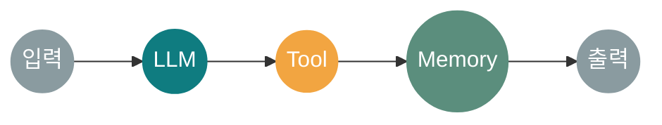
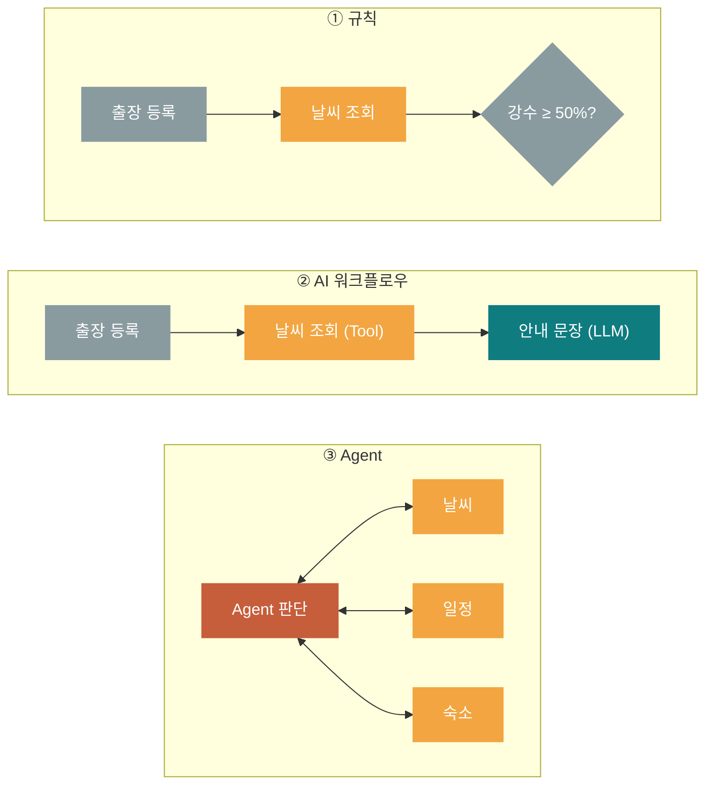
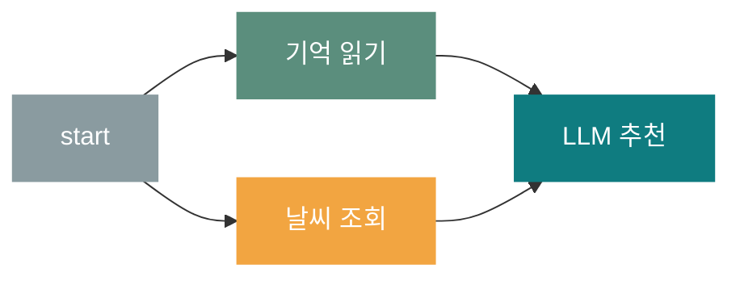
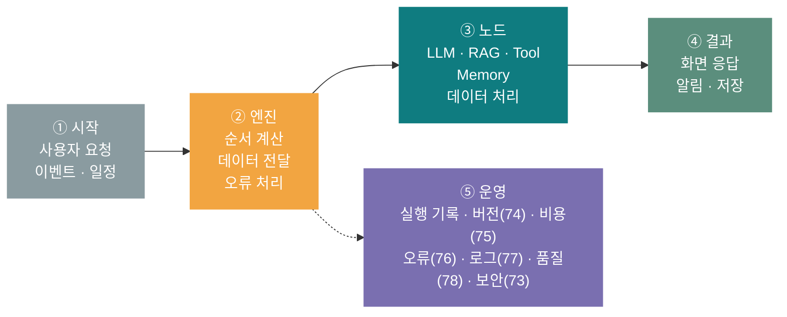
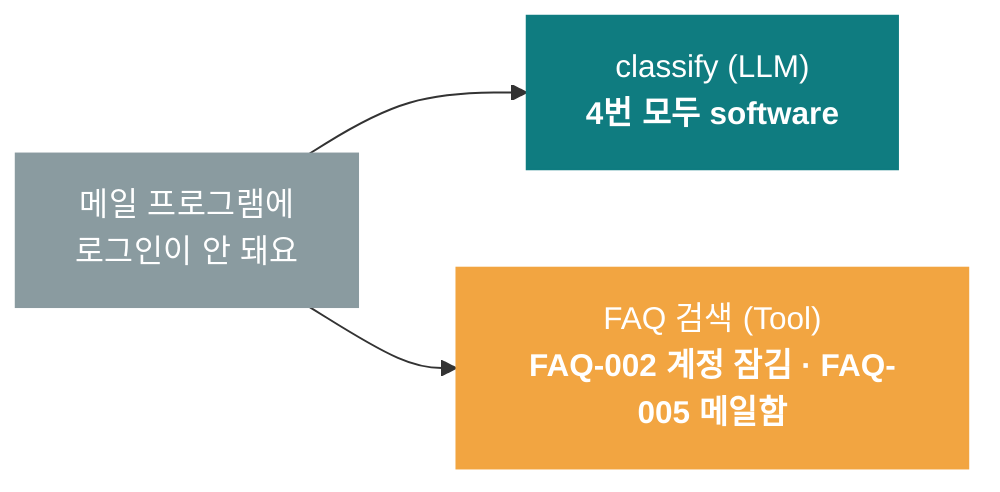
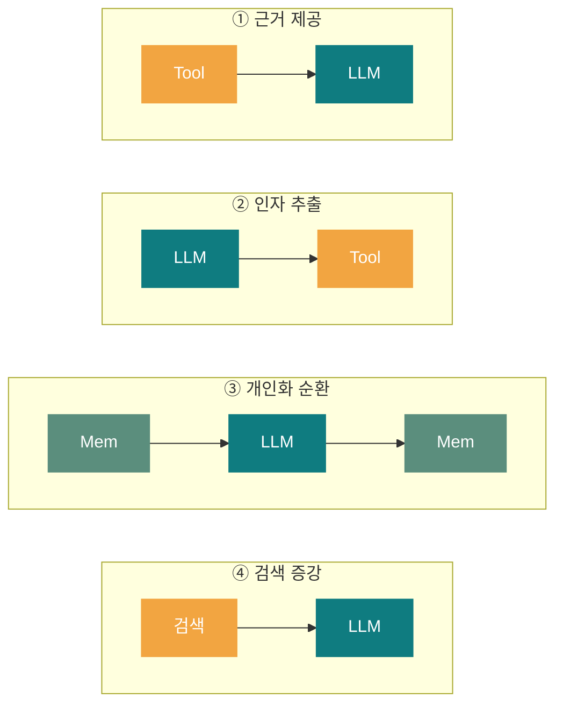
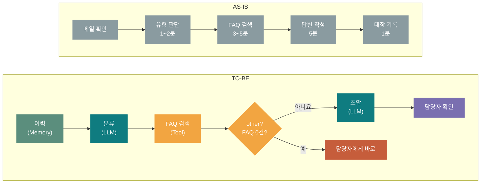

# 64일차 개요 · AI 워크플로우 개념 및 구성 요소 이해

> 노코드 멀티 에이전트 워크플로우 설계 및 운영 · 2026-10-14
> 26장 · 각 장은 가로줄(`---`)로 나뉩니다. 1교시에는 1~3장과 25장만 보고, 나머지 장은 각 단계를 설명할 때 함께 띄웁니다.

| 장 | 범위 |
| --- | --- |
| 1~3 | 표지 · 오늘의 목표 · 시간표 |
| 4~12 | 1단계 · 개념과 전체 아키텍처 |
| 13~20 | 2단계 · LLM·Tool·Memory와 데이터 흐름 |
| 21~24 | 3단계 · 업무 자동화 시나리오 분석 |
| 25~26 | 실습 · 퀴즈와 예고 |

---

## 1 / 26 · 표지



**64일차**

# AI 워크플로우 개념 및 구성 요소 이해

LLM·Tool·Memory 기반 AI Workflow 구조 이해 · 업무 자동화 시나리오 분석

<sub>노코드 멀티 에이전트 워크플로우 설계 및 운영 · 2026-10-14</sub>

---

## 2 / 26 · 오늘 할 수 있게 될 세 가지

| | 목표 | 내용 |
| :-: | --- | --- |
| **①** | **AI 워크플로우를 설명한다** | 정해진 경로 위에 AI 판단 단계를 둔 업무 흐름 · 규칙 자동화·AI Agent와 비교 · 실행 기록 읽기 |
| **②** | **LLM·Tool·Memory를 구분한다** | 노드 설정과 출력 형식 · LLM의 한계를 보완하는 방식 · 노드 사이의 데이터 흐름 |
| **③** | **업무를 워크플로우로 분석한다** | 후보 고르기 → AS-IS·TO-BE(예외 경로 포함) → 단계를 노드로 바꾸고 실행해 검증 |

---

## 3 / 26 · 오늘의 시간표

| ① 1~2교시 | ② 3~4교시 | ③ 5~6교시 | ④ 7~8교시 |
| --- | --- | --- | --- |
| **1단계** | **2단계** | **3단계** | **정리** |
| 개념과 전체 아키텍처 | LLM·Tool·Memory와 데이터 흐름 | 업무 자동화 시나리오 분석 | 퀴즈 A·B·C · 오늘의 정리·예고 |
| Lab 01 실행 기록 읽기 | Lab 02 노드 연결 | Lab 03 분석·설계 | 퀴즈 20분 |

> 09:00 시작 · 50분 수업 10분 휴식 · 12:00~13:00 점심 · LLM은 OpenAI `gpt-4.1-mini` (안 될 때 Ollama)

---

## 4 / 26 · 코드로 만들던 것을 노드와 선으로

<sub>지난 3개월: 코드로 순서 → 설정 파일로 순서(`teams.yaml`) → 이번 교과목: 그림으로 순서</sub>

| 지난 3개월 · 코드 | 이번 교과목 · 노코드 워크플로우 |
| --- | --- |
| **`engine.py`에 실행 순서 작성** | 캔버스에 노드를 놓고 선으로 연결 |
| **함수 인자로 데이터 전달** | 앞 노드 결과를 다음 노드 입력에 연결(매핑) |
| **`providers/` 레지스트리로 LLM 선택** | LLM 노드 설정에서 모델 선택 |
| **MCP Client로 Tool 호출** | Tool 노드 추가 (HTTP·DB·MCP) |
| **Redis Stream·로그로 실행 추적** | 실행 이력 화면에서 노드별 입력·출력 확인 |

> **왼쪽은 이미 해 본 것, 오른쪽은 같은 일에 새 이름이 붙는 것입니다**

---

## 5 / 26 · 왜 실행 순서를 그림으로 꺼내나

**실무에서 매주 오는 요청**

- "분류에 '보안' 항목을 하나 더 넣어 주세요"
- "보내기 전에 팀장이 한 번 보게 해 주세요"
- "FAQ에 없으면 담당자에게 알려 주세요"

| 코드 | 그림 |
| --- | --- |
| 고치고 → 테스트하고 → 다시 배포 | 노드 하나 추가 · 선 하나 변경 |

| 좋아지는 점 | 다루는 날 |
| --- | --- |
| **바꾸는 속도** | 65~67일차 |
| **함께 보기** | 오늘 3단계 |
| **문제 찾기** | 실행 기록 · 76~77일차 |
| **운영** | 버전·비용·오류 · 74~79일차 |

> **노코드가 코드를 없애지는 않는다**: 자주 바뀌는 순서·연결은 그림으로, 복잡한 처리는 Code 노드·HTTP Request로 기존 API 호출

---

## 6 / 26 · AI 워크플로우란

<sub>여러 단계를 정해진 연결 순서대로 실행하고, 그중 판단이 필요한 단계만 AI가 맡는 업무 흐름</sub>


> **AI가 맡은 단계는 6개 중 2개**
> AI 단계가 적고 위치가 분명할수록 결과를 예측하고 관리하기 쉽습니다.
> 판단이 필요한 곳에만 AI 노드, 규칙으로 되는 일은 데이터 처리·Tool 노드에.

---

## 7 / 26 · 누가 다음 행동을 결정하는가

| | 규칙 기반 자동화 | AI 워크플로우 | AI Agent |
| --- | --- | --- | --- |
| **결정 주체** | 개발자가 정한 규칙 | 설계자가 정한 경로 + 일부 AI 단계 | AI 모델이 상황을 보고 결정 |
| **예시** | 매일 9시 매출 엑셀 메일 발송 | 문의 분류 → FAQ 검색 → 답변 초안 | 목표만 주면 Tool을 스스로 선택 |
| **특징** | 예측 쉬움 · 유연성 낮음 · 저렴 | 검증 쉬움 · 비용 예측 가능 | 유연성 높음 · 비용·추적 어려움 |

> **실무 원칙: 가능한 한 워크플로우로, 꼭 필요한 곳에만 Agent로** (9월 `06_agent-workflow` 복습)

---

## 8 / 26 · 같은 업무를 세 방식으로: 출장 날씨 안내



| | ① 규칙 | ② AI 워크플로우 | ③ Agent |
| --- | --- | --- | --- |
| **특징** | 규칙에 없는 안내(바람·기온 차)는 못 함 | 경로는 고정, 문장만 상황에 맞게 (= 오늘 실습 `02-llm-tool.json`) | 새 요청에도 대응, 대신 호출 수·비용이 매번 다름 |
| **LLM 호출 횟수** | 0 | 1 | 2~5 (상황마다) |
| **같은 입력 → 같은 결과?** | 예 | 거의 같음 | 달라질 수 있음 |

---

## 9 / 26 · 기본 용어와 실행 기록 읽기

| 용어 | 뜻 | 코드에서 |
| --- | --- | --- |
| **노드** | 한 가지 일을 하는 단계 | 함수 하나 |
| **연결 (Edge)** | 실행 순서와 데이터 경로 | 함수 호출 순서 |
| **페이로드** | 노드 사이를 오가는 데이터 | 인자·반환값 |
| **실행 기록** | 노드별 입력·출력·시간 | TraceEvent 목록 |

```text
runs/…-02-llm-tool.json (수업 준비 때)
weather  tool  ok     0.3ms
  args   {"city": "제주"}
  output {"condition": "비", "rain_chance": 80}
answer   llm   ok  4978.8ms
  provider "openai"
  prompt  날씨 데이터: {…} 질문: 우산이…
  output  "네, … 우산이 필요합니다."
```

> **읽는 순서** 들어간 것(args·prompt) → 나온 것(output) → 걸린 시간(ms) · LLM 답이 이상하면 **prompt부터**

---

## 10 / 26 · 실행 순서는 연결이 정한다



기억 읽기와 날씨 조회는 서로 기다리지 않음 · LLM 추천은 둘 다 끝나야 실행 (48일차 Join)

| 엔진의 순서 계산 (위상 정렬) |
| --- |
| 1. 들어오는 연결이 없는 노드부터 실행 |
| 2. 끝난 노드에서 나가는 연결을 지움 |
| 3. 들어오는 연결이 없어진 노드를 다음에 |
| 4. 모두 실행할 때까지 반복 |

> ⚠ **고리(A → B → A)는 순서를 정할 수 없음** → `Error: Edges contain a cycle.`

> **연결 `["weather", "answer"]` = 순서(뒤에 실행) + 데이터(`{{nodes.weather.output}}` 사용 가능)** · 데이터를 쓰려면 반드시 뒤에 연결

---

## 11 / 26 · AI 워크플로우의 전체 아키텍처



<sub>지난 실습: Streamlit(시작) → FastAPI·PatternEngine(엔진) → Agent·MCP·DB(노드) → SSE·화면(결과)</sub>

> **오늘 miniflow는 실패하면 '멈추고 기록'까지** · 다른 길로 보내기는 65일차, 재시도는 72일차

---

## 12 / 26 · 좋은 노드 설계 원칙

<sub>노드를 나누면 실행 기록이 곧 문제 찾기 도구가 됩니다</sub>

| 원칙 | 나쁜 예 | 좋은 예 |
| --- | --- | --- |
| **한 노드는 한 가지 일** | LLM 하나가 분류·검색·답변까지 | 분류(LLM) → 검색(Tool) → 답변(LLM) |
| **이름은 하는 일로** | `llm1`, `node3` | `classify`, `faq`, `draft` |
| **출력 형식을 정한다** | "분류해 주세요" | "account·network·device·software·other 중 하나만" |
| **실패를 생각한다** | Tool이 실패하면 어떻게 될지 모름 | "도시를 못 찾으면?"을 설계 때 적어 둠 |
| **AI는 꼭 필요한 곳에만** | 글자 수 세기를 LLM에 (1~2초, 가끔 틀림) | `count_chars` Tool (0.0ms, 항상 정확) |

<sub>n8n 미리 보기: Trigger(Webhook) · 흐름 제어(IF·Switch·Merge) · 데이터 처리(Set·Code) · HTTP Request · AI Agent</sub>

---

## 13 / 26 · LLM의 한계를 Tool과 Memory가 채운다

| LLM · 판단 | Tool · 손과 발 | Memory · 기억 |
| --- | --- | --- |
| **분류 · 추출 · 요약 · 생성** | **날씨 API · DB 조회 · MCP Tool · 사내 시스템** | **단기(세션) · 장기(선호·이력) · 지식(RAG)** |
| 최신 정보·내부 문서를 모름<br/>호출마다 기억이 없음<br/>계산·규칙에 약함 | 최신 데이터와 외부 실행을 담당 | 실행과 실행 사이를 이어 줌 |

| LLM의 한계 | 생기는 문제 | 보완 |
| --- | --- | --- |
| **최신 정보·외부 실행** | "오늘 제주 날씨"를 지어냄 · 티켓 등록 불가 | Tool |
| **회사 내부 문서** | 사내 규정을 그럴듯하게 틀리게 | RAG |
| **이전 실행** | 매번 같은 정보를 다시 물어봄 | Memory |

---

## 14 / 26 · LLM 노드 설정과 출력 형식

<sub>사람이 읽을 답과 다음 노드가 읽을 답은 다르게 설계합니다</sub>

| `system` | `prompt` | 모델 | `temperature` |
| --- | --- | --- | --- |
| 역할·규칙 (매번 같음) | 이번 데이터 `{{input.ticket}}` | `gpt-4.1-mini` (`.env`) | 기본 0.2 · 분류는 낮게 |

| 문의 (수업 준비 때 `gpt-4.1-mini`) | 형식 지시 없음: "분류해 주세요" | 형식 지시 있음: `classify` 노드 |
| --- | --- | --- |
| **프린터에서 출력이 안 됩니다** | "… '프린터 문제' 또는 '출력 문제'로 분류할 수 있습니다." | `device` |
| **메일 프로그램에 로그인이 안 돼요** | "… 분류는 다음과 같이 할 수 있습니다: - 분류: 이메…" | `software` |
| **회의실 예약은 어떻게 하나요?** | "… '시스템 사용 방법' 또는 '서비스 이용 문의'로…" | `other` |

> **노드용 프롬프트**: 허용 값을 모두 적기 · 값만 답하게 · 근거 범위 정하기 · 모를 때의 답 정하기 ("없으면 other")

---

## 15 / 26 · 같은 답이 맞는 답은 아니다

**"메일 프로그램에 로그인이 안 돼요"**



> **일관성(같은 답) ≠ 정확성(맞는 답)** · 원인은 모델보다 '경계 사례의 기준이 없음' → `system`에 기준 추가, 두 노드가 다르면 사람에게

**"암호를 바꾸고 싶어요" · 단어가 다르면**

| classify (LLM) | FAQ 검색 (키워드) | 05 워크플로우 |
| --- | --- | --- |
| `account` (뜻을 알아들음) | 0건 ('암호'가 키워드에 없음) | `result`에서 `'0' not found`로 실패 |

<sub>→ 뜻으로 찾는 임베딩 검색(RAG)은 71일차</sub>

---

## 16 / 26 · LLM 노드는 어디서 실행되나 · 대체 경로

| | 클라우드 API · **오늘 기본** | 로컬 LLM · **대체용** |
| --- | --- | --- |
| **모델** | OpenAI `gpt-4.1-mini` | Ollama `gemma3:4b` (내 노트북) |
| **키·비용** | API 키 · 사용량만큼 비용 | 키·비용 없음 |
| **데이터** | 제공사 서버로 | 노트북 밖으로 안 나감 |
| **속도·품질** | 대체로 빠르고 품질이 높음 | 노트북 성능·모델 크기에 좌우 |

**문의 4건 분류 정답 수 (수업 준비 때)**

| 모델 | 정답 |
| --- | :-: |
| `gpt-4.1-mini` (기본) | **4/4** |
| `gemma3:4b` (대체) | **4/4** |
| `gemma3:1b` (8GB 대체) | **1/4** · 나머지를 모두 `software`로 답함 |


> **대체 경로는 서비스를 이어 주지만 같은 품질을 보장하지 않음** · 누가 답했는지는 실행 기록의 `provider`

---

## 17 / 26 · Tool 노드: 정할 것 네 가지와 실패 세 종류

| 정할 것 | `get_weather` 예 |
| --- | --- |
| **이름·설명** | 오늘의 도시 날씨 조회 |
| **인자** | `city` (서울·부산·제주·강릉) |
| **결과 형식** | `city` · `condition` · `temp_c` · `rain_chance` · `air` |
| **실패** | `Unknown city '평양'` |

| 실패 종류 | 예 | 처리 |
| --- | --- | --- |
| **입력이 잘못됨** | 없는 도시 | 다시 묻기 (65일차 Condition) |
| **잠깐 안 됨** | 네트워크·시간 초과 | 다시 시도 (72일차) |
| **결과가 없음** | FAQ 0건 | 담당자에게 (오늘 3단계) |

> **Function Calling (29~31일차)** LLM이 Tool을 고름 · 상황마다 다름 · 질문 유형이 넓을 때
> **워크플로우 Tool 노드** 설계자가 위치를 정함 · 경로에 있으면 항상 실행 · 절차가 정해져 있을 때
> <sub>67일차: AI Agent 노드로 두 방식을 함께</sub>

---

## 18 / 26 · Memory 노드: 무엇을, 어떤 키로, 언제 지울까

```json
// .miniflow-memory.json
{
  "user:minji": {"preference": "실내 전시"},
  "ticket:kim": {"last_ticket": "VPN …",
                 "last_category": "network"}
}
// key: "ticket:{{input.user}}" → 사용자마다 따로
```

| | Memory | 실행 기록 |
| --- | --- | --- |
| **목적** | 다음 실행이 쓰려고 | 사람이 확인하려고 |
| **무엇을** | 필요한 값 몇 개 | 모든 노드의 입력·출력·시간 |
| **오늘** | `.miniflow-memory.json` | `runs/*.json` |

| 조심할 것 | |
| --- | --- |
| **개인정보** | 필요한 것만, 보관 기간을 정해서 (73일차) |
| **오래된 기억** | 저장한 날짜를 함께 남기기 |
| **잘못된 기억** | 틀린 분류가 저장되면 다음 실행까지 영향 → 저장 전 확인 |

---

## 19 / 26 · LLM·Tool·Memory의 상호작용 패턴 4가지



| 패턴 | 실습 파일 | 실패 모습 |
| --- | --- | --- |
| **① 근거 제공** | `02-llm-tool.json` | 데이터에 없는 내용을 덧붙임 |
| **② 인자 추출** | Lab 02 도전 과제 | "질문에서 도시: 부산" → `Unknown city` |
| **③ 개인화 순환** | `03` → `04` | 틀린 값이 기억되어 계속 영향 |
| **④ 검색 증강** | `05` (FAQ 검색) | 검색 0건이면 답도 근거 없음 |

> **업무 워크플로우는 패턴을 이어 붙인 것** · `05-tech-support-ticket` = ③ 개인화 순환 + ④ 검색 증강

---

## 20 / 26 · 데이터 흐름: 표현식 `{{ }}` 읽기와 문제 찾기

| 표현식 | 뜻 | 실제 값 |
| --- | --- | --- |
| `{{input.city}}` | 워크플로우 입력 | 제주 |
| `{{nodes.weather.output}}` | 노드 결과 전체 | `{"city": "제주", …}` |
| `{{nodes.weather.output.rain_chance}}` | 결과의 한 필드 | 80 |
| `{{nodes.faq.output.0.id}}` | 목록 첫 번째(0번)의 id | FAQ-003 |

<sub>n8n: `{{ $json.city }}` · `{{ $('weather').item.json.rain_chance }}`</sub>

| 문제 찾는 순서 |
| --- |
| 1. 실패한 노드의 `error` — `'not found'` = 경로 문제 |
| 2. 앞 노드 `output`의 실제 모양 |
| 3. LLM이면 `prompt` |
| 4. 고치고 `validate` → `run` |

> **validate OK ≠ 맞는 흐름**
> `Execution order` 줄을 읽고 내가 원한 순서인지 확인 (Lab 02: `answer → result → length` 순서면 `'length' not found`)

---

## 21 / 26 · 업무 자동화 시나리오 분석 6단계

<sub>도구부터 열지 말고 업무를 글과 그림으로 먼저 분해합니다 · 실무에서는 ①~④가 절반 이상</sub>


**자동화 후보 판단 기준**

| 반복성 | 절차의 명확성 | 데이터 준비 | 판단의 난이도 | 실패했을 때 영향 |
| :-: | :-: | :-: | :-: | :-: |
| 매일·매주 | 문서로 정리됨 | 메일·폼·DB | 분류·요약·초안 | 되돌릴 수 있음 |

> **환불처럼 반복은 많지만 실패 영향이 큰 일은 사람 확인을 넣어 자동화** (9월 `mini_agent_07_human_approval`)

---

## 22 / 26 · 후보 점수 매겨 보기 (1~5점, 실패 영향은 작을수록 높게)

| 기준 | IT 문의 분류·초안 | 환불 처리 | 계약서 최종 승인 |
| --- | :-: | :-: | :-: |
| **반복성** | 5 | 4 | 1 |
| **절차의 명확성** | 4 | 4 | 2 |
| **데이터 준비** | 5 | 4 | 3 |
| **판단의 난이도** | 4 | 3 | 1 |
| **실패했을 때 영향** | 4 | 2 | 1 |
| **합계 (25점)** | **22** | **17** | **8** |
| **결론** | 우선 자동화 | 사람 확인 후 자동화 | 사람이 처리 |

> **점수는 정답이 아니라 같은 기준으로 이야기하는 도구** · 전부 자동화보다 가장 아픈 단계(FAQ 검색+초안)부터

---

## 23 / 26 · 사례: 사내 IT 문의 · AS-IS → TO-BE → 예외 경로

<sub>80~82일차 단위 프로젝트 '지능형 Tech Support 자동화'의 가장 작은 버전</sub>



| 예외 | 언제 | 어디로 |
| --- | --- | --- |
| **범위 밖 문의** | 분류가 `other` | 담당자에게 바로, 초안 만들지 않음 |
| **근거 없음** | FAQ 0건 (점심 메뉴) | "담당자가 확인 후 연락" + 전달 |
| **분류와 검색이 다름** | `software`인데 계정 FAQ | 담당자 확인 필수 |
| **Tool 실패** | 검색 시스템 장애 | 재시도 → 담당자 |

<sub>마름모 = 65일차 Condition(IF) · 오늘은 그림과 표로 남김</sub>

> **정상 경로만 그리면 반쪽짜리 설계** · 성공 기준은 숫자로 ("테스트 10건 중 9건 정답, FAQ 0건은 모두 담당자에게")

---

## 24 / 26 · AI를 쓰지 않을 단계와 사람 확인 위치

| 단계 | AI 대신 | 이유 |
| --- | --- | --- |
| **금액·수량 계산** | Tool·데이터 처리 | 정확해야 하고 규칙으로 해결 |
| **날짜 형식 변환** | 데이터 처리 | 항상 같은 결과 |
| **권한 확인** | 규칙·Tool | 보안 판단을 AI에 맡기면 위험 |
| **분류 → 담당 부서 대응표** | 규칙 (Condition·Switch) | 수업 준비 때 대체 모델이 부서 이름에 엉뚱한 글자를 붙임 |
| **결제·삭제 실행** | 사람 확인 후 Tool | 되돌리기 어려움 |

| 사전 승인 | 예외만 확인 | 사후 검토 |
| :-: | :-: | :-: |
| 실행 직전 · 환불 · 외부 발송 | 조건에 걸린 것만 · IT 문의 · 리뷰 답글 | 처리 후 일부 · 회의록 요약 · 내부 보고 |

> **처음에는 사전 승인으로 시작** → 실행 기록으로 품질을 확인한 뒤 예외만 확인으로 줄여 간다

---

## 25 / 26 · 오늘의 실습: miniflow로 워크플로우 실행하기

```bash
$ cd ~/aio-01d4-stu/Last3Mon/64/workflow-lab
$ uv run miniflow check
  Reply (openai, …)
$ uv run miniflow run \
    flows/02-llm-tool.json \
    -i city=제주 -i question="우산?"
$ uv run miniflow show flows/05-….json
```

| | 실습 | 내용 |
| :-: | --- | --- |
| **1** | **Lab 01** · 첫 워크플로우 실행과 실행 기록 읽기 | args·prompt → output → ms · 지난 프로젝트를 노드로(과제) |
| **2** | **Lab 02** · LLM·Tool·Memory 연결하기 | Tool → LLM · Memory로 실행 잇기 · 노드 추가 · OpenAI·Ollama 비교 |
| **3** | **Lab 03** · 시나리오 분석과 워크플로우 설계 | 템플릿(예외 경로 포함) · `my-scenario.json` · 정상·문제 입력 비교 |

- LLM은 OpenAI(`Last3Mon/.env`의 키) · 키·인터넷이 안 되면 Ollama가 대신 답함
- 구조만 볼 때는 `MINIFLOW_LLM=mock` (LLM 없이 정해진 답)

> ⚠ **키는 `.env`에만 · 채팅·문서·화면 캡처에 올리지 않기**

---

## 26 / 26 · 7교시 퀴즈 · 그리고 내일

| A · 기본 | B · 응용 | C · 심화 |
| :-: | :-: | :-: |
| 용어와 개념 | 노드 역할 · 데이터 흐름 | 설계 판단 · 실행 기록 해석 |

- 단계별 10문항 · 20분 · 원하는 단계 선택
- 마지막 주관식 '더 알고 싶은 것'은 선택 · 점수 없음

> **65일차 예고**
> Trigger · Condition · Action
> **FAQ 결과가 없으면 어디로 보낼까?**
> n8n 실습 환경 (Docker 이미지는 오늘 밤 집에서)

### *오늘의 한 문장: 경로는 설계자가, 판단은 AI가, 기억과 데이터는 Memory와 Tool이*
