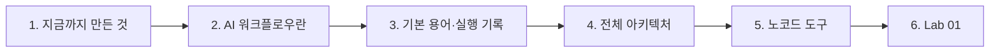
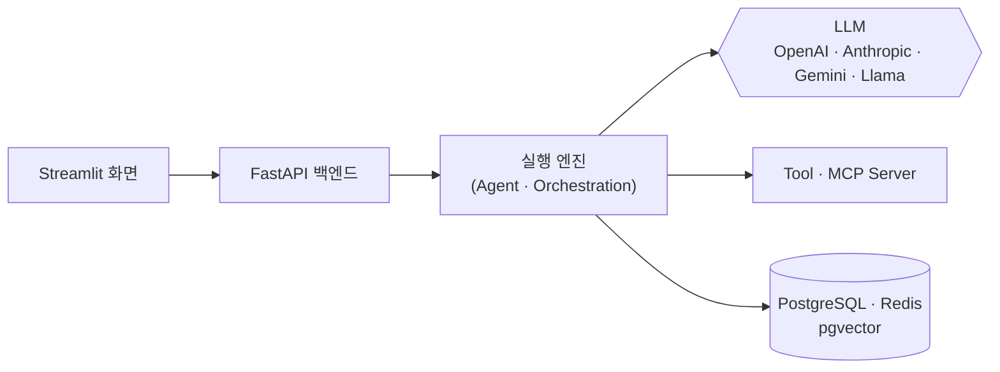
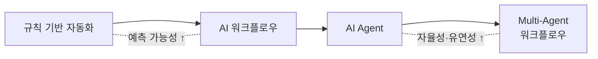
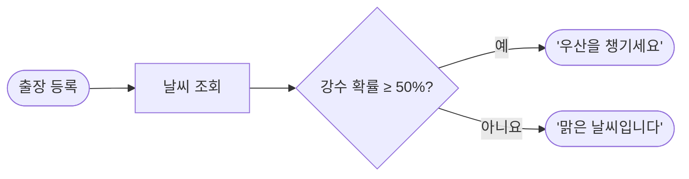
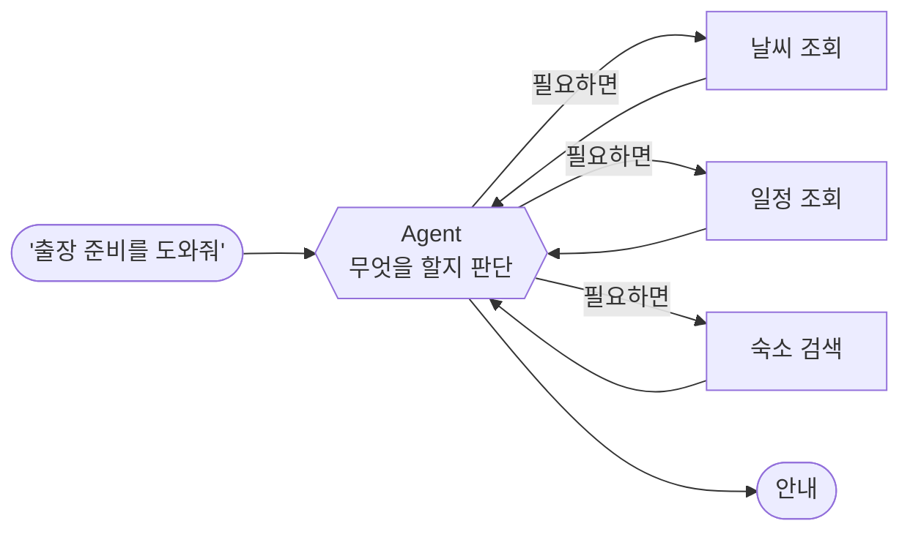
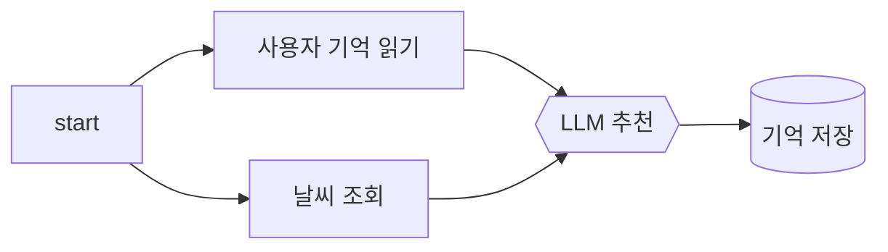
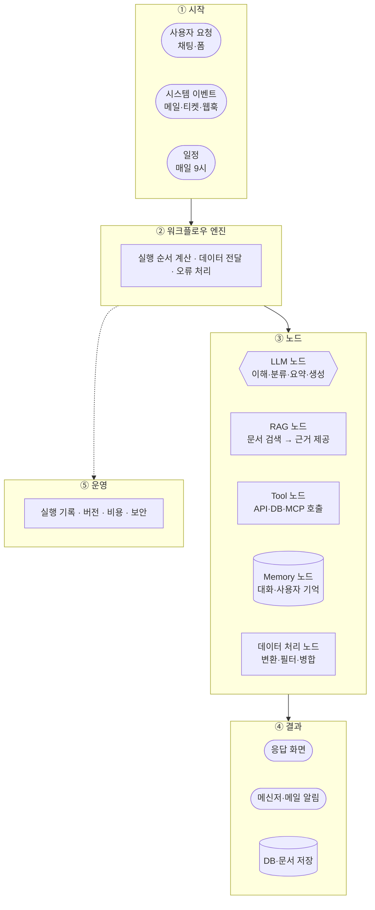
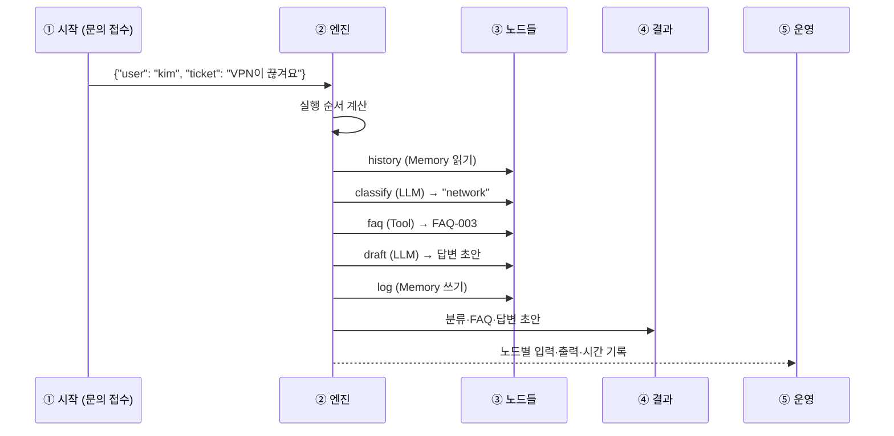
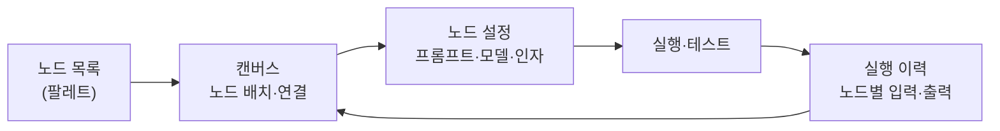

# 1단계 · AI 워크플로우의 개념과 전체 아키텍처

- 시간: 1~2교시 (1교시 앞부분은 [오늘의 개요](00-DAY64-OVERVIEW.md))
- 학습 목표
  - AI 워크플로우가 무엇이고, 일반 자동화·AI Agent와 어떻게 다른지 설명할 수 있다.
  - 노드·연결·데이터(페이로드)·실행 기록이라는 워크플로우 기본 용어를 사용할 수 있다.
  - 실행 기록을 읽고 노드마다 무엇이 들어가고 나왔는지 설명할 수 있다.
  - 워크플로우의 전체 아키텍처에서 LLM·RAG·Tool·Memory·데이터 처리 노드의 역할을 구분할 수 있다.
- 실습: [Lab 01 · 첫 번째 워크플로우 실행과 실행 기록 읽기](../../Last3Mon/64/LAB-01-FIRST-WORKFLOW.md)



---

## 1. 지금까지 만든 것을 다시 보기

지난 3개월 동안 여러분은 코드로 AI 서비스를 만들었습니다. 구조를 단순하게 그리면 거의 모든 프로젝트가 아래 모양이었습니다.



`mini_multi_agent_01_patterns`의 `PatternEngine`은 "어떤 순서로, 어떤 Agent와 Tool을 실행할지"를 Python 코드로 정했습니다. `mini_multi_agent_04`에서는 그 순서를 `ExecutionPlan`과 `teams.yaml`로 코드 밖에 적기 시작했습니다.

> 실행 순서를 코드가 아니라 **그림(노드와 연결)으로 정하고, 화면에서 바로 고치고 실행**할 수 있다면 어떨까요?
> 이것이 이번 교과목에서 배우는 **노코드 AI 워크플로우**입니다.

| 코드로 만들 때 | 노코드 워크플로우에서 |
| --- | --- |
| `engine.py`에 실행 순서를 작성 | 캔버스에 노드를 놓고 선으로 연결 |
| 함수 인자로 데이터 전달 | 앞 노드의 결과를 다음 노드 입력에 연결(매핑) |
| `providers/` 레지스트리로 LLM 선택 | LLM 노드 설정에서 모델 선택 |
| MCP Client로 Tool 호출 | Tool(HTTP·DB·MCP) 노드 추가 |
| Redis Stream·로그로 실행 추적 | 실행 이력 화면에서 노드별 입력·출력 확인 |

### 1.1 실행 순서를 코드 밖으로 꺼내면 좋은 점

코드로 만든 AI 서비스도 잘 동작합니다. 그런데 서비스를 실제 업무에 붙이면 아래 같은 요청이 매주 들어옵니다.

- "분류에 `보안` 항목을 하나 더 넣어 주세요."
- "답변을 보내기 전에 팀장이 한 번 보게 해 주세요."
- "FAQ에 없으면 담당자에게 메신저로 알려 주세요."

코드로 만들었다면 매번 개발자가 코드를 고치고, 테스트하고, 다시 배포해야 합니다. 실행 순서가 그림으로 밖에 나와 있으면 다음이 쉬워집니다.

| 좋아지는 점 | 무엇이 쉬워지나 | 이번 교과목에서 |
| --- | --- | --- |
| 바꾸는 속도 | 노드 하나 추가·연결 변경으로 업무 절차 변경 | 65~67일차 n8n 설계·구현 |
| 함께 보기 | 업무 담당자도 그림을 보고 절차를 확인·제안 | 오늘 3단계 시나리오 분석 |
| 문제 찾기 | 실행 이력에서 어느 노드가 무엇을 받고 무엇을 냈는지 바로 확인 | 오늘 Lab 01, 76~77일차 |
| 운영 | 버전·비용·오류를 워크플로우 단위로 관리 | 74~79일차 운영 단원 |

### 1.2 노코드가 코드를 없애지는 않는다

노코드 도구도 결국 내부에서는 코드가 실행됩니다. 노코드는 **자주 바뀌는 "순서와 연결"을 그림으로 꺼내고, 잘 바뀌지 않는 "복잡한 처리"는 코드나 API로 남기는** 방식입니다.

| 그림(노드)으로 두기 좋은 것 | 코드·API로 두기 좋은 것 |
| --- | --- |
| 업무 절차, 분기 조건, 알림 대상 | 복잡한 계산, 대량 데이터 처리 |
| 프롬프트, 모델 선택 | 사내 시스템과의 복잡한 인증·연동 |
| 사람 확인 단계의 위치 | 성능이 아주 중요한 부분 |

n8n에도 **Code 노드**(JavaScript·Python)와 **HTTP Request 노드**가 있어서, 그림으로 표현하기 어려운 부분은 작은 코드나 지난 3개월 동안 만든 FastAPI 서비스를 호출해 해결합니다. 지난 3개월의 코드 실력이 이 교과목에서도 그대로 쓰입니다.

---

## 2. AI 워크플로우란

**워크플로우(Workflow)** 는 하나의 업무 목표를 달성하기 위해 여러 작업 단계를 **정해진 연결 순서**대로 실행하는 흐름입니다.

**AI 워크플로우**는 그 단계 중 일부를 LLM·Agent 같은 AI가 맡는 워크플로우입니다. 사람이 하던 "읽고, 분류하고, 요약하고, 초안을 쓰는" 판단 작업을 AI 단계가 맡고, 나머지 단계(데이터 조회, 저장, 전송)는 정해진 규칙대로 실행합니다.


위 그림에서 AI가 맡은 단계는 6개 중 2개뿐입니다. 나머지 4개는 규칙대로 움직입니다. **AI 워크플로우라고 해서 모든 단계가 AI는 아닙니다.** 오히려 AI 단계가 적고 위치가 분명할수록 결과를 예측하고 관리하기 쉽습니다.

### 2.1 세 가지 자동화 방식 비교

9월 초 `06_agent-workflow` 단원에서 배운 질문을 다시 떠올려 봅시다. **"누가 다음 행동을 결정하는가?"**

| 구분 | 규칙 기반 자동화 | AI 워크플로우 | AI Agent |
| --- | --- | --- | --- |
| 다음 단계를 정하는 주체 | 개발자가 정한 규칙 | 설계자가 정한 경로 (일부 단계만 AI) | AI 모델이 상황을 보고 결정 |
| 예시 | 매일 9시 매출 엑셀을 메일로 발송 | 문의 분류 → FAQ 검색 → 답변 초안 | "고객 문제를 해결해 줘"라는 목표만 주고 Tool을 스스로 선택 |
| 결과 예측 | 매우 쉬움 | 쉬움 | 어려움 |
| 유연성 | 낮음 | 중간 | 높음 |
| 비용·속도 | 저렴·빠름 | 중간 | LLM 호출이 많아 비쌈·느림 |
| 문제 추적 | 쉬움 | 노드별로 확인 가능 | 실행 기록이 길고 복잡 |



실무에서는 **"가능한 한 워크플로우로, 꼭 필요한 곳에만 Agent로"** 설계하는 경우가 많습니다. 경로가 정해져 있으면 결과를 검증하기 쉽고, 비용과 장애를 관리하기 쉽기 때문입니다. 이번 교과목의 후반(68일차 이후)에서는 워크플로우 안에 여러 Agent를 넣는 **Multi-Agent 워크플로우**로 확장합니다.

### 2.2 같은 업무를 세 방식으로 만들어 보기

"출장 가는 직원에게 날씨와 준비물을 알려 준다"는 업무를 세 방식으로 만들면 차이가 분명해집니다.

**① 규칙 기반 자동화**: 비가 올 확률이 50% 이상이면 "우산을 챙기세요"라고 보냅니다.



빠르고 항상 같은 결과가 나옵니다. 하지만 "바람이 강하니 얇은 겉옷을 챙기세요"처럼 규칙에 없는 안내는 할 수 없습니다.

**② AI 워크플로우**: 날씨 조회는 항상 하고, 안내 문장만 LLM이 씁니다.


경로는 고정이고 문장만 상황에 맞게 바뀝니다. 오늘 실습 `02-llm-tool.json`이 이 구조입니다.

**③ AI Agent**: "출장 준비를 도와줘"라는 목표만 주고, 날씨 조회·일정 조회·숙소 검색 중 무엇을 쓸지 LLM이 고릅니다.



질문이 다양해도 대응할 수 있지만, 어떤 Tool을 몇 번 부를지 매번 달라 비용과 결과를 예측하기 어렵습니다.

| 질문 | ① 규칙 | ② AI 워크플로우 | ③ Agent |
| --- | --- | --- | --- |
| LLM 호출 횟수 | 0 | 1 | 2~5 (상황마다 다름) |
| 같은 입력이면 같은 결과? | 예 | 거의 같음 | 달라질 수 있음 |
| "숙소도 알려 줘" 같은 새 요청 | 불가 | 경로를 고쳐야 함 | 바로 대응 |

### 2.3 언제 Agent가 필요한가

아래 질문 중 "예"가 많을수록 Agent를, 적을수록 워크플로우를 고릅니다.

- 들어오는 요청의 종류가 너무 다양해서 경로를 미리 그릴 수 없는가?
- 필요한 Tool이 요청마다 다르고, 순서도 그때그때 달라지는가?
- 몇 번 시도하고 결과를 보며 다음 행동을 바꿔야 하는가?
- 비용과 응답 시간이 조금 늘어나도 괜찮은가?

대부분의 사내 업무(문의 처리, 보고서 작성, 승인 요청)는 절차가 정해져 있어 워크플로우가 먼저입니다. 67일차에 워크플로우 안에 **AI Agent 노드**를 넣어 두 방식을 함께 써 봅니다.

### 2.4 주변에서 볼 수 있는 AI 워크플로우

| 분야 | 시작 | AI 단계 | 규칙·Tool 단계 | 결과 |
| --- | --- | --- | --- | --- |
| 사내 IT 문의 | 문의 메일 | 분류, 답변 초안 | FAQ 검색, 이력 저장 | 답변 메일 |
| 쇼핑몰 리뷰 | 리뷰 등록 | 긍정·부정 판단, 답글 초안 | 상품 정보 조회 | 답글 게시 대기 |
| 채용 | 지원서 접수 | 경력 요약 | 필수 항목 확인, 일정 등록 | 면접관 메일 |
| 회의 | 회의 종료 | 회의록 요약, 할 일 추출 | 담당자 조회, 일정 등록 | 메신저 알림 |

네 사례 모두 "AI가 읽고 판단하는 단계"와 "정해진 규칙대로 처리하는 단계"가 섞여 있습니다. 3단계에서 이런 업무를 직접 하나 골라 분석합니다.

---

## 3. 워크플로우의 기본 용어

| 용어 | 뜻 | 코드에서 비슷한 것 |
| --- | --- | --- |
| 노드(Node) | 한 가지 일을 하는 단계 하나 | 함수 하나 |
| 연결(Edge) | 노드 사이의 실행 순서와 데이터 전달 경로 | 함수 호출 순서 |
| 페이로드(Payload) | 노드 사이를 이동하는 데이터 (보통 JSON) | 함수의 인자·반환값 |
| 입력(Input) | 워크플로우가 시작될 때 받는 데이터 | API 요청 본문 |
| 출력(Output) | 워크플로우가 최종으로 만드는 결과 | API 응답 |
| 실행(Run) | 워크플로우를 한 번 처음부터 끝까지 돌린 것 | 요청 1건 처리 |
| 실행 기록(Trace) | 실행마다 남는 노드별 입력·출력·시간·성공 여부 | `TraceEvent` 목록 |
| 트리거(Trigger) | 워크플로우를 시작시키는 사건 | API 호출, 스케줄러 (65일차) |

### 3.1 워크플로우 정의: 오늘은 JSON으로 적는다

오늘 실습 도구 `miniflow`는 워크플로우를 JSON 파일로 적습니다. 실습 파일 `02-llm-tool.json`을 줄여 보면 다음과 같습니다.

```json
{
  "name": "02 LLM + Tool",
  "inputs": ["city", "question"],
  "nodes": [
    {"id": "start", "type": "input"},
    {"id": "weather", "type": "tool", "tool": "get_weather", "args": {"city": "{{input.city}}"}},
    {"id": "answer", "type": "llm", "prompt": "날씨 데이터: {{nodes.weather.output}}\n질문: {{input.question}}"},
    {"id": "result", "type": "output", "value": "{{nodes.answer.output}}"}
  ],
  "edges": [["start", "weather"], ["weather", "answer"], ["answer", "result"]]
}
```

| 부분 | 뜻 |
| --- | --- |
| `inputs` | 실행할 때 받아야 하는 값 (`-i city=제주`처럼 넘김) |
| `nodes` | 노드 목록. `id`는 이름, `type`은 종류 (`input`·`llm`·`tool`·`memory_read`·`memory_write`·`output`) |
| `edges` | `["앞 노드", "뒤 노드"]` 쌍의 목록. 실행 순서와 데이터 흐름을 정함 |
| `{{ }}` | 표현식. 실행할 때 실제 값으로 바뀜 (2단계 5절에서 자세히) |

n8n에서는 이 JSON을 직접 쓰지 않고 화면에서 노드를 놓고 선을 잇습니다. 하지만 n8n도 워크플로우를 내보내면 **노드 목록과 연결 목록이 들어 있는 JSON 파일**이 나옵니다. 오늘 JSON을 읽을 줄 알면 n8n 워크플로우 파일도 읽을 수 있습니다.

### 3.2 실행 기록(Trace) 읽기

워크플로우를 실행할 때마다 노드별 기록이 남습니다. 문제가 생기면 가장 먼저 보는 것이 실행 기록입니다. 아래는 수업 준비 때 `02-llm-tool.json`을 실행해 남은 `runs/*.json`의 일부입니다.

```json
{
  "workflow": "02 LLM + Tool",
  "status": "completed",
  "trace": [
    {"step": 1, "id": "start", "type": "input", "status": "ok", "ms": 0.0,
     "output": {"city": "제주", "question": "우산이 필요할까?"}},
    {"step": 2, "id": "weather", "type": "tool", "status": "ok", "ms": 0.3,
     "args": {"city": "제주"},
     "output": {"city": "제주", "condition": "비", "temp_c": 20, "rain_chance": 80, "air": "좋음"}},
    {"step": 3, "id": "answer", "type": "llm", "status": "ok", "ms": 4978.8, "provider": "openai",
     "prompt": "날씨 데이터: {\"city\": \"제주\", \"condition\": \"비\", ...}\n질문: 우산이 필요할까?",
     "output": "네, 제주에 비가 오고 비 올 확률이 80%이므로 우산이 필요합니다."},
    {"step": 4, "id": "result", "type": "output", "status": "ok", "ms": 0.0, "output": "네, 제주에 ..."}
  ]
}
```

| 필드 | 읽는 법 |
| --- | --- |
| `status` | 노드가 성공(`ok`)했는지 실패(`failed`)했는지. 실패하면 `error`에 이유가 남음 |
| `ms` | 걸린 시간(밀리초). Tool은 0.3ms, LLM은 수천 ms → **전체 시간은 거의 LLM이 결정** |
| `args` | Tool 노드에 실제로 들어간 인자. `{{input.city}}`가 `제주`로 바뀐 것을 확인 |
| `prompt` | LLM에 실제로 보낸 프롬프트. 앞 노드 결과가 제대로 들어갔는지 확인 |
| `provider` | 어느 LLM이 답했는지 (`openai`, 대체 경로라면 `ollama`, 연습용 `mock`) |
| `output` | 노드가 낸 결과. 다음 노드는 이 값을 받음 |

실행 기록을 읽을 때는 **"들어간 것(args·prompt) → 나온 것(output) → 걸린 시간(ms)"** 순서로 봅니다. LLM 답이 이상하면 대부분 프롬프트에 들어간 데이터가 이상한 경우입니다.

### 3.3 실행 순서와 DAG

노드와 연결로 만든 그림은 대부분 **한 방향으로만 흐르는 그래프**입니다. 이런 그래프를 DAG(Directed Acyclic Graph, 방향이 있고 되돌아가는 고리가 없는 그래프)라고 부릅니다. 고리가 없으면 "누가 먼저 실행되어야 하는지"를 항상 계산할 수 있습니다.



위 그림에서 `사용자 기억 읽기`와 `날씨 조회`는 서로를 기다릴 필요가 없습니다. `LLM 추천`은 두 결과가 모두 있어야 실행됩니다. 이 관계가 `mini_multi_agent_04`의 병렬 실행과 Join과 같은 개념입니다.

엔진은 실행 순서를 이렇게 계산합니다.

1. 들어오는 연결이 없는 노드(`start`)부터 실행합니다.
2. 실행이 끝난 노드에서 나가는 연결을 지웁니다.
3. 들어오는 연결이 모두 지워진 노드를 다음에 실행합니다.
4. 모든 노드를 실행할 때까지 반복합니다.

이 방법을 **위상 정렬**이라고 부릅니다. `miniflow validate`의 `Execution order` 줄이 이렇게 계산한 결과입니다. `miniflow`는 계산된 순서대로 하나씩 실행하고, n8n 같은 도구는 서로 기다릴 필요가 없는 노드를 동시에 실행하기도 합니다.

**고리가 있으면?** `A → B → C → A`처럼 되돌아가는 연결이 있으면 "먼저 실행할 노드"를 정할 수 없습니다. `miniflow`는 이런 파일을 실행 전에 거부합니다. 실제 업무에는 "다시 시도", "모든 항목에 반복" 같은 되돌아가는 흐름이 필요한데, 워크플로우 도구는 이것을 고리 대신 **항목별 반복(Split Out 등)이나 재시도 설정**으로 따로 제공합니다 (66일차 반복·병렬, 72일차 재시도).

### 3.4 연결은 "순서"와 "데이터" 두 가지를 정한다

연결 `["weather", "answer"]`는 두 가지 뜻을 가집니다.

- **순서**: `answer`는 `weather`가 끝난 뒤에 실행된다.
- **데이터**: `answer`는 `weather`의 결과(`{{nodes.weather.output}}`)를 쓸 수 있다.

연결 없이 다른 노드의 결과를 쓰려고 하면 그 노드가 아직 실행되지 않았을 수 있습니다. Lab 02에서 연결을 빼먹으면 `'answer' not found` 같은 오류가 나는 이유입니다. **데이터를 쓰는 노드는 반드시 그 데이터를 만드는 노드 뒤에 연결**합니다.

---

## 4. AI 워크플로우의 전체 아키텍처

워크플로우 도구가 달라도 전체 구조는 거의 같습니다.



| 계층 | 하는 일 | 지난 실습에서 본 모습 |
| --- | --- | --- |
| ① 시작 | 언제, 무엇으로 시작할지 | Streamlit 버튼, FastAPI 요청 |
| ② 엔진 | 순서 계산, 데이터 전달, 실패 처리 | `PatternEngine`, `orchestration/engine.py` |
| ③ 노드 | 실제 작업 | Agent, MCP Tool, RAG 서비스, Memory 저장소 |
| ④ 결과 | 사람 또는 다른 시스템에 전달 | 화면 응답, SSE 이벤트 |
| ⑤ 운영 | 기록·버전·비용·보안 관리 | Redis Stream 추적, 로그, 가드레일 |

### 4.1 요청 하나가 다섯 계층을 지나는 과정

IT 문의 한 건이 들어왔을 때 각 계층이 하는 일을 시간 순서로 보면 다음과 같습니다.



엔진은 노드가 실패하면 그 자리에서 멈추고 실패를 기록합니다. 오늘 `miniflow`는 "멈추고 기록"까지만 합니다. 실패했을 때 다른 경로로 보내거나 다시 시도하는 일은 65일차(Condition)와 76일차(오류 처리)에서 배웁니다.

### 4.2 노드별 역할

| 노드 | 무엇을 하나 | 입력 → 출력 예시 | 주의할 점 |
| --- | --- | --- | --- |
| LLM | 글을 이해하고 판단·생성 | 문의 문장 → `"account"` 분류 | 답이 매번 조금씩 다를 수 있음 |
| RAG(검색) | 질문과 관련된 문서를 찾아 근거로 제공 | 질문 → 관련 문서 조각 3개 | 검색이 틀리면 답도 틀림 |
| Tool | 외부 시스템의 기능 실행 | 도시 이름 → 날씨 데이터 | 인자 형식과 실패 처리 |
| Memory | 이전 실행의 정보를 읽고 저장 | 사용자 ID → 선호·이력 | 저장할 것과 버릴 것 구분 |
| 데이터 처리 | 형식 변환·필터·병합 | 검색 결과 목록 → 상위 1개 | AI가 필요 없는 일은 여기서 처리 |

데이터 처리처럼 규칙으로 해결되는 일에 LLM을 쓰면 느리고 비싸며 결과도 불안정해집니다. **판단이 필요한 곳에만 LLM 노드**를 두는 것이 좋은 설계의 출발점입니다.

| 일 | LLM으로 하면 | 데이터 처리로 하면 |
| --- | --- | --- |
| 글자 수 세기 | 1~2초, 가끔 틀림 | 0.1ms 미만, 항상 정확 (실습 Tool `count_chars`) |
| 날짜를 `2026-10-14` 형식으로 | 형식이 가끔 흔들림 | 항상 같은 형식 |
| 목록에서 첫 번째 항목 고르기 | 불필요한 호출 | 표현식 `{{nodes.faq.output.0}}` |

### 4.3 운영 계층은 왜 따로 있나

워크플로우를 한 번 만들고 끝나는 일은 거의 없습니다. 매일 수백 건이 실행되면 다음 질문에 답할 수 있어야 합니다.

| 운영 질문 | 필요한 것 | 다루는 날 |
| --- | --- | --- |
| 어제 실패한 실행은 몇 건이고 왜 실패했나? | 실행 기록 모아 보기 | 76~77일차 |
| 지난주 프롬프트를 바꾼 뒤 품질이 나빠졌나? | 버전 관리, 품질 지표 | 74·78일차 |
| 이번 달 LLM 비용은 얼마인가? | 호출 수·토큰 기록 | 75일차 |
| 개인정보가 LLM에 그대로 넘어가지 않나? | 입력·출력 검사 | 73일차 |

오늘 남기는 `runs/*.json`이 이 모든 운영 기능의 출발점입니다.

### 4.4 좋은 노드 설계 원칙

| 원칙 | 나쁜 예 | 좋은 예 |
| --- | --- | --- |
| 한 노드는 한 가지 일 | LLM 노드 하나가 "분류하고, FAQ 찾고, 답변까지" | 분류(LLM) → 검색(Tool) → 답변(LLM) |
| 이름은 하는 일로 | `llm1`, `node3` | `classify`, `faq`, `draft` |
| 출력 형식을 정한다 | "분류해 주세요" | "account, network, device, software, other 중 하나만" |
| 실패를 생각한다 | Tool이 실패하면 어떻게 될지 모름 | "도시를 못 찾으면?"을 설계 단계에서 적어 둠 |
| AI는 꼭 필요한 곳에만 | 글자 수 세기를 LLM에 맡김 | 규칙으로 되는 일은 데이터 처리 노드로 |

한 노드에 여러 일을 몰아넣으면 실행 기록을 봐도 어디서 틀렸는지 알 수 없습니다. 노드를 나누면 **실행 기록이 곧 문제 찾기 도구**가 됩니다.

---

## 5. 노코드 워크플로우 도구

노코드 도구는 위 아키텍처를 화면으로 제공합니다. 노드 목록에서 끌어다 놓고, 선으로 잇고, 각 노드의 설정 창에서 값을 채웁니다.



이번 교과목에서는 오픈소스 노코드 워크플로우 도구 **n8n**을 사용합니다. 65일차부터 실습 환경을 구성합니다.

| 도구 | 특징 |
| --- | --- |
| n8n | 오픈소스 워크플로우 자동화 도구. Slack·Email·Jira·Notion·DB 등 수백 개의 서비스 연동 노드와 AI Agent 노드 제공 |

이 밖에도 Make·Zapier처럼 업무용 서비스 연동에 강한 도구들이 있습니다. 도구마다 화면과 노드 이름은 다르지만, 오늘 배우는 **노드·연결·페이로드·실행 기록**이라는 개념은 모든 도구에 그대로 적용됩니다.

### 5.1 n8n의 노드 미리 보기

n8n의 노드는 크게 다음과 같이 나뉩니다. 오늘 배우는 노드 종류가 어디에 해당하는지 미리 연결해 둡니다.

| n8n 노드 분류 | 예 | 오늘 개념 | 처음 쓰는 날 |
| --- | --- | --- | --- |
| Trigger | Webhook, Manual Trigger, Schedule Trigger | ① 시작 | 65일차 (Schedule은 72일차) |
| 흐름 제어 | IF, Switch, Merge | ② 엔진의 분기·합치기 | 65~66일차 |
| 데이터 처리 | Edit Fields(Set), Code, Split Out | 데이터 처리 노드 | 65~66일차 |
| 앱·HTTP | HTTP Request (LLM API·사내 데이터 API 호출) | Tool 노드 | 65일차 |
| AI | AI Agent, OpenAI Chat Model, Vector Store | LLM·RAG 노드 | 67일차 (Vector Store는 71일차) |

### 5.2 오늘의 `miniflow`와 n8n 비교

| 하는 일 | 오늘 `miniflow` | 65일차부터 n8n |
| --- | --- | --- |
| 워크플로우 만들기 | JSON 파일 작성 | 캔버스에 노드 배치·연결 |
| 노드 연결 | `edges` 목록 | 노드 사이에 선 긋기 |
| 앞 노드 결과 쓰기 | `{{nodes.weather.output.city}}` | `{{ $json.city }}`, `{{ $('weather').item.json.city }}` |
| 실행 | `uv run miniflow run ...` | 화면의 Execute 버튼, Webhook 호출 |
| 실행 기록 | `runs/*.json` | Executions 화면 |
| 그림으로 보기 | `miniflow show` → Mermaid | 캔버스 그 자체 |

`miniflow`는 수업용으로 만든 작은 엔진입니다. n8n으로 넘어가기 전에 **화면 뒤에서 엔진이 무엇을 하는지** 눈으로 보려고 씁니다.

---

## 6. Lab 01 안내

오늘 실습은 노코드 도구로 넘어가기 전에, 같은 개념을 직접 눈으로 확인하는 미니 워크플로우 엔진 `miniflow`로 진행합니다. 워크플로우를 화면 대신 JSON 파일로 적는다는 점만 다릅니다.

실습은 WSL(Ubuntu)에서 진행하고, LLM 노드는 **OpenAI API**(`gpt-4.1-mini`, 키는 `Last3Mon/.env`)가 맡습니다. 키나 인터넷에 문제가 있으면 노트북에서 실행하는 **Ollama**(`gemma3:4b`)가 대신 답합니다. 준비는 [사전 준비 안내](../../Last3Mon/64/SETUP-WSL-LLM.md)를 따릅니다.

- 실습 안내: [Last3Mon/64/LAB-01-FIRST-WORKFLOW.md](../../Last3Mon/64/LAB-01-FIRST-WORKFLOW.md)
- 할 일
  1. `uv run pytest`와 `uv run miniflow check`로 실습 환경·OpenAI 연결(대체 Ollama) 확인
  2. `01-llm-only.json` 실행 후 실행 기록(`runs/*.json`) 읽기
  3. 지난 실습 프로젝트 하나를 노드와 연결로 다시 그려 보기

실행 기록을 읽을 때는 3.2절의 표를 옆에 두고 `args`·`prompt` → `output` → `ms` 순서로 확인합니다.

---

## 7. 스스로 확인하기

<details><summary>Q1. "AI 워크플로우는 모든 단계를 AI가 처리한다"는 맞는 말인가요?</summary>

아닙니다. 경로는 설계자가 정하고, 판단이 필요한 일부 단계만 AI가 맡습니다. 조회·저장·전송은 규칙대로 실행합니다.
</details>

<details><summary>Q2. 출장 날씨 안내를 규칙 기반에서 AI 워크플로우로 바꾸면 무엇이 좋아지고 무엇을 잃나요?</summary>

규칙에 없는 상황(바람, 기온 차이)도 자연스러운 문장으로 안내할 수 있습니다. 대신 LLM 호출 비용과 1~2초의 시간이 들고, 문장이 매번 조금씩 달라집니다.
</details>

<details><summary>Q3. 실행 기록에서 LLM 답이 이상할 때 가장 먼저 볼 필드는?</summary>

`prompt`입니다. 앞 노드의 결과가 프롬프트에 제대로 들어갔는지부터 확인합니다.
</details>

<details><summary>Q4. 워크플로우에 A → B → A 같은 고리가 있으면 왜 실행할 수 없나요?</summary>

서로가 서로를 기다리므로 먼저 실행할 노드를 정할 수 없습니다. 반복이 필요하면 항목별 반복 노드나 재시도 설정을 씁니다.
</details>

<details><summary>Q5. "고객 문의 글자 수 세기"를 LLM 노드에 맡기면 안 되는 이유는?</summary>

규칙으로 항상 정확하게 처리할 수 있는 일인데, LLM은 느리고 비싸며 가끔 틀립니다. 데이터 처리 노드(실습에서는 `count_chars` Tool)로 처리합니다.
</details>

## 정리

- AI 워크플로우는 **정해진 경로** 위에 **AI 판단 단계**를 배치한 업무 흐름입니다.
- 실행 순서를 코드 밖 그림으로 꺼내면 바꾸기·함께 보기·문제 찾기·운영이 쉬워집니다. 복잡한 처리는 여전히 코드·API로 둡니다.
- 워크플로우는 노드·연결·페이로드로 구성되고, 실행할 때마다 실행 기록이 남습니다. 실행 기록은 `args`·`prompt` → `output` → `ms` 순서로 읽습니다.
- 연결은 실행 순서와 데이터 흐름을 함께 정하고, 엔진은 고리 없는 그래프(DAG)에서 순서를 계산합니다.
- 전체 구조는 시작 → 엔진 → 노드 → 결과 → 운영의 다섯 계층입니다.
- LLM은 판단이 필요한 곳에만, 규칙으로 되는 일은 데이터 처리 노드로 맡깁니다.
