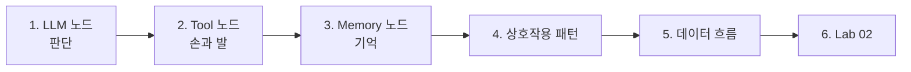
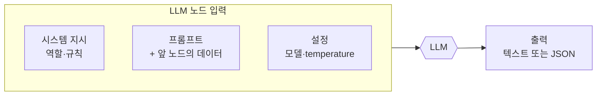
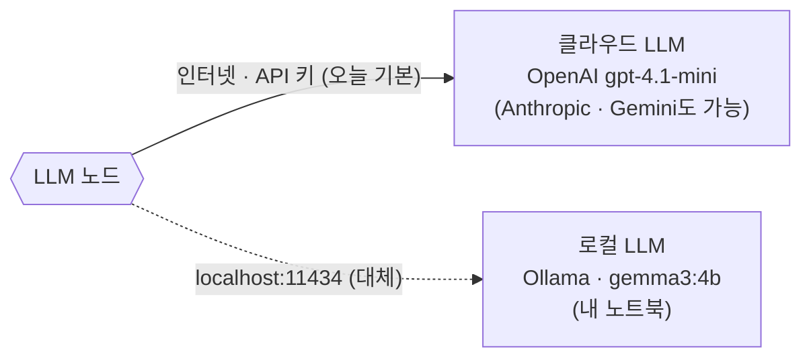
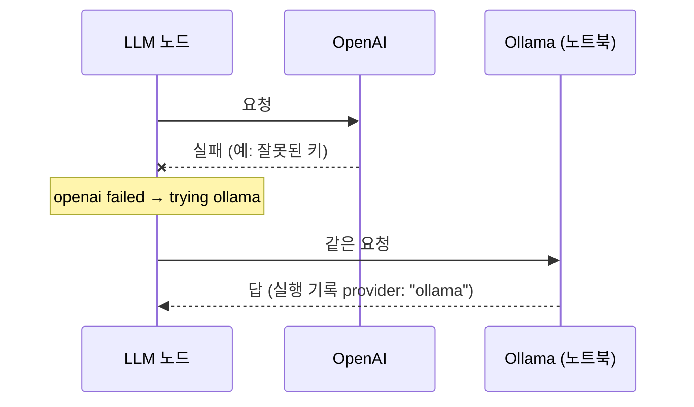
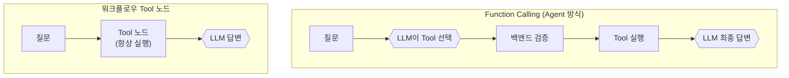
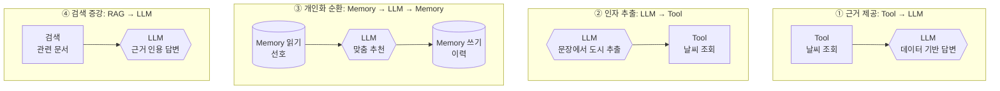
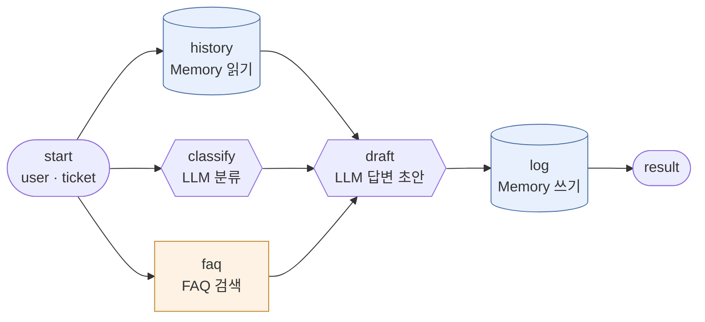
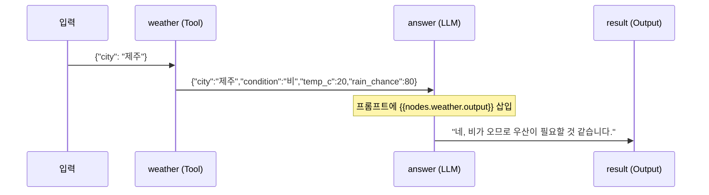

# 2단계 · LLM·Tool·Memory 노드와 데이터 흐름

- 시간: 3~4교시
- 학습 목표
  - LLM 노드 하나만으로는 업무를 끝낼 수 없는 이유를 LLM의 한계로 설명할 수 있다.
  - LLM 노드의 설정값(시스템 지시·프롬프트·모델·temperature)과 출력 형식 지시의 효과를 설명할 수 있다.
  - 로컬 LLM과 클라우드 LLM API의 차이를 비용·데이터·품질 관점에서 비교할 수 있다.
  - Tool·Memory 노드가 LLM의 어떤 한계를 보완하는지 구분할 수 있다.
  - LLM·Tool·Memory가 상호작용하는 대표 패턴 네 가지를 그림으로 그릴 수 있다.
  - 노드 사이에서 데이터(페이로드)가 어떻게 전달되는지 실행 기록으로 확인할 수 있다.
- 실습: [Lab 02 · LLM·Tool·Memory 연결하기](../../Last3Mon/64/LAB-02-LLM-TOOL-MEMORY.md)



---

## 1. LLM 노드: 워크플로우의 "판단" 담당

LLM 노드는 텍스트를 받아 텍스트(또는 구조화된 JSON)를 돌려주는 단계입니다.



| LLM 노드가 잘하는 일 | 예 |
| --- | --- |
| 분류 | 문의를 `account`, `network`, `device` 중 하나로 |
| 추출 | 문장에서 날짜·이름·주문번호 뽑기 |
| 요약 | 회의록 3줄 요약 |
| 생성 | 고객 답변 초안 작성 |
| 판단 | 이 요청이 승인 대상인지 판단 |

10일차에 LLM API(OpenAI/Anthropic/Gemini)를 처음 호출했을 때와 27일차 Structured Output에서 본 것처럼, LLM 노드 출력은 **다음 노드가 읽을 수 있는 형식**이어야 합니다. 분류 결과를 다음 노드에서 비교하려면 `"account"`처럼 정해진 값으로 받는 것이 안전합니다.

### 1.1 LLM 노드의 설정값

실습 파일 `05-tech-support-ticket.json`의 분류 노드는 다음과 같습니다.

```json
{"id": "classify", "type": "llm",
 "system": "Classify the ticket into one of: account, network, device, software, other. Reply with the label only.",
 "prompt": "문의: {{input.ticket}}",
 "mock": {"rules": [{"if_contains": ["비밀번호", "계정", "로그인", "잠김"], "then": "account"}, "..."], "default": "other"}}
```

| 설정 | 하는 일 | 오늘 실습 |
| --- | --- | --- |
| `system` (시스템 지시) | 역할과 지켜야 할 규칙. 모든 실행에 똑같이 들어감 | "다섯 값 중 하나만 답하라" |
| `prompt` (프롬프트) | 이번 실행의 데이터. 앞 노드 결과를 `{{ }}`로 넣음 | `문의: {{input.ticket}}` |
| 모델 | 어떤 LLM이 답할지 | `.env`의 `OPENAI_MODEL=gpt-4.1-mini` |
| `temperature` | 답의 무작위성. 낮을수록 같은 입력에 비슷한 답 | 기본 0.2 (분류·추출은 낮게) |
| `mock` | LLM 없이 정해진 규칙으로 답하는 연습용 설정 | `MINIFLOW_LLM=mock`일 때 사용 |

n8n의 OpenAI·AI Agent 노드에도 같은 항목이 있습니다. 이름만 조금 다릅니다 (System Message, Prompt, Model, Sampling Temperature).

### 1.2 출력 형식을 정하면 무엇이 달라지나

수업 준비 때 같은 문의를 두 가지 프롬프트로 분류해 본 결과입니다 (`gpt-4.1-mini`).

| 문의 | 형식 지시 없음 ("다음 IT 문의를 분류해 주세요") | 형식 지시 있음 (`classify` 노드) |
| --- | --- | --- |
| 프린터에서 출력이 안 됩니다 | "해당 IT 문의는 \"프린터 문제\" 또는 \"출력 문제\"로 분류할 수 있습니다." | `device` |
| 메일 프로그램에 로그인이 안 돼요 | "… 분류는 다음과 같이 할 수 있습니다: - 분류: 이메…" (여러 줄) | `software` |
| 회의실 예약은 어떻게 하나요? | "… \"시스템 사용 방법\" 또는 \"서비스 이용 문의\"로 분류할 수 있습니다." | `other` |

형식 지시가 없으면 답은 사람에게는 친절하지만, 다음 노드가 `"device"`와 비교할 수 없습니다. **사람이 읽을 답과 다음 노드가 읽을 답은 다르게 설계**합니다.

### 1.3 노드용 프롬프트 작성법

| 원칙 | 예 |
| --- | --- |
| 역할을 한 줄로 | "IT 문의를 분류한다." |
| 답할 수 있는 값을 모두 적기 | "account, network, device, software, other 중 하나" |
| 형식만 답하게 | "Reply with the label only." (설명·인사 금지) |
| 근거 범위를 정하기 | "주어진 FAQ 결과만 사용한다." |
| 모를 때의 답을 정하기 | "해당하는 값이 없으면 other." "FAQ가 없으면 담당자가 연락한다고 쓴다." |
| 데이터와 지시를 구분 | 지시는 `system`, 이번 데이터는 `prompt`에 |

### 1.4 같은 답이 계속 나와도 맞는 답은 아닐 수 있다

"메일 프로그램에 로그인이 안 돼요"를 `classify` 노드로 4번 분류했더니 4번 모두 `software`였습니다. 답은 흔들리지 않았습니다. 그런데 같은 문장으로 FAQ를 검색하면 `FAQ-002 계정 잠김 해제`와 `FAQ-005 메일함 용량 초과`가 나옵니다. **분류 노드는 "소프트웨어 문제", 검색 노드는 "계정 문제"로 본 것**입니다.

이것은 모델의 잘못이라기보다 **분류 기준이 정해지지 않은 문제**입니다. "메일 로그인 문제는 account로 분류한다"처럼 경계가 모호한 경우의 규칙을 시스템 지시에 적거나, 분류 결과와 검색 결과가 다르면 사람에게 보내는 경로를 둡니다. 일관성(같은 답)과 정확성(맞는 답)은 다른 문제라는 점을 기억해 둡니다.

### 1.5 LLM 혼자서는 할 수 없는 일

| LLM의 한계 | 실제로 생기는 문제 | 보완하는 노드 |
| --- | --- | --- |
| 학습 이후의 최신 정보를 모름 | "오늘 제주 날씨"를 지어냄 | Tool |
| 회사 내부 문서를 모름 | 사내 규정을 그럴듯하게 틀리게 답함 | RAG(검색) |
| 이전 대화를 기억하지 못함(호출마다 새로 시작) | 매번 같은 정보를 다시 물어봄 | Memory |
| 외부 시스템을 직접 바꾸지 못함 | 티켓 등록·메일 발송 불가 | Tool |
| 정확한 계산·규칙 처리에 약함 | 금액 합계 오류 | Tool·데이터 처리 |

오늘 실습에서도 이 한계가 실제로 보입니다. Lab 02의 `04-recommend-with-memory.json`에서 모델은 Tool 데이터에 없는 미술관 이름을 자기 지식으로 덧붙였습니다. 맞을 수도 있지만 **근거를 확인할 수 없는 정보**입니다.

### 1.6 LLM 노드는 어디서 실행되나

LLM 노드의 설정에서 가장 먼저 정하는 것은 **어떤 모델을 어디서 실행할지**입니다. 노코드 도구에서도 LLM 노드마다 모델과 연결 정보를 고릅니다.



| 구분 | 로컬 LLM (오늘 대체용) | 클라우드 LLM API (오늘 기본) |
| --- | --- | --- |
| 예 | Ollama + `gemma3:4b` | OpenAI `gpt-4.1-mini`, Anthropic, Gemini |
| 비용·키 | 없음 | API 키 필요, 사용량만큼 비용 또는 무료 한도 |
| 데이터 | 노트북 밖으로 나가지 않음 | 제공사 서버로 전송 |
| 속도·품질 | 노트북 성능과 모델 크기에 따라 달라짐 | 대체로 빠르고 품질이 높음 |
| 어울리는 경우 | 실습, 민감한 사내 데이터, 오프라인 | 높은 품질, 많은 사용자 |

수업 전에 같은 문의 4건(비밀번호, VPN, 프린터, 메일 프로그램 설치)을 세 모델로 분류해 본 결과입니다. "분류 정답"은 4건 중 정해진 값(`account`·`network`·`device`·`software`)과 정확히 같은 답을 낸 건수입니다.

| 모델 | 어디서 | 분류 정답 | 분류 노드 소요 시간 |
| --- | --- | --- | --- |
| `gpt-4.1-mini` (오늘 기본) | OpenAI API | 4/4 | 약 1초 |
| `gemma3:4b` (대체) | 노트북, 3.3GB | 4/4 | 약 1.6~2.3초 |
| `gemma3:1b` (8GB 노트북 대체) | 노트북, 815MB | 1/4 (나머지는 모두 `software`) | 약 1초 |

작은 모델은 빠르지만 판단이 틀릴 수 있습니다. 오늘 기본 모델이 맞혀도, 키·인터넷 문제로 대체 모델로 넘어가면 결과가 달라질 수 있다는 점을 기억해 두세요. 워크플로우를 설계할 때는 **노드마다 필요한 품질에 맞는 모델을 고르고**, LLM 출력이 다음 노드로 가기 전에 검증하는 단계를 둡니다. 모델 선택과 비용은 75일차에 다시 다룹니다.

### 1.7 대체 경로: 기본 모델이 실패하면

오늘 실습 환경은 OpenAI 호출이 실패하면(키 오류, 사용 한도 초과, 인터넷 끊김) Ollama로 한 번 더 시도합니다.



| 확인할 것 | 어디서 |
| --- | --- |
| 누가 답했나 | 실행 기록의 `provider` |
| 왜 넘어갔나 | 터미널의 `openai failed (...)` 줄 |
| 품질 차이 | 1.6절 표처럼 대체 모델은 결과가 다를 수 있음 |

대체 경로는 "서비스가 멈추지 않게" 해 주지만 "같은 품질"을 보장하지는 않습니다. 72일차(안정성)와 76일차(장애 대응)에서 이 구조를 n8n으로 다시 만듭니다.

---

## 2. Tool 노드: 워크플로우의 "손과 발"

Tool 노드는 정해진 인자를 받아 외부 기능을 실행하고 결과 데이터를 돌려줍니다. 날씨 API, DB 조회, 사내 시스템 API, MCP Server의 Tool이 모두 Tool 노드가 될 수 있습니다.

```text
$ uv run miniflow tools
get_weather    Return today's sample weather for a city.
search_faq     Return FAQ entries ranked by keyword overlap with the query.
count_chars    Count characters and words of a text.
```

### 2.1 Tool 노드를 설계할 때 정하는 것

| 정할 것 | `get_weather` 예 | 놓치면 생기는 일 |
| --- | --- | --- |
| 이름·설명 | 오늘의 도시 날씨 조회 | 다른 사람이 언제 써야 하는지 모름 |
| 인자 | `city` (서울·부산·제주·강릉) | 앞 노드가 엉뚱한 값을 넣음 |
| 결과 형식 | `{"city", "condition", "temp_c", "rain_chance", "air"}` | 다음 노드가 필드 이름을 틀림 |
| 실패 | 없는 도시 → `ToolError: Unknown city '평양'` | 워크플로우가 이유 없이 멈춘 것처럼 보임 |

Tool의 결과는 **다음 노드가 쓰기 좋은 모양**이어야 합니다. 필요 없는 필드가 많으면 LLM 프롬프트가 길어져 느려지고 비싸집니다. 실패했을 때는 "무엇이 왜 실패했는지"를 오류 메시지에 남겨야 실행 기록만 보고 원인을 찾을 수 있습니다.

### 2.2 Function Calling과 워크플로우 Tool 노드의 차이

29~31일차에 배운 Function Calling·MCP에서는 **LLM이 어떤 Tool을 쓸지 고르고**, 백엔드가 검증한 뒤 실행했습니다. 워크플로우의 Tool 노드는 **설계자가 미리 위치를 정해 둔** Tool입니다.



| 구분 | Function Calling | 워크플로우 Tool 노드 |
| --- | --- | --- |
| Tool 선택 | LLM | 설계자 |
| 실행 여부 | 상황마다 다름 | 경로에 있으면 항상 실행 |
| 장점 | 다양한 질문에 유연하게 대응 | 결과 예측·검증이 쉬움 |
| 어울리는 경우 | 질문 유형이 넓을 때 | 업무 절차가 정해져 있을 때 |

노코드 도구에도 "AI Agent 노드"처럼 LLM이 Tool을 고르게 하는 노드가 있습니다. 67일차에 두 방식을 함께 써 봅니다.

### 2.3 Tool이 실패하면

```text
$ uv run miniflow run flows/02-llm-tool.json -i city=평양 -i question="우산이 필요할까?"
[2/4] weather        tool         FAILED  ToolError: Unknown city '평양'. Available: 서울, 부산, 제주, 강릉
Status: failed
```

`weather`가 실패하자 뒤의 `answer`·`result`는 실행되지 않았습니다. LLM이 날씨를 지어내는 것보다는 낫지만, 사용자는 아무 답도 받지 못합니다. 실무에서는 Tool 실패를 세 가지로 나눠 설계합니다.

| 실패 종류 | 예 | 처리 |
| --- | --- | --- |
| 입력이 잘못됨 | 없는 도시 | 사용자에게 다시 물음 (65일차 Condition) |
| 잠깐 안 됨 | 네트워크 끊김, 시간 초과 | 몇 번 다시 시도 (72일차 재시도) |
| 결과가 없음 | FAQ 검색 0건 | 담당자에게 보냄 (오늘 3단계 사례) |

### 2.4 검색 Tool의 한계: 단어가 달라지면

실습의 `search_faq`는 문의와 FAQ의 **키워드가 겹치는 정도**로 순위를 매깁니다. 수업 준비 때 확인한 결과입니다.

| 문의 | FAQ 검색 (키워드) | LLM 분류 (`classify`) |
| --- | --- | --- |
| 패스워드 초기화 부탁드립니다 | `FAQ-001 비밀번호 재설정` | |
| 암호를 바꾸고 싶어요 | **0건** ("암호"가 키워드에 없음) | `account` (뜻을 알아들음) |
| 재택 중인데 회사 시스템 연결이 안 돼요 | `FAQ-003 VPN 접속 오류` ("재택", "연결"이 겹침) | |

LLM은 "암호"와 "비밀번호"가 같은 뜻이라는 것을 알지만, 키워드 검색은 글자가 같아야 찾습니다. 그래서 실무 검색에는 **뜻이 비슷한 문서를 찾는 임베딩 검색(RAG)** 을 씁니다. 71일차에 `text-embedding-3-large`로 사내 규정 문서를 검색하는 RAG를 만듭니다.

---

## 3. Memory 노드: 워크플로우의 "기억"

| 종류 | 무엇을 기억하나 | 보관 기간 | 지난 실습 |
| --- | --- | --- | --- |
| 실행 컨텍스트 | 이번 실행에서 앞 노드들이 만든 결과 | 실행 1회 | 노드 결과 전달 |
| 단기 기억 | 최근 대화 몇 턴, 진행 중인 작업 상태 | 분~시간 (TTL) | Redis 세션 (`mini_agent_05_memory`) |
| 장기 기억 | 사용자 선호, 처리 이력 | 계속 | PostgreSQL `user_memories` |
| 지식 기억 | 회사 문서·FAQ | 문서가 바뀔 때까지 | pgvector RAG (`mini_agent_04_rag`) |

Memory를 설계할 때는 세 가지를 정합니다.

1. **무엇을** 저장할까: 다음 실행에 실제로 필요한 것만 (전체 대화를 무조건 저장하지 않음)
2. **어떤 키로** 찾을까: `user:minji`, `ticket:kim`처럼 사용자·업무 단위 키
3. **언제** 지울까: 보관 기간과 사용자의 삭제 요청

### 3.1 오늘 실습의 Memory는 어디에 저장되나

`miniflow`의 Memory는 실습 폴더의 `.miniflow-memory.json` 파일 하나입니다. 키와 값이 그대로 들어갑니다.

```json
{
  "user:minji": {"preference": "실내 전시"},
  "ticket:kim": {"last_ticket": "VPN 접속이 계속 끊겨요", "last_category": "network"}
}
```

```json
{"id": "log", "type": "memory_write", "key": "ticket:{{input.user}}",
 "value": {"last_ticket": "{{input.ticket}}", "last_category": "{{nodes.classify.output}}"}}
```

키에 `{{input.user}}`를 넣었기 때문에 사용자마다 따로 저장됩니다. `uv run miniflow memory`로 내용을 보고, `--clear`로 지웁니다. 실무에서는 이 파일 대신 Redis·PostgreSQL을 쓰고, n8n에서는 Memory 노드나 DB 노드가 같은 역할을 합니다.

### 3.2 Memory와 실행 기록은 다르다

| 구분 | Memory | 실행 기록 |
| --- | --- | --- |
| 목적 | **다음 실행**이 쓰려고 | **사람**이 나중에 확인하려고 |
| 무엇을 | 필요한 값 몇 개 (선호, 마지막 분류) | 모든 노드의 입력·출력·시간 |
| 누가 읽나 | 워크플로우의 `memory_read` 노드 | 개발자·운영자 |
| 오늘 | `.miniflow-memory.json` | `runs/*.json` |

### 3.3 기억할 때 조심할 것

- **개인정보**: 이름·연락처·문의 원문을 그대로 오래 저장하면 유출되었을 때 피해가 큽니다. 필요한 것만 저장하고 보관 기간을 정합니다 (73일차 보안).
- **오래된 기억**: "지난달 선호"가 지금도 맞는지 알 수 없습니다. 저장한 날짜를 함께 남기면 판단하기 쉽습니다.
- **잘못된 기억**: LLM이 틀린 분류를 내면 그 값이 Memory에 저장되어 다음 실행까지 영향을 줍니다. 저장하기 전에 값을 확인하는 단계가 필요한 이유입니다.

---

## 4. LLM·Tool·Memory의 상호작용 패턴



| 패턴 | 언제 쓰나 | 실습 파일 |
| --- | --- | --- |
| ① 근거 제공 | 최신·정확한 데이터가 필요할 때 | `02-llm-tool.json` |
| ② 인자 추출 | 자유 문장을 Tool 인자로 바꿔야 할 때 | Lab 02 도전 과제 |
| ③ 개인화 순환 | 사용자마다 다른 결과가 필요할 때 | `03-save-profile.json` → `04-recommend-with-memory.json` |
| ④ 검색 증강 | 내부 문서를 근거로 답해야 할 때 | `05-tech-support-ticket.json` (FAQ 검색) |

### 4.1 패턴마다 자주 생기는 실패

| 패턴 | 자주 생기는 실패 | 예방 |
| --- | --- | --- |
| ① 근거 제공 | LLM이 데이터에 없는 내용을 덧붙임 | "주어진 데이터만 사용" 지시, 근거 필드 인용 요구 |
| ② 인자 추출 | 형식이 달라 Tool이 못 알아들음 ("제주도", "Jeju") | 허용 값 목록을 프롬프트에, 추출 뒤 값 확인 |
| ③ 개인화 순환 | 틀린 값이 기억되어 다음 실행까지 영향 | 저장 전 확인, 기억에 날짜 남기기 |
| ④ 검색 증강 | 검색 결과가 없거나 엉뚱함 → 답도 틀림 | 결과 0건일 때의 경로, 검색 품질 측정 (71일차) |

② 인자 추출은 Lab 02 도전 과제에서 직접 확인합니다. 수업 준비 때 "다음 주에 부산 가는데 날씨 어때?"에서 형식 지시 없이 도시를 추출하게 했더니 기본 모델은 "질문에서 도시: 부산", 대체 모델은 "질문에서 언급된 도시: 부산"처럼 답해 Tool이 `Unknown city`로 실패했습니다 (2회 모두). 도시 이름만 답하도록 지시하자 둘 다 성공했습니다.

### 4.2 패턴을 이어 붙이면 업무가 된다

실제 업무 워크플로우는 이 패턴들을 이어 붙여 만듭니다. `05-tech-support-ticket.json`은 ③과 ④를 함께 사용합니다.



- 파란색(`history` → `draft` → `log`): ③ 개인화 순환. 같은 사람의 이전 문의를 참고하고, 이번 문의를 남깁니다.
- 주황색(`faq` → `draft`): ④ 검색 증강. FAQ를 근거로 답변 초안을 씁니다.
- `classify`: LLM 분류. 결과는 초안과 기록 두 곳에 쓰입니다.

---

## 5. 데이터 흐름: 노드 사이에서 무엇이 오가나

노드는 앞 노드의 **출력**을 자신의 **입력**으로 사용합니다. 노코드 도구에서는 이 연결을 "필드 매핑" 화면에서 마우스로 선택하고, `miniflow`에서는 `{{...}}` 표현으로 적습니다.



```json
{"id": "answer", "type": "llm",
 "prompt": "날씨 데이터: {{nodes.weather.output}}\n질문: {{input.question}}"}
```

### 5.1 표현식 `{{ }}` 읽는 법

| 표현식 | 뜻 | 실제 값 (제주) |
| --- | --- | --- |
| `{{input.city}}` | 워크플로우 입력의 `city` | `제주` |
| `{{nodes.weather.output}}` | `weather` 노드의 결과 전체 | `{"city": "제주", "condition": "비", ...}` |
| `{{nodes.weather.output.rain_chance}}` | 결과 중 한 필드 | `80` |
| `{{nodes.faq.output.0.id}}` | 결과 목록의 첫 번째(0번) 항목의 `id` | `FAQ-003` (VPN 문의일 때) |

- 값이 표현식 하나뿐이면(`"{{nodes.weather.output}}"`) 원래 모양(객체·숫자)이 그대로 전달됩니다.
- 글자와 섞여 있으면(`"날씨 데이터: {{...}}"`) 문자열로 바뀌어 들어갑니다. 객체는 JSON 문자열이 됩니다.
- 없는 경로를 가리키면 `Cannot resolve '{{nodes.faq.output.0.id}}': '0' not found`처럼 **어느 부분이 없는지** 알려 줍니다. FAQ 검색 결과가 0건이면 `0`번 항목이 없어서 이 오류가 납니다 (3단계 점심 메뉴 사례).

n8n도 같은 생각입니다. `{{ $json.city }}`(바로 앞 노드 결과의 `city`), `{{ $('weather').item.json.rain_chance }}`(이름으로 고른 노드의 결과)처럼 씁니다.

### 5.2 데이터 흐름에서 자주 생기는 문제

| 문제 | 원인 | 예방 |
| --- | --- | --- |
| 다음 노드에서 값을 못 찾음 | 앞 노드 출력의 필드 이름이 다름 | 실행 기록에서 실제 출력 구조를 먼저 확인 |
| LLM이 엉뚱한 형식으로 답함 | 출력 형식을 지정하지 않음 | 정해진 값·JSON으로 답하도록 지시 |
| 빈 결과가 다음 노드로 전달됨 | 검색 결과 0건 | 결과가 없을 때의 경로 설계 (65일차 Condition) |
| 데이터가 너무 큼 | 문서 전체를 LLM에 전달 | 필요한 필드만 골라 전달 |

### 5.3 데이터 문제를 찾는 순서

1. `Status: failed`라면 실패한 노드의 `error`를 읽습니다. `not found`면 표현식 경로 문제입니다.
2. 앞 노드의 `output`을 실행 기록에서 열어 **실제 필드 이름과 모양**을 확인합니다.
3. LLM 답이 이상하면 그 노드의 `prompt`를 읽습니다. 데이터가 빠졌거나 `{}`처럼 비어 있지 않은지 봅니다.
4. 고친 뒤 `validate` → `run`으로 다시 확인합니다.

### 5.4 실행 순서는 연결이 정한다

`miniflow validate`는 연결(edges)을 보고 실행 순서를 계산합니다.

```text
$ uv run miniflow validate flows/05-tech-support-ticket.json
OK: 05 Tech support ticket (7 nodes, 8 edges)
Execution order: start -> history -> classify -> faq -> draft -> log -> result
```

`history`, `classify`, `faq`는 모두 `start`만 기다리므로 서로 독립입니다. 노코드 도구에서는 이런 노드를 동시에 실행해 전체 시간을 줄이기도 합니다. `draft`는 세 노드가 모두 끝나야 실행됩니다.

`validate`가 `OK`라고 해서 흐름이 맞는 것은 아닙니다. Lab 02에서 `length` 노드를 추가하고 `["answer", "length"]` 연결만 넣으면 `validate`는 통과하지만 순서가 `... answer -> result -> length`가 되어 `result`에서 `'length' not found`가 납니다. **`Execution order` 줄을 읽고, 내가 원한 순서인지 확인**하는 습관을 들입니다.

---

## 6. Lab 02 안내

- 실습 안내: [Last3Mon/64/LAB-02-LLM-TOOL-MEMORY.md](../../Last3Mon/64/LAB-02-LLM-TOOL-MEMORY.md)
- 할 일
  1. `02-llm-tool.json`으로 Tool 결과가 LLM 프롬프트에 들어가는 과정 확인
  2. `03` → `04` 순서로 실행해 Memory가 실행과 실행 사이를 이어 주는 것 확인
  3. 워크플로우에 Tool 노드를 하나 추가하고 데이터 연결 고치기
  4. Mock, OpenAI, 대체 Ollama 모델의 결과·속도 비교 (작은 모델이 분류를 틀리는 경우 관찰)

---

## 7. 스스로 확인하기

<details><summary>Q1. 분류 노드의 시스템 지시에 "Reply with the label only."를 넣는 이유는?</summary>

다음 노드가 `"device"`처럼 정해진 값과 비교하려면 설명 없는 값 하나가 필요합니다. 형식 지시가 없으면 "프린터 문제로 분류할 수 있습니다" 같은 문장이 나옵니다.
</details>

<details><summary>Q2. 같은 문의를 4번 분류해 4번 모두 같은 답이 나왔습니다. 맞는 답이라고 할 수 있나요?</summary>

아닙니다. 일관성과 정확성은 다릅니다. "메일 프로그램 로그인"은 4번 모두 `software`였지만 FAQ 검색은 계정 문제로 봤습니다. 경계가 모호한 경우의 분류 기준을 정해야 합니다.
</details>

<details><summary>Q3. "암호를 바꾸고 싶어요"에서 FAQ 검색이 0건인 이유와 해결 방향은?</summary>

키워드 검색이라 "암호"가 FAQ 키워드("비밀번호", "패스워드")와 글자가 달라 찾지 못했습니다. 뜻으로 찾는 임베딩 검색(RAG, 71일차)이나 키워드 보강이 필요합니다.
</details>

<details><summary>Q4. Memory와 실행 기록의 차이는?</summary>

Memory는 다음 실행이 쓰려고 필요한 값만 남기고, 실행 기록은 사람이 확인하려고 모든 노드의 입력·출력·시간을 남깁니다.
</details>

<details><summary>Q5. `Cannot resolve '{{nodes.faq.output.0.id}}': '0' not found` 오류는 무슨 뜻인가요?</summary>

FAQ 검색 결과 목록에 0번(첫 번째) 항목이 없다는 뜻입니다. 검색 결과가 0건일 때 납니다. 결과가 없을 때의 경로를 설계해야 합니다.
</details>

## 정리

- LLM은 판단과 생성을, Tool은 최신 데이터와 외부 실행을, Memory는 실행 사이의 연속성을 맡습니다.
- LLM 노드는 시스템 지시·프롬프트·모델·temperature로 설정하고, 다음 노드가 읽을 답은 **정해진 형식**으로 받습니다.
- 대체 모델은 서비스를 이어 주지만 같은 품질을 보장하지 않습니다. 실행 기록의 `provider`로 누가 답했는지 확인합니다.
- 워크플로우 Tool 노드는 설계자가 위치를 정하므로 결과를 예측하기 쉽습니다. 실패는 입력 오류·일시 장애·결과 없음으로 나눠 설계합니다.
- 상호작용 패턴은 근거 제공, 인자 추출, 개인화 순환, 검색 증강 네 가지로 정리할 수 있습니다.
- 노드 사이의 데이터 연결이 틀리면 워크플로우가 멈춥니다. `error` → 앞 노드 `output` → `prompt` 순서로 실행 기록을 확인합니다.
