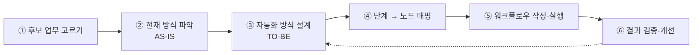
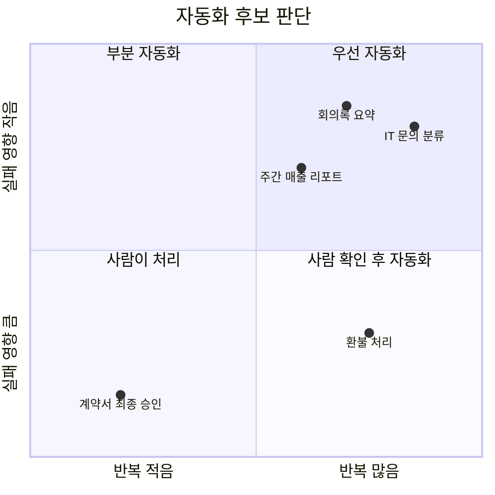
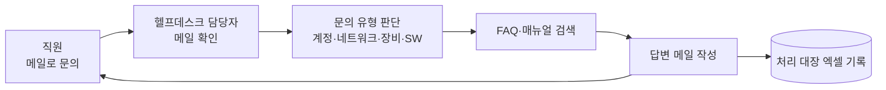
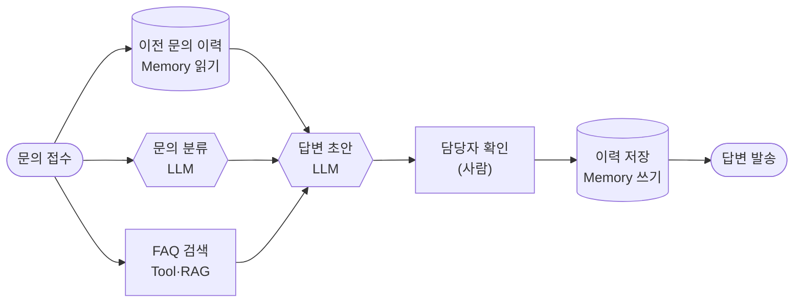
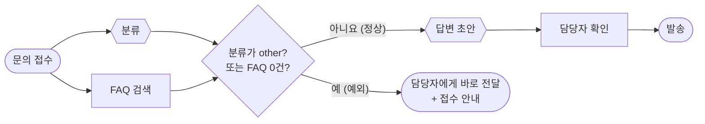

# 3단계 · 업무 자동화 시나리오 분석

- 시간: 5~6교시
- 학습 목표
  - 업무를 보고 자동화하기 좋은 후보인지 기준에 따라 판단할 수 있다.
  - 하나의 업무를 현재 방식(AS-IS)과 자동화 이후(TO-BE)로 나누어 분석할 수 있다.
  - 정상 경로뿐 아니라 예외 경로와 사람 확인 단계를 설계에 넣을 수 있다.
  - 업무 단계를 LLM·Tool·Memory·데이터 처리·사람 확인 노드로 바꿀 수 있다.
  - 분석 결과를 워크플로우 JSON으로 옮기고 실행해 검증할 수 있다.
- 실습: [Lab 03 · 업무 자동화 시나리오 분석과 워크플로우 설계](../../Last3Mon/64/LAB-03-SCENARIO-ANALYSIS.md)

---

## 1. 좋은 워크플로우는 좋은 분석에서 시작한다

도구부터 열고 노드를 놓기 시작하면 금방 길을 잃습니다. 먼저 **업무를 글과 그림으로 분해**하고, 그다음에 노드로 옮깁니다.

| 단계 | 결과물 | 오늘 어디서 |
| --- | --- | --- |
| ① 후보 고르기 | 5기준 점수표 | 템플릿 1절 |
| ② AS-IS | 현재 흐름 그림, 단계별 시간·문제점 | 템플릿 3절 |
| ③ TO-BE | 자동화 흐름 그림 (정상 + 예외) | 템플릿 4절 |
| ④ 노드 매핑 | 단계별 노드 종류·입력·출력 표 | 템플릿 5절 |
| ⑤ 작성·실행 | `flows/my-scenario.json` | Lab 03 3절 |
| ⑥ 검증 | 정상·문제 입력의 실행 결과 | Lab 03 4절 |

분석에 시간이 더 걸리는 것이 정상입니다. 실무에서는 ①~④에 전체 시간의 절반 이상을 씁니다. 분석이 잘 되어 있으면 ⑤는 표를 그대로 옮기는 일이 됩니다.

---

## 2. 자동화 후보 고르기

모든 업무가 자동화에 어울리지는 않습니다. 다음 다섯 가지 기준으로 점수를 매겨 봅니다.

| 기준 | 높은 점수(자동화 유리) | 낮은 점수(자동화 불리) |
| --- | --- | --- |
| 반복성 | 매일·매주 같은 일이 반복 | 1년에 몇 번 |
| 절차의 명확성 | 단계가 문서로 정리됨 | 담당자마다 방식이 다름 |
| 데이터 준비 | 입력이 메일·폼·DB에 디지털로 있음 | 종이·구두 전달 |
| 판단의 난이도 | 분류·요약·초안처럼 AI가 잘하는 판단 | 법적 책임이 큰 최종 결정 |
| 실패했을 때 영향 | 사람이 검토하면 되돌릴 수 있음 | 결제·삭제처럼 되돌리기 어려움 |

환불처럼 반복은 많지만 실패 영향이 큰 업무는 **사람 확인 단계**를 넣어 자동화합니다. 9월의 `mini_agent_07_human_approval`에서 변경 작업 직전에 멈추고 승인받던 구조가 여기에 해당합니다.

### 2.1 점수 매겨 보기

각 기준을 1~5점으로 매기고 합칩니다. 실패 영향은 **작을수록 높은 점수**입니다.

| 기준 | IT 문의 분류·답변 초안 | 환불 처리 | 계약서 최종 승인 |
| --- | :-: | :-: | :-: |
| 반복성 | 5 (하루 수십 건) | 4 | 1 |
| 절차의 명확성 | 4 (FAQ·매뉴얼 있음) | 4 (환불 규정 있음) | 2 |
| 데이터 준비 | 5 (메일·폼) | 4 (주문 DB) | 3 |
| 판단의 난이도 | 4 (분류·초안) | 3 | 1 (법적 판단) |
| 실패했을 때 영향 | 4 (사람이 고쳐 보내면 됨) | 2 (돈이 나감) | 1 |
| 합계 (25점 만점) | **22** | 17 | 8 |
| 결론 | 우선 자동화 | 사람 확인 후 자동화 | 사람이 처리, 자료 정리만 보조 |

점수는 정답이 있는 계산이 아니라 **팀이 같은 기준으로 이야기하기 위한 도구**입니다. 특히 "실패했을 때 영향"이 1~2점이면 합계가 높아도 사람 확인을 반드시 넣습니다.

### 2.2 "전부 자동화"보다 "가장 아픈 단계부터"

후보를 골랐으면 업무 전체가 아니라 **가장 시간이 많이 들거나 실수가 잦은 단계**부터 자동화합니다. IT 문의라면 "FAQ 검색 + 답변 초안"이 가장 시간이 많이 듭니다(3.1절 표). 메일 발송까지 처음부터 자동화하지 않고, 초안을 담당자에게 보여 주는 것부터 시작하면 실패해도 피해가 없습니다.

---

## 3. 사례로 분석하기: 사내 IT 문의

80~82일차 단위 프로젝트 주제인 "지능형 Tech Support 자동화"의 가장 작은 버전으로 분석해 봅니다.

### 3.1 AS-IS (현재 방식)

| 단계 | 소요 시간 | 문제점 |
| --- | --- | --- |
| 메일 확인 | 수시 | 출근 전·회의 중에는 처리 지연 |
| 유형 판단 | 1~2분 | 담당자마다 분류가 다름 |
| FAQ 검색 | 3~5분 | 같은 질문을 매번 다시 검색 |
| 답변 작성 | 5분 | 반복 문장을 매번 새로 작성 |
| 대장 기록 | 1분 | 누락이 잦아 통계가 부정확 |

AS-IS를 그릴 때는 담당자에게 직접 물어봅니다. "보통 몇 건이 오나요?", "가장 오래 걸리는 단계는?", "실수가 가장 많이 나는 곳은?" 세 질문의 답이 TO-BE의 목표가 됩니다.

### 3.2 무엇이 좋아져야 하나: 측정 지표

자동화가 성공했는지 말하려면 AS-IS 때 숫자를 먼저 적어 둡니다. 아래 숫자는 하루 문의 40건을 가정한 예시입니다.

| 지표 | AS-IS (예시) | TO-BE 목표 | 어떻게 재나 |
| --- | --- | --- | --- |
| 한 건 처리 시간 | 약 10~13분 | 담당자 확인 2분 | 접수~발송 시간 |
| 하루 담당자 시간 | 약 7~8시간 | 약 1.5시간 | 건수 × 처리 시간 |
| 분류 일치율 | 담당자마다 다름 | 정해진 값 기준 90% 이상 | 담당자가 고친 비율 |
| 대장 기록 누락 | 자주 | 0건 | 실행 기록 건수와 대장 비교 |
| 첫 답변까지 시간 | 몇 시간 | 몇 분 | 접수 시각과 초안 시각 |

지표가 없으면 "좋아진 것 같다"로 끝납니다. 지표를 정하면 75일차(비용), 77~78일차(운영 지표·품질)에서 실제로 측정할 수 있습니다.

### 3.3 TO-BE (자동화 이후)

### 3.4 예외 경로까지 그리기

위 TO-BE는 **모든 것이 잘될 때**의 그림입니다. 오늘 Lab 03 1절에서 "점심 메뉴 추천해줘"를 넣으면 FAQ 검색이 0건이라 마지막 `result` 노드에서 실패합니다. 실제 업무에서는 이런 경우가 하루에도 여러 번 생깁니다. 분석 단계에서 예외를 먼저 적어 둡니다.

| 예외 | 언제 생기나 | 어디로 보낼까 |
| --- | --- | --- |
| 범위 밖 문의 | 분류가 `other` | 담당자에게 바로 전달, 초안 만들지 않음 |
| 근거 없음 | FAQ 검색 0건 | "담당자가 확인 후 연락" 안내 + 담당자 전달 |
| 분류와 검색이 다름 | 분류는 `software`, FAQ는 계정 문서 | 담당자 확인 필수 |
| Tool 실패 | 검색 시스템 장애 | 다시 시도 → 그래도 실패하면 담당자 전달 |
| 반복 문의 | 이력에 같은 문의가 최근에 있음 | 우선순위 올려 담당자 전달 |

가운데 마름모(`C`)가 65일차에 배우는 **Condition(IF) 노드**입니다. 오늘 `miniflow`에는 분기 노드가 없으므로, 예외 경로는 분석 문서에 그림과 표로 남겨 둡니다.

### 3.5 단계를 노드로 바꾸기

| 업무 단계 | 노드 종류 | 이유 |
| --- | --- | --- |
| 문의 접수 | 입력(Trigger) | 메일·폼이 들어오면 시작 |
| 이전 문의 확인 | Memory 읽기 | 같은 사람이 반복 문의했는지 파악 |
| 유형 판단 | LLM | 자유 문장을 정해진 분류로 바꾸는 판단 |
| FAQ 검색 | Tool(RAG) | 회사 문서는 LLM이 모르므로 검색해 근거 확보 |
| 답변 작성 | LLM | 검색 결과를 바탕으로 문장 생성 |
| 답변 확인 | 사람 | 잘못된 안내를 막기 위한 확인 단계 |
| 처리 기록 | Memory 쓰기 | 다음 문의와 통계를 위해 저장 |

이 TO-BE에서 사람 확인을 뺀 형태가 실습 파일 `05-tech-support-ticket.json`입니다.

노드 매핑 표에는 **입력과 출력**도 적습니다. 그래야 JSON으로 옮길 때 `{{ }}` 연결을 바로 쓸 수 있습니다.

| 노드 | 입력 | 출력 | `05` 파일에서 |
| --- | --- | --- | --- |
| history | 사용자 ID | 이전 문의·분류 | `ticket:{{input.user}}` |
| classify | 문의 문장 | `account` 등 정해진 값 하나 | `{{nodes.classify.output}}` |
| faq | 문의 문장 | FAQ 목록 (최대 2건) | `{{nodes.faq.output.0.id}}` |
| draft | 문의, 분류, 이력, FAQ | 답변 초안 문장 | `{{nodes.draft.output}}` |
| log | 문의, 분류 | 저장한 값 | `last_ticket`, `last_category` |

---

## 4. 시나리오 분석 템플릿

시나리오를 분석할 때는 아래 항목을 빠짐없이 채웁니다. 실습 폴더의 [SCENARIO-ANALYSIS-TEMPLATE.md](../../Last3Mon/64/templates/SCENARIO-ANALYSIS-TEMPLATE.md)를 복사해서 사용합니다.

| 항목 | 질문 |
| --- | --- |
| 목표 | 이 자동화로 무엇이 좋아지나? (시간·품질·누락 감소) |
| 시작 조건 | 무엇이 들어오면 시작하나? |
| 입력 데이터 | 어떤 필드가 들어오나? |
| 처리 단계 | 어떤 순서로 무엇을 하나? |
| 필요한 Tool·데이터 | 외부에서 무엇을 가져오거나 실행해야 하나? |
| 기억 | 이전 실행에서 무엇을 읽고, 무엇을 남기나? |
| 결과와 전달 | 결과는 어떤 형식으로 누구에게 가나? |
| 사람 확인 | 어느 단계에서 사람이 확인해야 하나? |
| 예외 상황 | 데이터가 없거나 Tool이 실패하면? |
| 성공 기준 | 무엇을 보면 잘 동작한다고 말할 수 있나? |

### 4.1 채운 예시: IT 문의

| 항목 | 내용 |
| --- | --- |
| 목표 | 담당자의 반복 작업(분류·FAQ 검색·답변 작성) 시간을 줄이고, 처리 대장 누락을 없앤다 |
| 시작 조건 | 직원이 문의 폼을 제출하거나 헬프데스크 메일이 도착 |
| 입력 데이터 | `user`(사번 또는 이름), `ticket`(문의 문장) |
| 처리 단계 | 이력 읽기 → 분류 → FAQ 검색 → 답변 초안 → 담당자 확인 → 이력 저장 → 발송 |
| 필요한 Tool·데이터 | FAQ 검색(`search_faq`), 향후 사내 매뉴얼 검색 |
| 기억 | 읽기: 같은 사용자의 마지막 문의·분류 / 쓰기: 이번 문의·분류 |
| 결과와 전달 | 분류·FAQ 번호·답변 초안을 담당자에게, 확인 후 직원에게 메일 |
| 사람 확인 | 답변 발송 직전 (초안 수정 가능) |
| 예외 상황 | 분류 `other`·FAQ 0건 → 담당자에게 바로 / 검색 실패 → 재시도 후 담당자 |
| 성공 기준 | 테스트 문의 10건 중 분류 9건 이상 정답, FAQ 0건 문의는 모두 담당자에게 전달, 대장 누락 0건 |

성공 기준은 **확인할 수 있는 문장**으로 적습니다. "잘 동작한다" 대신 "10건 중 9건"처럼 적어야 67일차의 워크플로우 테스트로 그대로 옮길 수 있습니다.

### 4.2 AI를 쓰지 않아야 하는 단계

| 단계 | AI 대신 | 이유 |
| --- | --- | --- |
| 금액·수량 계산 | Tool·데이터 처리 | 정확해야 하고 규칙으로 해결됨 |
| 날짜 형식 변환 | 데이터 처리 | 항상 같은 결과가 필요 |
| 권한 확인 | 규칙·Tool | 보안 판단을 AI 답변에 맡기면 위험 |
| 결제·삭제 실행 | 사람 확인 후 Tool | 되돌리기 어려움 |

수업 준비 때 S5(분류별 담당 부서 안내)를 만들면서, 분류값 → 담당 부서 대응표를 LLM 프롬프트에 넣어 봤습니다. 대체 모델(`gemma3:4b`)은 부서 이름 뒤에 알 수 없는 로마자를 덧붙였습니다. **정해진 대응표는 LLM이 아니라 규칙(데이터 처리·Condition 노드)으로** 처리하는 것이 맞습니다.

### 4.3 사람 확인을 어디에 둘까

| 방식 | 언제 확인하나 | 어울리는 업무 | 단점 |
| --- | --- | --- | --- |
| 사전 승인 | 실행 직전 (보내기·결제 전) | 환불, 외부 발송, 데이터 변경 | 사람이 바쁘면 처리가 늦어짐 |
| 예외만 확인 | 조건에 걸린 것만 (FAQ 0건, 낮은 확신) | IT 문의, 리뷰 답글 | 조건을 잘못 정하면 빠져나감 |
| 사후 검토 | 처리 후 일부를 골라 확인 | 회의록 요약, 내부 보고 | 잘못된 결과가 이미 나간 뒤 |

처음에는 **사전 승인**으로 시작하고, 실행 기록으로 품질을 확인한 뒤 **예외만 확인**으로 줄여 가는 것이 안전합니다. 65일차에는 먼저 "담당자 확인" 경로로 넘기는 것부터 만들고, 69일차에는 초안을 규칙으로 검토하는 단계를 넣습니다. n8n에서 실제 승인 대기는 Wait 노드나 메신저·메일 승인 버튼으로 만들 수 있습니다.

---

## 5. 분석 연습용 시나리오

Lab 03에서 아래 중 하나를 골라 분석합니다. 자신의 업무 경험에서 시나리오를 만들어도 좋습니다.

| 번호 | 시나리오 | 힌트 |
| --- | --- | --- |
| S1 | 회의록 요약 후 할 일 정리 | LLM 요약·추출 → 담당자별 할 일 → 기록 |
| S2 | 쇼핑몰 상품 리뷰 분류와 답글 초안 | LLM 감정·유형 분류 → FAQ·정책 검색 → 답글 초안 |
| S3 | 신규 입사자 질문 응답 | 사내 규정 검색(RAG) → 답변 → 질문 이력 저장 |
| S4 | 출장 전 날씨·준비물 안내 | 일정 입력 → 날씨 Tool → 사용자 선호 Memory → 안내 |
| S5 | IT 문의 처리 확장 | `05` 워크플로우에 분류별 담당 부서 안내 추가 |

### 5.1 오늘 만들 수 있는 부분과 "향후 노드"

오늘 쓸 수 있는 노드는 입력·LLM·Tool(`get_weather`, `search_faq`, `count_chars`)·Memory 읽기/쓰기·출력입니다. 나머지는 분석 문서에 **향후 노드**로 적고, 65일차 이후 n8n에서 만듭니다.

| 번호 | 오늘 `my-scenario.json`으로 만들 수 있는 것 | 향후 노드로 남길 것 |
| --- | --- | --- |
| S1 | 회의록 요약(LLM), 할 일 추출(LLM), 글자 수(`count_chars`), 회의 이력 저장(Memory) | 담당자 조회, 메신저 알림, 일정 등록 |
| S2 | 리뷰 감정 분류(LLM), 답글 초안(LLM), 고객별 리뷰 이력(Memory) | 상품·정책 검색, 답글 게시, 부정 리뷰 담당자 알림 |
| S3 | 질문 분류(LLM), 답변(LLM), 질문 이력(Memory). IT 관련 질문은 `search_faq` 사용 가능 | 사내 규정 문서 검색(RAG, 71일차) |
| S4 | 날씨 조회(`get_weather`, 서울·부산·제주·강릉), 선호 읽기(Memory), 준비물 안내(LLM) | 일정 시스템 연동, 출장 전날 자동 실행(Schedule) |
| S5 | `05`의 분류·FAQ·초안·이력 | 분류별 담당 부서 연결(Condition·Switch, 65·68일차), 메신저 알림 |

### 5.2 직접 시나리오를 만들 때

자기 업무로 만들면 분석이 훨씬 구체적이 됩니다. 아래 질문으로 시작합니다.

1. 일주일에 몇 번 하는 일인가? (3번 이하면 다른 일을 고릅니다)
2. 입력은 어디서 오나? (메일, 엑셀, 메신저, 웹 폼)
3. 내가 "읽고 판단하는" 단계는 어디인가? → LLM 후보
4. "찾아보거나 복사하는" 단계는 어디인가? → Tool 후보
5. "지난번 것을 참고하는" 단계는 어디인가? → Memory 후보
6. 틀리면 누가 곤란해지나? → 사람 확인 위치

---

## 6. 흔한 분석 실수

| 실수 | 모습 | 고치는 법 |
| --- | --- | --- |
| LLM 하나로 다 하기 | "LLM이 분류하고 검색하고 답한다" | 단계마다 노드를 나누고 종류를 정함 |
| 정상 경로만 그리기 | 검색 0건, Tool 실패가 그림에 없음 | 3.4절 예외 표를 먼저 채움 |
| 입력·출력이 없는 매핑 | "분류 → 답변"만 적음 | 노드마다 무엇이 들어가고 나오는지 적음 |
| 성공 기준이 막연함 | "잘 동작한다" | "10건 중 9건", "누락 0건"처럼 숫자로 |
| 규칙으로 될 일을 AI에 | 부서 대응표, 날짜 변환을 LLM에 | 데이터 처리·Condition 노드로 |
| 사람 확인 위치가 없음 | 결제·발송이 자동으로 나감 | 되돌리기 어려운 단계 앞에 확인 |

---

## 7. Lab 03 안내

- 실습 안내: [Last3Mon/64/LAB-03-SCENARIO-ANALYSIS.md](../../Last3Mon/64/LAB-03-SCENARIO-ANALYSIS.md)
- 할 일
  1. 시나리오 하나를 골라 분석 템플릿 작성 (AS-IS·TO-BE Mermaid 포함)
  2. TO-BE를 `flows/my-scenario.json`으로 작성하고 `validate`·`show`로 확인
  3. 정상 입력과 문제가 생기는 입력으로 각각 실행하고 실행 기록 비교
  4. 분석 문서와 워크플로우 파일 제출

### 7.1 발표와 제출 확인 기준

| 기준 | 확인할 것 |
| --- | --- |
| 후보 판단 | 5기준 점수와 근거가 있다 |
| AS-IS·TO-BE | 두 그림이 있고, TO-BE에 예외 경로가 하나 이상 있다 |
| 노드 매핑 | 단계마다 노드 종류·입력·출력이 있다 |
| AI 사용 | AI 노드마다 "왜 AI가 필요한지"를 설명할 수 있다 |
| 실행 | `validate` 통과, 정상 입력과 문제 입력의 결과를 비교했다 |
| 향후 노드 | 오늘 못 만든 노드를 적었다 |

---

## 8. 스스로 확인하기

Q1. 환불 처리는 반복이 많은데 왜 "우선 자동화"가 아닌가요?

실패했을 때 돈이 나가 되돌리기 어렵기 때문입니다. 실패 영향 점수가 낮으면 합계가 높아도 사람 확인 단계를 넣어 자동화합니다.

Q2. TO-BE 그림에 예외 경로를 꼭 그려야 하는 이유는?

예외는 실제 업무에서 매일 생깁니다. 점심 메뉴 사례처럼 예외 경로가 없으면 워크플로우가 마지막에 가서야 실패하고, 사용자는 답을 받지 못합니다.

Q3. "분류값 → 담당 부서" 대응을 LLM 노드에 맡기지 않는 이유는?

정해진 대응표라 규칙으로 항상 정확하게 처리할 수 있습니다. LLM에 맡기면 느리고, 수업 준비 때처럼 부서 이름에 엉뚱한 글자를 붙이는 일이 생길 수 있습니다.

Q4. 성공 기준 "답변 품질이 좋아진다"를 어떻게 고치면 좋을까요?

확인할 수 있는 숫자로 바꿉니다. 예: "테스트 문의 10건 중 담당자가 고치지 않고 보낸 초안이 7건 이상", "FAQ 0건 문의는 모두 담당자에게 전달".

Q5. 처음 자동화할 때 사람 확인을 사전 승인으로 시작하는 이유는?

품질을 아직 모르기 때문입니다. 실행 기록으로 품질을 확인한 뒤 예외만 확인하는 방식으로 줄여 갑니다.

## 정리

- 자동화는 도구보다 분석이 먼저입니다. 반복성·명확성·데이터·판단 난이도·실패 영향으로 후보를 고릅니다.
- AS-IS의 문제점과 숫자를 먼저 적고, TO-BE의 목표와 성공 기준을 확인할 수 있는 숫자로 정합니다.
- TO-BE에는 정상 경로와 함께 예외 경로(범위 밖, 근거 없음, Tool 실패)를 그립니다.
- 각 단계를 노드 종류로 바꾸고, 노드마다 입력과 출력을 적습니다.
- 계산·변환·권한·대응표처럼 규칙으로 되는 일은 AI에게 맡기지 않습니다.
- 실패 영향이 큰 단계에는 사람 확인을 두고, 품질을 확인한 뒤 확인 범위를 줄여 갑니다.
