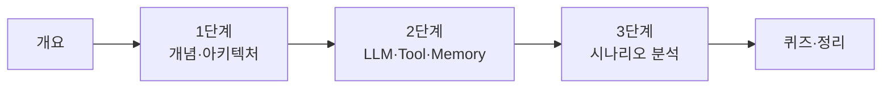

# 64일차 · AI 워크플로우 개념 및 구성 요소 이해

- 일자: 2026-10-14 (64일차)
- 교과목: 노코드 멀티 에이전트 워크플로우 설계 및 운영
- 단원: AI 워크플로우 개념 및 구성 요소 이해
- 학습 내용: LLM·Tool·Memory 기반 AI Workflow 구조 이해, 업무 자동화 시나리오 분석
- 실습 폴더: [Last3Mon/64](../../Last3Mon/64/README.md)
- 수강생 저장소: [https://gl.isitsoft.kr/publicproj/aio-01d4-stu](https://gl.isitsoft.kr/publicproj/aio-01d4-stu) (공개) → WSL 홈에서 `git clone`, 매일 `git pull` (학생 폴더 `~/aio-01d4-stu`)
- 실습 환경: Windows 11 WSL(Ubuntu) + OpenAI API (`gpt-4.1-mini`, 키는 `Last3Mon/.env`) · 안 되면 Ollama 로컬 LLM (`gemma3:4b`)
- **실습 준비: [00-DAY64-PREP.md](00-DAY64-PREP.md) (수업 전날까지 1~2절 완료)**

## 오늘의 시간표

| 교시 | 시간 | 내용 | 자료 |
| --- | --- | --- | --- |
| 1 | 09:00~09:50 | 오늘의 개요 (10분) · 1단계 시작 | [00-DAY64-OVERVIEW.md](00-DAY64-OVERVIEW.md), [1단계](01-STAGE1-AI-WORKFLOW-CONCEPT.md) |
| 2 | 10:00~10:50 | 1단계 · AI 워크플로우 개념과 전체 아키텍처, Lab 01 | [1단계](01-STAGE1-AI-WORKFLOW-CONCEPT.md), [Lab 01](../../Last3Mon/64/LAB-01-FIRST-WORKFLOW.md) |
| 3 | 11:00~11:50 | 2단계 · LLM·Tool·Memory 노드와 상호작용 | [2단계](02-STAGE2-LLM-TOOL-MEMORY.md) |
| - | 12:00~13:00 | 점심 |  |
| 4 | 13:00~13:50 | 2단계 · 데이터 흐름, Lab 02 | [2단계](02-STAGE2-LLM-TOOL-MEMORY.md), [Lab 02](../../Last3Mon/64/LAB-02-LLM-TOOL-MEMORY.md) |
| 5 | 14:00~14:50 | 3단계 · 업무 자동화 시나리오 분석 | [3단계](03-STAGE3-AUTOMATION-SCENARIO.md) |
| 6 | 15:00~15:50 | 3단계 · Lab 03 시나리오 분석과 워크플로우 설계 | [Lab 03](../../Last3Mon/64/LAB-03-SCENARIO-ANALYSIS.md) |
| 7 | 16:00~16:50 | 퀴즈 (A·B·C 중 선택, 20분) · 풀이 | [퀴즈와 정리](04-QUIZ-AND-WRAPUP.md) |
| 8 | 17:00~17:50 | 오늘의 정리 · 다음 시간 예고 · 복습 과제 | [퀴즈와 정리](04-QUIZ-AND-WRAPUP.md) |

## 자료 목록

| 파일 | 내용 |
| --- | --- |
| `00-DAY64-PREP.md` | 실습 준비: 환경 설치·확인, JSON 기초, 지난 실습 복습, 생각해 올 업무 시나리오 (수업 전) |
| `00-DAY64-OVERVIEW.md` | 개요 26장 (PPT 대신 Markdown, 가로줄로 장 구분): 개요(1~3), 1단계(4~12), 2단계(13~20), 3단계(21~24), 실습(25), 퀴즈·예고(26). 각 단계 설명 때 함께 띄움 |
| `ppt-src/` | (참고) 이전 PPT 생성 스크립트 — pptx 파일은 삭제, 필요하면 다시 만들 수 있음 |
| `01-STAGE1-AI-WORKFLOW-CONCEPT.md` | 노코드가 필요한 이유, AI 워크플로우 정의, 같은 업무를 세 방식으로 비교, 기본 용어와 실행 기록 읽기, DAG, 전체 아키텍처, 노드 설계 원칙, n8n 미리 보기 |
| `02-STAGE2-LLM-TOOL-MEMORY.md` | LLM 노드 설정값과 출력 형식, LLM의 한계, 로컬·클라우드와 대체 경로, Tool 설계·실패·검색 한계, Memory 설계, 상호작용 패턴 4가지, 표현식과 데이터 흐름 |
| `03-STAGE3-AUTOMATION-SCENARIO.md` | 자동화 후보 선정과 점수, AS-IS·측정 지표, TO-BE와 예외 경로, 단계 → 노드 매핑, 채운 분석 템플릿, 사람 확인 위치, 시나리오별 구현 범위, 흔한 분석 실수 |
| `04-QUIZ-AND-WRAPUP.md` | 퀴즈 안내, 오늘의 정리, 자주 막히는 부분, 65일차 예고 |
| `quiz/` | 퀴즈 문항(A·B·C), Google Form 생성 스크립트, 응답 분석 엑셀 |
