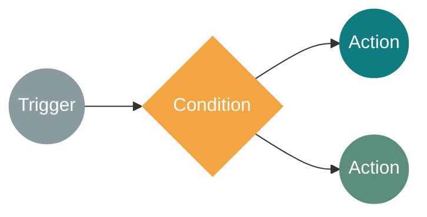
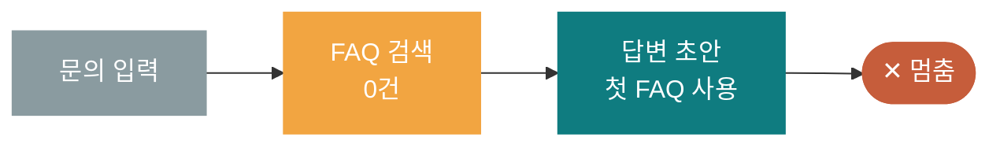
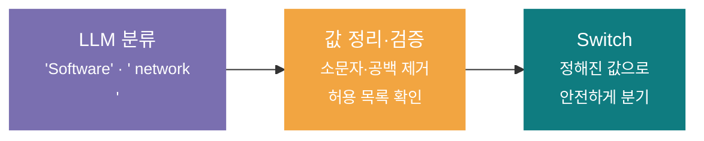
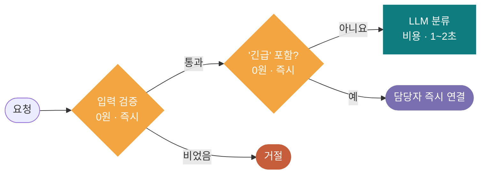
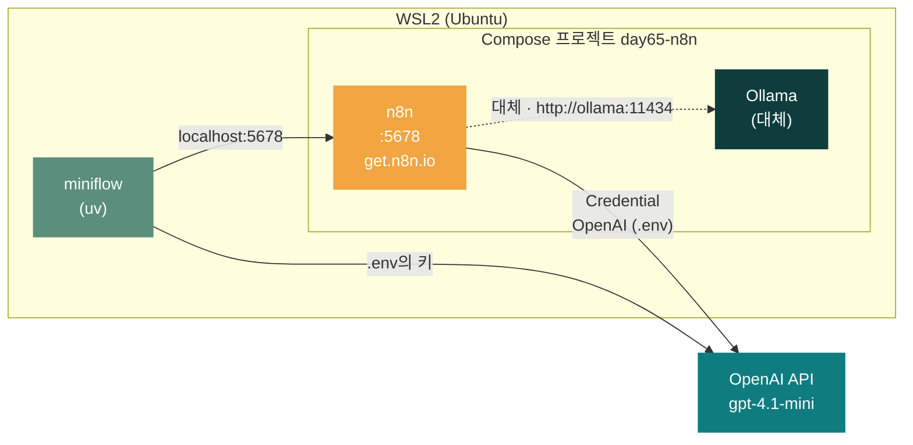
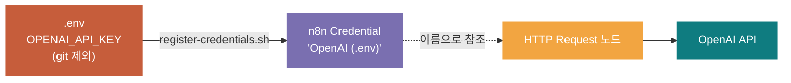
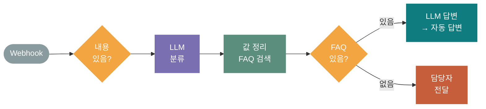
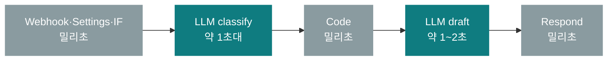
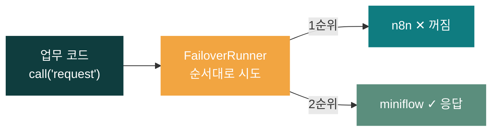
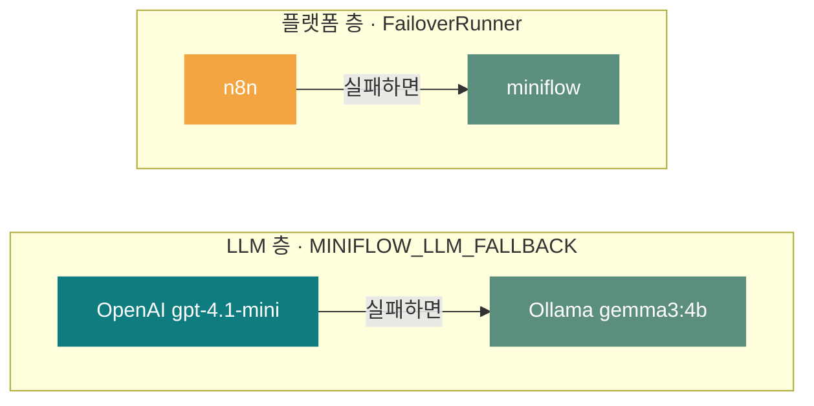

# 65일차 개요 · Trigger·Condition·Action 기반 워크플로우 설계

> 노코드 멀티 에이전트 워크플로우 설계 및 운영 · 2026-10-15
> 18장 · 각 장은 가로줄(`---`)로 나뉩니다. 1교시에는 1~3장과 17장만 보고, 나머지 장은 각 단계를 설명할 때 함께 띄웁니다.

| 장 | 범위 |
| --- | --- |
| 1~3 | 표지 · 오늘의 목표 · 시간표 |
| 4~8 | 1단계 · TCA 설계 |
| 9~12 | 2단계 · n8n 실습 환경과 기본 설정 |
| 13~16 | 3단계 · 샘플 AI 워크플로우와 플랫폼 전환 |
| 17~18 | 실습 · 퀴즈와 예고 |

---

## 1 / 18 · 표지



**65일차**

# Trigger·Condition·Action 기반 워크플로우 설계

업무 자동화 흐름 구성 · n8n 실습 환경 · 샘플 AI 워크플로우

<sub>노코드 멀티 에이전트 워크플로우 설계 및 운영 · 2026-10-15</sub>

---

## 2 / 18 · 오늘 할 수 있게 될 세 가지

| | 목표 | 내용 |
| :-: | --- | --- |
| **①** | **흐름을 TCA로 설계한다** | 언제 시작하고(Trigger), 어느 길로 가고(Condition), 무엇을 하는지(Action) · 형식 함정 · 싼 검사부터 |
| **②** | **n8n으로 워크플로우를 실행한다** | Docker로 n8n 실행 · OpenAI Credential · 항목과 표현식 · IF·Switch·Webhook · 실행 기록 |
| **③** | **AI 워크플로우를 플랫폼과 상관없이 부른다** | LLM 분기 + 결과 없음 경로 · 같은 입출력 약속 · 플랫폼·LLM 두 층의 자동 전환 |

---

## 3 / 18 · 오늘의 시간표

| ① 1~2교시 | ② 3~4교시 | ③ 5~6교시 | ④ 7~8교시 |
| --- | --- | --- | --- |
| **1단계** | **2단계** | **3단계** | **정리** |
| TCA 기반 워크플로우 설계 | n8n 실습 환경과 기본 설정 | 샘플 AI 워크플로우와 실행 흐름 | 퀴즈 A·B·C · 오늘의 정리·예고 |
| Lab 01 miniflow 분기 | Lab 02A 브라우저에서 직접 · Lab 02 IF·Webhook·Switch | Lab 03 AI 문의·전환 | 퀴즈 20분 |

> 09:00 시작 · 50분 수업 10분 휴식 · 12:00~13:00 점심

---

## 4 / 18 · 어제의 질문: 결과가 없으면 어디로?

64일차: "점심 메뉴 추천해줘" → FAQ 검색 결과 0건 → 다음 단계가 멈춤



> **오늘의 답** 결과가 있을 때와 없을 때를 **다른 길**로 보낸다 → Condition
> 있음 → 답변 초안 작성 · 없음 → 담당자에게 전달 · 어떤 입력이 와도 결과가 나온다

| TCA | 코드에서 |
| --- | --- |
| Trigger | 엔드포인트 `@app.post(...)` |
| Condition | `if` / `elif` / `else` |
| Action | 함수 호출 · 저장 · 응답 |

<sub>그림에서는 마름모에서 나가는 선이 하나뿐이면 빠진 길이 바로 보입니다</sub>

---

## 5 / 18 · 워크플로우 설계의 세 가지 질문

| ① Trigger | ② Condition | ③ Action |
| --- | --- | --- |
| **언제 시작하나?** | **어느 길로 갈까?** | **무엇을 하나?** |
| 문의 양식 제출<br/>매일 오전 9시<br/>메일 도착 | 긴급 문의인가?<br/>FAQ가 있나?<br/>분류가 무엇인가? | LLM 답변 작성<br/>담당자 전달<br/>기록 저장 · 응답 |

> **모든 길의 끝에는 결과가 있어야 하고, 예상하지 못한 값을 받는 default 길이 필요합니다**

---

## 6 / 18 · Trigger 고르기와 시작 데이터의 약속

| 질문 | 답에 따라 |
| --- | --- |
| **누가 시작하나?** | 사람 → 폼·웹훅 / 시스템 → 이벤트 / 시계 → 일정 |
| **얼마나 자주?** | 요청마다 → 웹훅 / 하루 한 번 묶어서 → 일정 |
| **결과를 기다리나?** | 기다린다 → 웹훅 + 응답 노드 / 안 기다린다 → 처리 후 알림 |
| **한 번에 몇 건?** | 1건 → 웹훅 / 여러 건 → 일정 Trigger가 목록을 읽어 항목별 처리 |

```json
{"user": "kim", "text": "VPN 접속이 계속 끊겨요"}
```

| 필드 | 필수 | 비었을 때 |
| --- | --- | --- |
| `user` | 예 | 거절하거나 `anonymous` |
| `text` | 예 | **400으로 거절** (`Has text?`) |

> 약속을 정해 두면 Trigger를 바꿔도(폼 → 메일 → 메신저) 뒤의 흐름은 그대로

---

## 7 / 18 · Condition의 종류와 LLM 출력 분기

| IF | Switch | 입력 검증 |
| :-: | :-: | :-: |
| **두 길** | **여러 길 + 그 밖** | **맨 앞에서 거절** |
| 긴급인가? 내용이 있나? | 분류: 계정·네트워크·장비·SW·기타 | 필수값이 비면 400 |

**LLM의 판단으로 분기할 때**



---

## 8 / 18 · 비교의 형식 함정과 "싼 검사부터"

| 함정 | 왼쪽 | 오른쪽 | 막는 방법 |
| --- | --- | --- | --- |
| **대소문자** | `Network` | `network` | 소문자로 |
| **공백·줄바꿈** | `" network\n"` | `network` | `trim` |
| **문장으로 답함** | `"It is network."` | `network` | 허용 목록에서 찾기 |
| **문자와 숫자** | `"30"` | `30` | 형식을 먼저 고름 |
| **빈 값과 없는 값** | `""` / `[]` | (필드 없음) | empty 연산자 |



> **비용이 적고 확실한 검사를 앞에** · 빈 요청과 긴급 문의는 LLM을 부르기 전에 걸러진다

---

## 9 / 18 · 오늘의 실습 환경과 주소



| 명령 (`Last3Mon/65/n8n`) | 하는 일 |
| --- | --- |
| `curl -fsSL https://get.n8n.io \| N8N_DIR=./day65-n8n sh -s -- --version 2.42.6` | n8n 공식 한 줄 설치 (홈에서 한 번, 사전 준비) |
| `docker compose up -d` / `ps` | Ollama 더해 함께 실행 / 상태 확인 |
| `docker compose stop` / `start` | 멈춤 / 다시 켬 (데이터 유지) |
| `docker compose logs n8n` | 화면이 안 열릴 때 |

> **API 키는 .env와 Credential에만 둔다 · 컨테이너끼리는 서비스 이름(ollama)으로 부른다** · 오늘 띄운 n8n을 79일차까지 계속 씁니다

---

## 10 / 18 · API 키는 Credential로



| 방식 | 워크플로우 JSON에 키가 들어가나 | 키를 바꿀 때 |
| --- | --- | --- |
| 노드에 직접 적기 | **들어감** (공유·내보내기 위험) | 모든 노드를 찾아 고침 |
| Credential 참조 | 들어가지 않음 (이름·ID만) | Credential 하나만 (`.env` 수정 → 스크립트 다시 실행) |

<sub>수업용 Credential 두 개: `OpenAI (.env)` · `Ollama local`</sub>

---

## 11 / 18 · n8n의 데이터와 웹훅

```text
[ {id: T-1, priority: urgent},
  {id: T-2, priority: normal},
  {id: T-3, priority: urgent} ]

IF priority = urgent
→ true 2개 · false 1개   (IF는 항목마다 3번 검사)
```

| Test URL | Production URL |
| --- | --- |
| `/webhook-test/...` | `/webhook/...` |
| 화면에서 대기 중일 때 1회 · 캔버스에 실행 과정 표시 | Publish 후 언제든 · Executions에서 확인 |
| 만들면서 확인 | 다른 프로그램(miniflow, 업무 코드)이 부를 때 |

> 결과를 돌려주려면 **Respond to Webhook** 노드 · 빈 요청은 **400**으로 알린다

---

## 12 / 18 · 표현식으로 값 꺼내기

| 표현식 | 어느 데이터 |
| --- | --- |
| `{{ $json.priority }}` | 바로 앞 노드가 넘겨 준 지금 항목 |
| `{{ $json.body.text }}` | **웹훅 요청 본문은 `body` 안에** |
| `{{ $('Settings').first().json.model }}` | 이름으로 지정한 노드의 첫 항목 |
| `{{ $('Request webhook').item.json }}` | 이름으로 지정한 노드에서 지금 항목과 짝인 항목 |

| 노드 설정 창 | 64일차 실행 기록에서 |
| --- | --- |
| INPUT (왼쪽) | 앞 노드의 `output` |
| Parameters (가운데) | `args`, `prompt` |
| OUTPUT (오른쪽) | `output` — Table · JSON · Schema로 보기 |

> 노드 이름은 표현식에 쓰이므로 **처음부터 하는 일로** 짓는다 · 처음엔 `$json.text` 대신 `$json.body.text`를 가장 자주 틀린다

---

## 13 / 18 · 샘플 AI 워크플로우: IT 문의 처리



| 입력 | 지나간 길 | 응답 시간 (수업 전 측정) |
| --- | --- | --- |
| VPN 접속이 계속 끊겨요 | **자동 답변** (FAQ-003) | 약 3~4초 · LLM 2회 |
| 비밀번호를 잊어버렸어요 | **자동 답변** (FAQ-001) | 약 3초 · LLM 2회 |
| 점심 메뉴 추천해줘 | **담당자 확인** | 약 0.6초 · LLM 1회 |

> 바뀔 수 있는 값은 **Settings**에 · LLM 출력은 **Code**에서 정리 · 두 길은 **같은 필드**(`category`·`faq_id`·`route`·`reply`)로 끝난다

---

## 14 / 18 · 키워드 규칙 vs LLM 분류 · 시간은 어디서

| | 키워드 규칙 (`65-02`) | LLM 분류 (`03`) |
| --- | --- | --- |
| **방식** | 단어 목록에 있으면 그 분류 | 문장의 뜻을 보고 분류 |
| **시간·비용** | 즉시 · 0원 | 1~2초 · 호출 비용 |
| **약한 곳** | 목록에 없는 표현 ("암호를 바꾸고 싶어요") | 형식이 흔들림 → 정리 단계 필요 |



> **전체 시간은 거의 LLM 호출 횟수가 정한다** · Executions에서 `raw_label`(원래 값)과 `category`(정리된 값)를 나란히 본다

---

## 15 / 18 · 플랫폼에 묶이지 않는 실행: 자동 전환



| 그대로인 것 | 플랫폼마다 만드는 것 |
| --- | --- |
| 업무를 부르는 코드 · 입력 `{user, text}` · 출력 `{category, faq_id, route, reply}` | 워크플로우 자체 · 그 플랫폼의 어댑터 · 주소와 인증 설정 |

| 넘길 실패 | 넘기지 않을 실패 |
| --- | --- |
| 접속 불가 · 시간 초과 · 404 · 500 | **입력 오류(400)** — 어디서 실행해도 똑같이 실패 |

<sub>수업 전 측정: 정상 n8n 약 2.5초 · n8n을 멈추자 약 12ms 만에 실패 판단 → miniflow가 처리</sub>

---

## 16 / 18 · 두 층의 대체 경로



| 층 | 무엇이 실패할 때 | 오늘 확인 |
| --- | --- | --- |
| **플랫폼** | n8n이 꺼짐·응답 없음 | `docker compose stop n8n` 후 `miniflow call request` |
| **LLM** | OpenAI 키 오류·한도·인터넷 | 잘못된 키로 `miniflow run` (이 명령에서만) |

> 두 층을 함께 쓰면 n8n도, OpenAI도 안 될 때 miniflow + Ollama로 업무가 이어진다 · 어느 쪽이 처리했는지 `served_by`·`provider`로 기록

---

## 17 / 18 · 오늘의 실습

| | 실습 | 내용 |
| :-: | --- | --- |
| **1** | **Lab 01** · miniflow Condition·Switch | 어제 멈춘 흐름을 결과 없음 경로로 고치기 · `default` 길 · 긴급 분기 직접 추가 |
| **2A** | **Lab 02A** · 브라우저에서 직접 만들기 (기본) | Windows 브라우저로 WSL의 n8n 열기 · Manual → Edit Fields → If → 두 길 · WSL `curl`로 웹훅 부르기 |
| **2** | **Lab 02** · n8n 화면과 첫 워크플로우 | 가져오기 · Manual + IF · Webhook + Switch · Test/Production URL · 보안 분류 추가 |
| **3** | **Lab 03** · AI 문의 처리와 플랫폼 전환 | LLM 분류·FAQ 분기 · Executions 추적 · n8n을 멈추고 자동 전환 · LLM 대체 |

<sub>준비: SETUP-N8N (.env에 OpenAI 키 · n8n 2.42.6 공식 한 줄 설치 + Ollama 대체 · Credential 등록) · 수업 전날</sub>

---

## 18 / 18 · 7교시 퀴즈 · 그리고 내일

| A · 기본 | B · 응용 | C · 심화 |
| :-: | :-: | :-: |
| TCA 용어 · n8n 기본 | 표현식 · 주소 · 분기 결과 | 설계 판단 · 자동 전환 |

- 단계별 10문항 · 20분 · 원하는 단계 선택
- 마지막 주관식 '더 알고 싶은 것'은 선택 · 점수 없음

> **66일차 예고**
> 빈 캔버스에서 시작하는 **단일 업무 자동화 워크플로우**
> 복습: 어제 시나리오를 TCA 설계표로 정리

### *오늘의 한 문장: 언제 시작하고, 어느 길로 가고, 무엇을 하는지 — 그리고 모든 길에 끝을*
