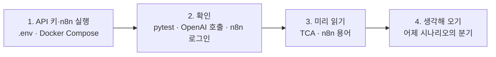

# 65일차 실습 준비 · 수업 전에 미리 해 두면 좋은 것

- 수업일: 2026-10-15 (65일차) · Trigger·Condition·Action 기반 워크플로우 설계, n8n 실습 환경 구성
- 준비 시간: 약 1시간 (이미지 다운로드 포함)
- 먼저 WSL에서 `cd ~/aio-01d4-stu && git pull`로 오늘 자료를 받습니다 (수강생 저장소: https://gl.isitsoft.kr/publicproj/aio-01d4-stu).
- **수업 전날까지** 1~2절을 끝내 주세요. 3~4절은 시간이 될 때 읽어 오면 좋습니다.



---

## 1. API 키 연결과 n8n 실행 (전날 필수, 약 45분)

오늘부터 노코드 워크플로우 도구 **n8n**을 사용합니다. 수업의 LLM은 64일차와 같은 **OpenAI API**(`gpt-4.1-mini`)이고, 64일차에 만든 `Last3Mon/.env`의 키를 n8n에서도 그대로 씁니다. 64일차의 Ollama는 OpenAI가 실패할 때 쓰는 **대체용**으로 n8n과 함께 Docker에서 실행합니다.

자세한 순서는 **[n8n 준비 안내 (SETUP-N8N)](../../Last3Mon/65/SETUP-N8N.md)** 를 따라 하세요.

| 순서 | 할 일 | 시간 |
| --- | --- | --- |
| 1 | WSL에 Docker·ctop 설치 ([install-sh](https://gl.isitsoft.kr/publicproj/install-sh#-2-%EC%8B%9C%EC%8A%A4%ED%85%9C--%EC%BB%A8%ED%85%8C%EC%9D%B4%EB%84%88-devops-1)의 Docker·ctop), `docker version` 확인 | 10분 |
| 2 | `Last3Mon/.env` 확인 (64일차에 키를 넣어 둠) | 1분 |
| 3 | WSL의 Ollama 서비스 멈추기 (`sudo systemctl stop ollama`) | 2분 |
| 4 | `65/n8n/.env`에 64일차 모델 폴더 연결 (대체용) | 2분 |
| 5 | n8n 공식 한 줄 설치 `cd ~ && curl -fsSL https://get.n8n.io | N8N_DIR=./day65-n8n sh -s -- --version 2.42.6` → `Last3Mon/65/n8n`에서 `docker compose up -d`로 Ollama 더하기 (이미지 약 6.5GB), http://localhost:5678 관리자 계정 만들기 | 15~35분 |
| 6 | `bash register-credentials.sh`로 n8n에 Credential 등록 | 2분 |

> 이미지가 크기 때문에 수업 중에 받으면 강의실 네트워크가 매우 느려집니다. **다운로드는 꼭 집에서 미리** 해 주세요.

## 2. 준비가 끝났는지 확인 (전날 필수, 5분)

```bash
cd ~/aio-01d4-stu/Last3Mon/65/workflow-lab
uv sync
uv run pytest -q                              # 35 passed, 1 skipped
uv run miniflow check                         # Reply (openai, …): ready
cd ../n8n
docker compose ps                             # n8n, ollama 모두 running
```

브라우저에서 n8n에 로그인되면 준비 완료입니다. 해결이 안 되면 수업 당일 1교시 전에 말씀해 주세요.

---

## 3. 미리 읽어 오면 좋은 내용 (선택, 약 15분)

### 3.1 Trigger·Condition·Action

| 구성 요소 | 질문 | 예 |
| --- | --- | --- |
| Trigger | 언제 시작하나? | 문의 양식 제출, 매일 9시, 메일 도착 |
| Condition | 어느 길로 갈까? | 긴급 문의인가? FAQ가 있나? |
| Action | 무엇을 하나? | 답변 작성, 담당자 전달, 기록 저장 |

어제 `05` 워크플로우에 "점심 메뉴 추천해줘"를 넣었을 때 멈춘 이유를 떠올려 보세요. 오늘은 이 문제를 Condition으로 해결합니다.

### 3.2 n8n 용어 미리 보기

| 용어 | 뜻 |
| --- | --- |
| 캔버스 | 노드를 놓고 선으로 연결하는 화면 |
| 항목(item) | 노드 사이를 흐르는 데이터 한 건 (JSON 객체 하나) |
| 표현식 | `{{ $json.text }}`처럼 앞 노드의 값을 꺼내 쓰는 식 |
| Webhook | 다른 프로그램이 HTTP 요청으로 워크플로우를 시작시키는 Trigger |
| Publish | 워크플로우를 게시해 화면을 닫아도 계속 동작하게 함 |
| Executions | 실행 기록 목록 |

### 3.3 지난 실습과 연결

| 오늘 | 지난 실습 |
| --- | --- |
| n8n 공식 설치 스크립트가 만든 Compose + 수업 Compose(Ollama)를 `include`로 함께 실행 | 9월 Docker Compose 배포 (Weather MCP 등) |
| API 키는 `.env`에, n8n에서는 Credential로 | 7월 FastAPI 실습의 `.env`와 환경 변수 |
| 컨테이너끼리 서비스 이름으로 호출 (`http://ollama:11434`) | 9월 Weather MCP의 `http://weather-mcp:8010` |
| Webhook으로 워크플로우 호출 | FastAPI 엔드포인트 호출 |
| 플랫폼 장애 시 자동 전환 | 9월 `mini_multi_agent_01`의 Provider Failover |

---

## 4. 생각해 오기 (선택, 5분)

64일차 Lab 03에서 분석한 업무 시나리오를 떠올리고 답해 보세요.

- 이 업무는 **무엇이 들어오면** 시작하나요? (Trigger)
- 중간에 **길이 갈라지는 지점**은 어디인가요? 각 길에서는 무엇을 하나요? (Condition·Action)
- 예상하지 못한 입력이 오면 어디로 보내야 할까요? (default 길)

## 5. 당일 준비물

- 충전된 노트북과 충전기 (Docker는 배터리를 많이 사용합니다)
- WSL의 Docker(1절에서 설치), Windows Terminal(WSL), VS Code, 웹 브라우저

## 확인

- [ ] `uv run pytest -q` → `35 passed, 1 skipped`
- [ ] `uv run miniflow check` → `Reply (openai, …): ready`
- [ ] `docker compose ps` → n8n, ollama running
- [ ] 브라우저에서 n8n에 로그인했고 Credentials에 `OpenAI (.env)`가 있다
- [ ] 어제 시나리오의 Trigger와 분기 지점을 생각해 왔다
