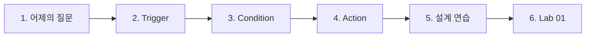
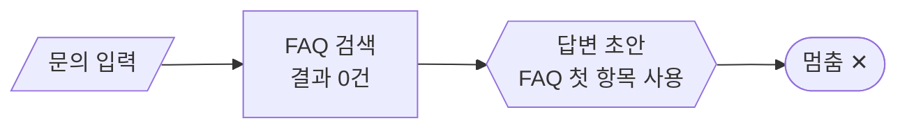
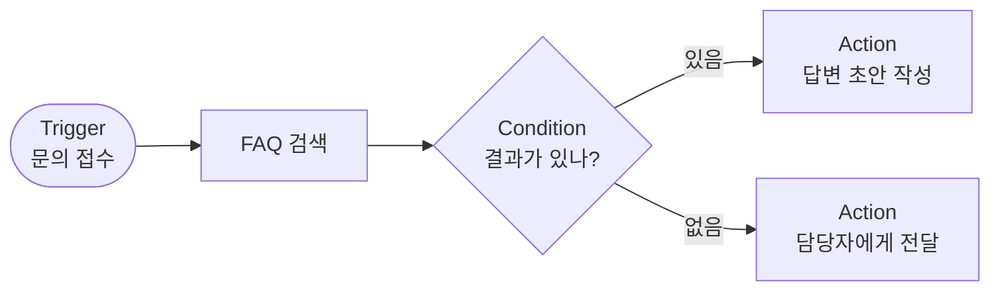
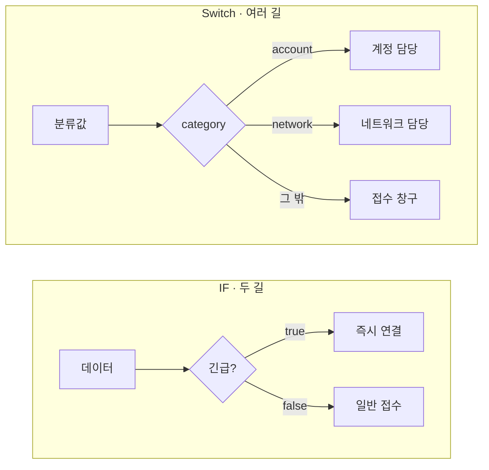
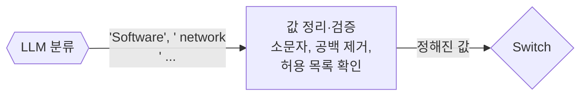
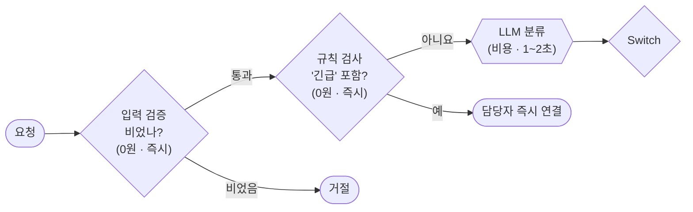
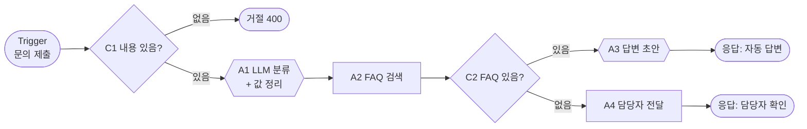
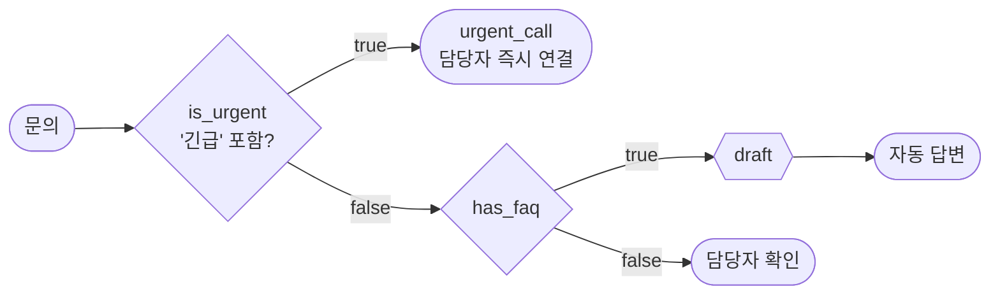

# 1단계 · Trigger·Condition·Action으로 워크플로우 설계하기

- 시간: 1~2교시 (1교시 앞부분은 [오늘의 개요](00-DAY65-OVERVIEW.md))
- 학습 목표
  - 워크플로우를 Trigger(언제)·Condition(어느 길)·Action(무엇을)으로 나누어 설명할 수 있다.
  - 업무 상황에 맞는 Trigger 종류와 Condition 종류를 고를 수 있다.
  - 비교하는 값의 형식 차이 때문에 생기는 분기 오류를 찾고 막을 수 있다.
  - "결과가 없거나 예상과 다른 경우"를 받는 길까지 포함해 흐름을 설계할 수 있다.
- 실습: [Lab 01 · Condition으로 "결과 없음" 경로 만들기](../../Last3Mon/65/LAB-01-CONDITION-IN-MINIFLOW.md)



---

## 1. 어제의 질문에서 출발하기

64일차 마지막에 IT 문의 워크플로우에 "점심 메뉴 추천해줘"를 넣었더니, FAQ 검색 결과가 없는데도 다음 단계가 첫 번째 FAQ를 꺼내려다 멈췄습니다.



실제 업무에서는 "결과가 있을 때"와 "없을 때"를 **다른 길**로 보내야 합니다. 이렇게 흐름을 설계할 때 쓰는 세 가지 질문이 오늘의 주제입니다.

| 질문 | 구성 요소 | 예 |
| --- | --- | --- |
| 언제 시작하나? | **Trigger** | 직원이 문의 양식을 제출했을 때 |
| 어느 길로 갈까? | **Condition** | FAQ 검색 결과가 있는가? |
| 무엇을 하나? | **Action** | 답변 초안 작성 / 담당자에게 전달 |



### 1.1 코드로 만들 때와 비교하면

TCA는 새로운 개념이 아닙니다. 지난 3개월 동안 FastAPI로 만든 서비스도 같은 세 부분으로 되어 있었습니다.

| TCA | 코드에서 | 예 |
| --- | --- | --- |
| Trigger | 엔드포인트, 스케줄러, 메시지 큐 소비자 | `@app.post("/requests")` |
| Condition | `if` / `elif` / `else`, `match` | `if not faq: return hand_off()` |
| Action | 함수 호출, DB 저장, 응답 반환 | `draft = llm.complete(...)` |

차이는 **분기가 그림으로 드러난다**는 점입니다. 코드에서는 `else`가 빠져 있어도 눈에 잘 띄지 않지만, 그림에서는 마름모에서 나가는 선이 하나뿐이면 바로 보입니다. 어제 워크플로우가 멈춘 것도 "결과 없음"이라는 선이 그림에 없었기 때문입니다.

### 1.2 TCA로 생각하면 좋은 점

| 좋은 점 | 설명 |
| --- | --- |
| 빠진 경우가 보인다 | Condition마다 "참일 때·거짓일 때·그 밖"을 적다 보면 빠진 길이 드러남 |
| 업무 담당자와 이야기하기 쉽다 | "언제 시작하나요? 어떤 경우에 다른 사람에게 넘기나요?"는 코드 지식 없이 답할 수 있음 |
| 도구가 바뀌어도 그대로 | n8n, miniflow, 다른 도구 모두 Trigger·분기·Action 노드가 있음 |
| 비용을 줄이는 위치를 찾기 쉽다 | 비싼 Action(LLM)을 어느 길에만 둘지 정할 수 있음 (3단계 측정) |

---

## 2. Trigger: 워크플로우를 시작시키는 사건

| 종류 | 언제 쓰나 | 예 | 지난 실습에서 비슷한 것 |
| --- | --- | --- | --- |
| 수동 실행 | 개발·테스트할 때, 사람이 직접 시작할 때 | 실행 버튼 | Streamlit 버튼 |
| 웹훅·폼 | 다른 시스템이나 화면이 요청을 보낼 때 | 문의 양식 제출 → `POST /webhook/...` | FastAPI 엔드포인트 |
| 일정 | 정해진 시간마다 | 매일 09:00 미처리 문의 요약 | (cron) |
| 이벤트 | 외부에서 무언가 바뀌었을 때 | 메일 도착, 파일 업로드, DB 행 추가 | Redis Queue에 작업 등록 |
| 다른 워크플로우 | 워크플로우를 부품처럼 나눌 때 | 공통 "알림 보내기" 워크플로우 호출 | 함수 호출 (70일차 모듈화) |

Trigger를 정할 때는 **시작할 때 어떤 데이터를 받는지**도 함께 정합니다. 웹훅이라면 `{"user": "kim", "text": "..."}`처럼 받을 필드를 미리 약속해 둡니다. 받은 데이터가 비어 있거나 형식이 틀리면 바로 거절하는 Condition을 맨 앞에 두는 것이 좋습니다.

### 2.1 Trigger를 고르는 네 가지 질문

| 질문 | 답에 따라 |
| --- | --- |
| 누가 시작하나? | 사람이 직접 → 폼·웹훅 / 시스템이 → 이벤트 / 시계가 → 일정 |
| 얼마나 자주? | 요청마다 → 웹훅 / 하루 한 번 묶어서 → 일정 |
| 요청한 쪽이 결과를 기다리나? | 기다린다 → 웹훅 + 응답 노드 / 안 기다린다 → 처리 후 알림 |
| 한 번에 몇 건이 들어오나? | 1건 → 웹훅 / 여러 건 → 일정 Trigger가 목록을 읽어 항목별 처리 (66일차) |

예를 들어 "직원이 IT 문의를 남기면 바로 답을 받는다"는 웹훅 + 응답, "매일 아침 어제 들어온 문의를 팀장에게 요약해 보낸다"는 일정 Trigger가 맞습니다. 같은 IT 문의 업무라도 질문에 대한 답이 다르면 Trigger가 달라집니다.

### 2.2 시작 데이터의 약속

웹훅 Trigger라면 받을 데이터를 문서로 정해 둡니다. 오늘 실습의 IT 문의 웹훅은 다음 약속을 씁니다.

```json
{"user": "kim", "text": "VPN 접속이 계속 끊겨요"}
```

| 필드 | 필수 | 비었을 때 |
| --- | --- | --- |
| `user` | 예 | 이력을 남길 수 없으므로 거절하거나 `anonymous`로 처리 |
| `text` | 예 | 처리할 내용이 없으므로 **400으로 거절** (오늘 실습의 `Has text?`) |

약속을 정해 두면 Trigger를 바꿔도(폼 → 메일 → 메신저) 뒤의 흐름은 그대로 쓸 수 있습니다. 3단계에서 n8n과 miniflow가 **같은 입력 약속**을 지켜서 서로 대신할 수 있는 것도 이 때문입니다.

---

## 3. Condition: 데이터를 보고 길을 고르는 단계

| 종류 | 길의 수 | 예 | n8n 노드 |
| --- | --- | --- | --- |
| 참/거짓 분기 | 2 | 긴급 문의인가? | IF |
| 여러 갈래 분기 | 여러 개 + 그 밖의 값 | 분류가 account / network / device / software / 그 밖 | Switch |
| 걸러내기 | 1 (조건에 맞는 항목만 통과) | 금액 10만 원 이상 주문만 | Filter |
| 입력 검증 | 2 | 필수 필드가 있는가? | IF |
| 오류 경로 | 2 | 외부 API 호출이 실패했는가? | 노드의 오류 출력 (76일차) |



### 3.1 LLM의 판단으로 길을 고를 때

"이 문의는 어떤 종류인가?"처럼 규칙으로 정하기 어려운 판단은 LLM에게 맡기고, 그 결과로 Switch 분기를 만들 수 있습니다. 이때 꼭 지킬 것이 있습니다.



- LLM의 답은 매번 형식이 조금씩 다를 수 있습니다(대문자, 공백, 설명 문장 추가). 64일차에 작은 모델은 `Software`처럼 대문자로 답하기도 했습니다.
- 그래서 LLM 출력은 **정해진 값으로 정리하고 검증**한 뒤 Condition에 넘깁니다. 허용 목록에 없으면 `other`로 보냅니다.

### 3.2 좋은 Condition의 조건

| 원칙 | 이유 |
| --- | --- |
| 모든 길의 끝에 결과가 있다 | 어떤 입력이 와도 응답·저장·알림 중 하나로 끝나야 합니다 |
| "그 밖의 값" 길(default)이 있다 | 예상하지 못한 값이 와도 멈추지 않습니다 |
| 조건은 하나의 값만 본다 | 여러 조건을 한 번에 섞으면 왜 그 길로 갔는지 찾기 어렵습니다 |
| 비교하는 값의 형식을 맞춘다 | `"30"`(문자)과 `30`(숫자), `"Network"`와 `"network"`는 다릅니다 |

### 3.3 비교할 때 자주 걸리는 형식 함정

Condition이 "이상하게" 동작할 때는 대부분 비교하는 두 값의 모양이 다릅니다.

| 함정 | 왼쪽 값 | 오른쪽 값 | 결과 | 막는 방법 |
| --- | --- | --- | --- | --- |
| 대소문자 | `Network` | `network` | 같지 않음 | 비교 전에 소문자로 |
| 앞뒤 공백·줄바꿈 | `" network\n"` | `network` | 같지 않음 | 비교 전에 `trim` |
| 문장으로 답함 | `"It is network."` | `network` | 같지 않음 | 허용 목록에서 포함된 값 찾기 |
| 문자와 숫자 | `"30"` | `30` | 연산자에 따라 다름 | 형식(String·Number)을 먼저 고름 |
| 빈 값과 없는 값 | `""` 또는 `[]` | (필드 없음) | 검사 방법에 따라 다름 | "비어 있음(empty)" 연산자 사용 |

오늘 실습의 `miniflow` Condition 노드는 `equals`, `not_equals`, `contains`, `empty`, `not_empty`, `in`, `gt`, `lt` 연산자를 씁니다. FAQ 검색 결과가 있는지는 `not_empty`로 봅니다.

```json
{"id": "has_faq", "type": "condition", "check": {"left": "{{nodes.faq.output}}", "op": "not_empty"}}
```

### 3.4 Condition의 순서: 싼 검사부터

Condition을 여러 개 둘 때는 **비용이 적고 확실한 검사를 앞에** 둡니다.



빈 요청이나 "긴급" 문의는 LLM을 부르기 전에 걸러지므로, 시간과 비용이 들지 않습니다. 75일차(비용 관리)에서 이 원칙을 숫자로 확인합니다.

---

## 4. Action: 각 길에서 실제로 하는 일

64일차에 배운 노드들이 모두 Action이 됩니다.

| Action 종류 | 예 |
| --- | --- |
| 데이터 처리 | 필드 추가·이름 바꾸기, 형식 변환 |
| LLM | 분류, 요약, 답변 초안 작성 |
| Tool·HTTP | 외부 API·DB 조회, 다른 시스템에 등록 |
| 저장 | 처리 이력 기록 |
| 응답·알림 | 요청한 쪽에 결과 반환, 메신저·메일 알림 |
| 사람 확인 | 담당자에게 넘기고 승인 대기 |

### 4.1 모든 길이 같은 모양으로 끝나게

길이 여러 개여도 요청한 쪽이 받는 결과는 **같은 모양**인 것이 좋습니다. 오늘 실습 `06`의 두 끝 노드는 같은 필드를 가집니다.

| 필드 | 자동 답변 길 (`auto_reply`) | 담당자 확인 길 (`hand_off`) |
| --- | --- | --- |
| `category` | LLM 분류값 | LLM 분류값 |
| `faq_id` | `FAQ-003` 같은 번호 | 빈 값 |
| `route` | `자동 답변` | `담당자 확인` |
| `reply` | LLM이 쓴 답변 | "관련 안내를 찾지 못해 담당자가 확인 후 답변드리겠습니다." |

요청한 쪽은 `route`만 보고 다음 일을 정하면 됩니다. 길마다 모양이 다르면 받는 쪽 코드가 길마다 따로 처리해야 합니다.

### 4.2 Action에서 조심할 것

| 조심할 것 | 예 | 방법 |
| --- | --- | --- |
| 되돌리기 어려운 Action | 메일 발송, 결제, 삭제 | 앞에 사람 확인 또는 검증 Condition |
| 같은 요청이 두 번 오면 | 웹훅이 재시도해 같은 문의가 두 번 등록 | 요청 번호로 중복 확인 (76일차) |
| 느린 Action | LLM 호출 2회 | 꼭 필요한 길에만 (3단계 측정: 담당자 확인 길은 LLM 1회) |

---

## 5. 설계 연습: IT 문의 처리를 TCA로 나누기

| 구분 | 내용 |
| --- | --- |
| Trigger | 문의 양식 제출 (웹훅, 필드: `user`, `text`) |
| Condition C1 | `text`가 비어 있나? → 비었으면 거절(400) |
| Action A1 | LLM으로 분류 → 값 정리 |
| Action A2 | FAQ 검색 |
| Condition C2 | FAQ가 있나? |
| Action A3 (있음) | LLM 답변 초안 → 결과 응답 (`route`: 자동 답변) |
| Action A4 (없음) | 담당자 전달 안내 → 결과 응답 (`route`: 담당자 확인) |



이 설계는 오늘 3단계에서 n8n으로 그대로 만들어 실행합니다.

### 5.1 같은 설계를 확장하기: 긴급 문의

Lab 01 4절에서 직접 만드는 확장입니다. "긴급"이라는 단어가 있으면 FAQ와 상관없이 바로 담당자에게 연결합니다.



| 질문 | 답 |
| --- | --- |
| 새로 생긴 Condition은? | `is_urgent` (`contains` "긴급") |
| 왜 맨 앞에 두나? | 긴급 문의는 FAQ 검색·LLM 결과를 기다릴 필요가 없음 (3.4절 싼 검사부터) |
| 기존 흐름은 어떻게 이어지나? | `is_urgent`의 `false` 길이 `has_faq`로 이어짐 |

### 5.2 설계표로 정리하기

설계는 [TCA 설계 템플릿](../../Last3Mon/65/templates/TCA-DESIGN-TEMPLATE.md)에 적습니다. 64일차 Lab 03에서 분석한 시나리오를 이 표로 다시 정리하면, 오늘 배운 Condition과 예외 경로가 자연스럽게 들어갑니다.

| 템플릿 칸 | 채울 내용 |
| --- | --- |
| Trigger | 시작 방식, 받는 필드, 비었을 때 처리 |
| Condition | 번호·검사할 값·조건·참일 때·거짓일 때, Switch라면 default 길 |
| Action | 길마다 할 일과 노드 종류 |
| 흐름 그림 | mermaid로 전체 흐름 |

---

## 6. Lab 01 안내

- 실습 안내: [Last3Mon/65/LAB-01-CONDITION-IN-MINIFLOW.md](../../Last3Mon/65/LAB-01-CONDITION-IN-MINIFLOW.md)
- 할 일
  1. 어제 멈춘 워크플로우(`05`)와 Condition이 들어간 워크플로우(`06`)를 비교 실행
  2. Switch(`07`)로 여러 갈래 분기, `default` 길 확인
  3. "긴급" 문의를 바로 담당자에게 보내는 Condition 직접 추가

`miniflow`에서는 분기 노드에서 나가는 연결에 길 이름을 적습니다. 선택되지 않은 길의 노드는 실행 기록에 `skipped`로 남습니다.

```json
"edges": [["has_faq", "draft", "true"], ["has_faq", "hand_off", "false"]]
```

Switch 노드는 `cases`에 정한 값과 같으면 그 이름의 길로, 아니면 `default` 길로 보냅니다.

```json
{"id": "route", "type": "switch", "value": "{{nodes.classify.output}}", "cases": ["account", "network", "device", "software"]}
```

실행 기록에서 확인할 것: 선택된 길의 이름(`branch`), `skipped` 노드, 마지막 결과의 `route`.

---

## 7. 자주 하는 설계 실수

| 실수 | 증상 | 고치는 법 |
| --- | --- | --- |
| 거짓 길을 안 그림 | 결과가 없을 때 멈춤 (64일차 점심 메뉴) | Condition마다 참·거짓 길을 모두 연결 |
| Switch에 default가 없음 | 예상 밖 값(`Software`)이 오면 아무 길도 안 감 | default(Fallback) 길 추가 |
| LLM 답을 그대로 비교 | 대문자·공백·문장 때문에 분기 실패 | 정리·검증 단계 추가 |
| 입력 검증을 뒤에 둠 | 빈 요청에도 LLM을 불러 비용 발생 | 입력 검증을 맨 앞에 |
| 길마다 결과 모양이 다름 | 받는 쪽 처리가 복잡해짐 | 같은 필드로 끝나게 (`route`로 구분) |

---

## 8. 스스로 확인하기

<details><summary>Q1. "매일 아침 어제 들어온 문의를 팀장에게 요약해 보낸다"에 맞는 Trigger는?</summary>

일정(Schedule) Trigger입니다. 요청마다가 아니라 정해진 시간에 여러 건을 묶어 처리하고, 요청한 사람이 결과를 기다리지 않습니다.
</details>

<details><summary>Q2. Switch 노드에 default(그 밖) 길이 꼭 필요한 이유는?</summary>

LLM이 `Software`, `It is network.`처럼 예상 밖의 값을 내면 어떤 규칙에도 맞지 않아 흐름이 멈춥니다. default 길이 있으면 그런 값도 접수 창구 같은 곳으로 보내 결과가 남습니다.
</details>

<details><summary>Q3. LLM 분류 결과를 Switch에 바로 넣지 않고 정리 단계를 두는 이유는?</summary>

LLM 답은 대소문자·공백·설명 문장이 섞일 수 있습니다. 소문자 변환, 공백 제거, 허용 목록 확인을 거쳐 정해진 값으로 만든 뒤 분기해야 안전합니다.
</details>

<details><summary>Q4. 빈 요청 검사를 LLM 분류보다 앞에 두는 이유는?</summary>

비용이 들지 않고 즉시 끝나는 검사이기 때문입니다. 뒤에 두면 처리할 수 없는 요청에도 LLM을 불러 시간과 비용을 씁니다.
</details>

<details><summary>Q5. 자동 답변 길과 담당자 확인 길이 같은 필드로 끝나야 하는 이유는?</summary>

요청한 쪽이 `route` 값만 보고 처리할 수 있어 단순해집니다. 3단계의 플랫폼 전환도 모든 플랫폼이 같은 출력 약속을 지켜야 가능합니다.
</details>

## 정리

- 워크플로우는 Trigger(언제 시작)·Condition(어느 길)·Action(무엇을)으로 설계합니다. 코드의 엔드포인트·`if`·함수와 같은 구조이고, 그림이 빠진 길을 드러내 줍니다.
- Trigger는 누가·얼마나 자주·결과를 기다리는지·몇 건인지로 고르고, 시작 데이터의 약속을 함께 정합니다.
- Condition은 IF(두 길), Switch(여러 길), 걸러내기, 입력 검증, 오류 경로로 나뉩니다. 싼 검사를 앞에 둡니다.
- 모든 길의 끝에 결과가 있어야 하고, 예상하지 못한 값을 받는 default 길이 필요합니다.
- LLM의 판단으로 분기할 때는 출력값을 정리·검증한 뒤 Condition에 넘깁니다. 비교하는 값의 형식(대소문자·공백·문자/숫자)을 맞춥니다.
- 여러 길은 같은 모양의 결과로 끝나게 하고, `route` 같은 필드로 어느 길이었는지 알려 줍니다.
