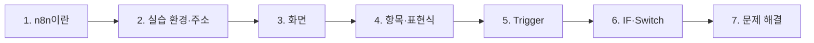
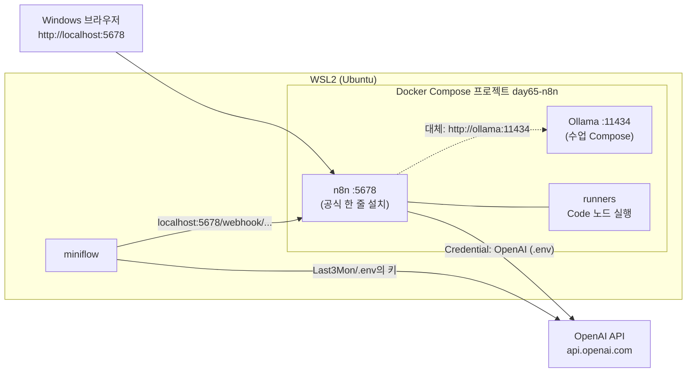
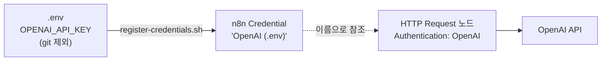
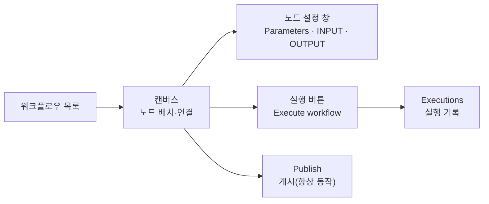
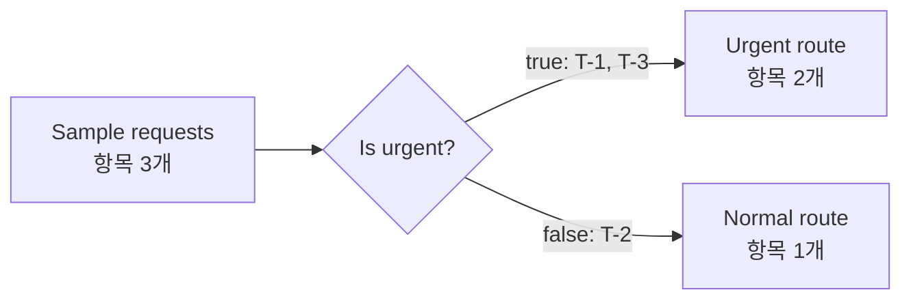
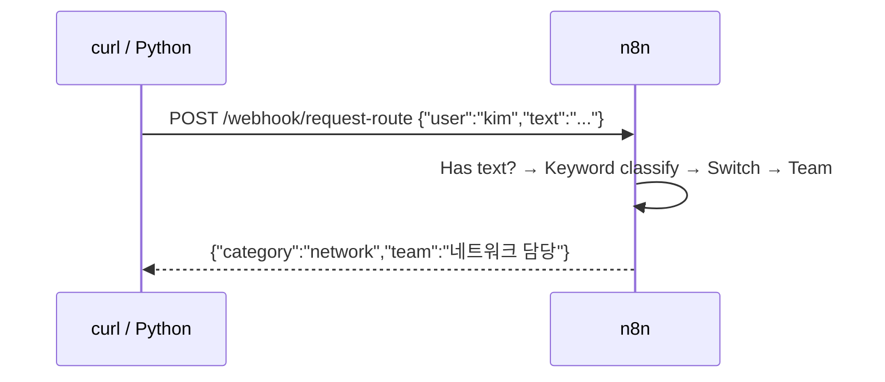
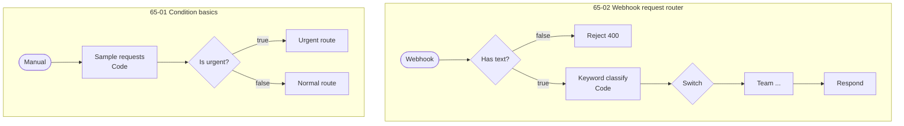
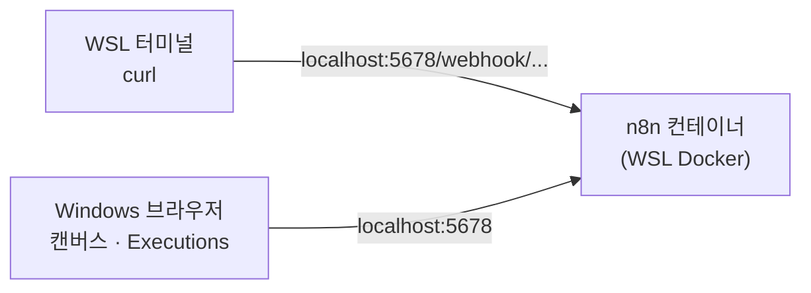

# 2단계 · n8n 실습 환경과 기본 설정

- 시간: 3~4교시
- 학습 목표
  - 실습 환경(WSL·Docker·n8n·OpenAI API·Ollama 대체)의 구성과 서로 연결되는 주소를 설명할 수 있다.
  - API 키를 워크플로우에 쓰지 않고 Credential로 관리하는 이유를 설명할 수 있다.
  - n8n 화면의 캔버스·노드 설정·실행 기록을 사용할 수 있다.
  - n8n의 데이터 단위(항목, item)와 표현식으로 앞 노드의 값을 꺼내 쓸 수 있다.
  - Manual·Webhook Trigger와 IF·Switch 노드로 워크플로우를 만들고 실행할 수 있다.
- 실습: [Lab 02A · 브라우저에서 n8n 첫 워크플로우 직접 만들기 (기본)](../../Last3Mon/65/LAB-02A-FIRST-WORKFLOW-IN-BROWSER.md) → [Lab 02 · n8n 화면 익히기와 첫 워크플로우](../../Last3Mon/65/LAB-02-N8N-FIRST-WORKFLOWS.md)



---

## 1. n8n은 어떤 도구인가

n8n은 **오픈소스 노코드 워크플로우 자동화 도구**입니다. 내 노트북이나 회사 서버에 직접 설치해서 쓸 수 있고, 화면에서 노드를 놓고 연결해 워크플로우를 만듭니다.

| 특징 | 내용 |
| --- | --- |
| 노드 | 수백 개의 서비스 연동 노드 (Slack·Email·Jira·Notion·DB·HTTP 등) |
| AI | AI Agent·LLM 노드 (OpenAI/Anthropic/Gemini, Ollama 등) |
| 코드 | 필요하면 Code 노드에 JavaScript·Python을 직접 작성 |
| 실행 기록 | 실행마다 노드별 입력·출력·시간 저장 |
| 설치 | Docker 한 줄로 실행, 데이터는 내 PC에 저장 |

64일차의 `miniflow`와 비교하면 다음과 같습니다.

| 개념 | miniflow | n8n |
| --- | --- | --- |
| 워크플로우 정의 | JSON 파일 직접 작성 | 화면에서 노드 배치 (내보내면 JSON) |
| 노드 연결 | `edges` 목록 | 캔버스의 선 |
| 앞 노드 값 꺼내기 | `{{nodes.faq.output}}` | `{{ $json.faq }}`, `{{ $('FAQ').first().json }}` |
| 조건 분기 | `condition`, `switch` 노드 | IF, Switch 노드 |
| 실행 기록 | `runs/*.json` | Executions 화면 |

### 1.1 직접 설치(self-hosted)해서 쓰는 이유

| 이유 | 설명 |
| --- | --- |
| 데이터가 내 PC·회사 서버에 남음 | 워크플로우·실행 기록·Credential이 Docker 저장 공간(`n8n-data`)에 저장 |
| 사내 시스템에 바로 접속 | 같은 네트워크의 DB·API를 부를 수 있음 (67일차 사내 데이터 API) |
| 비용 | 실행 횟수에 따른 요금이 없음 (LLM API 비용은 따로) |
| 수업 | 모든 학생이 같은 버전(`2.42.6`)을 같은 방법으로 실행 |

대신 설치·업데이트·백업을 직접 해야 합니다. 74일차(버전 관리)와 76일차(운영)에서 이 부분을 다룹니다.

---

## 2. 오늘의 실습 환경



| 누가 | 누구를 | 어떤 주소로 | 왜 이 주소인가 |
| --- | --- | --- | --- |
| 브라우저 | n8n | `http://localhost:5678` | n8n 컨테이너가 5678 포트를 공개 |
| n8n | OpenAI API | `https://api.openai.com/v1` | 키는 Credential `OpenAI (.env)`에 저장 (워크플로우에 키를 쓰지 않음) |
| miniflow (WSL) | OpenAI API | `https://api.openai.com/v1` | 키는 `Last3Mon/.env`에서 읽음 |
| n8n (대체) | Ollama | `http://ollama:11434` | 같은 Compose 안의 컨테이너는 **서비스 이름**으로 서로 부름 |
| miniflow (대체) | Ollama | `http://localhost:11434` | Ollama 컨테이너가 11434 포트를 공개 |
| miniflow (WSL) | n8n | `http://localhost:5678/webhook/...` | 웹훅 주소로 워크플로우 호출 |

> 컨테이너 안에서 `localhost`는 **그 컨테이너 자신**입니다. n8n 안에서 `localhost:11434`를 부르면 Ollama가 아니라 n8n 컨테이너를 찾습니다. 9월 Weather MCP 배포 실습에서 Backend가 `http://weather-mcp:8010`을 썼던 것과 같은 원리입니다.

### 2.1 설치: n8n 공식 한 줄 설치

n8n은 설치 스크립트 하나로 Docker Compose 환경을 **자동으로** 만들어 줍니다 ([공식 안내](https://docs.n8n.io/deploy/host-n8n/install-options/one-line-setup)). 수업에서는 설치 폴더와 버전만 정해 사전 준비에서 실행했습니다.

```bash
cd ~ && curl -fsSL https://get.n8n.io | N8N_DIR=./day65-n8n sh -s -- --version 2.42.6
```

| 스크립트가 하는 일 | 결과 |
| --- | --- |
| Docker·Compose·데몬 확인, 5678 포트가 비었는지 확인 | 문제가 있으면 이유를 알려 주고 멈춤 |
| `~/day65-n8n/compose.yml`, `.env` 작성 | n8n, `runners`(Code 노드의 코드를 n8n과 분리해 실행), `sandbox-*`·`searxng`(n8n 화면 안 AI 도우미용) |
| 이미지 받기, 시작, `/healthz` 확인 | http://localhost:5678 |

9월에는 Compose 파일을 직접 썼습니다. 지금은 **도구가 권장 구성을 만들어 주고**, 우리는 필요한 것(Ollama)만 더합니다. 수업 Compose(`Last3Mon/65/n8n/compose.yml`)는 공식 파일을 `include`로 포함하고 Ollama를 더한 것이라, 둘이 **한 프로젝트**(`day65-n8n`)로 움직입니다.

| 설치 옵션 | 이유 |
| --- | --- |
| `N8N_DIR=./day65-n8n` | 폴더 이름 = 프로젝트 이름 → 네트워크 `day65-n8n_default`. 67일차 데이터 API가 이 네트워크에 붙음 |
| `--version 2.42.6` | 수업 자료의 버전과 맞춤. 빼면 그날의 최신 버전 |

### 2.2 켜고 끄기

실습 폴더 `Last3Mon/65/n8n`에서 Docker Compose로 다룹니다 (n8n과 Ollama가 함께).

| 명령 | 하는 일 | 데이터 |
| --- | --- | --- |
| `docker compose up -d` | 공식 설치에 Ollama를 더해 함께 실행 | n8n 쪽은 그대로, Ollama 새로 |
| `docker compose ps` | n8n·runners·ollama가 `running`인지 확인 | |
| `docker compose stop` | 수업이 끝나면 멈춤 | 유지 |
| `docker compose start` | 다음 날 다시 켬 | 유지 |
| `docker compose down` | 컨테이너 삭제 | 워크플로우·계정·Credential은 `n8n-data`에 유지 |
| `docker compose logs n8n` | 화면이 안 열릴 때 오류 확인 | |

65일차 이후 모든 n8n 실습은 오늘 띄운 이 n8n을 계속 씁니다. 매일 새로 설치하지 않습니다.

### 2.3 API 키는 Credential로

n8n에서 OpenAI를 부르려면 키가 필요합니다. 키를 HTTP Request 노드의 헤더에 직접 적으면 워크플로우를 내보내거나 화면을 공유할 때 키가 함께 새어 나갑니다. 그래서 키는 **Credential**(자격 증명)이라는 별도 저장소에 두고, 노드는 그 이름만 가리킵니다.



| 방식 | 워크플로우 JSON에 키가 들어가나 | 키를 바꿀 때 |
| --- | --- | --- |
| 노드에 직접 적기 | 들어감 (공유·내보내기 위험) | 모든 노드를 찾아 고침 |
| Credential 참조 | 들어가지 않음 (이름·ID만) | Credential 하나만 고침 (`.env` 수정 후 스크립트 다시 실행) |

사전 준비에서 `register-credentials.sh`가 `.env`의 키로 `OpenAI (.env)`와 `Ollama local` 두 Credential을 만들어 두었습니다. 수업 워크플로우는 이 이름을 그대로 씁니다.

---

## 3. n8n 화면 둘러보기



| 화면 | 하는 일 |
| --- | --- |
| 캔버스 | 노드를 놓고 선으로 연결. `+`를 누르거나 노드 출력 점을 끌어 다음 노드 추가 |
| 노드 설정 창 | 왼쪽 INPUT(들어온 데이터), 가운데 Parameters(설정), 오른쪽 OUTPUT(나간 데이터) |
| Execute workflow | 지금 화면의 워크플로우를 한 번 실행 (테스트) |
| Executions | 지난 실행 목록. 열면 실행 당시의 노드별 데이터를 볼 수 있음 |
| Publish | 게시하면 웹훅·일정 Trigger가 화면을 닫아도 계속 동작 |
| Import from File | 다른 사람이 만든 워크플로우 JSON 가져오기 |

### 3.1 노드 설정 창 읽는 법

노드를 더블클릭하면 세 칸이 나옵니다. 64일차 실행 기록의 `args·prompt → output` 순서와 같습니다.

| 칸 | 64일차 실행 기록에서 | 보는 것 |
| --- | --- | --- |
| INPUT (왼쪽) | 앞 노드의 `output` | 이 노드에 들어온 항목. 필드 이름을 끌어다 Parameters에 놓으면 표현식이 자동으로 만들어짐 |
| Parameters (가운데) | `args`, `prompt` | 이 노드의 설정. 표현식은 실제 값으로 미리 보기가 나옴 |
| OUTPUT (오른쪽) | `output` | 이 노드가 내보낸 항목. IF·Switch는 출력마다 탭이 나뉨 |

OUTPUT은 **Table · JSON · Schema** 세 가지로 볼 수 있습니다. 필드 이름과 모양을 정확히 볼 때는 JSON, 여러 항목을 한눈에 볼 때는 Table이 편합니다.

### 3.2 워크플로우 가져오기와 저장

수업 워크플로우는 `Last3Mon/NN/n8n/workflows/*.json`으로 배포합니다. Windows 파일 선택 창에서 WSL 폴더로 가려면 주소창에 `\\wsl$\Ubuntu\home\<사용자>\aio-01d4-stu\...`를 입력합니다.

- 같은 파일을 여러 번 가져오면 같은 웹훅 경로를 가진 워크플로우가 여러 개 생깁니다. 게시할 때 충돌하므로 **한 번만 가져오고, 다시 가져올 때는 기존 것을 지웁니다.**
- 고친 뒤에는 오른쪽 위 **Save**를 누릅니다. 저장하지 않고 다른 화면으로 가면 바뀐 내용이 사라집니다.

---

## 4. 데이터 단위: 항목(item)

n8n에서 노드 사이를 흐르는 데이터는 **항목(item)의 목록**입니다. 항목 하나는 JSON 객체 하나입니다.

```json
[
  {"json": {"id": "T-1", "priority": "urgent"}},
  {"json": {"id": "T-2", "priority": "normal"}},
  {"json": {"id": "T-3", "priority": "urgent"}}
]
```

- 대부분의 노드는 **항목마다 한 번씩** 동작합니다. 항목이 3개면 IF 노드는 3번 검사해서 true 쪽에 2개, false 쪽에 1개를 내보냅니다.
- 64일차 `miniflow`는 한 번에 값 하나만 흘렸습니다. n8n은 여러 건을 한꺼번에 처리할 수 있다는 점이 다릅니다.



### 4.1 표현식으로 값 꺼내기

노드 설정에서 `{{ }}` 안에 JavaScript 식을 쓰면 데이터를 꺼낼 수 있습니다.

| 표현식 | 의미 |
| --- | --- |
| `{{ $json.priority }}` | 지금 처리 중인 항목의 `priority` |
| `{{ $json.body.text }}` | 웹훅으로 받은 요청 본문의 `text` |
| `{{ $('Settings').first().json.model }}` | `Settings` 노드 출력의 첫 항목에서 `model` |
| `{{ $json.text.length > 0 }}` | 식 계산도 가능 |

### 4.2 `$json`과 `$('노드 이름')`의 차이

| 표현식 | 어느 데이터 | 언제 쓰나 |
| --- | --- | --- |
| `$json` | **바로 앞 노드**가 넘겨 준 지금 항목 | 대부분의 경우 |
| `$('Settings').first().json` | 이름으로 지정한 노드의 첫 항목 | 몇 단계 앞 노드의 값이 필요할 때 (설정값, 원래 요청) |
| `$('Request webhook').item.json` | 이름으로 지정한 노드에서 **지금 항목과 짝인** 항목 | 여러 항목을 처리하며 원래 요청 값을 다시 볼 때 |

64일차 `miniflow`의 `{{nodes.weather.output}}`이 `$('weather')`에 해당합니다. 노드 이름을 바꾸면 그 이름을 쓰는 표현식도 함께 고쳐야 하므로, **노드 이름은 처음부터 하는 일로** 짓습니다 (64일차 노드 설계 원칙).

### 4.3 웹훅 데이터는 `body` 안에

Webhook 노드가 내보내는 항목에는 요청 정보가 함께 들어 있습니다. 요청 본문은 `body` 안에 있습니다.

```json
{
  "headers": {"content-type": "application/json", "...": "..."},
  "params": {},
  "query": {},
  "body": {"user": "kim", "text": "VPN 접속이 계속 끊겨요"}
}
```

그래서 웹훅 바로 뒤에서는 `{{ $json.text }}`가 아니라 `{{ $json.body.text }}`로 꺼냅니다. 처음 만들 때 가장 자주 틀리는 부분입니다. 3단계 워크플로우는 `Settings` 노드에서 `user`, `text`를 꺼내 두고 뒤에서는 `Settings` 값을 씁니다.

---

## 5. Trigger 노드: Manual과 Webhook

| 노드 | 시작 방법 | 주소 |
| --- | --- | --- |
| Manual Trigger | 화면에서 Execute workflow 클릭 | 없음 |
| Webhook | 다른 프로그램이 HTTP 요청을 보냄 | 테스트: `/webhook-test/<path>` · 게시 후: `/webhook/<path>` |



- **Test URL**은 화면에서 "Listen for test event"를 누른 동안 한 번만 받습니다. 실행 과정이 캔버스에 바로 보여서 만들 때 편합니다.
- **Production URL**은 워크플로우를 **Publish**한 뒤 언제든 받습니다. 실행 과정은 Executions에서 확인합니다.
- 요청에 답을 돌려주려면 Webhook 노드의 응답 방식을 "Respond to Webhook 노드 사용"으로 두고, 흐름 끝에 **Respond to Webhook** 노드를 둡니다.

### 5.1 Test URL과 Production URL 비교

| | Test URL | Production URL |
| --- | --- | --- |
| 주소 | `/webhook-test/request-route` | `/webhook/request-route` |
| 받을 수 있는 때 | "Listen for test event"를 누른 동안 1회 | Publish한 뒤 언제든 |
| 실행 모습 | 캔버스에 지나간 길이 바로 표시 | Executions에서 열어 봄 |
| 쓰는 때 | 만들면서 확인 | 다른 프로그램(miniflow, 업무 코드)이 부를 때 |
| 자주 나는 오류 | 대기 중이 아니면 404 | Publish하지 않았거나 같은 경로가 둘이면 404 (`not registered`) |

### 5.2 응답 상태 코드도 결과의 일부

Respond to Webhook 노드는 본문뿐 아니라 HTTP 상태 코드도 정할 수 있습니다. Lab 02의 `65-02`는 빈 요청에 **400**을 돌려줍니다.

| 상황 | 상태 코드 | 받는 쪽이 할 일 |
| --- | --- | --- |
| 정상 처리 | 200 | 결과 사용 |
| 입력이 잘못됨 (빈 `text`) | 400 | 사용자에게 다시 입력 요청 |
| 워크플로우가 없음·게시 안 됨 | 404 | 주소·Publish 확인 |

상태 코드로 실패를 알려야 3단계의 플랫폼 전환 코드가 "이 플랫폼은 실패"를 판단할 수 있습니다.

---

## 6. Condition 노드: IF와 Switch

| 설정 | IF | Switch |
| --- | --- | --- |
| 출력 | true, false 두 개 | 규칙마다 하나 + Fallback(그 밖) |
| 조건 | 왼쪽 값 · 연산자 · 오른쪽 값 | 규칙마다 같은 형식, 위에서부터 검사 |
| 자주 쓰는 연산자 | is equal to, contains, is empty, is not empty, is true | 같음 |

- 연산자를 고를 때 값의 **형식(String·Number·Boolean)** 을 먼저 고릅니다. 숫자를 문자로 비교하면 원하는 결과가 나오지 않습니다.
- Switch의 **Fallback Output**을 켜 두면, 어떤 규칙에도 맞지 않는 값이 그 밖의 길로 갑니다. 1단계의 "default 길이 있다" 원칙입니다.

### 6.1 Lab 02의 두 워크플로우 미리 보기



| | `65-01` | `65-02` |
| --- | --- | --- |
| 배우는 것 | 항목 여러 개가 IF에서 나뉘는 모습 | 웹훅으로 받고 분기해 응답하기 |
| Trigger | Manual | Webhook (`/request-route`) |
| 분류 방식 | `priority` 값 비교 | 키워드 규칙(Code) → Switch |
| 직접 바꿔 볼 것 | 조건을 `text` contains `계정`으로 | `security`(보안) 분류 추가 |

`65-02`의 분류는 LLM이 아니라 **키워드 규칙**입니다. 3단계에서 같은 자리를 LLM 분류로 바꾼 워크플로우를 실행해 보고, 무엇이 달라지는지 비교합니다.

---

## 7. 처음 n8n을 쓸 때 자주 막히는 곳

| 증상 | 원인 | 해결 |
| --- | --- | --- |
| 웹훅 호출이 404 (`not registered`) | Publish 안 함, 또는 같은 워크플로우를 여러 번 가져옴 | Publish 확인, 중복 워크플로우 삭제 |
| Test URL 호출이 404 | "Listen for test event"를 누르지 않음 | 누른 뒤 다시 호출 |
| 표현식 결과가 비어 있음 | 웹훅 데이터를 `$json.text`로 꺼냄 | `$json.body.text` |
| n8n에서 Ollama 연결 실패 | 주소를 `localhost:11434`로 씀 | `http://ollama:11434` (서비스 이름) |
| OpenAI 호출 401 | Credential의 키가 틀림 | `.env` 수정 후 `register-credentials.sh` 다시 실행 |
| 고친 내용이 사라짐 | Save를 누르지 않음 | 오른쪽 위 Save |
| `localhost:5678`이 열리지 않음 | 컨테이너가 꺼져 있음 | `docker compose ps`, `docker compose logs n8n` |

---

## 8. Lab 02A · Lab 02 안내

### 8.1 Lab 02A (기본): 브라우저에서 직접 만들기

- 실습 안내: [Last3Mon/65/LAB-02A-FIRST-WORKFLOW-IN-BROWSER.md](../../Last3Mon/65/LAB-02A-FIRST-WORKFLOW-IN-BROWSER.md)
- **WSL의 Docker에서 도는 n8n을 Windows 브라우저(`localhost:5678`)로 열고**, 파일을 가져오지 않고 노드를 하나씩 놓아 "긴급 문의 나누기"를 만듭니다.
  1. Manual Trigger → Edit Fields(`Sample request`) → If(`Is urgent?`) → 두 Edit Fields, 두 길을 모두 실행
  2. Webhook을 더해 WSL 터미널의 `curl`로 부르기 (Test URL → Publish 후 Production URL)



요청을 보내는 곳(WSL), 실행되는 곳(WSL의 컨테이너), 화면을 보는 곳(Windows)이 다르다는 것을 직접 확인하는 것이 목표입니다. 이 구조가 이해되면 Lab 02·03의 `curl`과 `miniflow call`이 무엇을 하는지 바로 보입니다.

### 8.2 Lab 02: 준비된 워크플로우 가져와 다루기

- 실습 안내: [Last3Mon/65/LAB-02-N8N-FIRST-WORKFLOWS.md](../../Last3Mon/65/LAB-02-N8N-FIRST-WORKFLOWS.md)
- 할 일
  1. 워크플로우 JSON 가져오기 (`Import from File`)
  2. `65-01`: Manual Trigger → Code → IF → Set, 항목별 분기 확인
  3. `65-02`: Webhook → IF → Code → Switch → Respond, Test URL과 Production URL 비교
  4. Switch에 새 분류(보안) 추가

---

## 9. 스스로 확인하기

<details><summary>Q1. n8n 컨테이너 안에서 Ollama를 부를 때 `localhost:11434`가 안 되는 이유는?</summary>

컨테이너 안의 `localhost`는 n8n 컨테이너 자신입니다. 같은 Compose 안의 다른 컨테이너는 서비스 이름(`http://ollama:11434`)으로 부릅니다.
</details>

<details><summary>Q2. API 키를 HTTP Request 노드 헤더에 직접 쓰지 않고 Credential로 두는 이유는?</summary>

워크플로우를 내보내거나 공유해도 키가 따라가지 않고, 키를 바꿀 때 Credential 하나만 고치면 되기 때문입니다.
</details>

<details><summary>Q3. 항목 3개가 IF 노드를 지나 true 2개, false 1개가 되었습니다. IF 노드는 몇 번 검사했나요?</summary>

3번입니다. 대부분의 n8n 노드는 항목마다 한 번씩 동작합니다.
</details>

<details><summary>Q4. 웹훅 바로 뒤 노드에서 `{{ $json.text }}`가 비어 있습니다. 무엇을 고쳐야 하나요?</summary>

웹훅 요청 본문은 `body` 안에 있으므로 `{{ $json.body.text }}`로 꺼냅니다.
</details>

<details><summary>Q5. miniflow 같은 다른 프로그램이 부를 주소는 Test URL과 Production URL 중 어느 것인가요?</summary>

Production URL(`/webhook/...`)입니다. 워크플로우를 Publish한 뒤 언제든 받을 수 있고, Test URL은 화면에서 대기 중일 때 한 번만 받습니다.
</details>

## 정리

- n8n은 오픈소스 노코드 워크플로우 도구로, Docker로 내 PC에 실행합니다. 오늘 띄운 n8n을 79일차까지 계속 씁니다.
- LLM은 OpenAI API이고 키는 `.env`(git 제외)와 n8n Credential에만 둡니다. 대체용 Ollama처럼 같은 Compose 안의 컨테이너는 서비스 이름(`ollama`)으로, WSL에서는 `localhost`로 접속합니다.
- 노드 설정 창은 INPUT·Parameters·OUTPUT 세 칸이고, 64일차 실행 기록과 같은 순서로 읽습니다.
- n8n 데이터는 항목의 목록이고, 표현식 `{{ $json.필드 }}`로 값을 꺼냅니다. 웹훅 데이터는 `body` 안에 있습니다.
- Webhook은 테스트 주소와 게시 후 주소가 다르며, 결과를 돌려주려면 Respond to Webhook 노드가 필요합니다. 상태 코드로 실패를 알립니다.
