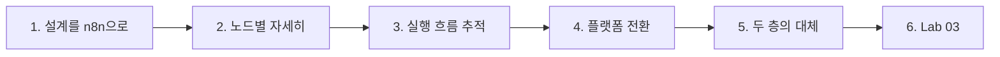
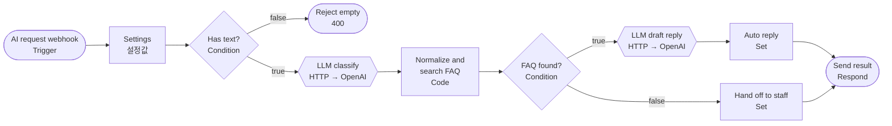
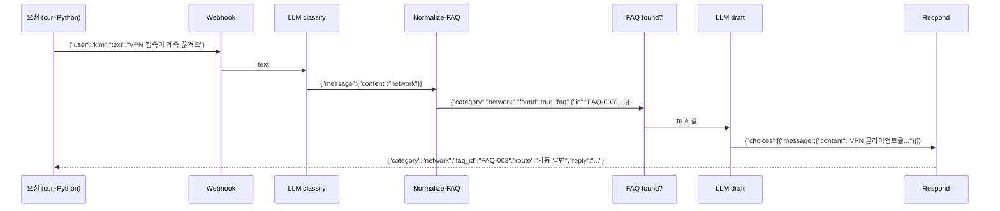
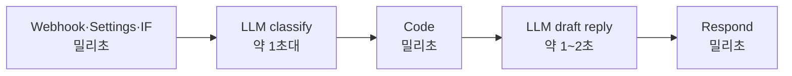
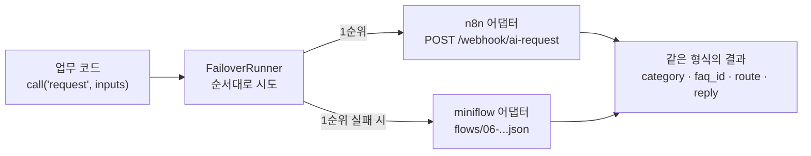
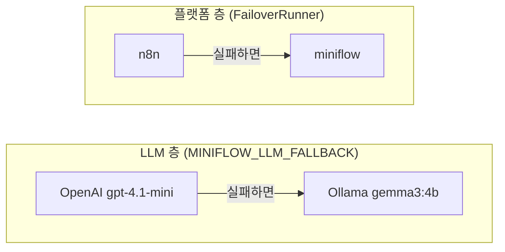

# 3단계 · 샘플 AI 워크플로우와 실행 흐름

- 시간: 5~6교시
- 학습 목표
  - LLM이 들어간 Trigger·Condition·Action 워크플로우를 노드 단위로 설명할 수 있다.
  - 실행 기록으로 각 노드의 입력·출력과 지나간 길을 추적할 수 있다.
  - 키워드 규칙 분류와 LLM 분류를 비교하고, 어느 길에 LLM을 둘지 시간·비용으로 판단할 수 있다.
  - 같은 업무를 다른 플랫폼에서도 실행할 수 있도록 입력·출력 약속과 전환(Failover) 구조를 설명할 수 있다.
  - 플랫폼 전환과 LLM 대체(OpenAI → Ollama)라는 두 층의 대체 경로를 구분할 수 있다.
- 실습: [Lab 03 · AI 문의 처리 워크플로우와 플랫폼 전환](../../Last3Mon/65/LAB-03-AI-WORKFLOW-FAILOVER.md)



---

## 1. 1단계 설계를 n8n으로 옮기기

1단계에서 설계한 IT 문의 처리 흐름을 n8n 노드로 바꾸면 다음과 같습니다.



| 설계 (1단계) | n8n 노드 | 역할 |
| --- | --- | --- |
| Trigger 문의 제출 | AI request webhook | `POST /webhook/ai-request`로 `{user, text}` 받기 |
| (설정) | Settings | LLM API 주소·모델 이름을 한곳에 모아 둠 |
| C1 내용 있음? | Has text? (IF) | 비었으면 400 응답 |
| A1 LLM 분류 | LLM classify (HTTP Request) | OpenAI `/chat/completions` 호출 (Credential `OpenAI (.env)`) |
| A1 값 정리 + A2 FAQ 검색 | Normalize and search FAQ (Code) | 분류값을 허용 목록으로 정리, FAQ 검색 |
| C2 FAQ 있음? | FAQ found? (IF) | `found`가 true인가 |
| A3 답변 초안 | LLM draft reply (HTTP Request) | FAQ 내용으로 답변 작성 |
| A4 담당자 전달 | Hand off to staff (Set) | 안내 문구와 `route: 담당자 확인` |
| 응답 | Send result (Respond to Webhook) | `{category, faq_id, route, reply}` 반환 |

---

## 2. 노드별로 자세히 보기

### 2.1 Settings: 바뀔 수 있는 값은 한곳에

```text
llm_url    = https://api.openai.com/v1
model      = gpt-4.1-mini
user       = {{ $json.body.user }}
text       = {{ $json.body.text }}
```

모델이나 주소를 바꿀 때 여러 노드를 고치지 않고 이 노드만 고치면 됩니다. 뒤의 노드는 `{{ $('Settings').first().json.model }}`처럼 값을 가져다 씁니다.

### 2.2 LLM 호출: HTTP Request 노드로 OpenAI 부르기

| 설정 | 값 |
| --- | --- |
| Method · URL | `POST` `{{ $('Settings').first().json.llm_url }}/chat/completions` |
| Authentication | Predefined Credential Type → **OpenAI** → `OpenAI (.env)` |
| Body | JSON (아래) |

```json
{
  "model": "gpt-4.1-mini",
  "temperature": 0,
  "messages": [
    {"role": "system", "content": "Classify the IT request into exactly one of: account, network, device, software, other. Reply with the label only."},
    {"role": "user", "content": "VPN 접속이 계속 끊겨요"}
  ]
}
```

- 응답은 `{"choices": [{"message": {"content": "network"}}], "usage": {...}}` 형태입니다.
- API 키는 노드에 쓰지 않고 **Credential**에서 가져옵니다. 워크플로우를 내보내거나 공유해도 키는 따라가지 않습니다.
- n8n에는 OpenAI 같은 LLM 전용 노드(OpenAI Chat Model 등)도 있습니다. 오늘은 **요청과 응답이 그대로 보이도록** HTTP Request 노드로 직접 호출합니다. 64일차 `miniflow`의 LLM 호출과 같은 메시지 형식입니다.
- 대체: Ollama도 같은 형식의 주소(`http://ollama:11434/v1/chat/completions`)를 제공합니다. Settings의 `llm_url`을 `http://ollama:11434/v1`, `model`을 `gemma3:4b`로 바꾸면 그대로 동작합니다.

### 2.3 LLM 출력 정리: Code 노드

```javascript
const allowed = ['account', 'network', 'device', 'software', 'other'];
const raw = String($input.first().json.choices?.[0]?.message?.content ?? '').trim().toLowerCase();
const category = allowed.find(a => raw.includes(a)) ?? 'other';
```

- LLM이 `Network`, ` network\n`, `It is network.`처럼 답해도 `network`로 정리합니다.
- 허용 목록에 없으면 `other`로 보냅니다. 1단계에서 배운 "LLM 출력은 정리·검증 후 Condition에 넘긴다"를 코드로 옮긴 것입니다.
- 같은 노드에서 FAQ 목록을 검색해 `found`(true/false)와 `faq`를 만듭니다.

### 2.4 키워드 규칙 분류와 LLM 분류

Lab 02의 `65-02`는 키워드 규칙(Code)으로, 오늘 `03`은 LLM으로 분류합니다. 같은 자리의 두 방법을 비교하면 언제 LLM이 필요한지 보입니다.

| | 키워드 규칙 (`65-02` Keyword classify) | LLM 분류 (`03` LLM classify) |
| --- | --- | --- |
| 방식 | 단어 목록에 있으면 그 분류 | 문장의 뜻을 보고 분류 |
| 시간·비용 | 즉시 · 0원 | 1~2초 · 호출 비용 |
| 같은 입력의 결과 | 항상 같음 | 거의 같음 (`temperature: 0`) |
| 약한 곳 | 목록에 없는 표현 ("암호를 바꾸고 싶어요"는 "비밀번호"가 없어 못 찾음, 64일차) | 형식이 흔들림 → 정리 단계 필요 |
| 고치는 방법 | 단어 추가 (끝이 없음) | 프롬프트·허용 목록 수정 |

실무에서는 둘을 함께 쓰기도 합니다. 확실한 단어("긴급", "피싱")는 규칙으로 먼저 걸러 내고(싼 검사부터, 1단계 3.4절), 나머지만 LLM에 맡깁니다.

### 2.5 대체 LLM(Ollama)로 바꾸는 방법

OpenAI 키·인터넷에 문제가 생기면 같은 워크플로우를 Ollama로 돌릴 수 있습니다. 바꾸는 곳은 `Settings` 노드와 인증뿐입니다.

| 바꿀 곳 | OpenAI (기본) | Ollama (대체) |
| --- | --- | --- |
| `Settings.llm_url` | `https://api.openai.com/v1` | `http://ollama:11434/v1` |
| `Settings.model` | `gpt-4.1-mini` | `gemma3:4b` |
| HTTP Request 인증 | Credential `OpenAI (.env)` | Credential `Ollama local` |
| 요청·응답 형식 | `/chat/completions` | 같음 (Ollama도 이 형식 지원) |

바뀔 수 있는 값을 Settings에 모아 둔 덕분에 노드 두 개(`LLM classify`, `LLM draft reply`)를 하나씩 고치지 않아도 됩니다. 대체 모델은 처음 부를 때 모델을 메모리에 올리느라 오래 걸리고(수업 전 측정 20초 이상), 64일차에 본 것처럼 품질도 다를 수 있습니다.

### 2.6 두 길이 같은 곳에서 끝나기

`Auto reply`와 `Hand off to staff`는 같은 형식의 필드를 만들고, 둘 다 `Send result`로 연결됩니다. 어느 길로 가든 **응답 형식이 같기 때문에** 요청한 쪽은 `route` 값만 보고 결과를 처리할 수 있습니다.

| 필드 | 자동 답변 | 담당자 확인 |
| --- | --- | --- |
| `category` | `network` | `other` |
| `faq_id` | `FAQ-003` | (빈 값) |
| `route` | `자동 답변` | `담당자 확인` |
| `reply` | LLM이 쓴 답변 | 고정 안내 문구 |

---

## 3. 실행 흐름 추적하기

워크플로우를 게시(Publish)한 뒤 웹훅으로 호출하면, 실행 과정은 **Executions**에 남습니다.



수업 전에 측정한 결과입니다. 내 노트북 결과와 비교해 보세요.

| 입력 | 지나간 길 | 응답 시간 |
| --- | --- | --- |
| VPN 접속이 계속 끊겨요 | 자동 답변 | 약 3~4초 (LLM 2회) |
| 비밀번호를 잊어버려서 로그인이 안 돼요 | 자동 답변 | 약 3초 (LLM 2회) |
| 점심 메뉴 추천해줘 | 담당자 확인 | 약 0.6초 (LLM 1회만 호출) |

담당자 확인 길은 LLM을 한 번만 부르기 때문에 빠릅니다. **어느 길에 LLM 노드를 두느냐가 처리 시간과 비용을 정합니다.** (75일차 비용 관리)

### 3.1 Executions에서 볼 것

| 확인할 것 | 어디서 | 왜 |
| --- | --- | --- |
| LLM이 돌려준 원래 분류값 | `Normalize and search FAQ` 출력의 `raw_label` | LLM이 실제로 어떤 형식으로 답했는지 |
| 정리된 분류값 | 같은 출력의 `category` | 정리 단계가 제대로 동작했는지 |
| 어느 길로 갔나 | `FAQ found?`의 true/false 출력 | 분기가 예상과 같은지 |
| 가장 오래 걸린 노드 | 각 노드 오른쪽 위의 실행 시간 | 어디를 줄여야 빠른지 (72일차) |

`raw_label`과 `category`를 나란히 두는 것은 **정리 전 값을 버리지 않는** 습관입니다. 정리 단계가 값을 잘못 바꿨을 때 원래 값을 보고 원인을 찾을 수 있습니다.

### 3.2 시간은 어디서 드나



64일차에 본 것과 같습니다. **전체 시간은 거의 LLM 호출 횟수가 정합니다.** 자동 답변 길(LLM 2회)이 약 3초, 담당자 확인 길(LLM 1회)이 1초 안쪽인 이유입니다. 속도를 높이려면 노드 수보다 LLM 호출을 줄이거나 한꺼번에 처리하는 방법을 먼저 봅니다.

---

## 4. 플랫폼에 묶이지 않는 워크플로우 실행

같은 업무를 여러 플랫폼에서 실행할 수 있게 만들어 두면, 한 플랫폼에 장애가 나도 업무가 멈추지 않습니다. 오늘은 n8n과 `miniflow` 두 플랫폼이 같은 업무 `request`를 처리합니다.



```python
class FailoverRunner:
    def run(self, workflow, inputs):
        attempts = []
        for platform in self.platforms:          # 예: [n8n, miniflow]
            try:
                result = platform.run(workflow, inputs)
            except PlatformError as error:       # 꺼짐, 시간 초과, 404 ...
                attempts.append({"platform": platform.name, "error": str(error)})
                continue                         # 다음 플랫폼으로
            return {"served_by": platform.name, "result": result, "attempts": attempts}
        raise PlatformError("All platforms failed")
```

수업 전 측정에서는 정상일 때 n8n이 약 2.5초(`2506.8ms`)에 처리했고, n8n을 멈추자 n8n 시도는 약 12ms 만에 실패한 뒤 miniflow가 같은 업무를 처리했습니다.

| 구성 | 하는 일 |
| --- | --- |
| 어댑터 | 플랫폼마다 "업무 이름과 입력을 받아 결과를 돌려주는" 같은 모양의 `run()` 제공 |
| 설정 (`platforms.json`) | 업무 이름 → 플랫폼별 실행 방법 (n8n 웹훅 경로, miniflow 파일) |
| 실행 순서 (`WORKFLOW_PLATFORMS`) | `n8n,miniflow`처럼 환경 변수로 지정 |
| FailoverRunner | 앞 플랫폼이 실패하면 다음 플랫폼으로 자동 전환, 시도 기록 남김 |

### 4.1 무엇이 바뀌지 않고, 무엇을 다시 만들어야 하나

| 플랫폼을 바꿔도 그대로인 것 | 플랫폼마다 따로 만들어야 하는 것 |
| --- | --- |
| 업무를 부르는 코드 (`call("request", inputs)`) | 워크플로우 자체 (n8n 화면, miniflow JSON) |
| 입력 형식 `{user, text}` | 각 플랫폼의 설정 (주소, 인증) |
| 출력 형식 `{category, faq_id, route, reply}` | 어댑터 클래스 (플랫폼당 한 번) |

"코드를 바꾸지 않고 플랫폼을 바꾼다"는 말은 **업무를 부르는 쪽**의 이야기입니다. 이를 위해 모든 플랫폼이 **같은 입력·출력 약속**을 지켜야 합니다. 이 구조는 과정 제목의 Auto-Healing(장애 자동 복구)과 76일차 예외 대응에서 다시 다룹니다.

---

### 4.2 무엇을 "실패"로 볼까

FailoverRunner가 다음 플랫폼으로 넘어가려면 실패를 알아차려야 합니다.

| 실패 | 예 | 알아차리는 방법 |
| --- | --- | --- |
| 접속 불가 | n8n 컨테이너가 꺼짐 | 연결 거부 (`n8n is not reachable ...`) |
| 시간 초과 | 응답이 너무 늦음 | 정해 둔 시간 안에 답이 없음 |
| 워크플로우 없음 | 게시 안 됨, 경로 오타 | HTTP 404 |
| 플랫폼 내부 오류 | 노드 실행 실패 | HTTP 500 |

반대로 **입력이 잘못된 경우(400)** 는 다른 플랫폼으로 넘겨도 입력이 그대로라 올바른 결과가 나오지 않습니다. 이런 요청은 넘기지 않고 바로 돌려보내는 것이 맞습니다.

그런데 오늘의 FailoverRunner는 아직 이 둘을 나누지 않습니다. 빈 문의로 직접 확인해 보세요.

```bash
uv run miniflow call request -i user=kim -i text=""
```

```text
  n8n        failed     108.5ms  n8n returned HTTP 400 for http://localhost:5678/webhook/ai-request
  miniflow   ok        1465.4ms
Served by: miniflow          → route: 담당자 확인
```

n8n은 빈 문의를 400으로 거절했는데, 실행기가 이것도 "플랫폼 실패"로 보고 miniflow에 넘겼고, `06`에는 입력 검증이 없어 빈 문의를 담당자에게 보내 버렸습니다. 두 플랫폼이 **"빈 입력은 거절"이라는 약속까지 같아야** 진짜 같은 업무이고, 실행기는 400을 넘기지 않아야 합니다. "어떤 실패는 다시 시도하거나 넘기고, 어떤 실패는 바로 돌려보낼지"는 72일차(안정성)와 76일차(예외 대응)에서 자세히 나눕니다.

---

## 5. 두 층의 대체 경로

오늘 실습에는 대체 경로가 두 층 있습니다.



| 층 | 무엇이 실패할 때 | 무엇으로 넘어가나 | 오늘 확인 |
| --- | --- | --- | --- |
| 플랫폼 | n8n이 꺼짐·응답 없음 | miniflow | `docker compose stop n8n` 후 `miniflow call request` |
| LLM | OpenAI 키 오류·한도·인터넷 | Ollama | 잘못된 키로 `miniflow run` (이 명령에서만, `.env`는 그대로) |

수업 전 측정에서 잘못된 키로 실행하자 `openai failed (...); trying ollama`가 찍히고 Ollama(`gemma3:4b`)가 답해 같은 `자동 답변`이 나왔습니다. 두 층을 함께 쓰면 "n8n도 꺼지고 OpenAI도 안 되는" 상황에서도 miniflow + Ollama로 업무가 이어집니다. 단, 대체 쪽은 느리고 품질이 다를 수 있으므로 **어느 쪽이 처리했는지 기록**(`served_by`, `provider`)을 꼭 남깁니다.

---

## 6. 자주 생기는 문제

| 증상 | 원인 | 해결 |
| --- | --- | --- |
| 모든 요청이 담당자 확인으로 감 | `category`가 늘 `other` → `raw_label` 확인 필요 | LLM 응답 형식·정리 코드 확인 |
| `LLM classify`가 401 | Credential 키 오류 | `.env` 확인 후 `register-credentials.sh` |
| Ollama로 바꿨더니 연결 실패 | `llm_url`을 `localhost`로 씀 | `http://ollama:11434/v1` |
| `miniflow call`이 n8n에서 404 | `03` 워크플로우를 Publish하지 않음 | Publish 토글 확인 |
| 전환이 일어나지 않음 | n8n이 켜져 있음 | `docker compose stop n8n` 후 다시 |

---

## 7. Lab 03 안내

- 실습 안내: [Last3Mon/65/LAB-03-AI-WORKFLOW-FAILOVER.md](../../Last3Mon/65/LAB-03-AI-WORKFLOW-FAILOVER.md)
- 할 일
  1. `03-ai-request-flow.json` 가져오기, Settings 확인, Publish
  2. 자동 답변·담당자 확인 두 길을 실행하고 Executions에서 `raw_label`과 `category` 비교
  3. `uv run miniflow call request ...`로 n8n 호출, n8n을 멈추고 miniflow로 전환되는지 확인
  4. 정리 질문 작성

---

## 8. 스스로 확인하기

<details><summary>Q1. "점심 메뉴 추천해줘"가 다른 문의보다 훨씬 빨리 끝나는 이유는?</summary>

FAQ가 없어 담당자 확인 길로 가므로 LLM을 분류에 한 번만 부르기 때문입니다. 자동 답변 길은 분류와 답변 초안에 두 번 부릅니다.
</details>

<details><summary>Q2. Executions에서 `raw_label`이 `Network`, `category`가 `network`였습니다. 무엇을 알 수 있나요?</summary>

LLM이 대문자로 답했지만 정리 단계가 정해진 값으로 바꿔 분기가 제대로 동작했다는 것입니다. 원래 값을 남겨 두었기 때문에 이런 확인이 가능합니다.
</details>

<details><summary>Q3. 빈 요청(400)을 받았을 때 FailoverRunner가 다음 플랫폼으로 넘기지 않아야 하는 이유는?</summary>

입력이 잘못된 요청은 어느 플랫폼으로 넘겨도 올바른 결과가 나오지 않습니다. 오늘 실행기는 아직 400도 넘기기 때문에, 빈 문의가 miniflow에서 `담당자 확인`으로 처리되어 버립니다(miniflow `06`에는 입력 검증이 없음). 넘기면 시간만 더 들고, 잘못된 결과가 나올 수도 있습니다.
</details>

<details><summary>Q4. 플랫폼을 n8n에서 miniflow로 바꿔도 업무를 부르는 코드를 고치지 않아도 되는 조건은?</summary>

두 플랫폼이 같은 입력 약속(`user`, `text`)과 같은 출력 약속(`category`, `faq_id`, `route`, `reply`)을 지키는 것입니다.
</details>

<details><summary>Q5. OpenAI 키가 틀렸을 때와 n8n이 꺼졌을 때, 각각 어느 층의 대체 경로가 동작하나요?</summary>

키가 틀리면 LLM 층(OpenAI → Ollama), n8n이 꺼지면 플랫폼 층(n8n → miniflow)이 동작합니다.
</details>

## 정리

- 1단계의 TCA 설계는 n8n의 Webhook·IF·HTTP Request·Code·Set·Respond 노드로 그대로 옮길 수 있습니다.
- 바뀔 수 있는 값은 Settings 노드에 모으고, LLM 출력은 Code 노드에서 정리·검증합니다.
- 여러 길이 같은 응답 형식으로 끝나면 요청하는 쪽의 처리가 단순해집니다.
- 입력·출력 약속을 지키면 업무 코드를 바꾸지 않고 플랫폼을 바꾸거나, 장애 시 다른 플랫폼으로 자동 전환할 수 있습니다.
- 키워드 규칙은 빠르고 일정하지만 표현이 달라지면 놓치고, LLM 분류는 뜻을 알지만 형식 정리가 필요합니다. 전체 시간은 거의 LLM 호출 횟수가 정합니다.
- 대체 경로는 플랫폼 층(n8n → miniflow)과 LLM 층(OpenAI → Ollama) 두 층이며, 어느 쪽이 처리했는지 기록을 남깁니다.
