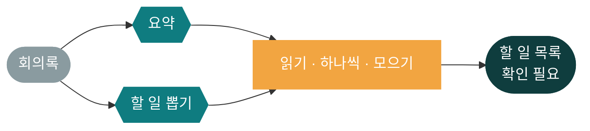
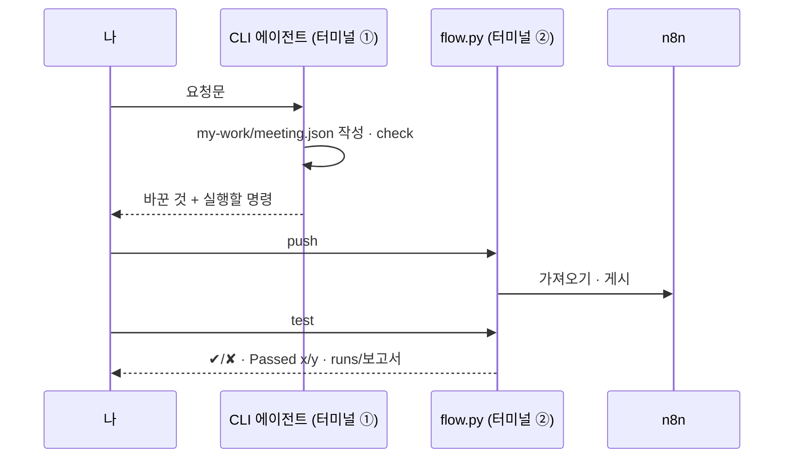
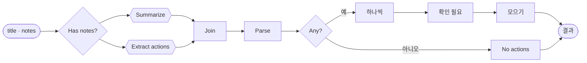

# 66일차 개요 · 바이브 코딩으로 만드는 단일 업무 자동화 워크플로우

> AI 워크플로우 설계 및 구현 · 2026-10-16
> 13장 · 각 장은 가로줄(`---`)로 나뉩니다. 1교시에는 1~6장을 보고, 나머지 장은 각 단계를 설명할 때 함께 띄웁니다.

| 장 | 범위 |
| --- | --- |
| 1~6 | 표지 · 목표 · 시간표 · 오늘부터 바뀌는 것 · 일하는 순서 · 오늘의 그림 |
| 7~8 | 1단계 · 결과 먼저 |
| 9~10 | 2단계 · JSON과 파싱 |
| 11 | 3단계 · 항목과 갈래 |
| 12~13 | 7교시 바이브 코딩 · 정리와 예고 |

---

## 1 / 13 · 표지



**66일차**

# 바이브 코딩으로 만드는 단일 업무 자동화 워크플로우

결과 먼저 · 요청문 · JSON과 파싱 · 1 → N → 1 · 두 갈래 · 테스트

<sub>AI 워크플로우 설계 및 구현 · 2026-10-16</sub>

---

## 2 / 13 · 오늘 할 수 있게 될 세 가지

| | 오늘 할 수 있게 될 것 |
| :-: | --- |
| **①** | 결과를 먼저 정하고, 노드를 끌어다 놓지 않고 **요청문**으로 n8n 워크플로우를 만들어 **테스트**로 확인한다 |
| **②** | LLM에게 **정해진 JSON**으로 받고, 코드로 읽고, 빈칸을 지어내지 않고 채운다 |
| **③** | 목록을 **하나씩** 다루고 다시 모으며(1 → N → 1), 두 갈래로 나누고, 어려운 테스트로 완성한다 |

---

## 3 / 13 · 오늘의 시간표

| ① 1~2교시 | ② 3~4교시 | ③ 5~6교시 | ④ 7~8교시 |
| --- | --- | --- | --- |
| **1단계** | **2단계** | **3단계** | **바이브 코딩** |
| 바이브 코딩 n8n · 결과 먼저 | JSON · 파싱 · 변환 | 항목 · 갈래 · 검증 | `turl` |
| Lab 01 요약 | Lab 02 할 일 · 참석자 | Lab 03 확인 필요 · 어려운 회의록 | 만들기 · 발표 · 정리 |

> 09:00 시작 · 50분 수업 10분 휴식 · 4교시 뒤 13:00~14:00 점심

---

## 4 / 13 · 오늘부터 바뀌는 것

| 일 | 64·65일차 | 오늘부터 |
| --- | --- | --- |
| 무엇을 만들지 정하기 | 나 | **나** (결과 · 요청문) |
| 노드 고르기 · 설정 · 연결 | 나 (마우스) | CLI 코딩 에이전트 |
| 형식 오류 찾기 | 실행해 보고 빨간 표시 | 에이전트 + `flow.py check` |
| 잘 되는지 확인 | 눈으로 OUTPUT 보기 | **나** (`flow.py test`) |

> 손으로 하던 일은 에이전트에게, **무엇이 맞는 결과인지 정하는 일**은 나에게.

---

## 5 / 13 · 일하는 순서 (터미널 두 개)



- 에이전트가 읽는 규칙 파일: `AGENTS.md` (Claude Code는 `CLAUDE.md` → `@AGENTS.md`)

---

## 6 / 13 · 오늘의 그림



> 파일 하나(`my-meeting`)를 Lab 01 → 02 → 03으로 키워 갑니다.

---

## 7 / 13 · 1단계 · 결과 먼저

```json
{"title": "10월 16일 주간 회의", "count": 4,
 "actions": [{"owner": "이준호", "task": "신규 고객 문의 응답 템플릿 정리", "due": "금요일까지", "needs_check": false},
             {"owner": "미정", "task": "회의실 예약 규칙 개선", "due": "미정", "needs_check": true}],
 "needs_check_count": 1}
```

> 내가 쓴 결과가 **테스트의 기대 결과**가 됩니다. 결과를 정하지 않으면 에이전트가 만든 것이 맞는지 판단할 수 없습니다.

---

## 8 / 13 · 1단계 · 요청문 다섯 가지 (수업 준비 측정)

| 넣을 것 | 예 |
| --- | --- |
| ① 파일 · ② 입력 · ③ 처리 · ④ 결과 모양 · ⑤ 기대 결과 | `my-work/meeting.json` · POST `my-meeting` · 한 문장 요약 · `{title, summary}` · `cases/lab01.json` |

| 빈 회의록 (`empty.json`) | 결과 |
| --- | --- |
| 입력 확인 없이 | **200** "회의 내용이 없으므로 …" (LLM을 불러 쓸모없는 답) |
| LLM 앞에서 확인 | 400, 0.1초 |

---

## 9 / 13 · 2단계 · LLM의 답은 글자

| | |
| --- | --- |
| 지시문 | "JSON만, 코드 블록 없이: `{"actions": [{"owner", "task", "due"}]}`" |
| n8n이 받는 것 | **글자** (` ```json … ``` `가 붙기도) |
| Code에서 | 앞뒤를 지우고 `JSON.parse`, 실패하면 빈 목록, 빈칸은 `미정` |

수업 준비: `lab02` 6/6 (할 일 4개, 할 일 없는 회의 0개)

---

## 10 / 13 · 2단계 · 하나 바꾸면 다른 것도 바뀐다 (수업 준비 때 실제로)

| 지시문 | 참석자 | 할 일 |
| --- | --- | --- |
| `attendees`만 더함 | ✔ 3명 | **3개** (담당 미정 할 일이 빠짐) |
| "담당자가 아직 없는 할 일도 넣을 것" 추가 | ✔ | 4개 |

> 고친 곳과 상관없는 결과가 바뀌었습니다. **고칠 때마다 원래 테스트도 다시.**

---

## 11 / 13 · 3단계 · 1 → N → 1, 그리고 두 갈래

| | 결과 (수업 준비, 1회) |
| --- | --- |
| 펼치기 → 항목마다 확인 필요 → 모으기 | `lab03` 5/5, 확인 필요 1개 |
| 할 일 0개면 펼치기 전에 따로 | 할 일 없는 회의도 끝까지 답 |
| 요약 ∥ 할 일 두 갈래 + Merge | `lab03` 5/5, 주간 회의 4.0초 → 4.2초 (**빨라지지 않음**) |
| 어려운 회의록 7개 | 예제 6/7 → 최종 7/7 |

> 두 갈래의 값은 속도가 아니라 **설계**입니다. n8n 기본 실행은 갈래를 하나씩 돕니다.

---

## 12 / 13 · 7교시 · 바이브 코딩 `turl`

```text
$ turl
[POST] [http://localhost:5678/webhook/my-meeting]  [보내기]
Body: requests/weekly.json   →   200 · x.xs · {"count": 4, …}
```

- curl을 TUI로: 요청 만들기 · 보내기 · 응답 보기 · 기록 · curl 명령으로 복사
- 오늘 만든 `my-meeting`을 이 도구로 불러 봅니다

---

## 13 / 13 · 정리와 67일차 예고

| 오늘 | 한 줄 |
| --- | --- |
| 1단계 | 결과 먼저, 요청문 다섯 가지, LLM 앞에서 입력 확인 |
| 2단계 | LLM의 답은 글자 → 코드로 읽기, 빈칸은 코드가, 고치면 다시 전부 재기 |
| 3단계 | 1 → N → 1, 빈 목록 따로, 두 갈래는 설계, 어려운 테스트로 완성 |

- 67일차: **Agent · Tool · 데이터 연계** — 정해진 흐름 대신 Agent가 Tool(FAQ 검색, 접수 현황)을 골라 답하고, 결과를 검증 · 바이브 코딩 `tman`
