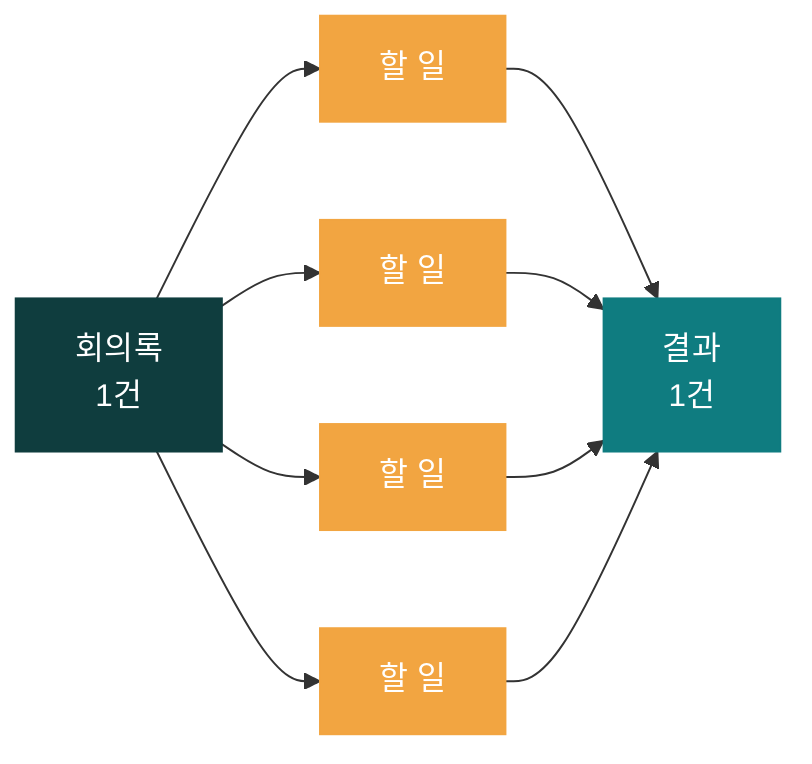
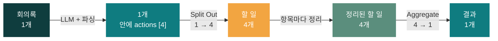
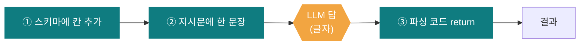
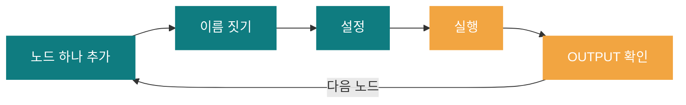
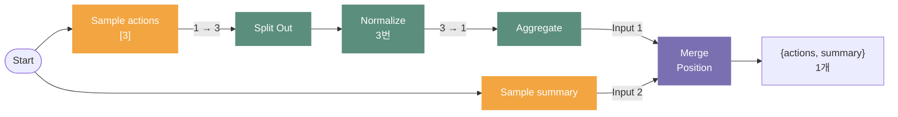
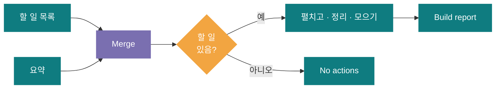
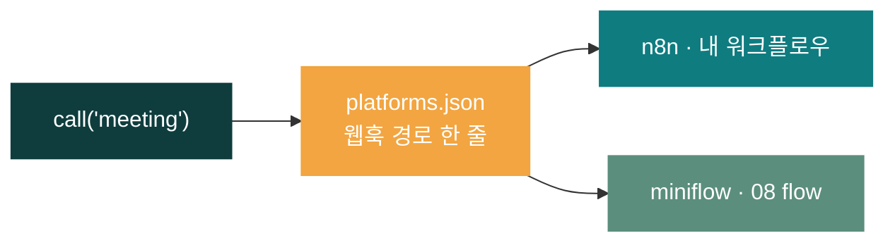

# 66일차 개요 · 단일 업무 자동화 워크플로우 구현

> 노코드 멀티 에이전트 워크플로우 설계 및 운영 · 2026-10-16
> 15장 · 각 장은 가로줄(`---`)로 나뉩니다. 1교시에는 1~3장과 14장만 보고, 나머지 장은 각 단계를 설명할 때 함께 띄웁니다.

| 장 | 범위 |
| --- | --- |
| 1~3 | 표지 · 오늘의 목표 · 시간표 |
| 4~7 | 1단계 · 업무 설계와 데이터 흐름 |
| 8~10 | 2단계 · 파싱과 변환 노드 |
| 11~13 | 3단계 · 반복·병렬과 완성 |
| 14~15 | 실습 · 퀴즈와 예고 |

---

## 1 / 15 · 표지



**66일차**

# 단일 업무 자동화 워크플로우 구현

쉬운 예제 2개 → 고쳐 보는 과제 · 데이터 파싱·변환·집계 · 반복과 병렬

<sub>노코드 멀티 에이전트 워크플로우 설계 및 운영 · 2026-10-16</sub>

---

## 2 / 15 · 오늘 할 수 있게 될 세 가지

| | 목표 | 내용 |
| :-: | --- | --- |
| **①** | **업무 하나를 노드와 데이터로 설계한다** | 목적·입출력·성공 기준 · TCA → 노드 목록 · 연결선마다 항목 수와 필드 · 제어 구조 고르기 |
| **②** | **LLM의 답을 데이터로 바꾼다** | JSON 스키마 출력 · 문자열 파싱 · 검증과 기본값 · 실패 이유 남기기 · Edit Fields 변환 |
| **③** | **반복과 병렬로 워크플로우를 완성한다** | Split Out → Aggregate · Fork-Join(Merge) · 같은 결과 형식 · Python 호출 |

---

## 3 / 15 · 오늘의 시간표

| ① 1~2교시 | ② 3~4교시 | ③ 5~6교시 | ④ 7~8교시 |
| --- | --- | --- | --- |
| **1단계** | **2단계** | **3단계** | **정리** |
| 업무 설계와 데이터 흐름 | 파싱과 변환 노드 | 반복·병렬과 완성 | 퀴즈 A·B·C · 오늘의 정리·예고 |
| Lab 01 예제 2 + 과제 | Lab 02 예제 2 + 과제 | Lab 03 예제 2 + **과제 40분** | 퀴즈 20분 · Python 호출 |

> 09:00 시작 · 50분 수업 10분 휴식 · 12:00~13:00 점심

---

## 4 / 15 · 오늘의 업무: 회의록 → 할 일 정리

| 지금 방식 | 자동화 후 |
| --- | --- |
| 회의록을 읽고 할 일·담당자·기한을 직접 찾음 | 회의록을 보내면 요약·할 일 목록·정리문 |
| 빠진 담당자·기한을 놓치기 쉬움 | 빠진 값은 `미정`으로 바로 보임 |
| 급한 일이 묻힘 | 오늘·내일 마감은 우선순위 `높음` |

| 범위를 좁히는 세 줄 | 오늘의 답 |
| --- | --- |
| **목적 한 문장** | 회의록을 받으면 할 일 목록과 공유용 정리문을 돌려준다 |
| **입력과 출력** | `{title, notes}` → `{title, route, count, summary, actions, report_text}` |
| **성공 기준** | `weekly`에서 할 일 4건, 빠진 값은 `미정`, 오늘 마감은 `높음` |

> **단일 업무로 좁히기** 오늘은 회의록 → 할 일 정리 → 응답까지. 알림·일정 등록은 나중에 확장

---

## 5 / 15 · 예시 데이터로 결과를 먼저 그려 보기

| # | 할 일 | 담당자 | 기한 | 우선순위 | 누가 정하나 |
| --- | --- | --- | --- | --- | --- |
| 1 | 신규 고객 문의 응답 템플릿 정리 | 이준호 | 금요일 | 보통 | 찾기는 **LLM** |
| 2 | VPN 장애 보고서 작성 | 박서연 | 다음 주 월요일 | 보통 | |
| 3 | 서버 점검 일정 공지 | 김민지 | 오늘 | **높음** | 우선순위는 **규칙** |
| 4 | 회의실 예약 규칙 개선 담당자 선정 | **미정** | 10월 23일 | 보통 | 빈 값 채우기는 **규칙** (기한은 LLM이 "다음 회의"에서 추론) |

> **LLM은 찾기만, 채우기·우선순위·정리문은 규칙** · 결과 형식(JSON)은 노드를 만들기 전에 약속한다 · 할 일이 없어도 같은 필드(`route: 할 일 없음`, `count: 0`, `actions: []`)

---

## 6 / 15 · 상자(항목)가 몇 개 지나가나 · 1 → 4 → 1



| 노드 | 상자 수 |
| --- | --- |
| Edit Fields · **If** · Switch | **그대로** (If는 한쪽 길로 보낼 뿐) |
| **Split Out** | **1 → N** (목록을 펼침) |
| **Aggregate** | **N → 1** (다시 모음) |
| Merge | 두 길 → 하나 |

> **Lab 01 예제 1** 어제 흐름은 모두 1 · **예제 2** 파싱 직후는 아직 1 (목록이 상자 하나에 들어 있음) → Split Out 뒤에 4

---

## 7 / 15 · 제어 구조 고르기 · 요청이 바뀌면

| 조건 분기 | 반복 | 병렬 (Fork-Join) |
| :-: | :-: | :-: |
| **입력에 따라 다른 결과** | **목록의 항목마다 같은 처리** | **서로 결과가 필요 없는 일** |
| 내용 없음 → 거절<br/>할 일 없음 → 다른 결과 | 할 일마다 우선순위 | 할 일 찾기와 요약 |
| If · Switch | Split Out → … → Aggregate | 가지 나누기 + Merge |

| 요청이 바뀌면 묻는 세 질문 | 고칠 곳 |
| --- | --- |
| 할 일 **하나마다** 정하는 값? | Split Out과 Aggregate **사이** (예: `priority`) |
| **모두 모은 뒤**에야 아는 값? | Aggregate **뒤** (예: `count`) |
| 결과 필드가 늘었나? | **모든 길**의 끝 |

> **Lab 01 과제** "담당자·기한이 없으면 확인 필요, 몇 건인지도" → 오후 Lab 03 과제에서 실제로 만든다

---

## 8 / 15 · LLM의 답은 글자다 → 파싱

```text
Fake LLM answer   content: "{\"actions\": [{\"task\": \"...\", \"owner\": \"\", ...}]}"   ← 글자 한 줄

Parse actions     { actions: [ {task, owner: "미정", due: "미정"}, ... ], count: 2 }        ← 목록
```

| ① 꺼내기 | ② 글자 → 데이터 | ③ 빈 할 일 버리기 | ④ 빈 값은 `미정` |
| :-: | :-: | :-: | :-: |
| `content` (진짜 LLM은 `choices[0].message.content`) | 실패하면 빈 목록 + `error` | | |

> **Lab 02 예제 1** LLM 없이 가짜 답으로 파싱 연습 · 끝 `}`를 지우면 `error: answer is not valid JSON` → 실패해도 **같은 모양**, 이유는 남긴다

---

## 9 / 15 · 답의 모양 알려 주기 · 하나 더 뽑기

| LLM 노드 JSON 칸 | 하는 일 | 비유 |
| --- | --- | --- |
| ① 스키마 `response_format` | 답의 **모양** | 빈칸이 정해진 답안지 |
| ② 지시문 `system` | 무엇을 찾을지, 없으면 `미정` | 문제 설명 |
| ③ 회의록 `user` | 읽을 글 | 지문 |



> **스키마는 모양만, 내용은 보장 안 함** · **Lab 02 과제** 참석자도 뽑기 = 세 곳 고치기 (③을 빠뜨리면 LLM 답에는 있어도 결과에서 사라짐) · `}}`가 붙으면 `invalid syntax` → `} }`

---

## 10 / 15 · Edit Fields와 만들고 확인하는 순서

| 하고 싶은 일 | Edit Fields 표현식 |
| --- | --- |
| 웹훅 입력 꺼내기 | `{{ $json.body.notes }}` |
| 비었으면 기본값 | `{{ $json.body.title \|\| '제목 없음' }}` |
| 여러 단어 중 하나라도 포함 | `{{ ['오늘','내일','긴급'].some(w => $json.due.includes(w)) }}` |



> `{{ }}` 값은 **Expression** 모드 · 같은 요청 파일(`weekly`·`no-action`·`empty`)로 매번 확인 · Test URL은 요청마다 Listen 다시

---

## 11 / 15 · 반복과 병렬 · Lab 03 예제 1·2



| 펼쳤으면 반드시 모은다 (수업 전 실측) | 결과 |
| --- | --- |
| 모으지 않고 바로 응답 | 200, **첫 할 일 하나만** (조용히 틀림) |
| 모으지 않고 `Build report` | 500 |

> Merge는 **두 입력이 모두 와야** 합침 · 한 길이 실패하면 응답 없음 · 항목마다 LLM을 부르면 Loop Over Items, 시간·비용은 항목 수에 비례

---

## 12 / 15 · 가짜를 진짜로 · Lab 03 과제 40분

| 예제의 가짜 | 과제의 진짜 |
| --- | --- |
| `Sample actions` | `LLM extract actions` → `Parse actions` (Lab 02) |
| `Sample summary` | `LLM summarize` → `Keep summary` |
| Merge · Split Out · Normalize · Aggregate | **복사해 붙이기** |
| (없음) | `Any actions?` · `Build report` · `No actions` · **확인 필요** |



> Merge를 **먼저** → 할 일 없음 길에도 요약이 있다 · 두 길 모두 `{title, route, count, summary, actions, need_check}`

---

## 13 / 15 · 기대 결과로 검증하고, 밖에서 부르기

| 요청 | 기대 결과 (수업 전 측정) |
| --- | --- |
| `weekly` | **할 일 정리** · `count: 4` · 오늘 마감 1건 `높음` · `need_check: 1` · 약 3~4초 |
| `no-action` | **할 일 없음** · `count: 0` · `need_check: 0` · 약 2초 |
| `empty` | **HTTP 400** · 1초 미만 |

| 오류 없이 틀리는 모양 (실측) | 원인 |
| --- | --- |
| 할 일 하나만 | Aggregate 빠짐 |
| `no-action`이 빈 응답 | false 길 끊김 |
| `need_check: 4` | `check`를 String으로 |



> 실행 기록 항목 수 1 → 4 → 4 → 1 → 1 · 같은 입력·같은 결과 형식 → **설정 한 줄**로 대상 변경 (8교시 함께)

---

## 14 / 15 · 오늘의 실습

| | 실습 | 예제 1 | 예제 2 | 과제 (생각하기) |
| --- | --- | --- | --- | --- |
| **1** | **Lab 01** · 설계 | 어제 흐름의 항목 수 | 오늘 흐름 빈칸 (1 → 4 → 1) | "확인 필요" 요청 → 어디를 고치나 |
| **2** | **Lab 02** · 파싱 | LLM 없이 글자 → 목록 | LLM 붙은 1부 가져와 실행 | 참석자도 뽑기 (세 곳) |
| **3** | **Lab 03** · 완성 | 펼치고 모으기 (1 → 3 → 1) | 두 길을 Merge로 | **40분** · 내 워크플로우 완성 + 확인 필요 |

<sub>예제는 따라 하기, 과제는 생각하기 · 환경: 65일차 n8n · Credential `OpenAI (.env)` 그대로 · 막히면 `n8n/workflows`의 파일과 비교</sub>

---

## 15 / 15 · 7교시 퀴즈 · 그리고 내일

| A · 기본 | B · 응용 | C · 심화 |
| :-: | :-: | :-: |
| 데이터 노드 · 제어 구조 용어 | 항목 수 · 표현식 · 노드 고르기 | 흐름 오류 찾기 · 설계 판단 |

- 단계별 10문항 · 20분 · 원하는 단계 선택
- 마지막 주관식 '더 알고 싶은 것'은 선택 · 점수 없음

> **67일차 예고**
> AI Agent가 Tool을 골라 쓰는 **Agent·Tool·데이터 연계**
> 실행 결과 검증

### *오늘의 한 문장: 연결선마다 무엇이 몇 개 흐르는지 알면, 워크플로우는 틀리지 않는다*
