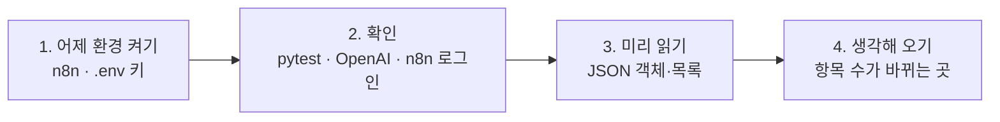

# 66일차 실습 준비 · 수업 전에 미리 해 두면 좋은 것

- 수업일: 2026-10-16 (66일차) · 단일 업무 자동화 워크플로우 직접 만들기
- 준비 시간: 약 20분 (새로 받을 이미지·모델 없음)
- 먼저 WSL에서 `cd ~/aio-01d4-stu && git pull`로 오늘 자료를 받습니다 (수강생 저장소: https://gl.isitsoft.kr/publicproj/aio-01d4-stu).
- **수업 전날까지** 1~2절을 끝내 주세요. 3~4절은 시간이 될 때 읽어 오면 좋습니다.



---

## 1. 어제 환경 다시 켜기 (전날 필수, 5분)

오늘은 65일차에 만든 n8n(Credential `OpenAI (.env)`)과 `Last3Mon/.env`를 그대로 씁니다. Ollama는 대체용으로 함께 켜 둡니다.

```bash
sudo systemctl stop ollama          # WSL의 Ollama가 켜져 있다면 멈춤
cd ~/aio-01d4-stu/Last3Mon/65/n8n
docker compose start
docker compose ps                   # n8n, ollama 모두 running
```

브라우저에서 http://localhost:5678 에 로그인합니다. 65일차 준비를 하지 못했다면 [n8n 준비 안내](../../Last3Mon/65/SETUP-N8N.md)를 먼저 끝내 주세요.

## 2. 실습 엔진 확인 (전날 필수, 5분)

```bash
cd ~/aio-01d4-stu/Last3Mon/66/workflow-lab
uv sync
uv run pytest -q                    # 43 passed, 1 skipped
```

---

## 3. 미리 읽어 오면 좋은 내용 (선택, 약 10분)

### 3.1 JSON의 객체와 목록

| 모양 | 이름 | 예 |
| --- | --- | --- |
| `{ }` | 객체 (이름: 값의 묶음) | `{"task": "보고서 작성", "owner": "박서연", "due": "월요일"}` |
| `[ ]` | 목록 (값을 순서대로) | `[{...}, {...}, {...}]` |
| `"..."` | 문자열 (글자) | `"{\"task\": \"보고서\"}"` ← JSON처럼 보이지만 **글자** |

오늘 LLM은 할 일 목록을 **글자**로 돌려줍니다. 이 글자를 실제 목록으로 바꾸는 작업을 **파싱**이라고 합니다. 64일차 준비 안내의 JSON 기초도 함께 보세요.

### 3.2 오늘 처음 쓰는 n8n 노드

| 노드 | 한 줄 설명 |
| --- | --- |
| Edit Fields (Set) | 필드를 만들고 값을 계산 |
| Code | JavaScript로 데이터 가공 |
| Split Out | 목록 하나를 항목 여러 개로 펼침 |
| Aggregate | 항목 여러 개를 목록 하나로 모음 |
| Merge | 두 갈래의 결과를 하나로 합침 |

---

## 4. 생각해 오기 (선택, 5분)

회의록 1건에서 할 일 4건이 나왔습니다. 할 일마다 우선순위를 정한 뒤 다시 하나의 결과로 돌려주려면, 데이터의 개수가 어떻게 바뀌어야 할까요?

```text
회의록 1건 → ? → ? → 결과 1건
```

## 5. 당일 준비물

- 충전된 노트북과 충전기, WSL의 Docker, Windows Terminal(WSL), 웹 브라우저

## 확인

- [ ] `docker compose ps` → n8n, ollama running
- [ ] `uv run pytest -q` → `43 passed, 1 skipped`
- [ ] JSON 객체·목록·문자열의 차이를 읽었다
