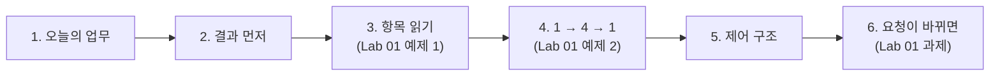
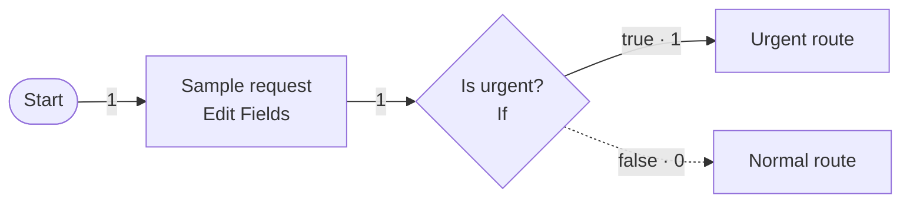
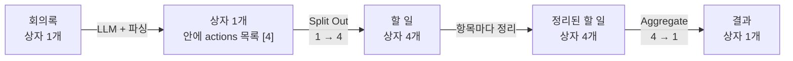
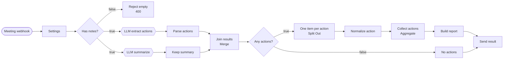
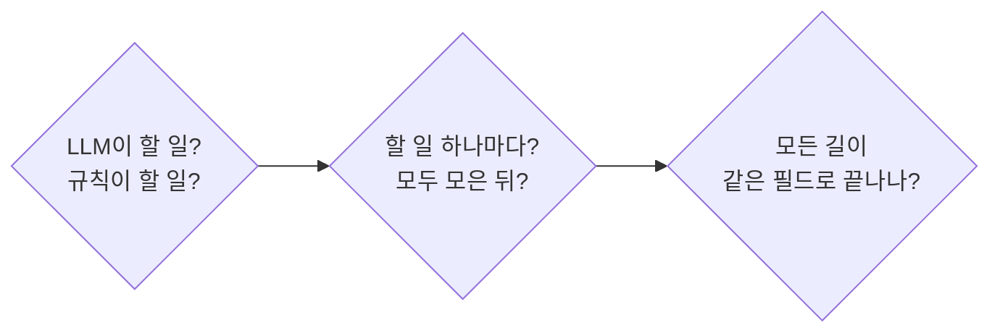

# 1단계 · 단일 업무 자동화 설계와 데이터 흐름

- 시간: 1~2교시 (1교시 앞부분은 [오늘의 개요](00-DAY66-OVERVIEW.md))
- 학습 목표
  - 하나의 업무를 목적 하나로 좁히고, 결과를 먼저 그려 볼 수 있다.
  - 노드 사이를 지나가는 **항목(item)** 의 개수를 읽고 쓸 수 있다 (1 → 4 → 1).
  - LLM이 할 일과 규칙으로 할 일을 나눌 수 있다.
  - 조건 분기·반복·병렬 중 어떤 제어 구조가 필요한지 고를 수 있다.
  - 요청이 바뀌었을 때 **어느 노드를 고치면 되는지** 찾을 수 있다.
- 실습: [Lab 01 · 회의록 자동 정리 워크플로우 설계하기 (예제 2개 + 과제)](../../Last3Mon/66/LAB-01-DESIGN-DATA-FLOW.md)



오늘 수업은 모두 같은 순서로 갑니다. **설명 → 쉬운 예제 2개를 함께 → 그것을 고치는 과제를 혼자**. 이 교안의 절도 Lab의 예제·과제 순서에 맞춰 놓았습니다.

---

## 1. 오늘의 업무: 회의록 → 할 일 정리

64일차 시나리오 S1 "회의록 요약 후 할 일 정리"를 n8n으로 만듭니다.

| 지금 (AS-IS) | 자동화 후 (TO-BE) |
| --- | --- |
| 누군가 회의록을 읽고 할 일·담당자·기한을 찾아 정리 | 회의록을 보내면 요약·할 일 목록·정리문이 바로 나옴 |
| 담당자나 기한이 빠진 일을 놓침 | 빠진 값은 `미정`으로 보임 |
| 급한 일이 묻힘 | 오늘·내일 마감은 우선순위 `높음` |

### 1.1 목적 하나로 좁히기

처음 만드는 자동화는 **목적 하나**만 해결합니다. 메일 발송·일정 등록까지 한 번에 넣으면 어디가 틀렸는지 찾기 어렵습니다.

| 질문 | 오늘의 답 (한 문장씩) |
| --- | --- |
| 목적 | 회의록을 받으면 할 일 목록과 정리문을 돌려준다 |
| 입력 → 출력 | `{title, notes}` → `{title, route, count, summary, actions, report_text}` |
| 성공 기준 | 예시 회의록(`weekly`)에서 할 일 4건, 빠진 값은 `미정`, 오늘 마감은 `높음` |

세 줄이 한 문장씩으로 끝나지 않으면 아직 범위가 넓은 것입니다. 회의록이 **비어 있으면** LLM을 부르기 전에 맨 앞에서 거절(HTTP 400)합니다. 쓸데없는 호출과 비용을 막는 가장 싼 방법입니다.

---

## 2. 결과를 먼저 그려 보기

노드를 생각하기 전에 **예시 입력 한 건과 기대하는 결과**를 손으로 적습니다.

> 참석: 김민지, 이준호, 박서연. 1) 신규 고객 문의 응답 템플릿을 이준호가 금요일까지 정리한다. 2) 박서연은 다음 주 월요일까지 VPN 장애 보고서를 작성한다. 3) 서버 점검 일정은 김민지가 오늘 중 공지한다. 4) 회의실 예약 규칙 개선은 담당자를 다음 회의에서 정한다. 다음 회의는 10월 23일.

| # | 할 일 | 담당자 | 기한 | 우선순위 |
| --- | --- | --- | --- | --- |
| 1 | 신규 고객 문의 응답 템플릿 정리 | 이준호 | 금요일 | 보통 |
| 2 | VPN 장애 보고서 작성 | 박서연 | 다음 주 월요일 | 보통 |
| 3 | 서버 점검 일정 공지 | 김민지 | 오늘 | **높음** |
| 4 | 회의실 예약 규칙 개선 담당자 선정 | **미정** | 10월 23일 | 보통 |

이 표를 채우다 보면 일이 두 종류로 나뉩니다.

| 누가 | 하는 일 | 왜 |
| --- | --- | --- |
| **LLM** | 문장 속에서 할 일·담당자·기한 **찾기**, 요약 | 사람 말을 읽어야 함 |
| **규칙** | 빈 값을 `미정`으로 **채우기**, 우선순위 **정하기**, 정리문 **만들기** | 항상 같은 답이어야 함 |

> 4번의 기한은 회의록에 직접 적혀 있지 않지만, 수업 전 측정(`gpt-4.1-mini`)에서 LLM은 매번 "다음 회의는 10월 23일"을 읽고 `10월 23일`로 채웠습니다. 담당자는 적혀 있지 않아 `미정`입니다. LLM이 **추론한 값**을 받아들일지도 설계에서 정할 일입니다.

### 2.1 결과 형식을 먼저 약속하기

결과를 받는 쪽(사람, 다른 시스템, 65일차의 플랫폼 전환 코드)이 이 모양에 맞춰 만들어지므로, 노드를 만들기 **전에** 정합니다.

```json
{"title": "10월 16일 주간 회의", "route": "할 일 정리", "count": 4, "summary": "요약 2문장",
 "actions": [{"task": "...", "owner": "...", "due": "...", "priority": "높음 | 보통"}],
 "report_text": "공유용 정리문"}
```

할 일이 없어도 **같은 필드**를 쓰고 `route: 할 일 없음`, `count: 0`, `actions: []`로 둡니다 (65일차 "모든 길이 같은 모양으로 끝나게").

---

## 3. 항목(item) 읽기 · Lab 01 예제 1

n8n에서 노드와 노드 사이를 지나가는 데이터 한 덩어리를 **항목(item)** 이라고 합니다. 택배 상자 하나라고 생각하면 됩니다. 상자 안에는 필드(`user`, `text` ...)가 들어 있습니다.

어제 Lab 02A에서 만든 흐름을 보면서 상자가 몇 개 지나가는지 셉니다.



- 모든 연결선이 **1개**입니다. If는 상자를 **한쪽 길로 보낼 뿐** 개수를 바꾸지 않습니다.
- 개수를 바꾸는 노드는 따로 있습니다. 오늘 새로 쓰는 노드입니다.

| 노드 | 하는 일 | 항목 수 |
| --- | --- | --- |
| Edit Fields (Set) | 필드 만들기·값 계산 | 그대로 |
| If · Switch | 길 나누기 | 그대로 (한쪽으로) |
| Code | 무엇이든 (파싱·검증) | 코드가 정함 |
| **Split Out** | 상자 속 목록을 **상자 여러 개로 펼침** | **1 → N** |
| **Aggregate** | 상자 여러 개를 **목록 하나로 모음** | **N → 1** |
| **Merge** | 두 길에서 온 상자를 **합침** | 둘 → 하나 |
| Filter | 조건에 맞는 상자만 남김 | 줄어듦 |

---

## 4. 오늘 흐름의 항목 수 1 → 4 → 1 · Lab 01 예제 2

회의록 1건이 할 일 4건이 되었다가 다시 결과 1건이 됩니다.



가장 자주 헷갈리는 곳은 **B**입니다. 할 일이 4건이라도 파싱 직후에는 **상자 1개 안에 목록으로** 들어 있습니다. Split Out을 지나야 비로소 상자 4개가 됩니다.

오늘 완성할 전체 그림과 각 노드의 역할입니다. (오후 Lab 03 과제의 완성 그림과 같습니다.)



| 설계에서 | n8n 노드 | 언제 만드나 |
| --- | --- | --- |
| 회의록 받기, 설정 모으기, 비었으면 거절 | Webhook, Edit Fields, If, Respond | Lab 02 예제 2 (가져옴) |
| 할 일 찾기 (LLM) → 글자를 목록으로 | HTTP Request, Code | Lab 02 예제 1·2 |
| 요약 (LLM)과 합치기 | HTTP Request, Edit Fields, Merge | Lab 03 예제 2 → 과제 |
| 할 일마다 우선순위 → 모으기 → 정리문 | Split Out, Edit Fields, Aggregate, Code | Lab 03 예제 1 → 과제 |
| 할 일이 없을 때 | If, Edit Fields | Lab 03 과제 |

### 4.1 연결선 표에 적는 세 가지

| 적는 것 | 예 | 빠뜨리면 |
| --- | --- | --- |
| **항목 수** | Split Out 뒤 4 | 응답이 할 일 하나만 나가는 것을 늦게 알아챔 |
| **필드 이름** | `actions`, `count`, `summary` | 표현식(`{{ $json.actions }}`)에 없는 이름 → 빈 값 |
| **형식** | LLM 바로 뒤는 **글자** | LLM 답을 목록으로 착각 → 2단계의 파싱이 필요 |

---

## 5. 제어 구조 고르기

질문 세 개로 고릅니다.

| 질문 | 예이면 | n8n | 오늘의 예 |
| --- | --- | --- | --- |
| 입력에 따라 **다른 결과**를 내야 하나? | 조건 분기 | If, Switch | 내용 없음 → 거절, 할 일 없음 → 다른 결과 |
| 목록의 **항목마다** 같은 일을 하나? | 반복 | Split Out → … → Aggregate | 할 일마다 우선순위 |
| 서로의 **결과가 필요 없는** 일이 둘 이상인가? | 병렬 (Fork-Join) | 가지 나누기 + Merge | 할 일 찾기와 요약 |

### 5.1 연습

| 업무 | 제어 구조 |
| --- | --- |
| 문의 메일 50통을 각각 분류 | 반복 |
| 리뷰의 감정 분석과 키워드 추출 | 병렬 |
| 감정이 부정이면 담당자에게, 아니면 자동 답글 | 조건 분기 |
| 회의록 요약을 만든 뒤 그 요약으로 제목 짓기 | **순서** (제목에 요약 결과가 필요 → 병렬 불가) |
| 출장자마다 날씨 조회 후 우산 필요 여부 판단 | 반복 + 조건 분기 |

실제 업무는 여러 구조가 섞이고, **앞 결과가 필요하면 병렬로 나눌 수 없습니다.**

---

## 6. 요청이 바뀌면 어디를 고치나 · Lab 01 과제

설계를 해 두면 요청이 바뀌었을 때 고칠 곳을 금방 찾습니다. 찾는 순서는 세 질문입니다.



| 질문 | 고칠 곳 |
| --- | --- |
| 할 일 **하나마다** 정하는 값인가? | 상자가 하나씩 흐르는 곳 = Split Out과 Aggregate **사이** |
| **모두 모은 뒤**에야 알 수 있는 값인가? (개수, 합계) | Aggregate **뒤** |
| 결과에 필드가 늘었나? | **모든 길**의 끝 (할 일 없음 길 포함) |

연습 삼아 이미 있는 값으로 확인해 봅니다.

| 값 | 하나마다? 모은 뒤? | 그래서 만드는 곳 |
| --- | --- | --- |
| `priority` (오늘·내일이면 높음) | 하나마다 | `Normalize action` |
| `count` (할 일 개수) | 모은 뒤 | `Build report` |
| `route` | 길마다 | `Build report` / `No actions` |

Lab 01 과제는 이 방법으로 "확인 필요" 요청을 설계하고, 오후 Lab 03 과제에서 실제로 만듭니다.

---

## 7. Lab 01 안내

- 실습 안내: [Last3Mon/66/LAB-01-DESIGN-DATA-FLOW.md](../../Last3Mon/66/LAB-01-DESIGN-DATA-FLOW.md) (22분, 활동지 `templates/LAB-01-WORKSHEET.md`)

| 순서 | 시간 | 할 일 | 교안 |
| --- | --- | --- | --- |
| 예제 1 | 5분 | 어제 흐름의 연결선 항목 수 읽기 | 3절 |
| 예제 2 | 7분 | 오늘 흐름의 빈칸 다섯 개 (1 → 4 → 1, 병렬 이유, LLM이 하는 일) | 2·4·5절 |
| 과제 | 10분 | "담당자·기한이 없는 할 일은 **확인 필요**로, 몇 건인지도" → 어디를 고치나 | 6절 |

- 전체 설계서(`templates/DATA-FLOW-DESIGN-TEMPLATE.md`)는 오늘 복습 과제에서 **내 업무**로 써 봅니다.

---

## 8. 자주 하는 설계 실수

| 실수 | 증상 | 고치는 법 |
| --- | --- | --- |
| 한 번에 알림·일정까지 넣음 | 어디가 틀렸는지 찾기 어려움 | 목적 하나로, 나머지는 "나중에" |
| LLM에게 우선순위·기본값까지 맡김 | 같은 회의록인데 결과가 매번 다름 | 찾기는 LLM, 채우기·계산은 규칙 |
| 항목 수를 안 적음 | 응답에 할 일이 하나만 | 1 → N → 1 표시 |
| 결과가 필요한 일을 병렬로 | 요약 전에 제목을 지으려 함 | "앞 결과가 필요한가?" |

---

## 9. 스스로 확인하기

<details><summary>Q1. If 노드를 지나면 항목 수는 어떻게 되나요?</summary>

그대로입니다. If는 항목을 true나 false 한쪽 길로 보낼 뿐 개수를 바꾸지 않습니다. 개수를 바꾸는 노드는 Split Out(1 → N), Aggregate(N → 1) 등입니다.
</details>

<details><summary>Q2. 할 일이 4건인데 `Parse actions` 바로 뒤의 항목 수가 1인 이유는?</summary>

4건이 `actions`라는 **목록 하나**에 담겨 상자 1개로 지나가기 때문입니다. Split Out을 지나야 상자 4개가 됩니다.
</details>

<details><summary>Q3. 우선순위를 LLM이 아니라 규칙으로 정하는 이유는?</summary>

"기한에 오늘·내일·긴급이 있으면 높음"은 규칙으로 항상 같게 정할 수 있습니다. LLM에 맡기면 결과가 흔들리고 시간·비용이 듭니다.
</details>

<details><summary>Q4. "요약을 만든 뒤 그 요약으로 제목 짓기"를 병렬로 나눌 수 없는 이유는?</summary>

제목 짓기가 요약 결과를 필요로 하기 때문입니다. 병렬은 서로의 결과가 필요 없을 때만 가능합니다.
</details>

<details><summary>Q5. 할 일 개수(`count`)를 `Normalize action`이 아니라 `Build report`에서 세는 이유는?</summary>

`Normalize action`은 할 일 하나마다 따로 실행되어 전체 개수를 모릅니다. 모두 모은(Aggregate) 뒤에야 셀 수 있습니다.
</details>

## 정리

- 처음 만드는 자동화는 목적 하나로 좁히고, 예시 입력의 기대 결과를 먼저 그립니다.
- LLM은 **찾기**, 규칙은 **채우기·계산·정리문**을 맡습니다. 결과 형식은 노드보다 먼저 약속합니다.
- 노드 사이를 지나가는 상자(항목)의 개수를 셉니다. 오늘 흐름은 **1 → 4 → 1**입니다.
- 결과가 필요 없는 일은 병렬, 항목마다 하는 일은 반복, 입력에 따라 다른 일은 조건 분기입니다.
- 요청이 바뀌면 "하나마다? 모은 뒤? 모든 길?"로 고칠 곳을 찾습니다.
