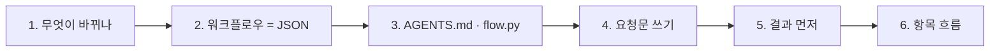
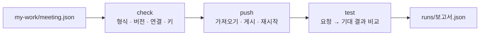

# 1단계 · 바이브 코딩으로 n8n 만들기, 결과 먼저

- 교시: 1~2교시 (09:00~10:50)
- 실습: [Lab 01](../../Last3Mon/66/LAB-01-Q-RESULT-FIRST.md)
- 이 단계가 끝나면: 결과를 먼저 정하고, 요청문으로 n8n 워크플로우를 만들어 push·test로 확인할 수 있다. 워크플로우 안에서 항목이 몇 개씩 지나가는지 읽을 수 있다.



## 1. 무엇이 바뀌나

64·65일차에는 n8n 화면에서 노드를 끌어다 놓고, 설정 칸을 채우고, 선을 이었습니다. 오늘부터는 그 일을 **CLI 코딩 에이전트**(Codex · Claude Code · Antigravity)가 합니다.

| 일 | 전 | 오늘부터 |
| --- | --- | --- |
| 무엇을 만들지 정하기 | 나 | **나** (결과 · 요청문) |
| 노드 고르기 · 설정 · 연결 | 나 (마우스) | 에이전트 |
| 형식 오류 찾기 | 실행해 보고 빨간 표시 | 에이전트 + `flow.py check` |
| 잘 되는지 확인 | 눈으로 OUTPUT 보기 | **나** (테스트 케이스, `flow.py test`) |
| 실패 원인 판단 | 나 | **나** + 에이전트 |

> 손이 하던 일은 줄고, **"무엇이 맞는 결과인가"를 정하는 일**이 늘어납니다. 64·65일차에 배운 노드와 데이터 흐름은 요청문의 재료가 됩니다.

## 2. 워크플로우는 JSON 파일이다

n8n 화면의 워크플로우를 **Download**하면 JSON 파일이 됩니다. 에이전트는 이 파일을 씁니다. Lab 01 예제 2의 워크플로우를 줄이면 이렇습니다.

```json
{
  "name": "66 Meeting summary (my)",
  "nodes": [
    {"name": "Meeting webhook", "type": "n8n-nodes-base.webhook", "typeVersion": 2, "parameters": {"path": "my-meeting", "...": "..."}},
    {"name": "Summarize", "type": "@n8n/n8n-nodes-langchain.agent", "typeVersion": 3.1, "parameters": {"...": "..."}},
    {"name": "Summary model", "type": "@n8n/n8n-nodes-langchain.lmChatOpenAi", "typeVersion": 1.2, "credentials": {"openAiApi": {"id": "openAiCourse0001"}}},
    {"name": "Send result", "type": "n8n-nodes-base.respondToWebhook", "typeVersion": 1.1, "parameters": {"...": "..."}}
  ],
  "connections": {
    "Meeting webhook": {"main": [[{"node": "Summarize", "type": "main", "index": 0}]]},
    "Summary model": {"ai_languageModel": [[{"node": "Summarize", "type": "ai_languageModel", "index": 0}]]}
  }
}
```

| JSON | 화면에서 |
| --- | --- |
| `nodes[]` 하나 | 노드 상자 하나 |
| `type` · `typeVersion` | 노드 종류와 버전 (버전이 틀리면 열리지 않음) |
| `parameters` | 노드를 열었을 때의 설정 칸 |
| `credentials.id` | 고른 Credential (키 자체는 n8n 안에만 있음) |
| `connections` | 선. 보내는 노드 이름 → 받는 노드 이름 |

## 3. 에이전트에게 주는 규칙과 확인 도구

### 3.1 AGENTS.md: 에이전트가 모르는 것을 알려 준다

| 에이전트가 모르는 것 | AGENTS.md에 적은 것 |
| --- | --- |
| 우리 n8n 버전에서 되는 노드 버전 | 실행 확인한 노드 JSON (`typeVersion` 포함) |
| Credential | `openAiCourse0001` id만 사용 (LLM은 OpenAI 하나), 키는 쓰지 않음 |
| 오늘 만들 것의 계약 | 웹훅 `my-meeting`, 입력 `title`·`notes`, Lab마다 결과 모양 |
| 일하는 순서 | `my-work/`에 쓰기 → `check` → 사람이 push·test |
| 하지 말 것 | 테스트 기대 결과 바꾸기, 도구 고치기, 키 출력 |

`codex`와 `agy`는 `AGENTS.md`를, `claude`는 `CLAUDE.md`(→ `@AGENTS.md`)를 읽습니다. 프로젝트마다 이런 파일을 두는 것이 바이브 코딩의 첫 단계입니다.

### 3.2 flow.py: 만든 것을 확인하는 도구



| 명령 | 언제 |
| --- | --- |
| `check` | 에이전트가 파일을 쓸 때마다 (에이전트가 직접 실행) |
| `push` | check 통과 후 (내가 실행). 화면의 Import → Publish를 대신함 |
| `test` | push 후 (내가 실행). `Passed x/y`, 실패하면 보고서 경로 |

## 4. 요청문 쓰기

에이전트는 **적힌 것만** 압니다. 요청문에 다섯 가지를 넣습니다. Lab과 다른 업무(고객 문의 메일 분류)로 예를 듭니다.

| 넣을 것 | 고객 문의 메일을 분류하는 워크플로우라면 |
| --- | --- |
| ① 파일 | `my-work/mail-triage.json` (새로 만듦) |
| ② 입력 | POST 웹훅 `my-mail-triage`, 본문의 `subject`·`body` |
| ③ 처리 | LLM이 문의 종류를 고르고(배송 · 환불 · 기타), 한 문장 요약 |
| ④ 결과 모양 | `{"category": "환불", "summary": "..."}` |
| ⑤ 기대 결과 | 테스트 파일 (예: 환불 메일은 `환불`, 빈 메일은 400) |

| 나쁜 요청문 | 무엇이 빠졌나 |
| --- | --- |
| "메일 분류 워크플로우 만들어 줘" | 파일 · 입력 · 결과 모양 · 기대 결과 전부 |
| "요약도 하게 해 줘" | 어느 파일을 고칠지, 결과에 무엇이 추가되는지 |
| "테스트 통과하게 해 줘" | 무엇을 바꿔야 하는지 (에이전트가 테스트를 고치려 할 수 있음) |

> 요청문은 **한 번에 한 가지 변화**만 담습니다. 예제 1 → 예제 2 → 과제처럼 작게 나눠 요청하고, 매번 test로 확인합니다. Lab 문서의 `▶` 가이드는 무엇을 채워야 하는지만 알려 주고, 요청문을 대신 써 주지 않습니다.

## 5. 결과 먼저

만들기 전에 **결과 JSON을 손으로** 씁니다.

```json
{"title": "10월 16일 주간 회의", "summary": "…", "count": 4,
 "actions": [{"owner": "이준호", "task": "신규 고객 문의 응답 템플릿 정리", "due": "금요일까지"}, "…",
             {"owner": "미정", "task": "회의실 예약 규칙 개선", "due": "미정"}]}
```

| 결과를 먼저 쓰면 | |
| --- | --- |
| 요청문의 ④ 결과 모양이 정해진다 | 필드 이름을 정확히 적을 수 있음 |
| 테스트가 된다 | `count`는 4, `actions.0.owner`는 이준호 |
| 헷갈리는 곳이 먼저 보인다 | 4번 할 일의 담당자·기한은? → 회의록에 없으면 **미정** (지어내지 않음) |

수업 준비 때 빈 회의록을 입력 확인 없이 보내자 LLM이 **"회의 내용이 없으므로 논의 사항이나 결정된 내용이 없습니다"** 라는 답을 만들어 200으로 돌아왔습니다. "빈 회의록이면 400"을 결과로 먼저 정해 두었다면 바로 실패로 보였을 것입니다.

## 6. 항목 흐름: 1 → N → 1

n8n은 노드 사이로 **항목**(item)을 흘려보냅니다.

| 단계 | 들어오는 항목 | 나가는 항목 |
| --- | --- | --- |
| 웹훅 | — | 1 (회의록 하나) |
| 할 일 뽑기 (LLM) | 1 | 1 (목록 하나) |
| 할 일 하나씩 (Split Out) | 1 | 4 |
| 확인 필요 표시 (Set) | 4 | 4 (항목마다 실행) |
| 다시 모으기 (Aggregate) | 4 | 1 |

- 64·65일차에 화면에서 본 "items" 수가 이것입니다. 요청문에 **어디서 몇 개가 되는지** 적으면 에이전트가 덜 헤맵니다 (3단계).

## 정리

- [ ] 워크플로우는 JSON 파일이고, 오늘부터 에이전트가 쓴다. 나는 결과 · 요청문 · 기대 결과를 쓴다
- [ ] AGENTS.md = 에이전트가 모르는 우리 교실의 사정, flow.py = check · push · test
- [ ] 요청문 다섯 가지: 파일 · 입력 · 처리 · 결과 모양 · 기대 결과
- [ ] 결과 먼저, 항목 흐름(1 → N → 1)
