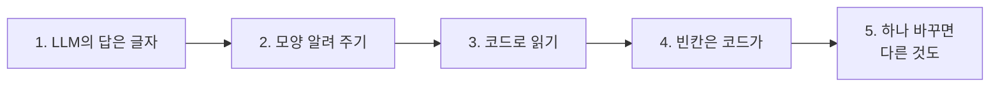

# 2단계 · LLM JSON 출력, 파싱과 변환

- 교시: 3~4교시 (11:00~12:50)
- 실습: [Lab 02](../../Last3Mon/66/LAB-02-Q-JSON-AND-PARSE.md)
- 이 단계가 끝나면: LLM에게 정해진 JSON 모양으로 답하게 하고, 그 글자를 코드로 읽어 목록으로 만들 수 있다. 빈칸은 지어내지 않고 코드로 채운다.



## 1. LLM의 답은 글자

"할 일을 정리해 줘"라고 하면 LLM은 **사람이 읽기 좋은 글**로 답합니다. 다음 노드(할 일 하나씩, 확인 필요 표시)는 그 글을 쓸 수 없습니다. 프로그램이 읽을 수 있는 **모양**으로 받아야 합니다.

| 받은 것 | 다음 노드가 쓸 수 있나 |
| --- | --- |
| "1. 이준호 – 템플릿 정리(금요일) …" | ✘ 글자 |
| `{"actions": [{"owner": "이준호", "task": "…", "due": "금요일까지"}]}` (글자) | 읽으면 ✔ |
| 같은 JSON에 ```` ```json ```` 가 붙은 글자 | 지우고 읽으면 ✔ |

## 2. 모양 알려 주기

```text
You read Korean meeting notes and list every action item. Return only JSON, no code fence:
{"actions": [{"owner": "person in charge or empty", "task": "the task in Korean", "due": "due date as written or empty"}]}
Keep the order of the notes. Use only what the notes say: never invent an owner or a date.
If there is no action item, return {"actions": []}.
```

| 지시 | 이유 |
| --- | --- |
| 필드 이름까지 정한 JSON 모양 | 코드가 `owner`, `task`, `due`로 읽음 |
| 회의록 순서 | 테스트가 `actions.0`을 봄 |
| 없으면 비워 둘 것, 지어내지 말 것 | 담당 · 기한이 없는 할 일 |
| 할 일이 없을 때의 모양 | `{"actions": []}` — 0개도 같은 모양 |

## 3. 코드로 읽기

```javascript
const raw = String($json.output ?? '').trim().replace(/^```(json)?\s*|```$/g, '');
let data = {};
try { data = JSON.parse(raw); } catch (error) { data = {}; }   // 읽지 못하면 멈추지 말고 빈 목록
```

- 읽기는 **실패할 수 있습니다.** 실패하면 워크플로우가 멈추지 않고 빈 목록으로 갑니다. 대신 `count: 0`이 나오면 Executions에서 LLM이 돌려준 글을 확인합니다.

## 4. 빈칸은 코드가

| 누가 "미정"을 쓰나 | 결과 |
| --- | --- |
| LLM에게 "없으면 미정이라고 써" | LLM이 지시를 다르게 따를 수 있음 |
| LLM은 비워 두고 **코드가** `미정` | 매번 같은 답 |

수업 준비 때 정답 워크플로우 (1회): `cases/lab02.json` 6/6 — 할 일 4개, 4번 담당 `미정`, 할 일 없는 회의 0개 (1.7초), 빈 회의록 400.

## 5. 하나 바꾸면 다른 것도 바뀐다

Lab 02 과제(참석자도 뽑기)를 수업 준비 때 해 보니:

| 지시문 | 참석자 | 할 일 |
| --- | --- | --- |
| JSON 모양에 `attendees`만 더함 | ✔ 김민지 · 이준호 · 박서연 | **3개** — "담당자를 다음 회의에서 정한다"가 빠짐 |
| "담당자가 아직 정해지지 않은 할 일도 넣을 것" 추가 | ✔ | 4개, `lab02` 6/6 |

- 고친 곳(참석자)과 **상관없는 결과**가 바뀌었습니다. LLM은 지시문 전체를 한 번에 읽기 때문입니다.
- 그래서 과제 테스트에 "할 일은 그대로" 케이스를 넣고, 원래 테스트도 **함께** 돌립니다. 이것이 오늘 가장 중요한 습관입니다.

## 정리

- [ ] LLM의 답은 글자: 모양을 정해 주고, 코드로 읽는다
- [ ] 읽지 못하면 멈추지 말고 빈 목록, 빈칸은 코드가 채운다
- [ ] 지시문을 고치면 원래 테스트도 다시 돌린다
