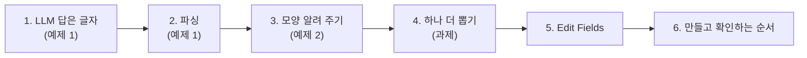
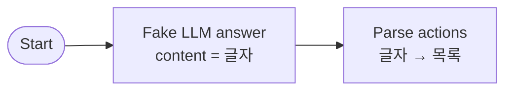
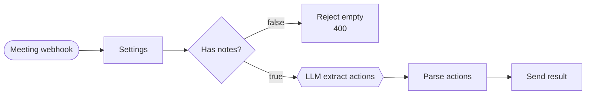
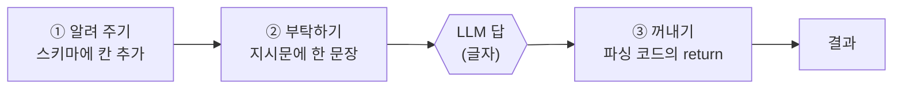
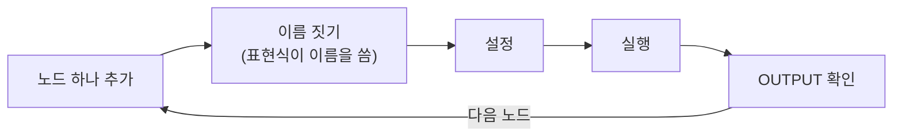

# 2단계 · 데이터 파싱과 변환 노드

- 시간: 3~4교시 (3교시 끝에 Lab 02 예제 1, 4교시에 예제 2와 과제)
- 학습 목표
  - LLM의 답은 JSON처럼 **보이는 글자**라는 것을 OUTPUT에서 구별할 수 있다.
  - Code 노드로 글자를 목록으로 파싱하고, 빈 값을 채우고, 실패 이유를 남길 수 있다.
  - 지시문과 JSON 스키마로 LLM에게 답의 모양을 알려 줄 수 있다.
  - 뽑을 정보를 하나 늘릴 때 고칠 곳(알려 주기 · 받기 · 꺼내기)을 찾을 수 있다.
  - Edit Fields와 표현식으로 간단한 변환을 할 수 있다.
- 실습: [Lab 02 · LLM 답을 데이터로 바꾸기 (예제 2개 + 과제)](../../Last3Mon/66/LAB-02-BUILD-PARSE-TRANSFORM.md)



---

## 1. LLM의 답은 "글자"다 · Lab 02 예제 1

LLM에게 "JSON으로 답해"라고 하면 이런 답이 옵니다.

```text
{"actions": [{"task": "신규 고객 문의 응답 템플릿 정리", "owner": "이준호", "due": "금요일"}, {"task": "회의실 예약 규칙 개선", "owner": "", "due": ""}]}
```

사람 눈에는 목록처럼 보이지만, n8n에게는 **따옴표로 둘러싸인 긴 글자 한 줄**입니다. 글자 상태로는 `actions`를 꺼낼 수도, 할 일 개수를 셀 수도 없습니다.

| 상태 | n8n OUTPUT에서 보이는 모습 | 할 수 있는 것 |
| --- | --- | --- |
| **글자** (문자열) | `content` 한 칸에 긴 글자 | 읽기만 |
| **데이터** (객체·목록) | Table 보기에서 `actions`가 줄줄이 펼쳐짐 | `$json.actions`, `count`, Split Out |

글자를 데이터로 바꾸는 일을 **파싱(parsing)** 이라고 합니다. 27일차 Structured Output에서 Pydantic으로 하던 일을 오늘은 Code 노드가 합니다.

예제 1에서는 LLM을 부르지 않고 위 글자를 `Fake LLM answer` 노드에 **직접 적어 넣고** 파싱부터 연습합니다. 돈도 시간도 들지 않고 매번 같은 결과가 나와서, 파싱만 따로 이해하기 좋습니다.



---

## 2. 파싱: 글자를 목록으로 · Lab 02 예제 1

`Parse actions`의 코드는 네 단계입니다. 한 줄씩 외울 필요는 없고 **번호의 뜻**만 알면 됩니다.

```javascript
const raw = String($input.first().json.content ?? '').trim().replace(/^```(json)?\s*|```$/g, '');   // ① 글자 꺼내기
let data;
try {
  data = JSON.parse(raw);                                                     // ② 글자 → 데이터
} catch (error) {
  return [{ json: { actions: [], count: 0, error: 'answer is not valid JSON' } }];   //    실패해도 멈추지 않고 이유를 남김
}
const items = Array.isArray(data) ? data : (data.actions ?? []);
const actions = items
  .filter(item => item && String(item.task ?? '').trim())                     // ③ 빈 할 일 버리기
  .map(item => ({
    task: String(item.task).trim(),
    owner: String(item.owner || '미정').trim() || '미정',                     // ④ 빈 값은 '미정'
    due: String(item.due || '미정').trim() || '미정',
  }));
return [{ json: { actions, count: actions.length } }];                       //    항상 같은 모양으로 돌려줌
```

| 번호 | 하는 일 | 예제 1에서 확인 |
| --- | --- | --- |
| ① | 앞 노드에서 글자를 꺼냄 (모델이 ```json 으로 감싸면 벗김) | `content` |
| ② | 글자 → 데이터. 실패하면 빈 목록 + `error` | 끝 `}`를 지우면 `error: answer is not valid JSON` |
| ③ | 할 일이 빈 칸인 것은 버림 | |
| ④ | 담당자·기한이 비면 `미정` | 두 번째 할 일의 `owner`·`due`가 `미정` |

예제 2에서는 ①만 바뀝니다. 가짜 답 대신 진짜 LLM 답이 있는 곳 `choices[0].message.content`를 읽습니다.

### 2.1 어떤 답이 와도 같은 모양으로

| LLM 답 | 그대로 `JSON.parse` | 오늘 코드의 결과 |
| --- | --- | --- |
| `{"actions": [...]}` | 성공 | 그대로 |
| ```` ```json {"actions": [...]} ``` ```` | 실패 | ①에서 감싼 표시를 벗기고 성공 |
| `[{"task": ...}]` (목록만) | 성공 | 목록 그대로 사용 |
| `할 일은 다음과 같습니다 ...` (문장) | 실패 | `{actions: [], count: 0, error: ...}` |
| `{"actions": [{"task": "", ...}]}` | 성공 | 빈 할 일 버림 |
| `{"owner": null}` | 성공 | `owner: "미정"` |

마지막 열이 모두 `{actions, count}` 모양입니다. 다음 노드는 어떤 답이 와도 같은 필드를 받습니다.

### 2.2 실패를 숨기지 않기

| 결과 | `count` | `error` | 뜻 |
| --- | --- | --- | --- |
| 할 일 없는 회의 (`no-action`) | 0 | 없음 | 정상 |
| LLM 답이 깨짐 | 0 | `answer is not valid JSON` | 문제 → 실행 기록 확인 |

`error` 한 칸이 "정말 할 일이 없는 회의"와 "답이 깨진 경우"를 구별합니다. 76일차(예외 대응)에서 이런 경우를 모아 알림을 보내는 Error Workflow를 만듭니다.

---

## 3. LLM에게 답의 모양 알려 주기 · Lab 02 예제 2

예제 2는 예제 1의 앞에 **Webhook과 진짜 LLM**이 붙은 워크플로우를 가져와 실행합니다.



`LLM extract actions` 노드의 JSON 칸은 세 부분입니다. (실습 파일은 읽기 쉽게 여러 줄로 적혀 있습니다.)

```text
{{ JSON.stringify({
  model: $('Settings').first().json.model,
  temperature: 0,
  response_format: { type: 'json_schema', json_schema: { name: 'reply', schema: {      ← ① 스키마: 답의 모양
    type: 'object',
    properties: {
      actions: { type: 'array', items: { type: 'object',
        properties: { task: { type: 'string' }, owner: { type: 'string' }, due: { type: 'string' } },
        required: ['task', 'owner', 'due'] } },
    },
    required: ['actions'],
  } } },
  messages: [
    { role: 'system', content: "Extract action items ... Use \"미정\" when ..." },     ← ② 지시문: 무엇을 찾을지
    { role: 'user', content: $('Settings').first().json.notes },                     ← ③ 회의록 원문
  ],
}) }}
```

| 부분 | 하는 일 | 비유 |
| --- | --- | --- |
| ① 스키마 (`response_format`) | "이 칸들로만 답해라" — 답의 **모양**을 정함 | 빈칸이 정해진 답안지 |
| ② 지시문 (`system`) | 무엇을 찾고, 없으면 무엇을 쓸지 | 문제 설명 |
| ③ 회의록 (`user`) | 읽을 글 | 지문 |

### 3.1 스키마는 모양만 지킨다

| | 지시문만 | 지시문 + 스키마 |
| --- | --- | --- |
| 모양 | 가끔 어긋남 (설명 문장, ```json) | 정한 모양으로만 |
| 필드 이름 | 가끔 `assignee`, `deadline` | 스키마 이름 그대로 |
| **내용이 맞나** | 보장 안 함 | **보장 안 함** |

스키마를 써도 담당자를 잘못 찾거나 할 일을 빠뜨리는 것은 막지 못합니다. 4번 할 일의 기한 `10월 23일`(회의록에 직접 적히지 않은 추론)이 그 예입니다. 그래서 스키마를 써도 2절의 파싱·검증은 그대로 둡니다. 그리고 답은 여전히 **글자**(`choices[0].message.content`)로 옵니다.

Anthropic·Gemini에도 비슷한 구조화 출력 기능이 있고, 대체용 Ollama도 같은 `response_format`을 받습니다.

> **표현식 주의**: `{{ }}` 안에서 `}`와 `}`가 **붙으면** 표현식이 거기서 끝나 `invalid syntax`가 납니다. 실습 파일에서 `} }`처럼 띄어 쓴 곳은 일부러 띄운 것입니다.

---

## 4. 뽑을 것을 하나 늘리려면 · Lab 02 과제

새 정보(예: 참석자)가 결과까지 오려면 데이터가 지나가는 길을 따라 **세 곳**이 모두 알아야 합니다.



| 곳 | 빠뜨리면 |
| --- | --- |
| ① 스키마 | LLM이 그 칸을 만들지 않을 수 있음 |
| ② 지시문 | 무엇을 넣을지 몰라 비우거나 엉뚱한 값 |
| ③ 파싱 코드 | LLM 답에는 있어도 **새 상자를 만들며 버려짐** → 결과에 없음 |

③이 가장 잘 빠집니다. 파싱 코드는 `return [{ json: { actions, count } }]`처럼 **필요한 필드만 골라 새 상자를 만들기** 때문입니다. 어디서 사라졌는지 모를 때는 노드를 하나씩 열어 OUTPUT에 그 필드가 있는지 봅니다.

뽑을 것을 늘린 뒤에는 **원래 기대 결과(할 일 4건)도 다시** 확인합니다. 요청이 바뀌면 원래 뽑던 결과도 흔들릴 수 있습니다.

---

## 5. 변환: Edit Fields와 표현식

코드 없이 필드를 만들거나 값을 계산할 때는 Edit Fields(Set)를 씁니다. 예제 2의 `Settings`가 그 예입니다.

| 하고 싶은 일 | 설정 예 |
| --- | --- |
| 입력값 꺼내기 | `notes` = `{{ $json.body.notes }}` (웹훅 입력은 `body` 안에) |
| 비었으면 기본값 | `title` = `{{ $json.body.title \|\| '제목 없음' }}` |
| 공백 다듬기 | `summary` = `{{ $json.choices[0].message.content.trim() }}` |
| 조건으로 값 정하기 | `priority` = `{{ ['오늘', '내일', '긴급'].some(w => $json.due.includes(w)) ? '높음' : '보통' }}` |
| 빈 목록 | `actions` (Array) = `{{ [] }}` |

- `{{ }}`가 들어간 값은 입력칸이 **Expression** 모드(초록색)여야 합니다. Fixed 모드면 글자 그대로 들어갑니다.
- 필드 형식(String·Number·Array·Boolean)을 맞춥니다. 예를 들어 `count`가 글자 `"0"`이면 숫자 비교가 원하는 대로 되지 않을 수 있습니다.

| Edit Fields | Code |
| --- | --- |
| 필드 몇 개를 만들거나 바꿀 때 | 파싱, 여러 줄 검증, 실패 처리 (`try / catch`) |
| 누구나 읽기 쉬움 | 자유롭지만 실수하기 쉬움 |

---

## 6. 만들고 확인하는 순서



- **한 번에 다 만들지 않습니다.** 노드 하나를 붙일 때마다 실행해 OUTPUT을 봅니다.
- 노드 이름을 안내와 똑같이 짓습니다. `$('Settings')`처럼 표현식이 이름을 씁니다.
- 같은 요청 파일(`weekly`·`no-action`·`empty`)로 매번 확인해야 고친 것의 효과를 비교할 수 있습니다.
- Test URL은 **한 번에 한 요청**만 받습니다. 요청마다 `Listen for test event`를 다시 누릅니다.

---

## 7. 막혔을 때

| 증상 | 원인 | 해결 |
| --- | --- | --- |
| `invalid syntax` | 표현식 안에서 `}}`가 붙음 | `} }`로 띄어 쓰기 |
| `401` | Credential이 `OpenAI (.env)`가 아님 | Authentication 확인 |
| 값에 `{{ $json.body.notes }}` 글자가 그대로 | Fixed 모드 | Expression 모드 |
| `actions`가 비고 `error`가 있음 | LLM 답이 JSON이 아님 | 앞 노드 OUTPUT의 `content` 확인 |
| 새 필드가 결과에 없음 | 파싱 코드의 `return`에 안 넣음 | 4절 ③ |
| 고치다 망가짐 | | 예제 2 파일을 다시 가져오기 |

---

## 8. Lab 02 안내

- 실습 안내: [Last3Mon/66/LAB-02-BUILD-PARSE-TRANSFORM.md](../../Last3Mon/66/LAB-02-BUILD-PARSE-TRANSFORM.md)

| 순서 | 시간 | 할 일 | 교안 |
| --- | --- | --- | --- |
| 예제 1 | 3교시 끝 15분 (함께) | `Fake LLM answer`(글자) → `Parse actions`(목록), 끝 `}`를 지워 `error` 보기 | 1~2절 |
| 예제 2 | 4교시 15분 | `lab02-example2-meeting-part1.json` 가져오기 → `weekly`·`empty`·`no-action`, JSON 칸의 ①②③ 찾기 | 3절 |
| 과제 | 4교시 25분 | 결과에 **참석자(`attendees`)** 추가 | 4절 |

---

## 9. 스스로 확인하기

<details><summary>Q1. `Fake LLM answer`의 `content`와 `Parse actions`의 `actions`는 무엇이 다른가요?</summary>

`content`는 글자 한 줄이고, `actions`는 파싱해서 만든 목록입니다. 목록이어야 개수를 세고 Split Out으로 펼칠 수 있습니다.
</details>

<details><summary>Q2. 스키마(`response_format`)를 지정했는데도 파싱·검증이 필요한 이유는?</summary>

스키마는 모양만 지켜 줍니다. 답은 여전히 글자로 오므로 파싱이 필요하고, 빈 값이나 잘못 찾은 내용은 검증으로 걸러야 합니다.
</details>

<details><summary>Q3. 파싱에 실패하면 빈 목록을 돌려주면서도 `error`를 남기는 이유는?</summary>

흐름이 멈추지 않게 하면서도, "정말 할 일이 없는 회의"와 "LLM 답이 깨진 경우"를 구별하기 위해서입니다.
</details>

<details><summary>Q4. 스키마와 지시문에 `attendees`를 넣었는데 결과에 없습니다. 어디를 보나요?</summary>

`LLM extract actions`의 OUTPUT에는 있는데 `Parse actions`의 OUTPUT에 없다면, 파싱 코드의 `return`이 `attendees`를 넣지 않은 것입니다. 노드를 앞에서부터 하나씩 열어 어디서 사라졌는지 찾습니다.
</details>

<details><summary>Q5. 기한을 스키마에서 날짜 형식이 아니라 글자(`string`)로 둔 이유는?</summary>

회의록에는 "금요일", "다음 주 월요일"처럼 날짜가 아닌 표현이 많습니다. 날짜로 바꾸려면 회의 날짜를 아는 계산이 필요하므로, 필요하면 규칙으로 따로 합니다.
</details>

## 정리

- LLM의 JSON 답은 **글자**입니다. Code 노드로 파싱해야 목록이 됩니다.
- 파싱은 꺼내기 → 바꾸기(실패하면 `error`) → 빈 할 일 버리기 → `미정` 채우기, 그리고 항상 같은 모양으로 돌려줍니다.
- 스키마는 답의 **모양**, 지시문은 **무엇을 찾을지**를 알려 줍니다. 스키마도 내용은 보장하지 않습니다.
- 뽑을 것을 늘리면 **알려 주기(스키마) · 부탁하기(지시문) · 꺼내기(파싱)** 세 곳을 고칩니다.
- 간단한 변환은 Edit Fields, 파싱·검증은 Code. 노드 하나마다 실행해 OUTPUT을 확인합니다.
