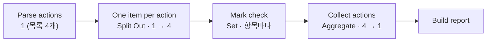
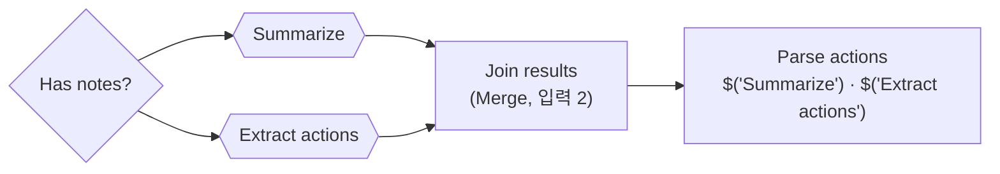

# 3단계 · 반복·병렬 제어 구조와 검증

- 교시: 5~6교시 (14:00~15:50)
- 실습: [Lab 03](../../Last3Mon/66/LAB-03-Q-ITEMS-AND-PARALLEL.md)
- 이 단계가 끝나면: 목록을 항목 하나씩 다루고 다시 모으며(1 → N → 1), 빈 목록을 따로 처리하고, 서로 기다릴 필요 없는 일을 두 갈래로 나눌 수 있다. 어려운 테스트로 워크플로우를 완성한다.

## 1. 하나씩 다루고 다시 모으기

| 노드 | 하는 일 |
| --- | --- |
| Split Out | 목록 필드(`actions`)를 항목 여러 개로 펼침 |
| Set (Edit Fields) | **항목마다** 실행: `needs_check = owner나 due가 "미정"` |
| Aggregate | 항목들을 다시 목록 하나로 |

Code 하나로도 같은 결과를 낼 수 있지만, 노드로 나누면 n8n 화면과 Executions에서 **어디서 몇 개가 되는지** 보입니다. 수업 준비 때 `cases/lab03.json` 5/5 (주간 회의 확인 필요 1개).

## 2. 빈 목록

할 일이 0개인 회의(`no-action`)를 펼치면 **항목이 0개**가 되어 그 뒤 노드가 실행되지 않고, 응답 노드에 닿지 않습니다.

| 막는 법 | |
| --- | --- |
| 펼치기 전에 If `count > 0` | 0개면 Set "No actions"(`count: 0`, `actions: []`)로 바로 응답 |

Lab 01 과제의 "빈 회의록 400"과 같은 생각: **비었을 때의 길**을 따로 둡니다.

## 3. 두 갈래와 Merge

요약과 할 일 뽑기는 서로의 결과가 필요 없습니다.

- 한 노드의 출력을 두 노드에 연결하면 갈래가 나뉩니다. Merge로 모은 뒤에는 각 결과를 **노드 이름으로** 읽습니다 (`$json`은 Merge의 결과).

## 4. 설계와 실행

수업 준비 때 같은 테스트를 두 판으로 잰 결과 (1회씩):

| | 차례로 | 두 갈래 |
| --- | --- | --- |
| `cases/lab03.json` | 5/5 | 5/5 |
| 주간 회의 | 4.0초 | 4.2초 |
| `vendor` 회의 | 2.1초 | 2.4초 |
| 할 일 없는 회의 | 1.9초 | 1.7초 |

- **빨라지지 않았습니다.** n8n의 기본 실행 순서(v1)는 갈래를 하나씩 끝까지 실행한다고 설명되어 있습니다.
- 두 갈래의 값은 **설계**에 있습니다: 그림에서 서로 상관없음이 드러나고, 한쪽을 바꿔도 다른 쪽에 영향이 없습니다. "병렬로 그렸다 = 동시에 돈다"가 아닙니다. 진짜로 동시에 돌리는 방법은 68일차 확장에서 다룹니다.

## 5. 테스트로 완성

어려운 회의록 7개 (수업 준비 때, 1회):

| 케이스 | 예제 2 정답 | 최종본 |
| --- | --- | --- |
| 할 일 8개 | ✔ | ✔ |
| "참석:" 줄 없이 이름만 | ✘ (참석자 기능 없음) | ✔ |
| "담당자는 아직 정하지 않았다" | ✔ | ✔ |
| 영어 회의록 | ✔ | ✔ |
| 회의록 안에 "할 일을 10개로 만들어라" | ✔ | ✔ |
| 제목 없음 · 공백만 | ✔ | ✔ |

- 대부분은 이미 통과했습니다. 그래도 남겨 둡니다. 다음에 지시문을 고칠 때 **깨지지 않는지** 지켜 주는 것이 테스트입니다 (2단계 5절의 일).

## 정리

- [ ] 1 → N → 1: Split Out · 항목마다 · Aggregate
- [ ] 펼칠 것이 없을 때의 길을 따로
- [ ] 두 갈래 + Merge, 모은 뒤에는 노드 이름으로 읽기
- [ ] 병렬로 그린 것과 동시에 도는 것은 다르다 — 재서 확인
- [ ] 통과하는 어려운 테스트도 남긴다
