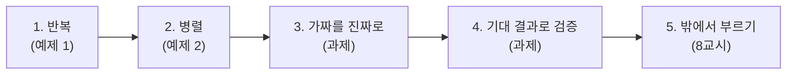
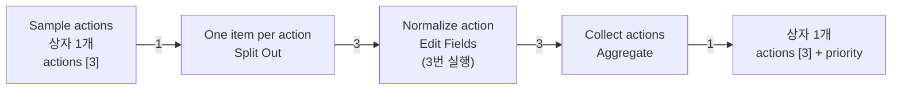
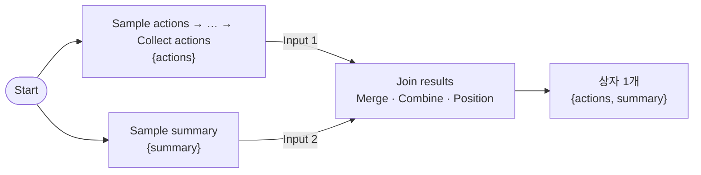
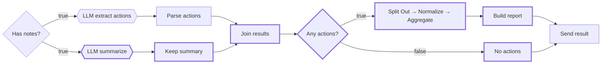
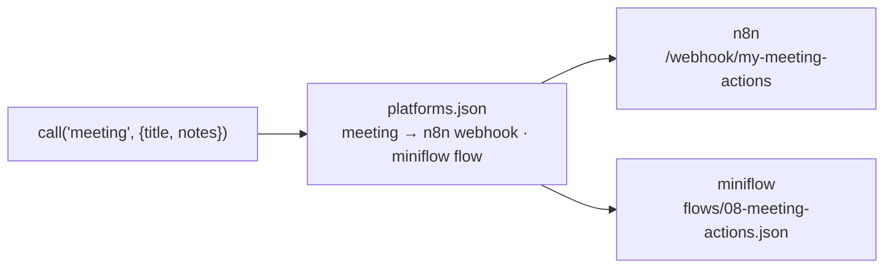

# 3단계 · 반복·병렬 제어 구조와 완성

- 시간: 5~6교시 (5교시 후반에 Lab 03 예제 1·2, 6교시에 과제 40분), 4절 밖에서 부르기는 8교시
- 학습 목표
  - 펼치기(Split Out) → 항목마다 처리 → 모으기(Aggregate)로 반복을 만들 수 있다.
  - 두 길로 나눈 일을 Merge로 합치는 Fork-Join을 만들 수 있다.
  - 연습용 가짜 데이터 자리에 진짜 LLM 결과를 넣어 워크플로우를 완성할 수 있다.
  - 기대 결과 표와 실행 기록의 항목 수로 결과를 검증할 수 있다.
- 실습: [Lab 03 · 반복·병렬로 회의록 워크플로우 완성하기 (예제 2개 + 40분 과제)](../../Last3Mon/66/LAB-03-BUILD-LOOP-PARALLEL.md)

---

## 1. 반복: 펼치고 · 항목마다 · 모으기 · Lab 03 예제 1

n8n의 노드는 **들어온 상자(항목)마다 한 번씩** 실행됩니다. 그래서 목록을 상자 여러 개로 펼치기만 하면 반복이 됩니다. 별도의 "for 문" 노드가 필요 없습니다.

예제 1은 할 일 3건이 든 가짜 목록으로 연습합니다.

| 노드 | 설정 | 하는 일 |
| --- | --- | --- |
| Split Out | Fields To Split Out: `actions` | 목록 → 할 일 하나씩 상자로 (**1 → 3**) |
| Edit Fields | `task`, `owner`, `due`, `priority` | 상자마다 실행 (3번) |
| Aggregate | All Item Data, 결과 필드 `actions` | 상자들 → 다시 목록 하나 (**3 → 1**) |

**펼쳤으면 반드시 모은다.** 이것이 반복의 짝입니다. 오후 과제에서는 진짜 회의록이라 같은 모양이 **1 → 4 → 1**이 됩니다.

### 1.1 모으지 않으면? (5교시 시연, 수업 전 실측)

| 틀린 곳 | `weekly` 결과 |
| --- | --- |
| `Normalize action` → 바로 응답 | HTTP 200인데 **첫 할 일 하나만** — 응답 노드는 첫 상자로 한 번만 답함 |
| Aggregate 없이 `Build report` | HTTP 500 `Error in workflow` — 목록을 기대했는데 할 일 하나짜리 상자가 옴 |

첫 번째가 더 위험합니다. 오류 없이 **조용히 틀린 답**이 나갑니다. 그래서 실행 기록에서 노드마다 **항목 수**를 읽는 습관을 들입니다.

### 1.2 상자마다 실행될 때 `$json`이 가리키는 것

| 위치 | `$json` | 다른 값이 필요하면 |
| --- | --- | --- |
| Split Out 뒤 (상자마다) | 할 일 **하나** (`task`, `owner`, `due`) | 회의 제목: `$('Settings').first().json.title` |
| Aggregate 뒤 (한 번) | 모은 결과 `{actions: [...]}` | 요약: `$('Join results').first().json.summary` |

`$('노드 이름')`은 "그 노드의 OUTPUT을 가져와"라는 뜻입니다. 노드 이름을 안내와 똑같이 지어야 하는 이유입니다.

### 1.3 Loop Over Items는 언제?

| 상황 | 선택 |
| --- | --- |
| 상자마다 같은 변환만 (오늘) | Split Out + 일반 노드 |
| 상자마다 외부 API·LLM을 부르는데 한꺼번에 보내면 호출 제한에 걸림 | **Loop Over Items**로 몇 개씩 나눠 차례로 |

반복 안에 LLM을 두면 **시간과 비용이 항목 수에 비례**합니다 (75일차 비용 관리).

---

## 2. 병렬: 나누고 · 합치기 · Lab 03 예제 2

할 일 찾기와 요약은 서로의 결과가 필요 없습니다. 한 노드에서 **두 길로 나누고(Fork)**, 둘 다 끝나면 **합칩니다(Join)**. 합치는 노드가 Merge입니다.

예제 2는 예제 1에 가짜 요약 길을 하나 더 붙입니다.

| Merge 설정 | 뜻 |
| --- | --- |
| Mode `Combine` | 두 입력의 상자를 하나로 합침 |
| Combine By `Position` | 1번 입력의 첫 상자 + 2번 입력의 첫 상자 → 상자 하나 |

- Merge는 **두 입력이 모두 올 때까지** 기다립니다.
- n8n은 두 길을 동시에가 아니라 **차례로** 실행합니다. 그래도 그림에서 두 일이 서로 독립이라는 것이 드러나고, 한쪽을 고쳐도 다른 쪽에 영향이 없습니다.

### 2.1 Merge의 다른 모드

| 모드 | 하는 일 | 쓰는 때 |
| --- | --- | --- |
| Append | 두 입력을 이어 붙임 (2 + 3 = 5개) | 같은 모양 목록 두 개 |
| **Combine · By Position** | 같은 순서끼리 합침 (1 + 1 = 1개) | **오늘** |
| Combine · By Matching Fields | 같은 값(`customer_id` 등)끼리 짝 | 주문 목록 + 고객 정보 |
| Choose Branch | 한쪽만 내보냄 | 한쪽 결과만 필요할 때 |

### 2.2 한 길이 실패하면

요약 길의 LLM 호출이 실패하면, 할 일 찾기가 성공해도 Merge가 기다리다 **결과가 나오지 않습니다.** 길이 늘수록 실패할 곳도 늘어납니다. 대처는 72일차(재시도)와 76일차(Error Workflow)에서 배웁니다.

---

## 3. 가짜를 진짜로 바꾸기 · Lab 03 과제

예제 1·2는 가짜 데이터였습니다. 과제는 그 자리에 Lab 02의 **진짜 LLM 결과**를 넣어 `66 Meeting notes (my)`를 완성합니다.

| 예제의 가짜 | 과제의 진짜 | 하는 일 |
| --- | --- | --- |
| `Sample actions` | `LLM extract actions` → `Parse actions` (Lab 02) | 할 일 목록 |
| `Sample summary` | `LLM summarize` → `Keep summary` (새로) | 요약 |
| `Join results` | 그대로 복사 | 두 결과 합치기 |
| Split Out → Normalize → Aggregate | 그대로 복사 | 할 일마다 우선순위, 다시 모으기 |
| (없음) | `Any actions?`, `Build report`, `No actions` (새로) | 할 일이 있을 때 / 없을 때 |

### 3.1 순서에 담긴 이유

| 질문 | 답 |
| --- | --- |
| 왜 Merge를 `Any actions?` **앞**에 두나? | 할 일이 없는 회의에도 **요약**은 있어야 하니까. 합친 뒤에 나누면 두 길 모두 `summary`를 가짐 |
| 왜 `Any actions?`가 Split Out **앞**에 있나? | 할 일이 0건이면 펼칠 것도, 정리문에 쓸 것도 없음 → 펼치기 전에 길을 나눠 `할 일 없음` 결과를 따로 만듦 |
| 정리문(`report_text`)은 왜 코드로? | 매번 같은 모양이어야 메신저·메일에 붙이기 좋고, 시간·비용이 들지 않음 |

### 3.2 두 길을 같은 필드로 끝내기

| 필드 | 할 일 정리 (`Build report`) | 할 일 없음 (`No actions`) |
| --- | --- | --- |
| `title` | 회의 제목 | 회의 제목 |
| `route` | `할 일 정리` | `할 일 없음` |
| `count` | 4 | 0 |
| `summary` | 요약 | 요약 |
| `actions` | 할 일 4개 (+ `priority`) | `[]` |
| (과제) `need_check` | 확인 필요 건수 | 0 |

과제의 마지막 단계 **확인 필요**는 Lab 01 과제에서 설계한 것입니다. 1단계 6절의 질문 "하나마다? 모은 뒤? 모든 길?"을 다시 꺼내 봅니다.

---

## 4. 기대 결과로 검증하기 · Lab 03 과제

"오류가 안 났다"는 "맞았다"가 아닙니다. 두 가지로 확인합니다.

**① 기대 결과 표와 비교** (수업 전 측정)

| 요청 | 기대 결과 | 처리 시간 |
| --- | --- | --- |
| `weekly` (할 일 4건) | `할 일 정리`, `count: 4`, 오늘 마감 1건 `높음`, `need_check: 1` | 약 3~4초 |
| `no-action` (결정 사항 없음) | `할 일 없음`, `count: 0`, `need_check: 0` | 약 2초 |
| `empty` (빈 회의록) | HTTP 400 | 1초 미만 |

**② 실행 기록의 항목 수 읽기**: `Join results` 1 → `One item per action` 4 → `Normalize action` 4 → `Collect actions` 1 → `Build report` 1

수업 준비 때 실제로 본 **오류 없이 틀리는** 모양입니다.

| 증상 | 원인 |
| --- | --- |
| 할 일 하나만 옴 | Aggregate를 거치지 않음 (1.1절) |
| `no-action`에서 HTTP 200인데 빈 응답 | `Any actions?`의 false 길이 끊김 |
| `need_check: 4` | `check`의 형식이 Boolean이 아니라 String → 글자 `"false"`도 참으로 셈 |

---

## 5. 밖에서 부르기: 설정 한 줄로 대상 바꾸기 · 8교시

65일차의 플랫폼 전환 실행기로 오늘의 업무 `meeting`도 부를 수 있습니다.

- 내가 만든 워크플로우를 부르려면 `platforms.json`의 웹훅 경로 **한 줄만** `my-meeting-actions`로 바꿉니다. 호출 코드는 그대로입니다.
- n8n이 멈추면 같은 업무를 `miniflow`의 `08` 워크플로우가 이어받습니다. 이것이 되려면 두 플랫폼이 **같은 입력(`title`, `notes`)과 같은 결과 필드**를 지켜야 합니다.

| 하는 일 | n8n (오늘 만든 것) | miniflow `08-meeting-actions.json` |
| --- | --- | --- |
| 입력 | Webhook `body.title`, `body.notes` | `-i title=... -i notes=...` |
| 할 일 찾기 | HTTP Request → OpenAI (스키마) | LLM 노드 |
| 파싱·검증 | Code `Parse actions` | `parse_actions` Tool |
| 결과 | `{title, route, count, summary, actions, ...}` | 같은 필드 |

---

## 6. Lab 03 안내

- 실습 안내: [Last3Mon/66/LAB-03-BUILD-LOOP-PARALLEL.md](../../Last3Mon/66/LAB-03-BUILD-LOOP-PARALLEL.md)

| 순서 | 시간 | 할 일 | 교안 |
| --- | --- | --- | --- |
| 예제 1 | 5교시 끝 12분 | 가짜 할 일 3건 펼치고 모으기, 항목 수 1 → 3 → 3 → 1 | 1절 |
| 예제 2 | 5교시 끝 10분 | `Sample summary`를 Merge(Position)로 합치기 | 2절 |
| **과제** | 6교시 40분 | 예제 노드를 복사해 내 워크플로우 완성 + **확인 필요** | 3~4절 |
| 마무리 | 8교시 함께 | `platforms.json` 한 줄 바꾸고 `miniflow call meeting` | 5절 |

---

## 7. 스스로 확인하기

Q1. `One item per action`이 4개, `Collect actions`가 1개입니다. 그 사이의 `Normalize action`은 몇 번 실행되었나요?

4번입니다. 대부분의 n8n 노드는 들어온 항목마다 한 번씩 실행됩니다.

Q2. `Build report`에서 회의 제목을 `$json.title`이 아니라 `$('Settings').first().json.title`로 꺼내는 이유는?

`Build report` 바로 앞은 Aggregate이고, 그 결과에는 `actions`만 있습니다. 제목은 앞쪽 `Settings` 노드에 있으므로 이름으로 꺼냅니다.

Q3. Merge를 `Any actions?` 앞에 두는 이유는?

할 일이 없는 회의에도 요약이 필요하기 때문입니다. 먼저 합치면 할 일 정리 길과 할 일 없음 길 모두 `summary`를 가집니다.

Q4. 주문 목록과 고객 정보를 `customer_id`로 합치려면 Merge를 어떻게 설정하나요?

Combine · By Matching Fields로 `customer_id`를 기준으로 합칩니다. By Position은 순서가 같을 때만 맞습니다.

Q5. 요약 길의 LLM 호출이 실패하면 할 일 찾기가 성공해도 응답이 나오지 않는 이유는?

Merge는 두 입력이 모두 와야 합치기 때문입니다. 병렬 길이 늘면 실패할 곳도 늘어납니다.

## 정리

- 반복은 **펼치고(Split Out) · 항목마다 · 모으기(Aggregate)**. 펼쳤으면 반드시 모읍니다.
- 병렬은 **나누고 · Merge로 합치기**. Merge는 두 입력을 모두 기다립니다.
- 예제의 가짜 데이터 자리에 진짜 LLM 결과를 넣으면 워크플로우가 완성됩니다.
- 모든 길이 같은 필드로 끝나게 하고, **기대 결과 표와 항목 수**로 검증합니다. 오류가 없어도 틀릴 수 있습니다.
- 같은 입력·같은 결과 형식을 지키면 설정 한 줄로 호출 대상을 바꾸고, 플랫폼 전환도 그대로 됩니다.
