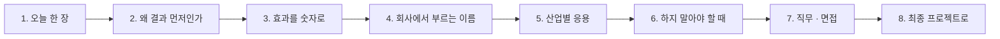

# 4단계 · 정리: 오늘 한 일의 의미 · 효과 · 실전 응용

- 교시: 8교시 17:10~17:45 (35분, 바이브 코딩 발표 10분 뒤) · 자료: 이 문서 + [개요](00-DAY66-OVERVIEW.md)
- 이 시간이 끝나면: 오늘 1~3단계에서 한 일(결과 먼저 · JSON으로 받기 · 반복과 검증)이 **왜 필요했는지**, 숫자로 **무엇이 좋아졌는지**, 회사에서는 같은 생각을 **어떤 이름과 도구로** 쓰는지 말할 수 있고, 최종 프로젝트에 무엇을 가져갈지 정할 수 있다.
- 숫자: 수업 준비 때 정답 워크플로우를 실행한 값입니다 (2026-10-18, gpt-4.1-mini, 1회. 강사의 수업 준비 기록).

## 0. 이 시간 (35분)

| 시간 | 절 | 하는 일 |
| --- | --- | --- |
| 17:10~17:15 | 1 · 2 | 오늘 한 장, 왜 "결과 먼저"인가 |
| 17:15~17:20 | 3 | 오늘 숫자로 본 효과 |
| 17:20~17:28 | 4 · 5 | 같은 생각의 업계 이름 · 도구, 산업별 응용 예 |
| 17:28~17:33 | 6 | 하지 말아야 할 때 |
| 17:33~17:40 | 7 · 8 | 직무와 면접 질문, 최종 프로젝트 체크리스트 |
| 17:40~17:45 | 9 · 토론 | 다음 일차와의 연결, 질문 둘 |

## 1. 오늘 한 장

| 단계 | 한 일 | 오늘 숫자 |
| --- | --- | --- |
| 1단계 · 결과 먼저 | 결과 모양을 먼저 정하고, CLI 에이전트에게 요청문(프롬프트)으로 회의록 요약 워크플로우를 만들게 함 | 빈 회의록 · 제목 없음 `lab01-challenge` 예제 상태 **1/4** → **4/4** |
| 2단계 · JSON으로 받기 | LLM 답을 JSON으로 받아 파싱 · 변환, 참석자 뽑기 | 참석자 과제 처음 **3/4** → 지시문 보강 **4/4**, `lab02` 6/6 |
| 3단계 · 반복과 검증 | 할 일마다 항목으로 나눠 처리(반복 · 병렬), 결과 검증, 확인 필요 표시 | 어려운 회의록 7개 예제 상태 **6/7** → **7/7** |
| 바이브 코딩 | 터미널에서 HTTP를 보내고 응답을 보는 `turl` | 오늘 만든 웹훅을 이 도구로 부름 |

한 문장으로: **원하는 결과의 모양을 먼저 정하고, LLM의 답을 그 모양(JSON)으로 받아, 코드로 확인한다.**

## 2. 왜 "결과 먼저"인가

| | 화면에서 노드부터 그리기 | 결과 먼저 |
| --- | --- | --- |
| 시작 | "어떤 노드가 필요하지?" | "끝에 무엇이 나와야 하지?" (`{title, summary, actions}`) |
| 완료 판단 | 눈으로 "된 것 같다" | 테스트 케이스가 통과 |
| 에이전트에게 | 막연한 부탁 | 모양이 정해진 요청문(프롬프트) |
| 다음 시스템과 | 붙일 때마다 다시 맞춤 | 약속한 모양 그대로 |

- LLM은 문장을 잘 쓰지만, 다음 시스템(메일 · 일정 · 티켓)은 **정해진 모양**만 읽습니다. 그래서 "어떤 칸에 무엇이 오나"를 먼저 정하는 것이 자동화의 시작입니다.
- 빈 회의록에 LLM이 "회의 내용이 없으므로 …"라고 **친절하게 200으로** 답한 것이 오늘의 교훈입니다. 오류처럼 보이지 않는 실패는 결과 모양과 테스트가 있어야 잡힙니다 (빈 회의록 → 400).

## 3. 효과를 숫자로

| 무엇 | 전 | 후 | 바꾼 것 |
| --- | --- | --- | --- |
| 빈 회의록 · 제목 없음 (`lab01-challenge`) | 1/4 | **4/4** | 입력 검사(400), 제목 없으면 `회의` |
| 참석자 뽑기 (`lab02-challenge`) | 3/4 (할 일 4개 → 3개로 줄어듦) | **4/4** | 지시문 보강 |
| 어려운 회의록 7개 | 6/7 | **7/7** | 두 갈래 + 확인 필요 + 참석자 |
| 앞의 테스트 (회귀) | | `lab01` 3/3 · `lab02` 6/6 · `lab03` 5/5 | 새 기능이 앞 기능을 깨지 않음 |

- 참석자를 더하자 **할 일이 4개에서 3개로 줄어든** 것이 중요합니다. 하나를 고치면 다른 곳이 바뀝니다. 그래서 고칠 때마다 **앞의 테스트도 다시** 돌립니다.

## 4. 회사에서는 같은 생각을 이렇게 부른다

| 오늘 한 것 | 업계 이름 | 쓰는 도구 · 표준 (예) |
| --- | --- | --- |
| 결과 모양부터 정하기 | 계약 우선 설계 (contract-first), 출력 스키마 | JSON Schema, OpenAPI |
| LLM 답을 JSON으로 | 구조화된 출력 (structured output) | 모델의 JSON 모드 · 스키마 지정, 출력 파서 |
| 파싱 실패 · 빈 입력 처리 | 입력 검증, 방어적 파싱 | 스키마 검증, 400 오류 |
| 할 일마다 나눠 처리 | 팬아웃 · 맵 (map), 배치 처리 | n8n 항목(item), 작업 큐 |
| 테스트 케이스로 확인 | 회귀 테스트, 평가 세트 | 테스트 파일, CI |
| 요청문(프롬프트)으로 만들게 함 | AI 코딩 에이전트 활용 | Codex · Claude Code · Antigravity |

## 5. 산업별 응용 (예)

아래는 오늘 한 일을 다른 업무에 옮긴 예입니다 (특정 회사 사례가 아니라 흔한 모양).

| 업무 | 오늘의 무엇을 | 이렇게 |
| --- | --- | --- |
| 영업 회의록 → CRM | 결과 먼저 · JSON | `{고객사, 다음 단계, 담당, 기한}`로 받아 CRM에 그대로 등록 |
| 고객 문의 메일 분류 | JSON · 확인 필요 | `{분류, 긴급도, 확인 필요}`, 확인 필요면 사람에게 |
| 계약서 검토 메모 | 반복 · 병렬 | 조항마다 항목으로 나눠 같은 검사를 동시에 |
| 사내 회의 (오늘) | 전부 | 빈 회의록은 400, 제목 없으면 `회의`, 할 일 · 참석자 |

**토론 거리**: 내 업무의 "회의록"에 해당하는 문서 하나를 골라, 결과 JSON의 칸을 먼저 적어 봅니다.

## 6. 하지 말아야 할 때 (흔한 실수)

| 하기 쉬운 일 | 왜 위험한가 | 대신 |
| --- | --- | --- |
| 노드부터 그리고 결과는 나중에 | 완료를 판단할 기준이 없음 | 결과 모양 · 테스트부터 |
| LLM 답을 문장 그대로 다음 시스템에 | 매번 모양이 달라 붙일 수 없음 | JSON으로 받고 파싱 |
| 빈 입력도 LLM에게 보냄 | "내용이 없으므로…" 같은 200 답 | 코드로 먼저 400 |
| 고친 기능의 테스트만 돌림 | 다른 기능이 몰래 깨짐 (할 일 4 → 3) | 앞의 테스트도 함께 |
| 에이전트의 "다 됐다"를 믿음 | 실제로는 통과하지 않을 수 있음 | 내가 `push` · `test` |

## 7. 직무와 면접

오늘 한 일은 **AI · LLM 애플리케이션 엔지니어, 업무 자동화(RPA · 노코드) 담당, 백엔드 엔지니어**가 날마다 하는 일입니다. 채용 공고의 "LLM 출력 구조화", "업무 자동화 워크플로우", "프롬프트 설계"가 오늘 내용입니다.

1. "LLM 답을 다른 시스템에 넘길 때 무엇을 조심하나요?"

결과 모양을 먼저 정하고 LLM에게 그 모양의 JSON으로 답하게 한 뒤, 코드로 파싱해 칸이 다 있는지 확인합니다. 빈 입력은 LLM에 보내기 전에 400으로 막습니다. 오늘 빈 회의록 · 제목 없음 케이스가 1/4에서 4/4가 됐습니다.

2. "기능을 하나 더했더니 다른 게 깨졌다면?"

그래서 앞의 테스트를 함께 돌립니다. 오늘 참석자를 더하자 할 일이 4개에서 3개로 줄었고, 테스트가 바로 잡아 지시문을 보강해 4/4로 고쳤습니다. 기능마다 테스트 파일을 두고, 고칠 때마다 전부 다시 돌립니다.

3. "AI 코딩 에이전트로 만든 것을 어떻게 믿나요?"

에이전트에게는 결과 모양과 테스트 파일을 요청문(프롬프트)에 적어 주고, push와 test는 내가 직접 합니다. "다 됐다"는 말이 아니라 테스트 통과 수로 판단합니다.

## 8. 최종 프로젝트로 가져갈 것

- [ ] 워크플로우마다 결과 JSON 모양을 먼저 적는다 (칸 이름 · 값의 종류)
- [ ] LLM 답은 JSON으로 받고 코드로 파싱 · 확인한다
- [ ] 빈 입력 · 잘못된 입력은 LLM 앞에서 400
- [ ] 정상 · 경계 · 어려운 케이스가 든 테스트 파일
- [ ] 고칠 때마다 앞의 테스트도 함께 돌린다
- [ ] 요청문(프롬프트)에 결과 모양 · 테스트 파일을 적는다

## 9. 다음 일차와의 연결

| 일차 | 오늘의 무엇을 잇나 |
| --- | --- |
| 67 | Agent가 Tool로 사내 데이터를 읽고 답함 — 결과 모양 · 테스트 그대로, 출처(`sources`)가 더해짐 |
| 68 | 요청 하나에 업무 여럿 — 오늘의 "항목으로 나누기"를 업무 단위로 |
| 72 | 단계별 시간 재기 — 오늘 병렬로 처리한 것이 실제로 얼마나 빨랐나 |

## 토론 (5분)

1. 오늘 결과 JSON에 칸을 하나 더 넣는다면 무엇을 넣고, 그 칸은 누가(LLM · 코드) 채워야 할까요?
2. 빈 회의록에 "내용이 없습니다"라고 200으로 답하는 것과 400으로 거절하는 것, 내 업무에서는 무엇이 맞을까요?

## 정리

- [ ] 결과 먼저: 끝에 나올 모양을 먼저 정한다
- [ ] LLM 답은 JSON으로, 코드가 확인한다 (빈 입력은 앞에서 400)
- [ ] 반복 · 병렬로 항목마다 같은 처리, 확인 필요는 표시
- [ ] 효과는 테스트 통과 수로 (1/4 → 4/4, 6/7 → 7/7), 고칠 때마다 앞의 테스트도
- [ ] 최종 프로젝트에 체크리스트 6개를 가져간다
