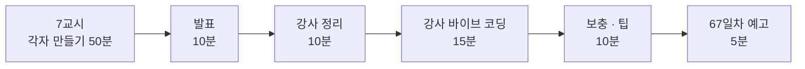

# 7·8교시 · 바이브 코딩 (`turl`)

- 교시: 7교시 16:00~16:50 (각자 만들기), 8교시 17:00~17:50 (발표 · 정리 · 강사 바이브 코딩 · 팁 · 예고)
- 과제: [VIBE-Q-TURL](../../Last3Mon/66/VIBE-Q-TURL.md)
- **오늘부터 7·8교시는 퀴즈 대신 매일 프로그램 하나를 바이브 코딩으로 만듭니다.** 오늘은 `turl`: curl을 터미널 화면(TUI)으로. 오늘 만든 `my-meeting` 웹훅을 이 도구로 불러 봅니다.

## 0. 7·8교시 진행 방식 (매일 같음)

1. 수강생이 직접 CLI 코딩 에이전트로 특정 기능의 프로그램 만들기 (7교시)
2. 수강생 한두 명이 만든 과정을 발표해서 공유
3. 강사가 이후 필요한 내용 정리
4. 강사가 더 필요한 내용으로 바이브 코딩 진행
5. 부족한 내용 보충과 팁

## 1. 7교시 · 각자 만들기 (50분)

| 시간 | 단계 | 확인 |
| --- | --- | --- |
| 16:00~16:03 | 0. 준비 (`~/vibe/turl`, `git init`, 에이전트 실행) | |
| 16:03~16:15 | 1. 글자로 보내기 (R1) | `turl send POST .../my-meeting --body-file ...`, `pytest` |
| 16:15~16:30 | 2. TUI (R1 · R2) | 화면에서 보내기, 파일에서 Body |
| 16:30~16:43 | 3. 기록 · curl · 오류 (R3 · R4 · R5) | 껐다 켜기, curl 명령 실행, 꺼진 주소 |
| 16:43~16:50 | 4. 정리 · 발표 메모 | |

| 볼 것 | 막혔을 때 한마디 |
| --- | --- |
| 한 번에 다 만들어 달라고 했나 | "1단계만 먼저. 글자로 보내지는지 보고 다음으로" |
| 실행해 보지 않고 다음 요청 | "에이전트가 됐다고 해도 직접 `uv run turl ...`" |
| 테스트가 진짜 서버를 부름 | "가짜 서버로 테스트하게 해 달라고 하세요" |
| 단계마다 commit 안 함 | "망가지면 `git diff`, `git checkout .`으로 돌아갈 곳이 필요" |

수업 준비 때 turl을 미리 만들어 보지는 않았습니다. 강사 바이브 코딩(4절)에서 걸린 시간을 재어 정답본(`VIBE-A-TURL.md`)에 남깁니다.

## 2. 8교시 · 발표 (10분)

- 1~2명. 7교시에 돌면서 **막혔다가 스스로 푼 사람**을 먼저 고릅니다 (완성도보다 과정).
- 3분 발표 · 2분 질문: 잘 먹힌 요청문 / 안 먹힌 요청문 / 에이전트가 틀린 곳과 알아챈 방법 / 시연.

## 3. 강사 정리 (10분)

| | n8n 회의록 워크플로우 | turl |
| --- | --- | --- |
| 규칙 파일 | `AGENTS.md` (환경 · 검증된 노드 · 계약 · 금지) | 각자 만든 `AGENTS.md`/`CLAUDE.md` (없으면 이번에 만들기) |
| 작게 나누기 | 예제 1 → 예제 2 → 과제 | 1단계 → 2단계 → 3단계 |
| 확인 도구 | `flow.py check · push · test` | `uv run turl`, `pytest` |
| 기대 결과 | `cases/*.json` | R1~R5 확인 표, 테스트 |
| 바꿔 끼우기 | Chat Model 노드 (모델 이름만 바꾸면 교체) | 진짜 서버 ↔ 가짜 서버 |
| 비밀 지키기 | Credential id만, 키 없음 | 기록에서 비밀 헤더 가리기 |

## 4. 강사 바이브 코딩 (15분)

| 주제 | 요청문 요지 | 보여 줄 것 |
| --- | --- | --- |
| 프로젝트 규칙 파일 | "이 프로젝트의 AGENTS.md를 만들어: 구조, 실행·테스트 명령, 규칙" | 다음 요청부터 같은 실수를 안 함 |
| 요청 모음 | "requests/ 폴더의 *.json 을 목록으로 보여 주고 고르면 Body로" | Lab의 요청 파일을 그대로 씀 |
| 같은 요청 N번 | "같은 요청을 10번 보내 시간 목록 출력" | 72일차 `tbench`의 씨앗 |

걸린 시간과 결과를 `Last3Mon/66/VIBE-A-TURL.md`에 적어 둡니다.

## 5. 보충 · 팁 (10분)

| 팁 | 설명 |
| --- | --- |
| 요청문은 "목표 · 범위 · 확인 방법" | "1단계만, TUI는 아직, `uv run turl send ...`로 확인" |
| 에이전트가 끝났다고 하면 **내가 실행** | 에이전트의 보고는 주장, 실행 결과가 증거 |
| 실패를 그대로 붙여 주기 | 오류 메시지 · 보고서 파일 경로를 요약하지 말고 그대로 |
| 3번 고쳐도 안 되면 방향 바꾸기 | 요청을 더 작게 나누거나, 다른 방법을 물어보기 |
| 단계마다 `git commit` | 에이전트가 망가뜨려도 돌아갈 곳 |

## 6. 67일차 예고 (5분)

- 오늘: 정해진 흐름(요약 → 할 일 → 하나씩 → 모으기). 내일: **Agent가 Tool을 골라** 사내 데이터(FAQ, 접수 현황)로 답하고, 결과를 검증합니다.
- 바이브 코딩: `tman` (tldr 한국어 + man을 탭으로 보여 주고 설명을 번역하는 TUI). 오늘 `turl`은 지우지 마세요. 내일 웹훅을 부를 때 씁니다.

## 확인 (강사)

- [ ] 7교시 시작 전 `~/vibe/turl` 만드는 명령을 화면에 띄웠다.
- [ ] 발표자 1~2명, 강사 정리 표, 강사 바이브 코딩 1개(시간 기록), 팁, 예고.
