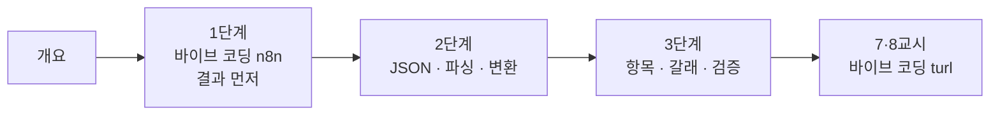

# 66일차 · 단일 업무 자동화 워크플로우 구현 (바이브 코딩)

- 일자: 2026-10-16 (66일차)
- 교과목: 노코드 멀티 에이전트 워크플로우 설계 및 운영
- 단원: AI 워크플로우 설계 및 구현
- 학습 내용: 노코드 Workflow 도구 활용, 단일 업무 자동화 Workflow 구현
- 실습 폴더: [Last3Mon/66](../../Last3Mon/66/README.md)
- 실습 환경: 65일차 n8n 2.42.6 + OpenAI API(`gpt-4.1-mini`, Credential `OpenAI (.env)`) + **CLI 코딩 에이전트**(Codex · Claude Code · Antigravity 중 하나)
- **실습 준비: [00-DAY66-PREP.md](00-DAY66-PREP.md) (수업 전날까지 1~3절 완료, CLI 코딩 에이전트 설치·로그인 포함)**

## 오늘부터 바뀌는 수업 방식

| 전 (64·65일차) | 오늘부터 |
| --- | --- |
| n8n 화면에서 노드를 끌어다 놓고 연결 | **CLI 코딩 에이전트**에게 요청문을 주고 워크플로우 JSON을 만들게 함 |
| 노드 설정을 하나씩 입력 | 나는 **결과 · 요청문 · 기대 결과(테스트)** 를 쓰고, 실행 결과를 확인 |
| 7교시 퀴즈 | 7·8교시 **바이브 코딩**: 매일 작은 프로그램 하나 만들기 · 발표 · 정리 |

## 오늘의 시간표

| 교시 | 시간 | 내용 | 자료 |
| --- | --- | --- | --- |
| 1 | 09:00~09:50 | 오늘의 개요 · 1단계 · 바이브 코딩으로 n8n 만들기, 결과 먼저 | [개요](00-DAY66-OVERVIEW.md), [1단계](01-STAGE1-VIBE-N8N-AND-RESULT-FIRST.md) |
| 2 | 10:00~10:50 | 1단계 · Lab 01 (결과 먼저, 첫 요청문, 과제: 빈 회의록·제목 없음) | [Lab 01](../../Last3Mon/66/LAB-01-Q-RESULT-FIRST.md) |
| 3 | 11:00~11:50 | 2단계 · LLM JSON 출력, 파싱과 변환, Lab 02 예제 1·2 | [2단계](02-STAGE2-JSON-AND-PARSE.md), [Lab 02](../../Last3Mon/66/LAB-02-Q-JSON-AND-PARSE.md) |
| 4 | 12:00~12:50 | 2단계 · Lab 02 과제 35분 (참석자도 뽑기) · 풀이 | [Lab 02](../../Last3Mon/66/LAB-02-Q-JSON-AND-PARSE.md) |
| - | 13:00~14:00 | 점심 |  |
| 5 | 14:00~14:50 | 3단계 · 반복·병렬 제어 구조와 검증, Lab 03 예제 1·2 | [3단계](03-STAGE3-ITEMS-PARALLEL-AND-VERIFY.md), [Lab 03](../../Last3Mon/66/LAB-03-Q-ITEMS-AND-PARALLEL.md) |
| 6 | 15:00~15:50 | 3단계 · Lab 03 과제 40분 (어려운 회의록으로 완성) · 풀이 | [Lab 03](../../Last3Mon/66/LAB-03-Q-ITEMS-AND-PARALLEL.md) |
| 7 | 16:00~16:50 | 바이브 코딩 · `turl` 만들기 (각자) | [VIBE-Q-TURL](../../Last3Mon/66/VIBE-Q-TURL.md), [진행](04-VIBE-CODING.md) |
| 8 | 17:00~17:50 | 바이브 코딩 발표 · 정리 · 강사 바이브 코딩 · 팁 · 67일차 예고 | [진행](04-VIBE-CODING.md) |

## 자료 목록

| 파일 | 내용 |
| --- | --- |
| `00-DAY66-PREP.md` | 실습 준비: n8n 켜기, CLI 코딩 에이전트 설치·로그인, `flow.py doctor` (수업 전) |
| `00-DAY66-OVERVIEW.md` | 개요 13장 (PPT 대신 Markdown, 가로줄로 장 구분) |
| `01-STAGE1-VIBE-N8N-AND-RESULT-FIRST.md` | 무엇이 바뀌나, 워크플로우는 JSON, AGENTS.md와 flow.py, 요청문 다섯 가지, 결과 먼저, 항목 흐름 |
| `02-STAGE2-JSON-AND-PARSE.md` | LLM의 답은 글자, 모양 알려 주기, 코드로 읽기, 빈칸은 코드가, 하나 바꾸면 다른 것도 바뀐다 |
| `03-STAGE3-ITEMS-PARALLEL-AND-VERIFY.md` | 1 → N → 1 (펼치기 · 항목마다 · 모으기), 빈 목록, 두 갈래와 Merge, 설계와 실행, 테스트로 완성 |
| `04-VIBE-CODING.md` | 7·8교시 바이브 코딩 진행 (turl), 발표, 강사 정리, 추가 바이브 코딩, 팁 |
