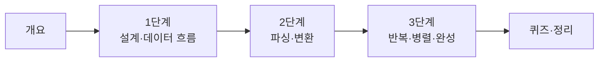

# 66일차 · 단일 업무 자동화 워크플로우 구현

- 일자: 2026-10-16 (66일차)
- 교과목: 노코드 멀티 에이전트 워크플로우 설계 및 운영
- 단원: AI 워크플로우 설계 및 구현
- 학습 내용: 노코드 Workflow 도구 활용, 단일 업무 자동화 Workflow 구현
- 실습 폴더: [Last3Mon/66](../../Last3Mon/66/README.md)
- 실습 환경: 65일차 n8n 2.42.6 + OpenAI API(`gpt-4.1-mini`, Credential `OpenAI (.env)`) 그대로 사용, Ollama는 대체용
- **실습 준비: [00-DAY66-PREP.md](00-DAY66-PREP.md) (수업 전날까지 1~2절 완료)**

## 오늘의 시간표

| 교시 | 시간 | 내용 | 자료 |
| --- | --- | --- | --- |
| 1 | 09:00~09:50 | 오늘의 개요 · 1단계 시작 | [00-DAY66-OVERVIEW.md](00-DAY66-OVERVIEW.md), [1단계](01-STAGE1-DESIGN-AND-DATA-FLOW.md) |
| 2 | 10:00~10:50 | 1단계 · 단일 업무 설계와 데이터 흐름, Lab 01 | [1단계](01-STAGE1-DESIGN-AND-DATA-FLOW.md), [Lab 01](../../Last3Mon/66/LAB-01-DESIGN-DATA-FLOW.md) |
| 3 | 11:00~11:50 | 2단계 · LLM JSON 출력, 파싱과 변환, Lab 02 예제 1 | [2단계](02-STAGE2-PARSE-AND-TRANSFORM.md), [Lab 02](../../Last3Mon/66/LAB-02-BUILD-PARSE-TRANSFORM.md) |
| - | 12:00~13:00 | 점심 |  |
| 4 | 13:00~13:50 | 2단계 · Lab 02 예제 2와 과제 (참석자 뽑기) | [Lab 02](../../Last3Mon/66/LAB-02-BUILD-PARSE-TRANSFORM.md) |
| 5 | 14:00~14:50 | 3단계 · 반복·병렬 제어 구조와 완성, Lab 03 예제 1·2 | [3단계](03-STAGE3-LOOP-PARALLEL-AND-FINISH.md), [Lab 03](../../Last3Mon/66/LAB-03-BUILD-LOOP-PARALLEL.md) |
| 6 | 15:00~15:50 | 3단계 · Lab 03 과제 40분 (내 워크플로우 완성 + 확인 필요) · 풀이 | [Lab 03](../../Last3Mon/66/LAB-03-BUILD-LOOP-PARALLEL.md) |
| 7 | 16:00~16:50 | 퀴즈 (A·B·C 중 선택, 20분) · 풀이 | [퀴즈와 정리](04-QUIZ-AND-WRAPUP.md) |
| 8 | 17:00~17:50 | 오늘의 정리 · Python에서 부르기(함께) · 다음 시간 예고 · 복습 과제 | [퀴즈와 정리](04-QUIZ-AND-WRAPUP.md) |

## 자료 목록

| 파일 | 내용 |
| --- | --- |
| `00-DAY66-PREP.md` | 실습 준비: 어제 환경 켜기, JSON 객체·목록, 새 노드 미리 보기 (수업 전) |
| `00-DAY66-OVERVIEW.md` | 개요 15장 (PPT 대신 Markdown, 가로줄로 장 구분). 1교시에 앞부분, 각 단계 설명 때 해당 장을 함께 띄움 |
| `01-STAGE1-DESIGN-AND-DATA-FLOW.md` | 목적 하나로 좁히기, 결과 먼저, 항목(상자) 읽기 1 → 4 → 1, 제어 구조, 요청이 바뀌면 (Lab 01 예제·과제 순서) |
| `02-STAGE2-PARSE-AND-TRANSFORM.md` | LLM 답은 글자, 파싱, 답의 모양 알려 주기(스키마), 하나 더 뽑기, Edit Fields (Lab 02 예제·과제 순서) |
| `03-STAGE3-LOOP-PARALLEL-AND-FINISH.md` | 펼치고·모으기, Merge로 합치기, 가짜를 진짜로, 기대 결과로 검증, 밖에서 부르기 (Lab 03 예제·과제 순서) |
| `04-QUIZ-AND-WRAPUP.md` | 퀴즈 안내, 오늘의 정리, 자주 막히는 부분, 67일차 예고 |
| `quiz/` | 퀴즈 문항(A·B·C), Google Form 생성 스크립트, 응답 분석 엑셀 |
