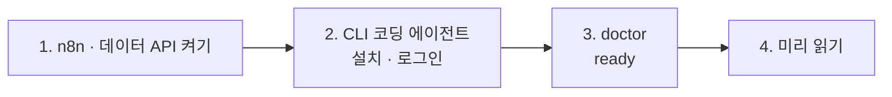

# 67일차 실습 준비 · 수업 전에 미리 해 두면 좋은 것

- 수업일: 2026-10-19 (67일차) · 바이브 코딩으로 만드는 Agent·Tool·데이터 연계 워크플로우와 결과 검증
- 준비 시간: 약 20분
- 먼저 WSL에서 `cd ~/aio-01d4-stu && git pull`로 오늘 자료를 받습니다 (수강생 저장소: https://gl.isitsoft.kr/publicproj/aio-01d4-stu).
- **수업 전날까지** 1~3절을 끝내 주세요.



---

## 1. n8n과 데이터 API 켜기 (전날 필수, 5분)

65일차에 설치한 n8n을 그대로 씁니다.

| 무엇 | 어디 |
| --- | --- |
| n8n 공식 설치 (compose.yml · .env) | `~/day65-n8n` (65일차 [SETUP-N8N](../../Last3Mon/65/SETUP-N8N.md) 5단계, 지우지 않음) |
| 켜고 끄기 (n8n) | `~/aio-01d4-stu/Last3Mon/65/n8n` (`~/day65-n8n/compose.yml`을 불러 씀) |
| Docker 프로젝트 · 네트워크 | `day65-n8n` · `day65-n8n_default` (데이터 API가 여기에 붙음) |

```bash
sudo systemctl disable --now ollama 2>/dev/null   # WSL에 설치한 Ollama가 있으면 끄고 자동 시작도 끔
cd ~/aio-01d4-stu/Last3Mon/65/n8n
docker compose rm -sf ollama                      # Ollama 컨테이너가 있으면 지움 (없으면 그냥 지나감)
docker compose start
cd ~/aio-01d4-stu/Last3Mon/67/data-api
docker compose up -d --force-recreate     # 데이터 파일 위치가 바뀌었으므로 다시 만듦
curl -s localhost:8800/health             # {"status": "ok"}
```

- **66일차부터 LLM은 OpenAI API 키(`Last3Mon/.env`, Credential `OpenAI (.env)`)만 씁니다.** Ollama는 쓰지 않으므로 위처럼 꺼서 메모리를 아낍니다. 다음 날부터는 같은 명령을 그대로 써도 됩니다.
`network day65-n8n_default not found`가 나오면 n8n이 켜져 있지 않은 것입니다. 위 n8n 부분부터 다시 합니다.

- `~/day65-n8n`에서 `docker compose start`로 켰어도 n8n은 같은 것입니다. 그래도 위처럼 `Last3Mon/65/n8n`에서 켜는 것을 기본으로 합니다.
- `docker compose start`가 `.../day65-n8n/compose.yml: no such file or directory`이면 n8n을 홈이 아닌 곳에 설치한 것입니다. 65일차 SETUP-N8N 문제 해결 표대로 `Last3Mon/65/n8n/.env`에 `N8N_HOME=<설치 폴더>`를 적습니다 (`flow.py`도 이 값을 읽습니다).

## 2. CLI 코딩 에이전트 (전날 필수, 10분)

66일차에 설치·로그인했다면 확인만 합니다. 아래 중 **하나 이상**이 WSL 터미널에서 실행되고 로그인되어 있어야 합니다.

| 에이전트 | 실행 | 확인 |
| --- | --- | --- |
| Codex CLI | `codex` | `codex --version` |
| Claude Code | `claude` | `claude --version` |
| Antigravity CLI | `agy` | `agy --version` |

- 처음 실행하면 브라우저 로그인 안내가 나옵니다. 끝까지 진행한 뒤 아무 질문("안녕")이나 해서 답이 오는지 봅니다.
- 설치가 안 되어 있으면 IT 문의 시간에 강사에게 알려 주세요.

## 3. 준비 확인 (전날 필수, 3분)

```bash
cd ~/aio-01d4-stu/Last3Mon/67
uv run tools/flow.py doctor
```

```text
✔ n8n install folder /home/<사용자>/day65-n8n
✔ n8n container day65-n8n-n8n-1
✔ n8n http://localhost:5678
✔ data API http://localhost:8800
✔ n8n → http://data-api:8800
✔ credential 'OpenAI (.env)' (openAiCourse0001)
✔ node catalog (for check)
✔ CLI coding agent: codex, claude
ready
```

| ✘ 항목 | 할 일 |
| --- | --- |
| ! n8n install folder | `~/day65-n8n`에 `compose.yml`이 없음. 다른 곳에 설치했다면 `N8N_HOME=<폴더> uv run tools/flow.py doctor` (경고만, n8n이 켜져 있으면 실습 가능) |
| n8n container | 1절 n8n 켜기. `flow.py`는 Docker 프로젝트 `day65-n8n`의 n8n 컨테이너를 자동으로 찾습니다. 그래도 못 찾으면 `N8N_CONTAINER=<이름>` (`docker ps`로 확인) |
| data API / n8n → data-api | 1절 데이터 API를 `--force-recreate`로 다시 켜기 |
| credential | `cd ~/aio-01d4-stu/Last3Mon/65/n8n && bash register-credentials.sh` |
| CLI coding agent | 2절 |

---

## 4. 미리 읽어 오면 좋은 내용 (선택, 약 5분)

### 4.1 n8n 워크플로우는 JSON 파일이다

66일차처럼 워크플로우 JSON 파일은 **CLI 코딩 에이전트가 씁니다.** 오늘은 Agent 노드에 Tool이 붙는 모양이 새로 나옵니다.

### 4.2 Agent와 Tool

| 용어 | 한 줄 설명 |
| --- | --- |
| Agent | 질문을 보고 어떤 Tool을 쓸지 **스스로 고르는** LLM |
| Tool | Agent가 부를 수 있는 기능 (FAQ 검색, 접수 현황 조회) |
| 테스트 케이스 | "이 입력이면 이런 결과가 나와야 한다"를 적은 것 |

29~33일차 Function Calling·Multi-Tool Agent를 떠올려 보세요. 오늘은 같은 일을 n8n으로, 그리고 **말로 만들고 테스트로 확인**합니다.

## 5. 당일 준비물

- 충전된 노트북과 충전기, WSL의 Docker, Windows Terminal(WSL) 창 **두 개**, 웹 브라우저

## 확인

- [ ] `curl -s localhost:8800/health` → `{"status": "ok"}`
- [ ] `codex` / `claude` / `agy` 중 하나에 로그인하고 답을 받았다
- [ ] `uv run tools/flow.py doctor` → 마지막 줄 `ready`
