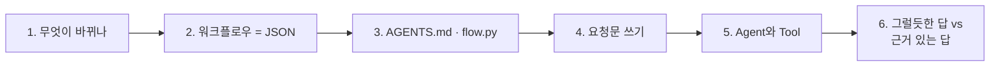
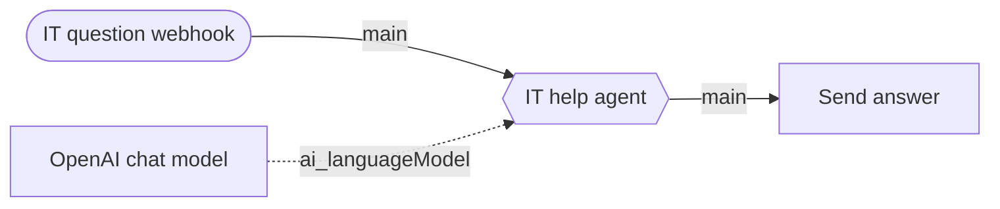
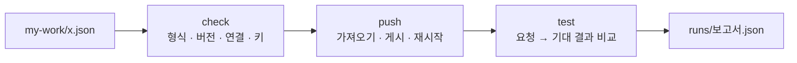
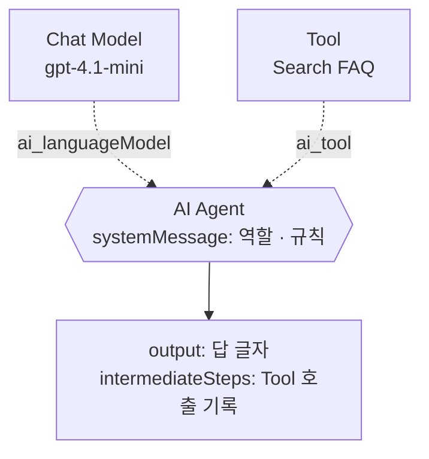

# 1단계 · 바이브 코딩으로 n8n 만들기, Agent와 Tool

- 교시: 1~2교시 (09:00~10:50)
- 실습: [Lab 01](../../Last3Mon/67/LAB-01-Q-AGENT-AND-FIRST-TOOL.md)
- 이 단계가 끝나면: 요청문으로 n8n 워크플로우를 만들고, push·test로 결과를 확인할 수 있다. Agent가 Tool을 써서 **근거 있는 답**을 하게 만들 수 있다.



## 1. 무엇이 바뀌나

64·65일차에는 n8n 화면에서 노드를 끌어다 놓고, 설정 칸을 채우고, 선을 이었습니다. 66일차부터는 그 일을 **CLI 코딩 에이전트**가 합니다. 오늘은 그 방식을 다시 짚고, 정해진 흐름이 아닌 **Agent**를 만듭니다.

| 일 | 64·65일차 | 66일차부터 |
| --- | --- | --- |
| 무엇을 만들지 정하기 | 나 | **나** (요청문) |
| 노드 고르기 · 설정 · 연결 | 나 (마우스) | 에이전트 |
| 형식 오류 찾기 | 실행해 보고 빨간 표시 | 에이전트 + `flow.py check` |
| 잘 되는지 확인 | 눈으로 OUTPUT 보기 | **나** (테스트 케이스, `flow.py test`) |
| 실패 원인 판단 | 나 | **나** + 에이전트 |

> 손이 하던 일은 줄고, **"무엇이 맞는 결과인가"를 정하는 일**이 늘어납니다. 66일차의 "결과 먼저"와 요청문 다섯 가지를 오늘도 그대로 씁니다.

## 2. 워크플로우는 JSON 파일이다

n8n 화면의 워크플로우를 **Download**하면 JSON 파일이 됩니다. 에이전트는 이 파일을 씁니다. Lab 01 예제 1의 워크플로우를 줄이면 이렇습니다.

```json
{
  "name": "67 IT chat agent (my)",
  "nodes": [
    {"name": "IT question webhook", "type": "n8n-nodes-base.webhook", "typeVersion": 2, "parameters": {"path": "my-chat", "...": "..."}},
    {"name": "IT help agent", "type": "@n8n/n8n-nodes-langchain.agent", "typeVersion": 3.1, "parameters": {"...": "..."}},
    {"name": "OpenAI chat model", "type": "@n8n/n8n-nodes-langchain.lmChatOpenAi", "typeVersion": 1.2, "credentials": {"openAiApi": {"id": "openAiCourse0001"}}},
    {"name": "Send answer", "type": "n8n-nodes-base.respondToWebhook", "typeVersion": 1.1, "parameters": {"...": "..."}}
  ],
  "connections": {
    "IT question webhook": {"main": [[{"node": "IT help agent", "type": "main", "index": 0}]]},
    "OpenAI chat model": {"ai_languageModel": [[{"node": "IT help agent", "type": "ai_languageModel", "index": 0}]]},
    "IT help agent": {"main": [[{"node": "Send answer", "type": "main", "index": 0}]]}
  }
}
```



| JSON | 화면에서 |
| --- | --- |
| `nodes[]` 하나 | 노드 상자 하나 |
| `type` · `typeVersion` | 노드 종류와 버전 (버전이 틀리면 열리지 않음) |
| `parameters` | 노드를 열었을 때의 설정 칸 |
| `credentials.id` | 고른 Credential (키 자체는 n8n 안에만 있음) |
| `connections` | 선. 보내는 노드 이름 → 받는 노드 이름 |

## 3. 에이전트에게 주는 규칙과 확인 도구

### 3.1 AGENTS.md: 에이전트가 모르는 것을 알려 준다

CLI 에이전트는 n8n을 일반적으로는 알지만, **우리 교실의 사정**은 모릅니다.

| 에이전트가 모르는 것 | AGENTS.md에 적은 것 |
| --- | --- |
| 우리 n8n 버전에서 되는 노드 버전 | 실행 확인한 노드 JSON 9종 (`typeVersion` 포함) |
| 데이터 API 주소 | n8n 안에서는 `http://data-api:8800` (`localhost` 아님) |
| Credential | `openAiCourse0001` id만 사용 (LLM은 OpenAI 하나), 키는 쓰지 않음 |
| 일하는 순서 | `my-work/`에 쓰기 → `check` → 사람이 push·test |
| 하지 말 것 | 테스트 기대 결과 바꾸기, 도구·데이터 고치기, 키 출력 |

`codex`와 `agy`는 `AGENTS.md`를, `claude`는 `CLAUDE.md`(→ `@AGENTS.md`)를 읽습니다. 프로젝트마다 이런 파일을 두는 것이 바이브 코딩의 첫 단계입니다.

### 3.2 flow.py: 만든 것을 확인하는 도구



| 명령 | 언제 | 수업 준비 때 |
| --- | --- | --- |
| `check` | 에이전트가 파일을 쓸 때마다 (에이전트가 직접 실행) | 1초 미만 |
| `push` | check 통과 후 (내가 실행) | 약 8초 |
| `test` | push 후 (내가 실행) | 케이스당 1~4초 |

`push`는 화면의 Import → Publish를 대신합니다. 같은 웹훅 경로를 쓰던 다른 워크플로우가 있으면 게시를 해제하고 알려 줍니다.

## 4. 요청문 쓰기

에이전트는 **적힌 것만** 압니다. 요청문에 다섯 가지를 넣습니다.

| 넣을 것 | 66일차 회의록 워크플로우에서 |
| --- | --- |
| ① 파일 | `my-work/meeting.json` (새로 만듦) |
| ② 입력 | POST 웹훅 `my-meeting`, 본문의 `title`·`notes` |
| ③ 처리 | LLM이 할 일 목록을 뽑고, 담당자·기한이 없으면 `미정`, 할 일이 없으면 다른 길 |
| ④ 결과 모양 | `{"title", "summary", "count", "actions": [...], "needs_check_count"}` |
| ⑤ 기대 결과 | 테스트 파일 (예: `weekly`는 4건, `empty`는 400) |

Lab에서는 이 다섯 가지를 **내가 직접** 채워 요청문을 씁니다. Lab 문서의 `▶` 가이드는 무엇을 채워야 하는지만 알려 주고, 요청문을 대신 써 주지 않습니다.

| 나쁜 요청문 | 무엇이 빠졌나 |
| --- | --- |
| "IT 문의 챗봇 만들어 줘" | 파일 · 입력 · 결과 모양 · 기대 결과 전부 |
| "FAQ 검색도 하게 해 줘" | 어느 파일을 고칠지, 결과에 무엇이 추가되는지 |
| "테스트 통과하게 해 줘" | 무엇을 바꿔야 하는지 (에이전트가 테스트를 고치려 할 수 있음) |

> 요청문은 **한 번에 한 가지 변화**만 담습니다. 예제 1 → 예제 2 → 과제처럼 작게 나눠 요청하고, 매번 test로 확인합니다.

## 5. Agent와 Tool

### 5.1 정해진 흐름 vs Agent

| | 66일차 회의록 워크플로우 | 오늘 IT 문의 Agent |
| --- | --- | --- |
| 다음에 할 일 | **내가** 요청문으로 흐름을 정함 | **LLM이** 질문을 보고 고름 |
| LLM의 역할 | 한 칸의 일 (할 일 찾기) | Tool을 고르고, 결과를 읽고, 답을 씀 |
| 좋은 점 | 늘 같은 순서, 예측 쉬움 | 질문이 다양해도 대응 |
| 조심할 점 | 새 경우마다 노드 추가 | 엉뚱한 Tool, 지어낸 답 → **테스트 필요** |

### 5.2 AI Agent 노드에 붙는 것



| 부분 | 하는 일 | 오늘 |
| --- | --- | --- |
| Chat Model | 생각하고 답을 쓰는 LLM (Tool 호출 기능 필요) | `gpt-4.1-mini` |
| Tool | Agent가 부를 수 있는 기능. **설명(toolDescription)** 을 보고 언제 쓸지 정함 | Search FAQ → Tool 이름 `Search_FAQ` |
| systemMessage | 역할과 규칙 ("Tool을 먼저 쓰고 그 결과로만 답") | 에이전트가 영어로 씀 |
| intermediateSteps | 어떤 Tool을 어떤 값으로 불렀고 무엇을 받았는지 | `returnIntermediateSteps: true` |

## 6. 그럴듯한 답 vs 근거 있는 답 (Lab 01 예제 1 → 2)

같은 테스트(`cases/lab01.json`)를 두 워크플로우에 보냈습니다 (수업 준비 때, 3번씩).

| | 예제 1 (Tool 없음) | 예제 2 (Search FAQ) |
| --- | --- | --- |
| 결과 | `Passed 3/9` | `Passed 9/9` |
| VPN 질문 | "인터넷 연결 상태 확인, 클라이언트 업데이트, 방화벽 점검" | "VPN 클라이언트를 최신 버전으로 업데이트하고 **인증서 만료 여부를 확인**" (FAQ-003 그대로) |
| 비밀번호 질문 | "사내 포털의 '비밀번호 찾기'… 이메일이나 휴대폰 번호로 인증" | "사내 포털 로그인 화면의 '비밀번호 찾기'에서 휴대폰 인증 후" (FAQ-001) |
| 점심 메뉴 질문 | "비빔밥이나 불고기 덮밥을 추천드립니다" | "회사 IT FAQ에는 점심 메뉴 추천에 관한 정보가 없습니다" |

예제 1의 비밀번호 답은 **우연히 거의 맞았습니다.** 답 글자만 봐서는 근거가 있는지 알 수 없습니다. 그래서 테스트는 `tools_used`(어떤 Tool을 썼나)도 확인합니다.

## 7. Lab 01 과제로 이어지는 질문

> "FAQ에 없으면 지어내지 말고, 쓴 FAQ 번호(`sources`)를 같이 주세요."

`sources`를 만드는 방법은 두 가지입니다. 66일차 "LLM이 할 일 vs 규칙이 할 일"을 떠올립니다.

| 방법 | 어디서 | 믿을 만한가 |
| --- | --- | --- |
| LLM에게 "답에 쓴 FAQ 번호도 써"라고 시킴 | systemMessage | LLM이 번호를 틀리거나 지어낼 수 있음 |
| Tool이 돌려준 글자에서 `FAQ-\d{3}`를 찾음 | Code 노드 (`intermediateSteps`) | 실제로 받은 데이터만 나옴 |

수업 준비 때 수업 정답은 **Code 노드가 Tool 결과에서 찾는** 방법을, Codex는 **LLM이 번호를 쓰게 하고 Code 노드가 실제로 받은 번호인지 다시 확인하는** 방법을 골랐습니다. 둘 다 테스트를 통과했습니다. 에이전트가 무엇을 골랐는지 JSON을 열어 확인하는 것도 나의 일입니다.

## 8. 자주 하는 실수

| 실수 | 증상 | 고치기 |
| --- | --- | --- |
| 요청문에 파일 이름이 없음 | 에이전트가 새 파일을 계속 만듦 | "my-work/it-agent.json 을 고쳐 줘"로 시작 |
| push 하지 않고 test | 예전 버전이 답함 | check → **push** → test 순서 |
| 테스트 기대 결과를 에이전트가 고침 | 통과했지만 의미 없음 | AGENTS.md 7절. 기대 결과는 내가 정함 |
| 한 번 통과로 끝 | 다음 실행에서 실패 | `--repeat 3` |

## 9. Q

1. 예제 1이 비밀번호 질문에 맞는 답을 했는데도 테스트가 실패한 이유는?
2. 요청문의 다섯 가지 중 빠지면 가장 곤란한 것은 무엇이라고 생각하나요? 이유는?
3. `sources`를 LLM이 쓰게 하는 것과 Code가 찾게 하는 것은 어떻게 다른가요?

## 정리

- 워크플로우는 JSON 파일이고, 66일차부터 에이전트가 씁니다. **나는 요청문과 기대 결과를 쓰고, 결과를 판단합니다.**
- AGENTS.md는 에이전트가 모르는 우리 환경을 알려 주고, `flow.py`는 만든 것을 확인합니다.
- Agent는 Tool을 스스로 고릅니다. 그럴듯한 답과 근거 있는 답은 **Tool 호출 기록**으로 구분합니다.
