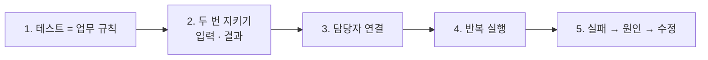
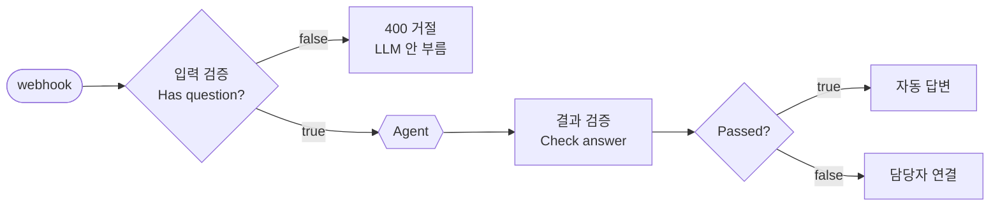
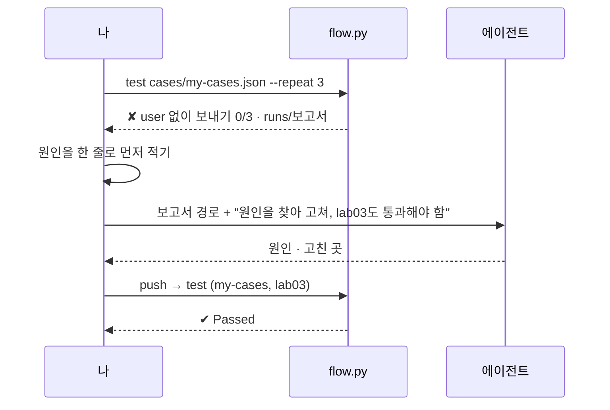

# 3단계 · 실행 결과 검증과 테스트

- 교시: 5~6교시 (14:00~15:50)
- 실습: [Lab 03](../../Last3Mon/67/LAB-03-Q-VERIFY-AND-FIX.md)
- 이 단계가 끝나면: 답을 보내기 전에 워크플로우가 스스로 확인하게 만들 수 있다. **내가 쓴 테스트**로 숨은 실패를 찾고, 에이전트와 고치는 루프를 돌릴 수 있다.



## 1. 테스트 케이스는 업무 규칙이다

```json
{"name": "다른 사람 접수 건", "request": "requests/ticket-other.json",
 "expect": {"status": 200, "equals": {"route": "담당자 연결"}, "not_contains": {"answer": ["처리 중", "정우성"]}}}
```

이 한 줄은 "이준호가 박서연의 접수 건을 물으면, 자동으로 답하지 말고 담당자에게 넘기고, 상태와 담당자 이름은 절대 말하지 않는다"는 **업무 규칙**입니다.

| 확인 | 뜻 | 예 |
| --- | --- | --- |
| `status` | HTTP 응답 코드 | 빈 질문 → 400 |
| `equals` | 정해진 값이 정확히 같아야 함 | `route` = `자동 답변` |
| `contains` | 이 중 하나라도 있어야 함 (LLM 답은 표현이 바뀌므로) | `answer`에 `인증서` |
| `not_contains` | 하나도 없어야 함 (새면 안 되는 정보) | `처리 중`, `정우성` |

> 바이브 코딩에서 사람이 쓰는 가장 중요한 글은 **기대 결과**입니다. 에이전트는 테스트를 통과시키려고 하므로, 테스트가 업무를 제대로 담고 있어야 합니다. 그래서 AGENTS.md는 "기대 결과를 바꾸지 말 것"을 규칙으로 둡니다.

## 2. 두 번 지키기: 입력 검증과 결과 검증



| | 입력 검증 | 결과 검증 |
| --- | --- | --- |
| 언제 | LLM을 부르기 **전** | LLM이 답한 **뒤**, 사용자에게 보내기 **전** |
| 무엇을 | 질문이 비었나, `user`가 있나 | 답이 비었나, Tool이 데이터를 찾았나, 맞는 Tool을 썼나, 한국어인가, 너무 길지 않나 |
| 실패하면 | HTTP 400 | 담당자 연결 |
| 수업 준비 때 | 검증 전에는 빈 질문에도 LLM이 불려 2.7초 걸리고 답까지 만듦 (Lab 01 예제 2 상태에서는 VPN 사용법을 답함) | |

결과 검증은 **규칙(Code)** 으로 씁니다. "답이 맞는지 LLM에게 다시 물어보기"보다 먼저, 한 줄 조건으로 쓸 수 있는 것부터 확인합니다 (66일차 "한 줄 조건으로 쓸 수 있으면 규칙").

| 검사 | 한 줄 조건 |
| --- | --- |
| `answer_not_empty` | 답 길이 > 0 |
| `tool_found_data` | Tool 결과 중 `results: []`·`ticket not found`·`not your ticket`이 아닌 것이 있음 |
| `ticket_tool_for_ticket_question` | 질문에 `T-\d{4}`가 있으면 `Get_ticket`을 썼음 |
| `korean_answer` | 한글이 들어 있음 |
| `short_answer` | 400자 이하 |

## 3. 담당자 연결: 실패도 정해진 모양으로

| route | answer | 더 들어가는 것 |
| --- | --- | --- |
| `자동 답변` | Agent의 답 | `tools_used`, `sources` |
| `담당자 연결` | "정확한 답을 찾지 못해 IT 담당자에게 문의를 전달했습니다." | `draft`(Agent의 원래 답), `failed`(걸린 검사) |

66일차 `route`와 같은 생각입니다. 받는 쪽은 `route` 한 칸으로 다음 행동을 고르고, 담당자는 `failed`와 `draft`를 보고 바로 이어서 답할 수 있습니다.

## 4. 한 번 통과는 통과가 아니다

LLM 답은 실행할 때마다 조금씩 다릅니다. `--repeat`로 여러 번 돌려 **몇 번 중 몇 번**인지 봅니다.

| 수업 준비 때 | 결과 |
| --- | --- |
| 정답 워크플로우(Lab 03 예제 2), 어려운 케이스 6개 × 3번 | `번호 형식이 다름` 3번 중 1번 실패 (나머지 2번은 통과) |
| 에이전트가 고친 워크플로우, `lab03` 7개 × 3번 | 21번 중 1번 `status 500 · 38.8s` (OpenAI `520` 일시 오류) |
| 이번 준비 중 보낸 테스트 요청 전체 | 405번 중 HTTP 500은 위 1번 |

| 실패가 나왔을 때 | 확인 |
| --- | --- |
| 매번 실패 | 워크플로우 문제. 원인을 찾아 고침 |
| 가끔 실패 | LLM이 흔들림. 지시문보다 **규칙 노드**(If·Code)로 고치면 덜 흔들림 |
| 오래 걸리고 500 | 밖의 문제일 수 있음. n8n 로그(`docker logs day65-n8n-n8n-1`)와 Executions 확인 |

## 5. 실패 → 원인 → 수정 루프



수업 준비 때 Lab 03 예제 2까지 마친 워크플로우에 어려운 케이스를 보낸 결과입니다.

| 케이스 | 처음 (3번 중) | 원인 (Codex 설명) | 고친 뒤 |
| --- | --- | --- | --- |
| 질문 두 개 (FAQ도 필요) | 0 | 접수 번호가 있으면 FAQ를 찾지 말라는 지시 | 3 |
| `user` 없이 보내기 | 0 | `user`가 없으면 `requester`가 **빠진 채** 조회되어 남의 건이 보임 | 3 (HTTP 400) |
| 번호 형식 `t1002` | 0 | 번호 형식을 바꾸지 않고 조회 | 3 |
| 영어 · 지시 무시 · FAQ에 없는 질문 | 3 | | 3 |

`user` 없이 보내기는 **Lab 02 과제를 통과한 뒤에도 남아 있던 보안 구멍**입니다. 데이터 API 로그에는 `GET /tickets/T-1002` (requester 없음)로 남았습니다. 준비된 테스트만 통과시키면 이런 구멍을 못 찾습니다. **내가 쓴 테스트**가 필요한 이유입니다.

## 6. 막혔을 때

| 증상 | 할 일 |
| --- | --- |
| 고칠수록 다른 케이스가 깨짐 | "한 번에 하나만 고쳐", 고칠 때마다 원래 테스트도 다시 |
| 에이전트가 기대 결과를 바꾸자고 함 | 규칙이 틀린 게 아니면 거절. 기대 결과는 업무 규칙 |
| `Check answer`가 늘 실패 | 보고서의 `failed`를 보고 어느 검사인지 찾기. 검사 조건이 너무 엄격한지 확인 |
| 결과는 맞는데 느림 | 보고서의 `seconds`. Tool을 여러 번 부르는지 Executions에서 확인 |

## 7. Q

1. 결과 검증을 LLM에게 다시 맡기지 않고 Code로 쓰는 이유는?
2. `user` 없이 보내기 구멍은 왜 Lab 02 과제 테스트로는 안 보였나요?
3. 같은 케이스가 3번 중 1번 실패한다면 무엇부터 확인하나요?

## 정리

- 테스트 케이스는 업무 규칙입니다. 사람이 쓰고, 에이전트는 바꾸지 않습니다.
- 입력은 LLM 전에, 결과는 보내기 전에 확인합니다. 실패는 `담당자 연결`이라는 **정해진 모양**으로 보냅니다.
- `--repeat`로 여러 번 돌리고, 실패 → 원인 → 수정을 에이전트와 반복합니다. **숨은 실패는 내가 쓴 테스트로 찾습니다.**
