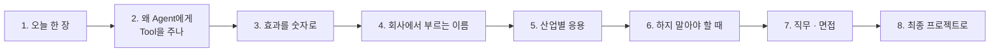

# 4단계 · 정리: 오늘 한 일의 의미 · 효과 · 실전 응용

- 교시: 8교시 17:10~17:45 (35분, 바이브 코딩 발표 10분 뒤) · 자료: 이 문서 + [개요](00-DAY67-OVERVIEW.md)
- 이 시간이 끝나면: 오늘 1~3단계에서 한 일(Agent와 Tool · 사내 데이터 연계 · 실행 결과 검증)이 **왜 필요했는지**, 숫자로 **무엇이 좋아졌는지**, 회사에서는 같은 생각을 **어떤 이름과 도구로** 쓰는지 말할 수 있고, 최종 프로젝트에 무엇을 가져갈지 정할 수 있다.
- 숫자: 수업 준비 때 정답 워크플로우를 실행한 값입니다 (2026-10-17, gpt-4.1-mini. 강사의 수업 준비 기록).

## 0. 이 시간 (35분)

| 시간 | 절 | 하는 일 |
| --- | --- | --- |
| 17:10~17:15 | 1 · 2 | 오늘 한 장, 왜 Agent에게 Tool을 주나 |
| 17:15~17:20 | 3 | 오늘 숫자로 본 효과 |
| 17:20~17:28 | 4 · 5 | 같은 생각의 업계 이름 · 도구, 산업별 응용 예 |
| 17:28~17:33 | 6 | 하지 말아야 할 때 |
| 17:33~17:40 | 7 · 8 | 직무와 면접 질문, 최종 프로젝트 체크리스트 |
| 17:40~17:45 | 9 · 토론 | 다음 일차와의 연결, 질문 둘 |

## 1. 오늘 한 장

| 단계 | 한 일 | 오늘 숫자 |
| --- | --- | --- |
| 1단계 · Agent와 Tool | IT 문의 Agent가 FAQ Tool로 답하고, 모르면 모른다고 · 출처(`sources`) | `lab01-challenge` **15/15** (5번 반복), `lab01` 6/6 |
| 2단계 · 사내 데이터 연계 | 접수 현황 Tool, **본인 접수 건만** (`requester` ← 웹훅의 `user`) | `lab02-challenge` 예제 상태 **4/8** → **20/20**, `lab02` 8/8 |
| 3단계 · 실행 결과 검증 | 어려운 테스트를 쓰고, 실패를 찾아 고치기 (`user` 필수 400, 번호 형식 정규화) | 어려운 케이스 예제 상태 **18/21** → **35/35** (5번 반복), `lab03` 21/21 |
| 바이브 코딩 | 명령어 사용 예를 보여 주는 `tman` | |

한 문장으로: **LLM에게 사내 데이터를 Tool로 주되, 틀리면 안 되는 값은 시스템이 정하고, 실행 결과는 테스트로 검증한다.**

## 2. 왜 Agent에게 Tool을 주나

| | LLM 혼자 | Agent + Tool |
| --- | --- | --- |
| 아는 것 | 학습할 때까지의 일반 지식 | 지금 회사의 FAQ · 접수 건 |
| 모르는 것을 물으면 | 그럴듯하게 지어내기 쉬움 | Tool 결과에 없으면 "모른다" |
| 출처 | 없음 | `sources`에 FAQ 번호 |
| 위험 | 틀린 답 | **틀린 답 + 남의 데이터 조회** (권한) |

- Tool을 주면 Agent는 **말만 하는 것이 아니라 일을 합니다.** 그래서 "누구의 데이터를 볼 수 있나" 같은 값은 LLM에게 맡기지 않고 웹훅이 받은 값으로 정했습니다 (본인 접수 건만, 4/8 → 20/20).
- LLM 답은 매번 조금씩 다르므로, 같은 테스트를 **여러 번(5번)** 돌려 흔들리지 않는지 봤습니다.

## 3. 효과를 숫자로

| 무엇 | 전 | 후 | 바꾼 것 |
| --- | --- | --- | --- |
| 모르면 모른다고 · 출처 (`lab01-challenge`) | | **15/15** (5번 반복) | 지시문 · `sources`는 Tool 결과에서 |
| 본인 접수 건만 (`lab02-challenge`) | 4/8 | **20/20** | `requester`를 LLM이 아니라 `body.user`에서 |
| 어려운 케이스 7개 | 18/21 (`user` 없이 보내기 0/3) | **35/35** (5번 반복) | `user` 필수(400), 번호 형식 정규화 |
| 앞의 테스트 | | `lab01` 6/6 · `lab02` 8/8 · `lab03` 21/21 | |

- 어려운 케이스에서 실패한 셋은 **`user` 없이 보내기**였습니다. 정상 질문만 시험하면 이런 구멍을 못 찾습니다. 테스트는 "되는 것"이 아니라 **"실패를 찾는 일"**입니다.

## 4. 회사에서는 같은 생각을 이렇게 부른다

| 오늘 한 것 | 업계 이름 | 쓰는 도구 · 표준 (예) |
| --- | --- | --- |
| Agent가 Tool을 골라 부름 | Tool 호출 (function calling), 에이전트 | n8n AI Agent, LLM의 tool/function calling, MCP |
| 사내 데이터를 읽어 답 | 데이터 연계, 근거 기반 답변 | 사내 API, 데이터베이스, (71일차) RAG |
| `requester`를 시스템이 | 인증 · 인가, 최소 권한 | SSO · OAuth, 역할 기반 접근(RBAC) |
| 출처 `sources` | 인용, 추적성 | 답변에 문서 id · 링크 |
| 실행 결과 검증 · 어려운 테스트 | 회귀 테스트, 적대적 테스트 | 테스트 파일, CI, LLM 평가 도구 |
| 같은 테스트 5번 | 비결정성 측정, 흔들림 확인 | 반복 실행 (`--repeat`) |

## 5. 산업별 응용 (예)

아래는 오늘 한 일을 다른 업무에 옮긴 예입니다 (특정 회사 사례가 아니라 흔한 모양).

| 업무 | 오늘의 무엇을 | 이렇게 |
| --- | --- | --- |
| 쇼핑몰 주문 문의 | Tool · 본인 것만 | 주문 조회 Tool, 주문자는 로그인 정보로, 남의 주문은 API가 403 |
| 사내 인사 문의 | 모르면 모른다고 · 출처 | 규정 Tool 결과에 없으면 "인사팀 연결", 답에 규정 번호 |
| 병원 예약 안내 | 데이터 연계 · 검증 | 예약 조회 Tool, 환자 확인은 시스템이, 어려운 테스트(없는 예약 번호 · 형식이 다른 번호) |
| 사내 IT 문의 (오늘) | 전부 | FAQ · 접수 건 Tool, 본인 건만, `user` 필수, 번호 정규화 |

**토론 거리**: 내 회사의 AI 기능에서 "LLM이 정하면 안 되는 값" 하나를 찾아 봅니다.

## 6. 하지 말아야 할 때 (흔한 실수)

| 하기 쉬운 일 | 왜 위험한가 | 대신 |
| --- | --- | --- |
| 사용자 이름을 LLM이 질문에서 읽게 | "나는 박서연이야"로 남의 데이터를 봄 | 웹훅 · 로그인 정보에서 |
| 출처를 LLM이 쓰게 | 없는 번호를 지어냄 | Tool 결과에서 코드가 |
| 정상 질문만 테스트 | `user` 없음 같은 구멍을 못 찾음 | 어려운 · 이상한 입력도 |
| 한 번 통과로 끝 | LLM 답이 흔들림 | 5번 반복 |
| 테스트를 통과시키려고 기대를 바꿈 | 테스트가 의미를 잃음 | 워크플로우를 고친다 |

## 7. 직무와 면접

오늘 한 일은 **AI · LLM 애플리케이션 엔지니어, AI 에이전트 개발자, 백엔드 엔지니어, QA · 테스트 엔지니어**가 날마다 하는 일입니다. 채용 공고의 "Tool calling", "에이전트 설계", "LLM 테스트 · 평가"가 오늘 내용입니다.

1. "Agent에게 사내 데이터를 줄 때 무엇을 조심하나요?"

틀리면 안 되는 값은 LLM이 정하지 않게 합니다. 오늘 접수 현황 Tool의 `requester`를 LLM이 아니라 웹훅의 `user`에서 받게 하자 본인 접수 건 테스트가 4/8에서 20/20이 됐습니다. 남의 건인지는 데이터 쪽이 403으로 판단합니다.

2. "LLM이 모르는 것을 지어내지 않게 하려면?"

Tool 결과로만 답하게 하고, 결과에 없으면 정해진 "모른다" 답을 하게 합니다. 출처는 Tool 결과에서 코드가 붙입니다. 5번 반복해 15/15로 흔들리지 않는 것을 확인했습니다.

3. "테스트는 어떻게 쓰나요?"

정상 케이스만이 아니라 실패를 찾는 케이스를 씁니다. 오늘 어려운 케이스 7개를 써 보니 `user` 없이 보내는 셋이 실패했고(18/21), `user` 필수 400과 번호 형식 정규화로 고쳐 35/35(5번 반복)가 됐습니다.

## 8. 최종 프로젝트로 가져갈 것

- [ ] Agent에게 줄 Tool 목록과 Tool마다 하는 일 · 입력 · 결과
- [ ] 권한이 걸린 값(사용자 · 계정)은 시스템이 정한다, 데이터 쪽이 403
- [ ] 출처는 Tool 결과에서 코드가 붙인다
- [ ] 모를 때의 정해진 답
- [ ] 어려운 테스트(빠진 입력 · 이상한 형식 · 남의 데이터)를 쓰고 여러 번 돌린다

## 9. 다음 일차와의 연결

| 일차 | 오늘의 무엇을 잇나 |
| --- | --- |
| 68 | Agent 여럿 — 오늘의 IT Agent가 여러 전문 Agent 중 하나가 됨 |
| 69 | 검토자 Agent — 오늘 코드로 한 검증을 역할로 나눔 |
| 71 | RAG — 오늘의 FAQ Tool 자리에 문서 검색이 들어감 |
| 73 | 보안 — 오늘의 "본인 건만"을 공격으로 시험 |

## 토론 (5분)

1. 오늘 IT Agent에게 Tool을 하나 더 준다면 무엇이고, 그 Tool에서 LLM이 정하면 안 되는 값은?
2. 테스트를 5번 반복했는데 4번만 통과한다면, 그 기능을 내보내도 될까요?

## 정리

- [ ] Agent + Tool: 지금의 사내 데이터로 답하고, 출처를 남긴다
- [ ] 틀리면 안 되는 값(누가 물었나)은 시스템이, 권한은 데이터 쪽이
- [ ] 테스트는 실패를 찾는 일, LLM은 여러 번
- [ ] 효과는 숫자로 (4/8 → 20/20, 18/21 → 35/35)
- [ ] 최종 프로젝트에 체크리스트 5개를 가져간다
