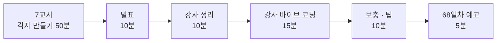

# 7·8교시 · 바이브 코딩 (`tman`)

- 교시: 7교시 16:00~16:50 (각자 만들기), 8교시 17:00~17:50 (발표 · 정리 · 강사 바이브 코딩 · 팁 · 예고)
- 과제: [VIBE-Q-TMAN](../../Last3Mon/67/VIBE-Q-TMAN.md)
- 66일차부터 7·8교시는 퀴즈 대신 **매일 프로그램 하나를 바이브 코딩**으로 만듭니다. 오늘은 `tman`: 명령어 사용 예(tldr 한국어)와 man을 탭으로 보여 주고, 설명을 한국어로 번역하는 TUI입니다.

## 1. 7교시 · 각자 만들기 (50분)

| 시간 | 단계 | 확인 |
| --- | --- | --- |
| 16:00~16:03 | 0. 준비 (`~/vibe/tman`, `git init`, 에이전트 실행) | |
| 16:03~16:13 | 1. 글자로 출력 (R1) | `uv run tman tar`, `pytest` |
| 16:13~16:28 | 2. TUI · 탭 (R2 · R4) | `uv run tman ls` |
| 16:28~16:43 | 3. 번역 · 캐시 (R3) | `uv run tman wcurl` |
| 16:43~16:50 | 4. 정리 · 발표 메모 | |

강사는 교실을 돌며 아래를 봅니다.

| 볼 것 | 막혔을 때 한마디 |
| --- | --- |
| 한 번에 다 만들어 달라고 했나 | "1단계만 먼저. 글자로 나오는지 보고 다음으로" |
| 실행해 보지 않고 다음 요청 | "에이전트가 됐다고 해도 직접 `uv run tman tar`" |
| 테스트가 실제 API를 부름 | "가짜 번역기로 테스트하게 해 달라고 하세요" |
| 키가 코드에 들어감 | "키는 `OPENAI_API_KEY` 환경 변수로" |
| 단계마다 commit 안 함 | "망가지면 `git diff`, `git checkout .`으로 돌아갈 곳이 필요" |

수업 준비 때 강사용 정답본(`VIBE-A-TMAN.md`)의 요청문으로 Codex가 만든 결과입니다 (강사 PC, 샌드박스 안이라 에이전트는 네트워크를 쓰지 못하고 실행은 강사가 확인).

| 단계 | 에이전트 시간 | 확인 |
| --- | --- | --- |
| 1. 글자로 출력 | 116초 | `uv run tman tar` 한국어 페이지 출력, pytest 19 passed |
| 2. TUI · 탭 | 78초 (Textual은 미리 설치) | tar 페이지와 man 탭 표시, pytest 29 passed |
| 3. 번역 · 캐시 | 133초 | `tman wcurl` 설명이 한국어로 번역되어 `~/.cache/tman`에 저장 ("중단된 다운로드 재개:"), pytest 48 passed |

에이전트 시간은 합쳐 6분 미만입니다. 나머지 시간은 요청문 쓰기, 실행해 보기, 고칠 곳 찾기에 씁니다.

## 2. 8교시 · 발표 (10분)

- 1~2명. 7교시에 돌면서 **막혔다가 스스로 푼 사람**을 먼저 고릅니다 (완성도보다 과정).
- 3분 발표 · 2분 질문: 잘 먹힌 요청문 / 안 먹힌 요청문 / 에이전트가 틀린 곳과 알아챈 방법 / 시연.

## 3. 강사 정리 (10분)

오늘 n8n 실습과 tman은 **같은 방식**입니다. 이 표로 묶어 줍니다.

| | n8n IT 문의 Agent | tman |
| --- | --- | --- |
| 규칙 파일 | `AGENTS.md` (환경 · 검증된 노드 · 금지) | 각자 만든 `AGENTS.md`/`CLAUDE.md` (없으면 이번에 만들기) |
| 작게 나누기 | 예제 1 → 예제 2 → 과제 | 1단계 → 2단계 → 3단계 |
| 확인 도구 | `flow.py check · push · test` | `uv run tman`, `pytest` |
| 기대 결과 | `cases/*.json` (업무 규칙) | R1~R4 확인 표, 테스트 |
| 바꿔 끼우기 | Chat Model 노드 (모델 이름만 바꾸면 교체) | 번역기 (실제 LLM ↔ 가짜) |
| 비밀 지키기 | Credential id만, 키 없음 | `OPENAI_API_KEY` 환경 변수 |

## 4. 강사 바이브 코딩 (15분)

학생 화면 앞에서 강사가 직접 이어서 만듭니다. 오늘 시간에 맞는 것 하나를 고릅니다.

| 주제 | 요청문 요지 | 보여 줄 것 |
| --- | --- | --- |
| 프로젝트 규칙 파일 | "이 프로젝트의 AGENTS.md를 만들어: 구조, 실행·테스트 명령, 규칙(키는 환경 변수, 테스트는 가짜 번역기)" | 다음 요청부터 같은 실수를 안 함 |
| 명령어 목록 검색 | "tldr 전체 목록(index)을 받아 입력칸에 자동 완성" | 큰 데이터는 한 번 받아 캐시 |
| `--json` 출력 | "`tman tar --json`으로 파싱 결과를 JSON 출력" | TUI와 로직을 나눠 두면 다른 프로그램이 씀 (내일 이후 n8n에서 부를 수도 있음) |

## 5. 보충 · 팁 (10분)

| 팁 | 설명 |
| --- | --- |
| 요청문은 "목표 · 범위 · 확인 방법" | "1단계만, TUI는 아직, `uv run tman tar`로 확인" |
| 에이전트가 끝났다고 하면 **내가 실행** | 에이전트의 보고는 주장, 실행 결과가 증거 |
| 실패를 그대로 붙여 주기 | 오류 메시지·보고서 파일 경로를 요약하지 말고 그대로 |
| 3번 고쳐도 안 되면 방향 바꾸기 | 요청을 더 작게 나누거나, 다른 방법을 물어보기 |
| 단계마다 `git commit` | 에이전트가 망가뜨려도 돌아갈 곳 |
| 비밀은 파일에 쓰지 않기 | 환경 변수, `.env`는 `.gitignore`에 |

## 6. 68일차 예고 (5분)

- 오늘: Agent 하나 + Tool 둘 + 검증. 내일: 여러 업무가 섞인 문의를 **여러 Agent로 나누어** 처리하는 설계 (복합 시나리오, Multi-Agent).
- 바이브 코딩: `tflow` (n8n 워크플로우 JSON을 트리·mermaid로 보여 주는 TUI). 오늘 `my-work/it-agent.json`을 입력으로 씁니다. 지우지 마세요.

## 확인 (강사)

- [ ] 7교시 시작 전 `OPENAI_API_KEY` 꺼내는 명령을 화면에 띄웠다 (키 값은 띄우지 않음).
- [ ] 발표자 1~2명, 강사 정리 표, 강사 바이브 코딩 1개, 팁, 예고.
