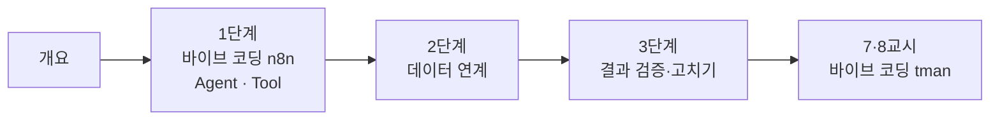

# 67일차 · Agent·Tool·데이터 연계 워크플로우와 실행 결과 검증 (바이브 코딩)

- 일자: 2026-10-19 (67일차)
- 교과목: 노코드 멀티 에이전트 워크플로우 설계 및 운영
- 단원: AI 워크플로우 설계 및 구현
- 학습 내용: Agent·Tool·데이터 연계 Workflow 구현, 실행 결과 검증
- 실습 폴더: [Last3Mon/67](../../Last3Mon/67/README.md)
- 실습 환경: 65일차 n8n 2.42.6 + OpenAI API(`gpt-4.1-mini`, Credential `OpenAI (.env)`) + 데이터 API + **CLI 코딩 에이전트**(Codex · Claude Code · Antigravity 중 하나)
- **실습 준비: [00-DAY67-PREP.md](00-DAY67-PREP.md) (수업 전날까지 1~3절 완료)**

## 66일차부터 바뀐 수업 방식 (이어서)

| 전 (64·65일차) | 66일차부터 |
| --- | --- |
| n8n 화면에서 노드를 끌어다 놓고 연결 | **CLI 코딩 에이전트**에게 요청문을 주고 워크플로우 JSON을 만들게 함 |
| 노드 설정을 하나씩 입력 | 나는 **요청문 · 기대 결과(테스트)** 를 쓰고, 실행 결과를 확인 |
| 7교시 퀴즈 | 7·8교시 **바이브 코딩**: 매일 작은 프로그램 하나 만들기 · 발표 · 정리 |

오늘 새로운 것: 66일차의 정해진 흐름(요약 → 할 일 → 하나씩 → 모으기) 대신 **Agent가 Tool을 골라** 사내 데이터로 답하고, 그 결과를 검증합니다.

## 오늘의 시간표

| 교시 | 시간 | 내용 | 자료 |
| --- | --- | --- | --- |
| 1 | 09:00~09:50 | 오늘의 개요 · 1단계 · 바이브 코딩으로 n8n 만들기, Agent와 Tool | [개요](00-DAY67-OVERVIEW.md), [1단계](01-STAGE1-VIBE-N8N-AGENT-AND-TOOL.md) |
| 2 | 10:00~10:50 | 1단계 · Lab 01 (예제 1·2, 과제: 모르면 모른다고·출처) | [Lab 01](../../Last3Mon/67/LAB-01-Q-AGENT-AND-FIRST-TOOL.md) |
| 3 | 11:00~11:50 | 2단계 · Tool로 사내 데이터 연계, Lab 02 예제 1·2 | [2단계](02-STAGE2-DATA-TOOLS.md), [Lab 02](../../Last3Mon/67/LAB-02-Q-DATA-TOOLS.md) |
| 4 | 12:00~12:50 | 2단계 · Lab 02 과제 35분 (본인 접수 건만) · 풀이 | [Lab 02](../../Last3Mon/67/LAB-02-Q-DATA-TOOLS.md) |
| - | 13:00~14:00 | 점심 |  |
| 5 | 14:00~14:50 | 3단계 · 실행 결과 검증과 테스트, Lab 03 예제 1·2 | [3단계](03-STAGE3-VERIFY-AND-FIX.md), [Lab 03](../../Last3Mon/67/LAB-03-Q-VERIFY-AND-FIX.md) |
| 6 | 15:00~15:50 | 3단계 · Lab 03 과제 40분 (어려운 테스트 쓰고 고치기) · 풀이 | [Lab 03](../../Last3Mon/67/LAB-03-Q-VERIFY-AND-FIX.md) |
| 7 | 16:00~16:50 | 바이브 코딩 · `tman` 만들기 (각자) | [VIBE-Q-TMAN](../../Last3Mon/67/VIBE-Q-TMAN.md), [진행](04-VIBE-CODING.md) |
| 8 | 17:00~17:50 | 바이브 코딩 발표 · 정리 · 강사 바이브 코딩 · 팁 · 68일차 예고 | [진행](04-VIBE-CODING.md) |

## 자료 목록

| 파일 | 내용 |
| --- | --- |
| `00-DAY67-PREP.md` | 실습 준비: 환경 켜기, CLI 코딩 에이전트 설치·로그인, `flow.py doctor` (수업 전) |
| `00-DAY67-OVERVIEW.md` | 개요 14장 (PPT 대신 Markdown, 가로줄로 장 구분) |
| `01-STAGE1-VIBE-N8N-AGENT-AND-TOOL.md` | 워크플로우는 JSON 파일, 에이전트에게 주는 규칙(AGENTS.md), 요청문 쓰는 법, 정해진 흐름 vs Agent, Tool, 그럴듯한 답 vs 근거 있는 답 |
| `02-STAGE2-DATA-TOOLS.md` | 데이터 API, HTTP Request Tool, `$fromAI`, 데이터 없음 처리, LLM이 정하면 안 되는 값과 권한 범위 |
| `03-STAGE3-VERIFY-AND-FIX.md` | 테스트 케이스 = 업무 규칙, 입력 검증, 결과 검증과 담당자 연결, 반복 실행, 실패 → 원인 → 수정 루프 |
| `04-VIBE-CODING.md` | 7·8교시 바이브 코딩 진행 (tman), 발표, 강사 정리 포인트, 추가 바이브 코딩, 팁 |
