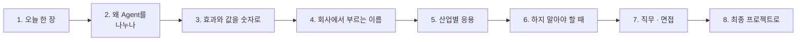

# 4단계 · 정리: 오늘 한 일의 의미 · 효과 · 실전 응용

- 교시: 8교시 17:10~17:45 (35분, 바이브 코딩 발표 10분 뒤) · 자료: 이 문서 + [개요](00-DAY68-OVERVIEW.md)
- 이 시간이 끝나면: 오늘 1~3단계에서 한 일(복합 업무 분석 · Multi-Agent 설계 · 검증과 장애 격리)이 **왜 필요했는지**, 숫자로 **무엇이 좋아졌고 무엇을 치렀는지**, 회사에서는 같은 생각을 **어떤 이름과 도구로** 쓰는지 말할 수 있고, 최종 프로젝트에 무엇을 가져갈지 정할 수 있다.
- 숫자: 수업 준비 때 정답 워크플로우를 실행한 값입니다 (2026-10-18, gpt-4.1-mini, 1회. 강사의 수업 준비 기록).

## 0. 이 시간 (35분)

| 시간 | 절 | 하는 일 |
| --- | --- | --- |
| 17:10~17:15 | 1 · 2 | 오늘 한 장, 왜 Agent를 나누나 |
| 17:15~17:20 | 3 | 오늘 숫자로 본 효과와 값 |
| 17:20~17:28 | 4 · 5 | 같은 생각의 업계 이름 · 도구, 산업별 응용 예 |
| 17:28~17:33 | 6 | 하지 말아야 할 때 |
| 17:33~17:40 | 7 · 8 | 직무와 면접 질문, 최종 프로젝트 체크리스트 |
| 17:40~17:45 | 9 · 토론 | 다음 일차와의 연결, 질문 둘 |

## 1. 오늘 한 장

| 단계 | 한 일 | 오늘 숫자 |
| --- | --- | --- |
| 1단계 · 복합 업무 분석 | 요청 하나를 업무 여럿으로 나누고, 업무마다 담당(`agent`) · 빠진 입력(`missing`)은 Code 규칙으로 | `lab01-challenge` 예제 상태 **0/4** → **4/4**, `lab01` 7/7 |
| 2단계 · Multi-Agent 설계 | Router(코드가 나눠 보냄)로 만들고, Supervisor(Agent가 Agent를 Tool로 부름)로도 만들어 비교 | Router `lab02` **6/6**, Supervisor `lab02-challenge` 4/5 → 5/5 · 같은 테스트(`lab02`) **1/6**, 복합 요청 **9.6~10.8초** |
| 3단계 · 검증과 장애 격리 | 한 Agent가 멈춰도 나머지 답은 내기, 어려운 테스트 | 회의록 Agent 꺼짐 `lab03-down` 예제 상태 **1/3**(500) → **3/3**, 어려운 케이스 5/7 → **7/7** |
| 바이브 코딩 | n8n 워크플로우를 트리로 보여 주는 `tflow` (요청서 → SPEC 먼저) | |

한 문장으로: **복합 요청은 먼저 업무로 나눠 분석하고, 업무마다 전문 Agent에 맡기되, 판단은 규칙으로 하고 하나가 멈춰도 전체가 멈추지 않게 한다.**

## 2. 왜 Agent를 나누나

| | Agent 하나가 다 | 업무별 Agent |
| --- | --- | --- |
| 지시문 | 모든 업무의 규칙이 한 덩어리 | 업무마다 짧고 분명 |
| 고칠 때 | 한 곳을 고치면 다른 업무가 흔들림 | 그 Agent만 |
| 멈출 때 | 전체가 멈춤 | 그 업무만 "지금 처리 못 함" (격리) |
| 값 | 호출 한 번 | 나누고 · 모으는 일이 늘어남 |

- **나누기는 LLM, 판단은 규칙.** 업무로 나누는 일은 글을 이해해야 하니 LLM이, "이 업무는 누가 맡나 · 무엇이 빠졌나"는 틀리면 안 되니 Code가 했습니다 (0/4 → 4/4).
- **Router와 Supervisor는 값이 다릅니다.** Supervisor는 유연하지만 LLM이 다음 순서를 정하느라 느리고(복합 요청 9.6~10.8초), 같은 테스트에서 1/6이었습니다. 순서가 정해진 업무는 Router가 낫습니다.

## 3. 효과와 값을 숫자로

| 무엇 | 전 | 후 | 바꾼 것 |
| --- | --- | --- | --- |
| 업무마다 담당 · 빠진 입력 (`lab01-challenge`) | 0/4 | **4/4** | Code 규칙 |
| Supervisor (`lab02-challenge`) | 4/5 | **5/5** | 지시문 고침 |
| 회의록 Agent가 멈춤 (`lab03-down`) | 1/3 (복합 요청 500) | **3/3** | 장애 격리 (나머지 답은 냄) |
| 어려운 케이스 7개 | 5/7 (`user` 없음, 공백만) | **7/7** | `user` 빠짐도 입력 필요, 공백 메시지 400 |

**치른 값**: Supervisor로 만들면 같은 요청에 Router보다 LLM 호출이 늘고 시간이 9.6~10.8초까지 걸렸습니다. 나누는 구조는 **유연함과 속도 · 비용을 맞바꾸는** 선택입니다 (72 · 75일차에서 잽니다).

## 4. 회사에서는 같은 생각을 이렇게 부른다

| 오늘 한 것 | 업계 이름 | 쓰는 도구 · 표준 (예) |
| --- | --- | --- |
| 요청을 업무로 나누기 | 의도 분석, 작업 분해 (task decomposition) | 분류 모델, LLM 분해 |
| 코드가 나눠 보냄 | 라우터 패턴 (router) | n8n Switch · If, API 게이트웨이 |
| Agent가 Agent를 부름 | 감독자 패턴 (supervisor), 오케스트레이터 | LangGraph, CrewAI, OpenAI Agents SDK, AutoGen |
| 하나가 멈춰도 계속 | 장애 격리 (bulkhead), 우아한 저하 | 서킷 브레이커, 타임아웃 · 대체 경로 |
| 분석표 다섯 칸 | 요구 분석, 업무 흐름 분석 | 유스케이스, BPMN |

## 5. 산업별 응용 (예)

아래는 오늘 한 일을 다른 업무에 옮긴 예입니다 (특정 회사 사례가 아니라 흔한 모양).

| 업무 | 오늘의 무엇을 | 이렇게 |
| --- | --- | --- |
| 고객센터 통합 창구 | 업무 나누기 · Router | "환불하고 주소도 바꿔 주세요" → 환불 Agent · 배송 Agent, 빠진 주문 번호는 되묻기 |
| 사내 총무 요청 | 분석표 · 빠진 입력 | 회의실 예약 · 택배 · 비품을 나눠, 회의실 이름이 없으면 `missing` |
| 여행 예약 도우미 | Supervisor | 항공 · 숙소 · 일정 Agent를 감독 Agent가 순서 조정 (순서가 매번 다를 때) |
| 사내 IT · 회의 (오늘) | 전부 | IT 문의 · 회의록 Agent, 회의록 Agent가 멈춰도 IT 답은 나감 |

**토론 거리**: 내 업무에서 "한 문장에 업무 여럿"이 오는 창구를 하나 골라, 업무 · 담당 · 빠질 수 있는 입력을 적어 봅니다.

## 6. 하지 말아야 할 때 (흔한 실수)

| 하기 쉬운 일 | 왜 위험한가 | 대신 |
| --- | --- | --- |
| 무조건 Agent를 많이 | 호출 · 시간 · 비용만 늘어남 | 업무가 정말 다를 때만 나눔 |
| 담당 · 빠진 입력도 LLM이 | 같은 요청에 매번 다른 판단 | 규칙(Code)으로 |
| 순서가 정해진 일을 Supervisor로 | 느리고 흔들림 (1/6, 10초) | Router |
| 하나가 멈추면 500 | 멀쩡한 업무까지 답을 못 함 | 장애 격리, 멈춘 업무만 안내 |
| 정상 요청만 테스트 | `user` 없음 · 공백 같은 구멍 | 어려운 케이스 |

## 7. 직무와 면접

오늘 한 일은 **AI 에이전트 · 멀티 에이전트 시스템 개발자, AI 서비스 기획자, 백엔드 · 플랫폼 엔지니어**가 날마다 하는 일입니다. 채용 공고의 "멀티 에이전트 설계", "에이전트 오케스트레이션", "장애 대응 설계"가 오늘 내용입니다.

1. "멀티 에이전트를 언제 쓰나요?"

요청 하나에 성격이 다른 업무가 섞일 때 씁니다. 먼저 업무로 나누는 분석을 하고, 업무마다 전문 Agent를 둡니다. 다만 담당 · 빠진 입력 같은 판단은 Code 규칙으로 해서 0/4를 4/4로 만들었습니다. 무조건 나누지 않고, 나누는 값(호출 · 시간)을 같이 봅니다.

2. "Router와 Supervisor 중 무엇을 고르나요?"

순서가 정해져 있으면 Router입니다. 오늘 같은 업무를 Supervisor로 만들자 같은 테스트에서 1/6, 복합 요청이 9.6~10.8초였습니다. Supervisor는 순서가 매번 달라 LLM이 정해야 할 때 씁니다.

3. "Agent 하나가 장애면 어떻게 하나요?"

장애를 격리합니다. 오늘 회의록 Agent를 꺼 보니 처음에는 복합 요청 전체가 500(1/3)이었고, 멈춘 업무만 "지금 처리 못 함"으로 두고 나머지 답은 내게 고쳐 3/3이 됐습니다.

## 8. 최종 프로젝트로 가져갈 것

- [ ] 복합 요청의 분석표 (업무 · 담당 · 입력 · 빠질 수 있는 것 · 관계)
- [ ] 나누기는 LLM, 판단(담당 · 빠진 입력)은 규칙
- [ ] Router와 Supervisor 중 고른 까닭 (순서가 정해졌나, 시간 · 호출 수)
- [ ] Agent 하나가 멈췄을 때의 테스트와 결과 (장애 격리)
- [ ] 어려운 케이스 (빠진 입력 · 공백 · 업무가 섞인 요청)

## 9. 다음 일차와의 연결

| 일차 | 오늘의 무엇을 잇나 |
| --- | --- |
| 69 | 역할 분리 — 업무별 Agent에서 역할별 Agent(작성자 · 검토자 · 정리자)로 |
| 70 | 템플릿 · 모듈 — 비슷한 Agent를 복사하지 않고 재사용 |
| 72 | 성능 — Supervisor가 느렸던 까닭을 단계별 시간으로 |
| 75 | 비용 — Agent 수 · 호출 수를 토큰과 단가로 |

## 토론 (5분)

1. 오늘 만든 Agent 중 하나를 합친다면 무엇을 합치고, 무엇을 잃을까요?
2. 내 업무에서 Agent 하나가 멈췄을 때 "나머지 답은 낸다"가 맞을까요, "전부 멈춘다"가 맞을까요?

## 정리

- [ ] 복합 요청은 분석부터: 업무 · 담당 · 빠진 입력
- [ ] 나누기는 LLM, 판단은 규칙 (0/4 → 4/4)
- [ ] Router와 Supervisor는 유연함과 속도 · 비용의 맞바꿈 (Supervisor 1/6 · 10초)
- [ ] 하나가 멈춰도 전체는 멈추지 않게 (1/3 → 3/3)
- [ ] 최종 프로젝트에 체크리스트 5개를 가져간다
