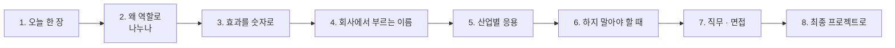

# 4단계 · 정리: 오늘 한 일의 의미 · 효과 · 실전 응용

- 교시: 8교시 17:10~17:45 (35분, 바이브 코딩 발표 10분 뒤) · 자료: 이 문서 + [개요](00-DAY69-OVERVIEW.md)
- 이 시간이 끝나면: 오늘 1~3단계에서 한 일(역할 분리 · 협업 워크플로우 · 협업 검증)이 **왜 필요했는지**, 숫자로 **무엇이 좋아졌는지**, 회사에서는 같은 생각을 **어떤 이름과 도구로** 쓰는지 말할 수 있고, 최종 프로젝트에 무엇을 가져갈지 정할 수 있다.
- 숫자: 수업 준비 때 정답 워크플로우를 실행한 값입니다 (2026-10-18, gpt-4.1-mini. 강사의 수업 준비 기록).

## 0. 이 시간 (35분)

| 시간 | 절 | 하는 일 |
| --- | --- | --- |
| 17:10~17:15 | 1 · 2 | 오늘 한 장, 왜 역할로 나누나 |
| 17:15~17:20 | 3 | 오늘 숫자로 본 효과 |
| 17:20~17:28 | 4 · 5 | 같은 생각의 업계 이름 · 도구, 산업별 응용 예 |
| 17:28~17:33 | 6 | 하지 말아야 할 때 |
| 17:33~17:40 | 7 · 8 | 직무와 면접 질문, 최종 프로젝트 체크리스트 |
| 17:40~17:45 | 9 · 토론 | 다음 일차와의 연결, 질문 둘 |

## 1. 오늘 한 장

| 단계 | 한 일 | 오늘 숫자 |
| --- | --- | --- |
| 1단계 · 역할 분리 | 역할 카드(하는 일 · **하지 않는 일**), 작성자, 검토자(규칙 3 + LLM 1 + LLM 판단 재확인) | 작성자 `lab01` 5/5, 검토자 `lab01-challenge` **6/6** |
| 2단계 · 협업 워크플로우 | 작성자 → 검토자 → 정리자(Fork-Join: `title`, `chat`) | 파이프라인 `lab02` 처음 **3/4**(검토자 거짓 경보) → 4/4, 정리자 `lab02-challenge` **4/4** (두 번) |
| 3단계 · 협업 검증 | 검토자를 꺼 보기(fail-closed), 어려운 테스트, 단일 Agent와 비교 | 검토자 꺼짐 `lab03-down` 예제 상태 **0/2**(500) → **2/2**, 어려운 케이스 6/7 → **7/7** |
| 바이브 코딩 | 작성자 → 검토자 → 정리자를 파이썬으로, 역할 지시문은 YAML (`tcrew`) | |

한 문장으로: **역할마다 하는 일과 하지 않는 일을 정해 나누고, 검토는 규칙 먼저 · LLM은 하나만, 검토자가 없으면 내보내지 않는다.**

## 2. 왜 역할로 나누나

| | Agent 하나가 쓰고 스스로 검사 | 작성자 · 검토자 · 정리자 |
| --- | --- | --- |
| 검사 | 자기 글을 자기가 봄 ("문제없음") | 다른 역할이 봄 |
| 지시문 | 쓰기 · 검사 · 정리가 한 덩어리 | 역할마다 짧게, 하지 않는 일까지 |
| 고칠 때 | 전체 지시문 | 그 역할 카드만 |
| 확인 | "다 됐다"는 자기 보고 | 검토 결과 `passed` · `codes` |

- 오늘 어려운 케이스에서 **단일 Agent도 6/7**이었지만, 그것은 Agent의 **자기 보고**였습니다. 검토자가 다시 보니 5/6. 스스로 "괜찮다"고 하는 것과 남이 확인한 것은 다릅니다.
- **검토자가 꺼지면 내보내지 않습니다 (fail-closed).** 검토 결과가 없는데 `게시 가능`이 되는 것이 가장 위험합니다 (0/2 500 → 2/2).

## 3. 효과를 숫자로

| 무엇 | 전 | 후 | 바꾼 것 |
| --- | --- | --- | --- |
| 검토자 (`lab01-challenge`) | | **6/6** | 규칙 3 + LLM 1 + LLM 판단 재확인 |
| 파이프라인 (`lab02`) | 3/4 (검토자 거짓 경보) | **4/4** | 검토자 Code가 LLM 판단을 다시 확인 (그 문장의 낱말이 모두 사실에 있으면 뺌) |
| 정리자 Fork-Join (`lab02-challenge`) | | **4/4** (두 번) | `title`, `chat` |
| 검토자가 꺼짐 (`lab03-down`) | 0/2 (500) | **2/2** | fail-closed: 검토 없으면 게시하지 않음 |
| 어려운 케이스 7개 | 6/7 (공백만) | **7/7** | 공백 사실 400 |

- 검토자도 **틀립니다** (거짓 경보로 3/4). 그래서 LLM이 내린 "문제 있음" 판단을 한 번 더 확인하는 단계를 두었습니다. 검토자의 검토도 테스트로 확인합니다.

## 4. 회사에서는 같은 생각을 이렇게 부른다

| 오늘 한 것 | 업계 이름 | 쓰는 도구 · 표준 (예) |
| --- | --- | --- |
| 역할 카드 | 역할 기반 에이전트, 페르소나 · 책임 정의 | CrewAI 역할 · 목표, AutoGen 에이전트 |
| 작성자 → 검토자 | 생성-검토(generator-critic), 4-eyes 원칙 | LLM-as-judge, 사람 승인 단계 |
| 규칙 먼저, LLM은 하나만 | 하이브리드 검증 | 정규식 · 스키마 검사 + LLM 평가 |
| Fork-Join 정리자 | 병렬 처리 후 합치기 (scatter-gather) | n8n Merge, 워크플로우 엔진 |
| 검토자가 없으면 막기 | fail-closed, 안전한 실패 | 보안 · 결재 설계 원칙 |
| 역할 지시문을 YAML로 | 설정과 코드 분리 | 프롬프트 파일, 설정 저장소 (74일차) |

## 5. 산업별 응용 (예)

아래는 오늘 한 일을 다른 업무에 옮긴 예입니다 (특정 회사 사례가 아니라 흔한 모양).

| 업무 | 오늘의 무엇을 | 이렇게 |
| --- | --- | --- |
| 보도자료 · 공지 작성 | 작성자 → 검토자 → 정리자 | 초안, 사실 · 금지어 검토, 채널별(메일 · 메신저) 정리 |
| 보험 청구 안내문 | 규칙 먼저 · fail-closed | 금액 · 날짜는 규칙으로 대조, 검토가 실패하면 발송하지 않음 |
| 코드 리뷰 보조 | 하지 않는 일 | 리뷰 Agent는 지적만 하고 코드를 고치지 않음 |
| 사내 공지 (오늘) | 전부 | 공지 팀, 검토자 꺼지면 게시 안 함 |

**토론 거리**: 내 업무에서 "쓰는 사람과 확인하는 사람이 달라야 하는" 문서를 하나 골라, 검토자의 하지 않는 일을 적어 봅니다.

## 6. 하지 말아야 할 때 (흔한 실수)

| 하기 쉬운 일 | 왜 위험한가 | 대신 |
| --- | --- | --- |
| Agent에게 자기 글을 검사하게 | 자기 보고는 늘 "괜찮다"에 가까움 | 다른 역할 · 규칙이 |
| 역할 카드에 하는 일만 | 검토자가 초안까지 고쳐 씀 | 하지 않는 일도 |
| 검토를 전부 LLM이 | 같은 초안에 매번 다른 판정 | 규칙 먼저, LLM은 뜻만 |
| 검토자가 멈추면 그냥 게시 | 확인 안 된 글이 나감 | fail-closed |
| 검토자의 판단을 믿기만 | 거짓 경보 (3/4) | 판단 재확인 · 테스트 |

## 7. 직무와 면접

오늘 한 일은 **AI 에이전트 개발자, AI 서비스 기획자, 콘텐츠 자동화 · 품질 담당**이 날마다 하는 일입니다. 채용 공고의 "역할 기반 멀티 에이전트", "LLM 평가 · 검토", "Human-in-the-loop 설계"가 오늘 내용입니다.

1. "Agent가 쓴 글을 어떻게 검증하나요?"

다른 역할(검토자)이 봅니다. 확실한 것(날짜 · 개인정보 모양)은 규칙으로, 뜻을 봐야 하는 것(없는 약속) 하나만 LLM으로 보고, LLM의 "문제 있음" 판단은 한 번 더 확인합니다. 검토자 테스트가 6/6이었고, 처음에 있던 거짓 경보(3/4)도 이렇게 고쳤습니다.

2. "검토 단계가 장애면요?"

내보내지 않습니다 (fail-closed). 오늘 검토자를 꺼 보니 처음에는 500(0/2)이었고, 검토 결과가 없으면 게시하지 않게 해 2/2가 됐습니다. 확인 안 된 글이 나가는 것이 가장 위험하기 때문입니다.

3. "단일 Agent로도 되지 않나요?"

오늘 어려운 케이스에서 단일 Agent도 6/7이었지만 자기 보고였고, 검토자가 다시 보니 5/6이었습니다. 역할을 나누면 호출은 늘지만 "누가 확인했나"가 분명해집니다.

## 8. 최종 프로젝트로 가져갈 것

- [ ] 역할 카드 (하는 일 · 하지 않는 일 · 입력 · 결과)
- [ ] 검토는 규칙 먼저, LLM은 뜻이 필요한 것 하나만, 판단 재확인
- [ ] 검토 결과(`passed` · `codes`)를 결과에 남긴다
- [ ] 검토자가 멈췄을 때의 정책 (fail-closed)과 테스트
- [ ] 단일 Agent와 비교한 숫자 (자기 보고 vs 검토)

## 9. 다음 일차와의 연결

| 일차 | 오늘의 무엇을 잇나 |
| --- | --- |
| 70 | 템플릿 · 모듈 — 검토자를 여러 워크플로우가 같이 쓰는 모듈로 |
| 71 | RAG 답 검사 — 오늘의 검토자 원리를 답이 근거를 따랐나 확인에 |
| 73 | 판별 LLM — 오늘의 fail-closed를 보안 관문에 |
| 74 | 역할 지시문을 버전으로 — 오늘 YAML로 꺼낸 지시문을 저장소에서 |

## 토론 (5분)

1. 검토자에게 "고쳐도 된다"고 하면 무엇이 좋아지고 무엇이 위험해질까요?
2. 내 업무에서 검토 단계가 멈췄을 때 "그래도 보낸다"가 맞는 경우가 있을까요?

## 정리

- [ ] 역할마다 하는 일 · 하지 않는 일
- [ ] 검토는 규칙 먼저, LLM은 하나만, 판단 재확인 (거짓 경보 3/4 → 4/4)
- [ ] 자기 보고와 남의 확인은 다르다 (6/7 vs 5/6)
- [ ] 검토자가 없으면 내보내지 않는다 (0/2 → 2/2)
- [ ] 최종 프로젝트에 체크리스트 5개를 가져간다
