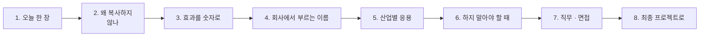

# 4단계 · 정리: 오늘 한 일의 의미 · 효과 · 실전 응용

- 교시: 8교시 17:10~17:45 (35분, 바이브 코딩 발표 10분 뒤) · 자료: 이 문서 + [개요](00-DAY70-OVERVIEW.md)
- 이 시간이 끝나면: 오늘 1~3단계에서 한 일(템플릿화 · 모듈화 · 변경 관리)이 **왜 필요했는지**, 숫자로 **무엇이 좋아졌는지**, 회사에서는 같은 생각을 **어떤 이름과 도구로** 쓰는지 말할 수 있고, 최종 프로젝트에 무엇을 가져갈지 정할 수 있다.
- 숫자: 수업 준비 때 정답 워크플로우를 실행한 값입니다 (2026-10-18, gpt-4.1-mini. 강사의 수업 준비 기록).

## 0. 이 시간 (35분)

| 시간 | 절 | 하는 일 |
| --- | --- | --- |
| 17:10~17:15 | 1 · 2 | 오늘 한 장, 왜 복사하지 않나 |
| 17:15~17:20 | 3 | 오늘 숫자로 본 효과 |
| 17:20~17:28 | 4 · 5 | 같은 생각의 업계 이름 · 도구, 산업별 응용 예 |
| 17:28~17:33 | 6 | 하지 말아야 할 때 |
| 17:33~17:40 | 7 · 8 | 직무와 면접 질문, 최종 프로젝트 체크리스트 |
| 17:40~17:45 | 9 · 토론 | 다음 일차와의 연결, 질문 둘 |

## 1. 오늘 한 장

| 단계 | 한 일 | 오늘 숫자 |
| --- | --- | --- |
| 1단계 · 템플릿화 | 복사본 3개 비교(노드 9개 중 4개가 다름), 같은 것과 다른 것을 나눠 설정 표 한 곳으로, 표에 없으면 400 | 공지 키트 `lab01` 5/5, 새 종류 · 없는 종류 `lab01-challenge` 예제 상태 **1/4** → **4/4** |
| 2단계 · 모듈화 | 공통 검사를 Sub-workflow 모듈로, 입력 · 결과 계약 | 규칙 검사 모듈 `lab02-module` 5/5 (0.1초), SMS가 같은 모듈 `lab02-challenge` **4/4** (0.9~2.9초) |
| 3단계 · 변경 관리 | 모듈을 바꾸면 누가 영향을 받나(영향 표), 모듈 버전, 어려운 테스트 | 키트 어려운 케이스 예제 상태 **3/7** → **7/7**, `lab03-v2` 5/5, SMS 4/4 |
| 바이브 코딩 | 템플릿 폴더 + 변수로 새 워크플로우 · 테스트 파일을 만드는 `tkit` | |

한 문장으로: **복사하지 말고 같은 것은 템플릿 · 모듈로, 다른 것은 설정 표 한 곳에 두고, 고칠 때는 누가 영향을 받는지 먼저 본다.**

## 2. 왜 복사하지 않나

| | 복사해서 고치기 | 템플릿 · 모듈 |
| --- | --- | --- |
| 처음 | 빠름 | 조금 더 생각 |
| 버그를 고칠 때 | 복사본마다 따로 (하나는 꼭 빠뜨림) | 한 곳 |
| 새 종류 | 또 복사 | 설정 표에 한 줄 |
| 다른 점 찾기 | 노드를 하나씩 비교 (9개 중 4개) | 설정 표를 봄 |
| 위험 | 복사본끼리 조금씩 달라짐 ("우연히 다른 것") | 모듈 하나를 바꾸면 모두가 영향 |

- 오늘 복사본 3개를 비교하니 9개 노드 중 4개가 달랐고, 그중에는 **일부러 다른 것**과 **우연히 다른 것**이 섞여 있었습니다. 템플릿화는 이 둘을 가르는 일입니다.
- 모듈의 값: 한 곳만 고치면 되지만, **한 곳을 고치면 모두가 바뀝니다.** 그래서 3단계에서 영향 표 · 버전 · 테스트를 했습니다.

## 3. 효과를 숫자로

| 무엇 | 전 | 후 | 바꾼 것 |
| --- | --- | --- | --- |
| 새 종류(설문) · 없는 종류 (`lab01-challenge`) | 1/4 | **4/4** | 설정 표에 한 줄, 없는 종류 400 · 목록 |
| SMS가 같은 모듈 사용 (`lab02-challenge`) | | **4/4** (0.9~2.9초) | 모듈 계약에 `max_length` 80 |
| 키트의 어려운 케이스 7개 | 3/7 | **7/7** | `kind` 다듬기 · 한국어 별칭 · 공백 사실 400 (모듈 v2) |
| 모듈을 바꾼 뒤 다른 사용처 (회귀) | | `lab01` 5/5 · `lab01-challenge` 4/4 · `lab03-v2` 5/5 · SMS 4/4 | 영향 표대로 다시 시험 |

- 규칙 검사 모듈은 **0.1초**였습니다. LLM을 부르지 않는 모듈은 빠르고 늘 같은 결과를 냅니다. 무엇을 모듈로 뽑을지 고를 때 이 차이도 봅니다.

## 4. 회사에서는 같은 생각을 이렇게 부른다

| 오늘 한 것 | 업계 이름 | 쓰는 도구 · 표준 (예) |
| --- | --- | --- |
| 같은 것 · 다른 것 나누기 | 템플릿화, 매개변수화 | n8n 템플릿, cookiecutter, 코드 생성기 |
| 설정 표 한 곳 | 설정 외부화, 단일 출처 (single source of truth) | 설정 파일, 원격 설정 (74일차) |
| Sub-workflow 모듈 | 모듈화, 재사용 컴포넌트, 공유 라이브러리 | n8n Execute Workflow, 함수 · 패키지 |
| 입력 · 결과 계약 | 인터페이스 계약, API 스키마 | JSON Schema, OpenAPI |
| 영향 표 · 모듈 버전 | 영향 분석, 의존성 관리, 시맨틱 버전 | 패키지 버전, 하위 호환 정책 |
| 표에 없으면 400 | 입력 검증, 허용 목록 | 열거형(enum) 검사 |

## 5. 산업별 응용 (예)

아래는 오늘 한 일을 다른 업무에 옮긴 예입니다 (특정 회사 사례가 아니라 흔한 모양).

| 업무 | 오늘의 무엇을 | 이렇게 |
| --- | --- | --- |
| 쇼핑몰 알림 (주문 · 배송 · 환불) | 템플릿 · 설정 표 | 알림 종류마다 복사하지 않고 종류 표 + 공통 흐름 |
| 사내 교육 신청 확인 | 키트 | 과정 표에 한 줄 더하면 새 과정 확인 메일 |
| 개인정보 검사 | 공통 모듈 | 메일 · SMS · 메신저가 같은 검사 모듈, 바꾸면 영향 표대로 다시 시험 |
| 사내 공지 (오늘) | 전부 | 공지 키트, 규칙 검사 모듈, SMS 재사용 |

**토론 거리**: 내 업무에서 "복사해서 조금씩 고친" 자동화 셋을 떠올려, 같은 것 · 다른 것 · 우연히 다른 것으로 나눠 봅니다.

## 6. 하지 말아야 할 때 (흔한 실수)

| 하기 쉬운 일 | 왜 위험한가 | 대신 |
| --- | --- | --- |
| 일단 복사 | 버그를 한 곳만 고침 | 같은 것은 템플릿 · 모듈 |
| 다른 값을 노드마다 흩어 둠 | 무엇이 다른지 찾기 어려움 | 설정 표 한 곳 |
| 표에 없는 값도 그냥 처리 | 엉뚱한 기본값으로 나감 | 400 + 가능한 목록 |
| 모듈을 고치고 사용처를 안 봄 | 다른 워크플로우가 몰래 깨짐 | 영향 표 · 사용처마다 테스트 |
| 모든 것을 모듈로 | 계약만 늘고 이해하기 어려움 | 정말 여러 곳이 쓰는 것만 |

## 7. 직무와 면접

오늘 한 일은 **자동화 플랫폼 엔지니어, 백엔드 엔지니어, 노코드 · RPA 운영 담당**이 날마다 하는 일입니다. 채용 공고의 "재사용 가능한 워크플로우 설계", "공통 모듈 · 컴포넌트", "변경 영향 분석"이 오늘 내용입니다.

1. "비슷한 자동화가 여러 개 생기면 어떻게 하나요?"

같은 것과 다른 것을 나눕니다. 오늘 복사본 셋을 비교하니 노드 9개 중 4개가 달랐고, 다른 값은 설정 표 한 곳에, 같은 흐름은 템플릿으로 뒀습니다. 새 종류(설문)는 표에 한 줄로 끝나고, 없는 종류는 400과 목록을 줘서 1/4가 4/4가 됐습니다.

2. "공통 모듈을 바꾸면 위험하지 않나요?"

위험합니다. 그래서 바꾸기 전에 누가 쓰는지 영향 표를 만들고, 모듈 버전을 두고, 사용처마다 테스트를 다시 돌렸습니다. 모듈 v2로 어려운 케이스를 3/7에서 7/7로 고친 뒤 키트 · SMS 테스트도 그대로 통과하는지 확인했습니다.

3. "무엇을 모듈로 뽑나요?"

여러 곳이 같은 일을 할 때입니다. 오늘 메일과 SMS가 같은 규칙 검사를 써서 모듈로 뽑았고, LLM 없는 규칙 모듈이라 0.1초에 늘 같은 결과였습니다.

## 8. 최종 프로젝트로 가져갈 것

- [ ] 비슷한 흐름이 둘 이상이면 같은 것 · 다른 것 표
- [ ] 다른 값은 설정 표 한 곳, 표에 없으면 400
- [ ] 공통 모듈의 입력 · 결과 계약
- [ ] 모듈을 쓰는 곳 목록(영향 표)과 사용처마다 테스트
- [ ] 모듈 버전 (깨지는 변경이면 새 버전)

## 9. 다음 일차와의 연결

| 일차 | 오늘의 무엇을 잇나 |
| --- | --- |
| 71 | RAG — 색인 · 검색을 다른 문서에도 쓰는 구조로 |
| 72 | 성능 — 모듈 호출이 더하는 시간 |
| 74 | 버전 관리 — 오늘의 모듈 버전 · 설정 표가 릴리스 · 지시문 저장소로 |
| 78 | 품질 규칙 — 오늘의 계약을 데이터 품질 규칙으로 |

## 토론 (5분)

1. 오늘 설정 표에 넣지 않고 템플릿 안에 둔 값 중, 나중에 표로 옮겨야 할 것은 무엇일까요?
2. 모듈을 고쳤는데 사용처 하나의 테스트가 깨졌다면, 모듈을 되돌릴까요 사용처를 고칠까요?

## 정리

- [ ] 복사하지 말고: 같은 것은 템플릿 · 모듈, 다른 것은 설정 표
- [ ] 표에 없으면 멈춘다 (400 + 목록)
- [ ] 모듈은 계약으로, 고칠 때는 영향 표 · 버전 · 사용처 테스트
- [ ] 효과는 숫자로 (1/4 → 4/4, 3/7 → 7/7, 규칙 모듈 0.1초)
- [ ] 최종 프로젝트에 체크리스트 5개를 가져간다
