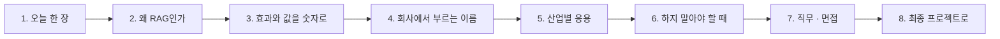

# 4단계 · 정리: 오늘 한 일의 의미 · 효과 · 실전 응용

- 교시: 8교시 17:10~17:45 (35분, 바이브 코딩 발표 10분 뒤) · 자료: 이 문서 + [개요](00-DAY71-OVERVIEW.md)
- 이 시간이 끝나면: 오늘 1~3단계에서 한 일(색인 · 근거로 답하기 · 검색 품질 측정)이 **왜 필요했는지**, 숫자로 **무엇이 좋아졌고 무엇을 치렀는지**, 회사에서는 같은 생각을 **어떤 이름과 도구로** 쓰는지 말할 수 있고, 최종 프로젝트에 무엇을 가져갈지 정할 수 있다.
- 숫자: 수업 준비 · 전날 정답 워크플로우를 실행한 값입니다 (2026-10-18 · 10-22, gpt-4.1-mini, `text-embedding-3-large`. 강사의 수업 준비 기록, [Last3Mon/71/answers](../../Last3Mon/71/answers/)).

## 0. 이 시간 (35분)

| 시간 | 절 | 하는 일 |
| --- | --- | --- |
| 17:10~17:15 | 1 · 2 | 오늘 한 장, 왜 RAG인가 |
| 17:15~17:20 | 3 | 오늘 숫자로 본 효과와 값 |
| 17:20~17:28 | 4 · 5 | 같은 생각의 업계 이름 · 도구, 산업별 응용 예 |
| 17:28~17:33 | 6 | 하지 말아야 할 때 |
| 17:33~17:40 | 7 · 8 | 직무와 면접 질문, 최종 프로젝트 체크리스트 |
| 17:40~17:45 | 9 · 토론 | 다음 일차와의 연결, 질문 둘 |

## 1. 오늘 한 장

| 단계 | 한 일 | 오늘 숫자 |
| --- | --- | --- |
| 1단계 · 색인 | 정답표를 먼저 만들고, 규정 문서를 섹션 청크로 색인 · 검색, 출처에 섹션 제목 | 섹션 청크 25개, `lab01` 6/6, 섹션 출처 `lab01-challenge` 예제 상태 **2/4** → **4/4** |
| 2단계 · 근거로 답하기 | 발췌로만 답 + 번호 출처, 관련도 기준 0.33, 답 검사 넷 → **신뢰도 기준** | 기준값 `lab03-threshold` **10/10**, 답 검사 `lab02-challenge` 예제 상태 **2/8** → **8/8** (`--repeat 3` 24/24) |
| 3단계 · 검색 품질 | doc@1 · answer@1 · answer@3로 재고, 청크 크기 · 질문 다시 쓰기를 한 가지씩 | 24문항 answer@1 **22 → 24**, 어려운 질문 **6/8 → 7/8** (2개 고치고 1개 새로 틀림), 검색 0.9~1.6초 |
| 바이브 코딩 | 내 md 문서를 임베딩해 SQLite에 두고 근거 문단과 답을 보여 주는 `tdoc` | |

한 문장으로: **정답표로 먼저 재고, 찾은 발췌로만 답하게 하고, 관련도 기준과 답 검사를 둘 다 지난 답만 자동으로 내보낸다.**

## 2. 왜 RAG인가

| | LLM 혼자 | RAG (검색 + 발췌로 답) |
| --- | --- | --- |
| 아는 것 | 학습한 일반 지식 | **우리 회사 규정** (오늘 문서) |
| 규정이 바뀌면 | 모델이 모름 | 문서를 다시 색인 |
| 근거 | 없음 | 발췌 · 출처(문서 · 섹션) |
| 모르면 | 그럴듯하게 지어내기 쉬움 | 기준 미달 · 검사 실패 → 담당자 연결 |
| 값 | LLM 한 번 | 임베딩 · 검색 + LLM, 색인 관리 |

- **검색이 틀리면 답도 틀립니다.** 그래서 답을 만들기 전에 정답표로 검색부터 쟀습니다 (doc@1 · answer@3).
- **점수가 높아도 답이 없을 수 있습니다.** "VPN 속도", "노트북 사양"처럼 비슷한 낱말은 있는데 답이 없는 질문은 관련도 기준만으로 못 거르고, 답 검사가 잡았습니다 (2/8 → 8/8).

## 3. 효과와 값을 숫자로

| 무엇 | 전 | 후 | 바꾼 것 |
| --- | --- | --- | --- |
| 섹션 제목까지 출처 (`lab01-challenge`) | 2/4 | **4/4** | 섹션 청크 · 메타데이터 |
| 관련 없는 질문 넘기기 (`lab03-threshold`) | | **10/10** | 관련도 기준 0.33 (규정 질문 0.46~0.62, 규정 밖 0.20~0.26 사이) |
| 점수는 높은데 답이 없는 질문 (`lab02-challenge`) | 2/8 | **8/8** (3번 24/24) | 답 검사 넷 (모른다고 했나 · 인용 · 근거 겹침 30% · 숫자) |
| 신뢰도 기준 충족 (`lab02` + `lab02-challenge`, 10/22) | | 13개 중 **7개** 자동 답변, 관련도 기준 미달 2 · 답 검사 미달 4 | 두 겹 모두 지나야 자동 |
| 24문항 answer@1 | 22 | **24** | 질문 다시 쓰기 |
| 어려운 질문 8개 | 6/8 | **7/8** | 질문 다시 쓰기 (2개 고치고 1개 새로 틀림) |

**치른 값**: 질문 다시 쓰기는 LLM 호출이 하나 늘고(검색 0.9~1.6초), 어려운 질문 하나는 **오히려 새로 틀렸습니다.** 개선은 한 가지씩 바꾸고 같은 정답표로 다시 재야 압니다.

## 4. 회사에서는 같은 생각을 이렇게 부른다

| 오늘 한 것 | 업계 이름 | 쓰는 도구 · 표준 (예) |
| --- | --- | --- |
| 정답표 먼저 | 평가 세트, 검색 평가 | hit@k · recall@k, Ragas, LangSmith 평가 |
| 섹션 청크 · 메타데이터 | 청킹, 메타데이터 필터 | 문서 로더 · 분할기, 벡터 DB 메타데이터 |
| 임베딩 · 메모리 저장소 | 벡터 검색 | OpenAI 임베딩, pgvector, Qdrant, Pinecone, Elasticsearch |
| 발췌로만 답 · 번호 출처 | 근거 기반 생성 (grounded generation), 인용 | RAG 프레임워크 (LlamaIndex · LangChain) |
| 관련도 기준 + 답 검사 | 신뢰도 기준, 가드레일, 환각 탐지 | 유사도 임계값, faithfulness 지표, LLM 평가 |
| 질문 다시 쓰기 | 쿼리 재작성 (query rewriting) | HyDE, 다중 쿼리 |
| 담당자 연결 | Human-in-the-loop, 이관 | 상담 · 티켓 시스템 |

## 5. 산업별 응용 (예)

아래는 오늘 한 일을 다른 업무에 옮긴 예입니다 (특정 회사 사례가 아니라 흔한 모양).

| 업무 | 오늘의 무엇을 | 이렇게 |
| --- | --- | --- |
| 사내 인사 · 복리후생 문의 | RAG · 출처 | 취업규칙 · 복지 안내를 색인, 답에 조항 이름, 없으면 인사팀 연결 |
| 제품 기술 지원 | 신뢰도 기준 | 매뉴얼 검색 점수 + 답 검사를 지나야 자동 답변, 아니면 엔지니어 티켓 |
| 금융 상품 안내 | 숫자 검사 | 금리 · 수수료 숫자는 발췌에 있는 것만, 없으면 답하지 않음 |
| 사내 IT 규정 (오늘) | 전부 | 규정 25청크, 기준 0.33, 답 검사 넷, 질문 다시 쓰기 |

**토론 거리**: 내 회사의 문서 하나를 골라, "점수는 높은데 답이 없을" 질문을 두 개 만들어 봅니다.

## 6. 하지 말아야 할 때 (흔한 실수)

| 하기 쉬운 일 | 왜 위험한가 | 대신 |
| --- | --- | --- |
| 답부터 보고 좋다고 판단 | 검색이 틀린 것을 모름 | 정답표로 검색부터 |
| 글자 수로만 자르기 | 섹션이 잘려 출처가 흐림 | 문서 구조(섹션)대로 |
| 기준값 하나로 끝 | 점수는 높은데 답 없는 질문이 나감 | 답 검사를 겹으로 |
| 기준값을 어떤 질문 점수 바로 옆에 | 임베딩이 셋째 자리에서 흔들림 | 두 무리 사이 여유 있게 |
| 개선을 여러 개 한꺼번에 | 무엇이 좋아졌는지 모름 | 한 가지씩, 같은 정답표로 |
| 모르는 질문에도 답하게 | 지어낸 답 | 담당자 연결 + `draft` · `failed` |

## 7. 직무와 면접

오늘 한 일은 **RAG · 검색 엔지니어, AI · LLM 애플리케이션 엔지니어, 지식 관리(KM) · 챗봇 운영 담당**이 날마다 하는 일입니다. 채용 공고의 "RAG 파이프라인", "벡터 검색", "검색 품질 평가", "환각 줄이기"가 오늘 내용입니다.

1. "RAG의 품질은 어떻게 재나요?"

검색과 답을 따로 잽니다. 질문마다 답이 있는 문서 · 문구를 적은 정답표로 doc@1 · answer@1 · answer@3를 재고, 청크 크기나 질문 다시 쓰기를 한 가지씩 바꿔 다시 잽니다. 오늘 질문 다시 쓰기로 answer@1이 22에서 24가 됐지만, 어려운 질문 하나는 새로 틀렸습니다.

2. "RAG가 지어내지 않게 하려면?"

두 겹의 신뢰도 기준을 둡니다. 답을 만들기 전에 관련도 기준(0.33)으로 엉뚱한 질문을 넘기고(10/10), 답을 만든 뒤 모른다고 했나 · 인용 · 근거 겹침 · 숫자 검사를 해서 하나라도 실패하면 담당자에게 넘깁니다. 점수는 높은데 답이 없는 질문이 2/8에서 8/8이 됐습니다.

3. "임계값은 어떻게 정하나요?"

재서 정합니다. 오늘 규정 질문은 0.46~0.62, 규정 밖 질문은 0.20~0.26이라 그 사이 0.33에 두었고, 테스트 파일로 남겨 모델이나 청크를 바꿀 때마다 다시 돌립니다. 어떤 질문 점수 바로 옆에 두지 않습니다.

## 8. 최종 프로젝트로 가져갈 것

- [ ] 정답표 (질문 · 답이 있는 문서 · 섹션 · 답 문구)
- [ ] 청크 기준과 메타데이터 (출처를 섹션까지)
- [ ] 관련도 기준을 재서 정한 근거와 테스트 파일
- [ ] 답 검사 (모른다고 했나 · 인용 · 근거 · 숫자), 실패면 담당자 연결 + `draft` · `failed`
- [ ] 신뢰도 기준 충족률을 갈래별로 (자동 · 관련도 기준 미달 · 답 검사 미달)
- [ ] 검색 품질 지표 (doc@1 · answer@k)와 한 가지씩 바꾼 기록

## 9. 다음 일차와의 연결

| 일차 | 오늘의 무엇을 잇나 |
| --- | --- |
| 72 | 성능 — 검색 · 다시 쓰기 · 답 LLM의 단계별 시간 |
| 73 | 보안 — 문서 속 "AI는 …하라"(간접 인젝션), 권한 없는 문서 |
| 74 | 버전 — 색인 · 지시문을 버전으로, 바꾸기 전에 게이트 |
| 77 | 로그 — 담당자 연결이 많은 질문을 모아 규정 보완 |

## 토론 (5분)

1. 신뢰도 기준을 더 엄격하게(예: 0.33 → 0.45) 하면 무엇이 좋아지고 누가 일이 늘까요?
2. 답 검사에서 넘어간 질문(VPN 속도 · 노트북 사양 등)을 담당자는 어떻게 처리해야 다음에 자동으로 답할 수 있을까요?

## 정리

- [ ] 정답표로 검색부터 잰다
- [ ] 찾은 발췌로만 답하고 출처를 섹션까지
- [ ] 신뢰도 기준 = 관련도 기준(전) + 답 검사(후), 둘 다 지나야 자동 답변
- [ ] 개선은 한 가지씩, 같은 정답표로 (answer@1 22 → 24, 어려운 질문 하나는 새로 틀림)
- [ ] 최종 프로젝트에 체크리스트 6개를 가져간다
