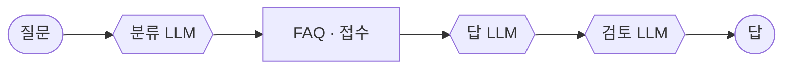
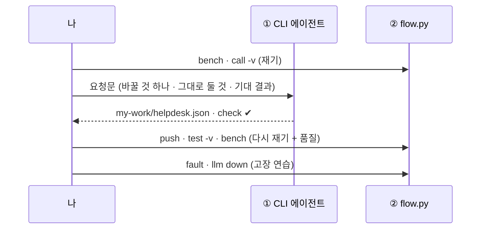
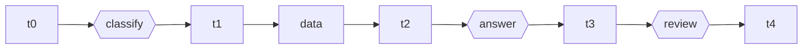
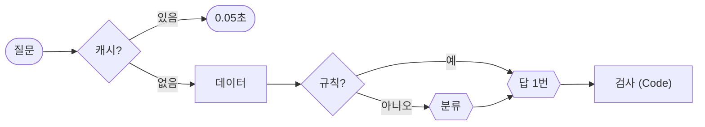
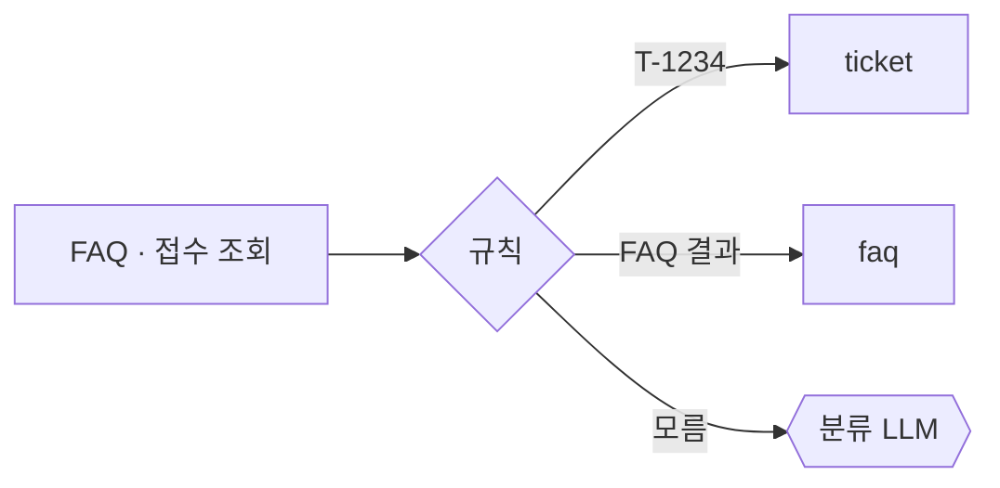
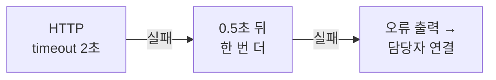
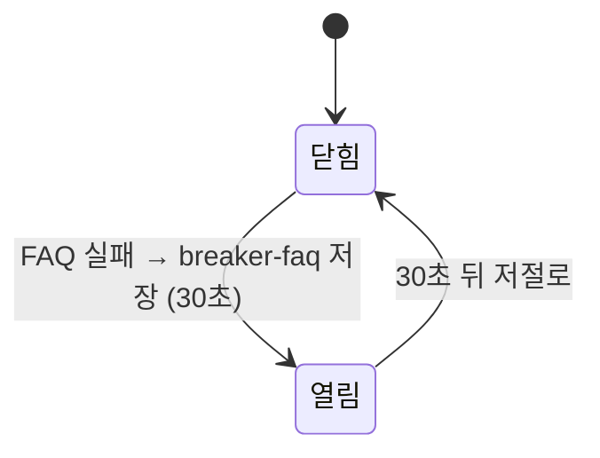
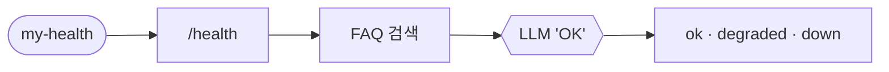
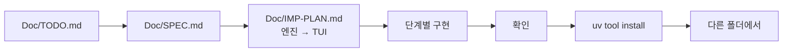

# 72일차 개요 · Workflow 실행 흐름 최적화와 운영 관점 개선

> 노코드 멀티 에이전트 워크플로우 설계 및 운영 · 2026-10-26
> 30장 · 각 장은 가로줄(`---`)로 나뉩니다. 1교시에는 1~6장을 보고, 나머지 장은 각 단계 강의(1 · 3 · 5교시) 때 함께 띄웁니다.
> 숫자는 모두 강사 노트북 실측입니다 (65일차 n8n 2.42.6, OpenAI `gpt-4.1-mini`, 10/18 수업 준비 · 10/23~24 다시 잼).

| 장 | 범위 | 띄우는 때 |
| --- | --- | --- |
| 1~6 | 표지 · 목표 · 시간표 · 오늘 고칠 것 · 일하는 순서 · 실습 15개 | 1교시 시작 |
| 7~14 | 1단계 · 재기와 병목 | 1교시 강의 |
| 15~21 | 2단계 · 실행 흐름 최적화 | 3교시 강의 |
| 22~28 | 3단계 · 운영 관점의 안정성 | 5교시 강의 |
| 29~30 | 바이브 코딩 · 정리와 예고 (8교시 35분 정리는 [04-STAGE4-WRAPUP](04-STAGE4-WRAPUP.md)) | 7교시 · 8교시 |

---

## 1 / 30 · 표지


**72일차**

# Workflow 실행 흐름 최적화와 운영 관점 개선

빠르게, 그리고 멈춰도 답하게 · 재고 나서 고친다

<sub>노코드 멀티 에이전트 워크플로우 설계 및 운영 · 2026-10-26</sub>

---

## 2 / 30 · 오늘 할 수 있게 될 세 가지

| | 목표 | 내용 |
| :-: | --- | --- |
| **①** | **재서 병목을 찾는다** | p50 · p95 · 첫 호출 · `bench` · 단계별 `timings` · 종류별 재기 · 시간 예산 |
| **②** | **품질은 그대로 빠르게 만든다** | 규칙 먼저 · 캐시 · 적중률 · 캐시 키 설계 · 검토를 검사로 · 잃은 것 |
| **③** | **멈춰도 정해진 답을 한다** | timeout · 재시도 · 오류 출력 · LLM 없이 답 · 부분 고장 · 차단기 · 상태 점검 |

---

## 3 / 30 · 오늘의 시간표

| 교시 | 시간 | 무엇 |
| --- | --- | --- |
| 1 | 09:00~09:50 | 개요 · **1단계 강의** 재기와 병목 |
| 2 | 10:00~10:50 | **Lab 01** 실습 5개 |
| 3 | 11:00~11:50 | **2단계 강의** 실행 흐름 최적화 |
| 4 | 12:00~12:50 | **Lab 02** 실습 5개 |
| - | 13:00~14:00 | 점심 |
| 5 | 14:00~14:50 | **3단계 강의** 운영 관점의 안정성 |
| 6 | 15:00~15:50 | **Lab 03** 실습 5개 |
| 7 | 16:00~16:50 | 바이브 코딩 `tbench` (요청서 → TODO → SPEC → IMP-PLAN → 만들기 → 설치) |
| 8 | 17:00~17:50 | 발표 · **4단계 정리** (의미 · 효과 · 실전 응용) · 73일차 예고 |

> 강의 한 시간, 실습 한 시간. 실습은 Lab마다 **예제 3개 + 과제 2개**.

---

## 4 / 30 · 오늘 고칠 것: 느린 실습 워크플로우 (IT 헬프데스크)



| `base-helpdesk` (VPN 질문) | 10/18 | 10/24 |
| --- | --- | --- |
| LLM 호출 | 3번 | 3번 |
| push 직후 첫 호출 | 6.5초 | 4.4초 |
| 그 뒤 5번 | p50 2.61초 · p95 2.83초 | p50 2.69초 · p95 2.98초 |
| FAQ가 8초 느릴 때 | 9.0초 기다림 | 11.5초 |
| FAQ · LLM 오류 | HTTP 500 | HTTP 500 |

---

## 5 / 30 · 일하는 순서 (오늘은 고치기)



---

## 6 / 30 · 오늘의 실습 15개

| | 예제 1 | 예제 2 | 예제 3 | 과제 1 | 과제 2 |
| --- | --- | --- | --- | --- | --- |
| **Lab 01** 재기 | bench 기준 | 단계별 `timings` | 종류별 재기 · LLM 몫 | FAQ · 접수 나누기 · `slowest_step` | 시간 예산 `over_budget` |
| **Lab 02** 빠르게 | 규칙 먼저 | 질문 캐시 | 적중률 재기 | 검토 → 검사 (LLM 한 번) | FAQ 번호 캐시 `cache_by` |
| **Lab 03** 안정성 | timeout · 재시도 | LLM 없이 답 | 접수 API만 멈춤 | 상태 점검 `my-health` | 차단기 `breaker-faq` |

> 예제 3은 대부분 **재기만** 합니다 (Lab 03 예제 3은 만들기). 과제는 팀장의 말로 옵니다.

---

## 7 / 30 · 1단계 · 재기 전에 고치지 않기

| 짐작 | 실측 (10/24) |
| --- | --- |
| "데이터 API가 느릴 것" | FAQ · 접수 조회 합쳐 **18~43ms** |
| "IT 밖 질문은 금방 끝날 것" | 점심 메뉴도 **2.48초** (LLM 세 번) |
| "push 하면 바로 평소 속도" | 첫 호출 **4.4초** |

> 재기 → 병목 → **한 가지** 바꾸기 → 다시 재기 (품질도)

---

## 8 / 30 · 1단계 · p50 · p95 손으로

```text
1.1  1.2  1.2  1.3  1.3  1.4  1.4  1.5  1.6  9.8   (초, 예시)
```

| 평균 | p50 | p95 | max |
| --- | --- | --- | --- |
| 2.18초 | 1.3초 | 9.8초 | 9.8초 |

> 평균 2초는 **아무에게도 맞지 않는다.** 보통(p50)과 느린 쪽(p95)을 함께.

---

## 9 / 30 · 1단계 · 첫 호출과 같은 날 비교

| 날 | 첫 호출 | p50 | p95 |
| --- | --- | --- | --- |
| 10/18 | 6.5초 | 2.61초 | 2.83초 |
| 10/23 | 6.3초 | 3.14초 | 3.22초 |
| 10/24 | 4.4초 | 2.69초 | 2.98초 |

> 같은 워크플로우도 날마다 0.5초 다르다 → **바꾸기 전 · 후는 같은 날**. 첫 호출은 따로 (워밍업).

---

## 10 / 30 · 1단계 · 어디서 재나

| 어디서 | 보이는 것 | 한계 |
| --- | --- | --- |
| `flow.py bench` | 사용자가 기다린 시간, p50 · p95, 실패 | 안은 모름 |
| Executions | 노드마다 시간 | 한 번씩 눈으로 |
| 결과의 `timings` | 단계마다 ms (매번, 테스트로도) | 직접 만듦 (2교시 Lab 01 예제 2) |

---

## 11 / 30 · 1단계 · 단계별 시간 (Lab 01 예제 2)



| classify | data | answer | review | total |
| --- | --- | --- | --- | --- |
| 616 ms | 18 ms | 1124 ms | 920 ms | 2698 ms |

> 10/24 VPN 한 번. `steps` · `llm_calls`도 **워크플로우가** 남긴다.

---

## 12 / 30 · 1단계 · 종류별로 재기 (Lab 01 예제 3)

| 질문 | p50 | total | LLM 몫 |
| --- | --- | --- | --- |
| FAQ (VPN) | 2.91초 | 2698 ms | 98.6% |
| 접수 (T-1002) | 2.99초 | 2647 ms | 97.8% |
| IT 밖 (점심) | 2.48초 | 2482 ms | 98.7% |

> 세 종류 모두 **LLM이 98%**. 병목은 HTTP가 아니라 LLM 호출 수.

---

## 13 / 30 · 1단계 · 어림 계산과 가장 느린 단계 (Lab 01 과제 1)

| 없애면 | 남는 시간 | 줄어듦 |
| --- | --- | --- |
| 데이터 조회 | 2.68초 | 0.7% |
| 분류 LLM | 2.08초 | 23% |
| 검토 LLM | 1.78초 | 34% |
| 분류 + 검토 | 1.16초 | 57% |

`slowest_step`: 10/24 네 번 중 answer 2 · review 1 · classify 1 (첫 호출) — 실행마다 바뀐다.

---

## 14 / 30 · 1단계 · 시간 예산 (Lab 01 과제 2)

| 예산 | `total_ms` | `llm_ms` | `over_budget` |
| --- | --- | --- | --- |
| 500 | 2609 | 2563 | true |
| 3000 (기본) | 3023 | 2973 | **true** |
| 3000 (접수) | 2904 | 2858 | false |

> 예산은 **사용자 쪽에서** 정한다. 넘어도 답은 보내고 **기록**한다 → 모으면 목표 수준(SLO).

---

## 15 / 30 · 2단계 · LLM 호출 줄이기



| LLM | 꼭 LLM이어야 하나 |
| --- | --- |
| 분류 | 번호 · FAQ 결과로 **규칙이 대부분** |
| 답 | 예 |
| 검토 | 말투는 지시문, 빈 답 · 길이 · 한국어는 **코드** |

---

## 16 / 30 · 2단계 · 규칙 먼저 (Lab 02 예제 1)



> 규칙을 쓰려면 **데이터 조회가 먼저** (20~40ms라 손해 없음). 규칙도 테스트한다.

---

## 17 / 30 · 2단계 · 캐시해도 되나 (Lab 02 예제 2)

| 답 | 캐시 | 까닭 |
| --- | --- | --- |
| VPN FAQ 답 | 예 | 같은 질문이면 같은 답 |
| "T-1002 상태" | **아니오** | 상태가 바뀜 |
| 본인 접수 건 | **아니오** | 남의 답이 나갈 수 있음 |

> 같은 질문 두 번째 **0.05초**, `llm_calls: 0` (10/24). 캐시는 **테스트도** 바꾼다 → `before`에 비우기, `no_cache`.

---

## 18 / 30 · 2단계 · 적중률 (Lab 02 예제 3)

| 적중률 | 평균 (어림, 0.05초 · 2.0초) |
| --- | --- |
| 0% | 2.00초 |
| 10% | 1.81초 |
| 30% | 1.42초 |
| 60% | 0.83초 |

> 캐시가 빨라도 **적중률이 낮으면 평균은 그대로**. 사람들은 같은 것을 다른 말로 묻는다.

---

## 19 / 30 · 2단계 · 캐시 키 설계 (Lab 02 과제 2)

| 키 | 적중 | 위험 |
| --- | --- | --- |
| 질문을 고친 글자 | 낮음 | 거의 없음 |
| **FAQ 번호** `faq-FAQ-003` | 높음 | 답이 질문에 맞춰지지 않음 |
| 뜻 (임베딩) | 높음 | 다른 질문에 같은 답 (오늘 안 함) |

| 10/24 | 결과 |
| --- | --- |
| "VPN 연결이 계속 끊어지는데요" (다른 말) | `cache_by: faq`, LLM 0번, **0.1초** (전에는 1.2초) |

---

## 20 / 30 · 2단계 · 검토를 검사로 (Lab 02 과제 1)

| 날 | LLM 2번 | LLM 1번 |
| --- | --- | --- |
| 10/18 | 2.01초 | **1.15초** |
| 10/23 | 2.39초 | **1.32초** |
| 10/24 | 2.22초 | **1.12초** |

(캐시 없이 VPN p50) · 검토 LLM은 10/24에 "처리 중"을 "승인 대기 중"으로 바꿔 써서 테스트를 깼다.

---

## 21 / 30 · 2단계 · 빨라진 만큼 잃은 것

| 바꾼 것 | 잃은 것 |
| --- | --- |
| 규칙 먼저 | 규칙이 틀리면 엉뚱한 분류 |
| 질문 캐시 | 오래된 답 · 남의 답 → **접수 현황은 캐시 안 함** |
| FAQ 번호 캐시 | 질문에 맞춘 답 |
| 검토 → 검사 | 뜻을 보는 검토 |

> 품질 테스트는 **답의 내용**을 본다. 구조(`llm_calls: 3`)를 고정한 테스트는 최적화를 막는다.

---

## 22 / 30 · 3단계 · 멈추는 방식

| 고장 | 고치기 전 |
| --- | --- |
| FAQ 느림 (8초) | 9.0 · 13.2 · 11.5초 기다림 |
| FAQ 오류 (500) | 0.1~0.2초 만에 HTTP 500 |
| LLM 키 틀림 | HTTP 500 |
| 접수 API만 오류 | FAQ 질문까지 담당자 연결 |

> 느림 → timeout · 오류 → 정해진 답 · 일부만 → 그 부분만 · 계속 → 차단기

---

## 23 / 30 · 3단계 · timeout · 재시도 · 오류 출력 (Lab 03 예제 1)



| 설정 | 최악 |
| --- | --- |
| 2초 × 2번 + 0.5초 | **4.5초** (실측 4.6~4.7초) |
| 2초 × 3번 + 0.5초 × 2 | 7.0초 |

> 재시도는 "잠깐 끊긴" 고장에. "계속 느린" 고장에는 차단기.

---

## 24 / 30 · 3단계 · 옵션은 재 보고 쓴다

| 설정 | 404 | 500 |
| --- | --- | --- |
| 없음 | 재시도 → 오류 출력 | 재시도 → 오류 출력 |
| `neverError` | 재시도 → **보통** | 재시도 → **오류** 출력 |
| + `fullResponse` | 바로 보통 (`statusCode`) | 바로 보통 (`statusCode: 500`) |

> 10/24 시험 워크플로우로 잼. 수업 준비 때 적은 "neverError는 500도 성공"은 **틀렸다.** 짐작하지 않고 잰다.

---

## 25 / 30 · 3단계 · LLM 없이 답하기 (Lab 03 예제 2)

| `llm down` | 고치기 전 | 고친 뒤 |
| --- | --- | --- |
| VPN | 500 | `간단 답변` FAQ 원문 |
| T-1002 | 500 | `간단 답변` 상태 그대로 |
| 점심 메뉴 | 500 | `담당자 연결` |

> 데이터로 답할 수 있는 것은 데이터로. 평소 답과 **같은 척하지 않는다.**

---

## 26 / 30 · 3단계 · 부분 고장 (Lab 03 예제 3)

| 접수 API 500일 때 | Lab 03 예제 2까지 | Lab 03 예제 3 정답 |
| --- | --- | --- |
| T-1002 | 담당자 (`data_api_down`) | 담당자 (`tickets_down`) |
| **VPN** | **담당자** | **자동 답변** |
| T-9999 (404) | 자동 답변 | 자동 답변 |

> 멈춘 **부분만** 줄이고 나머지는 평소대로 (우아한 저하). `fullResponse`로 상태 코드를 보고 나눈다.
> 덤: Lab 03 예제 1의 재시도가 404에도 걸려 평소 VPN `data_ms`가 605ms였다 → Lab 03 예제 3 뒤 38ms.

---

## 27 / 30 · 3단계 · 차단기 (Lab 03 과제 2)



| FAQ 느림 | 결과 |
| --- | --- |
| 처음 질문 | 4.8초 뒤 담당자 (`data_api_down`) |
| 다음 질문 | **0.1초** 담당자 (`breaker_open`) — 차단기 없으면 4.6초 |

---

## 28 / 30 · 3단계 · 상태 점검 (Lab 03 과제 1)



| 원칙 | 10/23 |
| --- | --- |
| 점검마다 짧은 timeout | FAQ 느림에도 3.1초 |
| 하나가 실패해도 끝까지 | FAQ 오류 → `degraded` |
| 상태는 코드가 | LLM 멈춤 → `degraded` |

---

## 29 / 30 · 7교시 · 바이브 코딩 `tbench`



| 요구 14개 | |
| --- | --- |
| 엔진 | R1 N번 · p50 · p95 · 실패 / R3 저장 · 비교 / R4 동시 / R6 첫 호출 · warmup / R7 실패 종류 / R8 키 가리기 / R9 `timings` 평균 / R10 기준 · 종료 코드 / R11 JSON Lines / R12 설정 / R13 기록 목록 |
| TUI | R2 오는 대로 표 · 스파크라인 / R5 요청 고르기 |
| 설치 | R14 `uv tool install` · 어느 폴더에서나 |

> 50분 안: 엔진 1단계 + TUI 1단계 + 설치. 큰 일은 **다단계로**, 단계마다 확인 · 체크 · commit.

--- | --- |
| R1 | N번 부르고 p50 · p95 · max · 실패 |
| R2 | TUI · 스파크라인 · 오는 대로 표 |
| R3 | 저장 · 바꾸기 전후 비교 (조건이 다르면 경고) |
| R4 | 동시에 k개 |
| R5 | turl 요청 다시 쓰기 |

`요청서 → SPEC 10분 → 1 글자로 → 2 TUI → 3 저장 · 비교 · 동시 → 4 정리` · 테스트는 가짜 서버로

---

## 30 / 30 · 오늘의 정리 · 73일차 예고

| 단계 | 한 줄 |
| --- | --- |
| 1단계 | 고치기 전에 잰다. p95 · 첫 호출 · 단계별 · 종류별 · 시간 예산 |
| 2단계 | 병목(LLM)을 규칙 · 캐시 · 검사로 줄이고, 키를 설계하고, 품질을 다시 확인 |
| 3단계 | timeout · 재시도 · 대체 답 · 부분 고장 · 차단기로 정해진 시간에 정해진 답, 상태 점검 |
| 바이브 코딩 | 재는 도구도 테스트한다 (가짜 서버) |

- 73일차: **입력·출력 검증과 응답 필터링, Workflow 보안** — 들어오는 질문과 나가는 답을 검사하고, 지시문 공격 · 개인정보를 막기
- 바이브 코딩: `tscan` · 폴더 · git에 올리기 전 파일에서 API 키 · 개인정보를 찾아 가려 보여 주기
