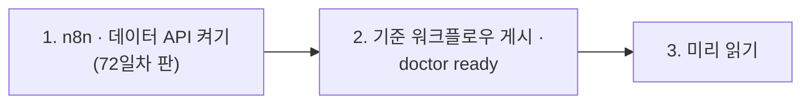

# 72일차 실습 준비 · 수업 전에 미리 해 두면 좋은 것

- 수업일: 2026-10-26 (72일차) · Workflow 실행 흐름 최적화와 운영 관점 개선
- 준비 시간: 약 10분
- 먼저 WSL에서 `cd ~/aio-01d4-stu && git pull`로 오늘 자료를 받습니다 (수강생 저장소: https://gl.isitsoft.kr/publicproj/aio-01d4-stu).
- **수업 전날까지** 1~2절을 끝내 주세요.



---

## 1. n8n과 데이터 API 켜기 (전날 필수, 3분)

오늘은 **72일차 판 데이터 API**(71일차 + 고장 스위치 + 캐시)를 씁니다. 같은 이름이라 이 폴더에서 다시 만들면 바뀝니다.

```bash
sudo systemctl disable --now ollama 2>/dev/null   # WSL에 설치한 Ollama가 있으면 끄고 자동 시작도 끔
cd ~/aio-01d4-stu/Last3Mon/65/n8n
docker compose rm -sf ollama                      # Ollama 컨테이너가 있으면 지움 (없으면 그냥 지나감)
docker compose start
cd ~/aio-01d4-stu/Last3Mon/72/data-api
docker compose up -d --force-recreate
curl -s localhost:8800/admin/fault                # {"faq": "ok", "tickets": "ok", "slow_seconds": 8}
```

- **66일차부터 LLM은 OpenAI API 키(`Last3Mon/.env`, Credential `OpenAI (.env)`)만 씁니다.** Ollama는 쓰지 않습니다.
- `network day65-n8n_default not found` → n8n이 켜져 있지 않음. 위 n8n 부분부터 다시.
- `.../day65-n8n/compose.yml: no such file or directory` → 홈이 아닌 곳에 설치함. `Last3Mon/65/n8n/.env`에 `N8N_HOME=<설치 폴더>` ([67일차 준비](../67/00-DAY67-PREP.md) 1절).

## 2. 기준 워크플로우 게시와 준비 확인 (전날 필수, 3분)

오늘 고칠 **느린 실습 워크플로우**(IT 헬프데스크)를 게시해 둡니다 (만들지 않고 게시만).

```bash
cd ~/aio-01d4-stu/Last3Mon/72
uv run tools/flow.py push reference/baseline-helpdesk.json
uv run tools/flow.py call base-helpdesk requests/faq-vpn.json -v     # route 자동 답변, 처음 한 번은 느림
uv run tools/flow.py doctor
```

```text
✔ n8n container day65-n8n-n8n-1
✔ n8n http://localhost:5678
✔ data API http://localhost:8800
✔ fault switch /admin/fault (day 72 data API)
✔ n8n → http://data-api:8800
✔ credential 'OpenAI (.env)' (openAiCourse0001)
✔ node catalog (for check)
✔ CLI coding agent: codex, claude
ready
```

| ✘ 항목 | 할 일 |
| --- | --- |
| n8n container · data API | 1절 |
| fault switch | 데이터 API가 예전 판 → 1절 `--force-recreate` |
| `! fault switch is on` | `uv run tools/flow.py fault all ok` |
| credential | `cd ~/aio-01d4-stu/Last3Mon/65/n8n && bash register-credentials.sh` |
| CLI coding agent | [67일차 준비](../67/00-DAY67-PREP.md) 2절 |

---

## 3. 미리 읽어 오면 좋은 내용 (선택, 약 5분)

### 3.1 "느리다"는 몇 초인가

실습 워크플로우에 질문을 보내고 3초를 기다리는 것과 9초를 기다리는 것은 다릅니다. 그런데 10번 중 9번은 2초, 1번은 9초라면 "느리다"고 말해야 할까요? 오늘은 이것을 **p50 · p95**로 잽니다.

### 3.2 용어

| 용어 | 한 줄 설명 |
| --- | --- |
| p50 · p95 | 응답 시간을 줄 세웠을 때 가운데(50%) · 느린 쪽 95% 위치의 값 |
| 병목 | 전체 시간을 정하는 가장 느린 단계 |
| 캐시 | 한 번 만든 답을 저장해 두고 같은 질문에 다시 쓰기 |
| timeout · 재시도 | 이 시간 안에 답이 없으면 실패로 보기 · 실패하면 한 번 더 |
| 대체 경로 (fallback) | 한 단계가 실패했을 때 멈추지 않고 가는 다른 길 |

## 4. 당일 준비물

- 충전된 노트북과 충전기, WSL의 Docker, Windows Terminal(WSL) 창 **두 개**, 웹 브라우저
- 66일차 `~/vibe/turl` (7교시 `tbench`에서 저장한 요청을 다시 씀, 없어도 됨)

## 확인

- [ ] `curl -s localhost:8800/admin/fault`가 `ok`
- [ ] `call base-helpdesk`가 답을 돌려줌
- [ ] `uv run tools/flow.py doctor` → 마지막 줄 `ready`
